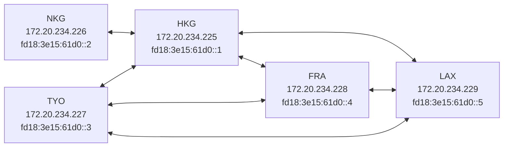
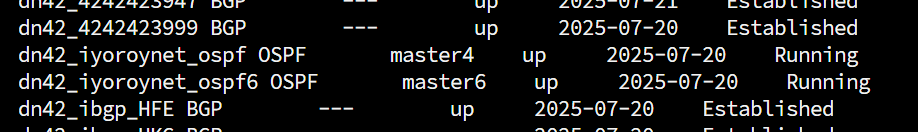
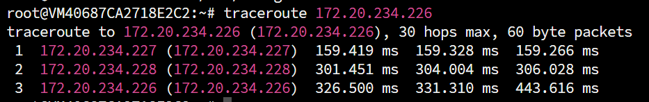

# 写在前面
本人是BGP小白，文章中可能会存在**不严谨内容/小白理解/低级错误**，请诸位大佬们手下留情。若发现存在问题，您愿意的话可以[邮件联系我](mailto:i@iyoroy.cn)，我会在第一时间更正。**如果您不能接受，建议现在就关闭此文章**。

# 本文更新日志


- 2025年7月22日：文章第一版发布，使用VXLAN over WireGuard隧道


- 2025年7月25日：更新隧道方案，使用`type ptp;`以支持直接通过WireGuard传输OSPF流量（特别感谢Nuro Trance大佬指导！）


- 2025年8月8日：添加iBGP部分的解释和配置


- 2025年8月27日：更新节点拓扑结构图


# 为什么需要内部路由
当节点数量增多，我们需要一个合适的方式处理自己AS的内部路由。因为BGP路由只负责将数据包路由到AS，这就导致了一个问题：假如我有A、B两个节点都与别人peer，但是在路由器看来这两台设备同属于一个AS，从A节点发出的请求回包可能被回到B上。这个时候，如果没有做内部路由，则A会无法收到回包。因此，我们需要保证自家内网各个设备之间都能连通。常见的几种方式如下：

1. 通过ZeroTier等组网工具：这种方式较为简单，只需要在每个节点上配置一个客户端即可实现各个节点之间的P2P连接。
2. 通过WireGuard等P2P工具手动建立$\frac{n(n-1)}{2}$条隧道，效果同1，但是节点一多工作量呈平方级上升
3. 通过WireGuard等P2P工具手动建立<$\frac{n(n-1)}{2}$条隧道，再通过OSPF、Babel等内网寻路协议建立内网路由，优点是较为灵活，易于后期添加新节点，缺点就是**较为危险**，容易[配置错误引爆DN42](https://lantian.pub/article/modify-website/how-to-kill-the-dn42-network.lantian/)。

~~因此我决定冒险一下~~

# 节点拓扑



# 更新Bird2至v2.16及以上
因为我希望使用IPv6 Link-Local地址传递IPv4的OSPF数据，而Bird在2.16及以后才支持这项功能，因此需要更新至v2.16。如果你不希望更新，可以先跳过此步骤。  
使用以下指令安装最新版本的Bird2：  
```shell
sudo apt update && sudo apt -y install apt-transport-https ca-certificates wget lsb-release
sudo wget -O /usr/share/keyrings/cznic-labs-pkg.gpg https://pkg.labs.nic.cz/gpg

echo "deb [signed-by=/usr/share/keyrings/cznic-labs-pkg.gpg] https://pkg.labs.nic.cz/bird2 $(lsb_release -sc) main" | sudo tee /etc/apt/sources.list.d/cznic-labs-bird2.list

sudo apt update && sudo apt install bird2 -y
```

# 配置隧道
```ini
[Interface]
PrivateKey = <本地WireGuard私钥>
ListenPort = <监听端口>
Table = off
Address = <IPv6 LLA>/64
PostUp = sysctl -w net.ipv6.conf.%i.autoconf=0

[Peer]
PublicKey = <对端公钥>
Endpoint = <对端公网接入点>
AllowedIPs = 10.0.0.0/8, 172.20.0.0/14, 172.31.0.0/16, fd00::/8, fe00::/8, ff02::5
```

* `ff02::5`是OSPFv3路由器专用的链路本地范围组播地址，需要添加进AllowedIPs。
* 如果你正在使用v2.16以前的Bird，请再为隧道配置一个IPv4地址，不一定非要是DN42 IPv4，其他私有地址也可以。请参考：


**包含IPv4的WireGuard配置示例**

```ini
[Interface]
PrivateKey = <本地WireGuard私钥>
ListenPort = <监听端口>
Table = off
Address = <IPv6 LLA>/64
PostUp = ip addr add 100.64.0.225/32 peer 100.64.0.226/32 dev %i
PostUp = sysctl -w net.ipv6.conf.%i.autoconf=0

[Peer]
PublicKey = <对端公钥>
Endpoint = <对端公网接入点>
AllowedIPs = 10.0.0.0/8, 172.20.0.0/14, 100.64.0.0/16, 172.31.0.0/16, fd00::/8, fe00::/8, ff02::5
```
请将`100.64.0.225`、`100.64.0.226`替换为你本机的IPv4和对端的IPv4，并且记得加入`AllowedIPs`。


# 启用OSPF
_默认你已经配置好了如上一篇文章所写的bird基础配置_  
在`/etc/bird`下新建一个名为`ospf.conf`的文件，填入如下内容：
```nginx
protocol ospf v3 <name> {
    ipv4 {
        import where is_self_net() && source != RTS_BGP;
        export where is_self_net() && source != RTS_BGP;
    };

    include "/etc/bird/ospf/*";
};

protocol ospf v3 <name> {
    ipv6 {
        import where is_self_net_v6() && source != RTS_BGP;
        export where is_self_net_v6() && source != RTS_BGP;
    };

    include "/etc/bird/ospf/*";
};
```

* 理论上来说应该使用OSPF v2处理IPv4，但是因为需要通过IPv6 LLA地址通信IPv4，因此此处IPv4也使用OSPF v3。
* 过滤规则保证**只有本网段内的路由**能够通过OSPF传递，并且**过滤掉外部BGP协议的路由**
* **千万不要随意使用`import all;export all;`，有可能会导致路由劫持并影响到整个DN42网络。OSPF只应该处理网段内部的路由。**


**配置示例**

`/etc/bird/ospf.conf`
```nginx
protocol ospf v3 dn42_iyoroynet_ospf {
    ipv4 {
        import where is_self_net() && source != RTS_BGP;
        export where is_self_net() && source != RTS_BGP;
    };

    include "/etc/bird/ospf/*";
};

protocol ospf v3 dn42_iyoroynet_ospf6 {
    ipv6 {
        import where is_self_net_v6() && source != RTS_BGP;
        export where is_self_net_v6() && source != RTS_BGP;
    };

    include "/etc/bird/ospf/*";
};
```


接着，新建`/etc/bird/ospf`文件夹，在其中创建area配置文件（如：`/etc/bird/ospf/0.conf`），填写区域信息：
```nginx
area 0.0.0.0 {
    interface "<DN42 dummy网卡>" { stub; };
    interface "<wg0网卡名称>" {
        cost 80; # 按照你的网络情况修改
        type ptp;
    };
    interface "<wg1网卡名称>" {
        cost 100; # 按照你的网络情况修改
        type ptp;
    };
    # 以此类推
};
```
* `0.0.0.0`区域代表骨干网
* 此处dummy网卡指[上一篇文章](https://www.iyoroy.cn/archives/84/)中所写的**DN42虚拟网卡**
* `cost`值本应该是用于[开销](https://edu.51cto.com/article/note/3019.html)计算，但在DN42这种对带宽要求不大而对延迟较为敏感的场景下可以直接填写延迟，OSPF会自动走开销值之和最短的路由。


**配置示例**

`/etc/bird/ospf/0.conf`
```nginx
area 0.0.0.0 {
    interface "dn42" { stub; };
    interface "dn42_hkg" {
        cost 80;
        type ptp;            
    };
    interface "dn42_hfe" {
        cost 150;
        type ptp;
    };
    interface "dn42_lax"{
        cost 100;
        type ptp;
    };
};
```


最后，打开`/etc/bird/bird.conf`，在末尾引入OSPF的配置文件：
```nginx
include "ospf.conf";
```
运行`birdc configure`，然后`birdc show protocols`应该就能看到OSPF的状态是**Running**了。如果不是，请检查配置步骤是否出错。



此时，在非直连的两台机器上互相ping应该就能通了：


# 配置iBGP
> 在从多个地点建立对等连接之前，您的各个节点必须首先完整掌握自身网络的拓扑结构。除了所有外部 BGP 连接外，这还需要配置另一个关键组件：内部 BGP（即 iBGP）。

## 必要性
iBGP可以保证AS内部所有运行BGP的路由器都能获知到达外部目的地的完整BGP路由信息，进而确保：
* 内部路由器可以选择最优的出口路径。
* 流量能够被正确地引导到负责连接特定外部网络的边界路由器。
* 即使存在多个边界路由器连接到同一个外部网络，内部路由器也能根据策略选择最佳出口。
* 相比于在AS内部使用默认路由指向边界路由器，iBGP提供了精确的外部路由信息，使得内部路由器能做出更智能的转发决策。

## 缺点与解决方案
为了防止路由信息在AS内部无控制地扩散导致环路，iBGP路由器不会将从某个iBGP邻居学到的路由再通告给其他iBGP邻居，这就要求传统的iBGP要求在同一个AS内所有运行iBGP的路由器之间必须建立**全网状的iBGP邻居关系（Full Mesh）**。（还是要建立$\frac{n(n+1)}{2}$条连接 ~~，没办法。不过OSPF起来之后iBGP配置还是比配置隧道简单的~~ ）
解决方案就是：
1. 使用**路由反射器（Route Reflector, RR）**: 由RR路由器管理整个AS内部所有的路由信息，缺点就是RR路由器故障将会导致整个网络瘫痪（这很不Decentralized）
2. 通过**BGP联盟（BGP Confederation）** 搭建内部网络: 将AS内的路由器虚拟成一个个子AS，再把各个路由器之间的连接当作BGP处理，最后向外传递的时候抹去内部AS的路由路径。

后面两种方案我没有尝试过，下面是一些可能有用的参考文章。本文着重讨论iBGP的配置。
* [DN42 实验网络介绍及注册教程（2022-12 更新） - Lan Tian @ Blog](https://lantian.pub/article/modify-website/dn42-experimental-network-2020.lantian/)
* [Bird 配置 BGP Confederation，及模拟 Confederation（2020-06-07 更新） - Lan Tian @ Blog](https://lantian.pub/article/modify-website/bird-confederation.lantian/)

## 编写iBGP配置文件
在`/etc/bird`下新建文件`ibgp.conf`，填入如下内容：
```nginx
template bgp ibgpeers {
    local as OWNAS;
    ipv4 {
        import where source = RTS_BGP && is_valid_network() && !is_self_net();
        export where source = RTS_BGP && is_valid_network() && !is_self_net();
        next hop self;
        extended next hop;
    };
    ipv6 {
        import where source = RTS_BGP && is_valid_network_v6() && !is_self_net_v6();
        export where source = RTS_BGP && is_valid_network_v6() && !is_self_net_v6();
        next hop self;
    };
};

include "ibgp/*";
```

* 导入和导出规则确保iBGP仅处理BGP协议学到的路由，并且过滤掉IGP的路由防止环回
* `next hop self`**是必须的**，指示 BIRD 在向 iBGP 邻居导出路由时，将下一跳重写为边界路由器自身的IP地址（而非原始的外部下一跳）。因为内部路由器无法直接访问外部邻居地址，若不重写则会被认定为地址不可达。重写后，内部路由器只需通过 IGP 路由将流量送至边界路由器，由边界路由器完成最终的外部转发。
* 因为我希望使用IPv6地址建立MP-BGP，通过IPv6路由IPv4，因此在IPv4中启用了`extended next hop`

接着创建`/etc/bird/ibgp`文件夹，在其中为每台节点都创建一个iBGP Peer配置文件:
```nginx
protocol bgp 'dn42_ibgp_<节点>' from ibgpeers{
    neighbor <对应节点的IPv6 ULA地址> as OWNAS;
};
```


**样例**

`/etc/bird/ibgp/hkg.conf`:
```nginx
protocol bgp 'dn42_ibgp_HKG' from ibgpeers{
    neighbor fd18:3e15:61d0::1 as OWNAS;
};
```


* 注意：每个节点上都需要建立(n-1)个iBGP连接，保证和AS内其他所有机器都建立连接，这也是为什么需要使用ULA地址
* 使用ULA地址确保即使两个节点之间的WireGuard断开，iBGP仍然能通过OSPF建立的内部路由建立，否则将会导致整个内部网络的崩溃

最后，在`/etc/bird/bird.conf`中加入对`ibgp.conf`的引入:
```nginx
include "ibgp.conf";
```
并运行`birdc configure`应用配置即可。

----
参考文章：
1. [BIRD 与 BGP 的新手开场 - 海上的宫殿](https://soha.moe/post/bird-bgp-kickstart.html)
2. [萌新入坑 DN42 之 —— 基于 tailscale + vxlan + OSPF 的组网 – 米露小窝](https://milu.ink/519.html)
3. [使用 Bird2 配置 WireGuard + OSPF 实现网络的高可用 | bs' realm](https://baimeow.cn/posts/dn11/configureospf/)
4. [DN42 实验网络介绍及注册教程（2022-12 更新） - Lan Tian @ Blog](https://lantian.pub/article/modify-website/dn42-experimental-network-2020.lantian/)
5. [如何引爆 DN42 网络（2023-05-12 更新） - Lan Tian @ Blog](https://lantian.pub/article/modify-website/how-to-kill-the-dn42-network.lantian/)
6. [Bird 配置 BGP Confederation，及模拟 Confederation（2020-06-07 更新） - Lan Tian @ Blog](https://lantian.pub/article/modify-website/bird-confederation.lantian/)
7. [深入解析OSPF路径开销、优先级和计时器 - 51CTO](https://edu.51cto.com/article/note/3019.html)
8. [New release 2.16 | BIRD Internet Routing Daemon](https://bird.nic.cz/news/2024-12-07-new-release-2.16/)
9. [第一章·第二节 如何在 Linux 上安装最新版本的 BIRD？ | BIRD 中文文档](https://bird.xmsl.dev/docs/user-guide/1-2-installing.html)
10. [\[DN42\] 使用 OSPF ptp 搭建内网与IBGP配置 – Xe_iu's Blog | Xe_iu的杂物间](https://blog.xeiu.top/archives/393)
11. [\[译\] dn42 多服务器环境中的 iBGP 与 IGP 配置 | liuzhen932 的小窝](https://blog.liuzhen932.top/posts/dn42-multiple-servers-ibgp-igps/)