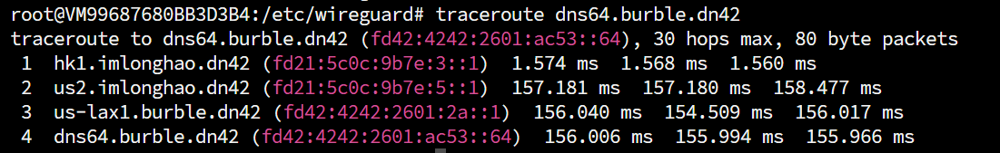

# 写在前面
本人是BGP小白，文章中可能会存在**不严谨内容/小白理解/低级错误**，请诸位大佬们手下留情。若发现存在问题，您愿意的话可以[邮件联系我](mailto:i@iyoroy.cn)，我会在第一时间更正。**如果您不能接受，建议现在就关闭此文章**。

> 假设你已经加入了DN42，并且能够正常收发路由表并且访问到DN42内的IP

# 本文更新日志


- 2025年8月3日：文章第一版发布


- 2026年3月15日：更新修复一些typo（感谢@Auride大佬的指正）


# 起因
在调试网络的时候发现Ping或traceroute别人的DN42 IP都能显示出来反向解析的域名，能知道路由经过了哪些节点而不是单纯的看IP（如下图），非常一目了然，~~让别人一眼就看出来你绕路了（逃），~~ 因此打算自己也注册一个DN42域名并搭建权威DNS服务。



查阅了蓝天大佬的[这篇文章](https://lantian.pub/article/modify-website/register-own-domain-in-dn42.lantian/)，他使用了PowerDNS+MySQL主从同步方案，但是我的服务器性能较差（只有1核心1GB内存），因此打算使用[KnotDNS](https://www.knot-dns.cz/)作为DNS服务器，用标准区域传输协议（AXFR/IXFR）实现主从同步。

# 准备工作

:::warning
本章及后续章节中提到的域名和IP均为我自己的域名和IP，实际部署时请换成你自己的；**文章中尖括号括起来的值需要按你的需求修改**
:::

挑选一个自己心仪的域名：`yori.dn42`，并且计划在三台机器上部署DNS服务器：
* 172.20.234.225, fd18:3e15:61d0::1, ns1.yori.dn42
* 172.20.234.227, fd18:3e15:61d0::3, ns2.yori.dn42
* 172.20.234.229, fd18:3e15:61d0::5, ns3.yori.dn42

其中，`ns1.yori.dn42`作为主服务器，ns2、ns3作为从服务器。

# 安装KnotDNS
如果系统的53端口被`systemd-resolvd`之类的进程占用了，就先将其禁用：

```shell
systemctl stop systemd-resolved
systemctl disable systemd-resolved
unlink /etc/resolv.conf
echo "nameserver 8.8.8.8" > /etc/resolv.conf
```

我使用的是Debian12系统，因此使用APT安装：
```shell
apt install knot knot-dnsutils -y
```

设置KnotDNS自启动：
```shell
systemctl enable knot
```

# 配置KnotDNS
## 创建key
首先创建一个key用于同步：
```shell
keymgr -t key_knsupdate
```
将输出部分复制下来：
```yaml
# hmac-sha256:key_knsupdate:<your secret>
key:
  - id: key_knsupdate
    algorithm: hmac-sha256
    secret: <your secret>
```

## 编辑配置文件
### 主服务器
编辑`/etc/knot/knot.conf`，填入如下内容：
```yaml
server:
    rundir: "/run/knot"
    user: knot:knot
    automatic-acl: on
    listen: [ <监听地址1>@53, <监听地址2>@53, ... ]

log:
  - target: syslog
    any: info

database:
    storage: "/var/lib/knot"

### 此处粘贴上一步生成的Key
# hmac-sha256:key_knsupdate:<your secret>
key:
  - id: key_knsupdate
    algorithm: hmac-sha256
    secret: <your secret>

remote:
  - id: <1号DNS服务器ID>
    address: <1号DNS服务器IP>@53

  - id: <2号DNS服务器ID>
    address: <2号DNS服务器IP>@53

  - id: <3号DNS服务器ID>
    address: <3号DNS服务器IP>@53

acl:
  - id: acl_slave
    key: key_knsupdate
    action: transfer
 
  - id: acl_master
    key: key_knsupdate
    action: notify
 
  - id: acl_knsupdate
    key: key_knsupdate
    action: update

template:
  - id: default
    storage: "/var/lib/knot"
    file: "%s.zone"

zone:
  - domain: <DN42 域名>
    notify: [ <从服务器1ID>, <从服务器2ID> ]
    acl: [ acl_slave, acl_knsupdate ]
  - domain: <IPv4反向解析域名>
    notify: [ <从服务器1ID>, <从服务器2ID> ]
    acl: [ acl_slave, acl_knsupdate ]
  - domain: <IPv6反向解析域名>
    notify: [ <从服务器1ID>, <从服务器2ID> ]
    acl: [ acl_slave, acl_knsupdate ]
```
* 其中，监听地址需要填写本机的DN42 IPv4和DN42 IPv6，如果需要本地调试可再加上`127.0.0.1`和`localhost`等内网IP
* 从服务器ID即`remote`里设置的服务器的ID，你选定哪台（哪些）机器作为从服务器就填写哪台（哪些）服务器的ID
* `remote`中的`address`可以填写内网地址或者DN42 IPv4或者DN42 IPv6，仅用于同步主从服务器。如果使用内网地址请将地址加到监听列表中
* `template`中设置了将Zone文件存储在`/var/lib/knot`下
* IPv4反向解析域名按照你申请的IPv4段填写，遵循[RFC 2317](https://datatracker.ietf.org/doc/html/rfc2317)规定的格式，如我的IPv4段是`172.20.234.224/28`，我的IPv4反向解析域名应该为`224/28.234.20.172.in-addr.arpa`，即将IPv4的最后一段`225/28`看作一个整体，剩下的按照点来分隔，再将各个部分倒序拼接，最后加上`.in-addr.arpa`
* IPv6反向解析域名按照你申请的IPv6段填写，遵循[RFC 3152](https://datatracker.ietf.org/doc/html/rfc3152)规定的格式，如我的IPv6段是`fd18:3e15:61d0::/48`，我的IPv6反向解析域名应该为`0.d.1.6.5.1.e.3.8.1.d.f.ip6.arpa`，即将地址块中的各个字符倒序拼接，最后加上`.ip6.arpa`。如果有0需要补全。


**示例**

```yaml
server:
    rundir: "/run/knot"
    user: knot:knot
    automatic-acl: on
    listen: [ 172.20.234.225@53, fd18:3e15:61d0::1@53, localhost@53, 127.0.0.1@53 ]

log:
  - target: syslog
    any: info

database:
    storage: "/var/lib/knot"

# hmac-sha256:key_knsupdate:<key>
key:
  - id: key_knsupdate
    algorithm: hmac-sha256
    secret: <key>

remote:
  - id: 225 # 主服务器
    address: 172.20.234.225@53

  - id: 227 # 从服务器
    address: 172.20.234.227@53

  - id: 229 # 从服务器
    address: 172.20.234.229@53

acl:
  - id: acl_slave
    key: key_knsupdate
    action: transfer
 
  - id: acl_master
    key: key_knsupdate
    action: notify
 
  - id: acl_knsupdate
    key: key_knsupdate
    action: update

template:
  - id: default
    storage: "/var/lib/knot"
    file: "%s.zone"

zone:
  - domain: yori.dn42
    notify: [ 227, 229 ]
    acl: [ acl_slave, acl_knsupdate ]
  - domain: 224/28.234.20.172.in-addr.arpa
    notify: [ 227, 229 ]
    acl: [ acl_slave, acl_knsupdate ]
  - domain: 0.d.1.6.5.1.e.3.8.1.d.f.ip6.arpa
    notify: [ 227, 229 ]
    acl: [ acl_slave, acl_knsupdate ]
#    # Secondary zone
#  - domain: example.net
#    master: primary
```


### 从服务器
从服务器的大致内容和主服务器相同，只需要将监听地址改成从服务器的地址，并且将zone部分配置修改一下：
```diff
--- a/knot.conf
+++ b/knot.conf
 zone:
   - domain: <DN42 域名>
-    notify: [ <从服务器1ID>, <从服务器2ID> ]
-    acl: [ acl_slave, acl_knsupdate ]
+    master: <主服务器ID>
+    zonefile-load: whole
+    acl: acl_master
   - domain: <IPv4反向解析域名>
-    notify: [ <从服务器1ID>, <从服务器2ID> ]
-    acl: [ acl_slave, acl_knsupdate ]
+    master: <主服务器ID>
+    zonefile-load: whole
+    acl: acl_master
   - domain: <IPv6反向解析域名>
-    notify: [ <从服务器1ID>, <从服务器2ID> ]
-    acl: [ acl_slave, acl_knsupdate ]
+    master: <主服务器ID>
+    zonefile-load: whole
+    acl: acl_master
```

* 主服务器ID即`remote`里设置的服务器的ID，你选定哪台机器作为主服务器就填写哪台服务器的ID


**样例**

```yaml
server:
    rundir: "/run/knot"
    user: knot:knot
    automatic-acl: on
    listen: [ 172.20.234.227@53, fd18:3e15:61d0::3@53, localhost@53, 127.0.0.1@53 ]

log:
  - target: syslog
    any: info

database:
    storage: "/var/lib/knot"

# hmac-sha256:key_knsupdate:<key>
key:
  - id: key_knsupdate
    algorithm: hmac-sha256
    secret: <key>

remote:
  - id: 225
    address: 172.20.234.225@53

  - id: 227
    address: 172.20.234.227@53

  - id: 229
    address: 172.20.234.229@53

acl:
  - id: acl_slave
    key: key_knsupdate
    action: transfer
 
  - id: acl_master
    key: key_knsupdate
    action: notify
 
  - id: acl_knsupdate
    key: key_knsupdate
    action: update

template:
  - id: default
    storage: "/var/lib/knot"
    file: "%s.zone"

zone:
  - domain: yori.dn42
    master: 225
    zonefile-load: whole
    acl: acl_master
  - domain: 224/28.234.20.172.in-addr.arpa
    master: 225
    zonefile-load: whole
    acl: acl_master
  - domain: 0.d.1.6.5.1.e.3.8.1.d.f.ip6.arpa
    master: 225
    zonefile-load: whole
    acl: acl_master
```


编写完配置文件后运行如下指令重启KnotDNS：
```shell
systemctl restart knot
```

## 编辑Zone区域文件
此章节中的记录值（非主机名）若需要填写域名，除了特殊说明外，都请遵循[RFC 1034](https://datatracker.ietf.org/doc/html/rfc1034)规范填写FQDN格式。此章节中的所有配置均在主DNS服务器上完成

#### DN42域名
进入`/var/lib/knot`，创建文件`<dn42域名>.zone`

##### SOA记录
域名的第一条记录必须为SOA记录，SOA记录是**起始授权记录**，记录了域名的一些基本信息如主要NS服务器地址。填入如下内容：
```text
@ <TTL> SOA <主要NS服务器地址> <联系人邮件> <记录编号> <AXFR刷新时间> <AXFR重试时间> <AXFR过期时间> <最小TTL>
```
* `@`表示是当前域名本身，不用修改
* **TTL**: 当前SOA记录的TTL值
* **主要NS服务器地址**: 当前域名的主要权威NS服务器地址，可以是域名内的解析值，如我的主要NS服务器是`172.20.234.225`，我打算使用`ns1.yori.dn42.`指向此地址，那么此处可填写`ns1.yori.dn42.`
* **联系人邮件**: 邮箱地址，并且用`.`代替`@`，如我的邮箱是`i@iyoroy.cn`，那么此处可填写`i.iyoroy.cn`
* **记录编号**: 一个10位数字，遵循[RFC 1912](https://datatracker.ietf.org/doc/html/rfc1912#section-2.2)，表示Zone文件的版本号。其他DNS服务器在获取SOA后发现序列号增加了就会重新拉取新的记录。一般使用日期+编号的方式编码，因此**此项值应该在每次修改后递增**。
* **AXFR刷新时间**: AXFR从服务器两次拉取的间隔
* **AXFR重试时间**: AXFR从服务器拉取失败后重试时间
* **AXFR过期时间**: AXFR从服务器拉取失败后，最多用先前最后一次拉取成功的记录继续提供服务这么长时间，之后停止应答
* **最小TTL**: 当前整个域名的最小TTL值，所有记录的最小刷新时间，至少过了这么长时间才会刷新


**样例**

```text
; SOA
@ 3600 SOA ns1.yori.dn42. i.iyoroy.cn. 2025072705 60 60 1800 60
```


##### NS记录
```text
@ <TTL> NS <NS服务器1>
@ <TTL> NS <NS服务器2>
@ <TTL> NS <NS服务器3>
```
根据你的实际情况填写，有几台服务器就填写几条记录。


**样例**

```text
; NS
@ 3600 NS ns1.yori.dn42.
@ 3600 NS ns2.yori.dn42.
@ 3600 NS ns3.yori.dn42.
```


##### A、AAAA、CNAME等记录
按照如下格式填写即可：
```text
<主机名> <TTL> <类型> <记录值>
```
如果你的NS服务器值指向了你自己的DN42域名的主机，请务必为其添加A类型或者AAAA类型的解析记录


**样例**

```text
; A
ns1 600 A 172.20.234.225
ns2 600 A 172.20.234.227
ns3 600 A 172.20.234.229
hkg-cn.node 600 A 172.20.234.225
nkg-cn.node 600 A 172.20.234.226
tyo-jp.node 600 A 172.20.234.227
hfe-cn.node 600 A 172.20.234.228
lax-us.node 600 A 172.20.234.229

; AAAA
ns1 600 AAAA fd18:3e15:61d0::1
ns2 600 AAAA fd18:3e15:61d0::3
ns3 600 AAAA fd18:3e15:61d0::5
hkg-cn.node 600 AAAA fd18:3e15:61d0::1
nkg-cn.node 600 AAAA fd18:3e15:61d0::2
tyo-jp.node 600 AAAA fd18:3e15:61d0::3
hfe-cn.node 600 AAAA fd18:3e15:61d0::4
lax-us.node 600 AAAA fd18:3e15:61d0::5
```


**完整样例**

`/var/lib/knot/yori.dn42.zone`
```text
; SOA
@ 3600 SOA ns1.yori.dn42. i.iyoroy.cn. 2025072705 60 60 1800 60

; NS
@ 3600 NS ns1.yori.dn42.
@ 3600 NS ns2.yori.dn42.
@ 3600 NS ns3.yori.dn42.

; A
ns1 600 A 172.20.234.225
ns2 600 A 172.20.234.227
ns3 600 A 172.20.234.229
hkg-cn.node 600 A 172.20.234.225
nkg-cn.node 600 A 172.20.234.226
tyo-jp.node 600 A 172.20.234.227
hfe-cn.node 600 A 172.20.234.228
lax-us.node 600 A 172.20.234.229

; AAAA
ns1 600 AAAA fd18:3e15:61d0::1
ns2 600 AAAA fd18:3e15:61d0::3
ns3 600 AAAA fd18:3e15:61d0::5
hkg-cn.node 600 AAAA fd18:3e15:61d0::1
nkg-cn.node 600 AAAA fd18:3e15:61d0::2
tyo-jp.node 600 AAAA fd18:3e15:61d0::3
hfe-cn.node 600 AAAA fd18:3e15:61d0::4
lax-us.node 600 AAAA fd18:3e15:61d0::5
```


#### IPv4反向解析域名
在`/var/lib/knot`下创建文件`<IPv4反向解析域名>.in-addr.arpa`，并用`_`代替`/`。如我的IPv4段是`172.20.234.224/28`，我的IPv4反向解析域名是`224/28.234.20.172.in-addr.arpa`，那么此处文件名为`224_28.234.20.172.in-addr.arpa.zone`。填入解析记录：
```text
; SOA
@ <TTL> SOA <主要NS服务器地址> <联系人邮件> <记录编号> <AXFR刷新时间> <AXFR重试时间> <AXFR过期时间> <最小TTL>

; NS
@ <TTL> NS <NS服务器1>
@ <TTL> NS <NS服务器2>
@ <TTL> NS <NS服务器3>
 
; PTR
<IPv4地址最后一位> <TTL> PTR <反向解析DNS值>
<IPv4地址最后一位> <TTL> PTR <反向解析DNS值>
<IPv4地址最后一位> <TTL> PTR <反向解析DNS值>
...
```
* SOA和NS记录和上方相同
* **IPv4地址最后一位**: 你给设备绑定的DN42 IPv4地址四段中的最后一段，如我的HK节点分配的`172.20.234.225`地址，那么此处就填写`225


**样例**

`224_28.234.20.172.in-addr.arpa.zone`
```text
; SOA
@ 3600 SOA ns1.yori.dn42. i.iyoroy.cn. 2025072802 60 60 1800 60

; NS
@ 3600 NS ns1.yori.dn42.
@ 3600 NS ns2.yori.dn42.
@ 3600 NS ns3.yori.dn42.
 
; PTR
225 600 PTR hkg-cn.node.yori.dn42.
226 600 PTR nkg-cn.node.yori.dn42.
227 600 PTR tyo-jp.node.yori.dn42.
228 600 PTR hfe-cn.node.yori.dn42.
229 600 PTR lax-us.node.yori.dn42.
```


你可能会疑惑为何需要带上CIDR掩码，这与Clearnet中常见的、按八位组倒序的格式（如`234.20.172.in-addr.arpa`）不同；以及如果你尝试本地测试，你会发现直接测试你自己的IP地址的反解会失败。  

原因在于DN42的分布式注册机制：单个区域文件无法覆盖你的地址段的所有反向查询入口点（即每个具体IP地址对应的`.in-addr.arpa`名称）。为了解决这个问题，DN42官方DNS会在你的PR被合并后，在其权威DNS服务器上为你的地址段添加CNAME重定向，将单个IP的PTR记录指向你的带CIDR的格式，如下：
```shell
~$ dig PTR 225.234.20.172.in-addr.arpa  +short
225.224/28.234.20.172.in-addr.arpa.  # <-- Registry 添加的 CNAME (重定向)
hkg-cn.node.yori.dn42.               # <-- DNS 返回的最终 PTR 记录
```

当外部解析器查询某个具体IP (如`172.20.234.225`) 的反向记录时（查询`225.234.20.172.in-addr.arpa`），官方DNS会返回一个`CNAME`记录，将其指向CIDR的区域名称下的具体记录（`225.224/28.234.20.172.in-addr.arpa`）。最终，PTR 记录由你配置的权威 DNS 服务器提供。

#### IPv6反向解析域名
在`/var/lib/knot`下创建文件`<IPv6反向解析域名>.ip6.arpa`。如我的IPv6段是`fd18:3e15:61d0::/48`，我的IPv6反向解析域名是`0.d.1.6.5.1.e.3.8.1.d.f.ip6.arpa`，那么此处文件名为`0.d.1.6.5.1.e.3.8.1.d.f.ip6.arpa.zone`。填入解析记录：
```text
; SOA
@ <TTL> SOA <主要NS服务器地址> <联系人邮件> <记录编号> <AXFR刷新时间> <AXFR重试时间> <AXFR过期时间> <最小TTL>

; NS
@ <TTL> NS <NS服务器1>
@ <TTL> NS <NS服务器2>
@ <TTL> NS <NS服务器3>

; PTR
<最后20字符反向序列> <TTL> PTR <反向解析DNS值>
<最后20字符反向序列> <TTL> PTR <反向解析DNS值>
<最后20字符反向序列> <TTL> PTR <反向解析DNS值>
...
```
* SOA和NS记录处理方式同上
* PTR的主机名，需要你**将主机IPv6地址移除/48前缀后的80位部分展开为20个十六进制字符**，并**倒序排列这些字符并用点分隔**。如我的香港节点IPv6是`fd18:3e15:61d0::1`，展开就是`fd18:3e15:61d0:0000:0000:0000:0000:0001`，此处主机名就填写`1.0.0.0.0.0.0.0.0.0.0.0.0.0.0.0.0.0.0.0`


**样例**

`0.d.1.6.5.1.e.3.8.1.d.f.ip6.arpa.zone`
```text
; SOA
@ 3600 SOA ns1.yori.dn42. i.iyoroy.cn. 2025072802 60 60 1800 60

; NS
@ 3600 NS ns1.yori.dn42.
@ 3600 NS ns2.yori.dn42.
@ 3600 NS ns3.yori.dn42.

; PTR
1.0.0.0.0.0.0.0.0.0.0.0.0.0.0.0.0.0.0.0 600 PTR hkg-cn.node.yori.dn42.
2.0.0.0.0.0.0.0.0.0.0.0.0.0.0.0.0.0.0.0 600 PTR nkg-cn.node.yori.dn42.
3.0.0.0.0.0.0.0.0.0.0.0.0.0.0.0.0.0.0.0 600 PTR tyo-jp.node.yori.dn42.
4.0.0.0.0.0.0.0.0.0.0.0.0.0.0.0.0.0.0.0 600 PTR hfe-cn.node.yori.dn42.
5.0.0.0.0.0.0.0.0.0.0.0.0.0.0.0.0.0.0.0 600 PTR lax-us.node.yori.dn42.
```


## 验证设置
全部保存后在每台DNS服务器上都运行一次`knot reload`重载，不出意外的话应该能看到从服务器同步了主服务器的zone文件，此时通过`dig`或者`nslookup`指定服务器查询应该能查到解析记录了

# 注册
## 域名
克隆下DN42 Registry，进入`data/dns`，新建文件`<你打算注册的域名>`，填入如下内容：
```plain
domain:             <你打算注册的域名>
admin-c:            <管理员NIC句柄>
tech-c:             <技术人员NIC句柄>
mnt-by:             <维护者>
nserver:            <NS1服务器域名> <NS1服务器IP>
nserver:            <NS2服务器域名> <NS2服务器IP>
nserver:            <NS3服务器域名> <NS3服务器IP>
...
source:             DN42
```

`admin-c`、`tech-c`、`mnt-by`请参考[DN42探究日记 - Ep.1 加入DN42网络](https://www.iyoroy.cn/archives/84/)


**样例**

`data/dns/yori.dn42`
```plain
domain:             yori.dn42
admin-c:            IYOROY-DN42
tech-c:             IYOROY-DN42
mnt-by:             IYOROY-MNT
nserver:            ns1.yori.dn42 172.20.234.225
nserver:            ns1.yori.dn42 fd18:3e15:61d0::1
nserver:            ns2.yori.dn42 172.20.234.227
nserver:            ns2.yori.dn42 fd18:3e15:61d0::3
nserver:            ns3.yori.dn42 172.20.234.229
nserver:            ns3.yori.dn42 fd18:3e15:61d0::5
source:             DN42
```


## IPv4反向解析域名
进入`data/inetnum`，找到你注册的地址块，加nserver字段，填写为你自己的DNS服务器：
```plain
nserver:            <你的DNS服务器地址>
nserver:            <你的DNS服务器地址>
...
```


**样例**

```diff
diff --git a/data/inetnum/172.20.234.224_28 b/data/inetnum/172.20.234.224_28
index 50c800945..5ad60e23d 100644
--- a/data/inetnum/172.20.234.224_28
+++ b/data/inetnum/172.20.234.224_28
@@ -8,3 +8,6 @@ tech-c:             IYOROY-DN42
 mnt-by:             IYOROY-MNT
 status:             ASSIGNED
 source:             DN42
+nserver:            ns1.yori.dn42
+nserver:            ns2.yori.dn42
+nserver:            ns3.yori.dn42
```


## IPv6反向解析域名
进入`data/inet6num`，找到你注册的地址块，加nserver字段，填写为你自己的DNS服务器：
```plain
nserver:            <你的DNS服务器地址>
nserver:            <你的DNS服务器地址>
...
```


**样例**

```diff
diff --git a/data/inet6num/fd18:3e15:61d0::_48 b/data/inet6num/fd18:3e15:61d0::_48
index 53f0de06d..1ae067b00 100644
--- a/data/inet6num/fd18:3e15:61d0::_48
+++ b/data/inet6num/fd18:3e15:61d0::_48
@@ -8,3 +8,6 @@ tech-c:             IYOROY-DN42
 mnt-by:             IYOROY-MNT
 status:             ASSIGNED
 source:             DN42
+nserver:            ns1.yori.dn42
+nserver:            ns2.yori.dn42
+nserver:            ns3.yori.dn42
```


## 提交PR，等待合并
填写完后推送并提交Pull Request。因为DN42中人人都可以建立递归DNS，DNS配置完全生效可能要一周左右。虽然我实测合并后半天以内公共DNS（172.20.0.53）就已经能查询到我的记录了

-----
特别感谢たのしい大佬，让我明白了DN42中IPv4反向解析与公网的不同之处
参考文章：
1. https://www.haiyun.me/archives/1398.html
2. https://www.jianshu.com/p/7d69ec2976c7
3. https://www.potat0.cc/posts/20220726/Register_DN42_Domain/
4. https://bbs.csdn.net/topics/393775423
5. https://blog.snorlax.blue/knot-reverse-dns-kickstart/
6. http://www.kkdlabs.jp/dns/automatic-dnssec-signing-by-knot-dns/
7. https://lantian.pub/article/modify-website/register-own-domain-in-dn42.lantian/
8. https://datatracker.ietf.org/doc/html/rfc2317
9. https://datatracker.ietf.org/doc/html/rfc3152
10. https://datatracker.ietf.org/doc/html/rfc1912#section-2.2