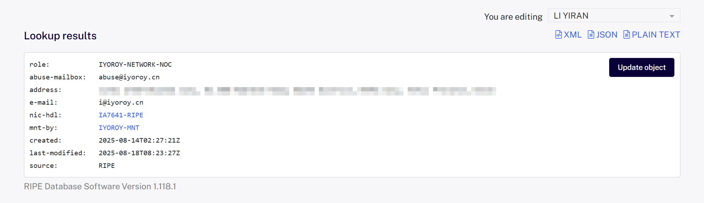
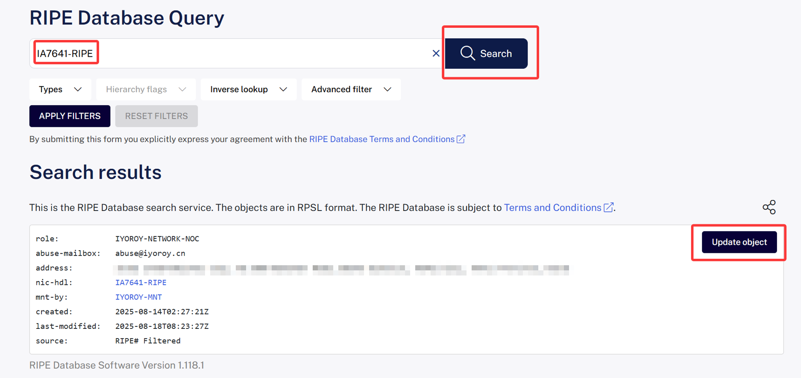
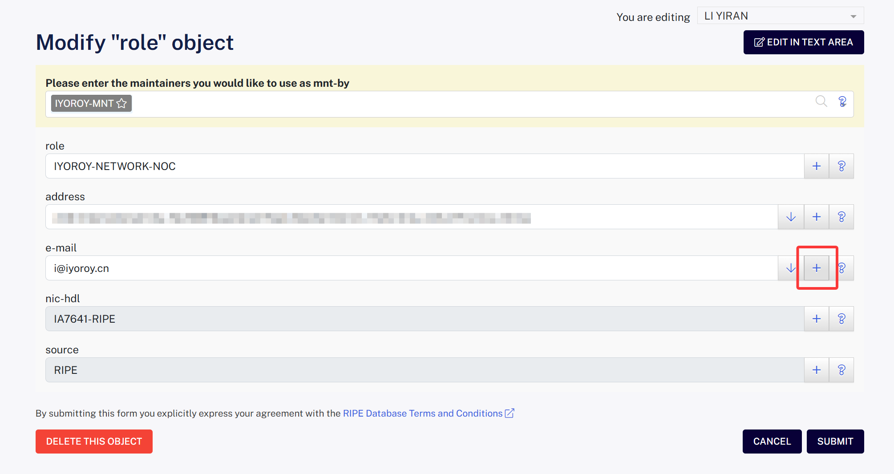
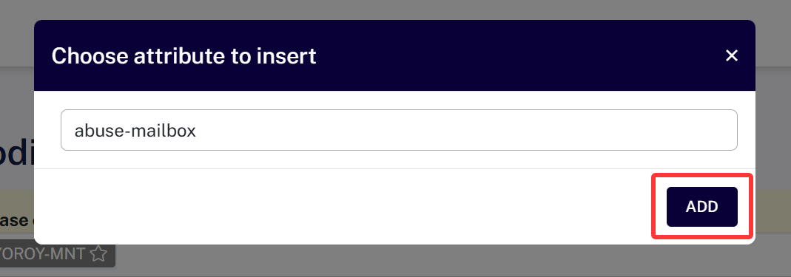
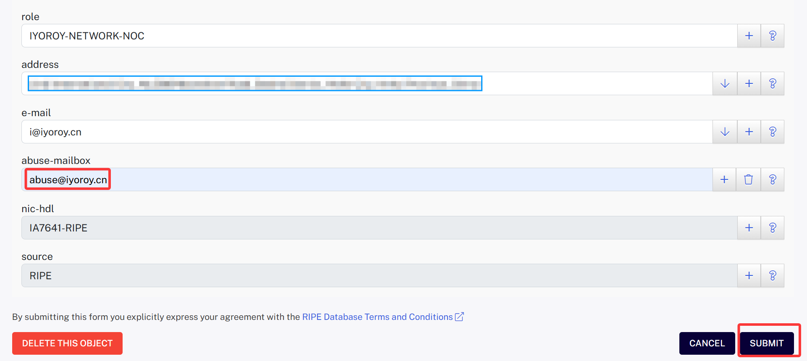
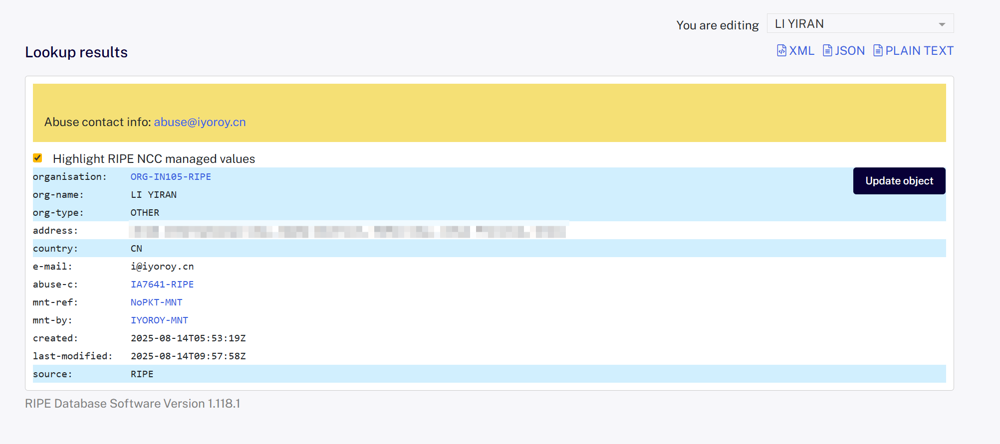
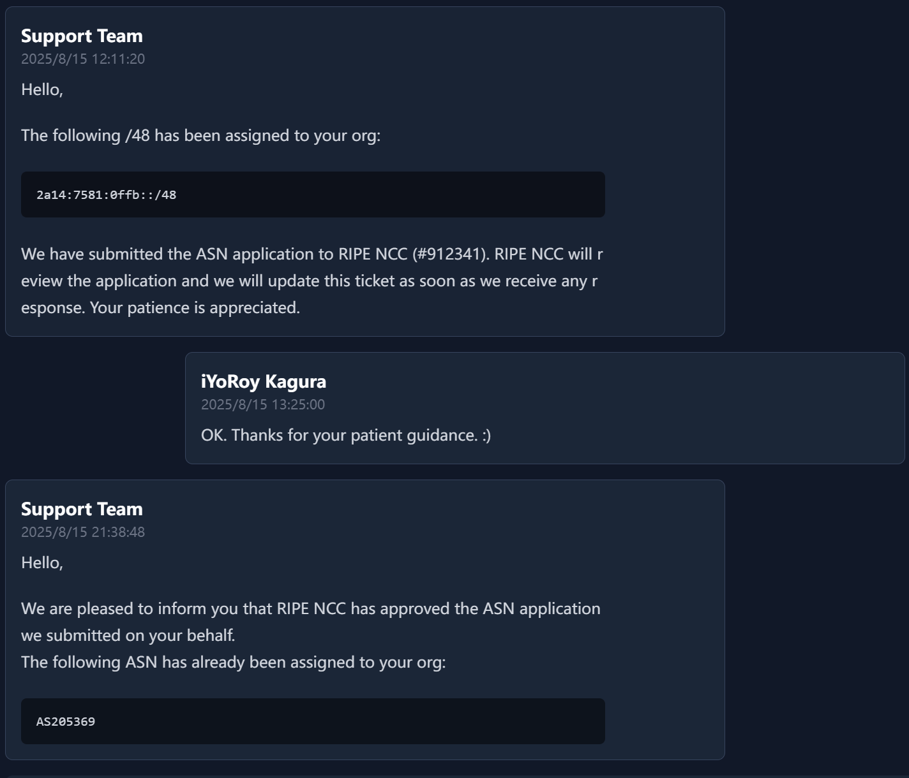
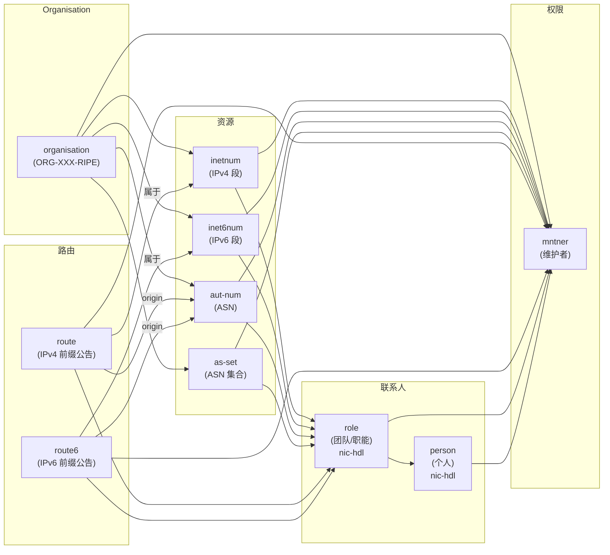

# 写在前面
本文记录了我在RIPE NCC申请ASN的完整过程，内容适合入门者参考，若有错误欢迎[邮件联系我](mailto:i@iyoroy.cn)，我会在第一时间更正。

~~既然已经在DN42上学习了基本的BGP概念，不玩玩公网的有点说不过去吧（~~

# 基本概念

目前公网ASN和IP资源分配由世界上5个 **区域互联网注册管理机构（Regional Internet registry, RIR）** 管理：
* ARIN: 负责管理北美地区
* RIPE NCC: 负责管理欧洲地区
* APNIC: 亚洲地区
* LACNIC: 拉丁美洲地区
* AfriNIC: 非洲地区

RIR不直接对个人用户提供服务，而是通过将资源授权给 **本地互联网注册管理机构（Local Internet Registry, LIR）** ，再由LIR授权给个人。当然，个人用户也可以注册成为LIR，但是这一般而言一般是不划算的。 ~~如果你愿意每年交几千美元作为会费的话当我没说。~~ 

其中，对个人申请比较友好的是RIPE NCC，其次是ARIN和APNIC。相较于RIPE NCC，APNIC的费用普遍要高30%左右；并且RIPE NCC提供了一套在线管理系统，用户可以自己修改信息、查询进度，而在APNIC则需要联系LIR处理。综合而言，我选择在RIPE NCC申请ASN。

申请到的资源（ASN、IP都算）一般分为两种：
* **PA（Provider Aggregatable）资源**: 属于LIR，由LIR注册授权给你用的资源
* **PI（Provider Independent）资源**: 属于你自己的资源，一般而言价格较高

# 准备阶段
## 选择一个LIR
上网查询`LIR Service`，可以找到很多提供这类服务的商家。目前RIPE NCC会向PI资源收取一年50EUR的管理费用，也就是说一般而言LIR注册ASN的费用不会低于50EUR（截至文章发布，大概60USD）一年。此处我选择的群友推荐的[NoPKT LLC](https://net.nopkt.com/)，价格算是比较合理的并且随ASN附赠一段/48 PA IPv6地址，实测下号速度也很快，从提交完材料到下号只用了半天。

## 准备材料
#### 身份证明
* 个人：提供身份证或者护照都可以（我提供的身份证正反面照片）
* 企业：提供有效的营业执照

若申请人为未成年人，通常需要其法定监护人提供书面同意书并履行相应监护职责。所有提交的文件应确保真实有效，且必须是原件或经过公证的副本。

#### 联系信息
1. 通信地址，被用于登记在RIPE Database
2. 技术人员邮箱
3. 滥用举报邮箱

#### 技术要求证明
1. 欧洲范围内的BGP服务商开具的账单，可以选择Vultr、BuyVM、iFog、V.PS等。
  注：Vultr是先用后付制，每月初出账单。如果你着急备好材料，建议选择其他家。
2. 两个你打算接入的上游的ASN（实际上审核方不会严格验证你填写的上游ASN，因此可以随意填写，但建议填写一些常见的公开ASN以显得合理，不用过多纠结。 ~~甚至填我的也行~~ ）

# 注册RIPE DB账户并创建条目
打开[RIPE Database](https://access.ripe.net/registration)并注册一个账户。此处填写姓名时建议填写你自己的真实姓名的拼音，并且强制要求开启2FA，请提前在手机上安装TOTP软件。

#### 创建Role对象和Maintainer对象
打开[Create role and maintainer pair - RIPE Database](https://apps.db.ripe.net/db-web-ui/webupdates/create/RIPE/role/self)，创建一个role对象。
此处role为一个抽象概念，用来描述一个团队、部门或者职能角色的联系方式，代指**一个角色**，比如 NOC (Network Operations Center)、Abuse Team、Hostmaster 等。  
* **mntner**: maintainer对象的标识符，可包含大小写字母、数字、`-_`。例如我填写的是`IYOROY-MNT`
* **role**: role对象的名称，可包含大小写字母、数字、`][)(._"*@,&:!'+/-`。例如我填写的是`IYOROY-NETWORK-NOC`
* **address**: 此role对象的办公地址
* **e-mail**: 此role的电子邮件地址

填写完成后SUBMIT即可创建role对象和maintainer对象。请记录下返回的主键名称，一般以`-RIPE`结尾，后续修改信息及提交到LIR需要用到。

此处**maintainer对象标识符**和role对象有所区别，前者意为**谁有权限维护数据库中的对象（即写入/修改/删除权限控制）**，是**维护者实体**。关于RIPE Database中各个概念之间的归属，可参考文章后部的示意图。

#### 添加滥用举报邮箱
打开[Query - RIPE Database](https://apps.db.ripe.net/db-web-ui/query)，查询刚刚获得的role主键名称，可以查询到刚刚创建的条目。点击右侧Update Object。

点击e-mail栏右侧的加号，创建一个abuse-mailbox属性，并且填入你的滥用举报邮箱：

SUBMIT保存。

**注：RIPE会定时检查滥用举报邮箱是否可用，请务必填写真实的邮箱地址**

#### 创建Organization对象

此处Organization对象是法律实体或组织（公司、大学、ISP、个人用户等）的抽象，是 RIPE Database 里资源对象（比如`aut-num`、`inetnum`、`inet6num`）的上层归属信息，也就是说后续的ASN、IP资源都将授权给Organization对象。

打开[Create Organization - RIPE Database](https://apps.db.ripe.net/db-web-ui/webupdates/create/RIPE/organisation)，填写如下信息：

* organisation: 唯一ID，保留为默认的`AUTO-1`即代表由RIPE NCC分配。
* org-name: 组织的名称。如果是个人用户注册则需要填写你自己的姓名拼音全称。
* address: 通信地址。
* country: 国家代码，参考ISO 3166。中国就填写`CN`
* e-mail: 组织的电子邮件。
* admin-c / tech-c: 联系对象（引用 role 的 handle）。
* abuse-c: 指定abuse联系方式（必须是一个role对象，链接到role对象中的abuse-mailbox）。
* mnt-ref: 指定可以创建引用该organisation的对象的维护者。
* mnt-by: 谁能维护这个organisation本身。

填写完SUBMIT，并记下返回的对象标识符，类似于`ORG-XXXX-RIPE`的格式。

如果你在提交后发现需要修改，去[Query - RIPE Database](https://apps.db.ripe.net/db-web-ui/query)查找刚刚记录下的Role主键或者组织的对象标识符即可找到修改入口。

# 支付LIR费用并且提交材料
将以下材料提交给你的LIR：
#### 身份证明
* 姓名
* 地址，推荐证件地址
* 身份证正反面照片

#### RIPE Database信息
* org: 组织对象标识符
* as-name: AS名称
* admin-c: 上面创建的role对象主键
* tech-c: 上面创建的role对象主键
* abuse-c: 上面创建的role对象主键
* nic-handle: 上面创建的role对象主键
* mnt-by: 上面创建的maintainer对象名称

#### 技术要求证明
* VPS账单
* 上游的ASN

LIR会要求你在你的Organization里添加一条`mnt-ref`，指向LIR的维护者，这样LIR那边才能够将AS和IP等资源授权到你的Organization。LIR那边审核没问题之后会将请求提交到RIPE，接着就是等待。一般而言需要3-5个工作日即可下号。

自此，我们已经在公网上注册了属于我们自己的ASN。

# 补充：RIPE Database中各个概念之间的关系

----
特别感谢米露大佬提供部分技术支持和答疑解惑！  

参考文章：
* [自己在家开运营商 Part.1 - 注册一个 ASN - LYC8503](https://blog.lyc8503.net/post/asn-1-asn-registration/)
* [从0开始注册一个ASN并广播IP | Pysio's Home](https://pysio.online/posts/daily/RegistryASN.html)
* [青年人的第一个运营商：注册一个 ASN | liuzhen932 的小窝](https://blog.liuzhen932.top/posts/asn-1-registration/)