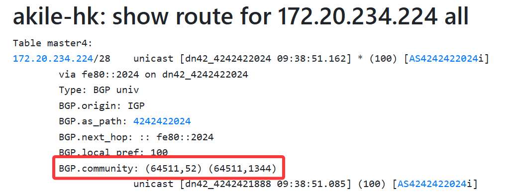

# 写在前面
本人是BGP小白，文章中可能会存在**不严谨内容/小白理解/低级错误**，请诸位大佬们手下留情。若发现存在问题，您愿意的话可以[邮件联系我](mailto:i@iyoroy.cn)，我会在第一时间更正。**如果您不能接受，建议现在就关闭此文章**。

# 什么是BGP Communities

> TL;DR: BGP Communities给路由“打标签”，其他人可以通过这个标签实现路由优选

这个概念对于刚入坑的小白 ~~（比如我）~~ 来说可能比较陌生，可能不理解它是干吗用的 
简单来说，BGP Communities是一种**标记路由**的机制，类似于给路由打标签。它允许网络管理员给通过BGP传播的路由附加一个或多个“标签”（即社区值）。这些标签本身并不改变路由的路径属性（如AS_PATH、LOCAL_PREF、MED等），但它们提供了一种**信号机制**，用于向本AS内或下游对等AS中的其他路由器**指示应该对该路由执行何种策略或处理**。BGP Communities可以用来：  

1. **简化策略配置**: 网络内部或下游 AS 的路由器只需配置基于社区值的策略（如设置LOCAL_PREF、添加NO_EXPORT、应用路由图等），无需知道具体的前缀细节。这使得策略更集中、更易管理、更不易出错
2. **传达策略意图给下游AS**: 可以将社区值附加在它通告给下游客户或对等AS的路由上。这些社区值传达了对这些路由应如何处理的要求或建议，如根据不同地理位置、不同延迟和带宽来进行路由优选等
3. **在AS内部协调策**: 在大型AS内部，IBGP全互联或使用路由反射器时，可以在 AS 边缘路由器（接收 EBGP 路由或重分发路由的路由器）给路由打上社区值，AS内部的核心路由器或路由反射器可以识别这些社区值，并应用相应的内部策略（如设置LOCAL_PREF、MED、决定是否向某些IBGP对等体通告、打上其他社区等），而无需在每个内部路由器上配置复杂的基于前缀的策略

DN42中有一套自己的Communities规范，详情可参考：[BGP-communities - DN42 Wiki](https://dn42.dev/howto/BGP-communities)

# 配置
本文大致思路和方案来源于Xe_iu大佬，仅针对地理位置信息添加BGP Communities并进行优选。一般来说这样就足够了。~~（还有个原因是其他的我还没太搞明白）~~  
注意: 我们应该**只对自己的AS添加地理位置信息相关的BGP Communities**，不应当对邻居传递来的路由添加相关条目。若对邻居的路由加上自己的地区Communities则会造成**伪造路由起源**，引发**路由劫持**。下游可能会误判流量路径，将本应直连的流量绕道至你的网络，增加延迟的同时大量消耗你的网络的流量。（Large Communities除外，Large Community有一套验证机制可以防止此类事情发生，但是不在本文讨论范围内）

思路已经很明白了，在导出路由时我们需要先验证是否是我们自己的路由，如果是则为路由打上communities标签即可。DN42官方给的样例配置中已经写好了两个函数`is_self_net()`和`is_self_net_v6()`用于检查是否是自己的路由，因此编写配置文件部分就很简单了。  

## 为路由添加Communities

首先我们需要在节点配置文件开头定义好当前节点的地理区域信息，详情请查询[BGP-communities - DN42 Wiki](https://dn42.dev/howto/BGP-communities)：
```bird2
define DN42_REGION = 52;   # 52代表亚洲东部地区
define DN42_COUNTRY= 1344; # 1344代表香港
```
* 请将上述数值按照你的节点地理位置情况修改

随后在dnpeers模板中修改导出的过滤器：
```diff
export filter {
-    if is_valid_network() && source ~ [RTS_STATIC, RTS_BGP] then accept;
+    if is_valid_network() && source ~ [RTS_STATIC, RTS_BGP] then{ 
+        if (is_self_net()) then {      # 检查是否是自己的路由
+            bgp_community.add((64511, DN42_REGION));  # 打上大洲级别的区域信息
+            bgp_community.add((64511, DN42_COUNTRY)); # 打上国家/地区信息
+        }
+        accept;
+    }
    reject;
};
import limit 1000 action block;
```
在导出时检查，如果是自己的路由则按照上面设置的`DN42_REGION`和`DN42_COUNTRY`为该路由设置bgp_community。其中，`64511`是**专门为地理标签（Region/Country）保留的公共AS号标识符**，直接照抄即可。在IPv6的导出规则中也如法炮制，不过将`is_self_net()`换成`is_self_net_v6()`即可。

## 根据Communities优选
此处我们需要引入另一个概念：`local_pref`（Local Preference），他用于**在AS内部**标识路由的优先级。其默认值为100，值越大优先级越高。并且在BGP选路逻辑中，`local_pref`有着最高的优先级，甚至高于`AS_PATH`长度。也就是说，通过设置`local_pref`我们可以调整整个路由的优先级，以实现路由优选。  
再结合上文的BGP Communities，我们可以根据Communities来为路由设置相应的`local_pref`来实现优选。同时，因为`BGP.local_pref`会在AS内部传递，所以需要同时更改eBGP和iBGP的路由导入和导出逻辑。

此处我处理BGP.local_pref的逻辑参考 ~~（实际上是照抄）~~ 了Xe_iu大佬的方案：
* 对于同一个大洲的路由，优先级+10
* 对于同一个国家，优先级再+5
* 对于直接和自己Peer的路由，优先级再+20

创建一个函数用于优先级计算：
```bird2
function ebgp_calculate_priority() {
    int priority = 100;  # 基础优先级
    
    # 同区域检测（+10）
    if bgp_community ~ [(64511, DN42_REGION)] then 
        priority = priority + 10;
    
    # 同国家检测（+5）
    if bgp_community ~ [(64511, DN42_COUNTRY)] then 
        priority = priority + 5;
    
    # eBGP直接邻居检测（+20）
    if bgp_path.len = 1 then 
        priority = priority + 20;
    
    return priority;
}
```

接着，在dnpeers模板中的导入过滤器中将`bgp_local_pref`设置为从函数计算出来的值：
```diff
template bgp dnpeers {
    local as OWNAS;
    path metric 1;

    ipv4 {
        import filter {
            if is_valid_network() && !is_self_net() then {
                if (roa_check(dn42_roa, net, bgp_path.last) != ROA_VALID) then {
                    print "[dn42] ROA check failed for ", net, " ASN ", bgp_path.last;
                    reject;
                }
+                bgp_local_pref = ebgp_calculate_priority(); 
                accept;
            }
            reject;
        };
```

IPv6也如法炮制即可。

运行`birdc configure`之后，我们应该就能在自己的邻居那里看到我们的路由已经被打上了Communities标签：



（此处截图来自：[https://lg.milu.moe/route_all/hk/172.20.234.224](https://lg.milu.moe/route_all/hk/172.20.234.224)）

-----
特别感谢Nuro Trace大佬和Xe_iu大佬，他们帮助我加深了对BGP Communities的理解并提供了很多帮助  
参考文章：
* [\[DN42\] bird2的配置文件 – Xe_iu's Blog | Xe_iu的杂物间](https://blog.xeiu.top/archives/448)
* [\[DN42\] 谈一谈如何配置 BGP community – Xe_iu's Blog | Xe_iu的杂物间](https://blog.xeiu.top/archives/402)
* [BGP-communities - DN42 Wiki](https://dn42.dev/howto/BGP-communities)