# 前言
上文我们已经成功注册了一个ASN并且拿到了一段IPv6地址，这次我们就来将这段地址广播给全世界。  

# 在RIPE Database设置子网对象
需要注意的是，公网允许广播的最小IPv6前缀是/48，也就是说你如果只有一个/48地址你无法将其拆成更小的段。所以我后来又单独租用了一段/40，打算将其拆成多个/48来广播。  

我获取到的IPv6为`2a14:7583:f200::/40`，打算拆出来`2a14:7583:f203::/48`用于给Vultr使用。如果你不需要拆段，请直接跳转到「创建路由信息」一节

## 拆段
首先打开[Create "inet6num" object - RIPE Database](https://apps.db.ripe.net/db-web-ui/webupdates/create/RIPE/inet6num)，填入如下内容：
* **inet6num**: 打算拆出来的IP段，CIDR格式
* **netname**: 网络名称
* **country**: IP段所属国家，需要符合ISO 3166标准（RIPE DB里可以直接选择）
* **admin-c**: 上文创建的Role对象的主键值
* **tech-c**: 上文创建的Role对象的主键值
* **status**: `ASSIGNED`即可

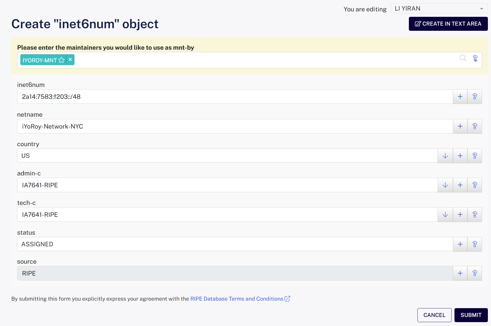

此步骤将你获得的地址拆出来一个小的/48地址块。

## 创建路由信息
打开[Create "route6" object - RIPE Database](https://apps.db.ripe.net/db-web-ui/webupdates/create/RIPE/route6)，填入如下内容：
* **route6**: 填写你打算广播播的IPv6地址块的CIDR格式
* **origin**: 填写你申请到的ASN，包含AS前缀

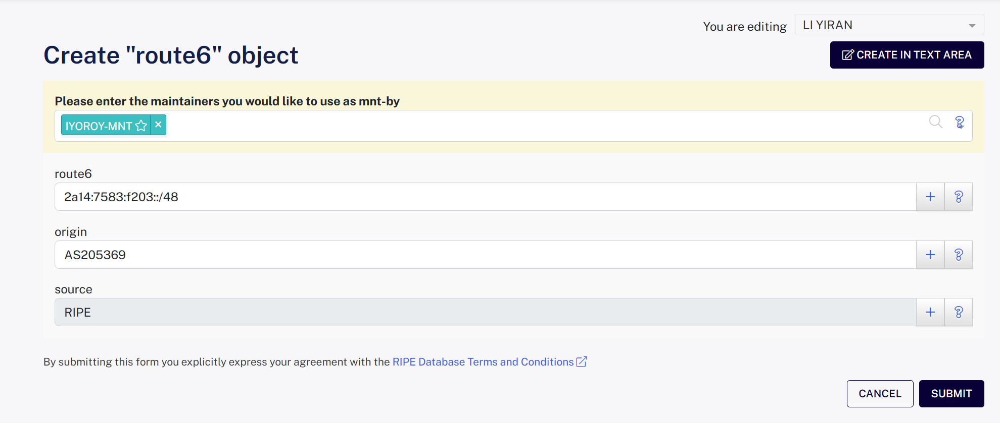

此步骤声明允许你的ASN使用这段地址段来发BGP路由。

# 申请VPS的BGP Session接入
此次我使用的是Vultr家的机器，他们家的BGP Session算是很新手友好的了，有一套自己的验证系统；并且上游良好的过滤器保证了一般情况下即使发送了错误的路由表也不会影响到公网。

（此处我配置的时候忘记截图了，可以参考一下宝硕大佬的文章 [年轻人的第一个 ASN](https://blog.baoshuo.ren/post/my-own-asn/) 中的 **申请 Vultr 的 BGP 广播功能** 章节）

进入[BGP - Vultr.com](https://my.vultr.com/bgp/)，选择Get Started之后按照要求填写你的ASN信息和IPv6地址块。LOA（Letter Of Authorization，授权信）可参考以下模板：[LOA-template.docx](/downloads/2025/08/3976042902.docx)（因为发现网上查到的都是以公司的名义写的，因此以个人名义重新写了一份）  

完成后系统会自动创建一条工单，并且能看到我们的ASN和IP地址块处于待验证的状态：
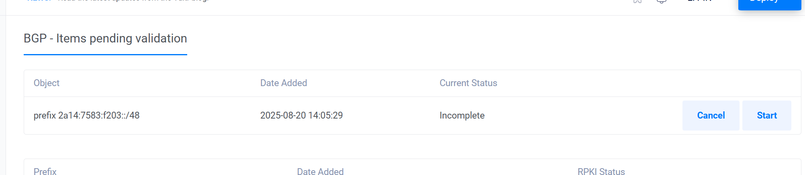  
点击Start，系统会向注册Role时填写的abuse-mailbox邮箱发送一封验证邮件：
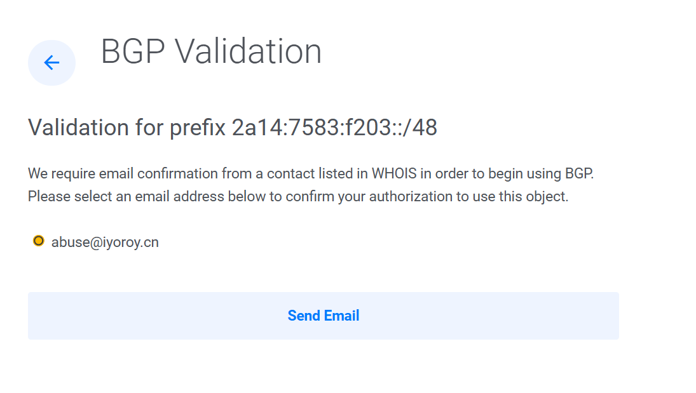  
收到的邮件如图所示：
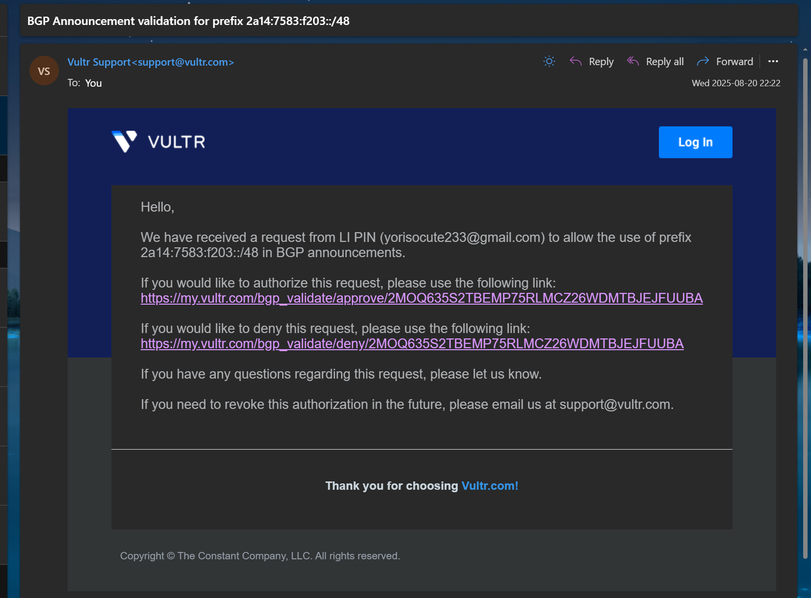  
其中，上面那个链接代表同意授权Vultr广播你的IP段，下面那个则是不同意。我们点击上面那个之后会进入Vultr的网页：
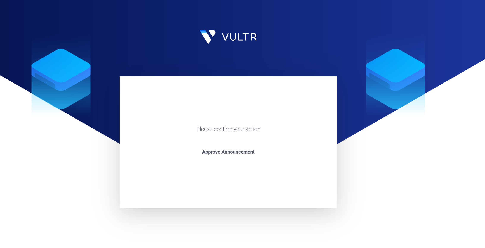
再点击Approve Announcement即可。ASN和IP段都需要验证一次。

接着，等待Vultr的工作人员审核完成后来到VPS的控制台，就能看到我们的BGP选项卡了，其中可以得到上游的信息：
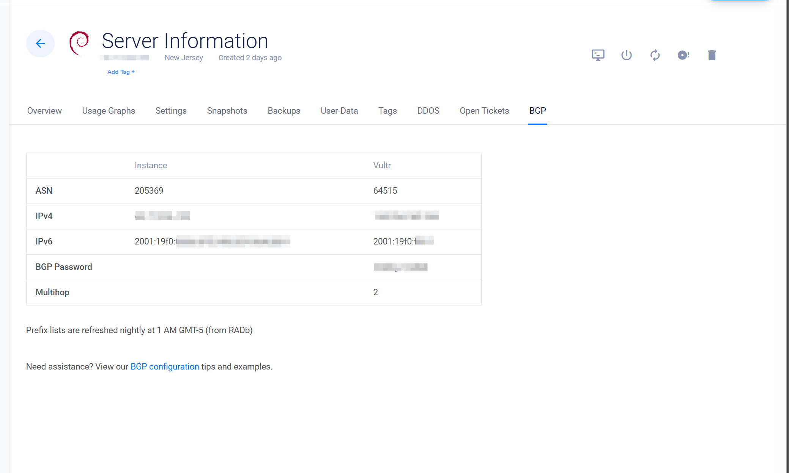

此处不得不称赞一下Vultr的工单效率，我平均从创建工单申请授权到完成只花了10分钟左右。~~（反观之前在iFog GmbH，平均工作日工单回复时间1天左右实在是好太多了）~~

其他厂商的VPS大概都是这么个流程，你需要告诉工作人员你要播的ASN和IP段，在验证完所有权之后工作人员会为你配置对应的BGP Session。

# 广播！

你应该已经从上游那里得到了以下信息：
1. 上游的ASN
2. 上游用于BGP Session的地址
3. （可选）密码

我用的操作系统是Debian12 Bookworm，使用Bird2作为路由软件，并且按照[这篇文章](https://www.iyoroy.cn/archives/103/)中「更新Bird2至v2.16及以上」章节更新Bird2至最新版。Vultr那边给我的上游ASN是`64515`，上游用于BGP Session的地址是`2001:19f0:ffff::1`，VPS用于BGP Session的地址是`2001:19f0:0006:0ff5:5400:05ff:fe96:881f`。

我的Bird2配置文件修改自DN42中的配置文件：
```bird2
log syslog all;
define OWNAS       = 205369;                   # 自己的ASN
define OWNIPv6     = 2a14:7583:f203::1;        # 给机器绑定的单个IPv6地址
define OWNNETv6    = 2a14:7583:f203::/48;      # 打算播的网段
define OWNNETSETv6 = [ 2a14:7583:f203::/48+ ]; # 打算播的网段集合

router id 45.77.x.x;                           # 路由器ID，这里使用VPS的公网IPv4

protocol device {
    scan time 10;
}

function is_self_net_v6() {
    return net ~ OWNNETSETv6;
}

protocol kernel {
    scan time 20;

    ipv6 {
        import none;
        export filter {
            if source = RTS_STATIC then reject;
            krt_prefsrc = OWNIPv6;
            accept;
        };
    };
};

protocol static {
    route OWNNETv6 reject;

    ipv6 {
        import all;
        export none;
    };
}

template bgp upstream {
    local as OWNAS;
    path metric 1;
    multihop; # 指定多跳

    ipv6 {
        import filter {
            if net ~ [::/0] then reject; # 拒绝导入默认路由
            accept;
        };
        export filter {
            if is_self_net_v6() then accept; # 仅导出自己网段内的路由，防止劫持
            reject;
        };
        import limit 1000 action block;
    };

    graceful restart; 
}

protocol bgp 'Vultr_v6' from upstream{
    local 2001:19f0:0006:0ff5:5400:05ff:fe96:881f as OWNAS; # local后面的地址即上游给的用于BGP Session的VPS上的地址
    password "123456"; # 上游给你的BGP密码，若没密码就将这一行删除
    neighbor 2001:19f0:ffff::1 as 64515; # 上游的BGP Session IP和ASN
}
```
几个值得注意的点：
1. 此处upstream模板的导入规则拒绝了 **默认路由** ，这样写可以防止上游发来的路由表覆盖掉本地的默认网关等路由信息。如果我们有多个BGP邻居，则可能导致绕路甚至路由环路。
2. upstream中指定了多跳（`multihop;`），这是因为Vultr的BGP对端不能直达，若不设置多跳则会导致BGP会话卡在Idle状态。如果你的BGP上游是直连，可以不设置此行或者改为`direct;`。

填写完配置文件，运行`birdc configure`载入配置。
运行`birdc show protocols`查看状态，如果不出意外的话应该能看到BGP会话已经Established：
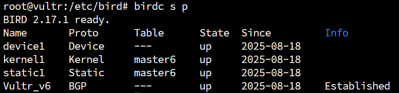

这个时候，你可以起身做点别的事情，等待全球路由收敛。大概半个小时之后，打开[bgp.tools](https://bgp.tools)，查询自己的/48段，应该就能看到已经成功被全球互联网收敛，并且能看到我们的上游信息：
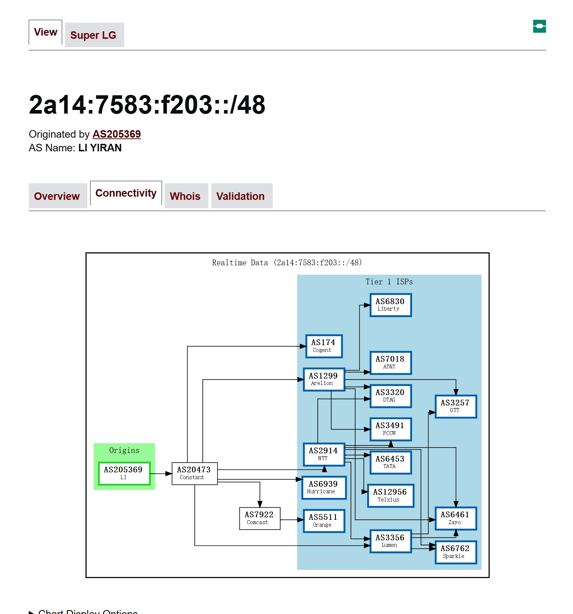

接着，我们在VPS上创建一个dummy网卡，并绑定我们为这个机器设置的段内的单个IPv6地址，如我给我这台机器分配了`2a14:7583:f203::1`：
```shell
ip link add dummy0 type dummy
ip addr add 2a14:7583:f203::1/128 dev dummy0
```

接着使用我们自己的PC ping这个地址就能通了，traceroute也能看到完整路由路径：
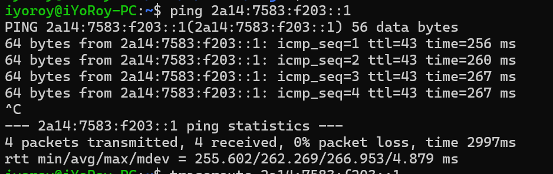
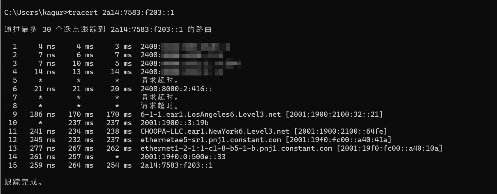

-----
感谢米露大佬提供的技术支持！
参考文章：
1. [自己在家开运营商 Part.2 - 向世界宣告 IP 段 (BGP Session & BIRD)](https://blog.lyc8503.net/post/asn-2-bgp-session/)
2. [年轻人的第一个 ASN - 宝硕博客](https://blog.baoshuo.ren/post/my-own-asn/)
3. [BGPlayer 从零开始速成指北 - 开通 Vultr 的 BGP 广播功能 - AceSheep](https://blog.acesheep.com/p/bgplayer-beginner-guide-activate-vultr-bgp-function/)
4. [BGP (2) 在 Vultr 和 HE 使用自己的 IPV6 地址 - 131's Blog](https://blog.yuzu.im/marchives/133)