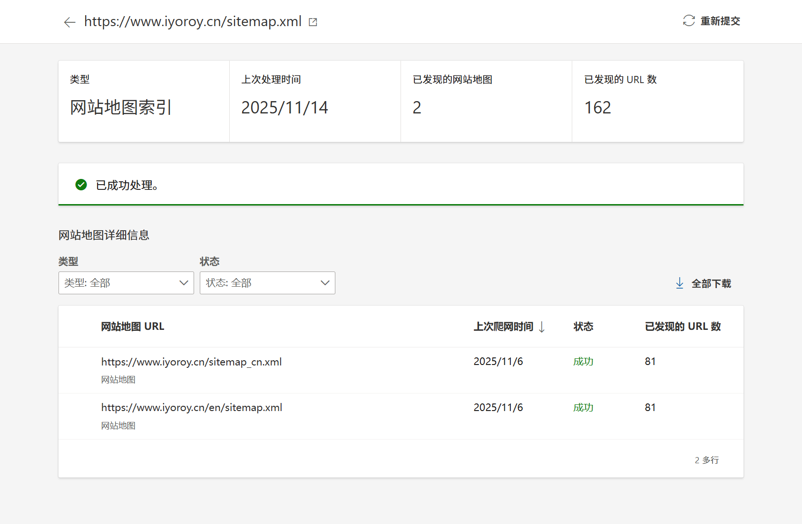

想着给博客做一下国际化支持，为每篇文章和每个页面单独配置一个英文版本，但是上网查了一圈发现Typecho对国际化的支持并不好，最终自己设计了一套方案，写这篇文章记录下来

> 本文默认你对PHP、Nginx、Typecho的基础逻辑有部分了解

# 分析
## 需求
* 需要为每个文章和页面都配置中英双语
* 需要配置一个语言选择器，使得前端可以快速切换语言
* 需要搜索引擎可以正确识别并收录多语言版本的文章

## 大致方案
中英文文章的区分大致有这两种方案：
1. 作为一个单独的参数，如访问文章时用`/?lang=zh-CN`和`/?lang=en-US`来区分，但是这种方案实现起来比较困难，同时对搜索引擎收录也不太好；  
2. 通过URL路径区分，如访问`https://<host>/article`是中文页面，访问`https://<host>/en/article`是英文页面，这种配置起来比较简单，直接分成两个Typecho实例即可，并且对搜索引擎友好。问题是评论和浏览量统计需要手动同步。

总结下来，我选择了第二种方案，并且打算直接通过在`/en/`新建一个Typecho实例实现多语言支持。

## 具体实现
1. 首先将博客实例复制两份，一份中文一份英文，然后分别翻译成英文；
2. 修改前端代码，实现语言选择器；
3. 要保证两边文章URL只有一个`/en`之差，就得保证中文站点和英文站点文章的`cid`相同，而这个`cid`是根据创建文章和附件的顺序来的，因此打算编写一个同步插件，中文端发文章的时候自动在英文数据库中插入一条对应`cid`的文章；
4. 改写SiteMap插件，因为sitemap不能既包含页面链接又包含其他sitemap的引用，因此主站需要创建两个sitemap，一个是收录中文站页面的主sitemap，另一个是索引，负责索引中文和英文的sitemap；
5. 在`<head></head>`中添加`hreflang`属性来告知搜索引擎如何处理多语言；
6. 将英文端的访问量和点赞量链接到中文的数据库；
7. 将英文端的评论链接到中文数据库。

# 开整
## 创建英文实例
将整个网站复制一份，放在原先的网站根目录的`/en/`文件夹下，同时将数据库也复制一份，我这里命名成`typecho_en`。  
接着，分别为两个实例配置伪静态：
```nginx
location /en/ {
    if (!-e $request_filename) {
        rewrite ^(.*)$ /en/index.php$1 last;
    }
}

location / {
  if (!-e $request_filename) {
      rewrite ^(.*)$ /index.php$1 last;
  }
}
```

关于为什么要将中文的主实例也用location括起来，是因为实际测试的时候发现如果不括起来就会将英文实例也当作中文实例的一部分解析，造成404。  

同时，修改`<webroot>/en/config.inc.php`里的数据库配置，指向英文实例的数据库。  

这个时候，访问`<host>/en/`应该能看到一个和中文主站一模一样的站点。  

## 修改Typecho语言
这一步其实感觉可以不要，因为基本上前端页面的语言都是由主题决定的，将Typecho本身语言设置为英文没什么大用，但是为了统一，还是选择改了一下（这样可以一眼看出来是哪个实例的后台（笑））  
直接参考GitHub上[typecho官方的多语言支持](https://github.com/typecho/languages)即可，从Release里下载语言包，然后解压到`<webroot>/en/usr/langs/`下，然后进入`https://<host>/en/admin/options-general.php`，就能看见语言设置选项，改为`English`即可。

## 修改主题语言
最繁琐的一步，我使用的是Joe，进入`<webroot>/en/usr/themes/Joe`，将所有你能看到的显示相关的中文都翻译成英文，这里没什么非常方便的方法，用翻译工具的话翻出来会很别扭，我还是选择了手动翻译。  
需要注意的是，有一部分的前端配置是在js中的，不止是PHP源文件，这些都需要翻译。

## 翻译文章
这一步没啥好说的，把`/en/`下的文章一篇篇翻译成英文，保存

## 配置文章同步发布
这一步是为了保持两边文章的`cid`同步，因为cid和访问url有关，保持cid同步可以使下文配置语言选择器一步更加简单，只要在host后加个`/en`或者去掉就行了。  
cid是数据库中`typecho_contents`表的一个自增字段，同时也是主键，他的分配和typecho的文章、附件等有关。因为上传的文件也会占用cid，而我打算将所有附件都上传到中文站，因此如果不做特殊处理两边的cid容易匹配不上，增加后续工作量。  
因此我选择的方案是用AI编写一个插件，当中文站发布文章的时候自动触发，读取中文站为其分配的cid并写入到英文站的数据库中。  
创建文件`<webroot>/usr/plugins/SyncToEnglish/Plugin.php`并填入如下内容:
```php
<?php
if (!defined('__TYPECHO_ROOT_DIR__')) exit;

/**
 * 中文文章同步到英文数据库
 *
 * @package SyncToEnglish
 * @author ChatGPT, iYoRoy
 * @version 1.0.0
 * @link https://example.com
 */
class SyncToEnglish_Plugin implements Typecho_Plugin_Interface
{
    public static function activate()
    {
        Typecho_Plugin::factory('Widget_Contents_Post_Edit')->finishPublish = [__CLASS__, 'push'];
        return 'SyncToEnglish 插件已启用：发布中文文章时会自动在英文库创建对应空文章';
        error_log("[SyncToEnglish] 插件激活成功");
    }

    public static function deactivate()
    {
        return 'SyncToEnglish 插件已禁用';
    }

    public static function config(Typecho_Widget_Helper_Form $form)
    {
        $host = new Typecho_Widget_Helper_Form_Element_Text('host', NULL, 'localhost', _t('英文数据库主机'));
        $user = new Typecho_Widget_Helper_Form_Element_Text('user', NULL, 'root', _t('英文数据库用户名'));
        $password = new Typecho_Widget_Helper_Form_Element_Password('password', NULL, NULL, _t('英文数据库密码'));
        $database = new Typecho_Widget_Helper_Form_Element_Text('database', NULL, 'typecho_en', _t('英文数据库名称'));
        $port = new Typecho_Widget_Helper_Form_Element_Text('port', NULL, '3306', _t('英文数据库端口'));
        $charset = new Typecho_Widget_Helper_Form_Element_Text('charset', NULL, 'utf8mb4', _t('字符集'));
        $prefix = new Typecho_Widget_Helper_Form_Element_Text('prefix', NULL, 'typecho_', _t('表前缀'));

        $form->addInput($host);
        $form->addInput($user);
        $form->addInput($password);
        $form->addInput($database);
        $form->addInput($port);
        $form->addInput($charset);
        $form->addInput($prefix);
    }

    public static function personalConfig(Typecho_Widget_Helper_Form $form) {}

    public static function push($contents, $widget)
    {
        $options = Helper::options();
        $config = $options->plugin('SyncToEnglish');

        // 获取中文库文章信息
        $cnDb = Typecho_Db::get();
        if (is_array($contents) && isset($contents['cid'])) {
            $cid = $contents['cid'];
            $title = $contents['title'];
        } elseif (is_object($contents) && isset($contents->cid)) {
            $cid = $contents->cid;
            $title = $contents->title;
        } else {
            $db = Typecho_Db::get();
            $row = $db->fetchRow($db->select()->from('table.contents')->order('cid', Typecho_Db::SORT_DESC)->limit(1));
            $cid = $row['cid'];
            $title = $row['title'];
            error_log("[SyncToEnglish DEBUG] CID not found in param, fallback to latest cid={$cid}\n", 3, __DIR__ . '/debug.log');
        }

        $article = $cnDb->fetchRow($cnDb->select()->from('table.contents')->where('cid = ?', $cid));
        if (!$article) return;

        $enDb = new Typecho_Db('Mysql', $config->prefix);
        $enDb->addServer([
            'host' => $config->host,
            'user' => $config->user,
            'password' => $config->password,
            'charset' => $config->charset,
            'port' => (int)$config->port,
            'database' => $config->database
        ], Typecho_Db::READ | Typecho_Db::WRITE);

        try {
            $exists = $enDb->fetchRow($enDb->select()->from('table.contents')->where('cid = ?', $article['cid']));

            if ($exists) {
                $enDb->query($enDb->update('table.contents')
                    ->rows([
                        // 'title' => $article['title'],
                        'slug' => $article['slug'],
                        'modified' => $article['modified']
                    ])
                    ->where('cid = ?', $article['cid'])
                );
            } else {
                $enDb->query($enDb->insert('table.contents')->rows([
                    'cid'      => $article['cid'],
                    'title'    => $article['title'],
                    'slug'     => $article['slug'],
                    'created'  => $article['created'],
                    'modified' => $article['modified'],
                    'type'     => $article['type'],
                    'status'   => $article['status'],
                    'authorId' => $article['authorId'],
                    'views'    => 0,
                    'text'     => $article['text'],
                    'allowComment' => $article['allowComment'],
                    'allowFeed'    => $article['allowFeed'],
                    'allowPing'    => $article['allowPing']
                ]));
            }

        } catch (Exception $e) {
            error_log('[SyncToEnglish] 同步失败: ' . $e->getMessage());
        }
    }
}

```
随后去后台启用插件并配置上英文数据库的数据库信息即可。  
完成后，在中文站发布文章，英文站应该能同步发布一篇相同cid的文章。  

## 配置语言选择器
既然我们已经完成了同步文章cid，接下来我们修改语言的时候只需要修改url，在前面加上或者去掉`/en/`就行了。通过PHP编写一个选择器，放在主题的顶栏中：
```php
<!-- Language Selector -->
<div class="joe_dropdown" trigger="hover" placement="60px">
    <div class="joe_dropdown__link">
    <a href="#" rel="nofollow">Language</a>
    <svg class="joe_dropdown__link-icon" viewBox="0 0 1024 1024" xmlns="http://www.w3.org/2000/svg" width="14" height="14">
        <path d="M561.873 725.165c-11.262 11.262-26.545 21.72-41.025 18.502-14.479 2.413-28.154-8.849-39.415-18.502L133.129 375.252c-17.697-17.696-17.697-46.655 0-64.352s46.655-17.696 64.351 0l324.173 333.021 324.977-333.02c17.696-17.697 46.655-17.697 64.351 0s17.697 46.655 0 64.351L561.873 725.165z" fill="var(--main)" />
    </svg>
    </div>
    <nav class="joe_dropdown__menu">
    <?php
        // 获取当前完整的 URL
        $current_url = $_SERVER['REQUEST_URI']; 
        $host = $_SERVER['HTTP_HOST'];

        // 判断是否有英文前缀 "/en/"
        if (strpos($current_url, '/en/') === 0) {
        $current_url = substr_replace($current_url, '', 0, 3);
        }

        $new_url_cn = 'https://' . $host . $current_url;
        $new_url_en = 'https://' . $host . '/en' . $current_url;

        // 生成两个超链接
        echo '<a href="' . $new_url_cn . '">简体中文</a>';
        echo '<a href="' . $new_url_en . '">English</a>';
    ?>
    </nav>
</div>
```
需要在中文和英文两个实例中都添加。  
之后，全局都能通过这个选择器选择语言。对于我用的Joe主题，移动端和PC端需要单独编写两个语言选择器。

## 改写SiteMap插件
为了让搜索引擎能更快的收录到英文的页面，我打算修改SiteMap插件，使之包含英文站点的页面。SiteMap有两种，一种是sitemapindex，用于索引子SiteMap，一种是urlset，用于包含页面。我使用的是[joyqi/typecho-plugin-sitemap](https://github.com/joyqi/typecho-plugin-sitemap)插件，在这个基础上，将默认的`/sitemap.xml`改为sitemapindex，新建一个路由`/sitemap_cn.xml`来存放中文站的SiteMap，英文站点的插件不变，再有默认的`/sitemap.xml`引用`/sitemap_cn.xml`和`/en/sitemap.xml`。  
修改SiteMap的`Plugin.php`：
```diff
/**
* Activate plugin method, if activated failed, throw exception will disable this plugin.
*/
public static function activate()
{
    Helper::addRoute(
-       'sitemap',
+       'sitemap_index',
        '/sitemap.xml',
        Generator::class,
-       'generate',
+       'generate_index',
        'index'
    );
+   Helper::addRoute(
+       'sitemap_cn',
+       '/sitemap_cn.xml',
+       Generator::class,
+       'generate_cn',
+       'index'
+   );
}

/**
* Deactivate plugin method, if deactivated failed, throw exception will enable this plugin.
*/
public static function deactivate()
{
-   Helper::removeRoute('sitemap');
+   Helper::removeRoute('sitemap_index');
+   Helper::removeRoute('sitemap_cn');
}
```


**完整代码**

```php
<?php

namespace TypechoPlugin\Sitemap;

use Typecho\Plugin\PluginInterface;
use Typecho\Widget\Helper\Form;
use Utils\Helper;

if (!defined('__TYPECHO_ROOT_DIR__')) {
    exit;
}

/**
 * 自动生成 Typecho 站点地图的插件。
 * 站点地图 Sitemap 的地址是：http(s)://yourdomain.com/sitemap.xml
 *
 * @package 站点地图插件
 * @author joyqi
 * @version 1.0.0
 * @since 1.2.1
 * @link https://github.com/joyqi/typecho-plugin-sitemap
 */
class Plugin implements PluginInterface
{
    /**
     * Activate plugin method, if activated failed, throw exception will disable this plugin.
     */
    public static function activate()
    {
        Helper::addRoute(
            'sitemap_index',
            '/sitemap.xml',
            Generator::class,
            'generate_index',
            'index'
        );
        Helper::addRoute(
            'sitemap_cn',
            '/sitemap_cn.xml',
            Generator::class,
            'generate_cn',
            'index'
        );
    }

    /**
     * Deactivate plugin method, if deactivated failed, throw exception will enable this plugin.
     */
    public static function deactivate()
    {
        Helper::removeRoute('sitemap_index');
        Helper::removeRoute('sitemap_cn');
    }

    /**
     * Plugin config panel render method.
     *
     * @param Form $form
     */
    public static function config(Form $form)
    {
        $sitemapBlock = new Form\Element\Checkbox(
            'sitemapBlock',
            [
                'posts' => _t('生成文章链接'),
                'pages' => _t('生成独立页面链接'),
                'categories' => _t('生成分类链接'),
                'tags' => _t('生成标签链接'),
            ],
            ['posts', 'pages', 'categories', 'tags'],
            _t('站点地图显示')
        );

        $updateFreq = new Form\Element\Select(
            'updateFreq',
            [
                'daily' => _t('每天'),
                'weekly' => _t('每周'),
                'monthly' => _t('每月或更久'),
            ],
            'daily',
            _t('更新频率')
        );

        // $externalSitemap = new Typecho_Widget_Helper_Form_Element_Text('externalSitemap', NULL, '', _t('附加SiteMap'));

        $form->addInput($sitemapBlock->multiMode());
        $form->addInput($updateFreq);
        // $form->addInput($externalSitemap);
    }

    /**
     * Plugin personal config panel render method.
     *
     * @param Form $form
     */
    public static function personalConfig(Form $form)
    {
        // TODO: Implement personalConfig() method.
    }
}
```


修改SiteMap的`Generator.php`：
```diff
class Generator extends Contents
{
+   public function generate_index(){
+       $sitemap = '<?xml version="1.0" encoding="UTF-8"?>
+<sitemapindex xmlns="http://www.sitemaps.org/schemas/sitemap/0.9">
+ <sitemap>
+   <loc>https://www.iyoroy.cn/sitemap_cn.xml</loc>
+ </sitemap>
+ <sitemap>
+   <loc>https://www.iyoroy.cn/en/sitemap.xml</loc>
+ </sitemap>
+</sitemapindex>';
+       $this->response->throwContent($sitemap, 'text/xml');
+   }
+
    /**
     * @return void
     */
-   public function generate()
+   public function generate_cn()
    {
        $sitemap = '<?xml version="1.0" encoding="' . $this->options->charset . '"?>' . PHP_EOL;
...
```


**完整代码**

```php
<?php

namespace TypechoPlugin\Sitemap;

use Widget\Base\Contents;
use Widget\Contents\Page\Rows;
use Widget\Contents\Post\Recent;
use Widget\Metas\Category\Rows as CategoryRows;
use Widget\Metas\Tag\Cloud;

if (!defined('__TYPECHO_ROOT_DIR__')) {
    exit;
}

/**
 * Sitemap Generator
 */
class Generator extends Contents
{
    public function generate_index(){
        $sitemap = '<?xml version="1.0" encoding="UTF-8"?>
<sitemapindex xmlns="http://www.sitemaps.org/schemas/sitemap/0.9">
  <sitemap>
    <loc>https://www.iyoroy.cn/sitemap_cn.xml</loc>
  </sitemap>
  <sitemap>
    <loc>https://www.iyoroy.cn/en/sitemap.xml</loc>
  </sitemap>
</sitemapindex>';
        $this->response->throwContent($sitemap, 'text/xml');
    }
    /**
     * @return void
     */
    public function generate_cn()
    {
        $sitemap = '<?xml version="1.0" encoding="' . $this->options->charset . '"?>' . PHP_EOL;
        $sitemap .= '<urlset xmlns="http://www.sitemaps.org/schemas/sitemap/0.9"'
            . ' xmlns:news="http://www.google.com/schemas/sitemap-news/0.9"'
            . ' xmlns:xhtml="http://www.w3.org/1999/xhtml"'
            . ' xmlns:image="http://www.google.com/schemas/sitemap-image/1.1"'
            . ' xmlns:video="http://www.google.com/schemas/sitemap-video/1.1">' . PHP_EOL;

        // add homepage
        $sitemap .= <<<EOF
        <url>
            <loc>{$this->options->siteUrl}</loc>
            <changefreq>daily</changefreq>
            <priority>1.0</priority>
        </url>
EOF;

        // add posts
        if (in_array('posts', $this->options->plugin('Sitemap')->sitemapBlock)) {
            $postsCount = $this->size($this->select()
                ->where('table.contents.status = ?', 'publish')
                ->where('table.contents.created < ?', $this->options->time)
                ->where('table.contents.type = ?', 'post'));

            $posts = Recent::alloc(['pageSize' => $postsCount]);
            $freq = $this->options->plugin('Sitemap')->updateFreq ==='monthly' ? 'monthly' : 'weekly';

            while ($posts->next()) {
                $sitemap .= <<<EOF
            <url>
                <loc>{$posts->permalink}</loc>
                <changefreq>{$freq}</changefreq>
                <lastmod>{$posts->date->format('c')}</lastmod>
                <priority>0.8</priority>
            </url>
EOF;
            }
        }

        // add pages
        if (in_array('pages', $this->options->plugin('Sitemap')->sitemapBlock)) {
            $pages = Rows::alloc();
            $freq = $this->options->plugin('Sitemap')->updateFreq ==='monthly' ? 'yearly' : 'monthly';

            while ($pages->next()) {
                $sitemap .= <<<EOF
            <url>
                <loc>{$pages->permalink}</loc>
                <changefreq>{$freq}</changefreq>
                <lastmod>{$pages->date->format('c')}</lastmod>
                <priority>0.5</priority>
            </url>
EOF;
            }
        }

        // add categories
        if (in_array('categories', $this->options->plugin('Sitemap')->sitemapBlock)) {
            $categories = CategoryRows::alloc();
            $freq = $this->options->plugin('Sitemap')->updateFreq;

            while ($categories->next()) {
                $sitemap .= <<<EOF
            <url>
                <loc>{$categories->permalink}</loc>
                <changefreq>{$freq}</changefreq>
                <priority>0.6</priority>
            </url>
EOF;
            }
        }

        // add tags
        if (in_array('tags', $this->options->plugin('Sitemap')->sitemapBlock)) {
            $tags = Cloud::alloc();
            $freq = $this->options->plugin('Sitemap')->updateFreq;

            while ($tags->next()) {
                $sitemap .= <<<EOF
            <url>
                <loc>{$tags->permalink}</loc>
                <changefreq>{$freq}</changefreq>
                <priority>0.4</priority>
            </url>
EOF;
            }
        }

        $sitemap .= '</urlset>';

        $this->response->throwContent($sitemap, 'text/xml');
    }
}

```


请将代码中的博客地址改成你自己的  
（最近太忙了实在是没空给单独写个配置页面了就直接把SiteMap URL写死在插件里了）

禁用再启用插件，访问`https://<host>/sitemap.xml`应该就能看到SiteMap的索引了：
```xml
<sitemapindex xmlns="http://www.sitemaps.org/schemas/sitemap/0.9">
    <sitemap>
        <loc>https://www.iyoroy.cn/sitemap_cn.xml</loc>
    </sitemap>
    <sitemap>
        <loc>https://www.iyoroy.cn/en/sitemap.xml</loc>
    </sitemap>
</sitemapindex>
```
通过Bing Search等其他搜索引擎的SEO管理页应该也能看到扫描到了英文站的SiteMap：


## 添加hreflang
这一步的作用是让搜索引擎知道当前页面存在多语言版本，使其可以根据用户的语言偏好或地理位置展示合适的页面。我们需要在页面的`<head></head>`中插入类似如下格式的link标签：
```html
<link rel="alternate" hreflang="en-us" href="https://example.com/us">
<link rel="alternate" hreflang="fr" href="https://example.com/fr">
<link rel="alternate" hreflang="x-default" href="https://example.com/default">
```
其中，`hreflang="x-default"`意为本文的默认语言。`hreflang`的值是由ISO 639-1的语言代码和ISO 3166-1 Alpha-2的区域代码构成的，其中区域代码可以省略，只标识语言（类似于中文和简体中文（大陆—）、繁体中文（香港），繁体中文（台湾）的区别）。  

在主题的`<head></head>`相关配置中加入如下内容：
```php
<?php
  // 获取当前完整的 URL
  $current_url = $_SERVER['REQUEST_URI']; 
  $host = $_SERVER['HTTP_HOST'];

  // 判断是否有英文前缀 "/en/"
  if (strpos($current_url, '/en/') === 0) {
    $current_url = substr_replace($current_url, '', 0, 3);
  }

  $new_url_cn = 'https://' . $host . $current_url;
  $new_url_en = 'https://' . $host . '/en' . $current_url;

  // 生成两个超链接
  echo '<link rel="alternate" hreflang="zh-cn" href="'.$new_url_cn.'" />';
  echo '<link rel="alternate" hreflang="en-us" href="'.$new_url_en.'" />';
  echo '<link rel="alternate" hreflang="x-default" href="'.$new_url_cn.'" />';
?>
```
同时需要在中文和英文站点都添加一遍。

之后，访问我们的网站，应该就能在`<head>`中找到相应的`hreflang`配置。

## 同步点赞量和浏览量
这一步和主题关联性比较大，可能并不适用于所有主题。我用的Joe主题，由主题本身连接数据库并读取写入点赞量、浏览量。我直接通过修改英文实例的主题代码，使其直接读写中文实例的点赞量和浏览量即可。  
修改`<webroot>/en/usr/themes/Joe/core/function.php`中获取浏览量的函数：  
```diff
/* 查询文章浏览量 */
function _getViews($item, $type = true)
{
-    $db = Typecho_Db::get();
+ // $db = Typecho_Db::get();

+ $db = new Typecho_Db('Mysql', 'typecho_' /* Prefix */);
+ $db->addServer([
+     'host' => 'mysql',
+     'user' => 'typecho',
+     'password' => '[数据删除]',
+     'charset' => 'utf8mb4',
+     'port' => 3306,
+     'database' => 'typecho'
+ ], Typecho_Db::READ | Typecho_Db::WRITE);
  
  $result = $db->fetchRow($db->select('views')->from('table.contents')->where('cid = ?', $item->cid))['views'];
  if ($type) echo number_format($result);
  else return number_format($result);
}
```
修改`<webroot>/en/usr/themes/Joe/core/function.php`中获取点赞量的函数：  
```diff
/* 查询文章点赞量 */
function _getAgree($item, $type = true)
{
- $db = Typecho_Db::get();
+ // $db = Typecho_Db::get();

+ $db = new Typecho_Db('Mysql', 'typecho_' /* Prefix */);
+ $db->addServer([
+     'host' => 'mysql',
+     'user' => 'typecho',
+     'password' => '[数据删除]',
+     'charset' => 'utf8mb4',
+     'port' => 3306,
+     'database' => 'typecho'
+ ], Typecho_Db::READ | Typecho_Db::WRITE);
  
  $result = $db->fetchRow($db->select('agree')->from('table.contents')->where('cid = ?', $item->cid))['agree'];
  if ($type) echo number_format($result);
  else return number_format($result);
}
```
修改`<webroot>/en/usr/themes/Joe/core/route.php`中主页显示浏览量部分的代码：
```diff
        $result[] = array(
            "mode" => $item->fields->mode ? $item->fields->mode : 'default',
            "image" => _getThumbnails($item),
            "time" => date('Y-m-d', $item->created),
            "created" => date('d/m/Y', $item->created),
            "title" => $item->title,
            "abstract" => _getAbstract($item, false),
            "category" => $item->categories,
-           "views" => number_format($item->views),
+           // "views" => number_format($item->views),
+           "views" => _getViews($item, false),
            "commentsNum" => number_format($item->commentsNum),
-           "agree" => number_format($item->agree),
+           // "agree" => number_format($item->agree),
+           "agree" => _getAgree($item, false),
            "permalink" => $item->permalink,
            "lazyload" => _getLazyload(false),
            "type" => "normal"
        );
```
文章页面中显示浏览量部分的代码本身就是调用的`_getViews`，因此不需要修改。  
修改增加浏览量部分的代码：
```diff
/* 增加浏览量 已测试 √ */
function _handleViews($self)
{
    $self->response->setStatus(200);

    $cid = $self->request->cid;

    /* sql注入校验 */
    if (!preg_match('/^\d+$/',  $cid)) {
        return $self->response->throwJson(array("code" => 0, "data" => "Illegal request! Blocked!"));
    }
-   $db = Typecho_Db::get();  
+   // $db = Typecho_Db::get();  
+   $db = new Typecho_Db('Mysql', 'typecho_' /* Prefix */);
+   $db->addServer([
+       'host' => 'mysql',
+       'user' => 'typecho',
+       'password' => '[数据删除]',
+       'charset' => 'utf8mb4',
+       'port' => 3306,
+       'database' => 'typecho'
+   ], Typecho_Db::READ | Typecho_Db::WRITE);
    
    
    $row = $db->fetchRow($db->select('views')->from('table.contents')->where('cid = ?', $cid));
    if (sizeof($row) > 0) {
```
修改点赞和取消点赞部分代码：
```diff
/* 点赞和取消点赞 已测试 √ */
function _handleAgree($self)
{
    $self->response->setStatus(200);

    $cid = $self->request->cid;
    $type = $self->request->type;

    /* sql注入校验 */
    if (!preg_match('/^\d+$/',  $cid)) {
        return $self->response->throwJson(array("code" => 0, "data" => "Illegal request! Blocked!"));
    }
    /* sql注入校验 */
    if (!preg_match('/^[agree|disagree]+$/', $type)) {
        return $self->response->throwJson(array("code" => 0, "data" => "Illegal request! Blocked!"));
    }
-   $db = Typecho_Db::get();
+   // $db = Typecho_Db::get();  
+   $db = new Typecho_Db('Mysql', 'typecho_' /* Prefix */);
+   $db->addServer([
+       'host' => 'mysql',
+       'user' => 'typecho',
+       'password' => '[数据删除]',
+       'charset' => 'utf8mb4',
+       'port' => 3306,
+       'database' => 'typecho'
+   ], Typecho_Db::READ | Typecho_Db::WRITE);
  
    $row = $db->fetchRow($db->select('agree')->from('table.contents')->where('cid = ?', $cid));
    if (sizeof($row) > 0) {
```
完成上述修改后保存，接着访问英文站可发现和中文站的浏览量同步了。

## 同步评论
本来想弄个插件，hook一下发布评论的函数，在发布的时候同时在另一个实例的数据库中同步插入评论信息，但是发现我的Joe主体已经hook了，我再hook会冲突，因此直接编辑Joe主题的代码：
编辑`<webroot>/index/usr/themes/Joe/core/factory.php`：
```diff
<?php

require_once("phpmailer.php");
require_once("smtp.php");

/* 加强评论拦截功能 */
Typecho_Plugin::factory('Widget_Feedback')->comment = array('Intercept', 'message');
class Intercept
{
  public static function message($comment)
  {
    ...
    Typecho_Cookie::delete('__typecho_remember_text');
+   
+   $db = new Typecho_Db('Mysql', 'typecho_' /* Prefix */);
+   $db->addServer([
+       'host' => 'mysql',
+       'user' => 'typecho_en',
+       'password' => '[数据删除]',
+       'charset' => 'utf8mb4',
+       'port' => 3306,
+       'database' => 'typecho_en'
+   ], Typecho_Db::READ | Typecho_Db::WRITE);
+   
+   $row = [
+       'coid'     => $comment['coid'], // 必须包含新生成的评论ID
+       'cid'      => $comment['cid'],
+       'created'  => $comment['created'],
+       'author'   => $comment['author'],
+       'authorId' => $comment['authorId'],
+       'ownerId'  => $comment['ownerId'],
+       'mail'     => $comment['mail'],
+       'url'      => $comment['url'],
+       'ip'       => $comment['ip'],
+       'agent'    => $comment['agent'],
+       'text'     => $comment['text'],
+       'type'     => $comment['type'],
+       'status'   => $comment['status'],
+       'parent'   => $comment['parent']
+   ];
+
+   // 插入数据到目标数据库的 `comments` 表
+   $db->query($db->insert('typecho_comments')->rows($row));
    return $comment;
  }
}
...
```
同理也在英文实例如此操作一番，插入到中文的数据库中  
这个方案存在的一个问题就是如果有垃圾评论需要删除，需要分别去两个实例各删除一次，后面再修吧（x  

---
参考文章：
1. [typecho/languages - GitHub](https://github.com/typecho/languages)