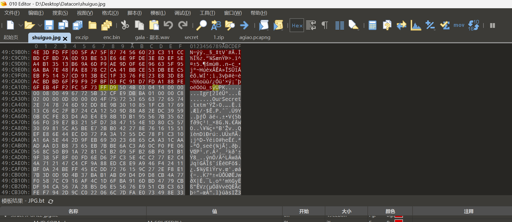
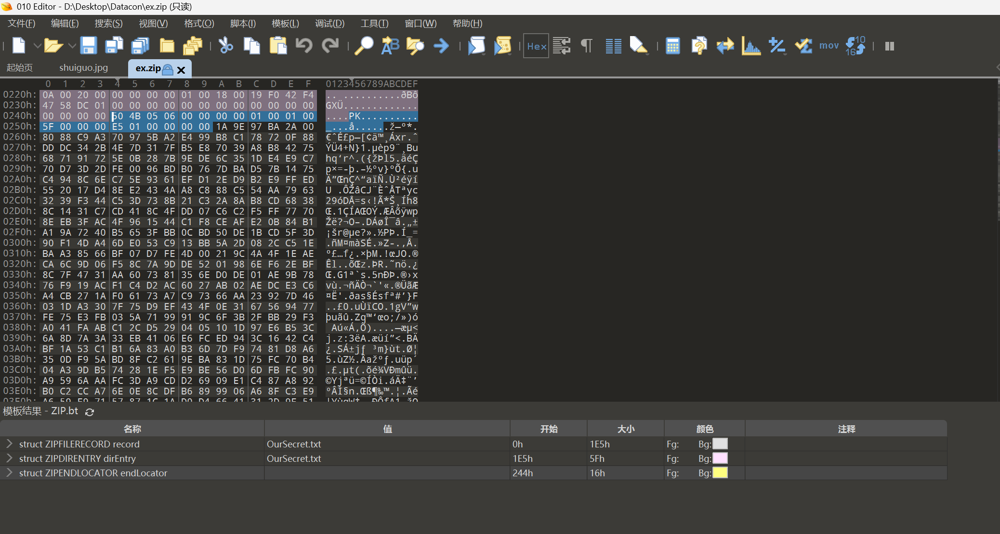
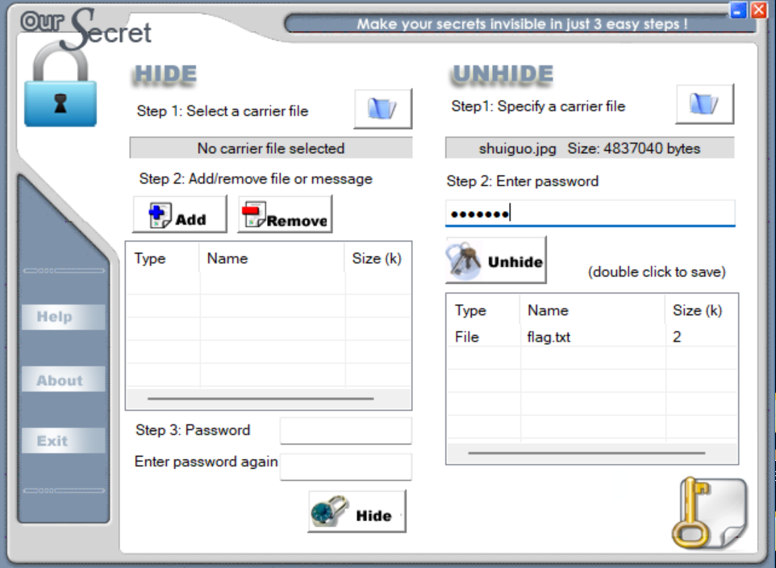

通过010 editor打开文件，发现末端存在ZIP头：


提取出来，打开发现无密码，是一串base64：
```txt
5L2g6L+Z6Iu55p6c5oCO5LmI6L+Z5LmI5aSnCuWkp+S4quWEv+aJjeWAvOmSseS9oOimgeS4jeimgQrov5nmoYPlrZDmgI7kuYjov5nkuYjnoawK56Gs5piv5Zug5Li65paw6bKc5L2g6KaB6L2v55qE6L+Y5piv57Ov55qECui/meilv+eTnOiDveWQg+WQl+eci+i1t+adpeacieeCueS4jeeGnwrkuI3nhp/nmoTopb/nk5zmgI7kuYjlj6/og73kvaDov5nlsLHmmK/nrYnnnYDlkIPnlJznmoQK5L2g6L+Z5p+a5a2Q6L+Z5LmI5bCPCuWwj+W3p+eahOaJjeWlveWQg+S9oOimgeWkp+S4queahOi/mOaYr+WlveWQg+eahArov5nmqZnlrZDmgI7kuYjov5nkuYjphbgK6YW45omN5piv5q2j5a6X55qE5qmZ5a2Q5L2g6KaB5piv55Sc55qE5Y675Yir5a6255yLCui/memmmeiVieacieeCueW8rwrlvK/nmoTpppnolYnmm7TnlJzkvaDkuI3mh4IK5L2g6L+Z5qKo5a2Q5piv5LiN5piv5pyJ54K556GsCuehrOaYr+WboOS4uuaWsOmynOWQg+edgOacieWPo+aEnwrov5nokaHokITmgI7kuYjov5nkuYjlsI8K5bCP55qE6JGh6JCE5pu05rWT57yp55Sc5ZGz
```
解码得到：
```txt
你这苹果怎么这么大
大个儿才值钱你要不要
这桃子怎么这么硬
硬是因为新鲜你要软的还是糯的
这西瓜能吃吗看起来有点不熟
不熟的西瓜怎么可能你这就是等着吃甜的
你这柚子这么小
小巧的才好吃你要大个的还是好吃的
这橙子怎么这么酸
酸才是正宗的橙子你要是甜的去别家看
这香蕉有点弯
弯的香蕉更甜你不懂
你这梨子是不是有点硬
硬是因为新鲜吃着有口感
这葡萄怎么这么小
小的葡萄更浓缩甜味
```
同时，发现导出的zip末端仍然有一部分未识别的数据：


根据其`1A 9E 97 BA 2A`可推测这是OurSecret隐写，通过OurSecret工具打开，发现需要密码。尝试发现密码就是`shuiguo`，可解出来一个txt：


```txt
你这柚子这么小
你这柚子这么小
你这柚子这么小
你这梨子是不是有点硬
你这柚子这么小
大个儿才值钱你要不要
你这柚子这么小
小巧的才好吃你要大个的还是好吃的
小巧的才好吃你要大个的还是好吃的
弯的香蕉更甜你不懂
硬是因为新鲜你要软的还是糯的
硬是因为新鲜你要软的还是糯的
你这柚子这么小
不熟的西瓜怎么可能你这就是等着吃甜的
硬是因为新鲜你要软的还是糯的
这桃子怎么这么硬
硬是因为新鲜你要软的还是糯的
不熟的西瓜怎么可能你这就是等着吃甜的
硬是因为新鲜你要软的还是糯的
酸才是正宗的橙子你要是甜的去别家看
硬是因为新鲜你要软的还是糯的
你这柚子这么小
硬是因为新鲜你要软的还是糯的
你这苹果怎么这么大
你这柚子这么小
大个儿才值钱你要不要
硬是因为新鲜你要软的还是糯的
小巧的才好吃你要大个的还是好吃的
硬是因为新鲜你要软的还是糯的
酸才是正宗的橙子你要是甜的去别家看
你这柚子这么小
这西瓜能吃吗看起来有点不熟
你这柚子这么小
这桃子怎么这么硬
你这柚子这么小
硬是因为新鲜你要软的还是糯的
硬是因为新鲜你要软的还是糯的
你这柚子这么小
硬是因为新鲜你要软的还是糯的
酸才是正宗的橙子你要是甜的去别家看
你这柚子这么小
这桃子怎么这么硬
硬是因为新鲜你要软的还是糯的
你这柚子这么小
硬是因为新鲜你要软的还是糯的
小巧的才好吃你要大个的还是好吃的
硬是因为新鲜你要软的还是糯的
这西瓜能吃吗看起来有点不熟
你这柚子这么小
硬是因为新鲜你要软的还是糯的
你这柚子这么小
这西瓜能吃吗看起来有点不熟
硬是因为新鲜你要软的还是糯的
这西瓜能吃吗看起来有点不熟
你这柚子这么小
不熟的西瓜怎么可能你这就是等着吃甜的
你这柚子这么小
硬是因为新鲜你要软的还是糯的
硬是因为新鲜你要软的还是糯的
你这柚子这么小
硬是因为新鲜你要软的还是糯的
小巧的才好吃你要大个的还是好吃的
你这柚子这么小
大个儿才值钱你要不要
硬是因为新鲜你要软的还是糯的
小巧的才好吃你要大个的还是好吃的
硬是因为新鲜你要软的还是糯的
这桃子怎么这么硬
你这柚子这么小
硬是因为新鲜你要软的还是糯的
硬是因为新鲜你要软的还是糯的
你这柚子这么小
硬是因为新鲜你要软的还是糯的
这桃子怎么这么硬
小巧的才好吃你要大个的还是好吃的
硬是因为新鲜吃着有口感
```
发现和上面解压出来的是一条条对应的。因为上面解压出来的语句是16条，推测是16进制，分别是`0-f`，然后将OurSecret解密出来的内容分别对应成16进制数，可得到：`666c61677b33653235393630613739646263363962363734636434656336376137326336327d`。
编写python脚本，2个一组按照ascii转换成字符：
```python
hex_string = "666c61677b33653235393630613739646263363962363734636434656336376137326336327d"
ascii_string = ''.join([chr(int(hex_string[i:i+2], 16)) for i in range(0, len(hex_string), 2)])
print(ascii_string)
```
得到Flag：`flag{3e25960a79dbc69b674cd4ec67a72c62}`