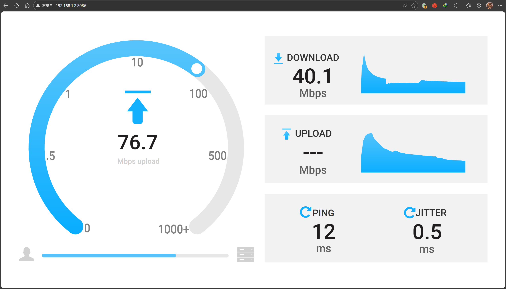
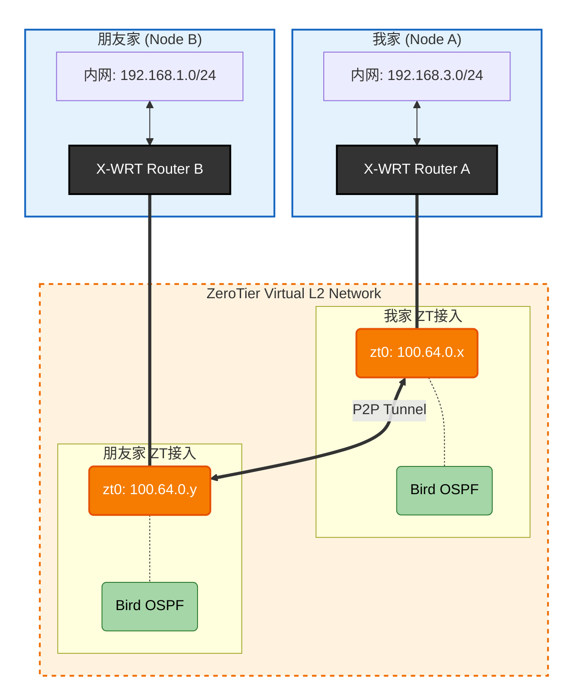

# 起因
本来在配自己的 ZeroTier 大内网, 因为网络结构比较复杂, 所以采用 OSPF 而不是静态路由来配置内部路由.    

之前尝试给自家 OpenWrt 上配置 ZeroTier 但是一直没成功, 这两天重新拿出来折腾了一下发现是 OpenWrt 的配置问题, 修好之后和好朋友闲聊的时候就想到: 


说干就干, 开整(

# 基本信息
## 本地
* 路由器系统: OpenWrt, `X-WRT 26.04_b202601250827`
* 局域网 IPv4 前缀: `192.168.3.0/24`
* 运营商: 合肥联通
* NAT 环境: NAT1

## 对端
* 路由器系统: OpenWrt, `X-WRT 25.04_b202510240128 `
* 局域网 IPv4 前缀: `192.168.1.0/24`
* 运营商: 合肥移动
* NAT 环境: NAT1


# 安装 ZeroTier 并使用自托管 Planet
我使用了 ZTNet 作为自托管 Controller , 搭建过程这里就不过多赘述了, 上网找一下就能找到.  
我使用的 OpenWrt 版本已经开始使用 `apk` 代替 `opkg` 作为包管理器. 使用 `apk` 可直接安装 zerotier-one:

```shell
apk add zerotier
```

完成后打开 `/etc/config/zerotier` 可找到默认配置文件.

```shell
config zerotier 'global'
	# Sets whether ZeroTier is enabled or not
	option enabled 0
	# Sets the ZeroTier listening port (default 9993; set to 0 for random)
	#option port '9993'
	# Client secret (leave blank to generate a secret on first run)
	option secret ''
	# Path of the optional file local.conf (see documentation at
	# https://docs.zerotier.com/config#local-configuration-options)
	#option local_conf_path '/etc/zerotier.conf'
	# Persistent configuration directory (to perform other configurations such
	# as controller mode or moons, etc.)
	#option config_path '/etc/zerotier'
	# Copy the contents of the persistent configuration directory to memory
	# instead of linking it, this avoids writing to flash
	#option copy_config_path '1'

# Network configuration, you can have as many configurations as networks you
# want to join (the network name is optional)
config network 'earth'
	# Identifier of the network you wish to join
	option id '8056c2e21c000001'
	# Network configuration parameters (all are optional, if not indicated the
	# default values are set, see documentation at
	# https://docs.zerotier.com/config/#network-specific-configuration)
	option allow_managed '1'
	option allow_global '0'
	option allow_default '0'
	option allow_dns '0'

# Example of a second network (unnamed as it is optional)
#config network
#	option id '1234567890123456'
#	option allow_managed '1'
#	option allow_global '0'
#	option allow_default '0'
#	option allow_dns '0'
```

按照需求修改一下:

```shell
config zerotier 'global'
    option enabled '1'              # 启用 ZeroTier 客户端服务
    option config_path '/etc/zerotier' # 持久化目录: 用于存放身份秘钥(identity)、Moon节点定义和网络设置
    option secret ''                # 秘钥留空: 首次启动会自动生成身份并存入 identity.secret 文件
    option copy_config_path '1'     # 保护闪存策略: 启动时将配置考入内存运行. 若设为 0, 则直接在 Flash 上读写

config network 'earth'
    option id '<network ID>'        # 16位 ZeroTier 网络标识符
    option allow_managed '1'        # 允许接收控制器分配的 IP 地址、路由和标签
    option allow_global '1'         # 允许通过 ZeroTier 分配全球单播 IPv6 地址 (GUA)
    option allow_default '0'        # 允许 ZeroTier 接管默认网关(实现类似全局代理的效果) 
    option allow_dns '1'            # 允许接收并设置 ZeroTier 控制面板中配置的 DNS 服务器

```

## 关于 copy_config_path '1'
因为 ZeroTier 工作目录 `/var/lib/zerotier-one` 在OpenWrt下属于 `tmpfs` , 重启后这里的内容会被清空, 因此需要将 planet ,identity, network 等配置放到路由器的 Flash 存储中, 即 `config_path` 配置的路径.  
默认逻辑是启动的时候将配置的 `config_path` 软链接到 `/var/lib/zerotier-one` 实现配置持久化, 一切 `/var/lib/zerotier-one` 下的读写操作都会被写入到 Flash. 但是问题就是 ZeroTier 的频繁读写会导致 Flash 寿命折损比较快.  
而开启 `copy_config_path '1'` 则会指定当 ZeroTier 启动的时候, 将 `config_path` 中的配置直接复制到 `/var/lib/zerotier-one`, 极大延长了路由器内部 Flash 的寿命, 但是问题是通过 `zerotier-cli` 做的一些修改默认不会直接同步到 Flash, 因此不适合需要经常调整配置的使用场景.

----

完成修改后使用

```shell
/etc/init.d/zerotier start
/etc/init.d/zerotier enable
```

来启动 ZeroTier 并开启开机自启.

第一次启动时若上面 `secret` 配置项留空, 则会自动生成. 启动完成后将 `/var/lib/zerotier-one` 下的所有文件复制到 `/etc/zerotier`. 

将 Planet 文件下载到上面设置的 `config_path` 中, 即 `/etc/zerotier`. 完成后重启 ZeroTier:
```shell
/etc/init.d/zerotier restart
```

即可. 接着去 ZeroTier Controller 控制台, 就能看到新设备接入了.  

接着可能需要允许 ZeroTier 流量通过防火墙, 这一步可参考网上其他教程. 我选择直接放行所有, NAT1下应该不会有太大问题.  

# 安装并配置 Bird2
_没想到 apk 里的 Bird2 是非常新的版本, 截止本文写作时间 `2026-02-10`, apk 里的 Bird2 版本为 2.18_

使用如下指令安装:
```shell
apk add bird2  # bird daemon 本体
apk add bird2c # birdc 指令
```

因为 OpenWrt 默认的 bird 配置文件存放在 `/etc/bird.conf`, 而我习惯按照不同的功能分不同的文件夹实现模块化引用, 因此我选择将默认配置文件改到 `/etc/bird/bird.conf`, 并在该文件夹下存放不同配置文件.  
打开 `/etc/init.d/bird`:
```shell
#!/bin/sh /etc/rc.common
# Copyright (C) 2010-2017 OpenWrt.org

USE_PROCD=1
START=70
STOP=10

BIRD_BIN="/usr/sbin/bird"
BIRD_CONF="/etc/bird.conf"
BIRD_PID_FILE="/var/run/bird.pid"

start_service() {
    mkdir -p /var/run
    procd_open_instance
    procd_set_param command $BIRD_BIN -f -c $BIRD_CONF -P $BIRD_PID_FILE
    procd_set_param file "$BIRD_CONF"
    procd_set_param stdout 1
    procd_set_param stderr 1
    procd_set_param respawn
    procd_close_instance
}

reload_service() {
    procd_send_signal bird
}
```

修改 `BIRD_CONF` 值为 `/etc/bird/bird.conf`:

```diff
- BIRD_CONF="/etc/bird.conf"
+ BIRD_CONF="/etc/bird/bird.conf"
```

然后新建 `/etc/bird`文件夹, 之后的 OSPF 配置文件全都放在这里.

# 配置 OSPF
我的配置文件结构遵循如下规则: 
* 由 `/etc/bird/bird.conf` 作为唯一入口点, 在这里定义一些基础的配置项, 如 Router ID, 过滤器网段, 接着由该文件引用其他子项的配置
* 不同网络的配置放在不同的文件夹下, 如公网部分放在 `/etc/bird/inet/`, DN42 部分放在 `/etc/bird/dn42/`, 自己的内网部分放在 `/etc/bird/intra/`
* 不同的网络都由一个 `defs.conf` 处理那些公共的函数 (类似于 Golang 开发时写的 utils? )

因此最终的配置文件结构如下：
* `/etc/bird/bird.conf`: 配置文件入口点
```nginx
define INTRA_ROUTER_ID = 100.64.0.100;
define INTRA_PREFIX_V4 = [ 100.64.0.0/16+, 192.168.0.0/16+ ]; # 允许被 OSPF 传递的 IPv4 前缀
define INTRA_PREFIX_V6 = [ fd18:3e15:61d0::/48+ ]; # 允许被 OSPF 传递的 IPv6 前缀

protocol device {
    scan time 10;
};

ipv4 table intra_table_v4; # 定义内部路由 IPv4 路由表
ipv6 table intra_table_v6; # 定义内部路由 IPv6 路由表

include "intra/defs.conf";
include "intra/kernel.conf";
include "intra/ospf.conf";
```
这里的 RouterID 我直接拿的这台机器在 ZeroTier 内网的 IPv4 地址.
分表是为了后期如果要为这台机器接入 DN42, 分表会比较安全.  

* `/etc/bird/intra/defs.conf`: 过滤器所用的函数
```nginx
function is_intra_net4() {
    return net ~ INTRA_PREFIX_V4;
}

function is_intra_net6(){
    return net ~ INTRA_PREFIX_V6;
}

function is_intra_dn42_net4(){
    return net ~ [ 172.20.0.0/14+ ];
}

function is_intra_dn42_net6(){
    return net ~ [ fd00::/8+ ];
}
```

* `/etc/bird/intra/kernel.conf`: 将 OSPF 学习到的路由写入系统路由表
```nginx
protocol kernel intra_kernel_v4 {
    kernel table 254;
    scan time 20;
    ipv4 {
        table intra_table_v4;
        import none;
        export filter {
            if source = RTS_STATIC then reject;
            accept;
        };
    };
};

protocol kernel intra_kernel_v6 {
    kernel table 254;
    scan time 20;
    ipv6 {
        table intra_table_v6;
        import none;
        export filter {
            if source = RTS_STATIC then reject;
            accept;
        };
    };
};
```

* `/etc/bird/intra/ospf.conf`: OSPF 模块
```nginx
protocol ospf v3 intra_ospf_v4 {
    router id INTRA_ROUTER_ID; # 指定 RouterID
    
    ipv4 {
        table intra_table_v4; # 指定路由表
        import where is_intra_dn42_net4() || is_intra_net4() && source != RTS_BGP;
        export where is_intra_dn42_net4() || is_intra_net4() && source != RTS_BGP;
    };

    include "ospf/*";
};

protocol ospf v3 intra_ospf_v6 {
    router id INTRA_ROUTER_ID; # 指定 RouterID

    ipv6 {
        table intra_table_v6; # 指定路由表
        import where is_intra_dn42_net6() || is_intra_net6() && source != RTS_BGP;
        export where is_intra_dn42_net6() || is_intra_net6() && source != RTS_BGP;
    };

    include "ospf/*";
};
```

* `/etc/bird/intra/ospf/backbone.conf`: OSPF 区域配置
```nginx
area 0.0.0.0 {
    interface "br-lan" { stub; }; # 本地内网网卡
    interface "zta7oqfzy6" { # ZeroTier 网卡
        type broadcast;
        cost 100;
        hello 20;
    };
};
```

完成后使用:
```shell
/etc/init.d/bird start
/etc/init.d/bird enable
```
来启动 Bird 并开启开机自启.  
如果没问题的话便可以使用
```shell
birdc s p
```
查看 Bird 状态. 如果不出意外的话等对方配置好应该能看到 OSPF 状态是 Running 了:
```shell
root@X-WRT:/etc/bird# birdc s p
BIRD 2.18 ready.
Name       Proto      Table      State  Since         Info
device1    Device     ---        up     14:28:02.410  
intra_kernel_v4 Kernel     intra_table_v4 up     14:28:02.410  
intra_kernel_v6 Kernel     intra_table_v6 up     14:28:02.410  
intra_ospf_v4 OSPF       intra_table_v4 up     14:28:02.410  Running
intra_ospf_v6 OSPF       intra_table_v6 up     14:31:38.389  Running
```

----

在朋友那边也按照这套流程走一遍, 等双方都是 Running 状态, 就可以通过
```shell
birdc s r protocol intra_ospf_v4
```
查看 OSPF 学到的路由. 发现已经可以正常学习到通过 ZeroTier 的通往对方的路由:
```shell
root@X-WRT:/etc/bird# birdc s r protocol intra_ospf_v4
BIRD 2.18 ready.
Table intra_table_v4:
...
192.168.1.0/24       unicast [intra_ospf_v4 23:20:21.398] * I (150/110) [100.64.0.163]
	via 100.64.0.163 on zta7oqfzy6
...
192.168.3.0/24       unicast [intra_ospf_v4 14:28:02.511] * I (150/10) [100.64.0.100]
	dev br-lan
```
在 PC 上 Ping 朋友家的服务器也可以 Ping 通:
```shell
iyoroy@iYoRoy-PC:~$ ping 192.168.1.103
PING 192.168.1.103 (192.168.1.103) 56(84) bytes of data.
64 bytes from 192.168.1.103: icmp_seq=1 ttl=63 time=54.3 ms
64 bytes from 192.168.1.103: icmp_seq=2 ttl=63 time=10.7 ms
64 bytes from 192.168.1.103: icmp_seq=3 ttl=63 time=15.2 ms
^C
--- 192.168.1.103 ping statistics ---
3 packets transmitted, 3 received, 0% packet loss, time 1998ms
rtt min/avg/max/mdev = 10.678/26.717/54.279/19.576 ms
iyoroy@iYoRoy-PC:~$ traceroute 192.168.1.103
traceroute to 192.168.1.103 (192.168.1.103), 30 hops max, 60 byte packets
 1  100.64.0.163 (100.64.0.163)  10.445 ms  9.981 ms  9.892 ms
 2  192.168.1.103 (192.168.1.103)  11.621 ms  10.994 ms  10.948 ms
```
正常打开网页测速都没有问题:


# 总结
这一系列操作实际上实现了如下的网络结构:



最底层的 P2P 网络还是依靠 ZeroTier实现的, 不过使用 OSPF 内部寻路来让两边都可以直接路由到对方网段下的设备, 同时因为双方都能完整学习到对方的路由, 因此不需要使用任何的NAT, 双方也都能直接获取到对方的来源地址.

----

# 朋友视角
* [Linux 运维 - 新版 OpenWrt 基于 Bird 的 OSPF 组网实现 » Nanamiの电波发射塔](https://blog.nanami.tech/archives/216/)
