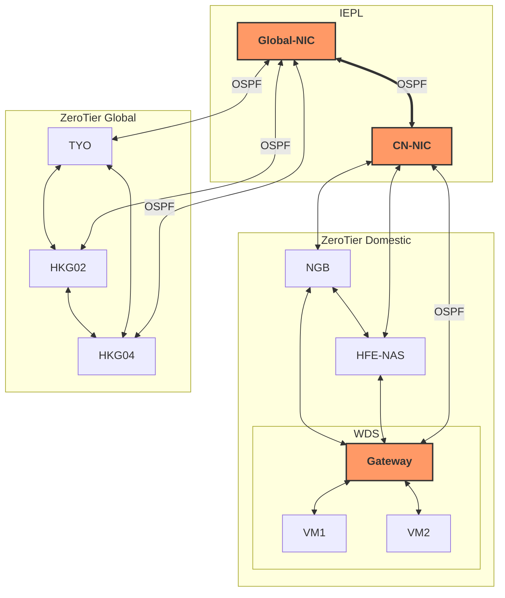
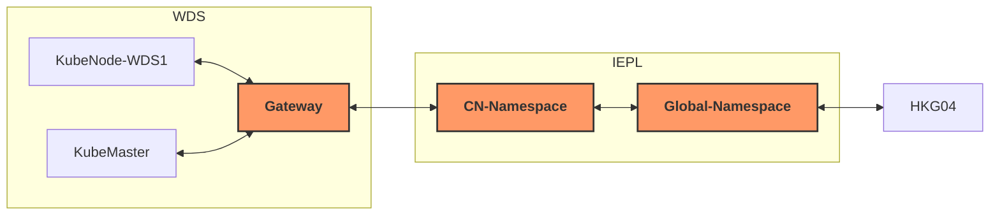
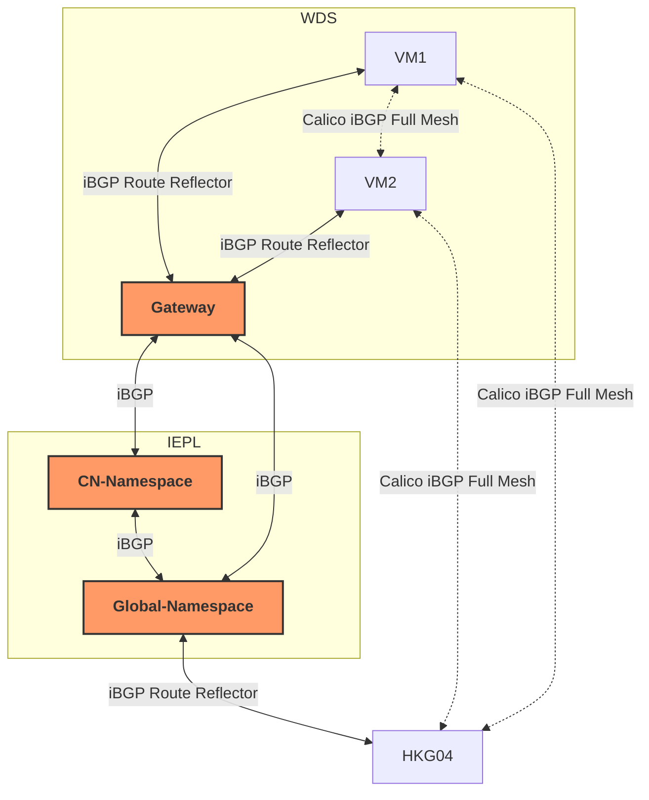

# 前言
其实老早就想玩玩 K8s 集群了，一直觉得没有足够的知识支撑，玩起来比较的费劲就没尝试。  
前段时间好好研究了一下 DN42 和 BGP, OSPF 之类的组网协议，发现现在理解起来不那么费劲了，于是果断上手 K3s（  

选择 K3s 而不是 K8s 主要原因还是其轻量化：资源要求低，部署不需要拉一大堆镜像，有国内镜像……总之就是，觉得 K3s 比较符合我的需求。  

咱是刚开始研究 K3s 的小白，若有错误还请各位大佬手下留情~
# 分析
## CNI 组件的选择
我目前的网络架构是这样的：

其中，  WDS 节点是个 ProxmoxVE，下挂多个 VM ，通过 OSPF 广播其 VM 的 IPv4 Prefix 地址，香港节点需要访问到 WDS 节点下挂 VM 时便可以通过加入 OSPF 内网实现多跳可达。这样封装层数也只有1层，不需要担心 MTU 消消乐。  

我打算在 WDS 下新开两个 VM 分别用作主控和一个节点（暂且称其为 KubeMaster 、KubeNode-WDS1），然后 HKG04 （暂且称为KubeNode-HKG04） 也当作一个节点接入 K3s。  

最简单的方式其实是直接通过 K3s 默认的 Flannel 作为 CNI，但是 Flannel 是基于 VXLAN 的，再套一层我现有的内网的话就会产生如下 MTU 消消乐的情况：
```plain
数据包 -> Flannel VXLAN封装 -> ZeroTier封装 -> 物理链路
```
实际容器间通信可用 MTU 大概得压缩到 1350 甚至更低。因此，我尝试寻找一个能直接基于这套内网工作的 CNI 方案，然后就找到了 Calico。了解下来知道 Calico 是以 BGP 作为底层寻路协议，支持通过 No-Encapsulated 即无封装模式启动，数据包直接交由上层路由器处理路由，因此选择 Calico 作为 CNI 组件。 
## 路由设计
为了保证中间节点的路由器可以知道如何路由 Pod 的 IP，而 KubeMaster 和 KubeNode-WDS1 在 ProxmoxVE 主机下，他们需要跨越整个内网与 HKG04 建立 BGP， 因此这就意味着中间每一级路由都需要学习到完整的 BGP 路由，这样才能打通这样的路由路径：

否则，中间的任何一跳都会因为不认识来源/目标 IP 导致丢包。同时，由于 iBGP 从邻居学到的路由，不能继续传递给下一个 iBGP 邻居的特性，Gateway、CN-Namespace、Global-Namespace 与节点间的 BGP Session 都需要启用 Route Reflector， 否则节点无法正确互相学习到路由。  

虽然但是，其实这种架构更适合做 BGP Confederation （ BGP 联邦），但是我现有的网络已经很复杂，再加 BGP 联邦会让后期维护起来比较麻烦，而且我的节点数量也不多，iBGP Full Mesh 的开销还能接受。 ~~绝对不是因为我懒（~~

所以最终网络路由结构是这样的：

_虚线部分的 BGP Session 是 Calico 自动创建的，实现部分是需要我们手动指派创建的_  

保留 Calico 自己的 iBGP Full Mesh 是为了后续可扩展性考虑，使得各个节点之间可以尽量通过 ZeroTier P2P 优先建立直连网络，而不是从 Route Reflector 汇聚路由器转发绕一圈。
# 部署
理清了结构之后部署就很简单了。
## 开启内核转发并关闭 rp_filter
老生常谈。
```shell
echo "net.ipv4.ip_forward=1" >> /etc/sysctl.conf
echo "net.ipv6.conf.default.forwarding=1" >> /etc/sysctl.conf
echo "net.ipv6.conf.all.forwarding=1" >> /etc/sysctl.conf
echo "net.ipv4.conf.default.rp_filter=0" >> /etc/sysctl.conf
echo "net.ipv4.conf.all.rp_filter=0" >> /etc/sysctl.conf
sysctl -p
```
## 安装 K3s
### Master
因为 KubeMaster 主控节点在境内，所以最好配置一下镜像加速：
```shell
mkdir -p /etc/rancher/k3s
cat <<EOF > /etc/rancher/k3s/registries.yaml
mirrors:
  docker.io:
    endpoint:
      - "https://docker.m.daocloud.io"
  quay.io:
    endpoint:
      - "https://quay.m.daocloud.io"
EOF
```
使用镜像源安装：
```shell
curl -sfL https://rancher-mirror.rancher.cn/k3s/k3s-install.sh | \
  INSTALL_K3S_MIRROR=cn INSTALL_K3S_EXEC=" \
  --flannel-backend=none \
  --disable-network-policy \
  --cluster-cidr=10.42.0.0/16" sh -
```
需要注意的是要指定 `--flannel-backend=none` 和 `--disable-network-policy` 来禁用默认 CNI 组件。  
使用 `cat /var/lib/rancher/k3s/server/node-token` 查看 Token ，并记录下来。
### WorkerNode
境内节点配置镜像加速：
```shell
mkdir -p /etc/rancher/k3s
cat <<EOF > /etc/rancher/k3s/registries.yaml
mirrors:
  docker.io:
    endpoint:
      - "https://docker.m.daocloud.io"
  quay.io:
    endpoint:
      - "https://quay.m.daocloud.io"
EOF
```
然后使用镜像源安装 K3s 并加入集群：
```shell
export INSTALL_K3S_MIRROR=cn
export K3S_URL=https://<主控节点 IP>:6443  # 换成你的主节点实际IP
export K3S_TOKEN=K10...你的TOKEN...::server:xxx # 换成第一步获取的完整TOKEN

curl -sfL https://rancher-mirror.rancher.cn/k3s/k3s-install.sh | sh -
```

这个时候各个节点的状态应该是 NotReady 的，因为缺少 CNI 组件。
## 安装 Calico 并配置 No-Encap 模式

在主控上手动下载下来 `https://raw.githubusercontent.com/projectcalico/calico/v3.26.1/manifests/tigera-operator.yaml` ，安装 Calico 算子：  
```shell
kubectl create -f tigera-operator.yaml
```
配置自定义资源，创建一个 `custom-resource.yaml` 文件：
```yml
apiVersion: operator.tigera.io/v1
kind: Installation
metadata:
  name: default
spec:
  # 添加镜像注册表配置
  registry: quay.m.daocloud.io 
  calicoNetwork:
    ipPools:
    - blockSize: 26
      cidr: 10.42.0.0/16
      encapsulation: None
      natOutgoing: Enabled
      nodeSelector: all()
```
此处通过指定 `encapsulation: None` 来设置 No-Encap 模式。想要修改 IPv4 CIDR 也可以在这里改。随后
```shell
kubectl apply -f custom-resource.yaml
```
执行安装。使用：
```shell
kubectl get pods -A -o wide
```
查看 Pod 状态，等待各个节点拉取完成即可。  
## 配置 BGP 拓扑
### 节点打标
通过给节点打标来指定 WDS 下的节点全都连接到 WDS 节点的 Gateway 的 BGP，境外节点全部连接 Global Namespace 的 BGP：
```shell
kubectl label nodes kubemaster region=WDS
kubectl label nodes kubenode-wds-1 region=WDS
kubectl label nodes kubenode-hkg04 region=Global
```
### Calico 配置
编写 yaml 配置文件：
```yaml
apiVersion: crd.projectcalico.org/v1
kind: BGPPeer
metadata:
  name: route-reflector-domestic
spec:
  nodeSelector: region == 'Domestic' # 这部分其实没用上，我原来设计的是 Domestic 区域有个总体的汇聚路由
  peerIP: 100.64.0.108
  asNumber: 64512
---
apiVersion: crd.projectcalico.org/v1
kind: BGPPeer
metadata:
  name: route-reflector-wds
spec:
  nodeSelector: region == 'WDS'
  peerIP: 192.168.100.1
  asNumber: 64512
---
apiVersion: crd.projectcalico.org/v1
kind: BGPPeer
metadata:
  name: route-reflector-global
spec:
  nodeSelector: region == 'Global'
  peerIP: 100.64.1.106
  asNumber: 64512
```
这部分的意思是：
* 所有 `region` 标签为 `Domestic` 的节点都添加一个连接到 `100.64.0.108` （即境内汇聚路由）的 BGP Session，使用 AS `64512`
* 所有 `region` 标签为 `WDS` 的节点都添加一个连接到 `192.168.100.1` （即 WDS 节点所有 VM 的 Gateway）的 BGP Session，使用 AS `64512`
* 所有 `region` 标签为 `Global` 的节点都添加一个连接到 `100.64.1.106` （即境外汇聚路由）的 BGP Session，使用 AS `64512`

借此实现上文图示的，所有 WDS 节点下的 VM，包括主控和 KubeNode-WDS1 都接入到 WDS 节点的 Gateway 汇聚路由，境外区域的所有节点都接入到境外部分的汇聚路由。
### 配置汇聚路由 iBGP
这部分直接写 Bird 配置文件就行了，简单（  
这里举几个例子：
* `k3s/ibgp.conf`：
```nginx
function is_insider_as(){
    if bgp_path.len > 0 && !(bgp_path ~ [= 64512 =]) then {
        return false;
    }

    if net ~ [ 10.42.0.0/16{16,32} ] then {
        return true;
    }

    return false;
}

template bgp k3sbackbone{
    local as K3S_AS;
    router id INTRA_ROUTER_ID;
    neighbor as K3S_AS;

    ipv4{
        table intra_table_v4;
        import filter{
            if is_insider_as() then accept;
            reject;
        };
        export filter{
            if is_insider_as() then accept;
            reject;
        };
        next hop self;
        extended next hop;
    };

    ipv6{
        table intra_table_v6;
        import filter{
            if is_insider_as() then accept;
            reject;
        };
        export filter{
            if is_insider_as() then accept;
            reject;
        };
        next hop self;
    };
};

template bgp k3speers{
    local as K3S_AS;
    neighbor as K3S_AS;
    router id INTRA_ROUTER_ID;
    rr client;
    rr cluster id INTRA_ROUTER_ID;

    ipv4{
        table intra_table_v4;
        import filter{
            if is_insider_as() then accept;
            reject;
        };
        export filter{
            if is_insider_as() then accept;
            reject;
        };
        next hop self;
    };

    ipv6{
        table intra_table_v6;
        import filter{
            if is_insider_as() then accept;
            reject;
        };
        export filter{
            if is_insider_as() then accept;
            reject;
        };
        next hop self;
    };
};

include "ibgpeers/*";
```

* `ibgpeers/backbone-cn.conf`：
```nginx
protocol bgp 'k3s_backbone_cn_v4' from k3sbackbone{
    neighbor fd18:3e15:61d0:cafe:f001::1;
};
```

* `ibgpeers/master.conf`：
```nginx
protocol bgp 'k3s_master_v4' from k3speers{
    neighbor 192.168.100.251;
};
```

主要是几个汇聚路由之间最好不要开 Route Reflector，以及记得开 next hop self。

---

全部完成之后使用 `kubectl get nodes` 应该能看到节点状态都 Ready 了：
```plain
NAME             STATUS   ROLES           AGE     VERSION
kubemaster       Ready    control-plane   2d23h   v1.34.5+k3s1
kubenode-hkg04   Ready    <none>          11h     v1.34.6+k3s1
kubenode-wds-1   Ready    <none>          2d7h    v1.34.5+k3s1
```

使用 `kubectl get pods -A -o wide` 查看 Pods：
```plain
NAMESPACE         NAME                                       READY   STATUS      RESTARTS        AGE     IP                NODE             NOMINATED NODE   READINESS GATES
calico-system     calico-kube-controllers-64fc874957-6bdlz   1/1     Running     0               5h38m   10.42.253.136     kubenode-hkg04   <none>           <none>
calico-system     calico-node-2qz82                          1/1     Running     0               4h24m   10.2.5.7          kubenode-hkg04   <none>           <none>
calico-system     calico-node-dhl2c                          1/1     Running     0               4h24m   192.168.100.251   kubemaster       <none>           <none>
calico-system     calico-node-nbpkj                          1/1     Running     0               4h23m   192.168.100.252   kubenode-wds-1   <none>           <none>
calico-system     calico-typha-7bb5db4bdc-rfpwg              1/1     Running     0               5h38m   10.2.5.7          kubenode-hkg04   <none>           <none>
calico-system     calico-typha-7bb5db4bdc-rwwr5              1/1     Running     0               5h38m   192.168.100.251   kubemaster       <none>           <none>
calico-system     csi-node-driver-jglwp                      2/2     Running     0               5h38m   10.42.64.68       kubenode-wds-1   <none>           <none>
calico-system     csi-node-driver-jqjsc                      2/2     Running     0               5h38m   10.42.253.137     kubenode-hkg04   <none>           <none>
calico-system     csi-node-driver-vk26s                      2/2     Running     0               5h38m   10.42.141.16      kubemaster       <none>           <none>
kube-system       coredns-695cbbfcb9-8fx4p                   1/1     Running     1 (7h27m ago)   2d23h   10.42.141.14      kubemaster       <none>           <none>
kube-system       helm-install-traefik-crd-5bkwx             0/1     Completed   0               2d23h   <none>            kubemaster       <none>           <none>
kube-system       helm-install-traefik-m9fgj                 0/1     Completed   1               2d23h   <none>            kubemaster       <none>           <none>
kube-system       local-path-provisioner-546dfc6456-dmn4g    1/1     Running     1 (7h27m ago)   2d23h   10.42.141.15      kubemaster       <none>           <none>
kube-system       metrics-server-c8774f4f4-2wkwh             1/1     Running     1 (7h27m ago)   2d23h   10.42.141.12      kubemaster       <none>           <none>
kube-system       svclb-traefik-999cddce-hpmcm               2/2     Running     6 (7h26m ago)   11h     10.42.253.134     kubenode-hkg04   <none>           <none>
kube-system       svclb-traefik-999cddce-q4225               2/2     Running     2 (7h27m ago)   2d22h   10.42.141.9       kubemaster       <none>           <none>
kube-system       svclb-traefik-999cddce-xmd64               2/2     Running     2 (7h26m ago)   2d6h    10.42.64.66       kubenode-wds-1   <none>           <none>
kube-system       traefik-788bc4688c-vbbhj                   1/1     Running     1 (7h27m ago)   2d22h   10.42.141.13      kubemaster       <none>           <none>
tigera-operator   tigera-operator-6b95bbf4db-vl46l           1/1     Running     1 (7h27m ago)   2d23h   192.168.100.251   kubemaster       <none>           <none>
```

使用 `kubectl exec -it -n calico-system <calico-node-xxxx> -- birdcl s p` 可查看 Bird 的状态：
```shell
root@KubeMaster:~/kube/calico# kubectl exec -it -n calico-system calico-node-2qz82 -- birdcl s p
Defaulted container "calico-node" out of: calico-node, flexvol-driver (init), install-cni (init)
BIRD v0.3.3+birdv1.6.8 ready.
name     proto    table    state  since       info
static1  Static   master   up     08:58:17    
kernel1  Kernel   master   up     08:58:17    
device1  Device   master   up     08:58:17    
direct1  Direct   master   up     08:58:17    
Mesh_192_168_100_251 BGP      master   up     08:58:33    Established   
Mesh_192_168_100_252 BGP      master   up     08:59:00    Established   
Node_100_64_1_106 BGP      master   up     12:57:44    Established   
```

`ip r` 可查看系统路由表：
```shell
root@KubeMaster:~/kube/calico# ip r
default via 192.168.100.1 dev eth0 proto static 
10.42.64.64/26 proto bird 
        nexthop via 192.168.100.1 dev eth0 weight 1 
        nexthop via 192.168.100.252 dev eth0 weight 1 
blackhole 10.42.141.0/26 proto bird 
10.42.141.9 dev caliac6501d3794 scope link 
10.42.141.12 dev calib07c23291bb scope link 
10.42.141.13 dev caliab16e60bd19 scope link 
10.42.141.14 dev calid5959219080 scope link 
10.42.141.15 dev cali026d8f1ddb7 scope link 
10.42.141.16 dev califa657ba417a scope link 
10.42.253.128/26 via 192.168.100.1 dev eth0 proto bird 
192.168.100.0/24 dev eth0 proto kernel scope link src 192.168.100.251 
```

找一个Pod 的地址 Ping 一下，如果没啥问题的话应该就能直接通了：
```shell
root@KubeMaster:~/kube/calico# ping 10.42.253.137
PING 10.42.253.137 (10.42.253.137) 56(84) bytes of data.
64 bytes from 10.42.253.137: icmp_seq=1 ttl=60 time=33.7 ms
64 bytes from 10.42.253.137: icmp_seq=2 ttl=60 time=33.5 ms
^C
--- 10.42.253.137 ping statistics ---
2 packets transmitted, 2 received, 0% packet loss, time 1002ms
rtt min/avg/max/mdev = 33.546/33.632/33.718/0.086 ms
```

### 调优 MTU
这一步其实是为了稳定性……？  
测试下来发现虽然我的 ZeroTier MTU 是 1420，但是实际上包大小到达 1392 左右就会开始触发分片（可用 `ping -M do -s <包大小> <Pod_IP>` 测试），因此强制指定 Pod MTU 为 1370：
```shell
root@KubeMaster:~/kube/calico# cat patch-mtu.yaml 
apiVersion: operator.tigera.io/v1
kind: Installation
metadata:
  name: default
spec:
  calicoNetwork:
    mtu: 1370
    nodeAddressAutodetectionV4:
      firstFound: true
root@KubeMaster:~/kube/calico# kubectl apply -f patch-mtu.yaml 
installation.operator.tigera.io/default configured
```