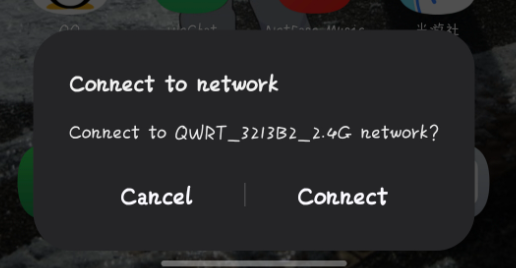

# 分析
将小米BE10000刷入QWRT后，猫棒和 SFP+ 接口在我的配置下已经可以使用，但原厂的 NFC 碰一碰连 Wi-Fi 功能失效了。查阅资料后，发现可以尝试通过 I2C 访问主板上的 NFC EEPROM，更新其中的 Wi-Fi 凭证。先使用`i2cdetect`进行扫描：

```bash
root@QWRT:~# i2cdetect -l
i2c-1   i2c             QUP I2C adapter                         I2C adapter
i2c-2   i2c             QUP I2C adapter                         I2C adapter
i2c-0   i2c             QUP I2C adapter                         I2C adapter
root@QWRT:~# i2cdetect -y -r 0
     0  1  2  3  4  5  6  7  8  9  a  b  c  d  e  f
00:          -- -- -- -- -- -- -- -- -- -- -- -- -- 
10: -- -- -- -- -- -- -- -- -- -- -- -- -- -- -- -- 
20: -- -- -- -- -- -- -- -- -- -- -- -- -- -- -- -- 
30: -- -- -- -- -- -- -- -- -- -- -- -- -- -- -- -- 
40: -- -- -- -- -- -- -- -- -- -- -- -- -- -- -- -- 
50: -- -- -- -- 54 -- -- -- -- -- -- -- -- -- -- -- 
60: -- -- -- -- -- -- -- -- -- -- -- -- -- -- -- -- 
70: -- -- -- -- -- -- -- --  
```
扫描结果很快锁定，设备挂载在I2C总线`0`上，物理地址为`0x54`。
NFC碰一碰连WiFi则用的是标准的NDEF格式的数据(Ref: [Wi-Fi Simple Configuration — ndeflib 0.3.2 documentation](https://ndeflib.readthedocs.io/en/stable/records/wifi.html))，因此只需要按照标准将数据写入EEPROM即可复现NFC碰一碰连接功能。
# 实现
> 本文内容仅探讨 OpenWrt/QWRT 系统的底层硬件驱动适配与 NDEF 标准协议的封装。文中涉及的硬件参数系基于公开规范文档与通用 I2C 调试工具探测得出。本项目为个人研究兴趣，未包含、也未分发任何厂商专有二进制代码。仅供技术交流学习，请勿用于商业用途，因尝试本文操作导致的设备损坏风险需由读者自行承担。
## 提取数据构造NDEF数据
要实现自动根据Wi-Fi账号密码更新NFC数据，首先得拿到当前的Wi-Fi账号密码。在OpenWrt上，这部分配置全部由**UCI (Unified Configuration Interface)** 管理，因此我们只需要读取 UCI 中的 `wireless` 配置文件即可。  
为应对现代手机的兼容性问题。早期的设备通常使用**Device Password Token**触发WPS协商，但现代Android/iOS系统已经限制了这种行为。为了兼顾兼容性，我们需要遵循Wi-Fi Simple Configuration (WSC)规范，将配置打包成 **WLAN Configuration Token (凭证配置令牌)**。(Ref: [Wi-Fi Simple Configuration — ndeflib 0.3.2 documentation](https://ndeflib.readthedocs.io/en/stable/records/wifi.html#ndef-record-classes))  
将OpenWrt的无线加密模式（如WPA2、WPA3-SAE）精准映射为 WSC 规范定义的 Hex 代码：  
- `0x1003`: 认证类型 (Authentication Type)
- `0x100F`: 加密类型 (Encryption Type)
- `0x1045`: SSID
- `0x1027`: 网络密钥 (密码)
通过脚本自动遍历并选举出桥接到`lan`的首选AP（`wifi0`），将其属性转换为Hex字符串，我们就得到了一串标准的NDEF注入载荷。  
## 写入NFC EEPROM
NFC的EEPROM在接收长串的NDEF数据时，如果连续写入太快，或者单次写入块过大，容易导致芯片的I2C状态机死锁。    
经过测试，最终选择使用`i2ctransfer`工具来进行分片原子写入。两个关键的时序细节：  
1. 由于通信限制，每次循环只切片取 4 个字节，带有寄存器地址递增的方式进行片段写入。
2. 在每次 4 字节的 block 写入之间，强制加上10毫秒的时序延迟，给芯片留下足够的内部擦写时间。最后对不足 4 字节的数据用 `0x00` 补零。
## 实现更改Wi-Fi信息自动触发写入
为了尽量贴合OpenWRT的架构，原先通过下hook的方式尝试了，但是发现经常会hook不上，最后加了三层fallback：
1. LuCI前端触发: 通过在`/etc/uci-defaults/`下注册钩子，将NFC同步脚本与系统的`ucitrack`机制绑定。当用户在LuCI中修改了Wi-Fi密码并点击“保存并应用”，系统就会在后台自动更新NFC数据。  
2. Hotplug层: 在`/etc/hotplug.d/iface/70-nfc`中添加热插拔监听事件。当路由器的`lan`或`wifi`接口发生`ifup`状态改变时，系统能够自动触发调度。
3. 定时任务: 若所有方式都没能触发，每隔15秒会强制检查一次并判断是否需要更新NFC数据。

同时，考虑到NFC芯片的EEPROM擦写次数是有限的。如果网络接口重启一次就全量重写一次，芯片很快就会报废。因此，在底层的`nfc-sync`调度脚本中，引入了简单的哈希校验机制：
1. 脚本被唤醒后，首先提取当前的 `wireless` 配置并计算 MD5 值。
2. 将其与缓存在`/var/run/nfc-wireless.md5`中的旧哈希进行对比。
3. **只有当 MD5 值发生实际变化时，才会真正下发 I2C 写入指令。** 否则直接终止流程。结合`/var/lock/nfc-sync.lock`的并发文件锁，可以减少重复事件导致的无效擦写，并避免多个同步任务同时操作芯片。这里的 MD5 仅用于检测配置变化，不用于安全校验；这些措施也不能保证 EEPROM 不会因其他原因损坏。

---
经过测试，发现是能够自动更新的：

代码仓库：[KaguraiYoRoy/be10000-qwrt-nfc: NFC Userland Implementation of QWRT for Xiaomi BE10000 (RC01) Router](https://github.com/KaguraiYoRoy/be10000-qwrt-nfc)

---
参考文章：
1. [Wi-Fi Simple Configuration — ndeflib 0.3.2 documentation](https://ndeflib.readthedocs.io/en/stable/records/wifi.html#ndef-record-classes)