> 文章开头部分会解释一下配置猫棒和 BE10000 PPPoE 的流程, 如果您只需要查阅 802.11k/v/r 相关的内容, 可跳转至 「 配置 802.11 k/v/r」 章节

起因是五一的时候在哈尔滨本地自提了一台 Xiaomi BE10000, 因为想玩玩猫棒, 看看能不能将家里的千兆网突破 1 Gbps (cc: [浙江移动烽火光猫获取超密 + G-010S-A 猫棒上网 – 米露小窝](https://milu.ink/600.html)). 而且因为我在用 EasyTier 这样的组网工具, 并且需要 WakeOnLan 这样的功能, 再加上家里已有的 Xiaomi AX3600 刷了 ImmortalWRT, 所以综合考虑我还希望能刷 WRT 系列系统, 然后也许能够利用 802.11 k/v/r 来实现自动切换, 达到手动 Mesh 的效果. 找来找去发现 好像只有 BE10000 满足我的需求, 既有 SFP+ 笼, 又可以刷入 QWRT. 暑假带回家了, 是时候折腾一下了()  

_而且在学校的时候也已经把唯一美中不足的 NFC 碰一碰自动连接修好了 (ref: [为小米BE10000路由器的QWRT适配NFC功能 - 悠笙の开发日记](https://blog.iyoroy.cn/archives/278/) ), 这台机器已经是完全体啦(点头)_  
## 专业名词解释
### 1. 宽带与光通信 (Fiber & PON)

| **缩写**    | **全称**                  | **中文解释 / 备注**                       |
| --------- | ----------------------- | ----------------------------------- |
| **FTTH**  | Fiber To The Home       | 光纤到户.                                |
| **PON**   | Passive Optical Network | 无源光网络. 家庭宽带接入的主流技术.                   |
| **GPON**  | Gigabit-Capable PON     | 千兆无源光网络. 我们使用的猫棒 (GPON Stick) 即基于此标准. |
| **OLT**   | Optical Line Terminal   | 光线路终端. 运营商局端设备, 负责向下分配光信号.             |
| **ONU**   | Optical Network Unit    | 光网络单元. 用户端设备, 如光猫或猫棒.                  |
| **UPC**   | Ultra Physical Contact  | 超微球面研磨. 常见的光纤接头类型（通常为蓝色端面）.           |
| **APC**   | Angled Physical Contact | 斜面物理接触. 常见的光纤接头类型（通常为绿色端面, 带8度斜角）.     |
| **LOID**  | Logical ONU ID          | 逻辑光网络单元标识符. 运营商用于认证光猫身份的一串字符.         |
| **PLOAM** | Physical Layer OAM      | 物理层操作、管理和维护. 也是一种光猫认证用的密码体制.          |
| **SN**    | Serial Number           | 序列号. 硬件设备的唯一出厂编号, 常用于光猫注册.             |

### 2. 无线局域网与漫游 (Wi-Fi & Roaming)

| **缩写**     | **全称**                                | **中文解释 / 备注**                            |
| ---------- | ------------------------------------- | ---------------------------------------- |
| **AP**     | Access Point                          | 无线接入点. 主路由或从路由发射 Wi-Fi 信号的角色.              |
| **SSID**   | Service Set Identifier                | 服务集标识符. 即用户看到的 Wi-Fi 名称.                   |
| **BSS**    | Basic Service Set                     | 基础服务集. 单个 AP 及其覆盖下连接设备的集合.                 |
| **BSSID**  | Basic Service Set Identifier          | 基础服务集标识符. 通常是 AP 无线网卡的 MAC 地址.             |
| **ESS**    | Extended Service Set                  | 扩展服务集. 多个 BSS 组成的统一网络（同 SSID）, 即漫游环境.       |
| **RRM**    | Radio Resource Management             | 无线电资源管理 (802.11k). 用于获取周围的 AP 邻居报告.        |
| **WNM**    | Wireless Network Management           | 无线网络管理 (802.11v). 允许 AP 给客户端发送漫游引导建议.      |
| **FT**     | Fast Transition                       | 快速漫游转换 (802.11r). 减少客户端切换 AP 时的握手和认证时间.    |
| **DS**     | Distribution System                   | 分布式系统. 有线网络主干, `ft_over_ds` 即通过有线主干交换漫游信息.  |
| **NAS ID** | Network Access Server ID              | 网络接入服务器标识符. 用于在漫游域中唯一标识某个 BSS 节点.          |
| **SAE**    | Simultaneous Authentication of Equals | 对等同时认证. WPA3 的密钥交换协议, 比 WPA2 更安全.           |
| **PSK**    | Pre-Shared Key                        | 预共享密钥. 家庭 Wi-Fi 最常用的输入密码认证方式.              |
### 3. 网络协议与系统设置 (Network & System)

| **缩写**          | **全称**                                    | **中文解释 / 备注**                         |
| --------------- | ----------------------------------------- | ------------------------------------- |
| **PPPoE**       | Point-to-Point Protocol over Ethernet     | 以太网上的点对点协议. 即我们常用的宽带拨号协议.               |
| **VLAN / PVID** | Virtual Local Area Network / Port VLAN ID | 虚拟局域网 / 端口默认 VLAN ID. 用于隔离网络流量, 光猫拨号必需.  |
| **SFP+**        | Enhanced Small Form-factor Pluggable      | 增强型小型可插拔光模块接口. 支持最高 10 Gbps 的传输速率.      |
| **UCI**         | Unified Configuration Interface           | 统一配置接口. OpenWrt/QWRT 的底层命令行配置系统.        |
| **LuCI**        | Lua Configuration Interface               | OpenWrt/QWRT 的 Web 图形化配置界面.            |
| **DHCP**        | Dynamic Host Configuration Protocol       | 动态主机配置协议. 用于自动给局域网内的设备分配 IP.            |
| **L2**          | Layer 2                                   | 数据链路层. 文中的“L2 网段”指同一广播域下的局域网.           |

## 准备材料
* Xiaomi BE10000 Router
* Xiaomi AX3600 Router
* G-010S-A NOKIA 猫棒
	* 散热片
	* SC/APC 转 SC/UPC 光纤
	* SC/UPC 光纤适配器
* 刷机资料 (这部分...自己找吧, 搬运别人的资料不太好. 可以参考下面刷机教程中的固件.)

关于那根 SC/APC 转 SC/UPC 光纤, 它们描述的是光纤接头的规格. 正常的家庭 FTTH 一般用的是 UPC, 是蓝色的接头, 而我们买的猫棒基本上都是 APC 的接头, 是绿色的. 它们的主要差别是末端接头的形状, UPC 的末端是向外微微凸起的, APC 的末端是斜着的切面. 如果运营商 OLT 下行光功率足够强的话直接用 UPC 接入猫棒也是能用的, 但是会有大概 3dB 左右的光衰. 因此, 我还是决定稳一点.  
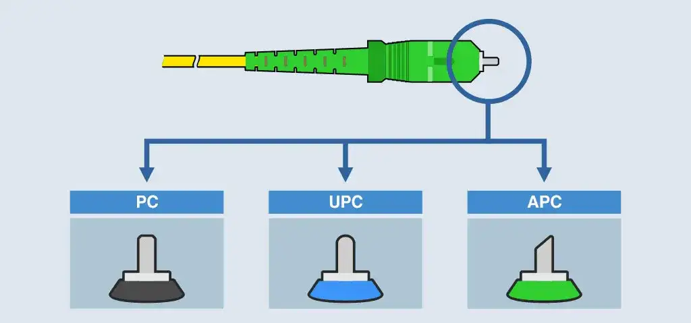 
_图片来源: [光纤连接器 PC、UPC 、APC主要区别 - 知乎](https://zhuanlan.zhihu.com/p/1928375679336051117)_

猫棒是出了名的发热量大, 所以记得贴散热片:  
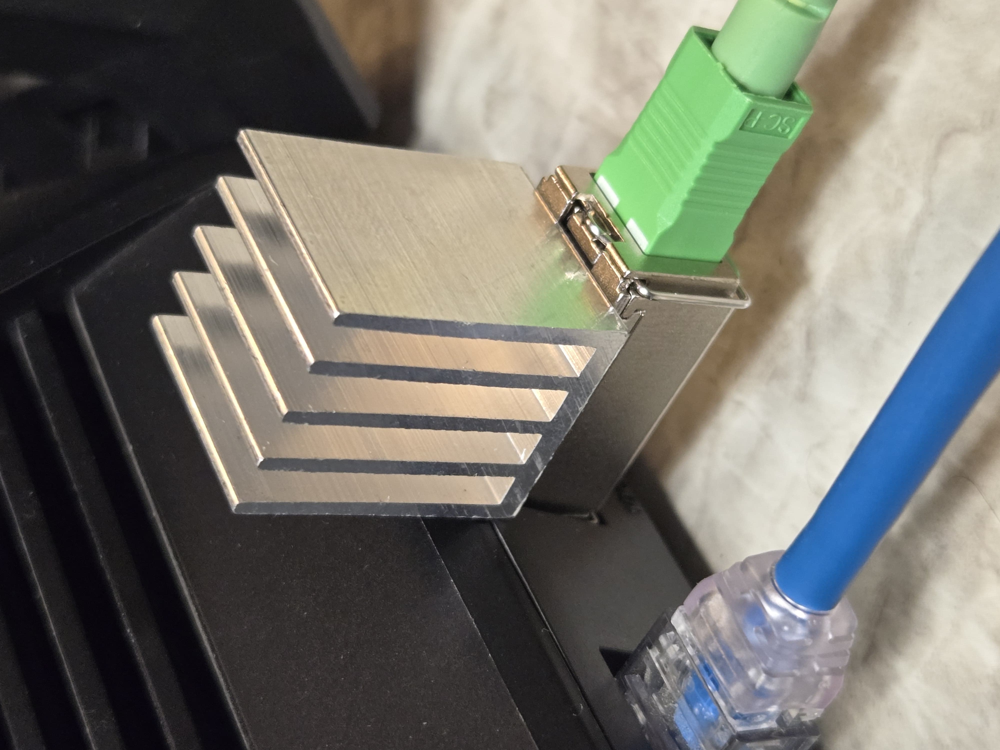  
贴完之后我在光猫后台看到的温度大概是 60 ℃ 左右.  

## 给 BE10000 刷机
这里就不多赘述了, 直接参考 [【小米万兆路由器刷OpenWrt】小米BE10000|SSH解锁固化|UBoot|iStore商店|多拨|-小米无线路由器及小米网络设备-恩山无线论坛 - Powered by Discuz!](https://www.right.com.cn/FORUM/thread-8450774-1-1.html) 即可.   

固件有一些已知的 bug, 比如前端配置的 WiFi 信息无法被正常写入, 会导致整个网络部分无法启动, 随后失联, 最终触发自动 Fallback. 所以下面的一些修改主路由的操作是利用 UCI 指令实现的.

## 获取运营商 ONU 配置
这一步没有通用教程...上闲鱼或者淘宝买个超密, 记录下 `LOID`, `SN`, `LOID CheckCode(Password)`, `PLOAM Password`, 还有 Internet 部分配置的 `VLAN` ID. 有的地区可能还需要记录下上行的 Mac 地址.  

_`LOID`和`LOID CheckCode`_:  
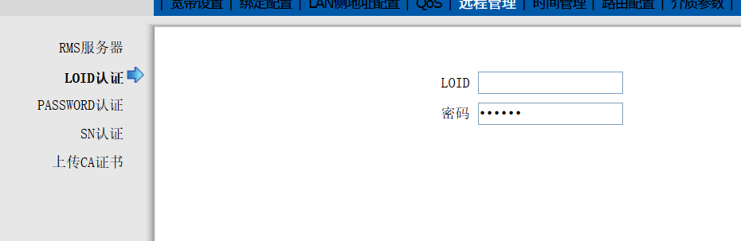  

_`PLOAM Password`_:  
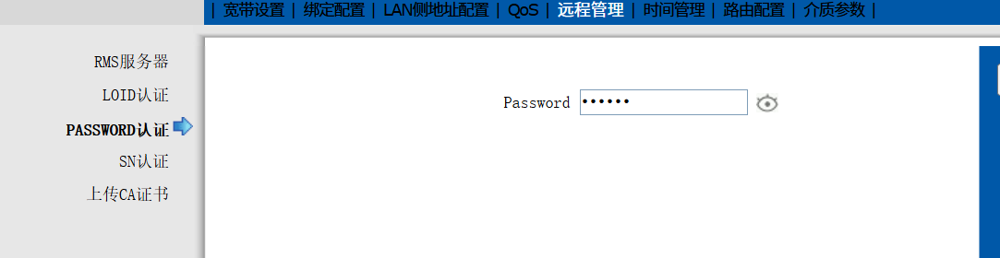  

_`VLAN` ID_:  
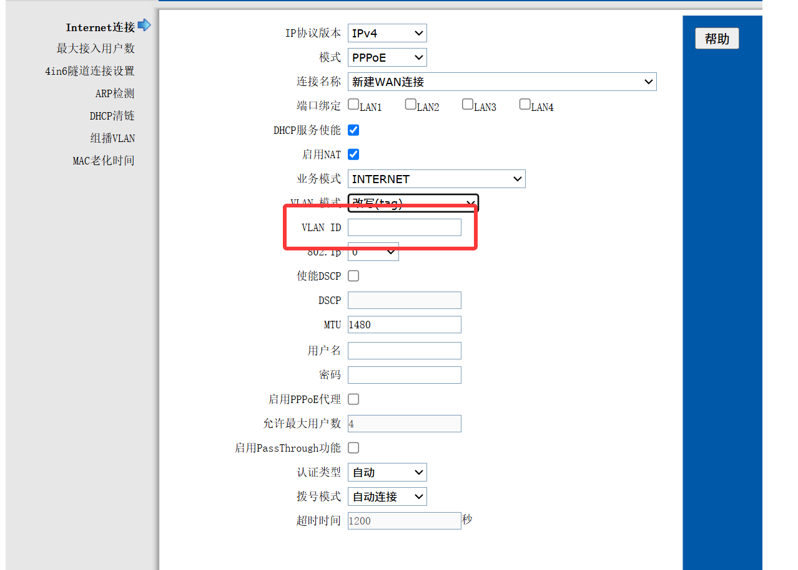  

一般而言, 运营商会选择用`LOID`, 配合上可能的 `LOID CheckCode(Password)`, **或者**可能使用 `PLOAM Password`. 请根据你的情况自行判断.  

我这边是安徽联通, 只记录了 `SN`, `VLAN ID`, `LOID` 就可以正常工作了. (因为联通的那个猫登不进去所以拿了个移动的猫来截图xD)  
有的时候不一定需要超密才能获得这些信息, 某些猫 (比如黑龙江联通, 创维的光猫) 的普通用户就能拿到上述信息.  

同时, 记录下 `PPPoE` 登录用户名和密码:
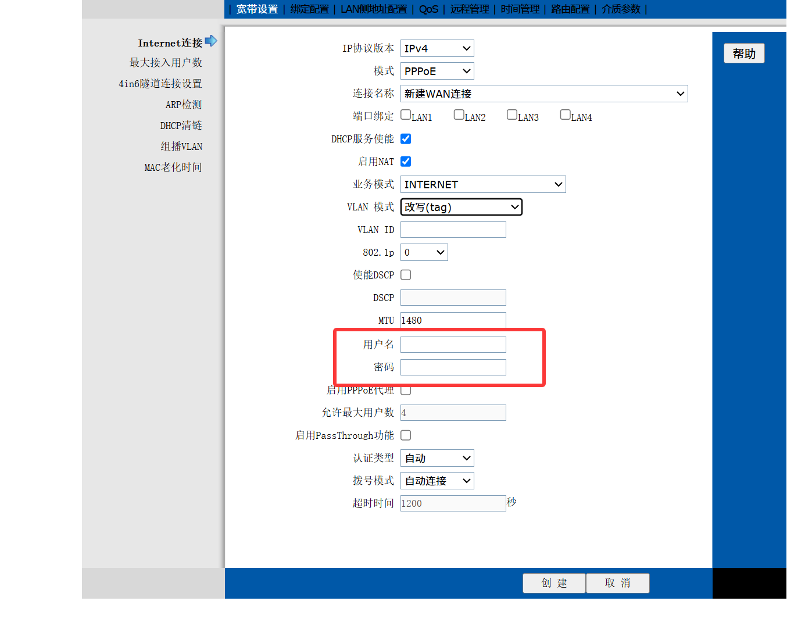

一般而言, 用户名是公开的, 有些猫的密码经过 F12 大法去除 `password` 属性也会直接显示, 但是有的猫会回传一些无意义占位符, 这个时候可以打电话给运营商重置密码.

## 配置 GPON Stick (猫棒)
将 GPON Stick 接入 SFP+ 接口, 如果网口灯一直没有亮起来的话可以尝试在 `QWRT` -> `网络` -> `ECM硬件加速设置` 里将 SFP1 和 SFP2 接口的速率设置强制改为 `Force 2.5Gbps`. (我不能确定哪个对应当前SFP接口, 所以两个都改了), 随后保存并应用, 也许需要重启路由器.

默认的 `br-lan` IP Prefix 应该是 `192.168.1.0/24`, 此时保持不变, 访问 `192.168.1.10` 即可打开光猫的控制台:
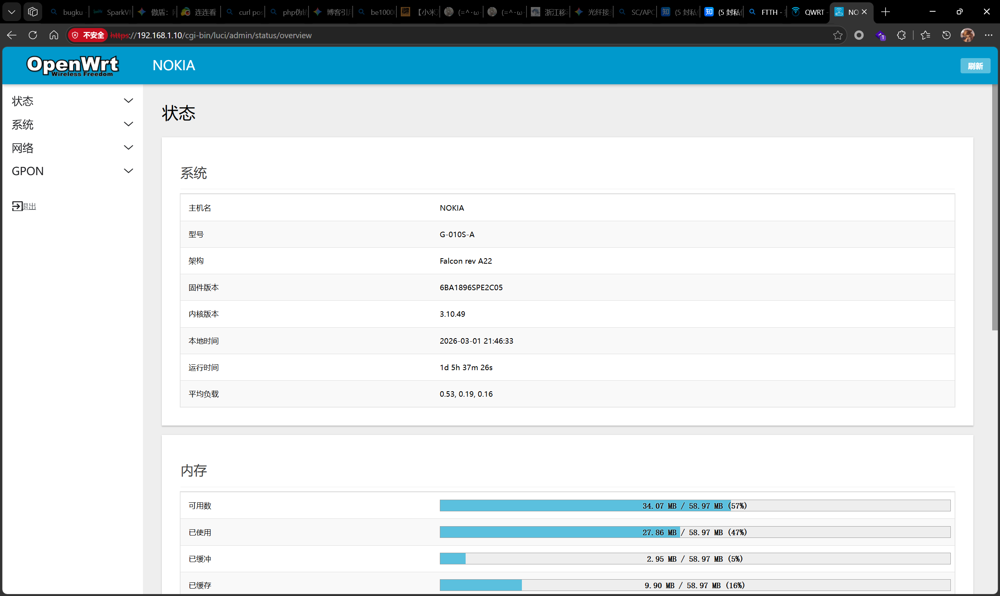

找到 GPON ONU 设置, 填入我们刚刚记录的信息:
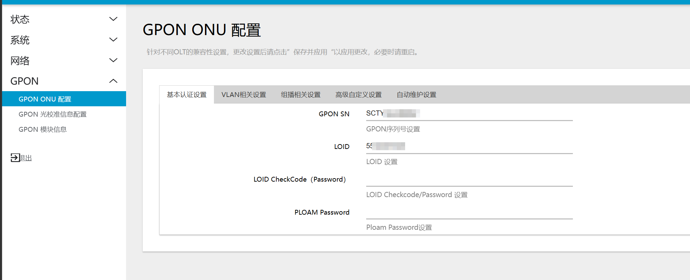
_`LOID` 和 `SN`_

并且启用 VLAN 配置:
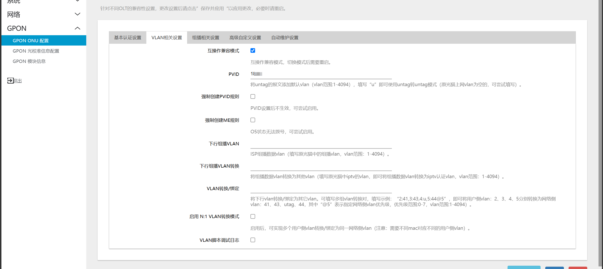
勾选**互操作兼容模式**, 并在 `PVID` 中填写 VLAN ID.  

保存后可能需要重启猫棒. 然后进入状态页, 如果看到 PON认证状态/PON信号状态 为 O5, 则说明猫棒已经完成注册并且正常工作了.
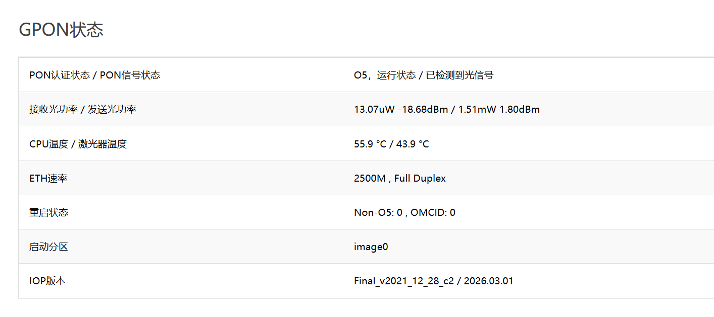

## 配置拨号上网
BE10000 上默认 WAN 口为 `eth4`, 而 SFP 端口为 `eth5`, 因此需要将 WAN 口从 `eth4` 切换成 `eth5`. 进入 `网络` -> `接口` -> `设备`, 找到 `br-lan` 并将 `eth4` 加入, 将 `eth5` 移除; 再进入 `接口` 页面, 将 WAN 网卡改为 `eth5`, 并填入刚刚的 PPPoE 账号密码:
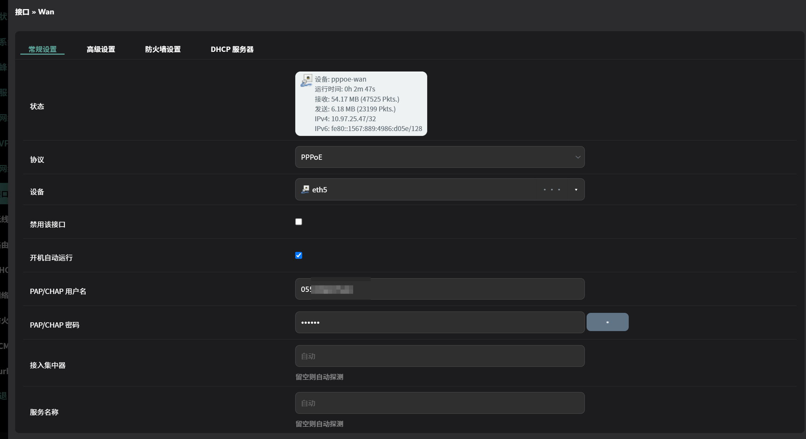

保存之后应该能看到 PPPoE 已经成功拨号并且能够正常上网了:
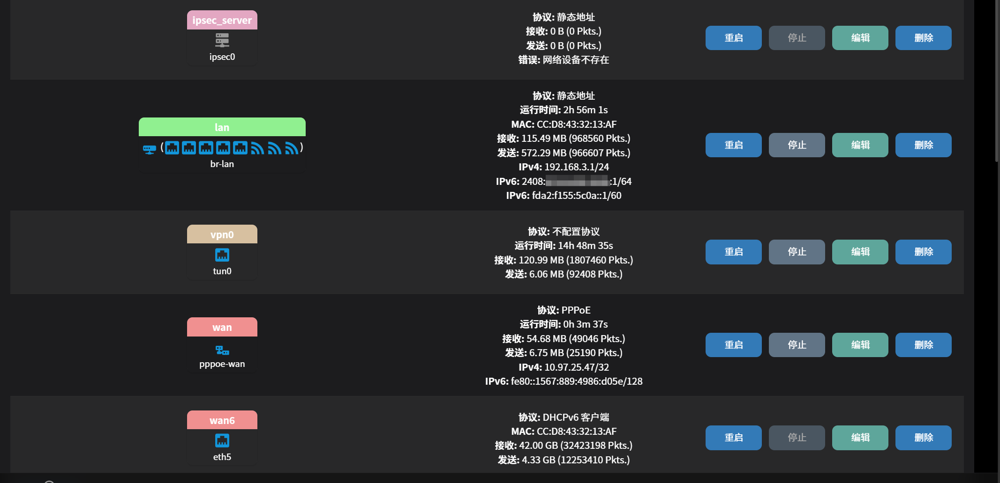
(我将整个 `br-lan` 的网段改成了`192.168.3.0/24`, 这一步不是必须的)

## 修改 WiFi 基本信息
实测发现...主路由通过 LuCI 直接修改 WiFi 信息会修改不进去(上文已经提到了), 因此在 SSH 通过 UCI 修改信息:

```shell
uci set wireless.ath0.ssid='[CENSORED]'
uci set wireless.ath0.encryption='psk2+ccmp'
uci set wireless.ath0.key='[CENSORED]'

uci set wireless.ath1.ssid='[CENSORED]'
uci set wireless.ath1.encryption='psk2+ccmp'
uci set wireless.ath1.key='[CENSORED]'

uci commit wireless
wifi reload
```
此处 SSID 为 WiFi 名称, encryption 的值 `psk2+ccmp` 表示 WPA2-PSK/AES，也就是常见的 WPA2-AES 配置。  

虽然 WPA3/SAE 更安全，但在多 AP + 802.11r 漫游场景下，WPA2-PSK + FT-PSK 的兼容性通常更好。部分手机或 IoT 设备在 WPA2/WPA3 Mixed、FT-SAE、PMF 等组合下可能会出现连接失败、漫游失败或切换变慢的问题。

如果需要追求最高兼容性，建议用于全屋漫游的主 SSID 先使用 WPA2-PSK/AES，并确保主路由和从路由的加密方式保持一致。

对于从路由, 因为要配置漫游, 需要保证两个 WiFi 接入的是同一个 L2 网段, 因此需要关闭从路由的 DHCP, 并且将从路由配置为主路由下的一个设备. 因此对于从路由, 做的配置如下:
* 将 网络 -> 接口 -> 接口 下的其他所有设备删除, 仅保留 `br-lan`:
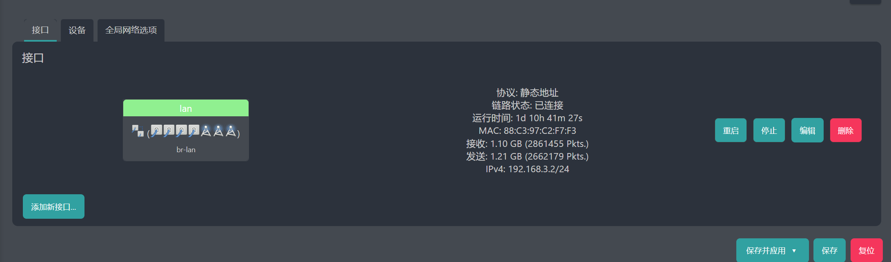  
* 在 网络 -> 接口 -> 设备 下的 `br-lan` 设备中添加 `wan` 网口:
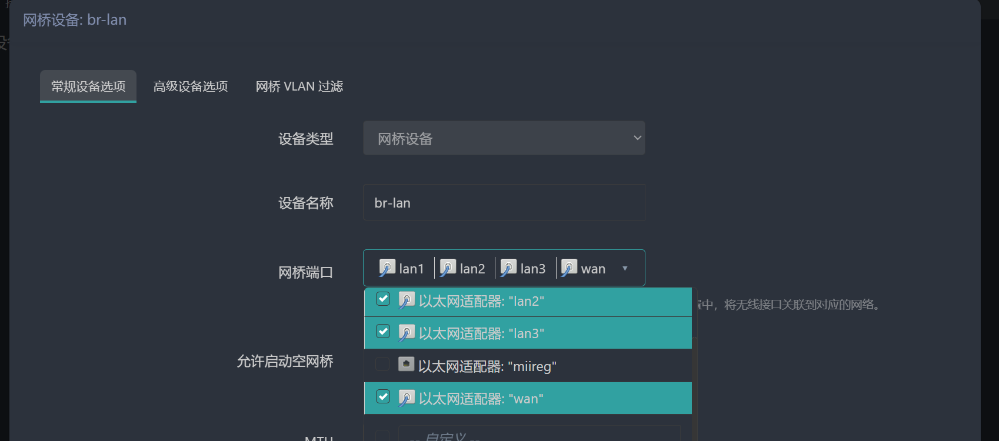

* 给 网络 -> 接口 -> 设备 下的 `br-lan` 添加 IP 地址:
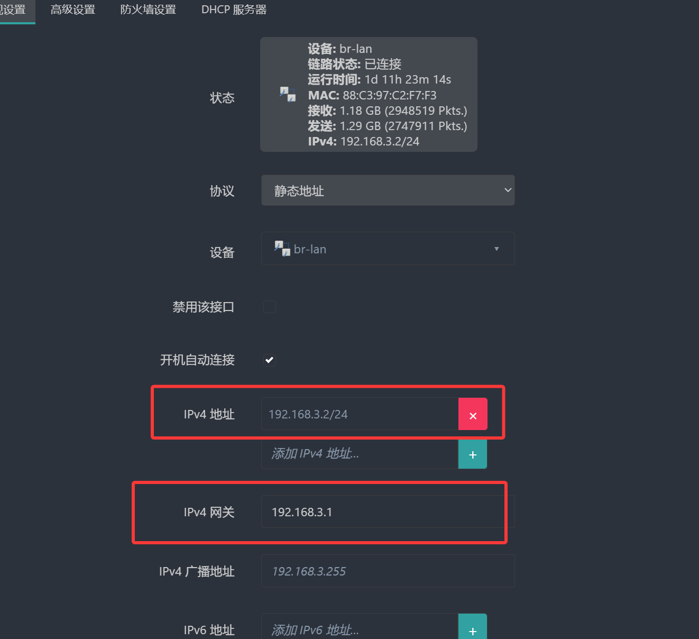

IPv4 地址一定记得填掩码, IPv4 网关填写主路由的 IP.  
* 在 网络 -> 防火墙 -> 常规设置 下, 放行对应的防火墙规则.
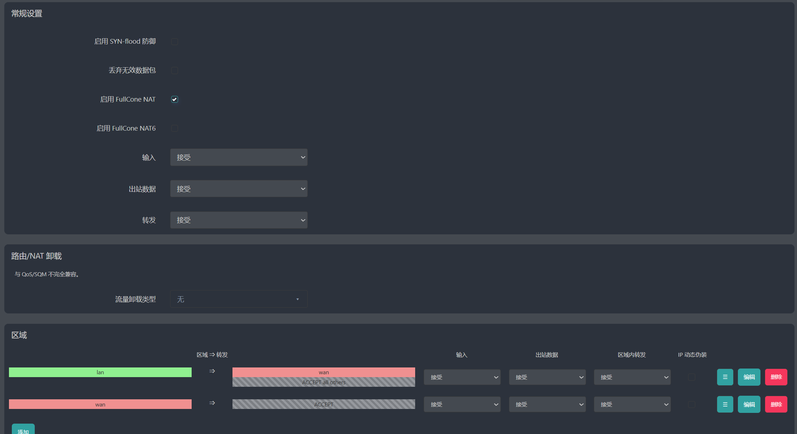
(btw. 我因为懒得配置详细的规则再加上内网设备应该也不会有太大风险因此全部放行了, 如果有特殊需求的话请不要参考xD)

因为此时主路由和从路由处在同一个 L2 广播域内，局域网中应该只保留一个 DHCP Server，也就是主路由。如果从路由 DHCP 没有关闭，客户端在连接或漫游时可能会同时收到来自主路由和从路由的 DHCP 响应，导致获取到错误的网关 / DNS，或者出现 `DHCPNAK wrong server-ID` 之类的问题。

这种问题的表现可能是：
- Wi-Fi 已经切换到另一个 AP，但网络恢复很慢；
- 漫游后短暂断网；
- 客户端重新获取 IP；
- 网关 / DNS 偶发异常；
- 看起来像是 802.11r 没有生效，但实际是 DHCP 层面在打架。

在从路由 SSH 中执行：
```sh
uci set dhcp.lan.ignore='1'
uci commit dhcp
/etc/init.d/dnsmasq restart
```

如果从路由还启用了 IPv6 RA / DHCPv6，而我们希望完全由主路由负责 IPv6，也可以一并关闭：
```sh
uci set dhcp.lan.ra='disabled'
uci set dhcp.lan.dhcpv6='disabled'
uci set dhcp.lan.ndp='disabled'
uci commit dhcp
/etc/init.d/odhcpd restart
```

关闭后可以检查：
```sh
uci show dhcp.lan
```

看到类似：
```sh
dhcp.lan.ignore='1'
```

即可。  

需要注意，`dnsmasq` 进程仍然运行不代表从路由还在发 DHCP。只要生成配置中存在类似：
```text
no-dhcp-interface=br-lan
```

就说明它不会再在 LAN / `br-lan` 上提供 DHCP 服务。保存并应用后应该就可以连接主路由并通过设置的子路由 IP 连接了. 
(这段我在LuCI上并没有找到很明确的关闭 DHCP 服务的配置选项, 是让 GPT 通过 SSH 直接编辑 UCI 得出的)  

在从路由的 网络 -> 无线, 配置各个 SSID 接口的信息和主路由同步:
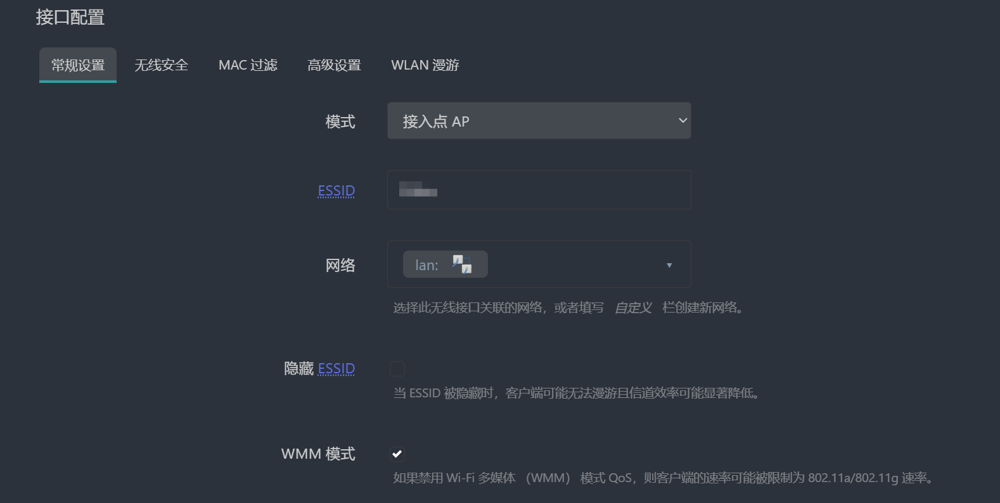  

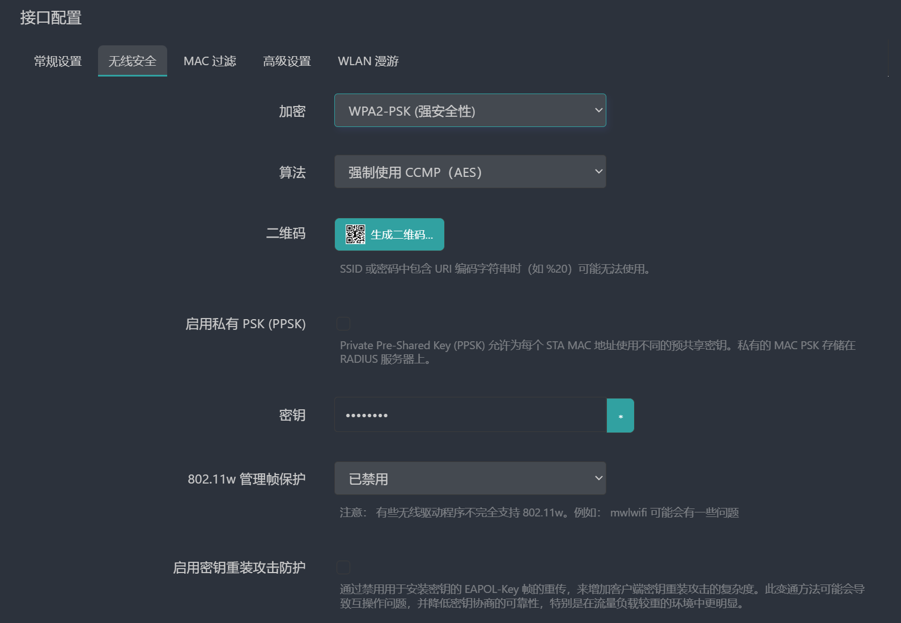

此时两个 WiFi 应该都能成功连上 (虽然 SSID 相同).
## 配置 802.11 k/v/r
### 主路由
```shell
uci set wireless.ath0.ieee80211k='1'
uci set wireless.ath0.rrm_neighbor_report='1'
uci set wireless.ath0.rrm_beacon_report='1'
uci set wireless.ath0.ieee80211v='1'
uci set wireless.ath0.time_advertisement='0'
uci set wireless.ath0.wnm_sleep_mode='0'
uci set wireless.ath0.bss_transition='1'
uci set wireless.ath0.ieee80211r='1'
uci set wireless.ath0.nasid='Master_2_4G'
uci set wireless.ath0.mobility_domain='cafe'
uci set wireless.ath0.reassociation_deadline='1000'
uci set wireless.ath0.ft_over_ds='0'
uci set wireless.ath0.ft_psk_generate_local='1'

uci set wireless.ath1.ieee80211k='1'
uci set wireless.ath1.rrm_neighbor_report='1'
uci set wireless.ath1.rrm_beacon_report='1'
uci set wireless.ath1.ieee80211v='1'
uci set wireless.ath1.time_advertisement='0'
uci set wireless.ath1.wnm_sleep_mode='0'
uci set wireless.ath1.bss_transition='1'
uci set wireless.ath1.ieee80211r='1'
uci set wireless.ath1.nasid='Master_5G'
uci set wireless.ath1.mobility_domain='cafe'
uci set wireless.ath1.reassociation_deadline='1000'
uci set wireless.ath1.ft_over_ds='0'
uci set wireless.ath1.ft_psk_generate_local='1'

uci commit wireless
wifi reload
```
需要注意的是, **802.11k/v/r 不是 AP 主动强制客户端漫游**, 真正决定是否漫游的仍然是客户端. AP 只是通过这些协议给客户端提供邻居信息、漫游建议和快速重关联能力, 不同手机、电脑、IoT 设备对这些协议的支持程度不同.  

上面的配置主要配置了三个无线接口: 
- `ath0`: 主路由 2.4G
- `ath1`: 主路由 5G

三个接口配置逻辑相同, 只是 `nasid` 不同.  
#### 1. 802.11k: 无线资源测量 / 邻居报告
相关配置: 
```sh
uci set wireless.ath0.ieee80211k='1'
uci set wireless.ath0.rrm_neighbor_report='1'
uci set wireless.ath0.rrm_beacon_report='1'
```
##### 1.1 `ieee80211k='1'`
开启 **802.11k Radio Resource Management**. 
802.11k 的主要作用是让 AP 能够向客户端提供周围 AP 的信息. 客户端不需要盲目扫描所有信道, 而是可以根据 AP 提供的邻居列表, 更快找到适合漫游的目标 AP. 

简单理解: 
> 802.11k 让客户端知道“附近还有哪些同 SSID 的 AP 可以切过去”. 

没有 802.11k 时, 客户端通常需要自己扫描信道. 扫描过程会消耗时间, 也可能导致短暂卡顿. 
开启后, 支持 802.11k 的客户端可以更快获得候选 AP 信息. 
##### 1.2 `rrm_neighbor_report='1'`
开启 **邻居报告**. 
这是 802.11k 中最常用、最关键的能力. AP 会向客户端提供邻近 BSS 的信息, 例如: 
- 邻居 AP 的 BSSID
- 所在信道
- PHY 类型
- 是否同属于当前 ESS
- 是否支持相关漫游能力

简单理解: 
> 这个参数让 AP 可以告诉客户端: “你旁边还有这些 AP, 它们在这些信道上. ”

这对多 AP 漫游很重要, 因为客户端不需要从 1 信道扫到 165 信道, 而是可以优先扫描 AP 告诉它的候选信道. 
##### 1.3 `rrm_beacon_report='1'`
开启 **Beacon Report** 支持. 
Beacon Report 允许 AP 请求客户端报告它扫描到的 Beacon 信息. 也就是说, 客户端可以告诉 AP: 
- 我看到了哪些 AP
- 它们的信号强度如何
- 它们在哪些信道
- 当前无线环境大概是什么样

简单理解: 
> Neighbor Report 是 AP 告诉客户端附近有什么；Beacon Report 是客户端反过来告诉 AP 它看到了什么. 

实际家庭网络里, `rrm_neighbor_report` 的作用通常更直观；`rrm_beacon_report` 属于辅助能力, 打开即可. 
#### 2. 802.11v: BSS Transition / 漫游引导
相关配置: 
```sh
uci set wireless.ath0.ieee80211v='1'
uci set wireless.ath0.time_advertisement='0'
uci set wireless.ath0.wnm_sleep_mode='0'
uci set wireless.ath0.bss_transition='1'
```

##### 2.1 `ieee80211v='1'`
开启 **802.11v Wireless Network Management**. 
802.11v 的作用比较广, 其中和家庭 Wi-Fi 漫游最相关的是 **BSS Transition Management**. 

简单理解: 
> 802.11v 让 AP 可以向客户端提出“建议你切到另一个 AP”的请求. 

注意, 这只是建议, 不是强制. 客户端可以接受, 也可以拒绝. 比如客户端还连在主路由上, 但它已经走到从路由附近了. 此时 AP 可以通过 802.11v 通知它: 
> 你现在连这个 AP 信号已经一般了, 可以考虑切到旁边那个 AP. 

启用 802.11v 可以改善“黏 AP”的情况, 但不能保证所有设备都会听. 
##### 2.2 `bss_transition='1'`
开启 **BSS Transition Management**. 这是 802.11v 中最关键的漫游相关功能. 启用后, AP 可以向客户端发送 BSS Transition Management Request, 里面通常会带上推荐的目标 AP 列表. 

简单理解: 
> `ieee80211v` 是打开 802.11v 总开关, `bss_transition` 是打开真正用于漫游建议的功能. 

如果只开 `ieee80211v`, 但不开 `bss_transition`, 漫游引导效果可能不完整. 

##### 2.3 `time_advertisement='0'`
关闭 **时间通告**. 802.11v 里包含 Time Advertisement 功能, AP 可以向客户端广播时间信息. 家庭 Wi-Fi 漫游场景通常不需要 AP 给客户端提供时间同步, 所以这里设置为 `0`. 
##### 2.4 `wnm_sleep_mode='0'`
关闭 **WNM Sleep Mode**. WNM Sleep Mode 是 802.11v 的一部分, 主要用于客户端省电. 客户端可以进入一种特殊睡眠状态, AP 帮它保留一些上下文. 
家庭路由、多 AP 漫游场景一般不依赖这个功能, 而且部分设备兼容性可能一般, 所以这里关闭. 
#### 3. 802.11r: Fast Transition / 快速漫游
相关配置: 
```sh
uci set wireless.ath0.ieee80211r='1'
uci set wireless.ath0.mobility_domain='cafe'
uci set wireless.ath0.reassociation_deadline='1000'
uci set wireless.ath0.ft_over_ds='0'
uci set wireless.ath0.ft_psk_generate_local='1'
```

##### 3.1 `ieee80211r='1'`
开启 **802.11r Fast BSS Transition**. 802.11r 的作用是缩短客户端从一个 AP 切换到另一个 AP 时的认证和重关联时间. 普通漫游时, 客户端切换 AP 可能需要重新完成一套认证流程. 802.11r 会提前准备好部分密钥派生流程, 让客户端切换时更快. 

它不会决定客户端什么时候漫游, 但当客户端决定要漫游时, 它可以让切换过程更快. 

适合场景: 
- 手机在房间之间移动
- 语音通话
- 视频会议
- 游戏
- 多 AP 同 SSID 环境

需要注意的是, 
- 大多数新设备支持 802.11r
- 少数老旧或兼容性差的 IoT 设备可能不喜欢 802.11r
- 如果遇到某些设备无法连接, 可以先怀疑 802.11r 兼容性
##### 3.2 `mobility_domain='cafe'`
设置 **Mobility Domain**. Mobility Domain 是 802.11r 的漫游域标识. 只有处在同一个 Mobility Domain 里的 AP, 客户端才会把它们视为同一个快速漫游域. 

同一套 SSID 下, 所有要参与 802.11r 快速漫游的 AP, 都应该使用相同的 `mobility_domain`. 

这里使用: 
```sh
uci set wireless.ath0.mobility_domain='cafe'
```

`cafe` 是一个 16-bit 十六进制值, 刚好是 4 个十六进制字符, 类似于 DEADBEAF 这种 Magic Number.
这个值可以自定义, 例如: 
```sh
mobility_domain='1234'
mobility_domain='abcd'
mobility_domain='beef'
```

但需要注意,
- 同一个漫游网络内必须一致
- 不同独立网络可以不同
- 必须是 4 位十六进制字符
##### 3.3 `reassociation_deadline='1000'`
设置 **重关联截止时间**. 这个参数表示客户端执行 Fast Transition 重关联时, 允许的最大时间窗口. 单位通常按 TU 理解, 1 TU ≈ 1.024 ms. `1000` 大约就是 1 秒左右. 

简单理解: 
> 客户端发起快速漫游后, 需要在这个时间窗口内完成重关联. 

家庭网络里设置 `1000` 是比较常见、宽松、稳妥的选择. 太短可能导致部分设备来不及完成切换；太长一般也没有明显收益. 
##### 3.4 `ft_over_ds='0'`
设置 802.11r 的 Fast Transition 方式. 802.11r 有两种常见方式: 
1. FT over the Air
2. FT over DS
这里: 使用的是 FT over the Air:
```sh
uci set wireless.ath0.ft_over_ds='0'
```
(关闭了 ft_over_ds, 也就是启用 FT over the Air).
###### FT over the Air
客户端直接和目标 AP 进行快速切换流程. 这是非专业环境里更常见、更直观的方式. 
###### FT over DS
客户端通过当前连接的 AP, 经由分布式系统和目标 AP 交换信息. 联网设备先通过旧 AP 联系新 AP, 再完成切换. 实际家庭 OpenWRT/QWRT 多 AP 环境中, 它并不能提供明显的便利, 反而可能会出现设备兼容性问题. 
##### 3.5 `ft_psk_generate_local='1'`
让本机根据 PSK 本地生成 802.11r 所需密钥. 在 WPA-PSK / SAE Mixed 这类家庭网络场景中, AP 可以根据 Wi-Fi 密码本地生成 Fast Transition 需要的密钥材料. 

家庭网络通常没有企业级认证服务器, 所以这个参数直接开启就行. 
适用场景: 
- WPA2-PSK
- WPA2/WPA3 Mixed
- SAE mixed 视固件支持情况而定
- 无 RADIUS 的普通家庭网络
#### 4. NAS ID: 每个 BSS 的唯一身份
```sh
uci set wireless.ath0.nasid='Master_2_4G'
uci set wireless.ath1.nasid='Master_5G'
```
##### 4.1 `nasid='Master_2_4G'`
`nasid` 是 NAS Identifier, 也就是当前 BSS 的身份标识. 在 802.11r 场景里, 它用于区分不同 AP / 不同 BSS. 每个参与漫游的无线接口都应该有唯一的 `nasid`. 

例如主路由: 
```text
ath0 -> Master_2_4G
ath1 -> Master_5G
```
从路由对应设置为: 
```text
2.4G -> Slave_2_4G
5G   -> Slave_5G
```
#### 5. 为什么三个 ath 都要配置同一套参数？
因为 `ath0`、`ath1`、`ath2` 分别是三个不同的无线 BSS, 即使它们广播同一个 SSID, 它们在系统里仍然是三个独立的无线接口, 所以 802.11k/v/r 参数需要分别写到每个接口上.

---
这部分参数可以概括为:

| 参数 | 协议 | 作用 |
|---|---|---|
| `ieee80211k` | 802.11k | 开启无线资源测量 |
| `rrm_neighbor_report` | 802.11k | 允许 AP 提供邻居 AP 列表 |
| `rrm_beacon_report` | 802.11k | 允许客户端上报扫描到的 Beacon 信息 |
| `ieee80211v` | 802.11v | 开启无线网络管理能力 |
| `bss_transition` | 802.11v | 允许 AP 给客户端发送漫游建议 |
| `time_advertisement` | 802.11v | 时间通告, 家庭漫游场景通常关闭 |
| `wnm_sleep_mode` | 802.11v | WNM 省电模式, 家庭漫游场景通常关闭 |
| `ieee80211r` | 802.11r | 开启快速漫游 |
| `nasid` | 802.11r / hostapd | 标识当前 BSS, 建议唯一 |
| `mobility_domain` | 802.11r | 设置快速漫游域, 所有 AP 保持一致 |
| `reassociation_deadline` | 802.11r | 设置快速重关联时间窗口 |
| `ft_over_ds` | 802.11r | 选择 FT 方式, `0` 表示 FT over the Air |
| `ft_psk_generate_local` | 802.11r | 根据 PSK 本地生成 FT 密钥 |
### 从路由
直接在 LuCI 启用对应配置即可, 可以参考我的配置:  
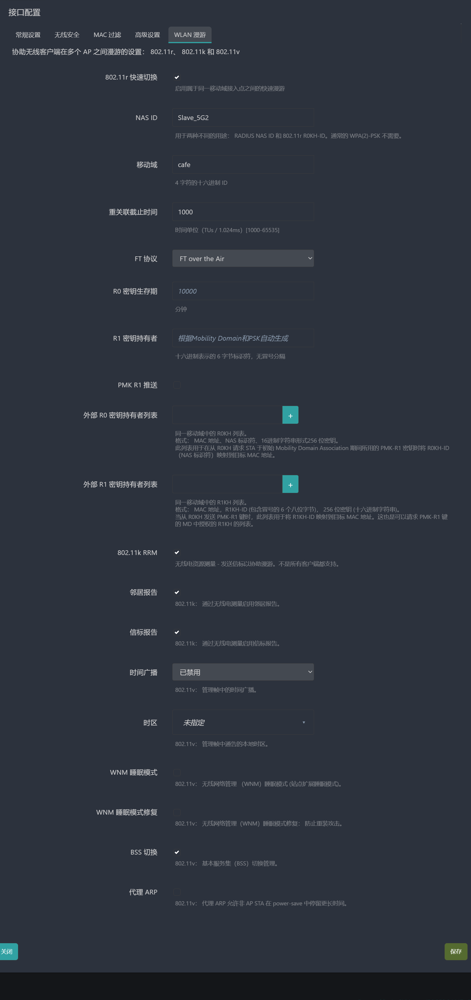  
三个无线接口都得做同样的设置, 同时保证 NAS ID 不同.

记得保证两边的加密方式完全相同, 802.11r 只负责减少漫游时重新认证的时间，但它要求参与同一个漫游域的 AP 在 SSID、密码、加密方式、Mobility Domain 等关键参数上保持一致。

如果主路由和从路由一个使用 WPA2-PSK，另一个使用 WPA2/WPA3 Mixed，或者一边启用了 SAE/FT-SAE，另一边只启用了 FT-PSK，客户端在漫游时可能无法使用同一套 Fast Transition 流程，表现为：
- 漫游时 Wi-Fi 图标短暂断开；
- 切换后重新进行 4-Way Handshake；
- 语音 / 视频通话卡顿；
- 某些 IoT 设备无法连接。

因此，如果目标是优先保证全屋漫游稳定，建议参与同一个 SSID 漫游的 AP 统一使用：
```text
WPA2-PSK / AES-CCMP / FT-PSK
```

也就是 OpenWrt/QWRT 中常见的：
```sh
encryption='psk2+ccmp'
ieee80211r='1'
ft_psk_generate_local='1'
ft_over_ds='0'
mobility_domain='cafe'
```

WPA3/SAE 可以单独拆一个 SSID 给新设备使用，而不要和 IoT / 全屋漫游主 SSID 混在一起。
## 频段分析
我家里的网络环境比较复杂, 其中主路由位于客厅正中央, 客厅与厨房和阳台直接连通, 因此主路由的信号可以直接覆盖到这部分; 从路由位于书房, 左右和两个卧室相邻. 书房和客厅由一个很短的走廊连接, 房间 A 与客厅之间间隔卫生间:
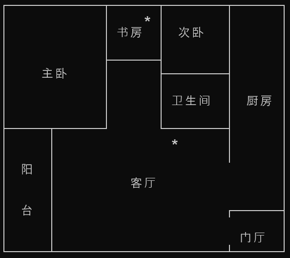
其中两个星号分别是 主路由(客厅) 和 从路由(书房).  

在各个房间的频段采集结果如下:  
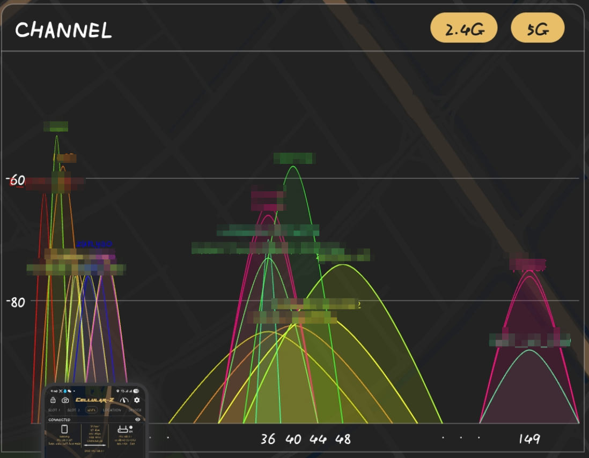
主卧

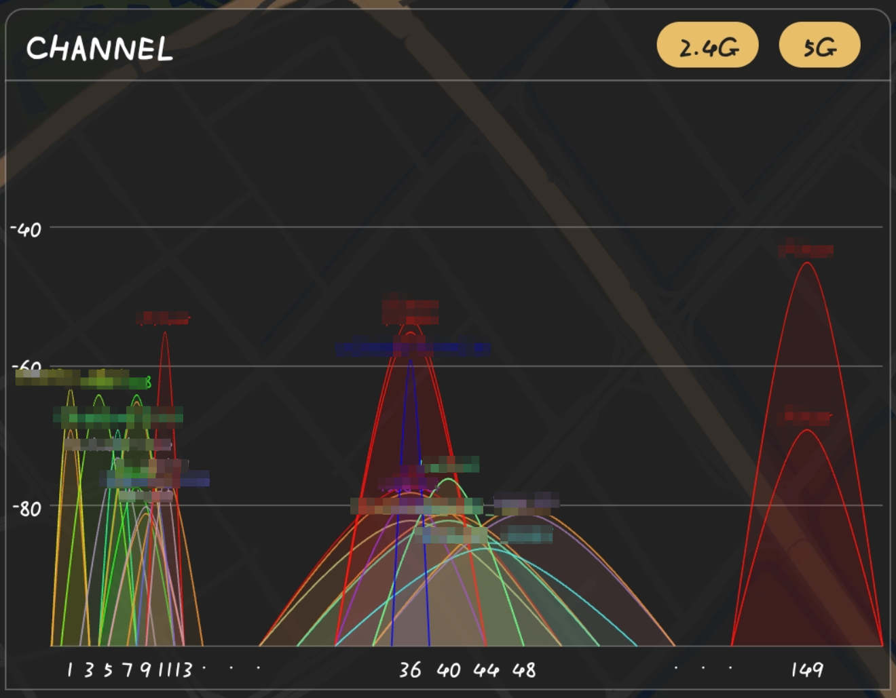
书房 (这里的红色高峰是由从路由发出的)

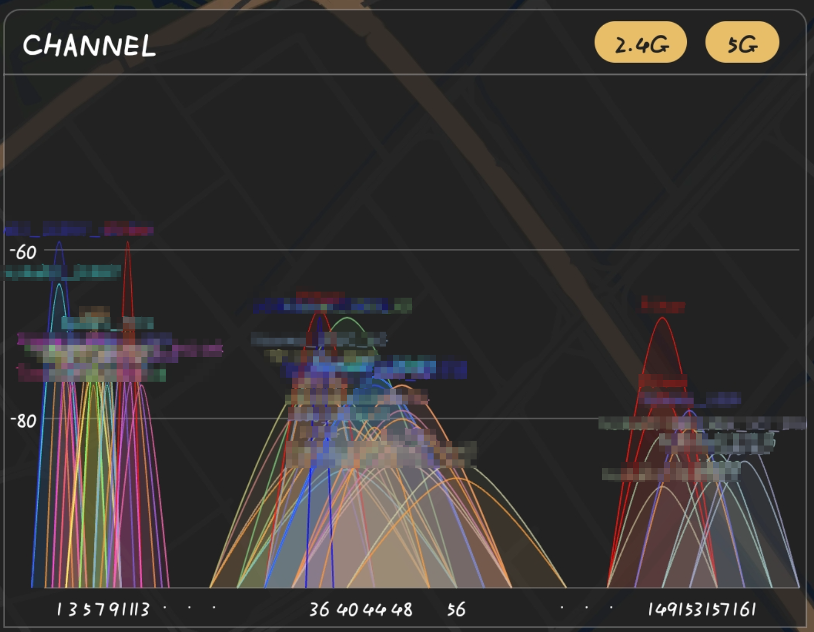
次卧

可以发现, 主卧的信道还算干净, 书房因为从路由所在所以信号足够强, 而次卧由于干扰严重, 加上信号没那么强, 并且目前我们的两个 AP (两个信号最强的红色的 WiFi) 信道全都挤在一起, 导致实际测速只能达到 80Mbps 左右.  

因此, 接下来需要对信道和功率做一些小调整, 并且要配置 802.11 k/v/r. 

## 调优功率和信道
其实主要就是为了将信道区分开, 同时调整覆盖范围, 尝试改善客户端粘在某个接入点的情况.
这部分配置参考了 AI 的建议, 下面整理一下各项参数的作用. 具体数值还是得结合房间布局、周边干扰和客户端表现调整.
### 1. 信道策略 (Channel): 减少两个 AP 之间的干扰
- **2.4G 频段 (主 1 / 从 11):** 在这里使用的 20MHz 频宽下, 两个 AP 分开使用信道 1 和 11, 可以减少彼此的信道重叠. 常见的 1/6/11 规划也基于这种思路, 但不意味着没有邻居 Wi-Fi、蓝牙等其他干扰.
- **5G 频段 (主 36 / 从 52):** 按这组设置, 两个 AP 使用不同的 80MHz 信道块. 52 属于 DFS 信道, 是否可用取决于地区和设备支持, 检测到雷达时也可能需要换信道.

这样做主要是减少自家两个 AP 的竞争, 不能保证底噪最低或吞吐量最大. 配置后仍需要检查实际工作信道和房间内的表现.

### 2. 频宽策略 (Bandwidth): 按干扰和速度需求取舍
- **2.4G 采用 20MHz:** 相比 40MHz 占用更少的频谱, 在我家这种较拥挤的环境里更适合作为覆盖和 IoT 设备使用的频段. 它不直接保证更远的覆盖或更少的断流.
- **5G 采用 80MHz:** 用作主要上网频段, 在速度和频谱占用之间取一个折中. 如果周围干扰较多, 也可以尝试降低频宽再比较实测结果.

### 3. 功率策略 (Tx Power): 调整覆盖范围
- **2.4G 设置为 18 dBm / 20 dBm:** 尝试缩小过度重叠的覆盖区域, 减少客户端一直连接远处 AP 的机会. 降得太低也可能出现覆盖空洞, 所以需要边走动边测试.
- **5G 设置为 24 dBm / 23 dBm:** 希望保留房间内的高速覆盖. 实际发射功率仍受设备与地区限制, 而且 AP 发射功率增大不代表手机的回传能力也会提高.

这些设置可能影响客户端的频段和 AP 选择, 但不等同于启用了专门的 Band Steering 机制, 也不能强制手机优先连接 5G.

### 4. 漫游配合 (Roaming)
- **11k (邻居报告) + 11v (BSS 转换管理):** 为支持的客户端提供候选 AP 信息与切换建议. 是否发送建议取决于 AP 的实现和配置, 是否接受仍由客户端决定.
- **11r (快速转换):** 在 SSID、加密方式和漫游域等配置匹配时, 减少切换 AP 所需的密钥协商开销. 普通漫游本来也不需要重新输入密码, 11r 优化的是认证过程, 不能仅凭打开开关就认定切换期间没有丢包或业务中断.

_配置与说明初稿参考 Gemini, 实际表现见下方测试记录._

最终的频段, 频宽, 功率的配置是:
* 主路由 192.168.3.1
  - 2.4G: channel 1 / 20 MHz / 18 dBm
  - 5G: channel 36 / 80 MHz / 24 dBm
* 从路由 192.168.3.2
  - 2.4G: channel 11 / 20 MHz / 20 dBm
  - 5G: channel 52 / 80 MHz / 23 dBm

---
## 效果 & 后续
最终经过测试, 在客厅, 阳台, 厨房, 卫生间中都是默认连接到主路由, 在次卧中会自动切换到从路由连接, 在书房中关上门也会从主路由切换到从路由. 从信号强度下降到实际切换大概需要 5s 左右. 主卧不能确定, 有的时候会切换有的时候不确定, 但是在 5 次测试中有 3 次都切换了.

这里的 5s 是从信号下降到观察到切换的时间, 不代表网络中断了 5s. 这份记录没有给出切换时的丢包和认证耗时, 因此还不能据此判断是否达到了无缝漫游.

插 5Gbps 网口之后测速:  
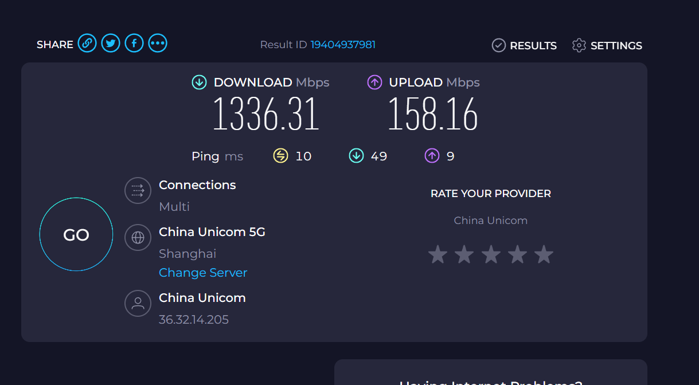
实际测速下行速率能跑到 1336.31 Mbps, 上行速率能跑到 158.16 Mbps. 应该是成功了 (?  
但是实际使用体感不算太大, 因为当时测试了很多平台, 很少有平台能够跑满的, 加上现在的一些运营商策略比如 QoS 什么的, 速度很难跑满. 不过如果有 IDM 之类的多线程下载工具应该能发挥更大的作用? 
