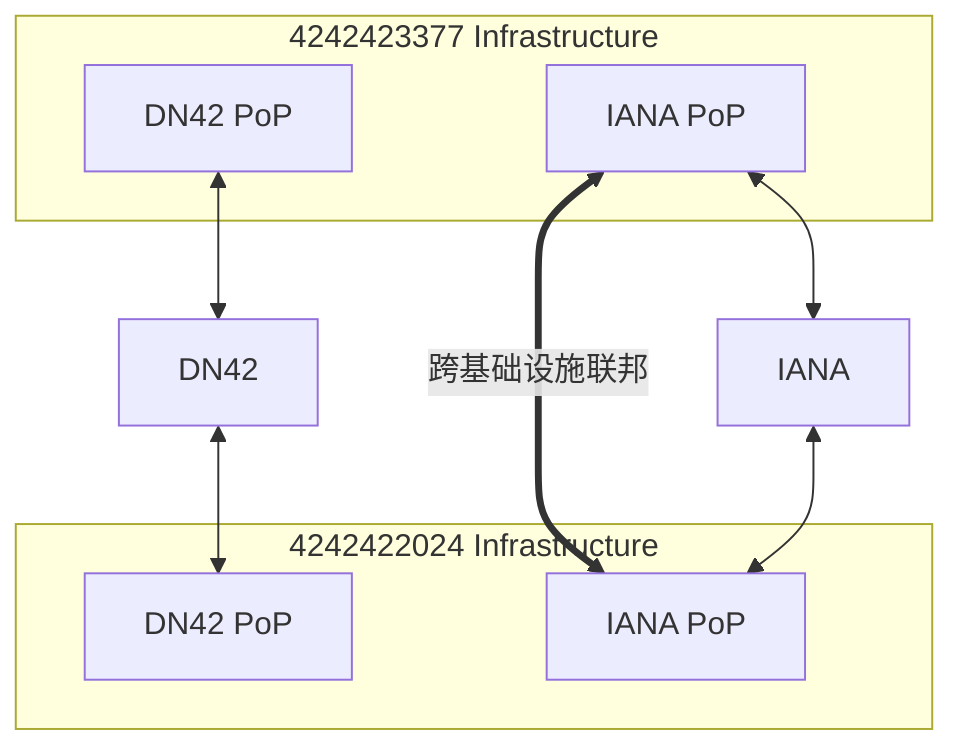
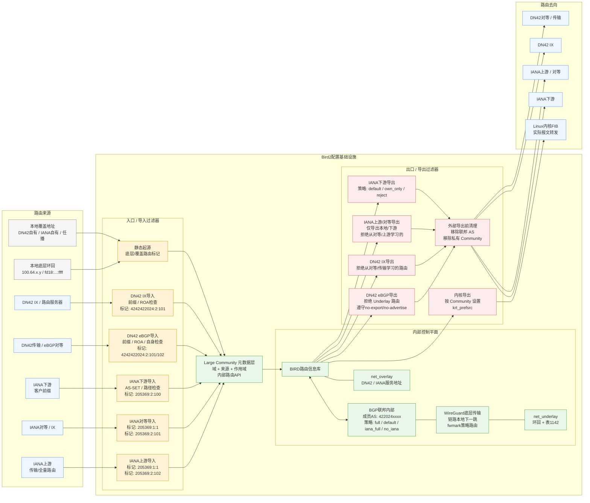
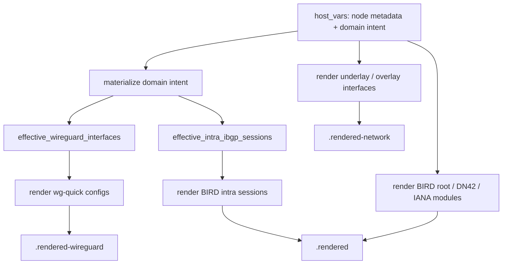

> 本文不详细展开代码实现, 仅记录内网架构设计过程和自动化实现思路. 若需要参考代码/配置文件, 可参阅 [iYoRoy-Network/bird2-config: BIRD2 Configuration for iYoRoy Network (AS4242422024, AS205369)](https://github.com/iYoRoy-Network/bird2-config). 仓库包含较多的 AI 生成代码.

_本文仅借用 Underlay/Overlay 的逻辑分层概念（基础层/业务层），特指地址角色的分离，不涉及 VXLAN/GRE 等隧道封装技术。_

# TL;DR
对整个内网架构进行了一次重构, 原本按“DN42 / IANA / WireGuard / BIRD 配置文件”水平切开的网络, 改造成一套按网络意图组织的基础设施. 最终设计可以概括为:  
- 用 WireGuard 承载节点间 underlay transport; 
- 用 BGP Confederation 替代 OSPF / full-mesh iBGP, 作为内部路由骨干;
- 用 Underlay / Overlay 分离节点身份和服务地址; 
- 用 Tier / Region / Node ID / Token 自动派生 AS、loopback 和 link-local; 
- 用 BGP Large Community 表达路由来源、传播范围和导出策略; 
- 用 Ansible 把高层 peer intent 编译成 WireGuard + BIRD + interface 配置并自动下发.

# 背景
在这两个系列之前的一些文章中, 我们已经成功运营起了 DN42 AS 和 IANA AS, 并且同一套基础设施同时承载着两张网的流量. 在先前的 [DN42&OneManISP - 共存环境下的OSPF源地址故障排除 - 悠笙の开发日记](https://blog.iyoroy.cn/archives/208/) 中, 对于这两张网已经有了一个初步的拆分和隔离, 但是随着节点的增多, 手动维护这一坨东西的 WireGuard 和 BIRD 配置文件已经变得越来越复杂, 而且公网节点之间也需要互联与互相 IP Transit, 因此最终狠下心来打算对这一整套内网进行一次彻底的重构.

# 分析
## 旧架构的问题
重构之前, 各个节点之间的 DN42 路由是相互导通的, 使用 OSPF over WireGuard 作为 IGP, 在此基础上使用 Full-Mesh iBGP 来在各个边界路由器之间传递完整路由信息; 对于IANA 流量, 各个节点之间完全隔离, 每个节点单独广播自己的 /48 IANA IPv6 Prefix.  

总结出来就是: 
- WireGuard 负责节点间隧道; 
- OSPF over WireGuard 负责 IGP; 
- DN42 边界路由器之间再跑 full-mesh iBGP; 
- IANA 节点基本各自独立广播自己的公网前缀. 

这个架构在节点少的时候很好用, 但节点多起来之后问题开始明显: 
1. WireGuard、OSPF、BIRD 配置需要分别维护; 
2. 新增节点需要同时改多个地方, 容易漏; 
3. DN42 和 IANA 的路由策略互相影响, 但配置上又是分散的; 
4. IANA prefix 的跨 PoP 调度不够自然; 
5. 有些节点只是转发节点, 却仍然被迫拥有 overlay 身份; 
6. 源地址选择、路由泄漏、内部地址暴露都变得越来越难控制. 
## 设计目标与 BGP Confederation
这次重构主要希望达成的几个目标: 
1. 节点加入要简单: 最好只需要描述节点身份和 peer 关系; 
2. DN42 / IANA / 内网骨干要能共享基础设施, 但策略上互相隔离; 
3. IP 地址应该是可以调度的资源, 而不是节点的固定身份; 
4. 内部拓扑不应该泄漏到外部 BGP peer; 
5. 配置应该由声明式数据生成, 而不是手写大量重复 WireGuard/BIRD session; 
6. 部署流程自动化

同时还有其他的一些比较细碎的需求:
1. 部分 IANA 节点希望能承载其他节点的 IP Transit, 用 IANA PoP 来为其他节点广播公网 IP
2. 当前 IANA AS 是[たのしい](https://leziblog.com/)和我共同在维护, 我们之间需要达成统一的协调, 部分基础设施需要互相 Transit 以及调控路由
3. 我们只有一个 44Net IPv4 /24 (Sponsored by たのしい), 要播的话所有节点都需要 iBGP 互联和 IGP, 否则只能一个 PoP 使用
4. IANA AS 需要承接下游
5. IANA PoP 之间需要路由调优

先前的 IANA IPv6 Prefix 分配规则遵循的是 **大洲 3 bits** + **地区 3 bits** + **同地区多节点 2 bits**, 由一个完整的 /40 拆出来若干 /48, 但是因为某些上游限制播出前缀数量, 再加上这样碎片化的前缀不利于做 IPAM, 因此我们打算最终合并对外广播只详细到大洲层面, 其次走内部 iBGP 路由来处理更加详细的部分.

たのしい那边的内网结构是 BGP Confederation, 用的是手动模拟的方案.

其实这样分析下来内网的架构就可以很轻松的定下来了, 最符合需求的就是把内网也切换成 BGP Confederation, 然后利用 BGP as IGP 的理念, 在联邦内广播 /32 和 /128 来处理内部路由. 同时, 因为联邦避免了传统 iBGP 水平分割的特性, 所以联邦不需要严格 Full-Mesh, 也不需要单独起 iBGP, 非常的去中心化啊xD 

同时, BGP Confederation 可以很轻松的和たのしい那边的基础设施合并, 只需要我们两边都将对方的内部 AS 视作联邦 AS 处理即可.   

这个方案还有一个好处, 因为实际上我们之间的基础设施包含关系是这样的:


我们之间的 DN42 PoP 和 Transit 是隔离的, 但是 IANA PoP 和 Transit 又是互通的, 在 BGP Confederation 场景下, 可以利用过滤器 + BGP (Large) Community 来对路由来源进行隔离的同时互通 IANA 之间的 Traffic Engineering 意图, 实现同一套标准两份基础设施通用. 

## Overlay 与 IPAM
在旧设计里, 一个节点通常同时承担两种身份: 
1. 它是网络中的一个路由器; 
2. 它也是 DN42 / IANA 中可以被访问的服务地址持有者. 

重构之后, 我决定把这两种身份拆开: 
- Underlay: 节点作为路由器的身份, 用于内部互联、下一跳、隧道和转发; 
- Overlay: 节点对外提供服务或承接流量时使用的 DN42 / IANA 地址. 

这样, 一个节点可以只参与转发而没有 DN42 IPv4; 也可以在需要时临时宣告某个 overlay /32 或 /128. 

实际应用场景下, 我的 DN42 段地址不算很充裕, 当初注册的是 /28, 只有 16 个可用地址. 有些节点比如 IEPL 之类的隧道节点或者 IX 节点, 它们只作转发作用, 不需要承载服务, 不需要被外部连接, 因此理论上并不需要为其分配独立可访问的 DN42/IANA 地址.  

再加上, 前面我们已经打算将内网切换成 BGP Confederation, 基于此套配置, 我们可以将原本 DN42 + IANA 这样水平分割的网络结构重新规划, 改成 Underlay + Overlay 的垂直划分, DN42 和 IANA 的地址/流量作为上层 Overlay Network 的负载, 下层 Underlay Network 用作节点间底层通讯和转发的基础设施. 在这种情形下, IP 地址变成了一种可以被在内网里轻松调度的资源而非和节点绑定的唯一 ID.  

这样的优势很明显:
1. 节省稀缺地址资源: 转发节点可以只拥有 underlay 身份, 不必分配 DN42 IPv4 或公网地址;
2. Anycast 与地址迁移: Overlay 地址变成可以通过 BGP 调度的资源, 不再强绑定某台机器;
3. 隐藏转发节点: 纯转发节点不需要暴露全局可达地址, 外部更难直接探测内部拓扑;
4. 新节点入网简单: 新节点先加入 underlay, 需要承载业务时再分配 overlay 地址;
5. 优雅 Transit 交付: IANA PoP 可以通过内部 confederation 把客户前缀或服务地址投递到其他节点.

# 设计
综上所述, 最终设计了这样一套 IPAM 机制和自动化流程.  

每个节点拥有一些基本的元数据:
* Tier: 指代当前节点用途, 如用作骨干网, 接入 IX, 或是作为网内节点
* Region: 节点所在大洲区域
* ID: 同区域下该节点ID
* Token: 给该节点分配的一个随机 16bit 字符串, 在 IPv6 下给节点作为唯一 ID 使用

对于 Tier 和 Region, 编写了几张表格作为数据来源:

| Tier | Desc                |
| ---- | ------------------- |
| 1    | Backbone            |
| 2    | IX                  |
| 3    | Backbone + IX Mixed |
| 9    | Node                |

| Region | Desc          |
| ------ | ------------- |
| 0      | Reserved      |
| 1      | Asia          |
| 2      | Europe        |
| 3      | Africa        |
| 4      | North America |
| 5      | South America |
| 6      | Oceania       |
| 7      | Antarctica    |

#### 联邦 AS: 4220240000 - 4220249999
分配规则: 
```text
422024{tier}{region}{node_id:02d}
```
其中 `tier` 指代节点用途, `region` 指代节点所在区域, 最后两位 `node_id` 用于区分同区域内的不同节点.
#### Underlay IPAM
IPv4 Prefix: 100.64.0.0/16  
分配规则: 
```text
100.64.{tier*10 + region}.{node_id}/32
```
IPv6 Prefix: fd18:3e15:61d0:ffff::/64  
分配规则: 
```text
fd18:3e15:61d0:ffff:{tier}:{region}::{node_token}/128
```
为了简化自动化流程, 我打算将 WireGuard 隧道之间的 Link-Local 地址也接入自动化管理, 利用上述 Tier, Region, Token 生成, 由自动化脚本生成 WireGuard 配置并自动配置隧道和联邦 BGP Session.   
Link-Local 分配规则也大体上沿用普通 IPv6 的规则:
```text
fe80::2024:{tier}:{region}:{node_token}/64
```
这样, 每个节点只需要为其指派元数据便可以按照上述规则自动生成内网联邦 AS 和地址.

#### Overlay IPAM
DN42 IPv4 部分就手动指派了, 这部分存在一些历史遗留架构, 修改需要合并到官方 Registry, 因此就打算手动指派.  
Underlay 的 IPv6 本身是 DN42 可达的, 如果还要分配其他 DN42 IPv6 直接按需广播即可.  

对于 IANA IPv6, 目前的设计格式是先按照最初提出的规则计算大洲 /43, 比如亚洲为:
```text
2a14:7583:f220::/43
```
再按照地区计算出 /46, 比如香港地区 HKG:
```text
2a14:7583:f224::/46
```
接着将从 /46 到 /112 全部置零, 最后的 16bits 填入节点 Token 作为节点的 IANA IPv6 地址. 比如我的某台香港地区骨干网节点:
```text
2a14:7583:f224::7d89/128
```

#### Community 隔离机制
在这套架构里, BGP Large Community 实际上就是一条路由在不同模块和基础设施之间传递的元数据信息和控制信息. 基于这些元数据, 我们在向不同外部对等体导出路由的时候就能判断:
* 它属于 DN42 还是 IANA?
* 它是本地生成、下游带来、peer 学到, 还是 upstream 学到?
* 它能不能导出到别的 AS?
* 它是不是 underlay-only?
* 这条路由需不需要 prepend as?

举个具体的例子, 比如用第一位标识路由来源/目标是 DN42 还是 IANA, 允许发往 DN42 的路由全部会被打上
```text
(4242422024, 1, 1)
```
同理, 发往 IANA 的路由全部会被打上
```text
(205369, 1, 1)
```

在各个 Protocol 中, 这一项作为总开关, 控制是否应当导出. IANA 的上游导出过滤器:  
```nginx
template bgp iana_upstream_v6 {
	...
	
    ipv6 {
		...
        import filter {
            if !iana_filter_default_check() then reject;  # 基础检查
            remove_confederation_as();                    # 移除 confederation as, 防止外部 peer 恶意携带内部 as
            remove_private_community();                   # 移除私有 community, 防止外部 peer 恶意操纵内部路由
            iana_upstream_add_community();                # 为所有来自 IANA 的路由打上允许在 IANA 基础设施广播的 community
            accept;
        };
        export filter {
            if !iana_filter_default_check() then reject;     # 基础检查
            if !iana_upstream_check_community() then reject; # 检查 community, 是否是发往 IANA 的路由/是否携带了 no-advertise/no-export 等
            remove_confederation_as();                       # 移除 confederation as
            remove_private_community();                      # 移除私有 community
            accept;
        };
		...
    };
	...
}
```

其中 `iana_filter_default_check()` 用于检查前缀长度, ROA, 是否是默认路由等比较琐碎的内容:
```nginx
function iana_filter_default_check(){
    if net ~ [::/0] then return false;
    if net.len > 48 then return false;
    if bgp_large_community ~ [(IANA_OWNAS,1,1)] && is_self_iana_v6() then return true;
    if roa_check(iana_roa_v6, net, bgp_path.last) = ROA_INVALID then return false;
    return true;
}
```

`remove_confederation_as()`, 顾名思义, 移除联邦内部 AS:
```nginx
function remove_confederation_as() {
    bgp_path.delete([4220240000..4220249999]); # 4242422024 Infrastructure
    bgp_path.delete([4233770000..4233779999]); # 4242423377 Infrastructure
}
```

`remove_private_community()`, 顾名思义, 移除内部 Community. 这部分目前实施的很粗糙, 后续需要详细细化, 因为部分 Community 应当对下游开放, 使其可以通过 Community 来传递路由意图, 做一些优化, 比如 prepend AS path, 可用于路由调优或者流量工程:
```nginx
function remove_private_community(){
    bgp_large_community.delete([(4242422024, *, *)]);
    bgp_large_community.delete([(205369, *, *)]);
}
```

`iana_upstream_add_community()`, 为来自上游的路由全都打上允许在 IANA 基础设施流通的 Community 以及路由来源标识:
```nginx
function iana_upstream_add_community(){
    bgp_large_community.add((205369,1,1));
    bgp_large_community.add((205369,2,102));
}
```
其中, `(205369,2,102)` 标识该路由来自于上游. 路由来源分为三种, **上游**, **对等体**, **下游/客户/自己(看作客户)**. 对这三种不同类型的 BGP Session, 导出的路由通常不相同:
* 对上游, 我们需要让上游帮我们广播我们自己的和我们下游的段, 因此需要向上游导出所有来自**下游**的前缀
* 对下游, 我们需要为其提供网络服务, 需要向其导出我们知道的所有路由, 即来自**上游, 对等体, 下游**的路由
* 对对等体, 对等体之间的连接仅仅是为了双方互相访问彼此的网络, 因此不能互相导出互相的上游或者对等体, 不然就变成免费 Transit/Tunnel 了, 因此只导出来自**下游**的路由
在当前内网中与之对应的, 来自对等体的会被打上`(205369,2,101)`, 来自下游的会被打上`(205369,2,100)`.

`iana_upstream_check_community()` 会检查路由的 Community, 基于上述原则判断其是否应该被广播给上游:
```nginx
function iana_upstream_check_community(){
    if !(bgp_large_community ~ [(205369,1,1)]) then return false;      # 没被允许在 IANA 基础设施广播, 则拒绝
    if bgp_large_community ~ [(205369,65535,65282)] then return false; # no-advertise
    if bgp_large_community ~ [(205369,65535,65281)] then return false; # no-export
    if bgp_community ~ [(65535,65281)] then reject;                    # no-advertise
    if bgp_community ~ [(65535,65282)] then reject;                    # no-export

    if bgp_large_community ~ [(205369,2,0)] then return false;         # 来自内网, 该 community 被用于标识路由来自内网, 不应该往外广播, 此处拒绝广播
    if bgp_large_community ~ [(205369,2,101)] then return false;       # 来自对等体, 拒绝广播
    if bgp_large_community ~ [(205369,2,102)] then return false;       # 来自上游, 拒绝广播

    return true;
}
```

同理, 对于 DN42 也是类似的检查机制. 基于这套机制, 可以很轻松的隔离 DN42 和 IANA 两张网. 

上述只是一个大致的解释, 更细的 community 设计和各类出口策略其实还可以继续展开, 但那就会变成另一篇路由策略详解了.

这部分其实大量参考来源于[たのしい的BGP Communities](https://t.me/as4242423377/26), 毕竟两者基础设施需要互通, 很多 Community 规范基本上都是照搬过来的. 在此感谢たのしい大佬提供的思路~ 

# 路由生命周期
## 第一阶段: Ingress / Import
所有外部路由进入系统时, 先经过对应 domain 的 import filter. 
IANA 有三类来源: 
- upstream; 
- peer / IX; 
- downstream. 

DN42 也有两类主要来源: 
- 普通 transit / eBGP peer; 
- IX / route server. 

除此之外, 本机也会产生一些 route: 
- underlay loopback; 
- DN42 overlay address; 
- IANA own / anycast address. 

这些路由在进入联邦时会被打上 Large Community. 后面的所有 filter 都需要据此调控. 
## 第二阶段: Core / Intra Confederation
进入 BIRD RIB 之后, 会通过内部的 Intra BGP Confederation 在节点之间传播.  此处 Intra Confederation 不止单纯为了处理连通性, 更是为了让内部路由也能携带策略信息. 

先前的 OSPF 很适合解决: 
* 这个 loopback 在哪里?
* 这个 next-hop 怎么到?

但是它无法传递 AS 信息和策略意图, 比如:
* 这条路由是 IANA peer 学来的, 不能再导给另一个 peer; 
* 这条路由是 DN42 underlay-only, 绝不能泄漏给 eBGP; 
* 这条路由是 downstream customer prefix, 可以导给 upstream; 

这些都是 BGP policy 的强项. 所以内部骨干从 OSPF / full-mesh iBGP 转向 confederation-style BGP, 本质上是把内部控制平面升级成了“可携带策略的控制平面”. 
## 第三阶段: Egress / Export
一条路由要离开基础设施时, 会再次经过 export filter. 此处根据 community 可以系统性的防止路由泄露并进行宏观调控如 AS prepend.

比如:
- DN42 underlay route 带有 underlay-only community, 所以不会被导出到 DN42 eBGP; 
- IANA upstream 学来的路由不会再导给另一个 upstream; 
- IANA peer 学来的路由不会再导给另一个 peer; 
- DN42 IX 学来的路由不会再导回 IX; 
- NO_EXPORT / NO_ADVERTISE 会被尊重; 
- 对外导出前会删除内部 confederation AS 和 private community. 

其实总结下来就是这样一张图:

# 自动化: 把网络意图编译成配置
前面讲了这么多 IPAM, Confederation AS, Underlay / Overlay 和 BGP Community, 这些设计如果最后还是靠手写配置维护, 那其实并没有真正解决问题, 只是把复杂度从一种形式搬到了另一种形式. 在这次重构之前, 新增一个节点或者 peer 往往需要同时修改很多地方:
* WireGuard 配置: interface 名称, listen port, peer public key, endpoint, allowed IPs
* BIRD 配置: BGP protocol 名称, neighbor 地址, neighbor interface, ASN, import/export filter
* IPAM 相关配置: loopback, link-local, router id, overlay 地址
* 部署相关配置: 哪些节点需要渲染, 哪些服务需要重启
* 一些特殊情况: NAT 后面的节点, passive peer, 特殊 local AS, 特殊 filter

这些东西在逻辑上其实描述的是同一件事: **两个节点之间存在一条属于某个路由域的连接**.  
但是在手工配置里, 它们会散落在 WireGuard, BIRD, network interface, systemd/openrc 等多个地方. 只要其中一个字段漏改或者不一致, 就可能出现很诡异的问题, 比如 WireGuard 已经起来了, 但是 BIRD neighbor 指向了错误的 interface; 或者 link-local 改了, 但是对端 session 里还写着旧地址.

所以这次重构里, 我不希望 Ansible 只是一个"把 YAML 填进 Jinja2 模板"的工具. 如果只是把原来的手写配置搬进模板, 本质上还是在维护一堆低层配置, 只是换了个文件格式而已. 既然都上自动化了, 那输入不应该是"我要生成一个长什么样的配置文件", 而应该是:
* 这个节点是谁
* 它属于哪个 tier / region
* 它和谁互联
* 这条连接属于 DN42, IANA 还是 Intra
* 这条连接应该使用什么 import/export policy
* 它是否有 NAT, passive, endpoint override 之类的特殊约束

至于具体的 WireGuard interface 怎么写, BIRD session 怎么写, link-local 地址是什么, 这些都应该尽量由自动化系统根据规则生成.
## Source of Truth: 节点状态而不是配置文件
这套自动化的输入主要放在 Ansible 的 `host_vars` 里, 每个节点的变量不再只是模板渲染需要的参数, 而是这个节点在网络里的身份描述. 例如一个节点至少会有:
* `tier`: 节点层级, 比如 backbone, IX, 普通 node
* `region`: 节点所在区域
* `node_id`: 同区域内的节点编号
* `node_token`: 一个稳定的 16-bit token, 用来生成 IPv6 地址尾部

这些字段会被用于 IPAM 的地址管理和 Confederation 内节点的识别信息 (就像前面提到的, AS 计算和 IP 地址派生). 这样做的好处是, 新节点加入时, 我们只需要给这个节点配置好基本的元数据, 它在 underlay 里的所有基础身份就都是确定的. 这可以大量减少后续维护工作. 如果 link-local 地址是手写在每个 BIRD session 里的, 那么一旦节点 token 或地址规则发生变化, 所有对端都要一起改; 但如果 BIRD neighbor 地址是根据 peer node 的 metadata 自动派生出来的, 那么它永远和 source of truth 保持一致.

## Domain Intent: peer 声明式配置
这次自动化里最重要的抽象是 **Domain Intent**, 也就是将 Session 和与之对应的 WireGuard 隧道绑定视作一个整体, 再按照所属网络类型 (DN42/IANA/Intra) 进行区域划分. 以 Intra peer 为例, 一条内部连接本质上同时需要两类配置:
1. WireGuard interface, 用来提供传输层隧道
2. BIRD BGP session, 用来在这条隧道上交换路由

如果手动维护, 这两部分很容易重复描述同样的信息:
* interface name
* peer node
* listen port
* endpoint
* neighbor interface
* BGP protocol name
* import/export policy

所以我们将常规 Intra peer 抽象成一条 peer intent. 简化之后大概像这样:
```yaml
- node: tyo03-jp
  interface: intra_tyo03
  wireguard:
    listen_port: 10234
    passive: true
  bgp:
    protocol: intra_ibgp_tyo03
    ipv4:
      import_policy: full
      export_policy: full
    ipv6:
      import_policy: full
      export_policy: full
```

这条声明并不是直接对应某一个配置文件, 而是对 Peer 意图进行描述:

> 当前节点和 `tyo03-jp` 之间有一条名为 `intra_tyo03` 的内部连接, 这条连接使用 WireGuard 承载, 并在其上建立一条 Intra BGP session, BGP policy 使用 `full`.

之后 Ansible 基于此自动渲染对应 WireGuard 和 BIRD 配置.

这样, 一个 peer 关系只需要描述一次, 后面的低层配置都由自动化生成. 例如 BIRD neighbor 的 link-local 地址不需要手写, 可以通过对端节点的 `tier / region / node_token` 自动得到; WireGuard endpoint 也可以根据对端 inventory 里的 `ansible_host` 和对端回程 peer 的 `listen_port` 自动推导.

这样做最大的优点是可以避免多个配置层之间出现状态不一致.
## 自动派生 endpoint 与 passive peer
在我的内网架构中, 并不是所有节点都有完全对称的公网可达性, 比如有的节点 / DN42 Peer 在 NAT 后面, 只能主动连出去, 有些隧道需要固定某一端作为监听, 由另一端主动发起连接, 因此 peer intent 里需要支持被动监听这样的特殊情况. 如果一个 peer 不是 passive, 自动化可以尝试从对端 inventory 中读取 `ansible_host`, 再结合对端声明中的 `listen_port`, 自动生成 WireGuard endpoint:
```text
endpoint = peer_ansible_host + ":" + peer_return_listen_port
```
如果 peer 标记为 passive, 则不渲染 endpoint, 让对端主动发起连接.

本质上 endpoint 是由"对端如何被访问"和"对端监听哪个端口"共同决定的, 这两个信息本来就已经存在于 inventory 和 peer intent 里, 没必要再复制一遍. 当然, 对于特别奇怪的链路, 保留最基础的手动覆盖 endpoint. 自动化的目标不是消灭所有特殊情况, 而是让常规情况不需要特殊处理.
## 通用场景 & 例外
其实就是为了特殊情况考虑的 Fallback:
* 历史遗留 tunnel
* DN42 上承载的特殊内部 peer
* NAT 后面的节点
* 临时 workaround
* 对端要求奇怪的 BGP 参数
* 某些 session 需要特殊 local AS
* 某些路由只想进入 IANA domain, 不应该进入 DN42 domain

最后保留的设计是: 大部分普通 Intra peer 可以通过 domain intent 生成 WireGuard + BIRD, DN42 peer 的 WireGuard 也可以从 DN42 peer intent 里生成, 但是一些特殊 BIRD session, 比如需要单独指定 `local_as`, 或者需要使用特殊导出策略的 session, 仍然可以继续用低层配置显式声明. 最终渲染前, Ansible 会把生成的配置和 legacy/manual override 合并成最终配置.

这样做的好处是, 自动化覆盖了 90% 重复且容易出错的部分, 同时给剩下 10% 特殊情况也预留了位置.
## 配置渲染
整个渲染过程大概可以理解成这样:



这里有三类最终产物:
* `.rendered/`: BIRD 配置
* `.rendered-wireguard/`: WireGuard 配置
* `.rendered-network/`: underlay / overlay dummy interface 配置

BIRD 配置里又分成几个模块, 这部分是通过 Jinja2 Templates 编写的, 实际拆分 Overlay Network 也是通过这里:
* root config: 全局 define, include, kernel protocol
* DN42 module: DN42 filter, RPKI, eBGP peer, IX peer
* IANA module: upstream, downstream, peer, RPKI, static route
* Intra module: confederation-style BGP session, static route, internal filter

这些模块是否 include, 也尽量由数据自动决定, 比如一个节点没有 DN42 peer, 就不需要渲染和 include `ebgp.conf`; 没有 IX session, 就不需要 include `ix.conf`. 这可以减少空配置和无意义 include, 也避免某些节点因为缺少相关变量导致模板渲染失败.

## 验证 & 部署
最终部署流程还添加了一些检查和验证阶段:
1. render BIRD
2. validate BIRD
3. render WireGuard
4. validate WireGuard
5. deploy dummy interfaces
6. deploy WireGuard
7. deploy BIRD

BIRD 配置先在本地渲染和验证, 尽量提前发现语法错误; WireGuard 配置也先渲染和验证, 避免缺 key 或者生成出明显非法的 wg-quick 配置; 最后验证都通过了再部署底层 interfaces + WireGuard, 最后才上传并 reload BIRD.

# 总结
_我不行了这文章给我写力竭了, 这玩意的架构用线性的语言叙述怎么这么难_  

理顺之后代码基本上都交给 AI 写的, 效果还行, 如需参考可查阅 [bird2-config/ansible at dev · iYoRoy-Network/bird2-config](https://github.com/iYoRoy-Network/bird2-config/tree/dev/ansible).

这套方案的适用情形其实挺窄的, DN42 + IANA 这种 BGP Player 场景还是太小众了 xD. 而且这套方案能正常运行, 很大一部分原因是 IANA 的前缀和 DN42 以及我自己的内网选择的网段完全不冲突, 若 Transit 网段存在冲突的话, 可能还是得考虑 VRF/MPLS L3VPN 这类正儿八经 ISP 会用的隔离方案.

---
参考文章:
* [Bird 配置 BGP Confederation, 及模拟 Confederation（2020-06-07 更新） - Lan Tian @ Blog](https://lantian.pub/article/modify-website/bird-confederation.lantian/)
* [浅谈 BGP 中的 Transit（中转）与 Peering（对等互联） | 网络蝙蝠侠部落](https://heiok.com/bgp-transit-and-peering.html)