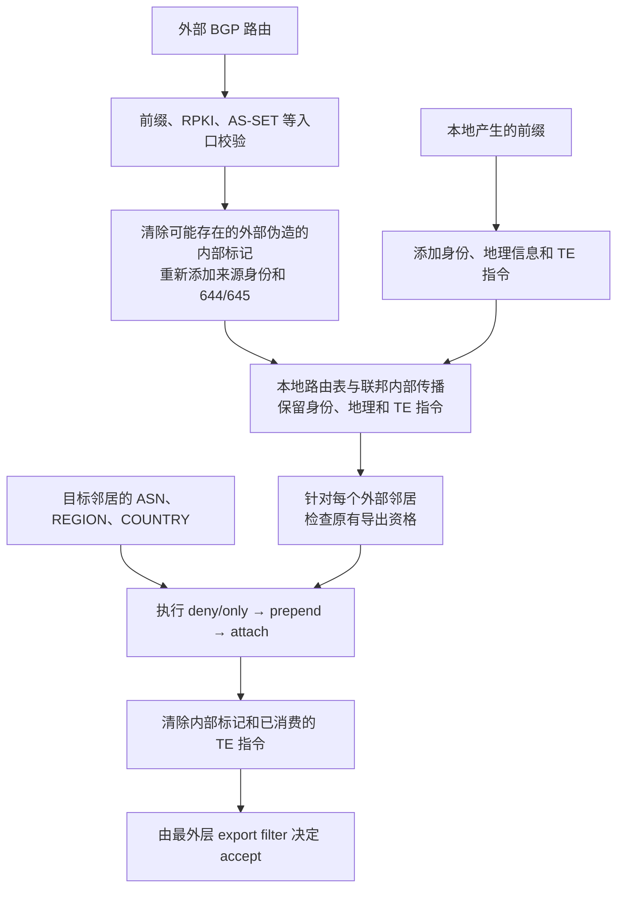

# 前言
在前一篇文章中，我们已经用 Ansible 自动化配置 WireGuard 和 Bird2，构建起一套跨地域的虚拟 BGP 联邦骨干网。但这张骨干网有一个天然问题：**BGP 选路并不感知物理延迟**。在联邦内部，各节点之间的 AS Path 往往很短，例如从香港到欧洲可能只有 1 到 2 跳，但它们之间的实际物理 RTT 仍然很高。

这就带来一个风险：如果同一个 Overlay 前缀被同时宣告到香港和欧洲节点，入站流量可能从香港上游出去后落到欧洲 PoP，再跨越高延迟的虚拟链路回到香港。尤其当我们直接与 Hurricane Electric（AS6939）这类 Tier 1 ISP Peer 时，问题会被进一步放大。前缀一旦进入 HE 骨干网，通常会被广泛传播并优先选择；如果此时把香港地区的前缀错误地从欧洲节点发给 HE，大量流量就会被吸引到 HE 的欧洲入口，再绕回香港，导致香港本地网络访问的整体延迟显著升高。

因此，在这张骨干网上，仅仅让 BGP Session 跑起来还不够。我们需要引入一些流量控制机制，明确一条路由“从哪里来、属于哪个域、应该从哪里宣告、允许传播到哪里”，从而避免错误地区的路由被导出到错误的上游。这也就是所谓的流量工程，一般会使用 BGP (Large) Community 来实现。

# 原理
其实是和之前操控标记内部路由还是外部路由，是 DN42 还是 IANA 是同一个思路，通过给前缀“打标签”来传递路由意图，并在边界路由器播出的时候“翻译”成对应操作。  

一般而言，常见的流量工程手段大致可以分为五类：
1. **传播范围控制**：控制前缀是否在某个地区、国家、PoP 或 Peer 导出；也可以只允许在 DN42/IANA/联邦内部等特定域可见。典型动作包括允许/拒绝导出、`NO_EXPORT`、`NO_ADVERTISE`、只播聚合抑制明细等。
2. **入站路径影响**：影响外部流量从哪个入口进来。最常用的是 **AS Path Prepend**，在指定上游或指定地区前追加自己的 AS，加长 AS Path 以降低该路径优先级；也可以选择只在部分 PoP 宣告前缀，或用更加详细的前缀做选择性引流，但后者要谨慎使用。
3. **出站选路影响**：影响自己从哪个出口出去。常见手段是 **Local Preference**、**MED**、下一跳/源地址选择，以及在 Overlay 场景下选择从哪个 Underlay 地址出。这类通常不直接靠 community 传播给外部，而是在本地策略里执行。和传播范围不同的是，这一类操作的对象是内部路由，而传播范围控制操作的范围是向外导出时的前缀。
4. **路径状态与主备**：用标签标记主路径、备份路径、维护状态或黑洞状态。例如备份路径做长 prepend 或低 Local Preference，这样主路径消失后才被动生效；维护时用 graceful shutdown 让路径优雅下线；异常流量用 blackhole community 丢弃。
5. **上游 TE 转译**：如果上游支持客户 TE Community，边界路由器可以把内部 Large Community 翻译成上游能识别的社区，例如地区偏好、prepend、blackhole 等。这样内部只需要表达路由意图，比如“我想让这条路由从 HK 出、优先级低一点”，具体怎么对上游表达，由边界策略转义成上游的 TE Community 并由上游完成操作。

我们其实不需要全部实现，我选择只做了如下部分：
1. well-known 的 `NO_EXPORT`、`NO_ADVERTISE`、`BLACKHOLE`；
2. 来源类型标识，上文提到了，即来自下游，来自 Peer，还是来自上游；
3. 地理标签，用于标识该路由从哪个地区/国家收到，这是后续按地区做策略匹配的基础；
4. 导出范围控制，对指定地区/国家/ASN执行只导出到此或者禁止导出；
5. AS Path Prepend，对指定地区/国家/ASN导出时 Prepend 1次/2次/3次自己的 AS。

这些已经能涵盖大部分我需要的场景了。  

# 标签设计
_这一步实际上来源于 たのしい 的 Community 规范，因为我们二者的基础设施共同承担 AS 205369 的骨干网_

还是像往常一样，使用 Communities 和 Large Communities 来承载。对于 IANA 的前缀，使用 `205369` 即自己的公网 AS 号作为 Large Community 的第一位；对于 DN42 的前缀，使用 `4242422024`；对于内部路由，则使用 `4220240000`。第二位作为功能号，第三位作为操作目标或者记录值。  

总结下来就是：

```
(asn, operation, target)
```

well-known 则使用普通 Communities，遵循通用约定：

```
(65535, 666)   # BLACKHOLE
(65535, 65281) # NO_EXPORT
(65535, 65282) # NO_ADVERTISE
```

最后定下来具体的功能号如下：
## 标记与识别

| 功能号 | 参数               | 已实现功能                                     |
| --- | ---------------- | ----------------------------------------- |
| 2   | 100 / 101 / 102  | 标记来自 Customer / Peer / Upstream，前一篇文章提到过了 |
| 644 | REGION 或 COUNTRY | 路由来源地，即对方 Peer 所在地区/国家                    |
| 645 | REGION 或 COUNTRY | 路由接收地，即本地 PoP 所在地区/国家                     

Peer 的地理位置可以单独配置，未指定时默认采用本节点位置。这也就意味着，我们需要给每个节点一个地理位置信息。自生成路由的 644、645 都按本地位置填写。
## 导出限制

| 功能号       | 参数      | 已实现功能                    |
| --------- | ------- | ------------------------ |
| 650 / 651 | REGION  | 禁止向指定地区导出 / 仅向指定地区导出     |
| 660 / 661 | COUNTRY | 禁止向指定国家导出 / 仅向指定国家导出     |
| 670 / 671 | ASN     | 禁止向指定 AS 导出 / 仅向指定 AS 导出 |

同一类功能号可以填写多个值，构成允许列表，不同边缘节点自会处理；地区、国家和 ASN 限制必须同时满足，禁止规则需要优先。这些规则匹配的是目标 Peer 的配置位置和 ASN，不是路由的 644/645 标签。
## AS Path Prepend

| 功能号     | 参数      | 已实现功能                       |
| ------- | ------- | --------------------------- |
| 691–693 | ASN     | 向指定 AS prepend 1 / 2 / 3 次  |
| 694–696 | ASN     | 向非指定 AS prepend 1 / 2 / 3 次 |
| 697–699 | REGION  | 向指定地区 prepend 1 / 2 / 3 次   |
| 700–702 | REGION  | 向非指定地区 prepend 1 / 2 / 3 次  |
| 703–705 | COUNTRY | 向指定国家 prepend 1 / 2 / 3 次   |
| 706–708 | COUNTRY | 向非指定国家 prepend 1 / 2 / 3 次  |

不同功能命中的 prepend 可以叠加；同一功能填写多个目标不会重复执行。这里的次数是额外增加次数，不包含正常 eBGP 导出时的自动处理。
## 附加 well-known Community

| 功能号             | 动作                                       |
| --------------- | ---------------------------------------- |
| 100666 / 200666 | 向指定 / 非指定 AS 附加 65535:666，BLACKHOLE      |
| 165281 / 265281 | 向指定 / 非指定 AS 附加 65535:65281，NO_EXPORT    |
| 165282 / 265282 | 向指定 / 非指定 AS 附加 65535:65282，NO_ADVERTISE |

前三个“指定”功能支持参数 0，表示所有邻居。BLACKHOLE 目前这里实现的是附加标签传递给外部，而不是本机自动丢弃路由，同时也不能保证对方执行黑洞。

# 实现
总体而言，我主要按照这个流程处理的：

## 导入阶段
在外部前缀进入联邦边界路由器时，经过基础的如前缀长度、RPKI等过滤后，先抹除可能存在的伪造的针对联邦的内部控制类和地理信息类 Community，再重新按照 Session 的配置打地理信息和来源标识。  

先删除导入时可能存在的内部 Community：

```bird2
function remove_internal_communities(){
    remove_intra_communities();
    bgp_large_community.delete([(4242422024, COMM_FN_IDENTIFY, *), (4242422024, COMM_FN_GEO_SRC, *), (4242422024, COMM_FN_GEO_DST, *)]);
    bgp_large_community.delete([(205369, COMM_FN_IDENTIFY, *), (205369, COMM_FN_GEO_SRC, *), (205369, COMM_FN_GEO_DST, *)]);
}
```

此处 `COMM_` 开头的常量分别对应不同的功能号：
```bird2
define COMM_FN_IDENTIFY = 2;
define COMM_FN_GEO_SRC = 644;
define COMM_FN_GEO_DST = 645;
```

再打上对应的 Geo 标签：
```bird2
function dn42_add_geo(int peer_region; int peer_country) {
    bgp_large_community.delete([(4242422024, COMM_FN_GEO_SRC, *), (4242422024, COMM_FN_GEO_DST, *)]);
    bgp_large_community.add((4242422024, COMM_FN_GEO_SRC, peer_region));
    bgp_large_community.add((4242422024, COMM_FN_GEO_SRC, peer_country));
    bgp_large_community.add((4242422024, COMM_FN_GEO_DST, POP_REGION));
    bgp_large_community.add((4242422024, COMM_FN_GEO_DST, POP_COUNTRY));
}
  
function iana_add_geo(int peer_region; int peer_country) {
    bgp_large_community.delete([(205369, COMM_FN_GEO_SRC, *), (205369, COMM_FN_GEO_DST, *)]);
    bgp_large_community.add((205369, COMM_FN_GEO_SRC, peer_region));
    bgp_large_community.add((205369, COMM_FN_GEO_SRC, peer_country));
    bgp_large_community.add((205369, COMM_FN_GEO_DST, POP_REGION));
    bgp_large_community.add((205369, COMM_FN_GEO_DST, POP_COUNTRY));
}
```
其中，`peer_region`、`peer_country` 是预先定义的按照 [DN42 的 Communities 规范](https://dn42.cc/wiki/howto/bgp-communities/)预先定义好的值：
```bird2
define GEO_REGION_EUROPE = 41;
define GEO_REGION_NA_EAST = 42;
define GEO_REGION_NA_CENTRAL = 43;
...
define GEO_REGION_ASIA_WEST = 56;
define GEO_REGION_ASIA_CENTRAL = 57;
define GEO_COUNTRY_CANADA = 1124;
define GEO_COUNTRY_CHINA = 1156;
define GEO_COUNTRY_TAIWAN = 1158;
define GEO_COUNTRY_FRANCE = 1250;
define GEO_COUNTRY_GERMANY = 1276;
define GEO_COUNTRY_HONG_KONG = 1344;
define GEO_COUNTRY_JAPAN = 1392;
define GEO_COUNTRY_UNITED_STATES = 1840;
...
```
## 联邦内部
在内部产生的路由，首先为其打上 Geo 数据，然后我们可以根据需求为其附加其他的控制类标签，比如：
```bird2
protocol static iana_static_advertise{
    route 2a14:7583:f220::/43 reject {
        bgp_large_community.add((205369,COMM_FN_ONLY_REGION,GEO_REGION_ASIA_SOUTH));
        bgp_large_community.add((205369,COMM_FN_ONLY_REGION,GEO_REGION_ASIA_SOUTHEAST));
        bgp_large_community.add((205369,COMM_FN_ONLY_REGION,GEO_REGION_ASIA_EAST));
        bgp_large_community.add((205369,COMM_FN_ONLY_REGION,GEO_REGION_ASIA_NORTH));
        bgp_large_community.add((205369,COMM_FN_ONLY_REGION,GEO_REGION_ASIA_WEST));
        bgp_large_community.add((205369,COMM_FN_ONLY_REGION,GEO_REGION_ASIA_CENTRAL));
        bgp_large_community.add((205369,COMM_FN_DENY_AS,6939));
    };
    route 2a14:7581:0ffb::/48 reject;
    ipv6 {
        import filter{
            bgp_large_community.add((205369,COMM_FN_IDENTIFY,COMM_ORIGIN_CUSTOMER));
            iana_add_geo(POP_REGION, POP_COUNTRY);
            accept;
        };
        export none;
    };
}
```
此处 `2a14:7583:f220::/43` 这个前缀，我们指定它只能播在亚洲区域，带上了 `COMM_FN_ONLY_REGION` 的功能号并且其值涵盖了亚洲的各个地区。同时，下方的 `iana_add_geo(POP_REGION, POP_COUNTRY);` 则为所有该 static protocol 产生的前缀打上地理位置标签。  

`POP_REGION` 和 `POP_COUNTRY` 的定义引用了前面预先定义好的列表：
```bird2
define POP_REGION = GEO_REGION_ASIA_EAST;
define POP_COUNTRY = GEO_COUNTRY_HONG_KONG;
```

还有一些有特殊需求的机器，比如需要往内核或者 Bird2 的 FIB 中注入某些特定路由来使整个节点的网络转发功能正常工作，此时就可以打上 well-known 的 `NO_ADVERTISE` 来确保这些路由不会被传递到其他机器上：
```bird2
protocol static iana_static{
    route 2401:5a0:1000::1/128 via fe80::232:17ff:fe4b:e4e0 % 'eth0' {
        bgp_community.add((COMM_FN_WELLKNOWN,COMM_WK_NO_ADVERTISE));
    };
    route fd00:7720::1/128 via fe80::232:17ff:fe4b:e4e0 % 'eth0' {
        bgp_community.add((COMM_FN_WELLKNOWN,COMM_WK_NO_ADVERTISE));
    };
    ipv6 {
        import all;
        export none;
    };
}
```

因此，在联邦内部节点间导出的时候，也需要对 Communities 进行处理，比如检测到 well-known 的 `NO_ADVERTISE` 就静默丢弃该前缀：
```bird2
filter intra_ibgp_import_full {
    # no-advertise
    if bgp_community ~ [(65535,65282)] then reject;
	...
}
```
这里需要注意一下，Bird2 本身会自动处理一些 well-known 比如 `NO_ADVERTISE`，`NO_EXPORT`，但是因为我使用的是手动模拟联邦而非 Bird2 自带的联邦功能，因此 Bird2 会将联邦间的 BGP Session 当作外部 BGP 处理，会自动应用 `NO_EXPORT`，导致一些可能我们想要在联邦内部传递而不想往外传的路由由于打上了 `NO_EXPORT` 而无法正常在联邦内传递，因此我们需要关闭 Bird2 的 interpret communities 功能，来阻止其自动应用 well-known：
```diff
template bgp intra_ibgpeers {
    router   id x.x.x.x;
    local    as xxxxxxxxxx;
    neighbor external;
+    interpret communities off;
};
```

## 导出阶段
首先进行基本过滤，过滤掉长度过长的前缀以及可能出现的默认路由 `::/0`，并进行 ROA 检查：
```bird2
function iana_filter_default_check(){
    if net ~ [::/0] then return false;
    if net.len > 48 then return false;
    if bgp_large_community ~ [(205369,COMM_FN_IDENTIFY,*)] && is_self_iana_v6() then return true;
    if roa_check(iana_roa_v6, net, bgp_path.last) = ROA_INVALID then return false;
    return true;
}
```
接着根据不同的会话类型（上下游，Peer）检查是否应当导出，这里以上游为例：
```bird2
function iana_upstream_check_community(){
    if !(bgp_large_community ~ [(205369,COMM_FN_IDENTIFY,*)]) then return false;
    if bgp_community ~ [(65535,65281)] then reject;
    if bgp_community ~ [(65535,65282)] then reject;
  
    if bgp_large_community ~ [(205369,COMM_FN_IDENTIFY,COMM_ORIGIN_PEER)] then return false;
    if bgp_large_community ~ [(205369,COMM_FN_IDENTIFY,COMM_ORIGIN_UPSTREAM)] then return false;
  
    return true;
}
```
对于上游，我们需要导出自己的前缀和下游的，而不能导出其他上游和来自 Peer 的前缀。  

然后分别处理各个功能号：  
允许/禁止广播到某些地区/AS：
```bird2
function iana_apply_export(int peer_as; int peer_region; int peer_country) -> bool {
    if (205369, COMM_FN_DENY_REGION, peer_region) ~ bgp_large_community then return false;
    if bgp_large_community ~ [(205369, COMM_FN_ONLY_REGION, *)] &&
       !((205369, COMM_FN_ONLY_REGION, peer_region) ~ bgp_large_community) then return false;
    if (205369, COMM_FN_DENY_COUNTRY, peer_country) ~ bgp_large_community then return false;
    if bgp_large_community ~ [(205369, COMM_FN_ONLY_COUNTRY, *)] &&
       !((205369, COMM_FN_ONLY_COUNTRY, peer_country) ~ bgp_large_community) then return false;
    if (205369, COMM_FN_DENY_AS, peer_as) ~ bgp_large_community then return false;
    if bgp_large_community ~ [(205369, COMM_FN_ONLY_AS, *)] &&
       !((205369, COMM_FN_ONLY_AS, peer_as) ~ bgp_large_community) then return false;
```

处理向指定 AS 对等体的 Prepend：
```bird2
    if (205369, COMM_FN_PREPEND_AS_1, peer_as) ~ bgp_large_community then bgp_path.prepend(205369);
    if (205369, COMM_FN_PREPEND_AS_2, peer_as) ~ bgp_large_community then { bgp_path.prepend(205369); bgp_path.prepend(205369); }
    if (205369, COMM_FN_PREPEND_AS_3, peer_as) ~ bgp_large_community then { bgp_path.prepend(205369); bgp_path.prepend(205369); bgp_path.prepend(205369); }
```

向除了指定 AS 之外的所有对等体的 Prepend：
```bird2
    if bgp_large_community ~ [(205369, COMM_FN_PREPEND_AS_OTHERS_1, *)] &&
       !((205369, COMM_FN_PREPEND_AS_OTHERS_1, peer_as) ~ bgp_large_community) then bgp_path.prepend(205369);
    if bgp_large_community ~ [(205369, COMM_FN_PREPEND_AS_OTHERS_2, *)] &&
       !((205369, COMM_FN_PREPEND_AS_OTHERS_2, peer_as) ~ bgp_large_community) then { bgp_path.prepend(205369); bgp_path.prepend(205369); }
    if bgp_large_community ~ [(205369, COMM_FN_PREPEND_AS_OTHERS_3, *)] &&
       !((205369, COMM_FN_PREPEND_AS_OTHERS_3, peer_as) ~ bgp_large_community) then { bgp_path.prepend(205369); bgp_path.prepend(205369); bgp_path.prepend(205369); }
```

向指定区域/国家的对等体 Prepend：
```bird2
    if (205369, COMM_FN_PREPEND_REGION_1, peer_region) ~ bgp_large_community then {
        bgp_path.prepend(205369);
    }
    if (205369, COMM_FN_PREPEND_REGION_2, peer_region) ~ bgp_large_community then {
        bgp_path.prepend(205369);
        bgp_path.prepend(205369);
    }
    if (205369, COMM_FN_PREPEND_REGION_3, peer_region) ~ bgp_large_community then {
        bgp_path.prepend(205369);
        bgp_path.prepend(205369);
        bgp_path.prepend(205369);
    }
    if (205369, COMM_FN_PREPEND_COUNTRY_1, peer_country) ~ bgp_large_community then {
        bgp_path.prepend(205369);
    }
    if (205369, COMM_FN_PREPEND_COUNTRY_2, peer_country) ~ bgp_large_community then {
        bgp_path.prepend(205369);
        bgp_path.prepend(205369);
    }
    if (205369, COMM_FN_PREPEND_COUNTRY_3, peer_country) ~ bgp_large_community then {
        bgp_path.prepend(205369);
        bgp_path.prepend(205369);
        bgp_path.prepend(205369);
    }
```

向非指定区域/国家的对等体 Prepend：
```bird2
    if bgp_large_community ~ [(205369, COMM_FN_PREPEND_REGION_OTHERS_1, *)] &&
       !((205369, COMM_FN_PREPEND_REGION_OTHERS_1, peer_region) ~ bgp_large_community) then {
        bgp_path.prepend(205369);
    }
    if bgp_large_community ~ [(205369, COMM_FN_PREPEND_REGION_OTHERS_2, *)] &&
       !((205369, COMM_FN_PREPEND_REGION_OTHERS_2, peer_region) ~ bgp_large_community) then {
        bgp_path.prepend(205369);
        bgp_path.prepend(205369);
    }
    if bgp_large_community ~ [(205369, COMM_FN_PREPEND_REGION_OTHERS_3, *)] &&
       !((205369, COMM_FN_PREPEND_REGION_OTHERS_3, peer_region) ~ bgp_large_community) then {
        bgp_path.prepend(205369);
        bgp_path.prepend(205369);
        bgp_path.prepend(205369);
    }
    if bgp_large_community ~ [(205369, COMM_FN_PREPEND_COUNTRY_OTHERS_1, *)] &&
       !((205369, COMM_FN_PREPEND_COUNTRY_OTHERS_1, peer_country) ~ bgp_large_community) then {
        bgp_path.prepend(205369);
    }
    if bgp_large_community ~ [(205369, COMM_FN_PREPEND_COUNTRY_OTHERS_2, *)] &&
       !((205369, COMM_FN_PREPEND_COUNTRY_OTHERS_2, peer_country) ~ bgp_large_community) then {
        bgp_path.prepend(205369);
        bgp_path.prepend(205369);
    }
    if bgp_large_community ~ [(205369, COMM_FN_PREPEND_COUNTRY_OTHERS_3, *)] &&
       !((205369, COMM_FN_PREPEND_COUNTRY_OTHERS_3, peer_country) ~ bgp_large_community) then {
        bgp_path.prepend(205369);
        bgp_path.prepend(205369);
        bgp_path.prepend(205369);
    }
```

处理向上游传递路由意图的 Communities 比如 `BLACKHOLE`：
```bird2
    if bgp_large_community ~ [(205369, COMM_FN_ATTACH_BLACKHOLE, 0)] ||
       (205369, COMM_FN_ATTACH_BLACKHOLE, peer_as) ~ bgp_large_community then
        bgp_community.add((COMM_FN_WELLKNOWN, COMM_WK_BLACKHOLE));
    if bgp_large_community ~ [(205369, COMM_FN_ATTACH_NO_EXPORT, 0)] ||
       (205369, COMM_FN_ATTACH_NO_EXPORT, peer_as) ~ bgp_large_community then
        bgp_community.add((COMM_FN_WELLKNOWN, COMM_WK_NO_EXPORT));
    if bgp_large_community ~ [(205369, COMM_FN_ATTACH_NO_ADVERTISE, 0)] ||
       (205369, COMM_FN_ATTACH_NO_ADVERTISE, peer_as) ~ bgp_large_community then
        bgp_community.add((COMM_FN_WELLKNOWN, COMM_WK_NO_ADVERTISE));
    if bgp_large_community ~ [(205369, COMM_FN_ATTACH_BLACKHOLE_OTHERS, *)] &&
       !((205369, COMM_FN_ATTACH_BLACKHOLE_OTHERS, peer_as) ~ bgp_large_community) then
        bgp_community.add((COMM_FN_WELLKNOWN, COMM_WK_BLACKHOLE));
    if bgp_large_community ~ [(205369, COMM_FN_ATTACH_NO_EXPORT_OTHERS, *)] &&
       !((205369, COMM_FN_ATTACH_NO_EXPORT_OTHERS, peer_as) ~ bgp_large_community) then
        bgp_community.add((COMM_FN_WELLKNOWN, COMM_WK_NO_EXPORT));
    if bgp_large_community ~ [(205369, COMM_FN_ATTACH_NO_ADVERTISE_OTHERS, *)] &&
       !((205369, COMM_FN_ATTACH_NO_ADVERTISE_OTHERS, peer_as) ~ bgp_large_community) then
        bgp_community.add((COMM_FN_WELLKNOWN, COMM_WK_NO_ADVERTISE));

    return true;
}
```

最后处理掉那些已经应用过的控制类 Communities：
```bird2
function remove_export_control_communities(){
    bgp_large_community.delete([(4242422024, COMM_FN_ATTACH_BLACKHOLE, *)]);
    bgp_large_community.delete([(4242422024, COMM_FN_ATTACH_BLACKHOLE_OTHERS, *)]);
    bgp_large_community.delete([(4242422024, COMM_FN_ATTACH_NO_EXPORT, *)]);
    bgp_large_community.delete([(4242422024, COMM_FN_ATTACH_NO_EXPORT_OTHERS, *)]);
...
    bgp_large_community.delete([(4242422024, COMM_FN_PREPEND_COUNTRY_3, *)]);
    bgp_large_community.delete([(4242422024, COMM_FN_PREPEND_COUNTRY_OTHERS_1, *)]);
    bgp_large_community.delete([(4242422024, COMM_FN_PREPEND_COUNTRY_OTHERS_2, *)]);
    bgp_large_community.delete([(4242422024, COMM_FN_PREPEND_COUNTRY_OTHERS_3, *)]);
    bgp_large_community.delete([(205369, COMM_FN_ATTACH_BLACKHOLE, *)]);
    bgp_large_community.delete([(205369, COMM_FN_ATTACH_BLACKHOLE_OTHERS, *)]);
    bgp_large_community.delete([(205369, COMM_FN_ATTACH_NO_EXPORT, *)]);
    bgp_large_community.delete([(205369, COMM_FN_ATTACH_NO_EXPORT_OTHERS, *)]);
...
    bgp_large_community.delete([(205369, COMM_FN_PREPEND_COUNTRY_3, *)]);
    bgp_large_community.delete([(205369, COMM_FN_PREPEND_COUNTRY_OTHERS_1, *)]);
    bgp_large_community.delete([(205369, COMM_FN_PREPEND_COUNTRY_OTHERS_2, *)]);
    bgp_large_community.delete([(205369, COMM_FN_PREPEND_COUNTRY_OTHERS_3, *)]);
}
```

以及其他内部 Communities 和联邦 AS：
```bird2
function remove_intra_communities(){ # 这个是处理内部路由的
    bgp_large_community.delete([(4220240000, COMM_FN_IDENTIFY, *), (4220240000, COMM_FN_GEO_SRC, *), (4220240000, COMM_FN_GEO_DST, *)]);
}
  
function remove_internal_communities(){ # 这个是处理 DN42 / IANA 路由的
    remove_intra_communities();
    bgp_large_community.delete([(4242422024, COMM_FN_IDENTIFY, *), (4242422024, COMM_FN_GEO_SRC, *), (4242422024, COMM_FN_GEO_DST, *)]);
    bgp_large_community.delete([(205369, COMM_FN_IDENTIFY, *), (205369, COMM_FN_GEO_SRC, *), (205369, COMM_FN_GEO_DST, *)]);
}

function remove_confederation_as() {
    bgp_path.delete([INTRA_CONFEDERATION_START..INTRA_CONFEDERATION_END]);
    bgp_path.delete([4233770000..4233779999]);
}
```

自此，我们也就大致实现了一套简易的 TE 控制体系。
## 自动化集成
这一步其实也就没什么好说的了，将这些内容交由 Ansible 处理即可，比如在每个 DN42 Peer 配置文件下添加一个对端地理位置信息然后据此渲染进配置：
```yml
...
geo:
  region: ASIA_EAST
  country: HONG_KONG
...
```

在配置前缀的时候加上 Communities 配置项并渲染进配置：
```yml
extra_routes:
- protocol: iana_static
  prefixes:
  - prefix: 2401:5a0:1000::1/128
	via:
	  address: fe80::232:17ff:fe4b:e4e0
	  interface: eth0
	communities:
	- [COMM_FN_WELLKNOWN, COMM_WK_NO_ADVERTISE]
  - prefix: fd00:7720::1/128
	via:
	  address: fe80::232:17ff:fe4b:e4e0
	  interface: eth0
	communities:
	- [COMM_FN_WELLKNOWN, COMM_WK_NO_ADVERTISE]
```

~~（其实这部分是我直接丢给 AI 让它帮我改我的 Ansible 模板的所以我说不好它模板是怎么渲染的（逃））~~  
代码部分可以参考：[bird2-config/ansible at dev · iYoRoy-Network/bird2-config](https://github.com/iYoRoy-Network/bird2-config/tree/dev/ansible)

# 效果 & 后记
我在亚洲地区播出的前缀 `2a14:7583:f220::/43`，不希望它被播到欧洲地区，并且不希望它被播往 AS 6939，因此我在所有播这个段的机器上为其添加了：
```yml
- [205369, COMM_FN_ONLY_REGION, GEO_REGION_ASIA_SOUTH]
- [205369, COMM_FN_ONLY_REGION, GEO_REGION_ASIA_SOUTHEAST]
- [205369, COMM_FN_ONLY_REGION, GEO_REGION_ASIA_EAST]
- [205369, COMM_FN_ONLY_REGION, GEO_REGION_ASIA_NORTH]
- [205369, COMM_FN_ONLY_REGION, GEO_REGION_ASIA_WEST]
- [205369, COMM_FN_ONLY_REGION, GEO_REGION_ASIA_CENTRAL]
- [205369, COMM_FN_DENY_AS, 6939]
```

此时，在欧洲地区的 PoP （英国机器）上查看该前缀信息：
```shell
root@LHR01-UK:~# birdc show route 2a14:7583:f220::/43 all
BIRD 2.19.2 ready.
Table master6:
2a14:7583:f220::/43  unicast [intra_confed_fra01 2026-10-31] * (100) [AS4220241106i]
	via fe80::2024:1:2:3b06 on intra_fra01
	Type: BGP univ
	BGP.origin: IGP
	BGP.as_path: 4220241201 4220241106
	BGP.next_hop: :: fe80::2024:1:2:3b06
	BGP.local_pref: 100
	BGP.large_community: (205369, 2, 100) (205369, 644, 52) (205369, 644, 1392) (205369, 645, 52) (205369, 645, 1392) (205369, 651, 50) (205369, 651, 51) (205369, 651, 52) (205369, 651, 55) (205369, 651, 56) (205369, 651, 57) (205369, 670, 6939)
                     unicast [intra_confed_cdg01 08:05:22.688] (100) [AS4220241103i]
	via fe80::2024:1:2:a024 on intra_cdg01
	Type: BGP univ
	BGP.origin: IGP
	BGP.as_path: 4220241203 4220241103
	BGP.next_hop: :: fe80::2024:1:2:a024
	BGP.local_pref: 100
	BGP.large_community: (205369, 2, 100) (205369, 644, 52) (205369, 644, 1344) (205369, 645, 52) (205369, 645, 1344) (205369, 651, 50) (205369, 651, 51) (205369, 651, 52) (205369, 651, 55) (205369, 651, 56) (205369, 651, 57) (205369, 670, 6939)
```

可以看到，它已经附带上了我们打的那些 Community。  

并且此时查看导出给上游的过滤器：
```shell
root@LHR01-UK:~# birdc 'show route 2a14:7583:f220::/43 export iana_upstream_44324_v6 all'
BIRD 2.19.2 ready.
```
会发现，该前缀没有出现在被导出的前缀列表里。同时，查看欧洲自己的前缀就能看到：
```shell
root@LHR01-UK:~# birdc 'show route 2a14:7583:f240::/43 export iana_upstream_44324_v6 all'
BIRD 2.19.2 ready.
Table master6:
2a14:7583:f240::/43  unreachable [iana_static_advertise 2026-10-28] * (200)
	Type: static univ
	BGP.as_path:
	BGP.large_community:
```
而且可以看出，其 Large Community 在经过过滤器处理后被剥离了内部联邦 AS 以及使用过的 Communities。

---
# 后记
这套机制目前只覆盖了入站方向最迫切的一部分需求：来源标识、地理标签、导出范围控制和 Prepend。它提供了一个最基础的调控路由的手段。成熟的流量工程应该比这复杂的多，比如出站方向的 Local Preference / MED 策略、把内部标签翻译成上游客户 TE Community、聚合与明细抑制、graceful shutdown，以及基于延迟探测的动态 TE 等等，当前都没写实现。

也能看出来，大量的 Communities 规则会导致配置的复杂度直线上升，因此也许使用自动化配置 IPAM 是一个必然的趋势（？