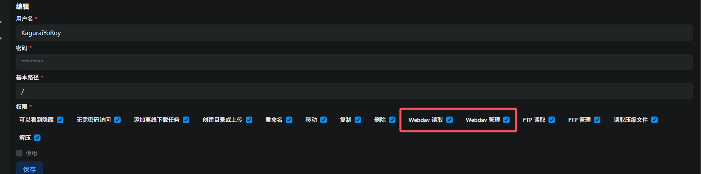
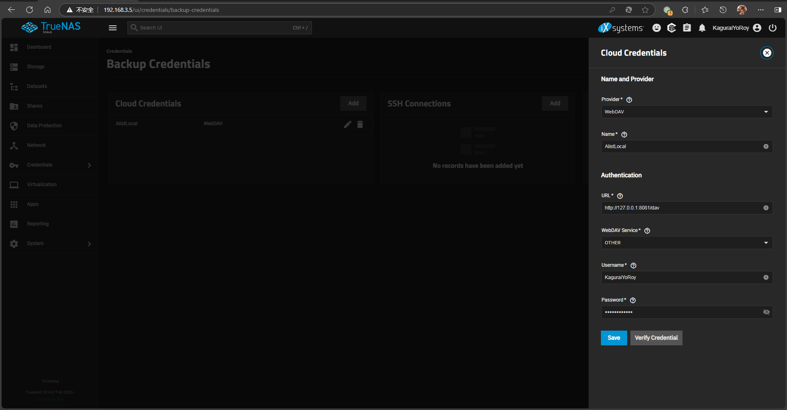
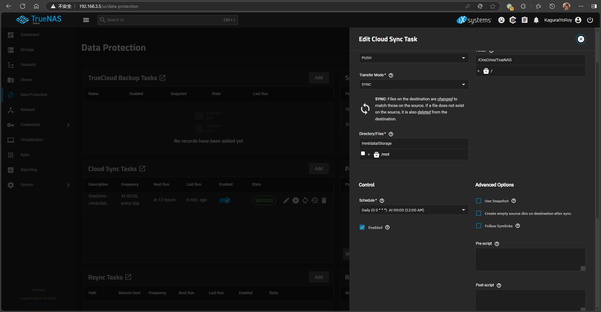

# 背景
手上有个E5订阅，本来用的方案是Docker运行**driveone/onedrive:edge**的方式来实现同步，但是这个方案一个是这种方式没有GUI/WebUI，一个是每次同步的时候都会占用掉CPU 25%-50%的性能。考虑到TrueNAS自带的同步方案可以向WebDAV同步，因此想到能用Alist来挂载OneDrive并转换成WebDAV供TrueNAS挂载。  

# 折腾过程
## 安装Alist
为Alist创建持久化存储文件夹，并根据Alist官方文档编写Docker Compose：  

```yaml
services:
  alist:
    environment:
      - PUID=3000
      - PGID=950
      - UMASK=022
    image: xhofe/alist:latest
    ports:
      - '8088:5244'
    restart: always
    volumes:
      - /mnt/systemdata/DockerData/alist/etc:/opt/alist/data
      - /mnt/data/Storage:/mnt/data
```

此处我将Alist端口开放在8088，其中映射`/mnt/data/Storage`是为了让Alist可以管理本地的存储；映射`/mnt/systemdata/DockerData/alist/etc`作为存储Alist数据的文件夹。  
关于如何配置Alist上的OneDrive本文不做讨论，请查询Alist官方文档。此处我将我的OneDrive挂载在`/OneDrive`。  

完成后进入Alist后台-用户，编辑你的用户或者创建一个新用户，勾选**Webdav 读取**、**Webdav 管理**以使得该用户可以使用WebDAV。  



## 配置TrueNAS同步

进入**TrueNAS后台-Credentials-Backup Credentials**，添加一个**Cloud Credential**，参数如下：
* Provider: WebDAV
* Name: 自定义
* URL: Alist地址+/dav，例如我这里填写`http://127.0.0.1:8088/dav`
* WebDAV Service: OTHER
* Username和Password: Alist账号密码



Verify Credential确认没问题之后保存。  

接着进入**TrueNAS后台-Data Protection**，添加一个**Cloud Sync Task**，**Provider**下的**Credentials**选择刚刚创建的Alist的WebDAV，点击下一步。此处的参数有很多种，详解如下：  
* Direction: 分为PULL和PUSH，分别对应云端同步到本地和本地同步到云端
* Transfer Mode:
1. COPY: 复制文件，若源文件夹中先前有的文件后来删除了云端的不会被删除
2. MOVE: Copy后删除源文件夹相关文件
3. SYNC: 保持源文件夹和目标文件夹同步，源文件夹删除的文件也会在目标里删除
* Directory/Files: 即本地需要同步的文件或文件夹
* Folder: 即云端需要同步的文件夹
* Description: 注释
* Schedule: Cron定时，可以使用他预设的时段或者自己编写



比如我这里选择的是PUSH，SYNC，从/mnt/data/Storage同步到/OneDrive/TrueNAS，每天0:00执行。  

编辑完成后保存，即可在你设置的时段自动将本地文件上传到OneDrive。

******
旧方案的项目地址：
* https://github.com/abraunegg/onedrive

参考文章：
* https://alist.nn.ci/zh/guide/install/docker.html
* https://alist.nn.ci/zh/guide/drivers/onedrive.html
