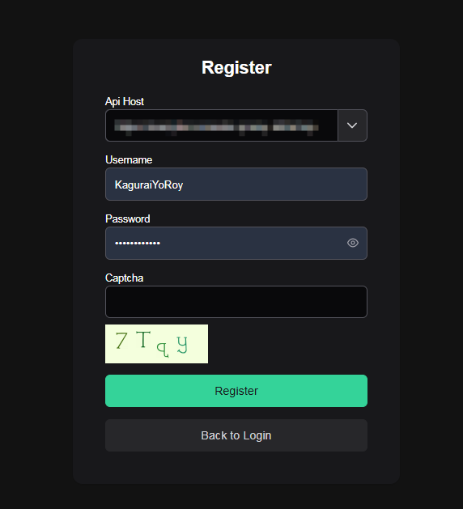
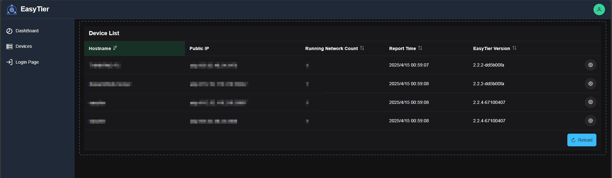
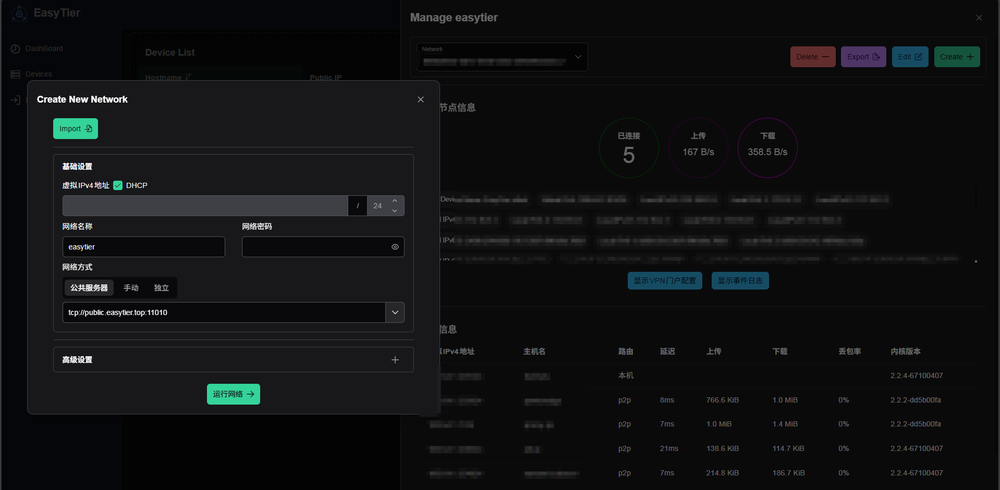

[EasyTier](https://easytier.cn)本身是个去中心化的p2p工具，任意节点都可作为转发服务器使用。但是每个节点的配置文件都得手动编写，从tailscale迁移过来时觉得有点不习惯。再加上摸索阶段经常需要修改配置文件的内容，故打算还是中心化部署EasyTier的Dashboard，统一管理设备。  

项目仓库：https://github.com/easytier/easytier

官方文档并未提供单独部署config-server的方式，但是实际上也不难，服务端已经包含在下载下来的二进制文件中了。本文着重论述通过Docker Compose安装，需要二进制模式安装的可参考下方参考文章。

# 分析
dashboard的部署主要分为两个部分，一个是后端RESTful API，一个是前端web控制台。其中Release里的**easytier-web-embed**同时提供了这俩，因此只要运行此二进制文件即可实现功能。

# 开整
## 部署API和Web控制台
Docker部署，没什么好说的。  

需要开放两个端口：
1. 11211/tcp: API接口，HTTP
2. 22020/udp: 用于客户端（easytier-core）和服务器通信

目录映射需要映射容器内`/app`文件夹，用作存储持久化数据。  

Compose文件如下：
```yaml
services:
  easytier:
    restart: always
    hostname: easytier
    volumes:
      - /opt/easytier/api:/app
    ports:
      - "127.0.0.1:11211:11211"
      - "22020:22020/udp"
    environment:
      - TZ=Asia/Shanghai
    image: easytier/easytier:latest 
    entrypoint: easytier-web-embed
```

此处镜像和官方文档的Docker部署客户端用的是同一个，默认入口点是**easytier-core**，因此运行webapi需要指定`entrypoint`为**easytier-web-embed**。  
因为API接口需要HTTPS，故此处没有直接将11211端口暴露公网，而是暴露到127.0.0.1再使用反向代理实现HTTPS。

## 设置反向代理
我使用的是1Panel，因此直接在面板中创建一个网站，反向代理到设置的API端口即可。

## 注册控制台账号
完成部署后打开`https://你的域名`（如果是内建控制台版本则不需要加`/web/`），将Api Host改为`https://你的域名`，注意填Api Host的时候URL末尾**不要带“/”**，否则会出莫名其妙的问题。点击下方Register注册一个账号



再使用这个账号登录即可进入控制台。

## 客户端配置
将启动参数全部删除，仅保留`--config-server udp://你的ip:22020/你的用户名`即可。运行easytier-core，再回到控制台即可看到设备。



点击右边的设置按钮，点击Create为其创建网络，接下来的步骤就和本地GUI模式操作一样了，这里就不赘述了。保存后在network栏选择新建的网络即可加入。



因为Docker重启容器内数据会丢失，Docker下部署客户端时需要映射一个文件到容器内`/usr/local/bin/et_machine_id`用作保存machine id，否则每次重启后都需要重新为其配置网络。同时，给容器设置`hostname`可以作为设备在web控制台显示的名称。

这里贴一下我的compose：
```yaml
services:
  easytier:
    command: '--config-server udp://<ip>:22020/KaguraiYoRoy'
    environment:
      - TZ=Asia/Shanghai
    hostname: truenas
    image: easytier/easytier:latest
    labels:
      com.centurylinklabs.watchtower.enable: 'true'
    mem_limit: 0m
    network_mode: host
    privileged: True
    restart: always
    volumes:
      - >-
        /mnt/systemdata/DockerData/easytier/app/et_machine_id:/usr/local/bin/et_machine_id
  watchtower:
    command: '--interval 3600 --cleanup --label-enable'
    environment:
      - TZ=Asia/Shanghai
      - WATCHTOWER_NO_STARTUP_MESSAGE
    image: containrrr/watchtower
    restart: always
    volumes:
      - /var/run/docker.sock:/var/run/docker.sock
```

-----

参考：
* https://blog.mitsea.com/1a57bda595c580088006c17d6ba2a744/
* https://github.com/EasyTier/EasyTier/issues/722
* https://github.com/EasyTier/EasyTier/issues/577
* https://github.com/EasyTier/EasyTier/pull/718