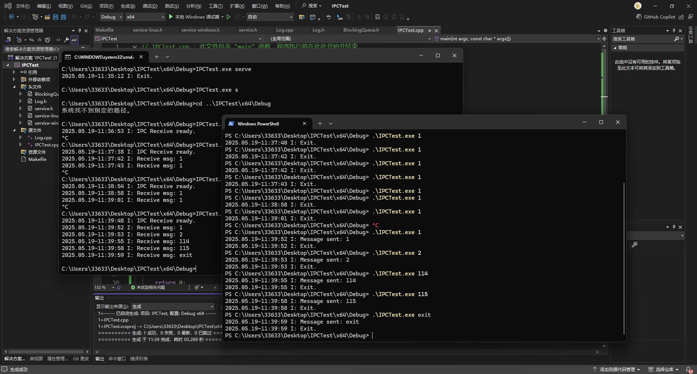
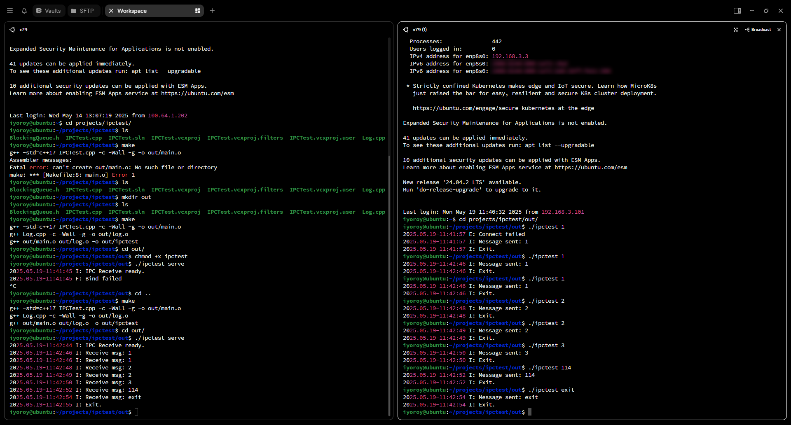

# 前情提要
上一篇文章实现了统一的日志管理，这篇文章来实现进程间消息通讯，即IPC。

# 分析
## Windows
在Windows下，主要通过**管道（Pipe）**实现进程间通讯。管道又分为**命名管道（Named Pipe）**和**匿名管道（Anonymous Pipe）**。其中，匿名管道是**单向**的，通常在父进程和子进程之间通讯<sup>[\[2\]](https://learn.microsoft.com/zh-cn/windows/win32/ipc/anonymous-pipes)</sup>。而命名管道则可以是单向管道或双工管道，并且支持一对多通讯<sup>[\[3\]](https://learn.microsoft.com/zh-cn/windows/win32/ipc/named-pipes)</sup>。顾名思义，识别命名管道的唯一方式是它的名称，因此两个进程只要都连接到同一个名字的命名管道即可实现通信。  
我们需要实现进程间的双向通讯，因此采用命名管道。大致思路就是：进程作为伺服模式，也就是接收端启动时创建一个线程，创建一个命名管道并监听管道内消息。当管道被连接时从中读取管道内数据；当进程作为发送端启动时尝试连接到同一个名称的管道，并写入消息内容。

## Linux
在Linux下通常使用**socket**进行进程间通讯。不过不同于监听端口，进程间通讯一般会选择监听一个**sock文件**<sup>[\[5\]](https://blog.csdn.net/dog250/article/details/100998838)</sup>，常见的服务类应用如docker daemon、mysql都是通过这种方式。  
因此，大致思路如下：作为伺服模式启动的进程创建一个socket监听，并等待从中接收消息；发送端连接到socket套接字并发送消息。和上文命名管道的名称类似，socket套接字会映射一个唯一的.sock文件，发送方只要打开这个文件即可发送消息。（实际上打开方式不是常规的打开文件，而是用socket专用的打开方式<sup>[\[5\]](https://blog.csdn.net/dog250/article/details/100998838)</sup>）

# 代码实现
## 初始化
为了实现共用一套主代码，我使用了和上一篇文章中一样的通过宏定义区分系统类型的方案，将Windows和Linux的代码分别写在`service-windows.h`和`service-linux.h`两个头文件中：
```cpp
#ifdef _WIN32
#include "service-windows.h"
#elif defined(__linux__)
#include "service-linux.h"
#endif
```
当接收端进程启动时，创建一个线程处理收信息（使用`std::thread`作为多线程库）：
```cpp
thread_bind = std::thread(bind_thread_main);
```

## 监听部分
### Windows
在Windows下，只要尝试从指定名称的命名管道读取数据即可。其中，因为设置了管道为**等待模式**（即下文中`CreateNamedPipe`的第三个参数`DWORD dwPipeMode`中设置了`PIPE_WAIT`），`ConnectNamedPipe`会是阻塞模式，因此不用担心不断循环造成的性能损失。

```cpp
void bind_thread_main() {
    while (!exit_requested.load()) {
        HANDLE hPipe = CreateNamedPipe(
            PIPE_NAME,
            PIPE_ACCESS_DUPLEX,
            PIPE_TYPE_MESSAGE | PIPE_READMODE_MESSAGE | PIPE_WAIT,
            PIPE_UNLIMITED_INSTANCES,
            1024,  // Output buffer size
            1024,  // Input buffer size
            0,     // Default timeout
            NULL);

        if (hPipe == INVALID_HANDLE_VALUE) {
            service_log.push(LEVEL_WARN, "Failed to create pipe: %d", GetLastError());
            continue;
        }

        if (ConnectNamedPipe(hPipe, NULL) ||
            GetLastError() == ERROR_PIPE_CONNECTED) {

            char buffer[1024];
            DWORD bytesRead;

            if (ReadFile(hPipe, buffer, sizeof(buffer) - 1, &bytesRead, NULL)) {
                buffer[bytesRead] = '\0';
                m_queueMsg.push(buffer);
                service_log.push(LEVEL_VERBOSE, "Message received: %s", buffer);
            }

            FlushFileBuffers(hPipe);
            DisconnectNamedPipe(hPipe);
            CloseHandle(hPipe);
        }
        else {
            CloseHandle(hPipe);
        }
    }
}
```

### Linux
为了防止创建失败，在创建前会先尝试删除没有清理干净的sock文件，即代码中`unlink(SOCKET_PATH)`。`SOCKET_PATH`为全局变量，定义了套接字文件的路径。创建套接字时，指定family为`AF_UNIX`代表创建UNIX套接字，即.sock文件的这种类型（如果是网络套接字就是`AF_INET`）。`timeval`这段代码设置了一个超时限制，当`accept`函数等待时间超过设置的`SOCKET_TIMEOUT`超时时间（单位秒）后会自动结束阻塞并返回错误信息。创建完套接字后按照正常流程设置绑定和监听即可。

```cpp
void bind_thread_main() {
    unlink(SOCKET_PATH);

    int server_fd = socket(AF_UNIX, SOCK_STREAM, 0);
    if (server_fd == -1) {
        service_log.push(LEVEL_FATAL, "Failed to create socket");
        exit_requested.store(true);
        return;
    }

    struct timeval tv;
    tv.tv_sec = SOCKET_TIMEOUT;
    tv.tv_usec = 0;
    setsockopt(server_fd, SOL_SOCKET, SO_RCVTIMEO, &tv, sizeof(tv));

    sockaddr_un addr{};
    addr.sun_family = AF_UNIX;
    strncpy(addr.sun_path, SOCKET_PATH, sizeof(addr.sun_path) - 1);

    if (bind(server_fd, (sockaddr*)&addr, sizeof(addr)) == -1) {
        service_log.push(LEVEL_FATAL, "Bind failed");
        close(server_fd);
        exit_requested.store(true);
        return;
    }

    if (listen(server_fd, 5) == -1) {
        service_log.push(LEVEL_FATAL, "Listen failed");
        close(server_fd);
        exit_requested.store(true);
        return;
    }

    while (!exit_requested.load()) {
        int client_fd = accept(server_fd, nullptr, nullptr);
        if (client_fd != -1) {
            char buffer[1024];
            int bytes_read = read(client_fd, buffer, sizeof(buffer) - 1);
            if (bytes_read > 0) {
                buffer[bytes_read] = '\0';
                m_queueMsg.push(buffer);
                service_log.push(LEVEL_VERBOSE, "Message received: %s", buffer);
            }
            close(client_fd);
        }
        else {
            if (errno == EWOULDBLOCK || errno == EAGAIN) {
                continue;
            }
            service_log.push(LEVEL_WARN, "Failed to accept socket connection");
        }
    }
}
```

当读取到消息后，两份代码都会将消息保存至阻塞队列`m_queueMsg`中。

## 发送部分
### Windows
打开指定管道并写入消息内容即可：
```cpp
bool send_message(const std::string& msg) {
    if (!WaitNamedPipe(PIPE_NAME, NMPWAIT_WAIT_FOREVER)) {
        service_log.push(LEVEL_ERROR, "Failed to find valid pipe: %d", GetLastError());
        return false;
    }

    HANDLE hPipe = CreateFile(
        PIPE_NAME,
        GENERIC_WRITE,
        0,
        NULL,
        OPEN_EXISTING,
        0,
        NULL);

    if (hPipe == INVALID_HANDLE_VALUE) {
        service_log.push(LEVEL_ERROR, "Failed to connect: %d", GetLastError());
        return false;
    }

    DWORD bytesWritten;
    if (WriteFile(hPipe, msg.c_str(), (DWORD)msg.size(), &bytesWritten, NULL)) {
        service_log.push(LEVEL_VERBOSE, "Message sent: %s", msg.c_str());
        CloseHandle(hPipe);
        return true;
    }
    else {
        service_log.push(LEVEL_ERROR, "Message (%s) send failed: %d", msg.c_str(),GetLastError());
        CloseHandle(hPipe);
        return false;
    }

}
```

### Linux
同理，连接套接字，发送数据：
```cpp
bool send_message(const std::string& msg) {
    int sock = socket(AF_UNIX, SOCK_STREAM, 0);
    if (sock == -1) {
        service_log.push(LEVEL_ERROR, "Failed to create socket");
        return false;
    }

    sockaddr_un addr{};
    addr.sun_family = AF_UNIX;
    strncpy(addr.sun_path, SOCKET_PATH, sizeof(addr.sun_path) - 1);

    if (connect(sock, (sockaddr*)&addr, sizeof(addr)) == -1) {
        service_log.push(LEVEL_ERROR, "Connect failed");
        close(sock);
        return false;
    }

    if (write(sock, msg.c_str(), msg.size()) == -1) {
        service_log.push(LEVEL_ERROR, "Message send failed: %s", msg.c_str());
        close(sock);
        return false;
    }
    else {
        service_log.push(LEVEL_VERBOSE, "Message sent success: %s", msg.c_str());
        close(sock);
        return true;
    }
}
```

## 清理
Windows下没什么需要清理的，Linux下删除套接字文件即可：
```cpp
unlink(SOCKET_PATH);
```

------

# 效果示意图
## Windows


## Linux


样例代码下载：
[IPCTest.zip](/downloads/2025/05/3672377721.zip)

------
参考文章：
1. https://learn.microsoft.com/zh-cn/windows/win32/ipc/pipes
2. https://learn.microsoft.com/zh-cn/windows/win32/ipc/anonymous-pipes
3. https://learn.microsoft.com/zh-cn/windows/win32/ipc/named-pipes
4. https://www.cnblogs.com/alantu2018/p/8493809.html
5. https://blog.csdn.net/dog250/article/details/100998838