虽然Cloudflare CDN在国内访问速度不尽人意，但是用作国际线路的解析内容还是很够用的。然而Cloudflare很早就取消了CNAME接入的方式，因此本文主要讨论通过SaaS接入，因此需要一张信用卡激活Cloudflare SaaS。

# 准备材料
1. 有效信用卡，需要有卡号、安全码，或者绑定了信用卡的PayPal。若不超过100个自定义主机名的限制则不会产生扣费。
2. 回退域名，和正常访问的域名不能是同一个（Cloudflare接入需要）
3. 正常访问域名

为了实现分大陆、境外地区单独解析，用作正常访问的域名不可以通过Cloudflare接入。  
本文正常访问的域名为：`www.iyoroy.cn`，回退域名为`nekonya.cloud`。

# 过程
## 回退域名接入
注册一个Cloudflare账户，按照官方教程将域名的DNS改到Cloudflare：
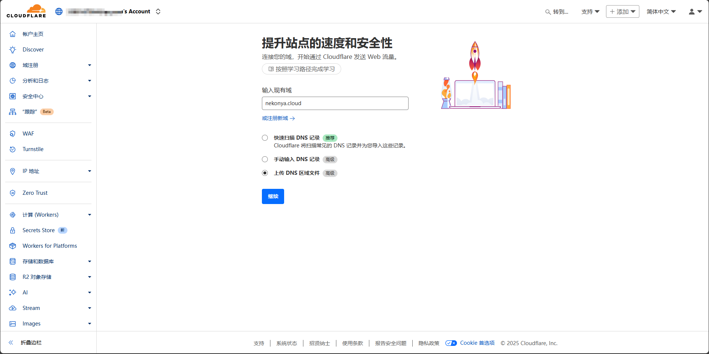

Plan选择Free计划即可：
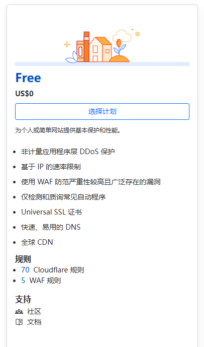

按照要求修改NS记录：
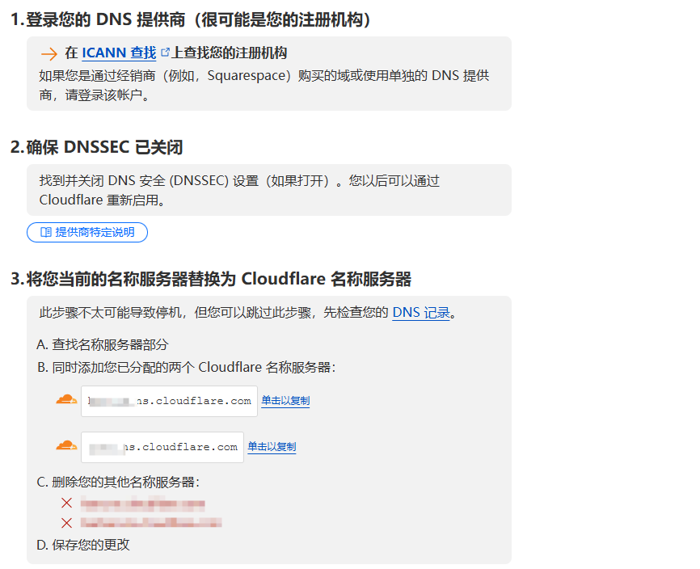

等到NS记录生效，即可通过Cloudflare管理回退域DNS。  

## 绑定信用卡，启用SaaS
进入回退域名的Cloudflare控制台，打开左侧**SSL/TLS**-**自定义主机名**，点击**启用Cloudflare for SaaS**：
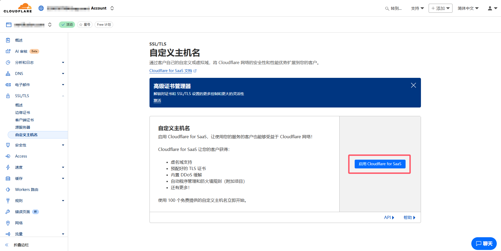

填入你的信用卡信息并保存。接着激活SaaS计划：
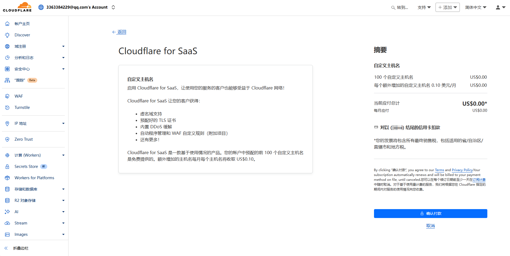

## 创建回退域的解析、设置自定义主机名
进入左侧**DNS**-**记录**，创建一条解析，指向你的源服务器：
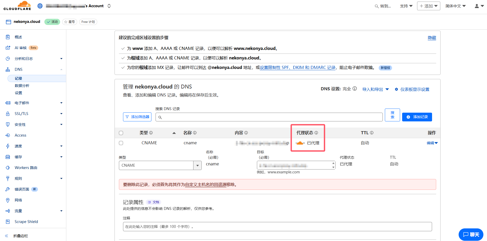
此处我的回退域为`cname.nekonya.cloud`，解析类型是CNAME，但是A、AAAA记录是也是完全可以的。记得要**打开Cloudflare代理**以使用CF的CDN。  

接着，进入左侧**SSL/TLS**-**自定义主机名**，回退源填刚刚添加的那条回退域下的解析，即`cname.nekonya.cloud`：
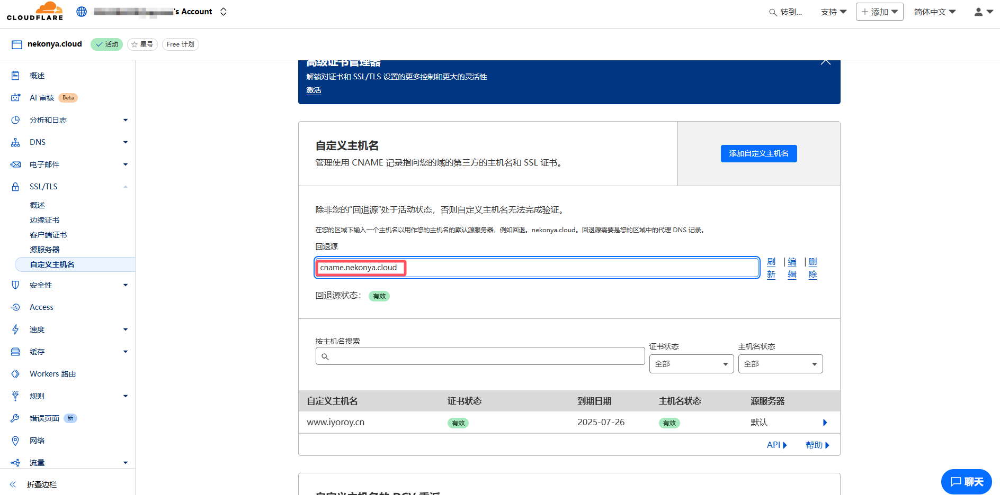

接着点击**添加自定义主机名**，并填写需要被访问的域名：
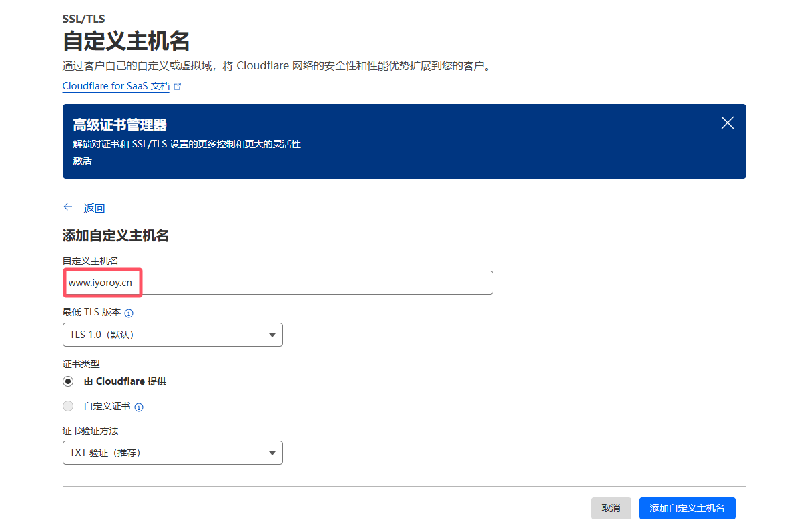
证书验证方法推荐TXT记录，这样可以使用**DCV委派**（详见下文**设置DCV委派**章节）。  

接着需要验证域名所有权，按照要求填写TXT记录（我已经配置过了，因此创建一条test做演示）：
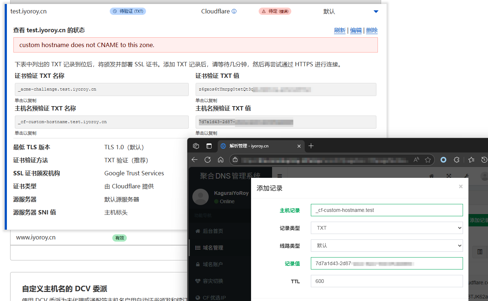
因为下文要通过DCV验证获取证书，此处并没有添加证书相应记录。若不使用DCV委派，则将证书相关记录也这样设置解析。  

:::warning
注：在添加证书记录时务必不要刷新整个页面，不然解析记录内容会变。请使用选项内的刷新按钮。
:::

待主机名状态变为**有效**后即可删除这条（也许是几条）解析。

## 设置DCV委派
找到下方**自定义主机名的 DCV 委派**，复制其中提供的解析值，到你的访问域名控制台，添加一条**CNAME**记录，主机名为`_acme-challenge.www`（此处和你的访问域名有关，我的访问域名是www.iyoroy.cn因此就是www。若是其他域名如test.iyoroy.cn，就填写_acme-challenge.test），记录值为Cloudflare提供的解析值前面加上你的hostname，即test.iyoroy.cn.xxxxxxx.dcv.cloudflare.com。
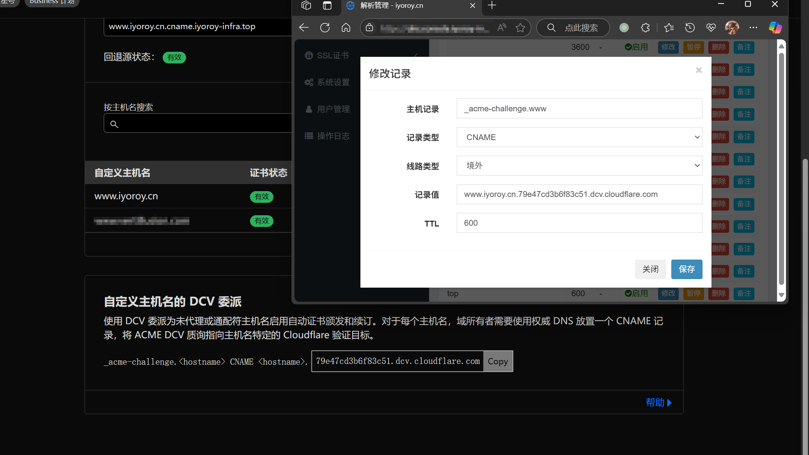

## 设置CNAME解析
进入你的访问域名控制台，为你要访问的域名添加相应解析记录。需要保证境外解析出来的内容是上文设置的回退源：
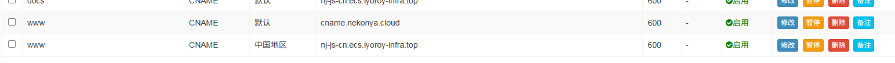

如果正常，那么就能看到证书状态和域名状态都是有效：
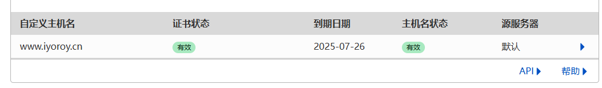

可以看到：，测试时境外已经切换到Cloudflare：
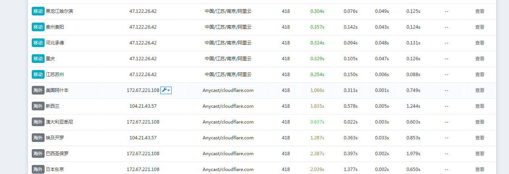

------
本文使用的DNS管理系统为[netcccyun/dnsmgr](https://github.com/netcccyun/dnsmgr)