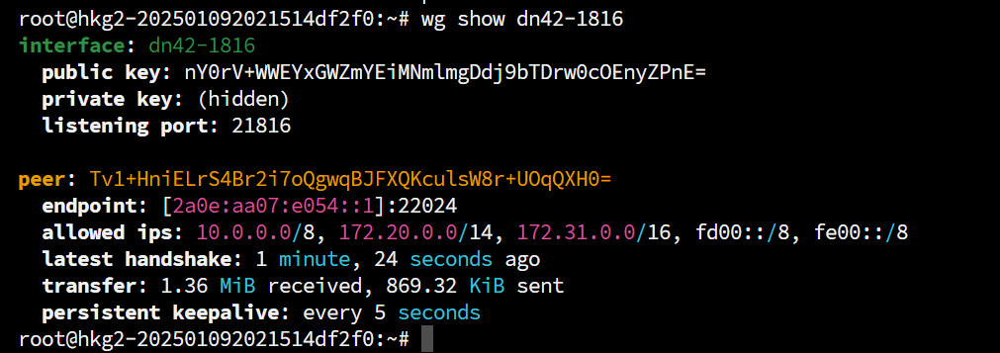

# 写在前面
本人是BGP小白，文章中可能会存在**不严谨内容/小白理解/低级错误**，请诸位大佬们手下留情。若发现存在问题，您愿意的话可以[邮件联系我](mailto:i@iyoroy.cn)，我会在第一时间更正。**如果您不能接受，建议现在就关闭此文章**。

> 欢迎与我建立对等连接！详情请查看：[iYoRoy DN42 Network](https://www.iyoroy.cn/dn42.html)

想研究BGP，奈何租一个ASN和IP段实在是太贵了，又怕自己[因为配置错误干掉半个互联网](https://blog.cloudflare.com/how-verizon-and-a-bgp-optimizer-knocked-large-parts-of-the-internet-offline-today/)，因此决定研究一下DN42这个虚拟的网络。DN42是个大型去中心化网络，使用BGP协议建立路由，和当今互联网的结构很相像，因此适合用于BGP等网络技术学习。在DN42中，每个人都将扮演ISP（网络服务提供商）的角色，和其他用户Peer，以加入并参与建设整个DN42网络。DN42运行在`172.20.0.0/14`和`fd00::/8`上，这两个地址都是内网地址，因此不会影响到正常的互联网。

# 注册
你需要会使用基础的git指令、GPG、Linux，并且最好启用GPG签名Commit。  
有Git使用基础的话可以参考我的commit：[Add AS4242422024 · d1f9046ecb - registry - dn42 git](https://git.dn42.dev/dn42/registry/commit/d1f9046ecbf358f5e45941f2e046c6a23db3ac45)

## Fork并克隆DN42注册表Git仓库
在[dn42 git](https://git.dn42.dev/)注册一个账号，并且Fork [dn42/registry](https://git.dn42.dev/dn42/registry)仓库。Clone下Fork出来的仓库并进入。

## 注册联系人
在`data/person`下创建文件`<昵称>-DN42`，填入如下内容：
```plain
person:             <姓名>
e-mail:             <邮箱>
pgp-fingerprint:    <GPG密钥指纹>
nic-hdl:            <NIC 句柄>
mnt-by:             <维护者>
source:             DN42
```

* `person`: 名称
* `e-mail`: 邮箱
* `pgp-fingerprint`: GPG密钥指纹，会被用于一些认证服务
* `nic-hdl`: [NIC句柄](https://en.wikipedia.org/wiki/NIC_handle)，指向文件本身，直接填写当前文件名即可
* `mnt-by`: 由谁维护，指向下文**注册维护者**一节中的维护者信息
* `source`: 来源，保持`DN42`即可
* `www`: 可选，可填网页地址


**示例**

[`data/person/IYOROY-DN42` @ dn42/registry@master](https://git.dn42.dev/dn42/registry/src/branch/master/data/person/IYOROY-DN42)
```plain
person:             Kagura iYoRoy
e-mail:             i@iyoroy.cn
www:                https://www.iyoroy.cn
pgp-fingerprint:    3ECCFFDEC2CB4CB8DA8089BE9AF2F2E03CE8FD67
nic-hdl:            IYOROY-DN42
mnt-by:             IYOROY-MNT
source:             DN42
```


## 注册维护者

创建文件`data/mntner/<昵称>-MNT`，并填入如下内容：
```plain
mntner:             <昵称>-MNT
admin-c:            <联系人>
tech-c:             <联系人>
auth:               <验证方式>
mnt-by:             <维护者>
source:             DN42
```

* `mntner`: 维护者名称，一般与文件名相同即可
* `admin-c`: 管理员联系信息，指向`person`文件夹中的文件，这里填上文**注册联系人**一节里的文件名即可
* `tech-c`: 技术人员联系信息，指向`person`文件夹中的文件，这里填上文**注册联系人**一节里的文件名即可
* `auth`: 验证方式，支持pgp或者ssh-key
* `mnt-by`: 由谁维护，一般指向文件名本身即可
* `source`: 来源，保持`DN42`即可


**示例**

[`data/mntner/IYOROY-MNT` @ dn42/registry@master](https://git.dn42.dev/dn42/registry/src/branch/master/data/mntner/IYOROY-MNT)
```plain
mntner:             IYOROY-MNT
admin-c:            IYOROY-DN42
tech-c:             IYOROY-DN42
auth:               pgp-fingerprint 3ECCFFDEC2CB4CB8DA8089BE9AF2F2E03CE8FD67
mnt-by:             IYOROY-MNT
source:             DN42
```


## 注册ASN
在公网上，**4200000000 - 4294967294**为ASN保留范围。DN42使用了**4242420000 - 4242429999**，而目前开放注册的是**4242420000 - 4242423999**。官方不建议自己寻找可用ASN，而是推荐使用Burble的[DN42 Free ASN Explorer](https://explorer.burble.com/free#/asn)，从中选取可用的ASN注册。  
找好心仪的ASN后在`data/aut-num`创建`<ASN，包含AS字母>`文件，填写如下内容：
```plain
aut-num:            <ASN>
as-name:            <自治系统名称>
descr:              <自治系统描述>
admin-c:            <管理员NIC句柄>
tech-c:             <技术人员NIC句柄>
mnt-by:             <维护者>
source:             DN42
```

* `aut-num`: 你选择的ASN，**包含AS前缀**。应该是AS424242xxxx的样式
* `as-name`: 自治系统名称
* `descr`: 自治系统描述，可以有空格
* `admin-c`: 管理员联系信息，指向`person`文件夹中的文件，这里填上文**注册联系人**一节里的文件名即可
* `tech-c`: 技术人员联系信息，指向`person`文件夹中的文件，这里填上文**注册联系人**一节里的文件名即可
* `mnt-by`: 由谁维护，指向上文**创建维护者**一节中的文件名
* `source`: 来源，保持`DN42`即可


**示例**

[`data/aut-num/AS4242422024` @ dn42/registry@master](https://git.dn42.dev/dn42/registry/src/branch/master/data/aut-num/AS4242422024)
```plain
aut-num:            AS4242422024
as-name:            IYOROYNET-AS-DN42
descr:              iYoRoy DN42 Network
admin-c:            IYOROY-DN42
tech-c:             IYOROY-DN42
mnt-by:             IYOROY-MNT
source:             DN42
```


## 注册IPv4地址块并添加路由
_如果你不想要注册IPv4，可以忽略本节_
官方提供了一个用于检索可用地址块的工具：[DN42 Free IPv4 Explorer ](https://explorer.burble.com/free#/4)。同样不建议手动指定，而是建议用检索工具检索出来的可用地址块。  
DN42同样面临IPv4地址短缺，所以请尽量按需注册。一般而言，一个/27地址块包含30个IPv4地址就够用了，如果是小型网络可以申请/28（14个可用地址）和/29（6个可用地址）。能直接申请的地址块最大是/26，也就是62个地址，若申请/25、/24则需要提交申请然后等待审核。详情可参考：[DN42 实验网络介绍及注册教程（2022-12 更新） - Lan Tian @ Blog](https://lantian.pub/article/modify-website/dn42-experimental-network-2020.lantian/)

选定你的IPv4地址块，然后在`data/inetnum`创建一个文件，命名为IPv4地址块的CIDR格式，并使用`_`代替`/`（如：我申请的IPv4地址块为172.20.234.224/28，则文件名为`172.20.234.224_28`），填入内容：
```plain
inetnum:            <IPv4地址块第一个地址> - <IPv4地址块最后一个地址>
cidr:               <IPv4地址块CIDR格式>
netname:            <IPv4地址块名称>
descr:              <IPv4地址块描述>
country:            <IPv4地址块所属国家代码>
admin-c:            <管理员NIC句柄>
tech-c:             <技术人员NIC句柄>
mnt-by:             <维护者>
status:             ASSIGNED
source:             DN42
```
* `inetnum`: IPv4地址范围，从第一个地址到最后一个地址，中间用`-`连接
* `cidr`: IPv4地址块CIDR格式，**不需要**用`_`代替`/`
* `netname`: IPv4地址块名称，自行填写即可，无特殊要求
* `descr`: IPv4地址块描述，中间可以有空格
* `country`: [ISO 3166](https://zh.wikipedia.org/wiki/ISO_3166)中的两字符国家代码，中国就填`CN`
* `admin-c`: 管理员联系信息，指向`person`文件夹中的文件，这里填上文**注册联系人**一节里的文件名即可
* `tech-c`: 技术人员联系信息，指向`person`文件夹中的文件，这里填上文**注册联系人**一节里的文件名即可
* `mnt-by`: 由谁维护，指向上文**创建维护者**一节中的文件名
* `status`: 状态，保存`ASSIGNED`即可
* `source`: 来源，保持`DN42`即可


**示例**

[`data/inetnum/172.20.234.224_28` @ dn42/registry@master](https://git.dn42.dev/dn42/registry/src/branch/master/data/inetnum/172.20.234.224_28)
```plain
inetnum:            172.20.234.224 - 172.20.234.239
cidr:               172.20.234.224/28
netname:            IYOROYNET-DN42-V4
descr:              iYoRoy DN42 Network IPv4 Block
country:            CN
admin-c:            IYOROY-DN42
tech-c:             IYOROY-DN42
mnt-by:             IYOROY-MNT
status:             ASSIGNED
source:             DN42
```


接着，在`data/route`下同样创建一个名为IPv4地址块的 CIDR 格式，并使用`_`代替`/`的文件，填入内容：
```plain
route:              <IPv4地址CIDR格式>
origin:             <ASN>
max-length:         <IPv4掩码>
mnt-by:             <维护者>
source:             DN42
```

* `route`: IPv4地址块，填写CIDR格式，无需转换`/`
* `origin`: ASN，需要带`AS`
* `max-lenth`: 前缀长度（Prefix Length），即CIDR格式中`/`后面的数字
* `mnt-by`: 由谁维护，指向上文**创建维护者**一节中的文件名
* `source`: 来源，保持`DN42`即可


**示例**

[`data/route/172.20.234.224_28` @ dn42/registry@master](https://git.dn42.dev/dn42/registry/src/branch/master/data/route/172.20.234.224_28)
```plain
route:              172.20.234.224/28
origin:             AS4242422024
max-length:         28
mnt-by:             IYOROY-MNT
source:             DN42
```


## 注册IPv6地址块并添加路由
_如果你不想要注册IPv6，可以忽略本节_
同样使用官方工具检索可用IPv6：[DN42 Free IPv6 Explorer ](https://explorer.burble.com/free#/6)。
选定地址块后在`data/inet6num`下创建名为IPv6地址块的CIDR格式，并使用`_`代替`/`的文件（如：我的IPv6地址块为`fd18:3e15:61d0::/48`，则文件名`fd18:3e15:61d0::_48`），填入内容：
```plain
inet6num:           <IPv6地址块第一个地址> - <IPv6地址块最后一个地址>
cidr:               <IPv6地址块CIDR格式>
netname:            <IPv6地址块名称>
descr:              <IPv6地址块描述>
country:            <IPv6地址块所属国家代码>
admin-c:            <管理员NIC句柄>
tech-c:             <技术人员NIC句柄>
mnt-by:             <维护者>
status:             ASSIGNED
source:             DN42
```
* `inet6num`: IPv6地址范围，从第一个地址到最后一个地址，不可使用`::`简写，中间用`-`连接。也就是说，比如我的地址块是`fd18:3e15:61d0::/48`，我需要填入`fd18:3e15:61d0:0000:0000:0000:0000:0000  - fd18:3e15:61d0:ffff:ffff:ffff:ffff:ffff`。
* `cidr`: IPv6地址块CIDR格式，**不需要**用`_`代替`/`
* `netname`: IPv6地址块名称，自行填写即可，无特殊要求
* `descr`: IPv6地址块描述，中间可以有空格
* `country`: [ISO 3166](https://zh.wikipedia.org/wiki/ISO_3166)中的两字符国家代码，中国就填`CN`
* `admin-c`: 管理员联系信息，指向`person`文件夹中的文件，这里填上文**注册联系人**一节里的文件名即可
* `tech-c`: 技术人员联系信息，指向`person`文件夹中的文件，这里填上文**注册联系人**一节里的文件名即可
* `mnt-by`: 由谁维护，指向上文**创建维护者**一节中的文件名
* `status`: 状态，保存`ASSIGNED`即可
* `source`: 来源，保持`DN42`即可


**示例**

[`data/inet6num/fd18:3e15:61d0::_48` @ dn42/registry@master](https://git.dn42.dev/dn42/registry/src/branch/master/data/inet6num/fd18:3e15:61d0::_48)
```plain
inet6num:           fd18:3e15:61d0:0000:0000:0000:0000:0000 - fd18:3e15:61d0:ffff:ffff:ffff:ffff:ffff
cidr:               fd18:3e15:61d0::/48
netname:            IYOROYNET-DN42-V6
descr:              iYoRoy DN42 Network IPv6 Block
country:            CN
admin-c:            IYOROY-DN42
tech-c:             IYOROY-DN42
mnt-by:             IYOROY-MNT
status:             ASSIGNED
source:             DN42
```


接着，在`data/route6`下同样创建一个名为IPv6地址块的 CIDR 格式，并使用`_`代替`/`的文件，填入内容：
```plain
route6:             <IPv6地址CIDR格式>
origin:             <ASN>
max-length:         <IPv6掩码>
mnt-by:             <维护者>
source:             DN42
```

* `route6`: IPv6地址块，填写CIDR格式，无需转换`/`
* `origin`: ASN，需要带`AS`
* `max-lenth`: 前缀长度（Prefix Length），即CIDR格式中`/`后面的数字
* `mnt-by`: 由谁维护，指向上文**创建维护者**一节中的文件名
* `source`: 来源，保持`DN42`即可


**示例**

[`data/route6/fd18:3e15:61d0::_48` @ dn42/registry@master](https://git.dn42.dev/dn42/registry/src/branch/master/data/route6/fd18:3e15:61d0::_48)
```plain
route6:             fd18:3e15:61d0::/48
origin:             AS4242422024
max-length:         48
mnt-by:             IYOROY-MNT
source:             DN42
```


## 创建并上传commit，提交PR
> 最好使用GPG签名你的commit并且在dn42 git里上传你的公钥

填完上述信息，回到仓库根目录下，运行脚本`./fmt-my-stuff <维护者>`自动格式化配置文件。注意：此处`<维护者>`是上文**注册维护者**章节中的`mntner`的值。接着按照正常git commit流程`git add data/`、`git commit -S -m "<commit-msg>"`创建commit，`git push origin master`推送，接着，来到dn42 git网页端，打开你Fork的仓库并提交Pull Request即可。  
如果配置有问题，自动审查机器人和管理员会告知你，请耐心按照要求修改并且**合并到原来的commit中，不要新开commit**，推荐add后使用`git commit --amend`指令。修改完**直接强制推送（`git push origin master --force`）** 即可。

**DN42 Registry 的工作语言是英语。请使用英语完成全部流程，以免出现不必要的麻烦。**

# 配置Bird
首先安装bird，以Ubuntu22.04为例：
```bash
apt install bird2 -y
```
如果要一并安装后续使用的WireGuard，就再加上`wireguard`、`wireguard-tools`软件包：
```bash
apt install bird2 wireguard wireguard-tools -y
```

## 编写配置文件

### bird.conf
修改`/etc/bird/bird.conf`：
```nginx
define OWNAS       = <AS 号>;
define OWNIP       = <DN42 IPv4 地址>;
define OWNIPv6     = <DN42 IPv6 地址>;
define OWNNET      = <DN42 IPv4 地址块, CIDR 格式>;
define OWNNETv6    = <DN42 IPv6 地址块, CIDR 格式>;
define OWNNETSET   = [ <DN42 IPv4 地址块, CIDR 格式>+ ];
define OWNNETSETv6 = [ <DN42 IPv6 地址块, CIDR 格式>+ ];

router id OWNIP;

protocol device {
    scan time 10;
}

function is_self_net() {
    return net ~ OWNNETSET;
}

function is_self_net_v6() {
    return net ~ OWNNETSETv6;
}

function is_valid_network() {
    return net ~ [
        172.20.0.0/14{21,29}, # dn42
        172.20.0.0/24{28,32}, # dn42 Anycast
        172.21.0.0/24{28,32}, # dn42 Anycast
        172.22.0.0/24{28,32}, # dn42 Anycast
        172.23.0.0/24{28,32}, # dn42 Anycast
        172.31.0.0/16+,       # ChaosVPN
        10.100.0.0/14+,       # ChaosVPN
        10.127.0.0/16{16,32}, # neonetwork
        10.0.0.0/8{15,24}     # Freifunk.net
    ];
}

function is_valid_network_v6() {
  return net ~ [
    fd00::/8{44,64} # ULA address space as per RFC 4193
  ];
}

protocol kernel {
    scan time 20;

    ipv6 {
        import none;
        export filter {
            if source = RTS_STATIC then reject;
            krt_prefsrc = OWNIPv6;
            accept;
        };
    };
};

protocol kernel {
    scan time 20;

    ipv4 {
        import none;
        export filter {
            if source = RTS_STATIC then reject;
            krt_prefsrc = OWNIP;
            accept;
        };
    };
}

protocol static {
    route OWNNET reject;

    ipv4 {
        import all;
        export none;
    };
}

protocol static {
    route OWNNETv6 reject;

    ipv6 {
        import all;
        export none;
    };
}

include "rpki.conf";
include "ebgp.conf";
```

此处`OWNIP`和`OWNIPV6`参数意为本机的DN42 IPv4和IPv6地址，**不是地址块的地址**，比如我申请到的地址段是172.20.234.224/28，我给A机器分配了172.20.234.225，则`OWNIP`为172.20.234.225，IPv6同理。  

### rpki.conf
你可能在其他教程里看到过使用定时任务+重载Bird的更新ROA方案，此处配置RPKI则是另一种配置ROA的方式。

创建`/etc/bird/rpki.conf`，填写如下内容：
```nginx
roa4 table dn42_roa;
roa6 table dn42_roa_v6;

protocol rpki dn42_rpki_akix {
    roa4 { table dn42_roa; };
    roa6 { table dn42_roa_v6; };
    remote "<rpki服务器地址>" port 8082; # change it
    refresh 30;
    retry 5;
    expire 600;
}
```

RPKI服务器可以使用我朋友的AkaereIX提供的服务：`rpki.akae.re`


**样例**

```nginx
roa4 table dn42_roa;
roa6 table dn42_roa_v6;

protocol rpki dn42_rpki_akix {
    roa4 { table dn42_roa; };
    roa6 { table dn42_roa_v6; };
    remote "rpki.akae.re" port 8082;
    refresh 30;
    retry 5;
    expire 600;
}
```


### ebgp.conf
创建`/etc/bird/ebgp.conf`，填入如下内容：
```nginx
template bgp dnpeers {
    local as OWNAS;
    path metric 1;

    ipv4 {
        import filter {
            if is_valid_network() && !is_self_net() then {
                if (roa_check(dn42_roa, net, bgp_path.last) != ROA_VALID) then {
                    print "[dn42] ROA check failed for ", net, " ASN ", bgp_path.last;
                    reject;
                }
                accept;
            }
            reject;
        };

        export filter {
            if is_valid_network() && source ~ [RTS_STATIC, RTS_BGP] then accept;
            reject;
        };
        import limit 1000 action block;
    };

    ipv6 {
        import filter {
            if is_valid_network_v6() && !is_self_net_v6() then {
                if (roa_check(dn42_roa_v6, net, bgp_path.last) != ROA_VALID) then {
                    print "[dn42] ROA check failed for ", net, " ASN ", bgp_path.last;
                    reject;
                }
                accept;
            }
            reject;
        };
        export filter {
            if is_valid_network_v6() && source ~ [RTS_STATIC, RTS_BGP] then accept;
            reject;
        };
        import limit 1000 action block;
    };
}


include "peers/*";
```

此配置项定义了DN42内部互相peer的模板，并且引用`/etc/bird/peers`下的所有配置文件，之后我们peer的时候就只需要在这里按照模板创建配置文件并编写即可。

创建`/etc/bird/peers`文件夹用作后续peer。

# 系统配置
## 内核
因为每个节点都可能会作为其他节点的路由器使用，因此需要打开Linux内核数据包转发；同时因为使用了WireGuard，并不是通过物理网卡转发，因此需要关闭`rp_filter`严格模式。
```shell
echo "net.ipv4.ip_forward=1" >> /etc/sysctl.conf
echo "net.ipv6.conf.default.forwarding=1" >> /etc/sysctl.conf
echo "net.ipv6.conf.all.forwarding=1" >> /etc/sysctl.conf
echo "net.ipv4.conf.default.rp_filter=0" >> /etc/sysctl.conf
echo "net.ipv4.conf.all.rp_filter=0" >> /etc/sysctl.conf
sysctl -p
```

## DN42虚拟网卡
因为MP-BGP通常使用LLA地址建立BGP，因此我们需要在系统里设置一个dummy网卡并绑定我们给这台机器分配的DN42 IP。运行以下指令：
```bash
ip link add dn42 type dummy
ip addr add <你给这这台机器分配的DN42 IPv4> dev dn42
ip addr add <你给这这台机器分配的DN42 IPv6> dev dn42
```

如果需要持久化配置，可以参考以下三种方式：


### systemd-networkd

```bash
tee /etc/systemd/network/10-dn42.netdev > /dev/null <<EOF
[NetDev]
Name=dn42
Kind=dummy
EOF

tee /etc/systemd/network/20-dn42.network > /dev/null <<EOF
[Match]
Name=dn42

[Network]
Address=<你给这台机器分配的DN42 IPv4>/32
Address=<你给这台机器分配的DN42 IPv6>/128
EOF

systemctl enable systemd-networkd
systemctl restart systemd-networkd
```


### netplan

```bash
tee /etc/netplan/99-dn42.yaml > /dev/null <<EOF
network:
  version: 2
  renderer: networkd
  ethernets:
    dn42:
      match:
        name: dn42
      addresses:
        - <你给这台机器分配的DN42 IPv4>/32
        - "<你给这台机器分配的DN42 IPv6>/128"
      accept-ra: no
EOF

netplan apply
```


### /etc/network/interfaces

```bash
tee -a /etc/network/interfaces > /dev/null <<EOF
auto dn42
iface dn42 inet static
    address <你给这台机器分配的DN42 IPv4>
    netmask 255.255.255.255

iface dn42 inet6 static
    address <你给这台机器分配的DN42 IPv6>/128
EOF

ifup dn42
```


# 与其他成员Peer
对新手较友好的应该就是Potat0大佬的自助Peer服务了，详情可参考他的[DN42 Network](https://dn42.potat0.cc/)页面。按照指引找到他的[自动对等连接机器人](https://t.me/Potat0_DN42_Bot)，按照要求在机器人上注册你的账号，需要提供你的DN42 ASN、上文注册时Maintainer里记录的邮箱（这也是为什么在注册的时候最好需要填邮箱，很多验证服务都会使用），并且用该邮箱接收验证码，然后按照机器人的要求建立peer即可。以下是我通过Bot建立peer的过程，全程使用Ubuntu22.04系统的香港VPS操作。

## 安装WireGuard
```shell
apt install wireguard wireguard-tools -y
```
注：现在的软件包管理一般会在安装`wireguard`的时候自动安装`wireguard-tools`以使用`wg-quick`指令。

## 生成密钥对
```shell
wg genkey | tee privatekey | wg pubkey > publickey
```
记下privatekey、publickey中的内容，代表私钥和公钥

## 建立Peer
一般而言有两种建立Peer的模式，即使用MP-BGP（Multiprotocol BGP，多协议BGP）和不使用MP-BGP。个人感觉MP-BGP更为常用，因为其配置较为简单。两种配置稍有不同，请根据你的需求参考。

### 使用MP-BGP
#### 与Peer对方交换信息
你需要提供对方以下信息，同时你也需要知道对方的以下信息：
* 公钥
* 公网地址（非DN42地址）
* 公网WireGuard端口，一般是监听对方ASN的**后5位**
* DN42 ASN
* LLA（Link-Local Address）地址，一般而言是`fe80::<对方ASN后4位>`
* 是否支持ENH(Extended Next Hop)，注意，若使用v6交换路由而不启用ENH则无法交换v4路由

也有时会将公网地址和公网wg端口放在一起称作Endpoint。  

#### 配置WireGuard
在`/etc/wireguard`下创建一个配置文件，名称随意，但是我的命名习惯是`dn42-<对方ASN后4位>.conf`，其中`dn42-xxxx`即为隧道名。往文件内填入如下内容：
```ini
[Interface]
PrivateKey = <上文「生成密钥对」章节生成的私钥>
ListenPort = <公网WireGuard监听端口>
Table = off
Address = <你的LLA地址>/64
PostUp = sysctl -w net.ipv6.conf.%i.autoconf=0

[Peer]
PublicKey = <对方给你的公钥>
Endpoint = <对方的Endpoint，即IP:端口>
AllowedIPs = 10.0.0.0/8, 172.20.0.0/14, 172.31.0.0/16, fd00::/8, fe00::/8
```

编辑完成后保存，运行：

```bash
wg-quick up <隧道名>
```

即可启动wg隧道。使用`wg show <隧道名>`即可查看连接状态。直接运行`wg`可查看所有隧道状态



如果需要让隧道开机自启动，可以运行：
```bash
systemctl enable wg-quick@<隧道名>
```

#### 配置Bird2的Peer部分
在`/etc/bird/peers`下新建文件`<名称>.conf`，填入如下内容：
```ini
protocol bgp <BGP会话名称> from dnpeers{
    neighbor <对方LLA地址> % '<WireGuard隧道名>' as <对方ASN，不带AS前缀>;
};
```

如果使用使用了Extended next hop（如上图交换信息时协商的），则配置：
```ini
protocol bgp <BGP会话名称> from dnpeers{
    neighbor <对方LLA地址> % '<WireGuard隧道名>' as <对方ASN，不带AS前缀>;
    ipv4{
        extended next hop;
    };
};
```

#### 应用配置
运行`birdc configure`（或者`birdc c`，等同）重载Bird配置，然后运行`birdc show protocols`（或者`birdc s p`，等同）即可查看当前建立的BGP连接。
```plain
root@hkg2-202501092021514df2f0:~# birdc show protocols
BIRD 2.0.12 ready.
Name       Proto      Table      State  Since         Info
device1    Device     ---        up     07:24:14.255  
static1    Static     dn42_roa   up     07:24:14.255  
static2    Static     dn42_roa_v6 up     07:24:14.255  
kernel1    Kernel     master6    up     07:24:14.255  
kernel2    Kernel     master4    up     07:24:14.255  
static3    Static     master4    up     07:24:14.255  
static4    Static     master6    up     07:24:14.255  
dn42-0298  BGP        ---        up     08:03:13.347  Established   
dn42-1816  BGP        ---        up     07:53:05.028  Established
```

### 不使用MP-BGP
#### 与Peer对方交换信息
你需要提供对方以下信息，同时你也需要知道对方的以下信息：
* 公钥
* 公网地址（非DN42地址）
* 公网WireGuard端口，一般是监听对方ASN的**后5位**
* DN42 ASN
* DN42 IP，如果交换IPv4路由则需要IPv4地址，如果交换IPv6路由则需要IPv6地址  

也有时会将公网地址和公网wg端口放在一起称作Endpoint。  

#### 配置WireGuard
在`/etc/wireguard`下创建一个配置文件，名称随意，但是我的命名习惯是`dn42-<对方ASN后4位>.conf`，其中`dn42-xxxx`即为隧道名。往文件内填入如下内容：
```ini
[Interface]
PrivateKey = <上文「生成密钥对」章节生成的私钥>
ListenPort = <公网WireGuard监听端口>
Table = off
PostUp = ip addr add <LLA>/64 dev %i
PostUp = ip addr add <本地DN42 IPv6> dev %i
PostUp = ip addr add <本地DN42 IPv4> peer <对方DN42 IPv4> dev %i
PostUp = sysctl -w net.ipv6.conf.%i.autoconf=0

[Peer]
PublicKey = <对方给你的公钥>
Endpoint = <对方的Endpoint，即IP:端口>
AllowedIPs = 10.0.0.0/8, 172.20.0.0/14, 172.31.0.0/16, fd00::/8, fe00::/8
```

编辑完成后保存，运行：

```bash
wg-quick up <隧道名>
```

即可启动wg隧道。使用`wg show <隧道名>`即可查看连接状态。直接运行`wg`可查看所有隧道状态

如果需要让隧道开机自启动，可以运行：
```bash
systemctl enable wg-quick@<隧道名>
```

#### 配置Bird2的Peer部分
在`/etc/bird/peers`下新建文件`<名称>.conf`，填入如下内容：
```ini
protocol bgp <v4BGP会话名称> from dnpeers{
    neighbor <对方DN42 IPv4地址> as <对方ASN，不带AS前缀>;
    direct;
    ipv6{
        import none;
        export none;
    };
};

protocol bgp <v6BGP会话名称> from dnpeers{
    neighbor <对方DN42 IPv6地址> % '<WireGuard隧道名称>' as <对方ASN，不带AS前缀>;
    direct;
    ipv4{
        import none;
        export none;
    };
};
```

#### 应用配置
运行`birdc configure`（或者`birdc c`，等同）重载Bird配置，然后运行`birdc show protocols`（或者`birdc s p`，等同）即可查看当前建立的BGP连接。

自此，我们成功加入了DN42网络。要想让网络更加稳定，我们可以与更多用户进行Peer，建立多条BGP线路以防止其中部分节点瘫痪导致失联。你可以加入[DN42非官方tg交流群](https://t.me/Dn42Chat)获取更多信息。  

如果出现BGP Established但是无法Ping通DN42内部IP的情况，请检查`bird.conf`中设置的IP和dummy网卡分配的IP或WireGuard中的本地IP是否相同。  

## 配置DNS
DN42内有自己的公共DNS，泛播地址为`172.20.0.53`，并且也能解析正常互联网的域名。要想能够访问以**dn42**结尾的内部域名，需要将这个地址放到resolv.conf最上面：
```ini
nameserver 172.20.0.53
nameserver 223.5.5.5 #下面是正常的DNS服务器配置
```

之后就可以解析DN42内部域名啦，同时`ping`、`traceroute`、`mtr`等命令查询内部IP时也能显示出来rDNS的解析结果。

---- 
> 欢迎与我建立对等连接！详情请查看：[iYoRoy DN42 Network](https://www.iyoroy.cn/dn42.html)


参考文章：
* https://blog.baoshuo.ren/post/dn42-network/
* https://dn42.dev/howto/Bird2#example-configuration
* https://dn42.eu/howto/wireguard
* https://blog.udon.eu.org/archives/dbf21067.html
* https://blog.byteloid.one/2025/06/02/babeld-over-wireguard/
* https://blog.wcysite.com/2021/%E8%B8%A9%E5%9D%91DN42-p2-peer/
* https://blog.chs.pub/p/23-14-joindn42/
* https://www.cnblogs.com/FengZeng666/p/15583434.html