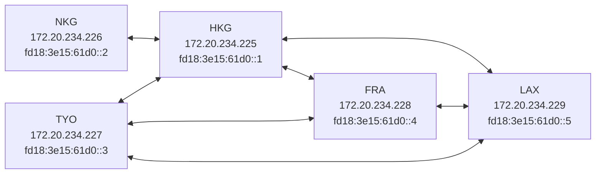
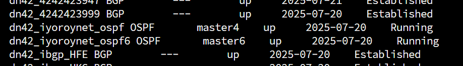
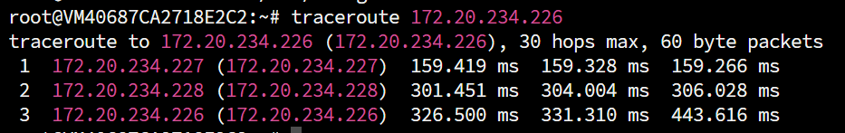

# Foreword
I am a novice in BGP. This article may contain **imprecise content/naive understandings/elementary mistakes**. I kindly ask the experts to be lenient. If you find any issues, you are welcome to contact me via [email](mailto:i@iyoroy.cn), and I will correct them as soon as possible. **If you find this unacceptable, it is recommended to close this article now.**  

# Article Update Log


- July 22, 2025: First edition published, using VXLAN over WireGuard tunnel.


- July 25, 2025: Updated tunneling solution, using type ptp; to support OSPF traffic via WireGuard (Special thanks to Nuro Trance for the guidance!).


- August 8, 2025: Added explanation and configuration for iBGP.


- August 27, 2025: Updated node topology diagram.


# Why Do We Need Internal Routing?

As the number of nodes increases, we need a proper way to handle internal routing within our AS (Autonomous System). BGP only handles routing to different ASes, which causes a problem: if nodes A and B are both peering with external networks, a request from node A may have its response routed to node B, even though they are part of the same AS. Without internal routing, node A will not receive the reply.  

To solve this, we need to ensure that all devices within our AS can communicate with each other. The common solutions are:  

1. Using network tools like ZeroTier: Simple to set up, just install the client on each node for P2P connectivity.  
2. Using P2P tools like WireGuard to manually create $\frac{n(n-1)}{2}$ tunnels, which works like the first solution but becomes cumbersome as nodes grow.  
3. Using WireGuard to establish $\frac{n(n-1)}{2}$ tunnels, then using an internal routing protocol like OSPF or Babel to manage the routing. This is more flexible and easier to scale, but it **can be risky** and could [break the DN42 network]((https://lantian.pub/article/modify-website/how-to-kill-the-dn42-network.lantian/))
 due to misconfigurations.  

~~Thus, I decided to take the risk.~~

# Node Topology



# Update Bird2 to v2.16 or Above
To use IPv6 Link-Local addresses to transmit IPv4 OSPF data, Bird v2.16 or later is required. Here are the steps to update:  
```shell
sudo apt update && sudo apt -y install apt-transport-https ca-certificates wget lsb-release
sudo wget -O /usr/share/keyrings/cznic-labs-pkg.gpg https://pkg.labs.nic.cz/gpg

echo "deb [signed-by=/usr/share/keyrings/cznic-labs-pkg.gpg] https://pkg.labs.nic.cz/bird2 $(lsb_release -sc) main" | sudo tee /etc/apt/sources.list.d/cznic-labs-bird2.list

sudo apt update && sudo apt install bird2 -y
```

# Tunnel Configuration
```ini
[Interface]
PrivateKey = <Local WireGuard Private Key>
ListenPort = <Listen Port>
Table = off
Address = <IPv6 LLA>/64
PostUp = sysctl -w net.ipv6.conf.%i.autoconf=0

[Peer]
PublicKey = <Peer Public Key>
Endpoint = <Peer Public Endpoint>
AllowedIPs = 10.0.0.0/8, 172.20.0.0/14, 172.31.0.0/16, fd00::/8, fe00::/8, ff02::5
```

* `ff02::5`is the OSPFv3 router-specific link-local multicast address and should be included in `AllowedIPs`.
* If you're using Bird versions earlier than v2.16, you'll need to add an IPv4 address for the tunnel as well. See the example below:


**WireGuard Configuration Example with IPv4**

```ini
[Interface]
PrivateKey = <Local WireGuard Private Key>
ListenPort = <Listen Port>
Table = off
Address = <IPv6 LLA>/64
PostUp = ip addr add 100.64.0.225/32 peer 100.64.0.226/32 dev %i
PostUp = sysctl -w net.ipv6.conf.%i.autoconf=0

[Peer]
PublicKey = <Peer Public Key>
Endpoint = <Peer Public Endpoint>
AllowedIPs = 10.0.0.0/8, 172.20.0.0/14, 100.64.0.0/16, 172.31.0.0/16, fd00::/8, fe00::/8, ff02::5
```
Please replace `100.64.0.225` and `100.64.0.226` with your local and peer IPv4 addresses, and remember to add `AllowedIPs`.


# Enable OSPF
_You should have already configured basic Bird settings as described in the previous article._  
Create a new file called `ospf.conf` under `/etc/bird` and add the following:
```bird2
protocol ospf v3 <name> {
    ipv4 {
        import where is_self_net() && source != RTS_BGP;
        export where is_self_net() && source != RTS_BGP;
    };

    include "/etc/bird/ospf/*";
};

protocol ospf v3 <name> {
    ipv6 {
        import where is_self_net_v6() && source != RTS_BGP;
        export where is_self_net_v6() && source != RTS_BGP;
    };

    include "/etc/bird/ospf/*";
};
```

* Theoretically, OSPF v2 should be used for handling IPv4, but since we need to communicate IPv4 using IPv6 Link-Local addresses, we are using OSPF v3 for IPv4 in this case as well.
* The filter rules ensure that **only routes within the local network segment** are allowed to propagate through OSPF, and **routes from external BGP protocols are filtered out**.
* **Never use import all; export all; indiscriminately, as this could lead to route hijacking and affect the entire DN42 network.** OSPF should only handle internal network routes.


**Example**

`/etc/bird/ospf.conf`
```bird2
protocol ospf v3 dn42_iyoroynet_ospf {
    ipv4 {
        import where is_self_net() && source != RTS_BGP;
        export where is_self_net() && source != RTS_BGP;
    };

    include "/etc/bird/ospf/*";
};

protocol ospf v3 dn42_iyoroynet_ospf6 {
    ipv6 {
        import where is_self_net_v6() && source != RTS_BGP;
        export where is_self_net_v6() && source != RTS_BGP;
    };

    include "/etc/bird/ospf/*";
};
```


Next, create the `/etc/bird/ospf` folder and then create an area configuration file (e.g., `/etc/bird/ospf/backbone.conf`) with the following content:
```bird2
area 0.0.0.0 {
    interface "<DN42 dummy interface>" { stub; };
    interface "<wg0 interface>" {
        cost 80; # Modify according to your network situation
        type ptp;
    };
    interface "<wg1 interface>" {
        cost 100; # Modify according to your network situation
        type ptp;
    };
    # Continue for other interfaces
};
```
* The `0.0.0.0` area represents the backbone network.
* he dummy interface here refers to the **DN42 virtual interface** mentioned in the [previous article](https://www.iyoroy.cn/archives/84/)
* The `cost` value is typically used for [cost](https://edu.51cto.com/article/note/3019.html) calculation but in DN42's case, where bandwidth is less critical but latency is more important, you can directly assign the latency value. OSPF will automatically choose the route with the lowest cost (sum of the cost values).


**Example**

`/etc/bird/ospf/backbone.conf`
```bird2
area 0.0.0.0 {
    interface "dn42" { stub; };
    interface "dn42_hkg" {
        cost 80;
        type ptp;            
    };
    interface "dn42_hfe" {
        cost 150;
        type ptp;
    };
    interface "dn42_lax"{
        cost 100;
        type ptp;
    };
};
```


Finally, open `/etc/bird/bird.conf` and add the following to include the OSPF configuration file at the end:
```bird2
include "ospf.conf";
```
Run `birdc configure`, and then `birdc show protocols` should show the OSPF status as **Running**. If not, check the configuration steps for errors.



At this point, you should be able to ping between two non-directly connected machines:


# Enable iBGP
> Before establishing multiple peer connections, each of your nodes must first have complete knowledge of the internal AS topology. This involves configuring another key component: internal BGP (iBGP).

## Necessity of iBGP
iBGP ensures that all routers within the AS have complete knowledge of external destination routes. It ensures that:
* Internal routers can select the best exit path.
* Traffic is correctly routed to the boundary routers responsible for specific external networks.
* Even if there are multiple boundary routers connected to the same external network, internal routers can choose the best exit based on policies.
* Compared to using a default route pointing to the border router within the AS, iBGP provides precise external route information, allowing internal routers to make more intelligent forwarding decisions.

## Disadvantages and Solutions
To prevent uncontrolled propagation of routing information within the AS, which could cause loops, an iBGP router will not readvertise routes learned from one iBGP neighbor to other iBGP neighbors. This necessitates that traditional iBGP requires **a full mesh of iBGP neighbor relationships** between all iBGP-running routers within the same AS. (You still need to establish $\frac{n(n+1)}{2}$ connections ~~, there's no way around it. But configuring iBGP is still easier than configuring tunnels after OSPF is set up~~ ).  
Solutions include:  
1. Using a **Route Reflector (RR)**: An RR router manages all routing information within the entire AS. The disadvantage is that if the RR router fails, the entire network can be paralyzed (which is not very Decentralized).
2. Using **BGP Confederation**: This involves virtually dividing the routers within the AS into sub-ASes, treating the connections between routers as eBGP, and finally stripping the internal AS path information when advertising routes externally.  

I haven't tried the latter two solutions. Here are some potentially useful reference articles. This article focuses on the configuration of iBGP.
* [DN42 Experimental Network: Intro and Registration (Updated 2022-12) - Lan Tian @ Blog](https://lantian.pub/en/article/modify-website/dn42-experimental-network-2020.lantian/)
* [Configure BGP Confederation & Fake Confederation in Bird (Updated 2020-06-07) - Lan Tian @ Blog](https://lantian.pub/en/article/modify-website/bird-confederation.lantian/)

## Writing the iBGP Configuration File
Create a new file `ibgp.conf` in `/etc/bird` and fill it with the following content:
```bird2
template bgp ibgpeers {
    local as OWNAS;
    ipv4 {
        import where source = RTS_BGP && is_valid_network() && !is_self_net();
        export where source = RTS_BGP && is_valid_network() && !is_self_net();
        next hop self;
        extended next hop;
    };
    ipv6 {
        import where source = RTS_BGP && is_valid_network_v6() && !is_self_net_v6();
        export where source = RTS_BGP && is_valid_network_v6() && !is_self_net_v6();
        next hop self;
    };
};

include "ibgp/*";
```

* The import and export filters ensure that iBGP only processes routes learned via the BGP protocol and filters out IGP routes to prevent loops.
* `next hop self` is **required**. It instructs BIRD to rewrite the next hop to the border router's own IP address (instead of the original external next hop) when exporting routes to iBGP neighbors. This is because internal routers cannot directly access the external neighbor's address; without rewriting, the address would be considered unreachable. After rewriting, internal routers only need to send traffic to the border router via IGP routing, and the border router handles the final external forwarding.
* Because I want to use IPv6 addresses to establish MP-BGP and route IPv4 over IPv6, `extended next hop` is enabled for IPv4.

Next, create the `/etc/bird/ibgp` directory. Inside, create an iBGP Peer configuration file for each node:
```bird2
protocol bgp 'dn42_ibgp_<Node Name>' from ibgpeers{
    neighbor <Corresponding Node's IPv6 ULA Address> as OWNAS;
};
```


**Example**

`/etc/bird/ibgp/hkg.conf`:
```bird2
protocol bgp 'dn42_ibgp_HKG' from ibgpeers{
    neighbor fd18:3e15:61d0::1 as OWNAS;
};
```


Note:
* Each node needs to establish (n-1) iBGP connections, ensuring connectivity with all other machines within the AS. This is why ULA addresses are used.
* Using ULA addresses ensures that even if the WireGuard connection between two nodes goes down, iBGP can still establish connections via the internal routing established by OSPF. Otherwise, it could lead to the collapse of the entire internal network.

Finally, add the inclusion of `ibgp.conf` in `/etc/bird/bird.conf`:
```bird2
include "ibgp.conf";
```
And run `birdc configure` to apply the configuration.

----
References:
1. [BIRD 与 BGP 的新手开场 - 海上的宫殿](https://soha.moe/post/bird-bgp-kickstart.html)
2. [萌新入坑 DN42 之 —— 基于 tailscale + vxlan + OSPF 的组网 – 米露小窝](https://milu.ink/519.html)
3. [使用 Bird2 配置 WireGuard + OSPF 实现网络的高可用 | bs' realm](https://baimeow.cn/posts/dn11/configureospf/)
4. [DN42 实验网络介绍及注册教程（2022-12 更新） - Lan Tian @ Blog](https://lantian.pub/article/modify-website/dn42-experimental-network-2020.lantian/)
5. [如何引爆 DN42 网络（2023-05-12 更新） - Lan Tian @ Blog](https://lantian.pub/article/modify-website/how-to-kill-the-dn42-network.lantian/)
6. [Bird 配置 BGP Confederation，及模拟 Confederation（2020-06-07 更新） - Lan Tian @ Blog](https://lantian.pub/article/modify-website/bird-confederation.lantian/)
7. [深入解析OSPF路径开销、优先级和计时器 - 51CTO](https://edu.51cto.com/article/note/3019.html)
8. [New release 2.16 | BIRD Internet Routing Daemon](https://bird.nic.cz/news/2024-12-07-new-release-2.16/)
9. [第一章·第二节 如何在 Linux 上安装最新版本的 BIRD？ | BIRD 中文文档](https://bird.xmsl.dev/docs/user-guide/1-2-installing.html)
10. [[DN42] 使用 OSPF ptp 搭建内网与IBGP配置 – Xe_iu's Blog | Xe_iu的杂物间](https://blog.xeiu.top/archives/393)
11. [[译] dn42 多服务器环境中的 iBGP 与 IGP 配置 | liuzhen932 的小窝](https://blog.liuzhen932.top/posts/dn42-multiple-servers-ibgp-igps/)