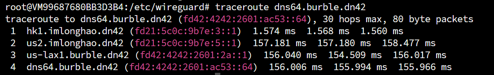

# Foreword
I am a novice in BGP. This article may contain **imprecise content/naive understandings/elementary mistakes**. If you find any issues, you are welcome to contact me via [email](mailto:i@iyoroy.cn), and I will correct them as soon as possible. **If you find this unacceptable, it is recommended to close this article now.**  

> Assumption: You have already joined DN42, can normally send and receive routing tables, and can access IPs within DN42.

# Article Update Log


- August 3, 2025: First edition published.


- March 15, 2026: Update typos. Thanks to @Auride.


# Motivation
While debugging the network, I noticed that pinging or tracerouting others' DN42 IPs could display the reverse-resolved domain names, making it clear which nodes the route passed through, rather than just looking at IPs (as shown in the figure below). It's very intuitive, ~~letting others see at a glance if you've taken a detour~~. Therefore, I decided to register my own DN42 domain and set up an authoritative DNS service.



After reading Lantian's [article](https://lantian.pub/article/modify-website/register-own-domain-in-dn42.lantian/), I saw he used a PowerDNS + MySQL master-slave synchronization solution. However, my server has limited performance (only 1 core, 1GB RAM), so I plan to use [KnotDNS](https://www.knot-dns.cz/) as the DNS server, utilizing the standard zone transfer protocol (AXFR/IXFR) for master-slave synchronization.

# Preparations

:::warning
The domain names and IPs mentioned in this and subsequent chapters are my own. Please replace them with your own during actual deployment; **values enclosed in angle brackets need to be changed according to your requirements.**
:::

I chose the domain: `yori.dn42`, and plan to deploy DNS servers on three machines:
* 172.20.234.225, fd18:3e15:61d0::1, ns1.yori.dn42
* 172.20.234.227, fd18:3e15:61d0::3, ns2.yori.dn42
* 172.20.234.229, fd18:3e15:61d0::5, ns3.yori.dn42

Among them, `ns1.yori.dn42` will be the master node, and `ns2`, `ns3` will be the slave nodes.

# Installing KnotDNS
If port 53 on the system is occupied by a process like `systemd-resolvd`, disable it first:

```shell
systemctl stop systemd-resolved
systemctl disable systemd-resolved
unlink /etc/resolv.conf
echo "nameserver 8.8.8.8" > /etc/resolv.conf
```

I am using Debian 12, so I'll use APT for installation:
```shell
apt install knot knot-dnsutils -y
```

Set KnotDNS to start automatically:
```shell
systemctl enable knot
```

# Configuring KnotDNS
## Creating a Key
First, create a key for synchronization:  
```shell
keymgr -t key_knsupdate
```
Copy the output:
```yaml
# hmac-sha256:key_knsupdate:<your secret>
key:
  - id: key_knsupdate
    algorithm: hmac-sha256
    secret: <your secret>
```

## Editing the Configuration File
### Master Node
Edit /etc/knot/knot.conf and fill in the following content:  
```yaml
server:
    rundir: "/run/knot"
    user: knot:knot
    automatic-acl: on
    listen: [ <listen_address1>@53, <listen_address2>@53, ... ]

log:
  - target: syslog
    any: info

database:
    storage: "/var/lib/knot"

### Paste the Key generated in the previous step here
# hmac-sha256:key_knsupdate:<your secret>
key:
  - id: key_knsupdate
    algorithm: hmac-sha256
    secret: <your secret>

remote:
  - id: <DNS_Node_1_ID>
    address: <DNS_Node_1_IP>@53

  - id: <DNS_Node_2_ID>
    address: <DNS_Node_2_IP>@53

  - id: <DNS_Node_3_ID>
    address: <DNS_Node_3_IP>@53

acl:
  - id: acl_slave
    key: key_knsupdate
    action: transfer
 
  - id: acl_master
    key: key_knsupdate
    action: notify
 
  - id: acl_knsupdate
    key: key_knsupdate
    action: update

template:
  - id: default
    storage: "/var/lib/knot"
    file: "%s.zone"

zone:
  - domain: <DN42 Domain>
    notify: [ <Slave_Node_1_ID>, <Slave_Node_2_ID> ]
    acl: [ acl_slave, acl_knsupdate ]
  - domain: <IPv4 Reverse Lookup Domain>
    notify: [ <Slave_Node_1_ID>, <Slave_Node_2_ID> ]
    acl: [ acl_slave, acl_knsupdate ]
  - domain: <IPv6 Reverse Lookup Domain>
    notify: [ <Slave_Node_1_ID>, <Slave_Node_2_ID> ]
    acl: [ acl_slave, acl_knsupdate ]
```
* The listen addresses should include the machine's DN42 IPv4 and DN42 IPv6 addresses. For local debugging, you can add internal IPs like `127.0.0.1` and `::1`.
* The Slave Node IDs are the IDs set in the `remote` section for the servers you designated as slave nodes.
* The `address` in `remote` can be an internal address, DN42 IPv4, or DN42 IPv6, used only for master-slave synchronization. If using an internal address, add it to the listen list.
* The `template` section sets the Zone file storage location to `/var/lib/knot`.
* The IPv4 Reverse Lookup Domain should follow the format specified in [RFC 2317](https://datatracker.ietf.org/doc/html/rfc2317) based on your allocated IPv4 block. For example, my IPv4 block is `172.20.234.224/28`, so my IPv4 reverse lookup domain should be `224/28.234.20.172.in-addr.arpa`. This treats the last octet `224/28` as a whole, reverses the order of the remaining parts, and appends `.in-addr.arpa`.
* The IPv6 Reverse Lookup Domain should follow the format specified in [RFC 3152](https://datatracker.ietf.org/doc/html/rfc3152) based on your allocated IPv6 block. For example, my IPv6 block is `fd18:3e15:61d0::/48`, so my IPv6 reverse lookup domain should be `0.d.1.6.5.1.e.3.8.1.d.f.ip6.arpa`. This involves reversing the order of the nibbles in the network prefix (excluding the `/48`) and appending `.ip6.arpa`. Pad with zeros if necessary.


**Example**

```yaml
server:
    rundir: "/run/knot"
    user: knot:knot
    automatic-acl: on
    listen: [ 172.20.234.225@53, fd18:3e15:61d0::1@53, localhost@53, 127.0.0.1@53 ]

log:
  - target: syslog
    any: info

database:
    storage: "/var/lib/knot"

# hmac-sha256:key_knsupdate:<key>
key:
  - id: key_knsupdate
    algorithm: hmac-sha256
    secret: <key>

remote:
  - id: 225 # Master Node
    address: 172.20.234.225@53

  - id: 227 # Slave Node
    address: 172.20.234.227@53

  - id: 229 # Slave Node
    address: 172.20.234.229@53

acl:
  - id: acl_slave
    key: key_knsupdate
    action: transfer
 
  - id: acl_master
    key: key_knsupdate
    action: notify
 
  - id: acl_knsupdate
    key: key_knsupdate
    action: update

template:
  - id: default
    storage: "/var/lib/knot"
    file: "%s.zone"

zone:
  - domain: yori.dn42
    notify: [ 227, 229 ]
    acl: [ acl_slave, acl_knsupdate ]
  - domain: 224/28.234.20.172.in-addr.arpa
    notify: [ 227, 229 ]
    acl: [ acl_slave, acl_knsupdate ]
  - domain: 0.d.1.6.5.1.e.3.8.1.d.f.ip6.arpa
    notify: [ 227, 229 ]
    acl: [ acl_slave, acl_knsupdate ]
```


### Slave Nodes
The configuration for slave nodes is largely similar to the master node. Just change the listen addresses to the slave node's addresses and modify the zone section configuration as follows:
```diff
--- a/knot.conf
+++ b/knot.conf
zone:
  - domain: <DN42 Domain>
-   notify: [ <Slave_Node_1_ID>, <Slave_Node_2_ID> ]
-   acl: [ acl_slave, acl_knsupdate ]
+   master: <Master_Node_ID>
+   zonefile-load: whole
+   acl: acl_master
  - domain: <IPv4 Reverse Lookup Domain>
-   notify: [ <Slave_Node_1_ID>, <Slave_Node_2_ID> ]
-   acl: [ acl_slave, acl_knsupdate ]
+   master: <Master_Node_ID>
+   zonefile-load: whole
+   acl: acl_master
  - domain: <IPv6 Reverse Lookup Domain>
-   notify: [ <Slave_Node_1_ID>, <Slave_Node_2_ID> ]
-   acl: [ acl_slave, acl_knsupdate ]
+   master: <Master_Node_ID>
+   zonefile-load: whole
+   acl: acl_master
```

* The Master Node ID is the ID set in the remote section for the server you designated as the master node.


**Examp;e**

```yaml
server:
    rundir: "/run/knot"
    user: knot:knot
    automatic-acl: on
    listen: [ 172.20.234.227@53, fd18:3e15:61d0::3@53, localhost@53, 127.0.0.1@53 ]

log:
  - target: syslog
    any: info

database:
    storage: "/var/lib/knot"

# hmac-sha256:key_knsupdate:<key>
key:
  - id: key_knsupdate
    algorithm: hmac-sha256
    secret: <key>

remote:
  - id: 225
    address: 172.20.234.225@53

  - id: 227
    address: 172.20.234.227@53

  - id: 229
    address: 172.20.234.229@53

acl:
  - id: acl_slave
    key: key_knsupdate
    action: transfer
 
  - id: acl_master
    key: key_knsupdate
    action: notify
 
  - id: acl_knsupdate
    key: key_knsupdate
    action: update

template:
  - id: default
    storage: "/var/lib/knot"
    file: "%s.zone"

zone:
  - domain: yori.dn42
    master: 225
    zonefile-load: whole
    acl: acl_master
  - domain: 224/28.234.20.172.in-addr.arpa
    master: 225
    zonefile-load: whole
    acl: acl_master
  - domain: 0.d.1.6.5.1.e.3.8.1.d.f.ip6.arpa
    master: 225
    zonefile-load: whole
    acl: acl_master
```


After writing the configuration file, run the following command to restart KnotDNS:  
```shell
systemctl restart knot
```

## Editing Zone Files
All configurations in this section are done on the primary DNS server. For record values (not hostnames) that require domain names, unless otherwise specified, please follow the [RFC 1034](https://datatracker.ietf.org/doc/html/rfc1034) specification and use FQDN format.

#### DN42 Domain
Navigate to `/var/lib/knot` and create a file named `<dn42_domain>.zone`.

##### SOA Record
The first record of the zone must be the SOA record. The SOA record is the **Start of Authority record**, containing basic information about the domain, such as the primary NS server address. Fill in the following content:
```text
@ <TTL> SOA <Primary_NS_Server_Address> <Contact_Email> <Serial_Number> <Refresh_Time> <Retry_Time> <Expire_Time> <Minimum_TTL>
```
* `@` represents the current domain itself, do not change it.
* **TTL**: The TTL (Time To Live) value for this SOA record.
* **Primary NS Server Address**: The address of the primary authoritative NS server for this domain. This can be a resolution within the domain. For example, my primary NS server is `172.20.234.225`, and I plan to use `ns1.yori.dn42.` pointing to this address, so here I can fill in `ns1.yori.dn42.`.
* **Contact Email**: The email address, with `@` replaced by `.`. For example, my email is `i@iyoroy.cn`, so here I can fill in `i.iyoroy.cn`.
* **Serial Number**: A 10-digit number following [RFC 1912](https://datatracker.ietf.org/doc/html/rfc1912#section-2.2), representing the version of the zone file. Other DNS servers will refetch the records if they detect an increase in the serial number when querying the SOA. It's commonly encoded using the date + a sequence number, so **this value should be incremented after each modification**.
* **Refresh Time:**: The interval for AXFR slave nodes to pull the zone.
* **Retry Time**: The retry interval for AXFR slave nodes after a failed pull.
* **Expire Time**: The maximum time an AXFR slave node can continue serving with the last successfully pulled records after a failure, after which it stops responding.
* **Minimum TTL**: The minimum TTL value for the entire domain, the minimum refresh time for all records. Records won't be refreshed before at least this much time has passed.


**Examp;e**

```text
; SOA
@ 3600 SOA ns1.yori.dn42. i.iyoroy.cn. 2025072705 60 60 1800 60
```


##### NS Records
```text
@ <TTL> NS <NS_Server_1>
@ <TTL> NS <NS_Server_2>
@ <TTL> NS <NS_Server_3>
```
Fill this in according to your actual situation; add as many records as you have servers.


**Example**

```text
; NS
@ 3600 NS ns1.yori.dn42.
@ 3600 NS ns2.yori.dn42.
@ 3600 NS ns3.yori.dn42.
```


##### A, AAAA, CNAME, etc. Records
Fill them in according to the following format:
```text
<Hostname> <TTL> <Type> <Record_Value>
```
If your NS server values point to hosts within your own DN42 domain, be sure to add A or AAAA resolution records for them.  


**Example**

```text
; A
ns1 600 A 172.20.234.225
ns2 600 A 172.20.234.227
ns3 600 A 172.20.234.229
hkg-cn.node 600 A 172.20.234.225
nkg-cn.node 600 A 172.20.234.226
tyo-jp.node 600 A 172.20.234.227
hfe-cn.node 600 A 172.20.234.228
lax-us.node 600 A 172.20.234.229

; AAAA
ns1 600 AAAA fd18:3e15:61d0::1
ns2 600 AAAA fd18:3e15:61d0::3
ns3 600 AAAA fd18:3e15:61d0::5
hkg-cn.node 600 AAAA fd18:3e15:61d0::1
nkg-cn.node 600 AAAA fd18:3e15:61d0::2
tyo-jp.node 600 AAAA fd18:3e15:61d0::3
hfe-cn.node 600 AAAA fd18:3e15:61d0::4
lax-us.node 600 AAAA fd18:3e15:61d0::5
```


**Complete Example**

`/var/lib/knot/yori.dn42.zone`
```text
; SOA
@ 3600 SOA ns1.yori.dn42. i.iyoroy.cn. 2025072705 60 60 1800 60

; NS
@ 3600 NS ns1.yori.dn42.
@ 3600 NS ns2.yori.dn42.
@ 3600 NS ns3.yori.dn42.

; A
ns1 600 A 172.20.234.225
ns2 600 A 172.20.234.227
ns3 600 A 172.20.234.229
hkg-cn.node 600 A 172.20.234.225
nkg-cn.node 600 A 172.20.234.226
tyo-jp.node 600 A 172.20.234.227
hfe-cn.node 600 A 172.20.234.228
lax-us.node 600 A 172.20.234.229

; AAAA
ns1 600 AAAA fd18:3e15:61d0::1
ns2 600 AAAA fd18:3e15:61d0::3
ns3 600 AAAA fd18:3e15:61d0::5
hkg-cn.node 600 AAAA fd18:3e15:61d0::1
nkg-cn.node 600 AAAA fd18:3e15:61d0::2
tyo-jp.node 600 AAAA fd18:3e15:61d0::3
hfe-cn.node 600 AAAA fd18:3e15:61d0::4
lax-us.node 600 AAAA fd18:3e15:61d0::5
```


#### IPv4 Reverse Lookup Domain
Create a file in `/var/lib/knot` named `<IPv4_Reverse_Lookup_Domain>.zone`, replacing `/` with `_`. For example, my IPv4 block is `172.20.234.224/28`, and my IPv4 reverse lookup domain is `224/28.234.20.172.in-addr.arpa`, so the filename here would be `224_28.234.20.172.in-addr.arpa.zone`. Fill in the resolution records:  

```text
; SOA
@ <TTL> SOA <Primary_NS_Server_Address> <Contact_Email> <Serial_Number> <Refresh_Time> <Retry_Time> <Expire_Time> <Minimum_TTL>

; NS
@ <TTL> NS <NS_Server_1>
@ <TTL> NS <NS_Server_2>
@ <TTL> NS <NS_Server_3>
 
; PTR
<Last_IPv4_Octet> <TTL> PTR <Reverse_DNS_Value>
<Last_IPv4_Octet> <TTL> PTR <Reverse_DNS_Value>
<Last_IPv4_Octet> <TTL> PTR <Reverse_DNS_Value>
...
```
* The SOA and NS records are the same as above.
* **Last IPv4 Octet**: The last octet of the DN42 IPv4 address you assigned to the device. For example, my HK node is assigned `172.20.234.225`, so here I would put `225`.


**Example**

`224_28.234.20.172.in-addr.arpa.zone`
```text
; SOA
@ 3600 SOA ns1.yori.dn42. i.iyoroy.cn. 2025072802 60 60 1800 60

; NS
@ 3600 NS ns1.yori.dn42.
@ 3600 NS ns2.yori.dn42.
@ 3600 NS ns3.yori.dn42.
 
; PTR
225 600 PTR hkg-cn.node.yori.dn42.
226 600 PTR nkg-cn.node.yori.dn42.
227 600 PTR tyo-jp.node.yori.dn42.
228 600 PTR hfe-cn.node.yori.dn42.
229 600 PTR lax-us.node.yori.dn42.
```


You might wonder why the CIDR mask is needed, which differs from the common Clearnet format of reversed octets (e.g., `234.20.172.in-addr.arpa`). Also, if you test locally, you might find that reverse lookups for your own IP addresses fail directly.

The reason lies in DN42's distributed registry mechanism: a single zone file cannot cover all reverse query entry points for your address block (i.e., the `.in-addr.arpa` name for each specific IP address). To solve this, after your PR is merged, the official DN42 DNS will add CNAME redirects for your address block on its authoritative servers, pointing individual IP PTR queries to your CIDR-formatted zone, as shown below:

```shell
~$ dig PTR 225.234.20.172.in-addr.arpa  +short
225.224/28.234.20.172.in-addr.arpa.  # <-- CNAME added by Registry (redirect)
hkg-cn.node.yori.dn42.               # <-- Final PTR record returned by your DNS
```

When an external resolver queries the reverse record for a specific IP (e.g., `172.20.234.225`) (querying `225.234.20.172.in-addr.arpa`), the official DN42 DNS returns a CNAME record pointing it to the specific record under the CIDR zone name (`225.224/28.234.20.172.in-addr.arpa`). Ultimately, the PTR record is provided by your configured authoritative DNS server.

#### IPv6 Reverse Lookup Domain
Create a file in `/var/lib/knot` named `<IPv6_Reverse_Lookup_Domain>.zone`. For example, my IPv6 block is `fd18:3e15:61d0::/48`, and my IPv6 reverse lookup domain is `0.d.1.6.5.1.e.3.8.1.d.f.ip6.arpa`, so the filename here would be `0.d.1.6.5.1.e.3.8.1.d.f.ip6.arpa.zone`. Fill in the resolution records:

```text
; SOA
@ <TTL> SOA <Primary_NS_Server_Address> <Contact_Email> <Serial_Number> <Refresh_Time> <Retry_Time> <Expire_Time> <Minimum_TTL>

; NS
@ <TTL> NS <NS_Server_1>
@ <TTL> NS <NS_Server_2>
@ <TTL> NS <NS_Server_3>

; PTR
<Reversed_Last_20_Nibbles> <TTL> PTR <Reverse_DNS_Value>
<Reversed_Last_20_Nibbles> <TTL> PTR <Reverse_DNS_Value>
<Reversed_Last_20_Nibbles> <TTL> PTR <Reverse_DNS_Value>
...
```
* Handle SOA and NS records as above.
* For the PTR hostname, you need to **take the last 80 bits of the host's IPv6 address (after removing the /48 prefix), expand them into 20 hexadecimal characters**, and **reverse the order of these characters**, separating them with dots. For example, my Hong Kong node's IPv6 is `fd18:3e15:61d0::1`. Expanded, this is `fd18:3e15:61d0:0000:0000:0000:0000:0001`. The hostname here would be `1.0.0.0.0.0.0.0.0.0.0.0.0.0.0.0.0.0.0.0`.


**Example**

`0.d.1.6.5.1.e.3.8.1.d.f.ip6.arpa.zone`
```text
; SOA
@ 3600 SOA ns1.yori.dn42. i.iyoroy.cn. 2025072802 60 60 1800 60

; NS
@ 3600 NS ns1.yori.dn42.
@ 3600 NS ns2.yori.dn42.
@ 3600 NS ns3.yori.dn42.

; PTR
1.0.0.0.0.0.0.0.0.0.0.0.0.0.0.0.0.0.0.0 600 PTR hkg-cn.node.yori.dn42.
2.0.0.0.0.0.0.0.0.0.0.0.0.0.0.0.0.0.0.0 600 PTR nkg-cn.node.yori.dn42.
3.0.0.0.0.0.0.0.0.0.0.0.0.0.0.0.0.0.0.0 600 PTR tyo-jp.node.yori.dn42.
4.0.0.0.0.0.0.0.0.0.0.0.0.0.0.0.0.0.0.0 600 PTR hfe-cn.node.yori.dn42.
5.0.0.0.0.0.0.0.0.0.0.0.0.0.0.0.0.0.0.0 600 PTR lax-us.node.yori.dn42.
```


## Verifying the Setup
After saving everything, run `knot reload` on each DNS server. If all goes well, you should see the slave nodes synchronizing the zone files from the master node. You can then use `dig` or `nslookup` specifying the server to query the resolution records.

# Registration
## Domain
Clone the DN42 Registry, navigate to `data/dns`, create a new file named `<your_desired_domain>`, and fill in the following content:
```plain
domain:             <your_desired_domain>
admin-c:            <Admin_NIC_Handle>
tech-c:             <Tech_NIC_Handle>
mnt-by:             <Maintainer>
nserver:            <NS1_Server_Domain> <NS1_Server_IP>
nserver:            <NS2_Server_Domain> <NS2_Server_IP>
nserver:            <NS3_Server_Domain> <NS3_Server_IP>
...
source:             DN42
```

Refer to [DN42 -  Ep.1 Joining the DN42 Network](https://www.iyoroy.cn/en/archives/84/) for `admin-c`, `tech-c`, and `mnt-by`.


**Example**

`data/dns/yori.dn42`
```plain
domain:             yori.dn42
admin-c:            IYOROY-DN42
tech-c:             IYOROY-DN42
mnt-by:             IYOROY-MNT
nserver:            ns1.yori.dn42 172.20.234.225
nserver:            ns1.yori.dn42 fd18:3e15:61d0::1
nserver:            ns2.yori.dn42 172.20.234.227
nserver:            ns2.yori.dn42 fd18:3e15:61d0::3
nserver:            ns3.yori.dn42 172.20.234.229
nserver:            ns3.yori.dn42 fd18:3e15:61d0::5
source:             DN42
```


## IPv4 Reverse Lookup Domain
Navigate to `data/inetnum`, find the file for your registered address block, and add `nserver` fields pointing to your own DNS servers:
```plain
nserver:            <your_DNS_server_address>
nserver:            <your_DNS_server_address>
...
...
```


**Example**

```diff
diff --git a/data/inetnum/172.20.234.224_28 b/data/inetnum/172.20.234.224_28
index 50c800945..5ad60e23d 100644
--- a/data/inetnum/172.20.234.224_28
+++ b/data/inetnum/172.20.234.224_28
@@ -8,3 +8,6 @@ tech-c:             IYOROY-DN42
 mnt-by:             IYOROY-MNT
 status:             ASSIGNED
 source:             DN42
+nserver:            ns1.yori.dn42
+nserver:            ns2.yori.dn42
+nserver:            ns3.yori.dn42
```


## IPv6 Reverse Lookup Domain
Navigate to `data/inet6num`, find the file for your registered address block, and add `nserver` fields pointing to your own DNS servers:
```plain
nserver:            <your_DNS_server_address>
nserver:            <your_DNS_server_address>
...
```


**Example**

```diff
diff --git a/data/inet6num/fd18:3e15:61d0::_48 b/data/inet6num/fd18:3e15:61d0::_48
index 53f0de06d..1ae067b00 100644
--- a/data/inet6num/fd18:3e15:61d0::_48
+++ b/data/inet6num/fd18:3e15:61d0::_48
@@ -8,3 +8,6 @@ tech-c:             IYOROY-DN42
 mnt-by:             IYOROY-MNT
 status:             ASSIGNED
 source:             DN42
+nserver:            ns1.yori.dn42
+nserver:            ns2.yori.dn42
+nserver:            ns3.yori.dn42
```


## Submit a PR and Wait for Merge
After filling everything out, push your changes and submit a Pull Request. Because anyone in DN42 can run recursive DNS, it might take up to a week for the DNS configuration to fully propagate, although I found that the public DNS (172.20.0.53) could query my records within half a day after merging.  

-----
Special thanks to たのしい for clarifying the differences between IPv4 reverse lookup in DN42 and the public internet.  
Reference Articles:
1. https://www.haiyun.me/archives/1398.html
2. https://www.jianshu.com/p/7d69ec2976c7
3. https://www.potat0.cc/posts/20220726/Register_DN42_Domain/
4. https://bbs.csdn.net/topics/393775423
5. https://blog.snorlax.blue/knot-reverse-dns-kickstart/
6. http://www.kkdlabs.jp/dns/automatic-dnssec-signing-by-knot-dns/
7. https://lantian.pub/article/modify-website/register-own-domain-in-dn42.lantian/
8. https://datatracker.ietf.org/doc/html/rfc2317
9. https://datatracker.ietf.org/doc/html/rfc3152
10. https://datatracker.ietf.org/doc/html/rfc1912#section-2.2