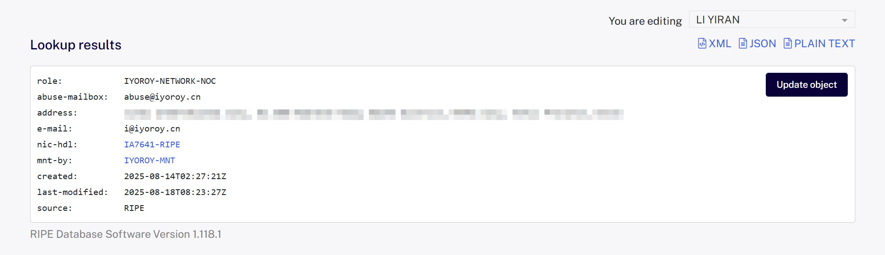
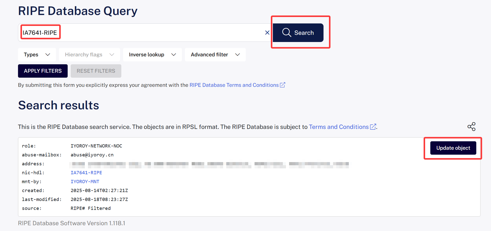
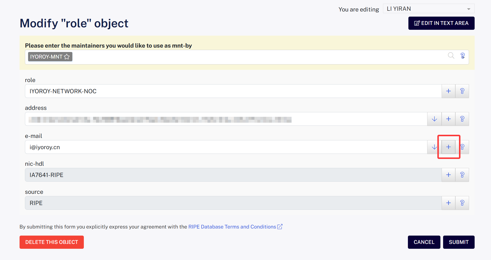
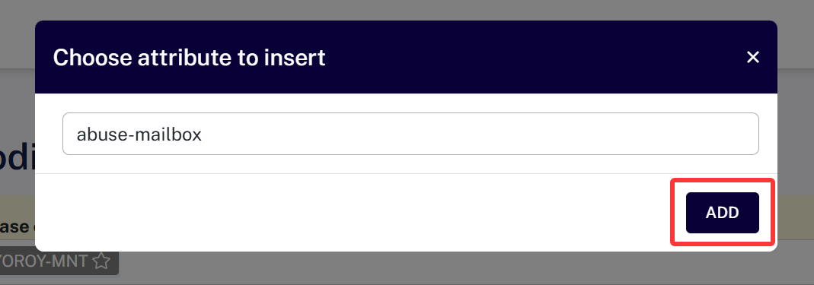
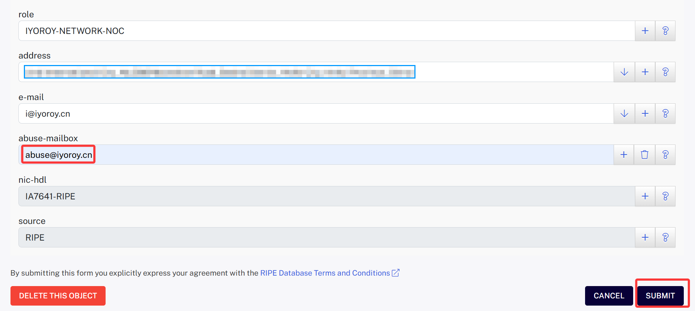
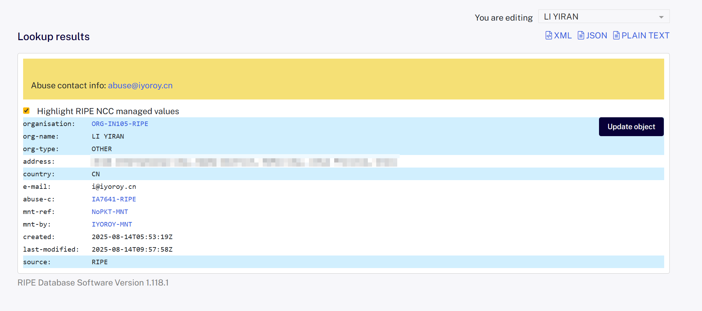
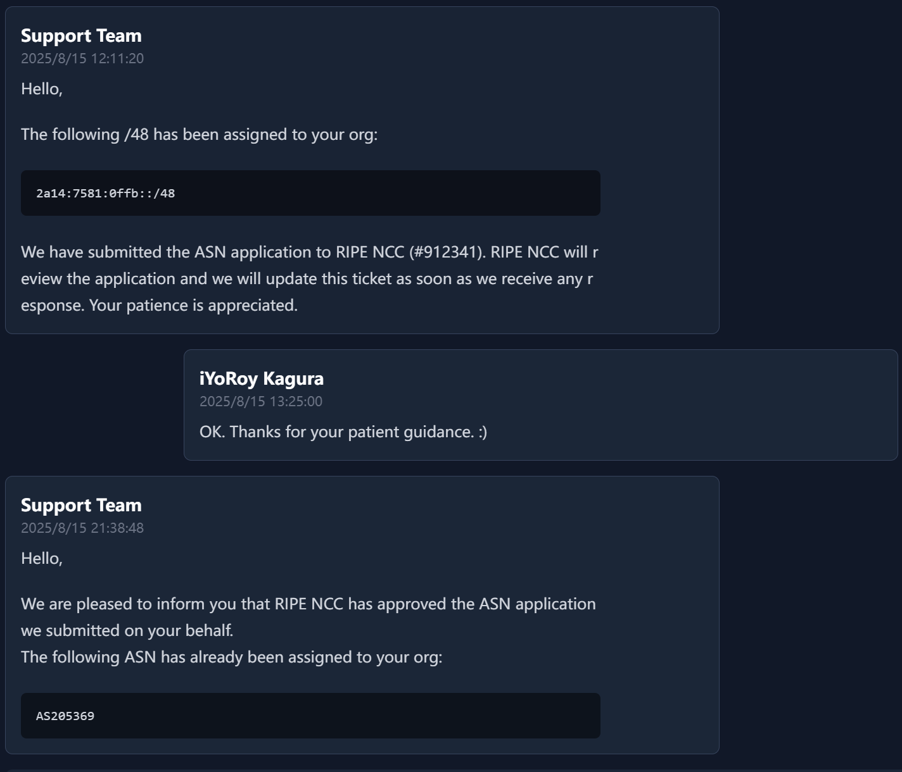
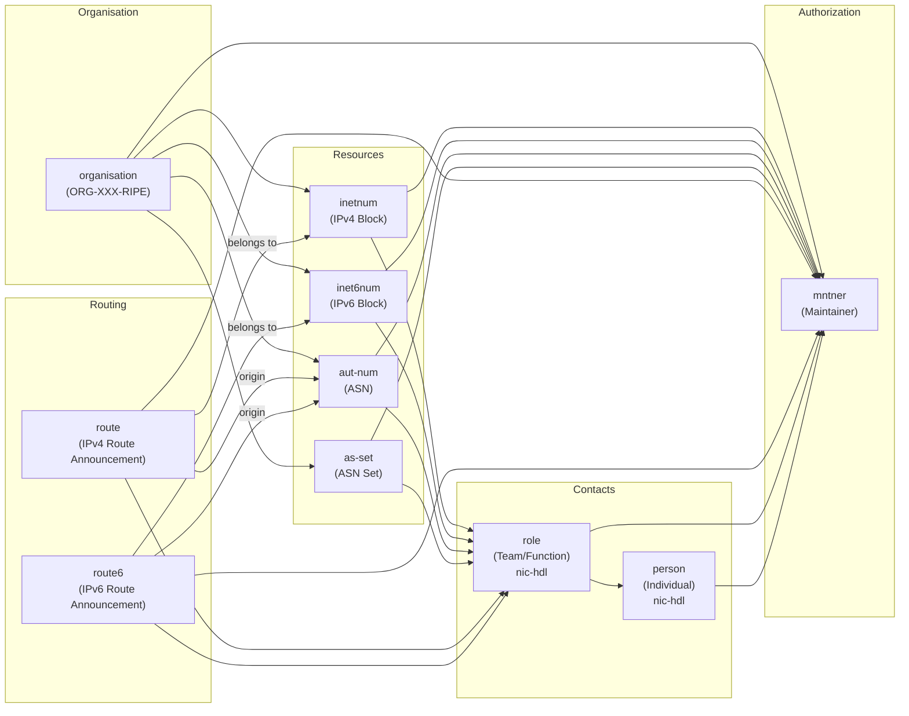

# Introduction
This article documents my complete process of applying for an ASN through the RIPE NCC. The content is suitable for beginners. If you find any errors, please feel free to contact me via [email](mailto:i@iyoroy.cn), and I will correct them promptly.

~~Now that we've learned the basic BGP concepts on DN42, it seems a bit of a waste not to play with the public internet, right?~~

# Basic Concepts

Currently, the allocation of public ASN and IP resources is managed by five **Regional Internet Registries (RIRs)** worldwide:

* ARIN: Manages the North American region.
* RIPE NCC: Manages the European region.
* APNIC: Manages the Asia-Pacific region.
* LACNIC: Manages the Latin American region.
* AfriNIC: Manages the African region.

RIRs do not provide services directly to end users. Instead, they allocate resources to **Local Internet Registries (LIRs)**, which then assign them to end users. Of course, individual users can also register as an LIR, but this is generally not cost-effective. ~~If you're willing to pay thousands of dollars in annual fees, then forget I said that.~~  

Among these, RIPE NCC is considered more friendly towards individual applications, followed by ARIN and APNIC. Compared to RIPE NCC, APNIC's fees are generally about 30% higher. Furthermore, RIPE NCC provides an online management system allowing users to modify information and check progress themselves, whereas with APNIC, you typically need to contact an LIR for changes. Overall, I chose to apply for an ASN through the RIPE NCC.

The resources obtained (both ASN and IPs) are generally categorized into two types:
* **PA (Provider Aggregatable) Resources**: Belong to the LIR and are assigned for your use by the LIR.
* **PI (Provider Independent) Resources**: Belong to you directly. These are generally more expensive.

# Preparation Stage
## Choosing an LIR
Search online for `LIR Service` to find many companies offering such services. Currently, RIPE NCC charges an annual administrative fee of 50 EUR for PI resources. This means the cost from an LIR for registering an ASN generally won't be lower than 50 EUR per year (approximately 60 USD at the time of writing). Here, I chose [NoPKT LLC](https://net.nopkt.com/), recommended by peers. Their pricing is quite reasonable and includes a /48 block of PA IPv6 addresses with the ASN. The activation speed was also very fast – it only took half a day from submitting the required documents to getting the ASN.  

## Preparing Documents
#### Proof of Identity
* Individual: Provide an ID card or passport (I submitted photos of the front and back of my national ID card).
* Company: Provide a valid business license.

If the applicant is a minor, usually written consent from their legal guardian is required, and the guardian must fulfill corresponding responsibilities. All submitted documents must be authentic and valid, and should be originals or notarized copies.

#### Contact Information
1. Postal Address: Used for registration in the RIPE Database.
2. Technical Contact Email.
3. Abuse Contact Email.

#### Technical Justification
1. Billing from a BGP-capable provider within the European region. Options include Vultr, BuyVM, iFog, V.PS, etc.  
  Note: Vultr uses a post-payment system, generating invoices at the beginning of the month. If you need the documents ready quickly, consider other providers.  
2. ASNs of two upstream providers you plan to connect to. (In practice, the reviewers won't strictly verify the specific upstream ASNs you list. Therefore, you can fill in common, publicly known ASNs to make it look reasonable. Don't overthink it too much. ~~You can even put mine.~~)

# Registering a RIPE DB Account and Creating Objects
Go to the [RIPE Database](https://access.ripe.net/registration) and register an account. For Chinese, it's recommended to use the 拼音(Pinyin) of your real legal name. Enabling 2FA is mandatory, so please install a TOTP app on your phone beforehand.

#### Creating a Role Object and Maintainer Object
Go to [Create role and maintainer pair - RIPE Database](https://apps.db.ripe.net/db-web-ui/webupdates/create/RIPE/role/self) to create a role object.  
Here, a 'role' is an abstract concept describing the contact information for a team, department, or functional role – it represents a role, such as NOC (Network Operations Center), Abuse Team, Hostmaster, etc.    
* **mntner**: The identifier for the maintainer object. It can contain uppercase/lowercase letters, numbers, and `-_`. For example, I used `IYOROY-MNT`.
* **role**: The name for the role object. It can contain uppercase/lowercase letters, numbers, and `][)(._"*@,&:!'+/-`. For example, I used `IYOROY-NETWORK-NOC`.
* **address**: The office address for this role.
* **e-mail**: The email address for this role.

Click SUBMIT after filling out the form to create both the role object and the maintainer object. Please note the returned primary key name, which usually ends with `-RIPE`. You will need this for future modifications and submissions to the LIR.

The **maintainer object identifier** here is conceptually different from the role object. The maintainer signifies **who has the authority to maintain (create/modify/delete) objects in the database** – it's the **maintaining entity**. The relationship between different concepts in the RIPE Database can be referenced in the diagram later in the article.

#### Adding an Abuse Contact Mailbox
Go to [Query - RIPE Database](https://apps.db.ripe.net/db-web-ui/query) and search for the primary key of the role you just created. You should find the entry you created. Click "Update Object" on the right.  

Click the plus sign (+) next to the email field to add an `abuse-mailbox` attribute and fill in your abuse contact email address:

Click SUBMIT to save.

**Note: RIPE periodically checks if the abuse-mailbox is functional. Please ensure you provide a real, active email address.**

#### Creating an Organization Object

The Organization object here is an abstraction of a legal entity or organization (company, university, ISP, individual user, etc.). It serves as the top-level ownership information for resource objects (like `aut-num`, `inetnum`, `inet6num`) in the RIPE Database. This means subsequent ASN and IP resources will be assigned to this Organization object.

Go to [Create Organization - RIPE Database](https://apps.db.ripe.net/db-web-ui/webupdates/create/RIPE/organisation) and fill in the following information:

* organisation: A unique ID. Keep it as the default `AUTO-1` to let RIPE NCC assign one.
* org-name: The name of the organization. For Chinese individuals, use your full name in Pinyin.
* address: Postal address.
* country: Country code, refer to ISO 3166. For China, use `CN`.
* e-mail: The organization's email address.
* admin-c / tech-c: Administrative and technical contact objects (referencing the role handle).
* abuse-c: Specifies the abuse contact (must be a role object linked to the `abuse-mailbox` in that role).
* mnt-ref: Specifies which maintainer(s) can create objects referencing this organisation.
* mnt-by: Specifies who can maintain this organisation object itself.

Click SUBMIT after filling out the form and note the returned object identifier, which follows a format like `ORG-XXXX-RIPE`.

If you need to make changes after submission, go to [Query - RIPE Database](https://apps.db.ripe.net/db-web-ui/query) and search for the previously noted Role primary key or the Organization object identifier to find the update option.

# Paying the LIR Fee and Submitting Documents
Submit the following documents to your chosen LIR:  

#### Proof of Identity
* Full Name
* Address (recommended to match your ID document)
* Photos of the front and back of your ID card

#### RIPE Database Information
* org: Organization object identifier
* as-name: AS Name
* admin-c: Primary key of the role object created earlier
* tech-c: Primary key of the role object created earlier
* abuse-c: Primary key of the role object created earlier
* nic-hdl: Primary key of the role object created earlier
* mnt-by: Name of the maintainer object created earlier

#### Technical Justification
* VPS Bill/Invoice
* Upstream ASNs

The LIR will likely ask you to add a `mnt-ref` attribute to your Organization object, pointing to the LIR's maintainer. This allows the LIR to assign the AS and IP resources to your Organization. Once the LIR reviews and approves your application, they will submit the request to RIPE. Then, it's a waiting game. Generally, it takes 3-5 working days to get your ASN.  

At this point, we have successfully registered our own ASN on the public internet.

# Supplement: Relationships Between Concepts in the RIPE Database

----
Special thanks to Mi Lu for providing technical support and answering questions!

Reference Articles:
* [自己在家开运营商 Part.1 - 注册一个 ASN - LYC8503](https://blog.lyc8503.net/post/asn-1-asn-registration/)
* [从0开始注册一个ASN并广播IP | Pysio's Home](https://pysio.online/posts/daily/RegistryASN.html)
* [青年人的第一个运营商：注册一个 ASN | liuzhen932 的小窝](https://blog.liuzhen932.top/posts/asn-1-registration/)