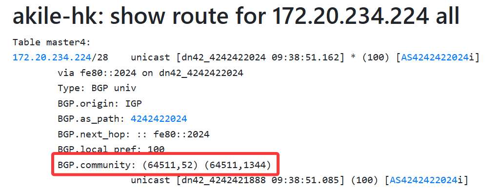

# Foreword
I am a novice in BGP. This article may contain **imprecise content/naive understandings/elementary mistakes**. I kindly ask the experts to be lenient. If you find any issues, you are welcome to contact me via [email](mailto:i@iyoroy.cn), and I will correct them as soon as possible. **If you find this unacceptable, it is recommended to close this article now.**  

# What are BGP Communities?

> TL;DR: BGP Communities "tag" routes, allowing others to use these tags for route optimization.

This concept might be unfamiliar to newcomers ~~(like me)~~, who might not initially understand its purpose.  
Simply put, BGP Communities are a mechanism for **tagging routes**, similar to adding labels. They allow network administrators to attach one or more "tags" (i.e., community values) to routes propagated via BGP. These tags themselves do not alter the route's path attributes (like AS_PATH, LOCAL_PREF, MED, etc.), but they provide a **signaling mechanism** to **indicate what policy or processing should be applied to that route** by other routers within the same AS or in downstream peer ASes. BGP Communities can be used to:

1. **Simplify Policy Configuration**: Routers inside the network or in downstream ASes only need to configure policies based on community values (like setting LOCAL_PREF, adding NO_EXPORT, applying route-maps, etc.), without needing to know the specific prefix details. This makes policies more centralized, easier to manage, and less prone to errors.
2. **Convey Policy Intent to Downstream ASes**: An AS can attach community values to routes it advertises to its downstream customer or peer ASes. These communities convey requirements or suggestions on how these routes should be handled, such as route optimization based on geographic location, latency, or bandwidth.
3. **Coordinate Policies within an AS**: Inside a large AS, when using IBGP full-mesh or route reflectors, edge routers (receiving EBGP routes or redistributing routes) can tag routes with community values. Core routers or route reflectors within the AS can recognize these communities and apply corresponding internal policies (like setting LOCAL_PREF, MED, deciding whether to advertise to certain IBGP peers, adding other communities, etc.), without needing complex prefix-based policies on every internal router.

DN42 has its own set of Communities specifications. For details, please refer to: [BGP-communities - DN42 Wiki](https://dn42.dev/howto/BGP-communities)

# Configuration
The general idea and approach in this article are largely based on Xe_iu's method, focusing on adding BGP Communities for geographic information and performing route optimization. Generally, this is sufficient. ~~(Another reason is that I haven't fully grasped the others yet)~~  

Note: In this example, geographic tags describe **routes originated by our own AS**, so I only add them to my own prefixes and leave neighbors' geographic tags unchanged. Adding our region to a neighbor's route could mislead policies that rely on these tags, but it does not change the route's origin AS. Neither Standard nor Large Communities provide built-in authenticity checks; trust depends on peer relationships, agreed semantics, and import filters.

See [RFC 8092, Section 7](https://www.rfc-editor.org/rfc/rfc8092.html#section-7): intermediate ASes can add, delete, or alter Large Community attributes.

The idea is clear. When exporting routes, we first need to verify if it's our own route. If it is, we add the communities tag to the route. The sample configuration provided by DN42 already includes two functions, `is_self_net()` and `is_self_net_v6()`, to check if a route is our own. Therefore, writing the configuration part is straightforward. 

## Adding Communities to Routes

First, we need to define the geographic region information for the current node at the beginning of the node configuration file. Please check [BGP-communities - DN42 Wiki](https://dn42.dev/howto/BGP-communities) for details:  
```bird2
define DN42_REGION = 52;   # 52 represents East Asia
define DN42_COUNTRY= 1344; # 1344 represents Hong Kong
```
* Please modify these values according to your node's actual geographic location.

Then, modify the export filter in the dnpeers template:  
```diff
export filter {
-    if is_valid_network() && source ~ [RTS_STATIC, RTS_BGP] then accept;
+    if is_valid_network() && source ~ [RTS_STATIC, RTS_BGP] then{
+        if (is_self_net()) then {      # Check if it's our own route
+            bgp_community.add((64511, DN42_REGION));  # Add continent-level region info
+            bgp_community.add((64511, DN42_COUNTRY)); # Add country/region info
+        }
+        accept;
+    }
    reject;
};
import limit 1000 action block;
```
During export, it checks if it's our own route. If it is, it sets the `bgp_community` according to the defined `DN42_REGION` and `DN42_COUNTRY`. Here, `64511` is the **reserved public AS number identifier specifically for geographic tags (Region/Country)**; you can just copy it. Apply the same method to the IPv6 export rules, but replace `is_self_net()` with `is_self_net_v6()`.

## Route Optimization Based on Communities
Here we need to introduce another concept: `local_pref` (Local Preference). It is used within an AS to indicate the priority of a route. Its default value is `100`, and a higher value indicates higher priority. Furthermore, in BGP route selection logic, `local_pref` has the highest priority, even higher than `AS_PATH` length. This means that by setting `local_pref`, we can adjust the priority of routes to achieve route optimization.
Combining this with the BGP Communities mentioned above, we can set the corresponding `local_pref` based on Communities for optimization. Also, since `BGP.local_pref` is propagated within the AS, we need to modify the import logic for both eBGP and iBGP routes.

My logic for handling `BGP.local_pref` here references ~~(basically copies)~~ Xe_iu's approach:  
* For routes from the same region, priority +10
* For routes from the same country, priority +5 additionally
* For routes received via direct peering with us, priority +20 additionally

Create a function to calculate the priority:  
```bird2
function ebgp_calculate_priority() {
    int priority = 100;  # Base priority

    # Same region detection (+10)
    if bgp_community ~ [(64511, DN42_REGION)] then
        priority = priority + 10;

    # Same country detection (+5)
    if bgp_community ~ [(64511, DN42_COUNTRY)] then
        priority = priority + 5;

    # Direct eBGP neighbor detection (+20)
    if bgp_path.len = 1 then
        priority = priority + 20;

    return priority;
}
```

Then, in the import filter within the `dnpeers` template, set `bgp_local_pref` to the value calculated by the function:  
```diff
template bgp dnpeers {
    local as OWNAS;
    path metric 1;

    ipv4 {
        import filter {
            if is_valid_network() && !is_self_net() then {
                if (roa_check(dn42_roa, net, bgp_path.last) != ROA_VALID) then {
                    print "[dn42] ROA check failed for ", net, " ASN ", bgp_path.last;
                    reject;
                }
+                bgp_local_pref = ebgp_calculate_priority(); 
                accept;
            }
            reject;
        };
```

Apply the same method for IPv6.

After running `birdc configure`, we should be able to see that our routes have been tagged with Communities labels at our neighbors:



(Screenshot source:[https://lg.milu.moe/route_all/hk/172.20.234.224](https://lg.milu.moe/route_all/hk/172.20.234.224))

-----
Special thanks to Nuro Trace and Xe_iu. They helped deepen my understanding of BGP Communities and provided much assistance.
Reference Articles:  

* [[DN42] bird2的配置文件 – Xe_iu's Blog | Xe_iu的杂物间](https://blog.xeiu.top/archives/448)
* [[DN42] 谈一谈如何配置 BGP community – Xe_iu's Blog | Xe_iu的杂物间](https://blog.xeiu.top/archives/402)
* [BGP-communities - DN42 Wiki](https://dn42.dev/howto/BGP-communities)