# Preface
In the previous article, we successfully registered an ASN and obtained an IPv6 address block. Now, we will announce this block to the world.  

# Setting Up the Subnet Object in the RIPE Database
It's important to note that the minimum IPv6 prefix allowed for announcement on the public internet is `/48`. This means if you only have a single `/48` block, you cannot break it down into smaller segments. Therefore, I later leased a separate `/40` block, intending to split it into multiple `/48`s for announcement.  

The IPv6 block I obtained is `2a14:7583:f200::/40`, and I plan to split out `2a14:7583:f203::/48` for use with Vultr. If you don't need to split your block, please skip directly to the "Creating the Route Object" section.

## Splitting the Prefix
First, go to [Create "inet6num" object - RIPE Database](https://apps.db.ripe.net/db-web-ui/webupdates/create/RIPE/inet6num) and fill in the following:
* **inet6num**: The IP block you want to split out, in CIDR format.
* **netname**: Network name.
* **country**: The country to which the IP block belongs, must conform to the ISO 3166 standard (can be selected directly in the RIPE DB).
* **admin-c**: The primary key value of the Role object created earlier.
* **tech-c**: The primary key value of the Role object created earlier.
* **status**: Keep `ASSIGNED`

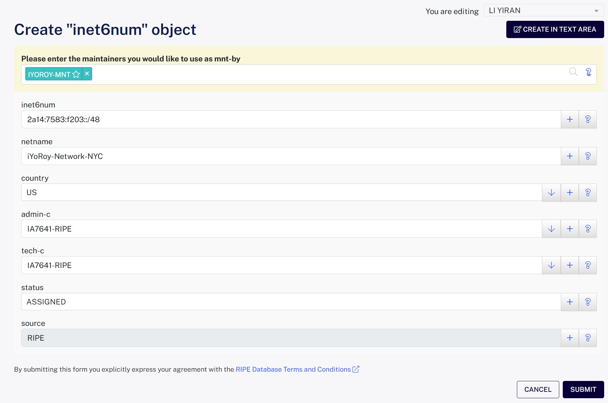

This step splits a smaller `/48` address block from your obtained allocation.

## Creating the Route Object
Go to [Create "route6" object - RIPE Database](https://apps.db.ripe.net/db-web-ui/webupdates/create/RIPE/route6) and fill in the following:
* **route6**: The IPv6 address block you intend to announce, in CIDR format.
* **origin**: The ASN you applied for, including the 'AS' prefix.

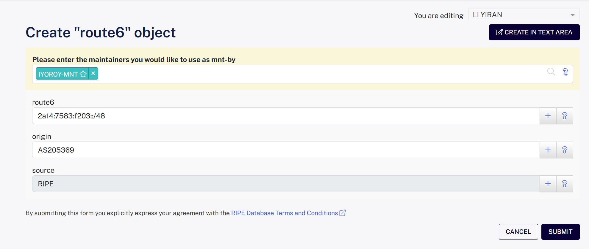

This step declares that your ASN is permitted to use this address block for originating BGP routes.  

# Applying for BGP Session with a VPS Provider
This time I'm using a machine from Vultr. Their BGP Session setup is very beginner-friendly, with their own validation system. Furthermore, their upstream has good filters ensuring that incorrect route advertisements generally won't affect the public internet.  

(I forgot to take screenshots during my configuration, but you can refer to the section **申请 Vultr 的 BGP 广播功能** in Bao Shuo's article [年轻人的第一个 ASN](https://blog.baoshuo.ren/post/my-own-asn/) for reference.)

Go to [BGP - Vultr.com](https://my.vultr.com/bgp/), select Get Started, and fill in your ASN and IPv6 block information as required. For the LOA (Letter Of Authorization), you can refer to this template: [LOA-template.docx](/downloads/2025/08/3976042902.docx) (I rewrote one for individuals as most templates found online are for companies).

After submission, the system will automatically create a ticket, and you will see your ASN and IP block in a pending verification state:  
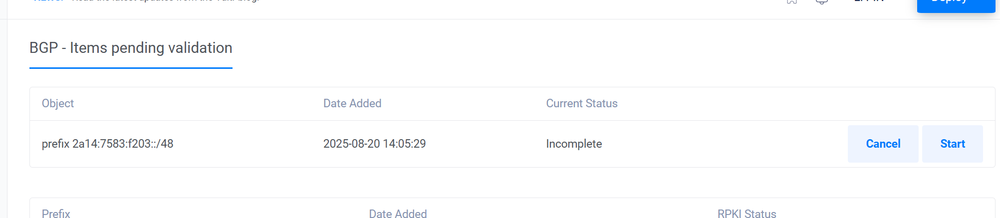
Click Start, and the system will send a verification email to the abuse-mailbox email address registered with your Role object:  
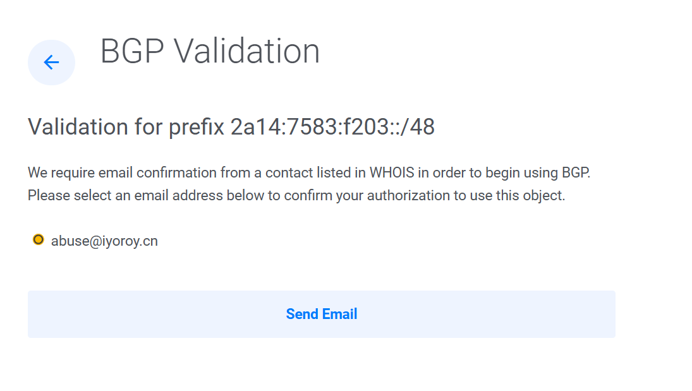  
The received email looks like this:  
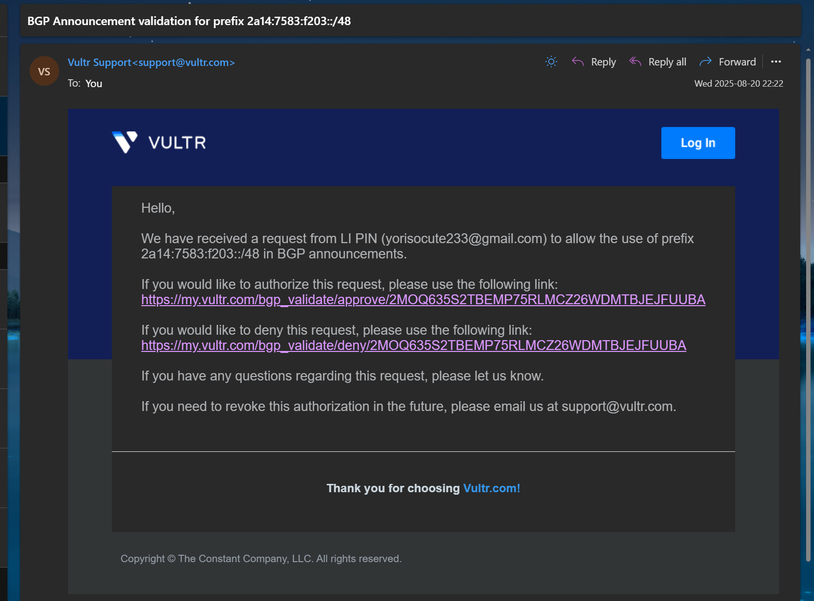  
The top link represents approving the authorization for Vultr to announce your IP block, and the bottom one is for disapproval. Click the top link, which will take you to Vultr's webpage:  
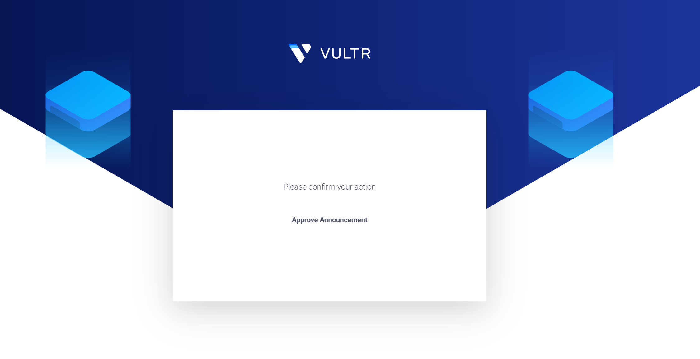  
Then click Approve Announcement. Both the ASN and the IP block need to be verified once.  

Next, wait for the Vultr staff to review and complete the process. Then, in your VPS control panel, you will see the BGP tab, where you can find the upstream information:  
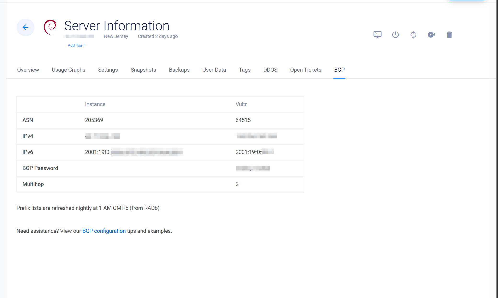

I must commend Vultr's ticket efficiency here; it took me an average of only about 10 minutes from creating the ticket requesting authorization to completion. ~~(In contrast, the average weekday ticket response time at iFog GmbH was around 1 day, which is much slower in comparison).~~

The process with other VPS providers is generally similar. You need to inform their staff of the ASN and IP block you want to announce. After verifying ownership, the staff will configure the corresponding BGP Session for you.

# Advertisement!

You should have received the following information from your upstream:   
* Upstream's ASN
* Upstream's IP address for the BGP Session
* (Optional) Password

The operating system I use is Debian 12 Bookworm, using Bird2 as the routing software. I updated Bird2 to the latest version following the section "Update Bird2 to v2.16 or above" in [this article](https://www.iyoroy.cn/en/archives/103/). The upstream ASN Vultr gave me is 64515, the upstream BGP Session address is `2001:19f0:ffff::1`, and the VPS's BGP Session address is `2001:19f0:0006:0ff5:5400:05ff:fe96:881f`.

My Bird2 configuration file is modified from the configuration file used in DN42:
```bird2
log syslog all;
define OWNAS       = 205369; 
define OWNIPv6     = 2a14:7583:f203::1; 
define OWNNETv6    = 2a14:7583:f203::/48; 
define OWNNETSETv6 = [ 2a14:7583:f203::/48+ ];

router id 45.77.x.x; 

protocol device {
    scan time 10;
}

function is_self_net_v6() {
    return net ~ OWNNETSETv6;
}

protocol kernel {
    scan time 20;

    ipv6 {
        import none;
        export filter {
            if source = RTS_STATIC then reject;
            krt_prefsrc = OWNIPv6;
            accept;
        };
    };
};

protocol static {
    route OWNNETv6 reject;

    ipv6 {
        import all;
        export none;
    };
}

template bgp upstream {
    local as OWNAS;
    path metric 1;
    multihop; 

    ipv6 {
        import filter {
            if net ~ [::/0] then reject;
            accept;
        };
        export filter {
            if is_self_net_v6() then accept;
            reject;
        };
        import limit 1000 action block;
    };

    graceful restart; 
}

protocol bgp 'Vultr_v6' from upstream{
    local 2001:19f0:0006:0ff5:5400:05ff:fe96:881f as OWNAS;
    password "123456";
    neighbor 2001:19f0:ffff::1 as 64515;
}
```
A few noteworthy points:  
1. The import rule in the upstream template here rejects the default route. This prevents the routing table sent by the upstream from overwriting local default gateway routes and other routing information. If we have multiple BGP neighbors, this could cause detours or even routing loops.
2. The upstream template specifies multihop (`multihop;`) because Vultr's BGP peer is not directly reachable. Without setting multihop, the BGP session would get stuck in the Idle state. If your BGP upstream is directly connected, you can omit this line or set it to `direct;`.

After filling in the configuration file, run `birdc configure` to load the configuration.  
Run `birdc show protocols` to check the status. If all goes well, you should see the BGP session state as Established:  
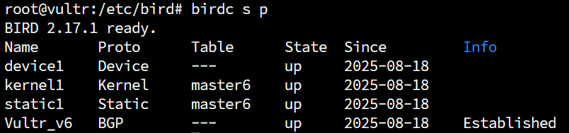

At this point, you can take a break and wait for global routing convergence. After about half an hour, open [bgp.tools](https://bgp.tools) and query your /48 block. You should see that it has been successfully received by the global internet, and you can see our upstream information:  
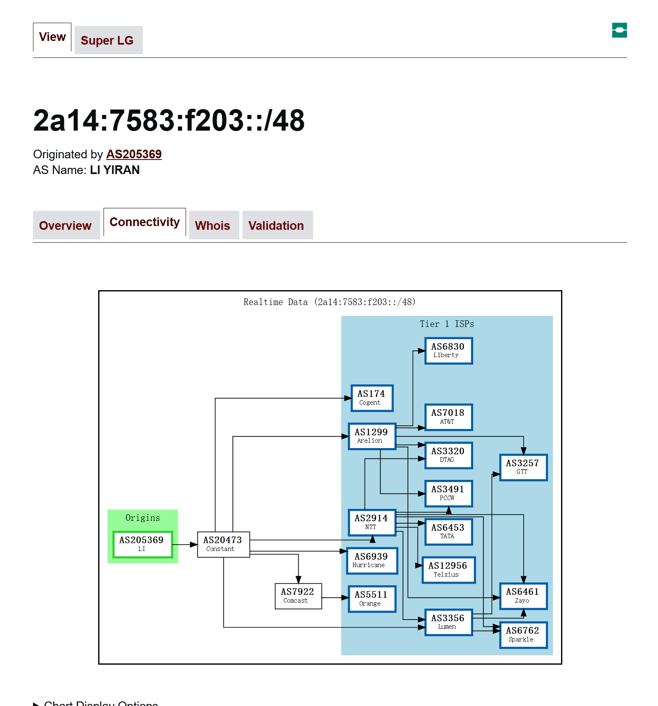

Next, we create a dummy interface on the VPS and assign a single IPv6 address from the block allocated for this machine. For example, I assigned `2a14:7583:f203::1` to my machine:
```shell
ip link add dummy0 type dummy
ip addr add 2a14:7583:f203::1/128 dev dummy0
```

Then, using your own PC, you should be able to ping this address, and traceroute will show the complete routing path:  
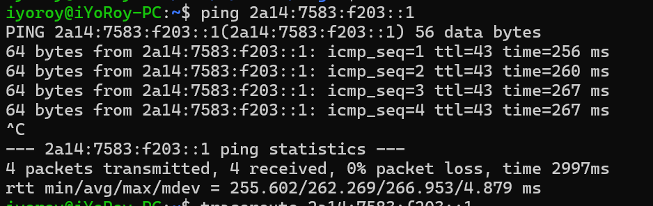
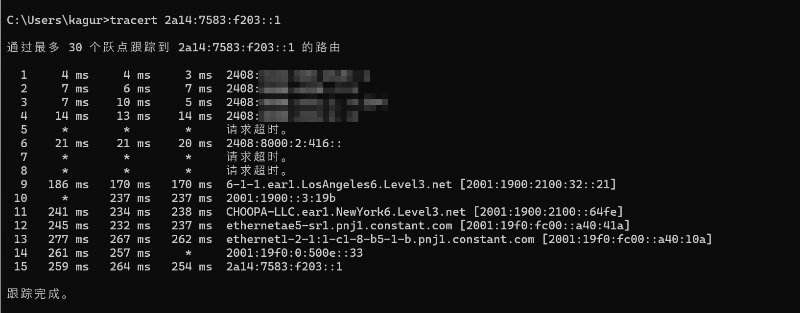

-----
Thanks to Mi Lu for the technical support!  
Reference Articles:
1. [自己在家开运营商 Part.2 - 向世界宣告 IP 段 (BGP Session & BIRD)](https://blog.lyc8503.net/post/asn-2-bgp-session/)
2. [年轻人的第一个 ASN - 宝硕博客](https://blog.baoshuo.ren/post/my-own-asn/)
3. [BGPlayer 从零开始速成指北 - 开通 Vultr 的 BGP 广播功能 - AceSheep](https://blog.acesheep.com/p/bgplayer-beginner-guide-activate-vultr-bgp-function/)
4. [BGP (2) 在 Vultr 和 HE 使用自己的 IPV6 地址 - 131's Blog](https://blog.yuzu.im/marchives/133)