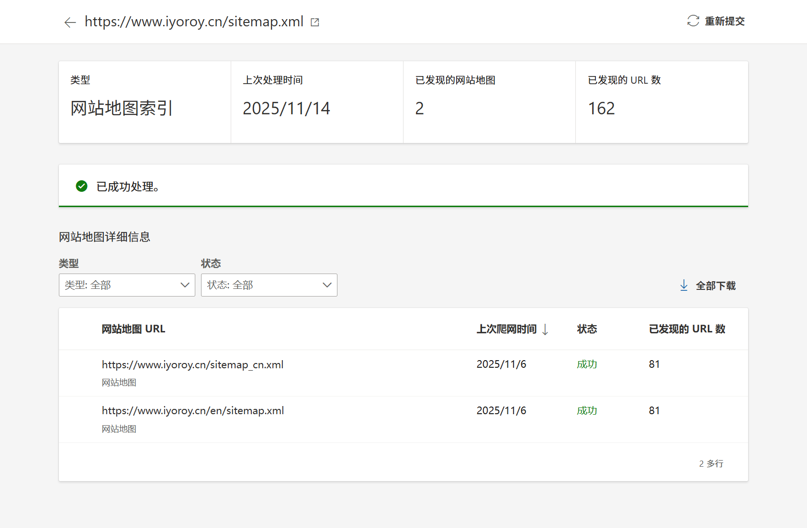

I wanted to add internationalization support to my blog, providing a separate English version for each post and page. However, after searching online, I found that Typecho has poor support for i18n. Eventually, I designed my own solution and am documenting it here.

> This article assumes you have some basic understanding of PHP, Nginx, and Typecho's core logic.

# Analysis
## Requirements
* Need to provide both Chinese and English versions for each post and page.
* Need to configure a language switcher so users can easily switch languages on the frontend.
* Need search engines to correctly identify and index the multi-language versions of the content.

## Proposed Solution
There are roughly two main schemes for distinguishing between Chinese and English content:  
1. Use a separate parameter, like accessing posts with `/?lang=zh-CN` and `/?lang=en-US`. However, this scheme is relatively difficult to implement and less friendly for search engine indexing.
2. Distinguish via the URL path, e.g., `https://<host>/article` for the Chinese page and `https://<host>/en/article` for the English page. This is simpler to configure (essentially setting up two separate Typecho instances) and is more search engine friendly. The challenge is that comments and view counts need to be manually synchronized.

After summarizing, I chose the second scheme and planned to implement multi-language support by creating a new Typecho instance directly under the `/en/` path.

## Implementation Plan
1. First, duplicate the blog instance into two copies: one for Chinese and one for English, then translate the English copy.
2. Modify the frontend code to implement the language switcher.
3. To ensure the article URLs between the two sites only differ by the `/en` prefix, the `cid` (content ID) for corresponding articles must be the same. Since `cid` is auto-incremented based on the order of creating posts and attachments, I plan to write a sync plugin. When a post is published on the Chinese site, it automatically inserts a corresponding article with the same cid in the English database.
4. Modify the SiteMap plugin. Because a sitemap cannot both contain page links and references to other sitemaps, the main site needs to create two sitemaps: one main sitemap containing the Chinese site pages, and another index sitemap responsible for indexing both the Chinese and English sitemaps.
5. Add the `hreflang` attribute within the `<head></head>` section to inform search engines about the multi-language handling.
6. Link the view counts and like counts from the English site to the Chinese database.
7. Sync the comments between two instances.

# Let's Do It
## Create the English Instance
Copy the entire website directory and place it in the `/en/` folder under the original web root. Also, duplicate the database; I named the new one `typecho_en`.  
Next, configure URL rewrite (pseudo-static) rules for both instances:
```nginx
location /en/ {
    if (!-e $request_filename) {
        rewrite ^(.*)$ /en/index.php$1 last;
    }
}

location / {
  if (!-e $request_filename) {
      rewrite ^(.*)$ /index.php$1 last;
  }
}
```

The reason for wrapping the main Chinese instance's rules in a location block is that during testing, I found that without it, the English instance might be parsed as part of the Chinese instance, leading to 404 errors.  
Also, modify the database configuration in `<webroot>/en/config.inc.php` to point to the English instance's database.  
At this point, accessing `<host>/en/` should display a site identical to the main Chinese site.

## Modify Typecho Language
This step might be optional since the frontend language is largely determined by the theme. Changing Typecho's backend language isn't strictly necessary but helps for consistency (and makes it easy to tell which admin panel you're in!).
Simply refer to the [official Typecho multi-language support on GitHub](https://github.com/typecho/languages). Download the language pack from the Releases and extract it to `<webroot>/en/usr/langs/`. Then, navigate to `https://<host>/en/admin/options-general.php`, where you should see the language setting option. Change it to English.

## Translate the Theme
This is the most tedious step. I use the Joe theme. Go to `<webroot>/en/usr/themes/Joe` and translate all the Chinese text related to display into English. There's no very convenient method here; machine translation often sounds awkward, so I opted for manual translation.  
Note that some frontend configurations are within JS files, not just PHP source files. These need translation too.

## Translate Articles
This step is self-explanatory. Translate the articles under `/en/` one by one into English and save them.

## Configure Article Sync Publishing
This step ensures the `cid` remains synchronized between corresponding articles on both sites. Since `cid` relates to the access URL, keeping them in sync simplifies the language switcher configuration later—just adding or removing `/en` from the host.
cid is an auto-incrementing primary key field in the `typecho_contents` table. Its assignment is also related to attachments in Typecho. Since I plan to upload all attachments to the Chinese site, without special handling, the `cid` values can easily become misaligned, increasing subsequent work.
Therefore, my chosen solution is to use AI to help write a plugin that triggers when the Chinese site publishes an article. It reads the `cid` assigned by the Chinese site and writes a corresponding entry into the English site's database.
Create the file `<webroot>/usr/plugins/SyncToEnglish/Plugin.php` and fill it with the following content:
```php
<?php
if (!defined('__TYPECHO_ROOT_DIR__')) exit;

/**
 * Sync Chinese Articles to English Database
 *
 * @package SyncToEnglish
 * @author ChatGPT, iYoRoy
 * @version 1.0.0
 * @link https://example.com
 */
class SyncToEnglish_Plugin implements Typecho_Plugin_Interface
{
    public static function activate()
    {
        Typecho_Plugin::factory('Widget_Contents_Post_Edit')->finishPublish = [__CLASS__, 'push'];
        return 'SyncToEnglish plugin activated: Empty corresponding articles will be automatically created in the English database when Chinese articles are published.';
        error_log("[SyncToEnglish] Plugin activated successfully");
    }

    public static function deactivate()
    {
        return 'SyncToEnglish plugin deactivated';
    }

    public static function config(Typecho_Widget_Helper_Form $form)
    {
        $host = new Typecho_Widget_Helper_Form_Element_Text('host', NULL, 'localhost', _t('English DB Host'));
        $user = new Typecho_Widget_Helper_Form_Element_Text('user', NULL, 'root', _t('English DB Username'));
        $password = new Typecho_Widget_Helper_Form_Element_Password('password', NULL, NULL, _t('English DB Password'));
        $database = new Typecho_Widget_Helper_Form_Element_Text('database', NULL, 'typecho_en', _t('English DB Name'));
        $port = new Typecho_Widget_Helper_Form_Element_Text('port', NULL, '3306', _t('English DB Port'));
        $charset = new Typecho_Widget_Helper_Form_Element_Text('charset', NULL, 'utf8mb4', _t('Charset'));
        $prefix = new Typecho_Widget_Helper_Form_Element_Text('prefix', NULL, 'typecho_', _t('Table Prefix'));

        $form->addInput($host);
        $form->addInput($user);
        $form->addInput($password);
        $form->addInput($database);
        $form->addInput($port);
        $form->addInput($charset);
        $form->addInput($prefix);
    }

    public static function personalConfig(Typecho_Widget_Helper_Form $form) {}

    public static function push($contents, $widget)
    {
        $options = Helper::options();
        $config = $options->plugin('SyncToEnglish');

        // Get article info from Chinese database
        $cnDb = Typecho_Db::get();
        if (is_array($contents) && isset($contents['cid'])) {
            $cid = $contents['cid'];
            $title = $contents['title'];
        } elseif (is_object($contents) && isset($contents->cid)) {
            $cid = $contents->cid;
            $title = $contents->title;
        } else {
            $db = Typecho_Db::get();
            $row = $db->fetchRow($db->select()->from('table.contents')->order('cid', Typecho_Db::SORT_DESC)->limit(1));
            $cid = $row['cid'];
            $title = $row['title'];
            error_log("[SyncToEnglish DEBUG] CID not found in param, fallback to latest cid={$cid}\n", 3, __DIR__ . '/debug.log');
        }

        $article = $cnDb->fetchRow($cnDb->select()->from('table.contents')->where('cid = ?', $cid));
        if (!$article) return;

        $enDb = new Typecho_Db('Mysql', $config->prefix);
        $enDb->addServer([
            'host' => $config->host,
            'user' => $config->user,
            'password' => $config->password,
            'charset' => $config->charset,
            'port' => (int)$config->port,
            'database' => $config->database
        ], Typecho_Db::READ | Typecho_Db::WRITE);

        try {
            $exists = $enDb->fetchRow($enDb->select()->from('table.contents')->where('cid = ?', $article['cid']));

            if ($exists) {
                $enDb->query($enDb->update('table.contents')
                    ->rows([
                        // 'title' => $article['title'],
                        'slug' => $article['slug'],
                        'modified' => $article['modified']
                    ])
                    ->where('cid = ?', $article['cid'])
                );
            } else {
                $enDb->query($enDb->insert('table.contents')->rows([
                    'cid'      => $article['cid'],
                    'title'    => $article['title'],
                    'slug'     => $article['slug'],
                    'created'  => $article['created'],
                    'modified' => $article['modified'],
                    'type'     => $article['type'],
                    'status'   => $article['status'],
                    'authorId' => $article['authorId'],
                    'views'    => 0,
                    'text'     => $article['text'],
                    'allowComment' => $article['allowComment'],
                    'allowFeed'    => $article['allowFeed'],
                    'allowPing'    => $article['allowPing']
                ]));
            }

        } catch (Exception $e) {
            error_log('[SyncToEnglish] Sync failed: ' . $e->getMessage());
        }
    }
}

```
Then, go to the admin backend, enable the plugin, and configure the English database information.  
After completion, publishing an article on the Chinese site should automatically publish an article with the same `cid` on the English site.

## Configure the Language Switcher
Since we have synchronized the article `cid`, switching languages now only requires modifying the URL by adding or removing the `/en/` prefix. We can create a switcher using PHP and place it in the theme's header:
```php
<!-- Language Selector -->
<div class="joe_dropdown" trigger="hover" placement="60px">
    <div class="joe_dropdown__link">
    <a href="#" rel="nofollow">Language</a>
    <svg class="joe_dropdown__link-icon" viewBox="0 0 1024 1024" xmlns="http://www.w3.org/2000/svg" width="14" height="14">
        <path d="M561.873 725.165c-11.262 11.262-26.545 21.72-41.025 18.502-14.479 2.413-28.154-8.849-39.415-18.502L133.129 375.252c-17.697-17.696-17.697-46.655 0-64.352s46.655-17.696 64.351 0l324.173 333.021 324.977-333.02c17.696-17.697 46.655-17.697 64.351 0s17.697 46.655 0 64.351L561.873 725.165z" fill="var(--main)" />
    </svg>
    </div>
    <nav class="joe_dropdown__menu">
    <?php
        // Get the current full URL
        $current_url = $_SERVER['REQUEST_URI']; 
        $host = $_SERVER['HTTP_HOST'];

        // Check if there is an English prefix "/en/"
        if (strpos($current_url, '/en/') === 0) {
        $current_url = substr_replace($current_url, '', 0, 3);
        }

        $new_url_cn = 'https://' . $host . $current_url;
        $new_url_en = 'https://' . $host . '/en' . $current_url;

        // Generate the two hyperlinks
        echo '<a href="' . $new_url_cn . '">简体中文</a>';
        echo '<a href="' . $new_url_en . '">English</a>';
    ?>
    </nav>
</div>
```
This needs to be added to both the Chinese and English instances.  
After this, the language selector should be available globally. For the Joe theme I use, separate language selectors needed to be written for mobile and PC views.

## Modify the SiteMap Plugin
To help search engines index the English pages faster, I decided to modify the SiteMap plugin to include the English site's pages. There are two types of sitemaps: sitemapindex (for indexing sub-sitemaps) and urlset (for containing page URLs). I use the [joyqi/typecho-plugin-sitemap](https://github.com/joyqi/typecho-plugin-sitemap) plugin. Based on this, I changed the default `/sitemap.xml` to a sitemapindex, created a new route `/sitemap_cn.xml` to hold the Chinese site's sitemap, left the English site's plugin unchanged (its sitemap remains at `/en/sitemap.xml`), and had the main index sitemap reference both `/sitemap_cn.xml` and `/en/sitemap.xml`.
Modify the SiteMap's Plugin.php:
```diff
/**
* Activate plugin method, if activated failed, throw exception will disable this plugin.
*/
public static function activate()
{
    Helper::addRoute(
-       'sitemap',
+       'sitemap_index',
        '/sitemap.xml',
        Generator::class,
-       'generate',
+       'generate_index',
        'index'
    );
+   Helper::addRoute(
+       'sitemap_cn',
+       '/sitemap_cn.xml',
+       Generator::class,
+       'generate_cn',
+       'index'
+   );
}

/**
* Deactivate plugin method, if deactivated failed, throw exception will enable this plugin.
*/
public static function deactivate()
{
-   Helper::removeRoute('sitemap');
+   Helper::removeRoute('sitemap_index');
+   Helper::removeRoute('sitemap_cn');
}
```


**Complete code**

```php
<?php

namespace TypechoPlugin\Sitemap;

use Typecho\Plugin\PluginInterface;
use Typecho\Widget\Helper\Form;
use Utils\Helper;

if (!defined('__TYPECHO_ROOT_DIR__')) {
    exit;
}

/**
 * Plugin to automatically generate a sitemap for Typecho.
 * The sitemap URL is: http(s)://yourdomain.com/sitemap.xml
 *
 * @package Sitemap Plugin
 * @author joyqi
 * @version 1.0.0
 * @since 1.2.1
 * @link https://github.com/joyqi/typecho-plugin-sitemap
 */
class Plugin implements PluginInterface
{
    /**
     * Activate plugin method, if activated failed, throw exception will disable this plugin.
     */
    public static function activate()
    {
        Helper::addRoute(
            'sitemap_index',
            '/sitemap.xml',
            Generator::class,
            'generate_index',
            'index'
        );
        Helper::addRoute(
            'sitemap_cn',
            '/sitemap_cn.xml',
            Generator::class,
            'generate_cn',
            'index'
        );
    }

    /**
     * Deactivate plugin method, if deactivated failed, throw exception will enable this plugin.
     */
    public static function deactivate()
    {
        Helper::removeRoute('sitemap_index');
        Helper::removeRoute('sitemap_cn');
    }

    /**
     * Plugin config panel render method.
     *
     * @param Form $form
     */
    public static function config(Form $form)
    {
        $sitemapBlock = new Form\Element\Checkbox(
            'sitemapBlock',
            [
                'posts' => _t('Generate post links'),
                'pages' => _t('Generate page links'),
                'categories' => _t('Generate category links'),
                'tags' => _t('Generate tag links'),
            ],
            ['posts', 'pages', 'categories', 'tags'],
            _t('Sitemap Display')
        );

        $updateFreq = new Form\Element\Select(
            'updateFreq',
            [
                'daily' => _t('Daily'),
                'weekly' => _t('Weekly'),
                'monthly' => _t('Monthly or less often'),
            ],
            'daily',
            _t('Update Frequency')
        );

        // $externalSitemap = new Typecho_Widget_Helper_Form_Element_Text('externalSitemap', NULL, '', _t('Additional Sitemap'));

        $form->addInput($sitemapBlock->multiMode());
        $form->addInput($updateFreq);
        // $form->addInput($externalSitemap);
    }

    /**
     * Plugin personal config panel render method.
     *
     * @param Form $form
     */
    public static function personalConfig(Form $form)
    {
        // TODO: Implement personalConfig() method.
    }
}
```


Modify the SiteMap's `Generator.php`:
```diff
class Generator extends Contents
{
+   public function generate_index(){
+       $sitemap = '<?xml version="1.0" encoding="UTF-8"?>
+<sitemapindex xmlns="http://www.sitemaps.org/schemas/sitemap/0.9">
+ <sitemap>
+   <loc>https://www.iyoroy.cn/sitemap_cn.xml</loc>
+ </sitemap>
+ <sitemap>
+   <loc>https://www.iyoroy.cn/en/sitemap.xml</loc>
+ </sitemap>
+</sitemapindex>';
+       $this->response->throwContent($sitemap, 'text/xml');
+   }
+
    /**
     * @return void
     */
-   public function generate()
+   public function generate_cn()
    {
        $sitemap = '<?xml version="1.0" encoding="' . $this->options->charset . '"?>' . PHP_EOL;
...
```


**Complete code**

```php
<?php

namespace TypechoPlugin\Sitemap;

use Widget\Base\Contents;
use Widget\Contents\Page\Rows;
use Widget\Contents\Post\Recent;
use Widget\Metas\Category\Rows as CategoryRows;
use Widget\Metas\Tag\Cloud;

if (!defined('__TYPECHO_ROOT_DIR__')) {
    exit;
}

/**
 * Sitemap Generator
 */
class Generator extends Contents
{
    public function generate_index(){
        $sitemap = '<?xml version="1.0" encoding="UTF-8"?>
<sitemapindex xmlns="http://www.sitemaps.org/schemas/sitemap/0.9">
  <sitemap>
    <loc>https://www.iyoroy.cn/sitemap_cn.xml</loc>
  </sitemap>
  <sitemap>
    <loc>https://www.iyoroy.cn/en/sitemap.xml</loc>
  </sitemap>
</sitemapindex>';
        $this->response->throwContent($sitemap, 'text/xml');
    }
    /**
     * @return void
     */
    public function generate_cn()
    {
        $sitemap = '<?xml version="1.0" encoding="' . $this->options->charset . '"?>' . PHP_EOL;
        $sitemap .= '<urlset xmlns="http://www.sitemaps.org/schemas/sitemap/0.9"'
            . ' xmlns:news="http://www.google.com/schemas/sitemap-news/0.9"'
            . ' xmlns:xhtml="http://www.w3.org/1999/xhtml"'
            . ' xmlns:image="http://www.google.com/schemas/sitemap-image/1.1"'
            . ' xmlns:video="http://www.google.com/schemas/sitemap-video/1.1">' . PHP_EOL;

        // add homepage
        $sitemap .= <<<EOF
        <url>
            <loc>{$this->options->siteUrl}</loc>
            <changefreq>daily</changefreq>
            <priority>1.0</priority>
        </url>
EOF;

        // add posts
        if (in_array('posts', $this->options->plugin('Sitemap')->sitemapBlock)) {
            $postsCount = $this->size($this->select()
                ->where('table.contents.status = ?', 'publish')
                ->where('table.contents.created < ?', $this->options->time)
                ->where('table.contents.type = ?', 'post'));

            $posts = Recent::alloc(['pageSize' => $postsCount]);
            $freq = $this->options->plugin('Sitemap')->updateFreq ==='monthly' ? 'monthly' : 'weekly';

            while ($posts->next()) {
                $sitemap .= <<<EOF
            <url>
                <loc>{$posts->permalink}</loc>
                <changefreq>{$freq}</changefreq>
                <lastmod>{$posts->date->format('c')}</lastmod>
                <priority>0.8</priority>
            </url>
EOF;
            }
        }

        // add pages
        if (in_array('pages', $this->options->plugin('Sitemap')->sitemapBlock)) {
            $pages = Rows::alloc();
            $freq = $this->options->plugin('Sitemap')->updateFreq ==='monthly' ? 'yearly' : 'monthly';

            while ($pages->next()) {
                $sitemap .= <<<EOF
            <url>
                <loc>{$pages->permalink}</loc>
                <changefreq>{$freq}</changefreq>
                <lastmod>{$pages->date->format('c')}</lastmod>
                <priority>0.5</priority>
            </url>
EOF;
            }
        }

        // add categories
        if (in_array('categories', $this->options->plugin('Sitemap')->sitemapBlock)) {
            $categories = CategoryRows::alloc();
            $freq = $this->options->plugin('Sitemap')->updateFreq;

            while ($categories->next()) {
                $sitemap .= <<<EOF
            <url>
                <loc>{$categories->permalink}</loc>
                <changefreq>{$freq}</changefreq>
                <priority>0.6</priority>
            </url>
EOF;
            }
        }

        // add tags
        if (in_array('tags', $this->options->plugin('Sitemap')->sitemapBlock)) {
            $tags = Cloud::alloc();
            $freq = $this->options->plugin('Sitemap')->updateFreq;

            while ($tags->next()) {
                $sitemap .= <<<EOF
            <url>
                <loc>{$tags->permalink}</loc>
                <changefreq>{$freq}</changefreq>
                <priority>0.4</priority>
            </url>
EOF;
            }
        }

        $sitemap .= '</urlset>';

        $this->response->throwContent($sitemap, 'text/xml');
    }
}

```


Please replace the blog URL in the code with your own.  
(I was too busy recently to create a separate configuration page, so I hardcoded the Sitemap URLs into the plugin for now.)  

Disable and then re-enable the plugin. Visiting `https://<host>/sitemap.xml` should now show the sitemap index:
```xml
<sitemapindex xmlns="http://www.sitemaps.org/schemas/sitemap/0.9">
    <sitemap>
        <loc>https://www.iyoroy.cn/sitemap_cn.xml</loc>
    </sitemap>
    <sitemap>
        <loc>https://www.iyoroy.cn/en/sitemap.xml</loc>
    </sitemap>
</sitemapindex>
```
You should also be able to see that search engines like Bing Webmaster Tools have detected the English site's sitemap:  


## Add hreflang
This step informs search engines that the current page has multi-language versions, allowing them to show the appropriate page based on user language preference or location. We need to insert link tags like the following format within the `<head></head>` section:
```html
<link rel="alternate" hreflang="en-us" href="https://example.com/us">
<link rel="alternate" hreflang="fr" href="https://example.com/fr">
<link rel="alternate" hreflang="x-default" href="https://example.com/default">
```
Here, `hreflang="x-default"` indicates the default language for the page. The value of hreflang is composed of an **ISO 639-1** language code and an optional **ISO 3166-1 Alpha-2** region code (e.g., distinguishing between en, en-US and en-UK).

Add the following content to the relevant section of your theme's `<head></head>`:
```php
<?php
  // Get the current full URL
  $current_url = $_SERVER['REQUEST_URI']; 
  $host = $_SERVER['HTTP_HOST'];

  // Check if there is an English prefix "/en/"
  if (strpos($current_url, '/en/') === 0) {
    $current_url = substr_replace($current_url, '', 0, 3);
  }

  $new_url_cn = 'https://' . $host . $current_url;
  $new_url_en = 'https://' . $host . '/en' . $current_url;

  // Generate the link tags
  echo '<link rel="alternate" hreflang="zh-cn" href="'.$new_url_cn.'" />';
  echo '<link rel="alternate" hreflang="en-us" href="'.$new_url_en.'" />';
  echo '<link rel="alternate" hreflang="x-default" href="'.$new_url_cn.'" />';
?>
```
This needs to be added to both the Chinese and English sites.

After this, you should find the corresponding `hreflang` configuration in the `<head>` section of your website pages.

## Sync Like Counts and View Counts
This step is highly theme-dependent and might not apply to all themes. I use the Joe theme, which handles reading and writing like counts and view counts to the database directly. I modified the English instance's theme code to read and write these values directly from/to the Chinese instance's database.  
Modify the function that retrieves view counts in `<webroot>/en/usr/themes/Joe/core/function.php`:  
```diff
/* Query Post Views */
function _getViews($item, $type = true)
{
- $db = Typecho_Db::get();
+ // $db = Typecho_Db::get();

+ $db = new Typecho_Db('Mysql', 'typecho_' /* Prefix */);
+ $db->addServer([
+     'host' => 'mysql',
+     'user' => 'typecho',
+     'password' => '[CENSORED]',
+     'charset' => 'utf8mb4',
+     'port' => 3306,
+     'database' => 'typecho'
+ ], Typecho_Db::READ | Typecho_Db::WRITE);
  
  $result = $db->fetchRow($db->select('views')->from('table.contents')->where('cid = ?', $item->cid))['views'];
  if ($type) echo number_format($result);
  else return number_format($result);
}
```
Modify the function that retrieves like counts in `<webroot>/en/usr/themes/Joe/core/function.php`:
```diff
/* Query Post Like Count */
function _getAgree($item, $type = true)
{
- $db = Typecho_Db::get();
+ // $db = Typecho_Db::get();

+ $db = new Typecho_Db('Mysql', 'typecho_' /* Prefix */);
+ $db->addServer([
+     'host' => 'mysql',
+     'user' => 'typecho',
+     'password' => '[CENSORED]',
+     'charset' => 'utf8mb4',
+     'port' => 3306,
+     'database' => 'typecho'
+ ], Typecho_Db::READ | Typecho_Db::WRITE);
  
  $result = $db->fetchRow($db->select('agree')->from('table.contents')->where('cid = ?', $item->cid))['agree'];
  if ($type) echo number_format($result);
  else return number_format($result);
}
```
Modify the code displaying view counts on the homepage in `<webroot>/en/usr/themes/Joe/core/route.php`:
```diff
        $result[] = array(
            "mode" => $item->fields->mode ? $item->fields->mode : 'default',
            "image" => _getThumbnails($item),
            "time" => date('Y-m-d', $item->created),
            "created" => date('d/m/Y', $item->created),
            "title" => $item->title,
            "abstract" => _getAbstract($item, false),
            "category" => $item->categories,
-           "views" => number_format($item->views),
+           // "views" => number_format($item->views),
+           "views" => _getViews($item, false),
            "commentsNum" => number_format($item->commentsNum),
-           "agree" => number_format($item->agree),
+           // "agree" => number_format($item->agree),
+           "agree" => _getAgree($item, false),
            "permalink" => $item->permalink,
            "lazyload" => _getLazyload(false),
            "type" => "normal"
        );
```
The code displaying view counts on the article page itself already uses `_getViews`, so it doesn't need modification.  
Modify the code that increments view counts:
```diff
/* Increase View Count - Tested √ */
function _handleViews($self)
{
    $self->response->setStatus(200);

    $cid = $self->request->cid;

    /* SQL injection check */
    if (!preg_match('/^\d+$/',  $cid)) {
        return $self->response->throwJson(array("code" => 0, "data" => "Illegal request! Blocked!"));
    }
-   $db = Typecho_Db::get();  
+   // $db = Typecho_Db::get();  
+   $db = new Typecho_Db('Mysql', 'typecho_' /* Prefix */);
+   $db->addServer([
+       'host' => 'mysql',
+       'user' => 'typecho',
+       'password' => '[CENSORED]',
+       'charset' => 'utf8mb4',
+       'port' => 3306,
+       'database' => 'typecho'
+   ], Typecho_Db::READ | Typecho_Db::WRITE);
    
    
    $row = $db->fetchRow($db->select('views')->from('table.contents')->where('cid = ?', $cid));
    if (sizeof($row) > 0) {
```
Modify the code for liking and unliking:
```diff
/* Like and Unlike - Tested √ */
function _handleAgree($self)
{
    $self->response->setStatus(200);

    $cid = $self->request->cid;
    $type = $self->request->type;

    /* SQL injection check */
    if (!preg_match('/^\d+$/',  $cid)) {
        return $self->response->throwJson(array("code" => 0, "data" => "Illegal request! Blocked!"));
    }
    /* SQL injection check */
    if (!preg_match('/^[agree|disagree]+$/', $type)) {
        return $self->response->throwJson(array("code" => 0, "data" => "Illegal request! Blocked!"));
    }
-   $db = Typecho_Db::get();
+   // $db = Typecho_Db::get();  
+   $db = new Typecho_Db('Mysql', 'typecho_' /* Prefix */);
+   $db->addServer([
+       'host' => 'mysql',
+       'user' => 'typecho',
+       'password' => '[CENSORED]',
+       'charset' => 'utf8mb4',
+       'port' => 3306,
+       'database' => 'typecho'
+   ], Typecho_Db::READ | Typecho_Db::WRITE);
  
    $row = $db->fetchRow($db->select('agree')->from('table.contents')->where('cid = ?', $cid));
    if (sizeof($row) > 0) {
```
After making these changes and saving, visiting the English site should show view counts and like counts synchronized with the Chinese site.

## Sync Comments
I initially thought about creating a plugin that hooks into the comment submission function to simultaneously insert comment data into the other instance's database. However, I found that my Joe theme already hooks into this, and adding another hook might cause conflicts. Therefore, I directly edited the Joe theme's code.  
Edit `<webroot>/index/usr/themes/Joe/core/factory.php`:  
```diff
<?php

require_once("phpmailer.php");
require_once("smtp.php");

/* Enhanced Comment Interception */
Typecho_Plugin::factory('Widget_Feedback')->comment = array('Intercept', 'message');
class Intercept
{
  public static function message($comment)
  {
    ...
    Typecho_Cookie::delete('__typecho_remember_text');
+   
+   $db = new Typecho_Db('Mysql', 'typecho_' /* Prefix */);
+   $db->addServer([
+       'host' => 'mysql',
+       'user' => 'typecho_en',
+       'password' => '[CENSORED]',
+       'charset' => 'utf8mb4',
+       'port' => 3306,
+       'database' => 'typecho_en'
+   ], Typecho_Db::READ | Typecho_Db::WRITE);
+   
+   $row = [
+       'coid'     => $comment['coid'], // Must include the newly generated comment ID
+       'cid'      => $comment['cid'],
+       'created'  => $comment['created'],
+       'author'   => $comment['author'],
+       'authorId' => $comment['authorId'],
+       'ownerId'  => $comment['ownerId'],
+       'mail'     => $comment['mail'],
+       'url'      => $comment['url'],
+       'ip'       => $comment['ip'],
+       'agent'    => $comment['agent'],
+       'text'     => $comment['text'],
+       'type'     => $comment['type'],
+       'status'   => $comment['status'],
+       'parent'   => $comment['parent']
+   ];
+
+   // Insert data into the target database's `comments` table
+   $db->query($db->insert('typecho_comments')->rows($row));
    return $comment;
  }
}
...
```
Perform the same operation on the English instance, inserting comments into the Chinese database.  
One issue with this scheme is that if you need to delete spam comments, you must delete them separately in both instances. I'll fix that later (maybe).  

---
Reference:
1. [typecho/languages - GitHub](https://github.com/typecho/languages)