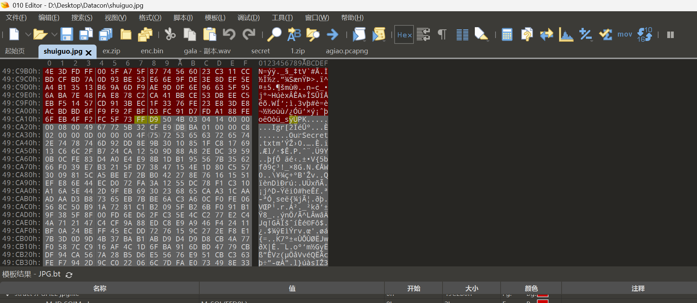
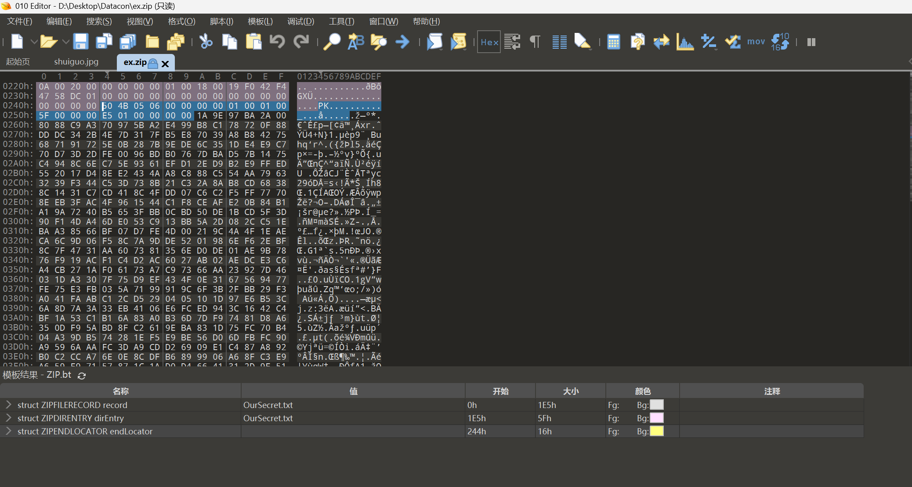
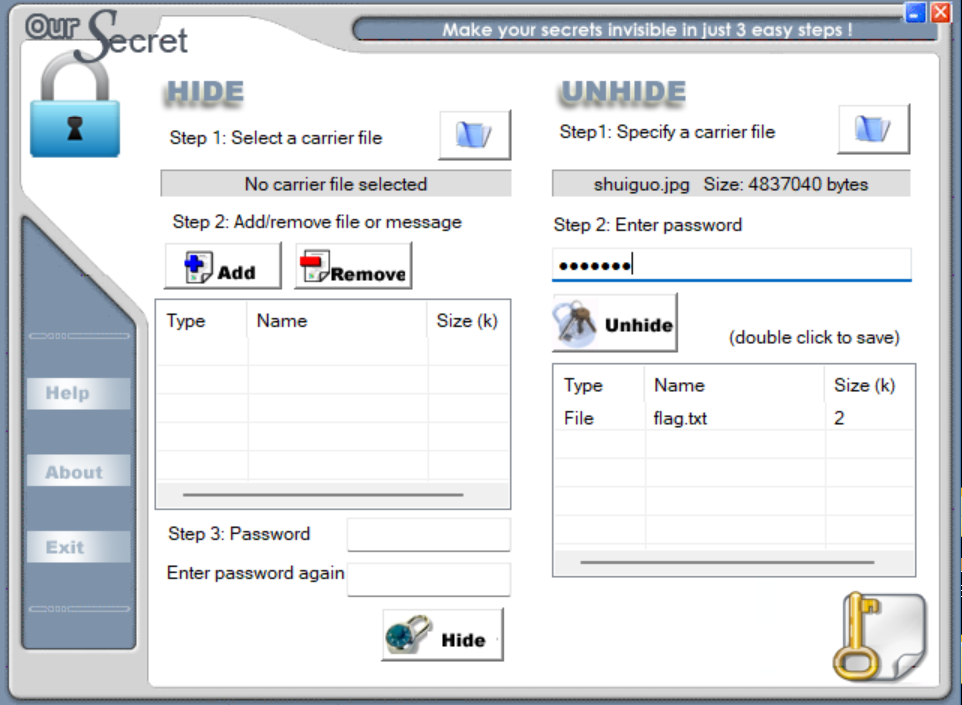

Open the file using 010 Editor and find a ZIP header at the end:


Extract it and open it to find no password, just a string of base64:  
```txt
5L2g6L+Z6Iu55p6c5oCO5LmI6L+Z5LmI5aSnCuWkp+S4quWEv+aJjeWAvOmSseS9oOimgeS4jeimgQrov5nmoYPlrZDmgI7kuYjov5nkuYjnoawK56Gs5piv5Zug5Li65paw6bKc5L2g6KaB6L2v55qE6L+Y5piv57Ov55qECui/meilv+eTnOiDveWQg+WQl+eci+i1t+adpeacieeCueS4jeeGnwrkuI3nhp/nmoTopb/nk5zmgI7kuYjlj6/og73kvaDov5nlsLHmmK/nrYnnnYDlkIPnlJznmoQK5L2g6L+Z5p+a5a2Q6L+Z5LmI5bCPCuWwj+W3p+eahOaJjeWlveWQg+S9oOimgeWkp+S4queahOi/mOaYr+WlveWQg+eahArov5nmqZnlrZDmgI7kuYjov5nkuYjphbgK6YW45omN5piv5q2j5a6X55qE5qmZ5a2Q5L2g6KaB5piv55Sc55qE5Y675Yir5a6255yLCui/memmmeiVieacieeCueW8rwrlvK/nmoTpppnolYnmm7TnlJzkvaDkuI3mh4IK5L2g6L+Z5qKo5a2Q5piv5LiN5piv5pyJ54K556GsCuehrOaYr+WboOS4uuaWsOmynOWQg+edgOacieWPo+aEnwrov5nokaHokITmgI7kuYjov5nkuYjlsI8K5bCP55qE6JGh6JCE5pu05rWT57yp55Sc5ZGz
```

Decode to get:  
```txt
你这苹果怎么这么大
大个儿才值钱你要不要
这桃子怎么这么硬
硬是因为新鲜你要软的还是糯的
这西瓜能吃吗看起来有点不熟
不熟的西瓜怎么可能你这就是等着吃甜的
你这柚子这么小
小巧的才好吃你要大个的还是好吃的
这橙子怎么这么酸
酸才是正宗的橙子你要是甜的去别家看
这香蕉有点弯
弯的香蕉更甜你不懂
你这梨子是不是有点硬
硬是因为新鲜吃着有口感
这葡萄怎么这么小
小的葡萄更浓缩甜味
```

At the same time, it is found that there is still part of unrecognized data at the end of the exported zip:  


Based on the `1A 9E 97 BA 2A`, it can be inferred that this is OurSecret steganography. Open it with the OurSecret tool and find that a password is required. Try the password `shuiguo` to extract a txt file:  


```txt
你这柚子这么小
你这柚子这么小
你这柚子这么小
你这梨子是不是有点硬
你这柚子这么小
大个儿才值钱你要不要
你这柚子这么小
小巧的才好吃你要大个的还是好吃的
小巧的才好吃你要大个的还是好吃的
弯的香蕉更甜你不懂
硬是因为新鲜你要软的还是糯的
硬是因为新鲜你要软的还是糯的
你这柚子这么小
不熟的西瓜怎么可能你这就是等着吃甜的
硬是因为新鲜你要软的还是糯的
这桃子怎么这么硬
硬是因为新鲜你要软的还是糯的
不熟的西瓜怎么可能你这就是等着吃甜的
硬是因为新鲜你要软的还是糯的
酸才是正宗的橙子你要是甜的去别家看
硬是因为新鲜你要软的还是糯的
你这柚子这么小
硬是因为新鲜你要软的还是糯的
你这苹果怎么这么大
你这柚子这么小
大个儿才值钱你要不要
硬是因为新鲜你要软的还是糯的
小巧的才好吃你要大个的还是好吃的
硬是因为新鲜你要软的还是糯的
酸才是正宗的橙子你要是甜的去别家看
你这柚子这么小
这西瓜能吃吗看起来有点不熟
你这柚子这么小
这桃子怎么这么硬
你这柚子这么小
硬是因为新鲜你要软的还是糯的
硬是因为新鲜你要软的还是糯的
你这柚子这么小
硬是因为新鲜你要软的还是糯的
酸才是正宗的橙子你要是甜的去别家看
你这柚子这么小
这桃子怎么这么硬
硬是因为新鲜你要软的还是糯的
你这柚子这么小
硬是因为新鲜你要软的还是糯的
小巧的才好吃你要大个的还是好吃的
硬是因为新鲜你要软的还是糯的
这西瓜能吃吗看起来有点不熟
你这柚子这么小
硬是因为新鲜你要软的还是糯的
你这柚子这么小
这西瓜能吃吗看起来有点不熟
硬是因为新鲜你要软的还是糯的
这西瓜能吃吗看起来有点不熟
你这柚子这么小
不熟的西瓜怎么可能你这就是等着吃甜的
你这柚子这么小
硬是因为新鲜你要软的还是糯的
硬是因为新鲜你要软的还是糯的
你这柚子这么小
硬是因为新鲜你要软的还是糯的
小巧的才好吃你要大个的还是好吃的
你这柚子这么小
大个儿才值钱你要不要
硬是因为新鲜你要软的还是糯的
小巧的才好吃你要大个的还是好吃的
硬是因为新鲜你要软的还是糯的
这桃子怎么这么硬
你这柚子这么小
硬是因为新鲜你要软的还是糯的
硬是因为新鲜你要软的还是糯的
你这柚子这么小
硬是因为新鲜你要软的还是糯的
这桃子怎么这么硬
小巧的才好吃你要大个的还是好吃的
硬是因为新鲜吃着有口感
```
It is found that this corresponds one-to-one with the previously extracted statements. Since there are 16 statements extracted earlier, it is speculated that they represent hexadecimal digits, corresponding to `0-f` respectively. Then, map the OurSecret decrypted content to hexadecimal numbers to obtain: `666c61677b33653235393630613739646263363962363734636434656336376137326336327d`.  
Write a Python script to convert the hexadecimal string to ASCII characters in groups of two:  
```python
hex_string = "666c61677b33653235393630613739646263363962363734636434656336376137326336327d"
ascii_string = ''.join([chr(int(hex_string[i:i+2], 16)) for i in range(0, len(hex_string), 2)])
print(ascii_string)
```
Get the Flag: `flag{3e25960a79dbc69b674cd4ec67a72c62}`