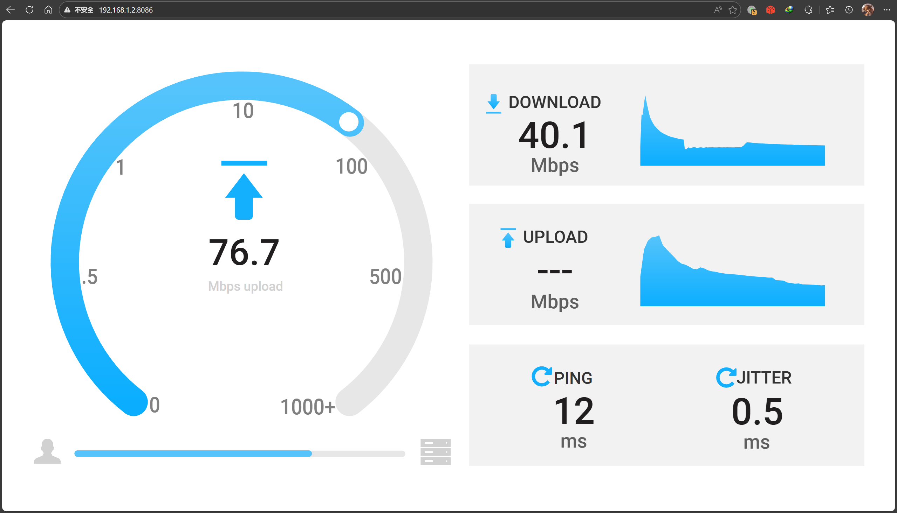
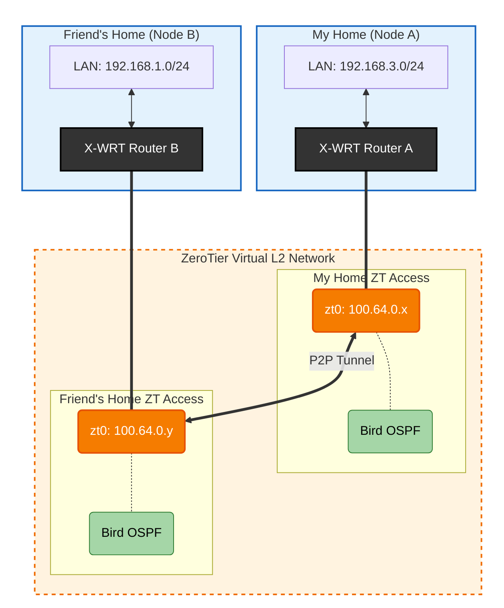

# Background
I was originally setting up my own ZeroTier "big internal network". Because the network structure is relatively complex, I decided to use OSPF instead of static routes to configure internal routing.

I had tried to configure ZeroTier on my home OpenWrt before but never succeeded. Recently, I took it out again to work on it and discovered it was a configuration issue with OpenWrt. After fixing it, I was chatting with a good friend and had an idea:


```plain
Kagura iYoRoy: 02-10 14:49:05
Hey...

Kagura iYoRoy: 02-10 14:49:06
Then...

Kagura iYoRoy: 02-10 14:49:20
If you also set up OSPF on your router...

Kagura iYoRoy: 02-10 14:49:27
Our two home networks would be directly interconnected, huh? (
```

Let's do it!

# Basic Information
## Local Side
* Router OS: OpenWrt, `X-WRT 26.04_b202601250827`
* LAN IPv4 Prefix: `192.168.3.0/24`
* ISP: Hefei China Unicom
* NAT Environment: NAT1

## Remote Side
* Router OS: OpenWrt, `X-WRT 25.04_b202510240128 `
* LAN IPv4 Prefix: `192.168.1.0/24`
* ISP: Hefei China Mobile
* NAT Environment: NAT1

# Installing ZeroTier and Using a Self-Hosted Planet
I used ZTNet as the self-hosted Controller. The setup process won't be elaborated here as you can find it online.
The OpenWrt version I'm using has started using `apk` instead of `opkg` as the package manager. Use `apk` to install zerotier-one directly:

```shell
apk add zerotier
```

After completion, open `/etc/config/zerotier` to find the default configuration file.

```shell
config zerotier 'global'
    # Sets whether ZeroTier is enabled or not
    option enabled 0
    # Sets the ZeroTier listening port (default 9993; set to 0 for random)
    #option port '9993'
    # Client secret (leave blank to generate a secret on first run)
    option secret ''
    # Path of the optional file local.conf (see documentation at
    # https://docs.zerotier.com/config#local-configuration-options)
    #option local_conf_path '/etc/zerotier.conf'
    # Persistent configuration directory (to perform other configurations such
    # as controller mode or moons, etc.)
    #option config_path '/etc/zerotier'
    # Copy the contents of the persistent configuration directory to memory
    # instead of linking it, this avoids writing to flash
    #option copy_config_path '1'

# Network configuration, you can have as many configurations as networks you
# want to join (the network name is optional)
config network 'earth'
    # Identifier of the network you wish to join
    option id '8056c2e21c000001'
    # Network configuration parameters (all are optional, if not indicated the
    # default values are set, see documentation at
    # https://docs.zerotier.com/config/#network-specific-configuration)
    option allow_managed '1'
    option allow_global '0'
    option allow_default '0'
    option allow_dns '0'

# Example of a second network (unnamed as it is optional)
#config network
#   option id '1234567890123456'
#   option allow_managed '1'
#   option allow_global '0'
#   option allow_default '0'
#   option allow_dns '0'
```

Modify it according to your needs:

```shell
config zerotier 'global'
    option enabled '1'              # Enable ZeroTier client service
    option config_path '/etc/zerotier' # Persistent directory: for storing identity secret, Moon node definitions, and network settings
    option secret ''                # Leave secret blank: identity will be auto-generated on first run and saved to identity.secret
    option copy_config_path '1'     # Flash protection policy: copy config to memory on startup. If set to 0, read/write directly to Flash

config network 'earth'
    option id '<network ID>'        # 16-digit ZeroTier Network ID
    option allow_managed '1'        # Allow receiving controller-assigned IPs, routes, and tags
    option allow_global '1'         # Allow receiving globally routable IPv6 unicast addresses (GUA) via ZeroTier
    option allow_default '0'        # Allow ZeroTier to take over the default gateway (similar to a global proxy)
    option allow_dns '1'            # Allow receiving and using DNS servers configured in the ZeroTier control panel
```

## Regarding `copy_config_path '1'`
Because the ZeroTier working directory `/var/lib/zerotier-one` is part of `tmpfs` in OpenWrt, its contents are cleared on reboot. Therefore, configurations like planet, identity, and network files need to be stored in the router's Flash storage, i.e., the path set in `config_path`.
The default logic is to create a soft link from the configured `config_path` to `/var/lib/zerotier-one` on startup to achieve persistence. All read/write operations in `/var/lib/zerotier-one` are then written to Flash. However, frequent ZeroTier read/writes can significantly reduce Flash lifespan.
Enabling `copy_config_path '1'` specifies that on ZeroTier startup, the configurations from `config_path` are copied directly into `/var/lib/zerotier-one`. This greatly extends the internal Flash lifespan, but the downside is that modifications made via `zerotier-cli` are not automatically synced back to Flash by default, making this option less suitable for scenarios requiring frequent configuration adjustments.

---

After making changes, use:

```shell
/etc/init.d/zerotier start
/etc/init.d/zerotier enable
```

to start ZeroTier and enable auto-start on boot.

On first startup, if the `secret` field was left empty, it will be auto-generated. After startup, copy all files from `/var/lib/zerotier-one` to `/etc/zerotier`.

Download the Planet file to the `config_path` set above, i.e., `/etc/zerotier`. After completion, restart ZeroTier:
```shell
/etc/init.d/zerotier restart
```

That's it. Then, go to your ZeroTier Controller console, and you should see the new device has joined.

Next, you may need to allow ZeroTier traffic through the firewall. This step can be referenced from other online tutorials. I chose to allow all traffic; it shouldn't be a big issue under NAT1.

# Installing and Configuring Bird2
_I didn't expect the Bird2 version in the apk repository to be very recent. As of this writing on `2026-02-10`, the Bird2 version in apk is 2.18_

Use the following command to install:
```shell
apk add bird2  # bird daemon itself
apk add bird2c # birdc command
```

Because OpenWrt's default bird configuration file is located at `/etc/bird.conf`, and I prefer modular referencing by placing different configurations in separate folders based on function, I chose to move the default config file to `/etc/bird/bird.conf` and store various config files within that folder.
Open `/etc/init.d/bird`:
```shell
#!/bin/sh /etc/rc.common
# Copyright (C) 2010-2017 OpenWrt.org

USE_PROCD=1
START=70
STOP=10

BIRD_BIN="/usr/sbin/bird"
BIRD_CONF="/etc/bird.conf"
BIRD_PID_FILE="/var/run/bird.pid"

start_service() {
    mkdir -p /var/run
    procd_open_instance
    procd_set_param command $BIRD_BIN -f -c $BIRD_CONF -P $BIRD_PID_FILE
    procd_set_param file "$BIRD_CONF"
    procd_set_param stdout 1
    procd_set_param stderr 1
    procd_set_param respawn
    procd_close_instance
}

reload_service() {
    procd_send_signal bird
}
```

Change the `BIRD_CONF` value to `/etc/bird/bird.conf`:

```diff
- BIRD_CONF="/etc/bird.conf"
+ BIRD_CONF="/etc/bird/bird.conf"
```

Then create the `/etc/bird` folder. All subsequent OSPF configuration files will be placed here.

# Configuring OSPF
My configuration file structure follows these rules:
* `/etc/bird/bird.conf` serves as the sole entry point, defining basic configurations like Router ID, filter prefixes, and then including other sub-configurations.
* Configurations for different networks are placed in separate folders, e.g., public internet parts in `/etc/bird/inet/`, DN42 parts in `/etc/bird/dn42/`, and my own internal network parts in `/etc/bird/intra/`.
* Each network has a `defs.conf` handling common functions (similar to utils in Golang development?).

Thus, the final configuration file structure is:
* `/etc/bird/bird.conf`: Configuration entry point
```nginx
define INTRA_ROUTER_ID = 100.64.0.100;
define INTRA_PREFIX_V4 = [ 100.64.0.0/16+, 192.168.0.0/16+ ]; # IPv4 prefixes allowed to be advertised via OSPF
define INTRA_PREFIX_V6 = [ fd18:3e15:61d0::/48+ ]; # IPv6 prefixes allowed to be advertised via OSPF

protocol device {
    scan time 10;
};

ipv4 table intra_table_v4; # Define internal routing IPv4 table
ipv6 table intra_table_v6; # Define internal routing IPv6 table

include "intra/defs.conf";
include "intra/kernel.conf";
include "intra/ospf.conf";
```
The RouterID here is directly taken from the node's IPv4 address within the ZeroTier internal network. 
Separate tables are used for future safety, e.g., if connecting this node to DN42.

* `/etc/bird/intra/defs.conf`: Functions for filters
```nginx
function is_intra_net4() {
    return net ~ INTRA_PREFIX_V4;
}

function is_intra_net6(){
    return net ~ INTRA_PREFIX_V6;
}

function is_intra_dn42_net4(){
    return net ~ [ 172.20.0.0/14+ ];
}

function is_intra_dn42_net6(){
    return net ~ [ fd00::/8+ ];
}
```

* `/etc/bird/intra/kernel.conf`: Write routes learned by OSPF into the system routing table
```nginx
protocol kernel intra_kernel_v4 {
    kernel table 254;
    scan time 20;
    ipv4 {
        table intra_table_v4;
        import none;
        export filter {
            if source = RTS_STATIC then reject;
            accept;
        };
    };
};

protocol kernel intra_kernel_v6 {
    kernel table 254;
    scan time 20;
    ipv6 {
        table intra_table_v6;
        import none;
        export filter {
            if source = RTS_STATIC then reject;
            accept;
        };
    };
};
```

* `/etc/bird/intra/ospf.conf`: OSPF module
```nginx
protocol ospf v3 intra_ospf_v4 {
    router id INTRA_ROUTER_ID; # Specify RouterID

    ipv4 {
        table intra_table_v4; # Specify routing table
        import where is_intra_dn42_net4() || is_intra_net4() && source != RTS_BGP;
        export where is_intra_dn42_net4() || is_intra_net4() && source != RTS_BGP;
    };

    include "ospf/*";
};

protocol ospf v3 intra_ospf_v6 {
    router id INTRA_ROUTER_ID; # Specify RouterID

    ipv6 {
        table intra_table_v6; # Specify routing table
        import where is_intra_dn42_net6() || is_intra_net6() && source != RTS_BGP;
        export where is_intra_dn42_net6() || is_intra_net6() && source != RTS_BGP;
    };

    include "ospf/*";
};
```

* `/etc/bird/intra/ospf/backbone.conf`: OSPF Area Configuration
```nginx
area 0.0.0.0 {
    interface "br-lan" { stub; }; # Local LAN interface
    interface "zta7oqfzy6" { # ZeroTier interface
        type broadcast;
        cost 100;
        hello 20;
    };
};
```

After completion, use:
```shell
/etc/init.d/bird start
/etc/init.d/bird enable
```
to start Bird and enable auto-start on boot.
If everything is fine, you can use
```shell
birdc s p
```
to check Bird's status. If all goes well, after the other side is configured, you should see the OSPF state as Running:
```shell
root@X-WRT:/etc/bird# birdc s p
BIRD 2.18 ready.
Name       Proto      Table      State  Since         Info
device1    Device     ---        up     14:28:02.410
intra_kernel_v4 Kernel     intra_table_v4 up     14:28:02.410
intra_kernel_v6 Kernel     intra_table_v6 up     14:28:02.410
intra_ospf_v4 OSPF       intra_table_v4 up     14:28:02.410  Running
intra_ospf_v6 OSPF       intra_table_v6 up     14:31:38.389  Running
```

---

Have your friend follow the same process. Once both sides show Running status, you can use
```shell
birdc s r protocol intra_ospf_v4
```
to view the routes learned by OSPF. You'll find that routes to the other side via ZeroTier are being learned normally:
```shell
root@X-WRT:/etc/bird# birdc s r protocol intra_ospf_v4
BIRD 2.18 ready.
Table intra_table_v4:
...
192.168.1.0/24       unicast [intra_ospf_v4 23:20:21.398] * I (150/110) [100.64.0.163]
    via 100.64.0.163 on zta7oqfzy6
...
192.168.3.0/24       unicast [intra_ospf_v4 14:28:02.511] * I (150/10) [100.64.0.100]
    dev br-lan
```
You can also ping your friend's server from your PC:
```shell
iyoroy@iYoRoy-PC:~$ ping 192.168.1.103
PING 192.168.1.103 (192.168.1.103) 56(84) bytes of data.
64 bytes from 192.168.1.103: icmp_seq=1 ttl=63 time=54.3 ms
64 bytes from 192.168.1.103: icmp_seq=2 ttl=63 time=10.7 ms
64 bytes from 192.168.1.103: icmp_seq=3 ttl=63 time=15.2 ms
^C
--- 192.168.1.103 ping statistics ---
3 packets transmitted, 3 received, 0% packet loss, time 1998ms
rtt min/avg/max/mdev = 10.678/26.717/54.279/19.576 ms
iyoroy@iYoRoy-PC:~$ traceroute 192.168.1.103
traceroute to 192.168.1.103 (192.168.1.103), 30 hops max, 60 byte packets
 1  100.64.0.163 (100.64.0.163)  10.445 ms  9.981 ms  9.892 ms
 2  192.168.1.103 (192.168.1.103)  11.621 ms  10.994 ms  10.948 ms
```
Web browsing and speed tests work normally:


# Summary
This series of operations essentially implements the following network structure:



The underlying P2P network is still powered by ZeroTier. However, using OSPF for internal routing allows both sides to directly route to devices on each other's network segments. Since both sides can fully learn each other's routes, no NAT is required, and both sides can directly see each other's source addresses.

----

# Check out the other side of this story!
* From my friend's side: [Linux Operations - OSPF Networking Implementation Based on Bird for New OpenWrt » NanamiのTechLaunchTower](https://blog.nanami.tech/en/archives/216/)