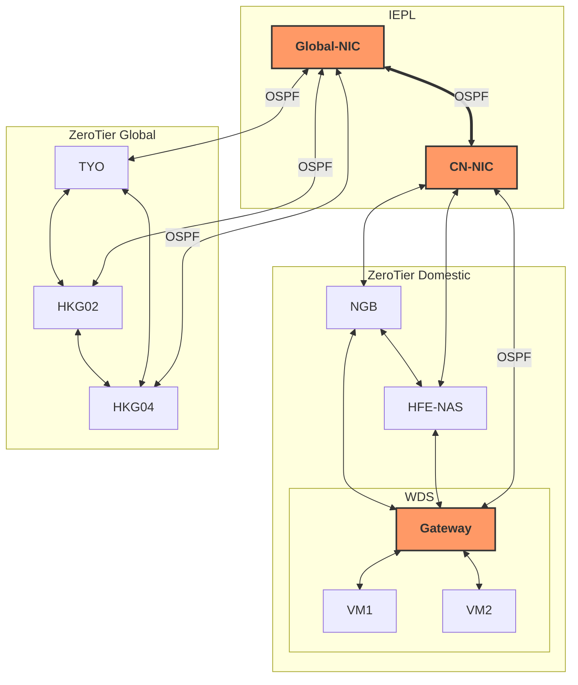
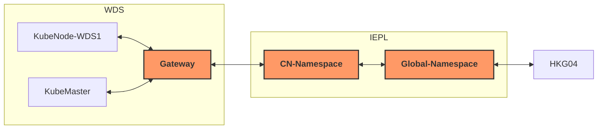
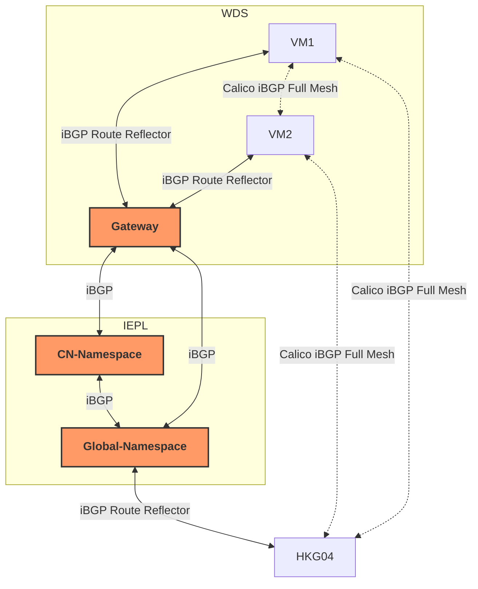

```markdown
# Preface

I've actually wanted to play with a K8s cluster for a long time, but always felt that without sufficient knowledge, it would be too difficult to attempt.  
Recently, I spent some time studying DN42 and routing protocols like BGP and OSPF, and realized that it no longer feels so difficult. So I decisively started with K3s (  

The main reason for choosing K3s over K8s is its lightweight nature: low resource requirements, no need to pull a bunch of images for deployment, availability of domestic mirrors… In short, K3s suits my needs better.  

I'm a beginner just starting to explore K3s, so please go easy on me if I make any mistakes~

# Analysis

## Choosing the CNI Component

My current network architecture looks like this:



Among this, the WDS node is a Proxmox VE host with multiple VMs underneath. It advertises its VMs' IPv4 prefixes via OSPF. When Hong Kong nodes need to access a VM under the WDS node, they can do so by joining the OSPF internal network to achieve multi-hop reachability. This keeps the encapsulation layer count to only one, so there's no worry about MTU "disappearing act".

I plan to create two new VMs under WDS to serve as the master and a node (temporarily called KubeMaster and KubeNode-WDS1). Then HKG04 (temporarily called KubeNode-HKG04) will also join the K3s cluster as a node.

The simplest approach would be to use K3s's default Flannel as the CNI. However, Flannel is based on VXLAN, and adding another layer of my existing internal network would lead to the following MTU "disappearing act":

```plain
Data packet -> Flannel VXLAN encapsulation -> ZeroTier encapsulation -> Physical link
```

The actual usable MTU for inter-container communication would likely be compressed to 1350 or even lower. Therefore, I tried to find a CNI solution that can work directly on top of this internal network, and then I found Calico. As I understand, Calico uses BGP as its underlying routing protocol, supports starting in no-encapsulation (No-Encap) mode, and hands packets directly to the upper routers for routing. Thus, I chose Calico as the CNI component.

## Routing Design

To ensure that intermediate routers know how to route Pod IPs, KubeMaster and KubeNode-WDS1 are under the Proxmox VE host. They need to establish BGP with HKG04 across the entire internal network. This means that every router at each intermediate level must learn the full BGP routes, so that the following routing path can be established:



Otherwise, any intermediate hop would drop packets because it doesn't recognize the source/destination IP. Also, due to the property of iBGP that routes learned from a neighbor cannot be propagated to the next iBGP neighbor, all BGP sessions between Gateway, CN-Namespace, Global-Namespace and the nodes need to enable Route Reflector; otherwise, nodes cannot correctly learn routes from each other.

That said, this architecture would be more suitable for BGP Confederation, but my existing network is already quite complex, and adding BGP confederations would make later maintenance more troublesome. Moreover, my number of nodes is small, so the overhead of iBGP Full Mesh is acceptable. ~~It's definitely not because I'm lazy (so~~

Thus, the final network routing structure is as follows:



_The dashed-line BGP sessions are automatically created by Calico, while the solid-line parts need to be manually created by us._

Keeping Calico's own iBGP Full Mesh is for future scalability, so that nodes can preferentially establish direct P2P connections via ZeroTier instead of taking a detour through the Route Reflector aggregation router.

# Deployment

After clarifying the structure, deployment becomes simple.

## Enable Kernel Forwarding and Disable rp_filter

Standard practice.

```shell
echo "net.ipv4.ip_forward=1" >> /etc/sysctl.conf
echo "net.ipv6.conf.default.forwarding=1" >> /etc/sysctl.conf
echo "net.ipv6.conf.all.forwarding=1" >> /etc/sysctl.conf
echo "net.ipv4.conf.default.rp_filter=0" >> /etc/sysctl.conf
echo "net.ipv4.conf.all.rp_filter=0" >> /etc/sysctl.conf
sysctl -p
```

## Install K3s

### Master

Because the KubeMaster control plane node is located inside China, it's best to configure image acceleration:

```shell
mkdir -p /etc/rancher/k3s
cat <<EOF > /etc/rancher/k3s/registries.yaml
mirrors:
  docker.io:
    endpoint:
      - "https://docker.m.daocloud.io"
  quay.io:
    endpoint:
      - "https://quay.m.daocloud.io"
EOF
```

Install using the mirror:

```shell
curl -sfL https://rancher-mirror.rancher.cn/k3s/k3s-install.sh | \
  INSTALL_K3S_MIRROR=cn INSTALL_K3S_EXEC=" \
  --flannel-backend=none \
  --disable-network-policy \
  --cluster-cidr=10.42.0.0/16" sh -
```

Note the need to specify `--flannel-backend=none` and `--disable-network-policy` to disable the default CNI component.  
Use `cat /var/lib/rancher/k3s/server/node-token` to view the token and record it.

### Worker Nodes

For nodes inside China, configure image acceleration:

```shell
mkdir -p /etc/rancher/k3s
cat <<EOF > /etc/rancher/k3s/registries.yaml
mirrors:
  docker.io:
    endpoint:
      - "https://docker.m.daocloud.io"
  quay.io:
    endpoint:
      - "https://quay.m.daocloud.io"
EOF
```

Then install K3s using the mirror and join the cluster:

```shell
export INSTALL_K3S_MIRROR=cn
export K3S_URL=https://<master node IP>:6443  # Replace with your master node's actual IP
export K3S_TOKEN=K10...your token...::server:xxx # Replace with the full token obtained in the first step

curl -sfL https://rancher-mirror.rancher.cn/k3s/k3s-install.sh | sh -
```

At this point, the status of each node should be NotReady because the CNI component is missing.

## Install Calico and Configure No-Encap Mode

On the master, manually download `https://raw.githubusercontent.com/projectcalico/calico/v3.26.1/manifests/tigera-operator.yaml` and install the Calico operator:

```shell
kubectl create -f tigera-operator.yaml
```

Configure a custom resource by creating a `custom-resource.yaml` file:

```yml
apiVersion: operator.tigera.io/v1
kind: Installation
metadata:
  name: default
spec:
  # Add image registry configuration
  registry: quay.m.daocloud.io 
  calicoNetwork:
    ipPools:
    - blockSize: 26
      cidr: 10.42.0.0/16
      encapsulation: None
      natOutgoing: Enabled
      nodeSelector: all()
```

Here, specify `encapsulation: None` to enable No-Encap mode. You can also modify the IPv4 CIDR here if needed. Then:

```shell
kubectl apply -f custom-resource.yaml
```

to perform the installation. Use:

```shell
kubectl get pods -A -o wide
```

to check Pod status, waiting for each node to finish pulling images.

## Configure BGP Topology

### Label Nodes

Label nodes to specify that nodes under WDS connect to the Gateway's BGP in the WDS node, and nodes outside China connect to the BGP of the Global Namespace:

```shell
kubectl label nodes kubemaster region=WDS
kubectl label nodes kubenode-wds-1 region=WDS
kubectl label nodes kubenode-hkg04 region=Global
```

### Calico Configuration

Create a YAML configuration file:

```yaml
apiVersion: crd.projectcalico.org/v1
kind: BGPPeer
metadata:
  name: route-reflector-domestic
spec:
  nodeSelector: region == 'Domestic' # This part is not actually used; I originally designed a general aggregation router in the Domestic area
  peerIP: 100.64.0.108
  asNumber: 64512
---
apiVersion: crd.projectcalico.org/v1
kind: BGPPeer
metadata:
  name: route-reflector-wds
spec:
  nodeSelector: region == 'WDS'
  peerIP: 192.168.100.1
  asNumber: 64512
---
apiVersion: crd.projectcalico.org/v1
kind: BGPPeer
metadata:
  name: route-reflector-global
spec:
  nodeSelector: region == 'Global'
  peerIP: 100.64.1.106
  asNumber: 64512
```

This means:
- All nodes with label `region` equal to `Domestic` will have a BGP session to `100.64.0.108` (the domestic aggregation router) using AS `64512`
- All nodes with label `region` equal to `WDS` will have a BGP session to `192.168.100.1` (the Gateway for all VMs under the WDS node) using AS `64512`
- All nodes with label `region` equal to `Global` will have a BGP session to `100.64.1.106` (the overseas aggregation router) using AS `64512`

This achieves what is shown in the diagram: all VMs under the WDS node, including the master and KubeNode-WDS1, connect to the Gateway aggregation router of the WDS node, and all nodes in overseas areas connect to the overseas aggregation router.

### Configure Aggregation Router iBGP

This part is simply a matter of writing Bird configuration files (easy).  
Here are a few examples:

* `k3s/ibgp.conf`:
```nginx
function is_insider_as(){
    if bgp_path.len > 0 && !(bgp_path ~ [= 64512 =]) then {
        return false;
    }

    if net ~ [ 10.42.0.0/16{16,32} ] then {
        return true;
    }

    return false;
}

template bgp k3sbackbone{
    local as K3S_AS;
    router id INTRA_ROUTER_ID;
    neighbor as K3S_AS;

    ipv4{
        table intra_table_v4;
        import filter{
            if is_insider_as() then accept;
            reject;
        };
        export filter{
            if is_insider_as() then accept;
            reject;
        };
        next hop self;
        extended next hop;
    };

    ipv6{
        table intra_table_v6;
        import filter{
            if is_insider_as() then accept;
            reject;
        };
        export filter{
            if is_insider_as() then accept;
            reject;
        };
        next hop self;
    };
};

template bgp k3speers{
    local as K3S_AS;
    neighbor as K3S_AS;
    router id INTRA_ROUTER_ID;
    rr client;
    rr cluster id INTRA_ROUTER_ID;

    ipv4{
        table intra_table_v4;
        import filter{
            if is_insider_as() then accept;
            reject;
        };
        export filter{
            if is_insider_as() then accept;
            reject;
        };
        next hop self;
    };

    ipv6{
        table intra_table_v6;
        import filter{
            if is_insider_as() then accept;
            reject;
        };
        export filter{
            if is_insider_as() then accept;
            reject;
        };
        next hop self;
    };
};

include "ibgpeers/*";
```

* `ibgpeers/backbone-cn.conf`:
```nginx
protocol bgp 'k3s_backbone_cn_v4' from k3sbackbone{
    neighbor fd18:3e15:61d0:cafe:f001::1;
};
```

* `ibgpeers/master.conf`:
```nginx
protocol bgp 'k3s_master_v4' from k3speers{
    neighbor 192.168.100.251;
};
```

Main points: it's best not to enable Route Reflector between the aggregation routers, and remember to enable `next hop self`.

---

After everything is done, using `kubectl get nodes` should show all nodes as Ready:

```plain
NAME             STATUS   ROLES           AGE     VERSION
kubemaster       Ready    control-plane   2d23h   v1.34.5+k3s1
kubenode-hkg04   Ready    <none>          11h     v1.34.6+k3s1
kubenode-wds-1   Ready    <none>          2d7h    v1.34.5+k3s1
```

Use `kubectl get pods -A -o wide` to view Pods:

```plain
NAMESPACE         NAME                                       READY   STATUS      RESTARTS        AGE     IP                NODE             NOMINATED NODE   READINESS GATES
calico-system     calico-kube-controllers-64fc874957-6bdlz   1/1     Running     0               5h38m   10.42.253.136     kubenode-hkg04   <none>           <none>
calico-system     calico-node-2qz82                          1/1     Running     0               4h24m   10.2.5.7          kubenode-hkg04   <none>           <none>
calico-system     calico-node-dhl2c                          1/1     Running     0               4h24m   192.168.100.251   kubemaster       <none>           <none>
calico-system     calico-node-nbpkj                          1/1     Running     0               4h23m   192.168.100.252   kubenode-wds-1   <none>           <none>
calico-system     calico-typha-7bb5db4bdc-rfpwg              1/1     Running     0               5h38m   10.2.5.7          kubenode-hkg04   <none>           <none>
calico-system     calico-typha-7bb5db4bdc-rwwr5              1/1     Running     0               5h38m   192.168.100.251   kubemaster       <none>           <none>
calico-system     csi-node-driver-jglwp                      2/2     Running     0               5h38m   10.42.64.68       kubenode-wds-1   <none>           <none>
calico-system     csi-node-driver-jqjsc                      2/2     Running     0               5h38m   10.42.253.137     kubenode-hkg04   <none>           <none>
calico-system     csi-node-driver-vk26s                      2/2     Running     0               5h38m   10.42.141.16      kubemaster       <none>           <none>
kube-system       coredns-695cbbfcb9-8fx4p                   1/1     Running     1 (7h27m ago)   2d23h   10.42.141.14      kubemaster       <none>           <none>
kube-system       helm-install-traefik-crd-5bkwx             0/1     Completed   0               2d23h   <none>            kubemaster       <none>           <none>
kube-system       helm-install-traefik-m9fgj                 0/1     Completed   1               2d23h   <none>            kubemaster       <none>           <none>
kube-system       local-path-provisioner-546dfc6456-dmn4g    1/1     Running     1 (7h27m ago)   2d23h   10.42.141.15      kubemaster       <none>           <none>
kube-system       metrics-server-c8774f4f4-2wkwh             1/1     Running     1 (7h27m ago)   2d23h   10.42.141.12      kubemaster       <none>           <none>
kube-system       svclb-traefik-999cddce-hpmcm               2/2     Running     6 (7h26m ago)   11h     10.42.253.134     kubenode-hkg04   <none>           <none>
kube-system       svclb-traefik-999cddce-q4225               2/2     Running     2 (7h27m ago)   2d22h   10.42.141.9       kubemaster       <none>           <none>
kube-system       svclb-traefik-999cddce-xmd64               2/2     Running     2 (7h26m ago)   2d6h    10.42.64.66       kubenode-wds-1   <none>           <none>
kube-system       traefik-788bc4688c-vbbhj                   1/1     Running     1 (7h27m ago)   2d22h   10.42.141.13      kubemaster       <none>           <none>
tigera-operator   tigera-operator-6b95bbf4db-vl46l           1/1     Running     1 (7h27m ago)   2d23h   192.168.100.251   kubemaster       <none>           <none>
```

Use `kubectl exec -it -n calico-system <calico-node-xxxx> -- birdcl s p` to check the status of Bird:

```shell
root@KubeMaster:~/kube/calico# kubectl exec -it -n calico-system calico-node-2qz82 -- birdcl s p
Defaulted container "calico-node" out of: calico-node, flexvol-driver (init), install-cni (init)
BIRD v0.3.3+birdv1.6.8 ready.
name     proto    table    state  since       info
static1  Static   master   up     08:58:17    
kernel1  Kernel   master   up     08:58:17    
device1  Device   master   up     08:58:17    
direct1  Direct   master   up     08:58:17    
Mesh_192_168_100_251 BGP      master   up     08:58:33    Established   
Mesh_192_168_100_252 BGP      master   up     08:59:00    Established   
Node_100_64_1_106 BGP      master   up     12:57:44    Established   
```

`ip r` shows the system routing table:

```shell
root@KubeMaster:~/kube/calico# ip r
default via 192.168.100.1 dev eth0 proto static 
10.42.64.64/26 proto bird 
        nexthop via 192.168.100.1 dev eth0 weight 1 
        nexthop via 192.168.100.252 dev eth0 weight 1 
blackhole 10.42.141.0/26 proto bird 
10.42.141.9 dev caliac6501d3794 scope link 
10.42.141.12 dev calib07c23291bb scope link 
10.42.141.13 dev caliab16e60bd19 scope link 
10.42.141.14 dev calid5959219080 scope link 
10.42.141.15 dev cali026d8f1ddb7 scope link 
10.42.141.16 dev califa657ba417a scope link 
10.42.253.128/26 via 192.168.100.1 dev eth0 proto bird 
192.168.100.0/24 dev eth0 proto kernel scope link src 192.168.100.251 
```

Ping a Pod's IP – if everything is fine, it should work directly:

```shell
root@KubeMaster:~/kube/calico# ping 10.42.253.137
PING 10.42.253.137 (10.42.253.137) 56(84) bytes of data.
64 bytes from 10.42.253.137: icmp_seq=1 ttl=60 time=33.7 ms
64 bytes from 10.42.253.137: icmp_seq=2 ttl=60 time=33.5 ms
^C
--- 10.42.253.137 ping statistics ---
2 packets transmitted, 2 received, 0% packet loss, time 1002ms
rtt min/avg/max/mdev = 33.546/33.632/33.718/0.086 ms
```

### Tune MTU

This step is actually for stability…?  
Tests have shown that although my ZeroTier MTU is 1420, packets start to fragment around 1392 bytes (test with `ping -M do -s <packet size> <Pod_IP>`). Therefore, force the Pod MTU to 1370:

```shell
root@KubeMaster:~/kube/calico# cat patch-mtu.yaml 
apiVersion: operator.tigera.io/v1
kind: Installation
metadata:
  name: default
spec:
  calicoNetwork:
    mtu: 1370
    nodeAddressAutodetectionV4:
      firstFound: true
root@KubeMaster:~/kube/calico# kubectl apply -f patch-mtu.yaml 
installation.operator.tigera.io/default configured
```