> The beginning of the article explains the process of configuring a GPON stick and BE10000 PPPoE. If you only need to look up 802.11k/v/r related content, you can jump directly to the "Configuring 802.11 k/v/r" section.

The reason this all started was that during the May Day holiday I picked up a Xiaomi BE10000 locally in Harbin. I wanted to try using a GPON stick to see if I could push my home gigabit connection past 1 Gbps (cc: [浙江移动烽火光猫获取超密 + G-010S-A 猫棒上网 – 米露小窝](https://milu.ink/600.html)). Moreover, since I use mesh-style tools like EasyTier and need features like Wake-on-LAN, and my existing Xiaomi AX3600 at home is already flashed with ImmortalWRT, I was hoping to also flash a WRT-based system. Then perhaps I could use 802.11 k/v/r for automatic switching, achieving a sort of manual mesh effect. After searching around, it seemed only the BE10000 met my requirements: it has an SFP+ cage and can be flashed with QWRT. I brought it home over the summer vacation — time to tinker with it()

_And while I was at school I even fixed the only minor imperfection: the NFC tap-to-connect feature (ref: [Adapting NFC Functionality for QWRT on Xiaomi BE10000 Router - iYoRoy's Develop Diary](https://blog.iyoroy.cn/en/archives/278/)). This machine is now truly complete (nod)_

## Terminology

### 1. Broadband & Optical Communication (Fiber & PON)

| **Abbreviation** | **Full Name**                  | **Description / Notes**                                                         |
| ---------------- | ------------------------------ | ------------------------------------------------------------------------------- |
| **FTTH**         | Fiber To The Home              | Fiber to the home.                                                              |
| **PON**          | Passive Optical Network        | Passive optical network. Mainstream technology for home broadband access.       |
| **GPON**         | Gigabit-Capable PON            | Gigabit-capable passive optical network. Our GPON stick is based on this standard. |
| **OLT**          | Optical Line Terminal          | Optical line terminal. The carrier's central office equipment, responsible for distributing optical signals downstream. |
| **ONU**          | Optical Network Unit           | Optical network unit. Customer premises equipment such as an ONT or GPON stick. |
| **UPC**          | Ultra Physical Contact         | Ultra physical contact. A common fiber connector type (usually blue end face).  |
| **APC**          | Angled Physical Contact        | Angled physical contact. A common fiber connector type (usually green end face, with an 8-degree angle). |
| **LOID**         | Logical ONU ID                 | Logical ONU identifier. A string used by the carrier to authenticate the ONU.   |
| **PLOAM**        | Physical Layer OAM             | Physical Layer Operations, Administration and Maintenance. Also a password system used for ONU authentication. |
| **SN**           | Serial Number                  | Serial number. The unique factory number of the hardware device, often used for ONU registration. |

### 2. Wi-Fi & Roaming

| **Abbreviation** | **Full Name**                                | **Description / Notes**                                                           |
| ---------------- | -------------------------------------------- | --------------------------------------------------------------------------------- |
| **AP**           | Access Point                                 | Access point. The role of the main router or satellite router emitting Wi‑Fi signals. |
| **SSID**         | Service Set Identifier                       | Service set identifier. The Wi‑Fi name seen by users.                             |
| **BSS**          | Basic Service Set                            | Basic service set. The set consisting of a single AP and the devices connected within its coverage. |
| **BSSID**        | Basic Service Set Identifier                 | Basic service set identifier. Usually the MAC address of the AP's wireless interface. |
| **ESS**          | Extended Service Set                         | Extended service set. A unified network of multiple BSSs (same SSID), i.e., the roaming environment. |
| **RRM**          | Radio Resource Management                    | Radio Resource Management (802.11k). Used to obtain neighbor reports of surrounding APs. |
| **WNM**          | Wireless Network Management                  | Wireless Network Management (802.11v). Allows the AP to send roaming guidance suggestions to clients. |
| **FT**           | Fast Transition                              | Fast Transition (802.11r). Reduces the handshake and authentication time when a client switches APs. |
| **DS**           | Distribution System                          | Distribution system. The wired network backbone; `ft_over_ds` means exchanging roaming information via the wired backbone. |
| **NAS ID**       | Network Access Server ID                     | Network access server identifier. Used to uniquely identify a BSS node within a roaming domain. |
| **SAE**          | Simultaneous Authentication of Equals        | Simultaneous Authentication of Equals. WPA3 key exchange protocol, more secure than WPA2. |
| **PSK**          | Pre-Shared Key                               | Pre-shared key. The most common password-based authentication method in home Wi‑Fi. |

### 3. Network Protocols & System Settings

| **Abbreviation**    | **Full Name**                                    | **Description / Notes**                                                      |
| ------------------- | ------------------------------------------------ | ---------------------------------------------------------------------------- |
| **PPPoE**           | Point-to-Point Protocol over Ethernet            | Point-to-Point Protocol over Ethernet. The broadband dial-up protocol we commonly use. |
| **VLAN / PVID**     | Virtual Local Area Network / Port VLAN ID        | Virtual LAN / Port VLAN ID. Used to isolate network traffic; required for ONU dial-up. |
| **SFP+**            | Enhanced Small Form-factor Pluggable             | Enhanced small form-factor pluggable. Supports transmission rates up to 10 Gbps. |
| **UCI**             | Unified Configuration Interface                  | Unified Configuration Interface. The underlying command-line configuration system of OpenWrt/QWRT. |
| **LuCI**            | Lua Configuration Interface                      | Lua Configuration Interface. The web-based graphical configuration interface of OpenWrt/QWRT. |
| **DHCP**            | Dynamic Host Configuration Protocol              | Dynamic Host Configuration Protocol. Used to automatically assign IP addresses to devices on the local network. |
| **L2**              | Layer 2                                          | Layer 2. In the article, "L2 segment" refers to a local network within the same broadcast domain. |

## Materials
* Xiaomi BE10000 Router
* Xiaomi AX3600 Router
* G-010S-A NOKIA GPON Stick
	* Heatsink
	* SC/APC to SC/UPC fiber patch cable
	* SC/UPC fiber optic adapter
* Flashing resources (you'll need to find these yourself; redistributing others' materials isn't great. You can refer to the firmware linked in the flashing tutorial below.)

Regarding that SC/APC to SC/UPC fiber cable — these terms describe the fiber connector specifications. Normal home FTTH typically uses UPC, which has a blue connector, whereas the GPON sticks we buy generally use an APC connector, which is green. The main difference lies in the shape of the ferrule end face: UPC has a slightly convex end face, while APC has an angled end face. If the OLT downstream optical power is strong enough, you could directly connect a UPC connector to the GPON stick and it might still work, but you'll suffer about 3 dB of additional optical loss. Therefore, I decided to play it safe.
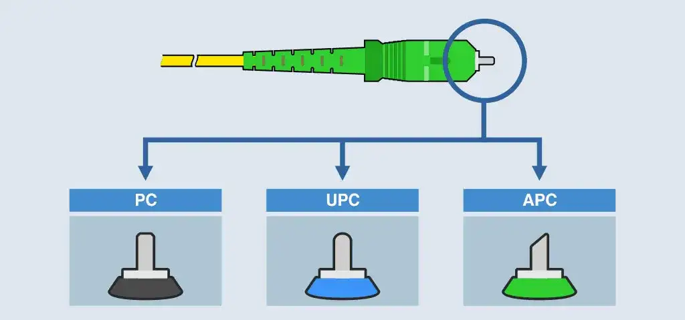
_Image source: [Fiber Connector PC, UPC, APC Main Differences - Zhihu](https://zhuanlan.zhihu.com/p/1928375679336051117)_

GPON sticks are notorious for running hot, so remember to attach a heatsink:
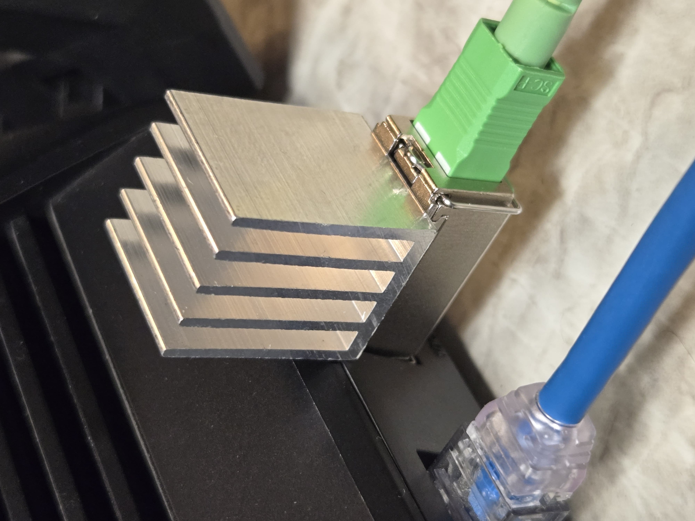
After attaching it, the temperature I saw in the ONU's management interface was around 60 ℃.

## Flashing the BE10000
I won't go into detail here. Just follow [【小米万兆路由器刷OpenWrt】小米BE10000|SSH解锁固化|UBoot|iStore商店|多拨|-小米无线路由器及小米网络设备-恩山无线论坛 - Powered by Discuz!](https://www.right.com.cn/forum/thread-8450774-1-1.html).

The firmware has some known bugs, such as Wi‑Fi settings made through the frontend interface not being written correctly, which can prevent the entire networking subsystem from starting, leading to loss of connectivity and eventually triggering an automatic fallback. Therefore, some of the modifications to the main router described below are implemented using UCI commands.

## Obtaining the Carrier ONU Configuration
There's no universal guide for this step... Go to Xianyu or Taobao and purchase a super admin password. Record the `LOID`, `SN`, `LOID CheckCode (Password)`, `PLOAM Password`, and the `VLAN` ID from the Internet configuration section. In some regions you may also need to record the upstream MAC address.

_`LOID` and `LOID CheckCode`_:
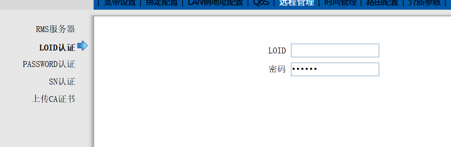

_`PLOAM Password`_:
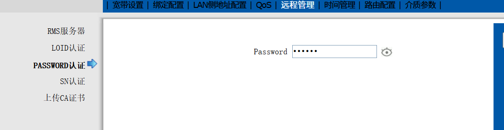

_`VLAN` ID_:
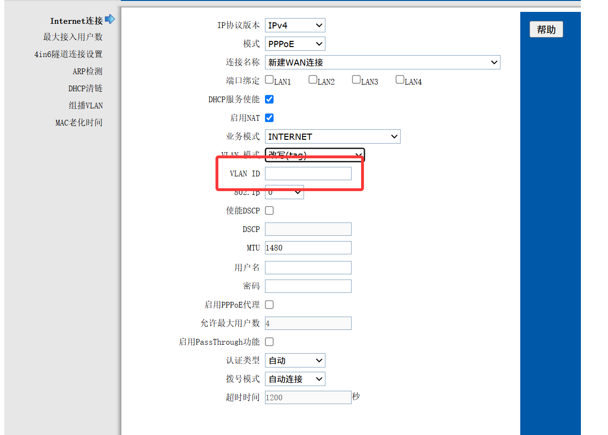

Generally speaking, carriers either use `LOID`, possibly together with a `LOID CheckCode (Password)`, **or** they might use the `PLOAM Password`. Determine which applies based on your own situation.

In my case, with China Unicom Anhui, I only needed to record the `SN`, `VLAN ID`, and `LOID` for it to work. (Because my Unicom ONU wouldn't let me log in, I used a China Mobile ONU for the screenshots xD)
Sometimes you don't even need the super admin password to get this information; certain ONUs (e.g., China Unicom Heilongjiang, Skyworth ONUs) provide these details even with a regular user account.

At the same time, record the `PPPoE` username and password:
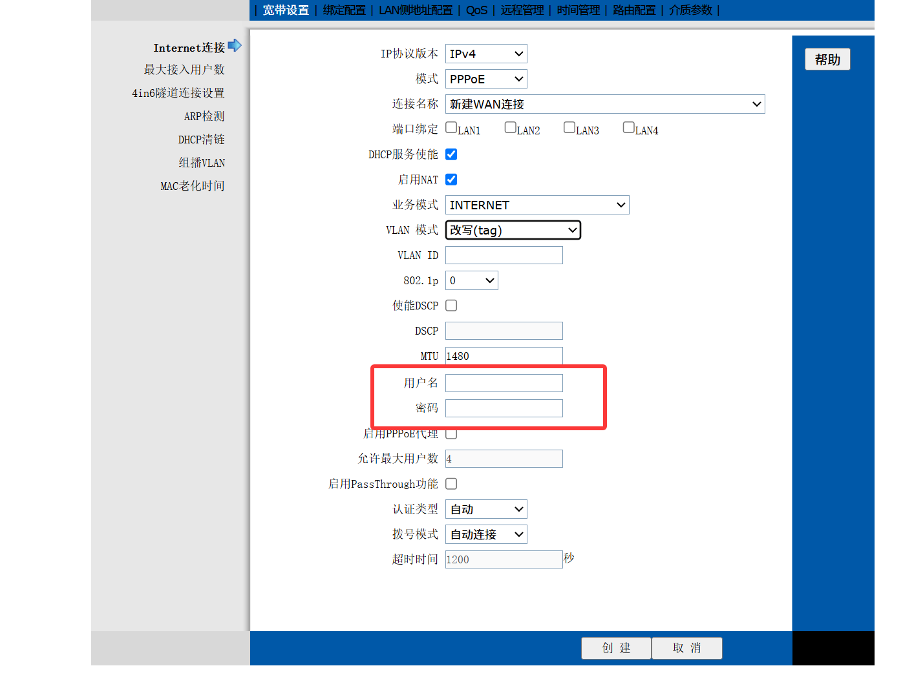

Typically, the username is public. On some ONUs you can use the F12 trick to remove the `password` attribute and reveal the actual password, but some ONUs will only send back meaningless placeholder characters. In that case you can call the carrier to reset the password.

## Configuring the GPON Stick
Insert the GPON Stick into the SFP+ port. If the Ethernet port LED does not light up, try going to `QWRT` -> `Network` -> `ECM Hardware Acceleration Settings` and forcing the SFP1 and SFP2 interface speeds to `Force 2.5Gbps`. (I wasn't sure which one corresponds to the current SFP slot, so I changed both.) Then Save & Apply, and you may need to reboot the router.

The default `br-lan` IP prefix should be `192.168.1.0/24`. Keep it unchanged and access `192.168.1.10` to open the GPON stick's management console:
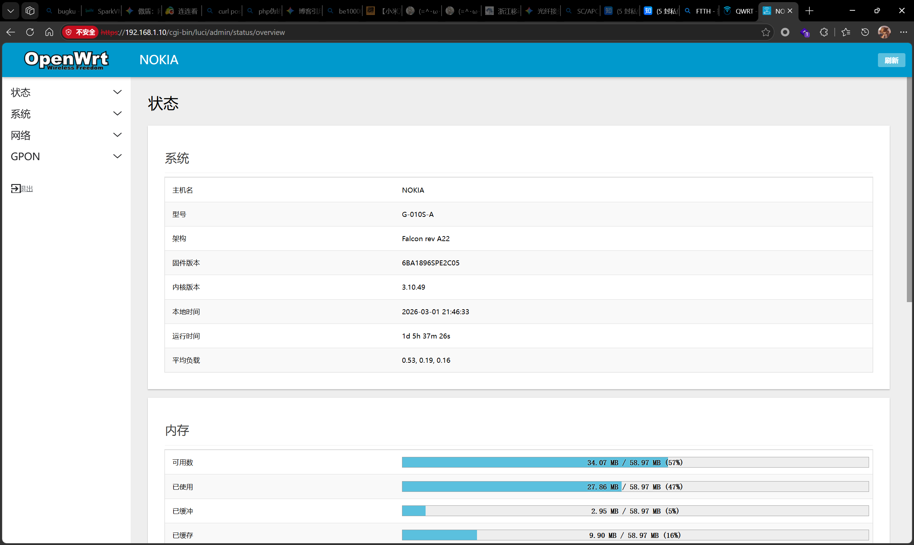

Go to GPON ONU Settings and fill in the information we just recorded:
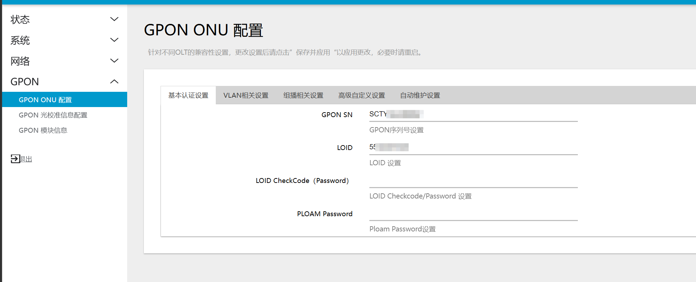
_`LOID` and `SN`_

And enable VLAN configuration:
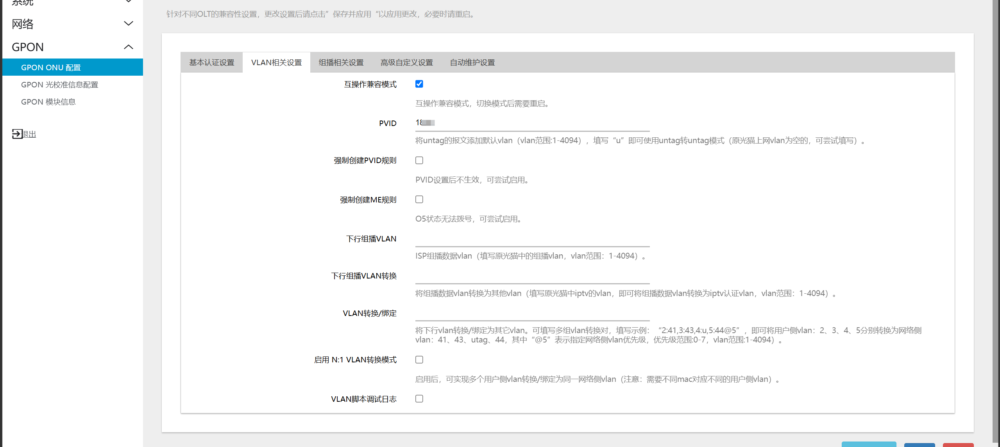
Check **Interoperability Compatibility Mode**, and fill in the VLAN ID under `PVID`.

After saving you may need to reboot the GPON stick. Then go to the Status page. If you see the PON Authentication Status / PON Signal Status as O5, it means the GPON stick has completed registration and is working normally.
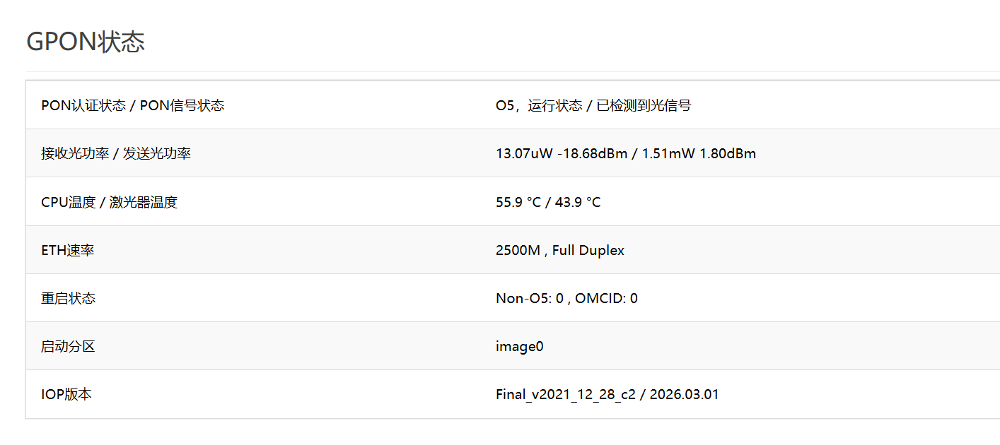

## Setting up PPPoE Dial-up
On the BE10000, the default WAN port is `eth4`, while the SFP port is `eth5`. Therefore, you need to switch the WAN interface from `eth4` to `eth5`. Go to `Network` -> `Interfaces` -> `Devices`, find `br-lan` and add `eth4` to it, then remove `eth5`. Next, go to the `Interfaces` page, change the WAN network adapter to `eth5`, and enter the PPPoE username and password you recorded earlier:
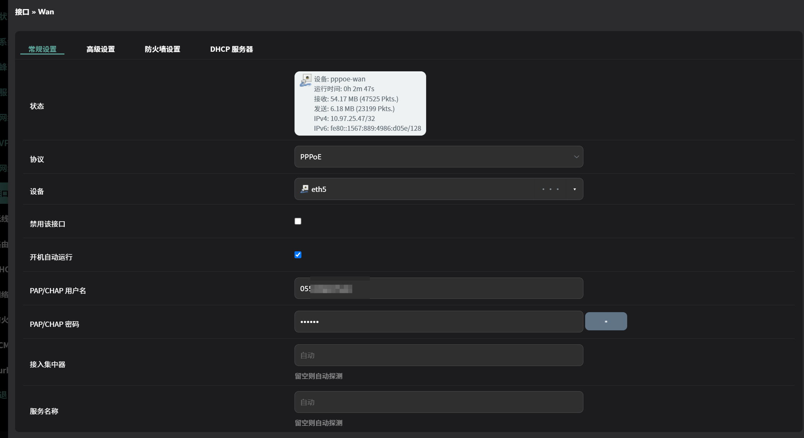

After saving, you should see that PPPoE has successfully dialed and you can access the internet normally:
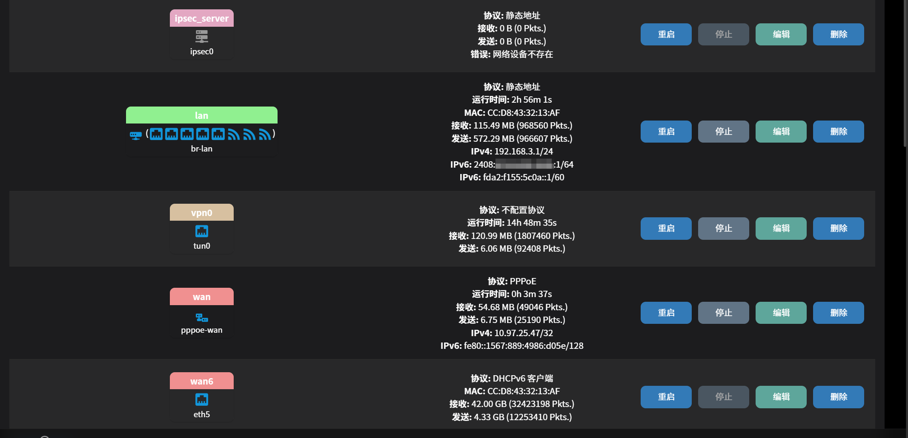
(I changed the entire `br-lan` subnet to `192.168.3.0/24`; this step is not required.)

## Modifying Basic Wi‑Fi Settings
Through testing I found that… modifying Wi‑Fi information directly via LuCI on the main router doesn't take effect properly (as mentioned above). Therefore, I modified the settings via UCI over SSH:

```shell
uci set wireless.ath0.ssid='[CENSORED]'
uci set wireless.ath0.encryption='psk2+ccmp'
uci set wireless.ath0.key='[CENSORED]'

uci set wireless.ath1.ssid='[CENSORED]'
uci set wireless.ath1.encryption='psk2+ccmp'
uci set wireless.ath1.key='[CENSORED]'

uci commit wireless
wifi reload
```
Here, SSID is the Wi‑Fi name, and the encryption value `psk2+ccmp` stands for WPA2-PSK/AES, the commonly used WPA2-AES configuration.

Although WPA3/SAE is more secure, in multi-AP + 802.11r roaming scenarios, WPA2-PSK + FT-PSK generally offers better compatibility. Some phones or IoT devices may experience connection failures, roaming failures, or slower switching when using combinations like WPA2/WPA3 Mixed, FT-SAE, PMF, etc.

If maximum compatibility is the priority, it is recommended to use WPA2-PSK/AES for the primary SSID used for whole-home roaming, and ensure that the encryption method is consistent across both the main router and the satellite router.

For the satellite router, since we want roaming, both Wi‑Fi networks must be on the same L2 segment. This requires disabling the satellite's DHCP server and configuring it as a device under the main router. Therefore, the following configuration steps apply to the satellite router:
* Remove all other interfaces under Network -> Interfaces -> Interfaces, keeping only `br-lan`:
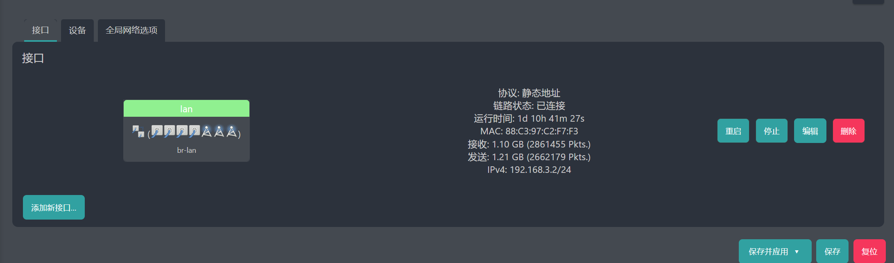
* Under Network -> Interfaces -> Devices, add the `wan` port to the `br-lan` device:
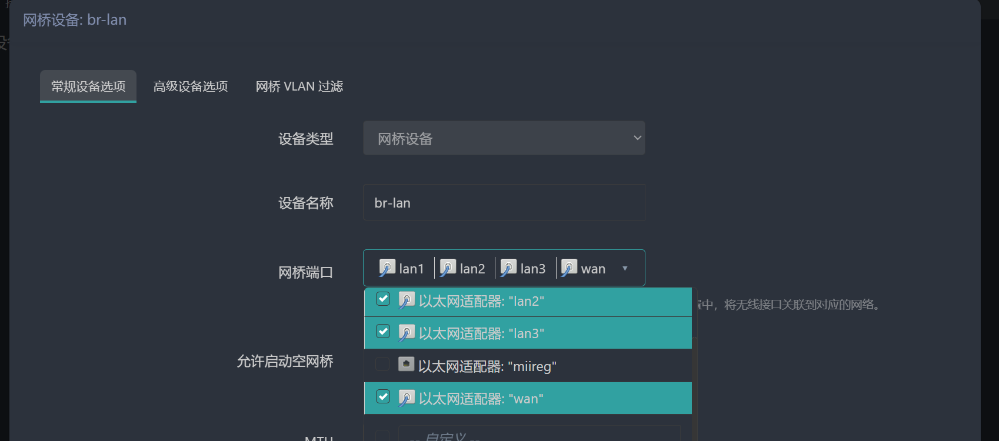

* Assign an IP address to the `br-lan` device under Network -> Interfaces -> Devices:
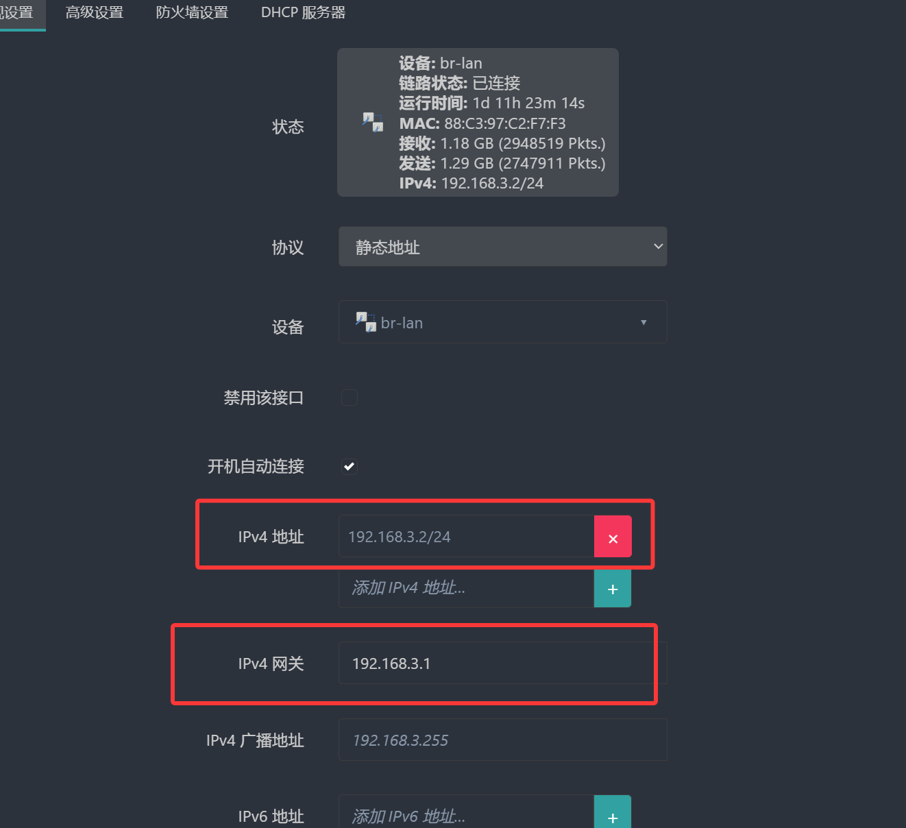

Make sure to include the subnet mask for the IPv4 address, and set the IPv4 gateway to the IP address of the main router.
* Under Network -> Firewall -> General Settings, adjust the firewall rules to allow traffic.
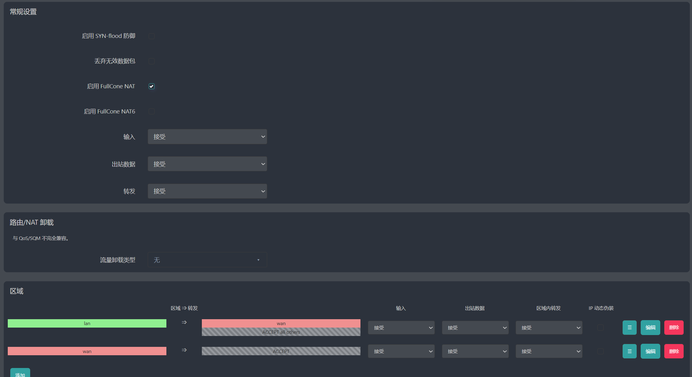
(btw, because I didn't want to bother with detailed rules and figured internal devices shouldn't be at much risk, I simply allowed everything. Please do not follow this if you have specific security needs xD)

Since the main router and satellite router are now on the same L2 broadcast domain, there should only be one DHCP server on the LAN: the main router. If the satellite's DHCP server is not turned off, clients might receive DHCP responses from both routers during connection or roaming, leading to incorrect gateways/DNS, or issues like `DHCPNAK wrong server-ID`.

Symptoms of this problem may include:
- Wi‑Fi has already switched to another AP, but network recovery is slow;
- Brief disconnection after roaming;
- Client reacquires an IP address;
- Occasional gateway/DNS anomalies;
- It looks like 802.11r isn't working, but the real culprit is the DHCP layer.

On the satellite router, run via SSH:
```sh
uci set dhcp.lan.ignore='1'
uci commit dhcp
/etc/init.d/dnsmasq restart
```

If the satellite router also has IPv6 RA / DHCPv6 enabled and you want the main router to handle all IPv6, you can also disable them:
```sh
uci set dhcp.lan.ra='disabled'
uci set dhcp.lan.dhcpv6='disabled'
uci set dhcp.lan.ndp='disabled'
uci commit dhcp
/etc/init.d/odhcpd restart
```

After disabling, you can verify with:
```sh
uci show dhcp.lan
```

You should see something like:
```sh
dhcp.lan.ignore='1'
```

That's it.

Note that the `dnsmasq` process still running does **not** mean the satellite is still handing out DHCP leases. As long as the generated configuration contains something like:
```text
no-dhcp-interface=br-lan
```
it means it will no longer provide DHCP service on the LAN / `br-lan`. After saving and applying, you should be able to connect through the main router and access the satellite via the IP address you assigned.
(I couldn't find a clear option to disable the DHCP service in LuCI for this part, so I had GPT edit UCI directly via SSH.)

In the satellite router's Network -> Wireless, configure the SSID interfaces to match the main router's settings:
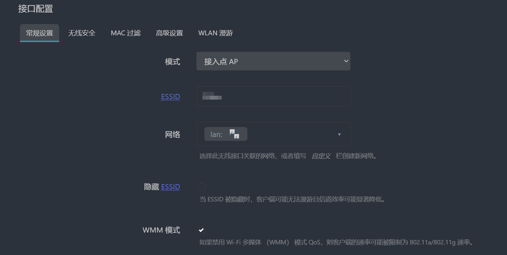

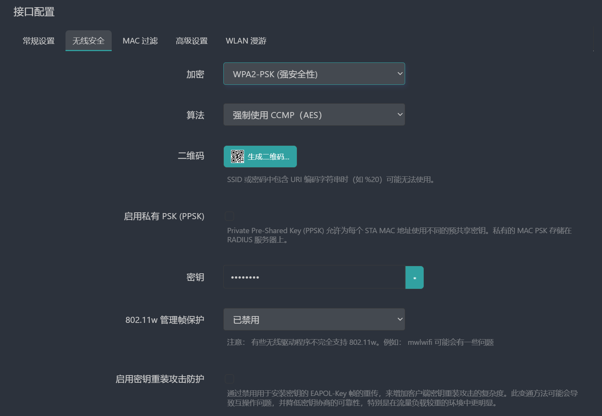

At this point, both Wi‑Fi networks should connect successfully (albeit with the same SSID).

## Configuring 802.11 k/v/r
### Main Router
```shell
uci set wireless.ath0.ieee80211k='1'
uci set wireless.ath0.rrm_neighbor_report='1'
uci set wireless.ath0.rrm_beacon_report='1'
uci set wireless.ath0.ieee80211v='1'
uci set wireless.ath0.time_advertisement='0'
uci set wireless.ath0.wnm_sleep_mode='0'
uci set wireless.ath0.bss_transition='1'
uci set wireless.ath0.ieee80211r='1'
uci set wireless.ath0.nasid='Master_2_4G'
uci set wireless.ath0.mobility_domain='cafe'
uci set wireless.ath0.reassociation_deadline='1000'
uci set wireless.ath0.ft_over_ds='0'
uci set wireless.ath0.ft_psk_generate_local='1'

uci set wireless.ath1.ieee80211k='1'
uci set wireless.ath1.rrm_neighbor_report='1'
uci set wireless.ath1.rrm_beacon_report='1'
uci set wireless.ath1.ieee80211v='1'
uci set wireless.ath1.time_advertisement='0'
uci set wireless.ath1.wnm_sleep_mode='0'
uci set wireless.ath1.bss_transition='1'
uci set wireless.ath1.ieee80211r='1'
uci set wireless.ath1.nasid='Master_5G'
uci set wireless.ath1.mobility_domain='cafe'
uci set wireless.ath1.reassociation_deadline='1000'
uci set wireless.ath1.ft_over_ds='0'
uci set wireless.ath1.ft_psk_generate_local='1'

uci commit wireless
wifi reload
```
It's important to note that **802.11k/v/r does not mean the AP actively forces clients to roam**. The final roaming decision still rests with the client. The AP merely provides neighbor information, roaming suggestions, and fast reassociation capabilities via these protocols. Support for these protocols varies across different phones, computers, and IoT devices.

The configuration above covers two wireless interfaces:
- `ath0`: Main router 2.4G
- `ath1`: Main router 5G

The configuration logic is identical for both interfaces; only the `nasid` differs.
#### 1. 802.11k: Radio Resource Measurement / Neighbor Report
Related configuration:
```sh
uci set wireless.ath0.ieee80211k='1'
uci set wireless.ath0.rrm_neighbor_report='1'
uci set wireless.ath0.rrm_beacon_report='1'
```
##### 1.1 `ieee80211k='1'`
Enables **802.11k Radio Resource Management**.
The main purpose of 802.11k is to allow the AP to provide information about surrounding APs to clients. Clients don't need to blindly scan all channels; they can use the neighbor list provided by the AP to find a suitable roaming target faster.

Simple understanding:
> 802.11k lets the client know "what other APs with the same SSID are nearby and available to switch to."

Without 802.11k, clients usually need to scan channels themselves. Scanning takes time and can cause brief stutters.
When enabled, clients that support 802.11k can obtain candidate AP information more quickly.
##### 1.2 `rrm_neighbor_report='1'`
Enables **Neighbor Report**.
This is the most commonly used and critical capability within 802.11k. The AP provides the client with information about neighboring BSSs, such as:
- Neighbor AP's BSSID
- Channel
- PHY type
- Whether it belongs to the same ESS
- Supported roaming capabilities

Simple understanding:
> This parameter allows the AP to tell the client: "Here are the nearby APs, and these are the channels they are on."

This is very important for multi-AP roaming because the client doesn't have to scan from channel 1 to channel 165; it can prioritize scanning the candidate channels suggested by the AP.
##### 1.3 `rrm_beacon_report='1'`
Enables **Beacon Report** support.
Beacon Report allows the AP to request that the client report information about the beacons it has scanned. In other words, the client can tell the AP:
- Which APs it has seen
- Their signal strength
- Which channels they are on
- An overview of the current wireless environment

Simple understanding:
> Neighbor Report is the AP telling the client what's nearby; Beacon Report is the client telling the AP what it sees in return.

In a typical home network, `rrm_neighbor_report` usually has a more immediate effect; `rrm_beacon_report` is a supplementary capability — just enable it.
#### 2. 802.11v: BSS Transition / Roaming Guidance
Related configuration:
```sh
uci set wireless.ath0.ieee80211v='1'
uci set wireless.ath0.time_advertisement='0'
uci set wireless.ath0.wnm_sleep_mode='0'
uci set wireless.ath0.bss_transition='1'
```

##### 2.1 `ieee80211v='1'`
Enables **802.11v Wireless Network Management**.
802.11v covers a broad range of functions. For home Wi‑Fi roaming, the most relevant is **BSS Transition Management**.

Simple understanding:
> 802.11v allows the AP to send a request to the client saying, "I suggest you switch to another AP."

Note that this is only a suggestion, not a command. The client can accept or decline. For instance, a client might still be connected to the main router but has physically moved close to the satellite router. The AP can use 802.11v to inform it:
> Your signal to this AP is now relatively weak; you might consider switching to that nearby AP.

Enabling 802.11v can improve the "sticky client" problem, but it does not guarantee that all devices will comply.
##### 2.2 `bss_transition='1'`
Enables **BSS Transition Management**. This is the most crucial roaming-related feature within 802.11v. Once enabled, the AP can send BSS Transition Management Requests to clients, typically containing a list of recommended target APs.

Simple understanding:
> `ieee80211v` is the master switch for 802.11v; `bss_transition` enables the actual function used for roaming suggestions.

If you enable `ieee80211v` without `bss_transition`, the roaming guidance effect may be incomplete.

##### 2.3 `time_advertisement='0'`
Disables **Time Advertisement**. 802.11v includes a Time Advertisement function where the AP can broadcast time information to clients. Time synchronization from the AP is generally not needed in a home Wi‑Fi roaming scenario, so this is set to `0`.
##### 2.4 `wnm_sleep_mode='0'`
Disables **WNM Sleep Mode**. WNM Sleep Mode is part of 802.11v and is mainly used for client power saving. The client can enter a special sleep state while the AP retains some context for it.
This feature is typically not relied upon in home routers or multi-AP roaming scenarios, and compatibility with some devices may be problematic, so it is disabled here.
#### 3. 802.11r: Fast Transition / Fast Roaming
Related configuration:
```sh
uci set wireless.ath0.ieee80211r='1'
uci set wireless.ath0.mobility_domain='cafe'
uci set wireless.ath0.reassociation_deadline='1000'
uci set wireless.ath0.ft_over_ds='0'
uci set wireless.ath0.ft_psk_generate_local='1'
```

##### 3.1 `ieee80211r='1'`
Enables **802.11r Fast BSS Transition**.
The purpose of 802.11r is to shorten the authentication and reassociation time when a client switches from one AP to another. During a normal roam, the client may need to complete an entire authentication process again. 802.11r pre-derives part of the key material, allowing for a faster transition when the client decides to switch.

It does not dictate *when* the client should roam, but when the client *does* decide to roam, it makes the handover process faster.

Suitable for scenarios like:
- Moving a phone between rooms
- Voice calls
- Video conferencing
- Gaming
- Multi-AP same-SSID environments

Note that:
- Most modern devices support 802.11r
- Some older or less compatible IoT devices may not like 802.11r
- If you encounter devices that fail to connect, suspect 802.11r compatibility first
##### 3.2 `mobility_domain='cafe'`
Sets the **Mobility Domain**. The Mobility Domain is the roaming domain identifier for 802.11r. Only APs within the same Mobility Domain will be considered by clients as part of the same fast roaming domain.

For a given SSID, all APs participating in 802.11r fast roaming should use the same `mobility_domain`.

Here we use:
```sh
uci set wireless.ath0.mobility_domain='cafe'
```

`cafe` is a 16-bit hexadecimal value (exactly 4 hex characters), akin to a magic number like DEADBEEF.
This value can be customized, for example:
```sh
mobility_domain='1234'
mobility_domain='abcd'
mobility_domain='beef'
```

But note:
- It must be identical within the same roaming network
- It can differ between independent networks
- It must be a 4-character hexadecimal string
##### 3.3 `reassociation_deadline='1000'`
Sets the **reassociation deadline**. This parameter indicates the maximum time window allowed for the client to complete a Fast Transition reassociation. The unit is typically understood as TU (1 TU ≈ 1.024 ms). `1000` TU is approximately 1 second.

Simple understanding:
> After the client initiates fast roaming, it needs to complete the reassociation within this time window.

In a home network, `1000` is a common, lenient, and safe choice. Too short a deadline might prevent some devices from completing the switch in time; too long generally offers no obvious benefit.
##### 3.4 `ft_over_ds='0'`
Sets the Fast Transition method for 802.11r.
802.11r has two common modes:
1. FT over the Air
2. FT over DS
Here we use FT over the Air:
```sh
uci set wireless.ath0.ft_over_ds='0'
```
(i.e., `ft_over_ds` is disabled, which enables FT over the Air).
###### FT over the Air
The client performs the fast transition directly with the target AP. This is the more common and intuitive method in non-enterprise environments.
###### FT over DS
The client communicates with the target AP through the currently connected AP over the distribution system. The networked device first contacts the new AP via the old AP, then completes the switch. In an actual home OpenWrt/QWRT multi-AP setup, it doesn't provide a significant advantage and may introduce device compatibility issues.
##### 3.5 `ft_psk_generate_local='1'`
Allows the local AP to generate the keys required for 802.11r based on the PSK. In home network scenarios using WPA-PSK / SAE Mixed, the AP can locally derive the necessary key material for Fast Transition using the Wi‑Fi password.

Home networks typically do not have an enterprise authentication server, so this parameter can simply be turned on.
Applicable scenarios:
- WPA2-PSK
- WPA2/WPA3 Mixed
- SAE mixed (depending on firmware support)
- Ordinary home networks without RADIUS
#### 4. NAS ID: Unique Identity for Each BSS
```sh
uci set wireless.ath0.nasid='Master_2_4G'
uci set wireless.ath1.nasid='Master_5G'
```
##### 4.1 `nasid='Master_2_4G'`
`nasid` stands for NAS Identifier, which is the identity of the current BSS. In 802.11r scenarios, it is used to differentiate between different APs / BSSs. Every wireless interface participating in roaming should have a unique `nasid`.

For example, on the main router:
```text
ath0 -> Master_2_4G
ath1 -> Master_5G
```
And correspondingly on the satellite router:
```text
2.4G -> Slave_2_4G
5G   -> Slave_5G
```
#### 5. Why Configure the Same Parameters for All ath Interfaces?
Because `ath0`, `ath1`, and `ath2` are three distinct wireless BSSs. Even if they broadcast the same SSID, they remain independent wireless interfaces within the system. Therefore, the 802.11k/v/r parameters must be applied to each interface separately.

---
This set of parameters can be summarized as:

| Parameter | Protocol | Function |
|---|---|---|
| `ieee80211k` | 802.11k | Enable radio resource measurement |
| `rrm_neighbor_report` | 802.11k | Allow AP to provide neighbor AP list |
| `rrm_beacon_report` | 802.11k | Allow client to report scanned beacon information |
| `ieee80211v` | 802.11v | Enable wireless network management capabilities |
| `bss_transition` | 802.11v | Allow AP to send roaming suggestions to clients |
| `time_advertisement` | 802.11v | Time advertisement; typically disabled in home roaming |
| `wnm_sleep_mode` | 802.11v | WNM power saving mode; typically disabled in home roaming |
| `ieee80211r` | 802.11r | Enable fast roaming |
| `nasid` | 802.11r / hostapd | Identifies current BSS; recommended to be unique |
| `mobility_domain` | 802.11r | Sets fast roaming domain; must be consistent across all APs |
| `reassociation_deadline` | 802.11r | Sets the time window for fast reassociation |
| `ft_over_ds` | 802.11r | Selects FT method; `0` means FT over the Air |
| `ft_psk_generate_local` | 802.11r | Generate FT keys locally based on PSK |
### Satellite Router
You can directly enable the corresponding settings in LuCI. Refer to my configuration:
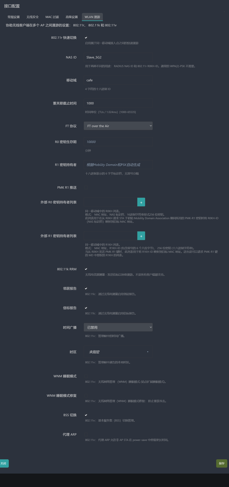
Apply the same settings to all three wireless interfaces, ensuring the NAS ID is unique for each.

Also, make sure the encryption settings are exactly the same on both ends. 802.11r only reduces the re-authentication time during roaming, but it requires that APs within the same roaming domain have consistent parameters: SSID, password, encryption method, Mobility Domain, etc.

If the main router uses WPA2-PSK and the satellite uses WPA2/WPA3 Mixed, or if one enables SAE/FT-SAE while the other only enables FT-PSK, clients may not be able to use the same Fast Transition process during roaming. This can manifest as:
- Brief disconnection of the Wi‑Fi icon during roaming;
- Re-performing the 4-Way Handshake after switching;
- Stuttering in voice/video calls;
- Inability of some IoT devices to connect.

Therefore, if the priority is stable whole-home roaming, it is recommended that all APs participating in the same SSID roaming use:
```text
WPA2-PSK / AES-CCMP / FT-PSK
```

Which in OpenWrt/QWRT is commonly:
```sh
encryption='psk2+ccmp'
ieee80211r='1'
ft_psk_generate_local='1'
ft_over_ds='0'
mobility_domain='cafe'
```

WPA3/SAE can be put on a separate SSID for newer devices, and should not be mixed with the IoT / whole-home roaming main SSID.
## Frequency Band Analysis
My home network environment is relatively complex. The main router is located in the center of the living room, which is openly connected to the kitchen and balcony, so the main router's signal can directly cover those areas. The satellite router is in the study, with bedrooms on both sides. The study and living room are connected by a short hallway, and Bedroom A is separated from the living room by the bathroom:
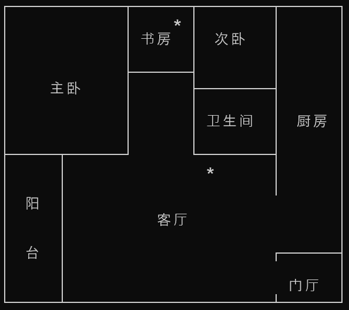
The two asterisks mark the main router (living room) and the satellite router (study).

The frequency band data collected in each room is as follows:
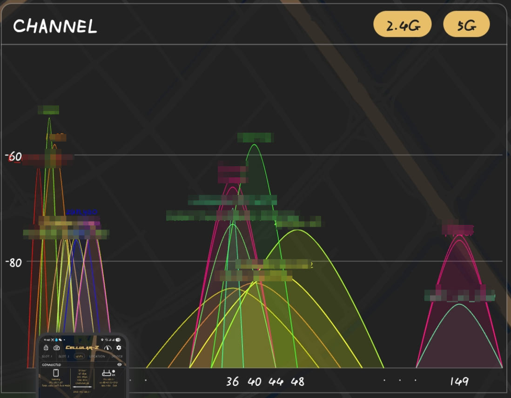
Master Bedroom

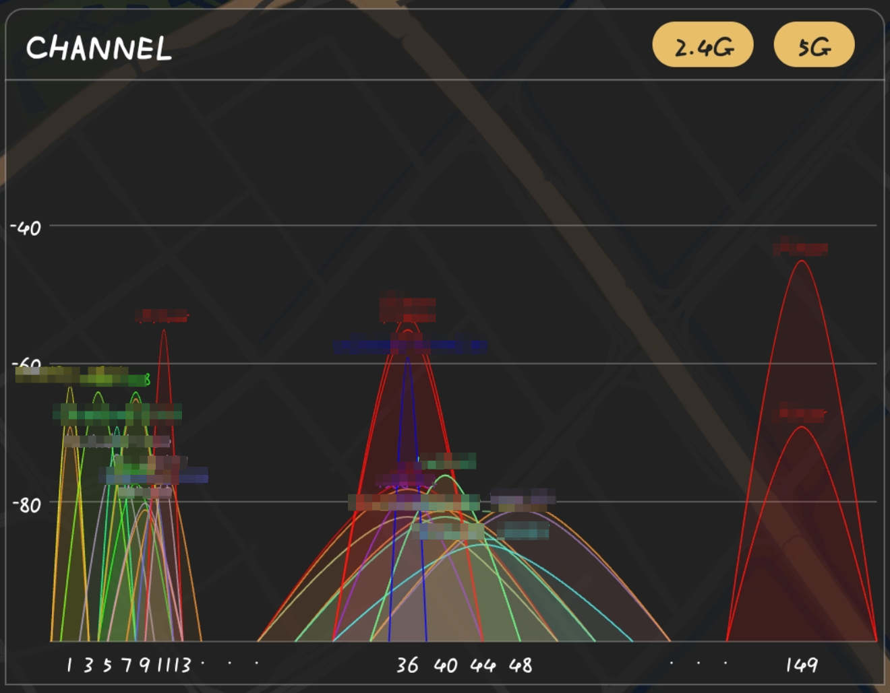
Study (the high red peak here is from the satellite router)

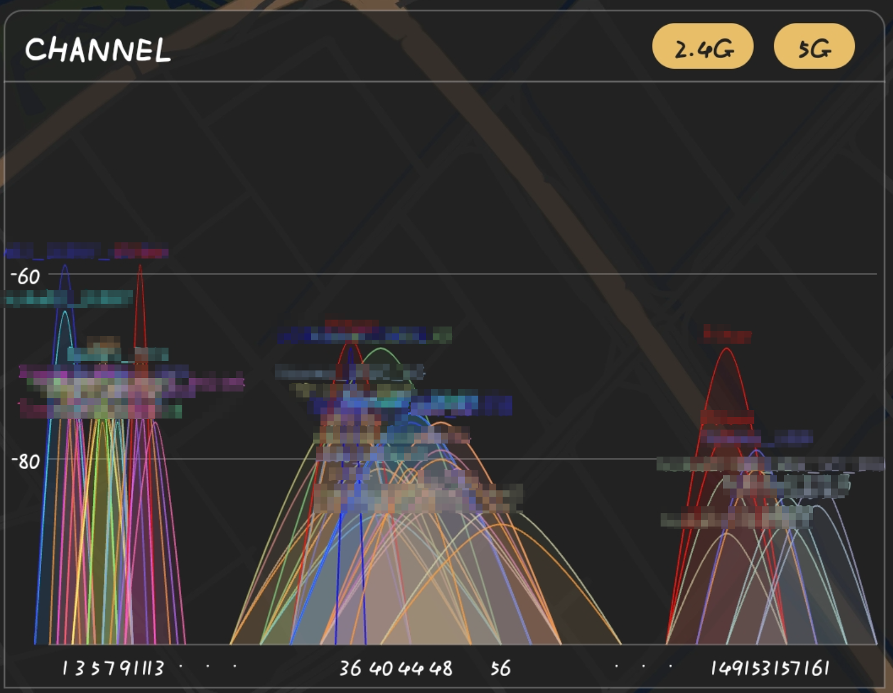
Second Bedroom

It can be observed that the channel in the master bedroom is fairly clean, the study has a strong signal thanks to the satellite router, but the second bedroom suffers from severe interference, coupled with a weaker signal. Additionally, our two APs (the two strongest red Wi‑Fi signals) are currently both crowded onto the same channels, resulting in actual speed tests of only about 80 Mbps.

Therefore, we need to make some minor adjustments to the channels and power levels, and also configure 802.11 k/v/r.

## Tuning Power and Channels
The main goal is to separate the channels and prevent clients from sticking to a specific access point.
I can't fully explain all the reasoning myself; I also referenced a lot of configurations suggested by AI. Let's have AI explain it here too (escape)
### 1. Band Strategy (Channel): Fully Separated to Avoid Co-Channel Interference
The main and satellite routers use **completely non-overlapping** channels on all bands, which is the most critical step in a multi-router setup.
- **2.4 GHz Band (Main 1 / Satellite 11):** In the 2.4 GHz band, only channels 1, 6, and 11 are completely non-overlapping and interference-free. The main and satellite routers occupy channels 1 and 11 respectively, ensuring that the two devices do not "fight" each other (co-channel interference) when transmitting 2.4 GHz signals, thereby ensuring the stability of smart home devices that rely on 2.4 GHz.
- **5 GHz Band (Main 36 / Satellite 52):** The main router uses the lower channel 36, and the satellite uses the DFS channel 52. These two channels are completely independent when using an 80 MHz bandwidth.

**Summary:** This spatial channel isolation means that when a device moves between the main and satellite routers, the background noise floor is minimal, maximizing network throughput.

### 2. Bandwidth Strategy: Balancing Stability and Extreme Speed
- **2.4 GHz uses 20 MHz:** This is a very sensible approach. Although 40 MHz is theoretically faster, in the extremely crowded 2.4 GHz band (microwave ovens, Bluetooth all operate here), enabling 40 MHz multiplies interference, often leading to frequent dropouts. Locking it to 20 MHz sacrifices peak speed but trades it for maximum **wall-penetration stability and coverage**, which is ideal for IoT smart devices that don't require high speeds.
- **5 GHz uses 80 MHz:** 80 MHz is the current sweet-spot bandwidth for most phones and computers, capable of providing extremely high internal network transfer speeds and external download speeds. It is the **primary internet access band**.

### 3. Power Strategy (Tx Power): "Weak 2.4 GHz, Strong 5 GHz"
This power configuration is the most brilliant aspect of this set of parameters, perfectly addressing the "sticky client" problem in multi-AP environments.
- **2.4 GHz Power Lowered (18 dBm / 20 dBm):** 2.4 GHz signals have long wavelengths and strong wall-penetration ability. If the power isn't reduced, a phone moving around the house will stubbornly "cling" to a distant 2.4 GHz signal, resulting in extremely slow speeds. Lowering the 2.4 GHz power on both routers artificially shrinks the 2.4 GHz coverage circle, encouraging the device to disconnect sooner when the signal weakens and search for a better signal.
- **5 GHz Power Maximized (23 dBm / 24 dBm):** 5 GHz signals have poor wall penetration and attenuate quickly. Keeping the power high helps compensate for this weakness, extending the high-speed 5 GHz coverage area.

**Summary:** This power differential configuration creates a natural form of "band steering" at the physical layer. When a phone receives both 2.4 GHz and 5 GHz signals simultaneously, the high-powered 5 GHz signal's strength can easily surpass the low-powered 2.4 GHz signal, making the phone willingly prioritize connecting to the faster 5 GHz network.

### 4. Roaming Coordination
With the physical layer parameters — band, bandwidth, and power — all optimally tuned as described above, the `802.11k/v/r` protocols form a perfect roaming closed loop:
- **11k (Neighbor Report) + 11v (BSS Transition Management):** The routers actively tell the phone "which nearby node has a better signal" and suggest it switch. Because the 2.4 GHz power is suppressed, the phone is more likely to trigger the 11v switching threshold when moving.
- **11r (Fast Transition):** Combined with a unified SSID (PINer) and the same encryption method, this eliminates the several hundred milliseconds normally required for re-entering the password and re-authenticating when the phone switches routers, achieving a truly "seamless" experience (e.g., WeChat voice calls don't drop). The consistent `mobility_domain` and unique `nasid` are also standard requirements for 11r configuration.

_Ref: Gemini_

The final configuration for band, bandwidth, and power is:
* Main Router 192.168.3.1
  - 2.4G: channel 1 / 20 MHz / 18 dBm
  - 5G: channel 36 / 80 MHz / 24 dBm
* Satellite Router 192.168.3.2
  - 2.4G: channel 11 / 20 MHz / 20 dBm
  - 5G: channel 52 / 80 MHz / 23 dBm

---
## Results & Follow-up
In the final testing, connections defaulted to the main router in the living room, balcony, kitchen, and bathroom. In the second bedroom, it automatically switches to the satellite router. Closing the door in the study also triggers a switch from the main router to the satellite. It takes about 5 seconds from signal degradation to the actual switch. The master bedroom was inconsistent; sometimes it switches, sometimes it doesn't, but it switched in 3 out of 5 tests.

Speed test after plugging into the 5 Gbps port:
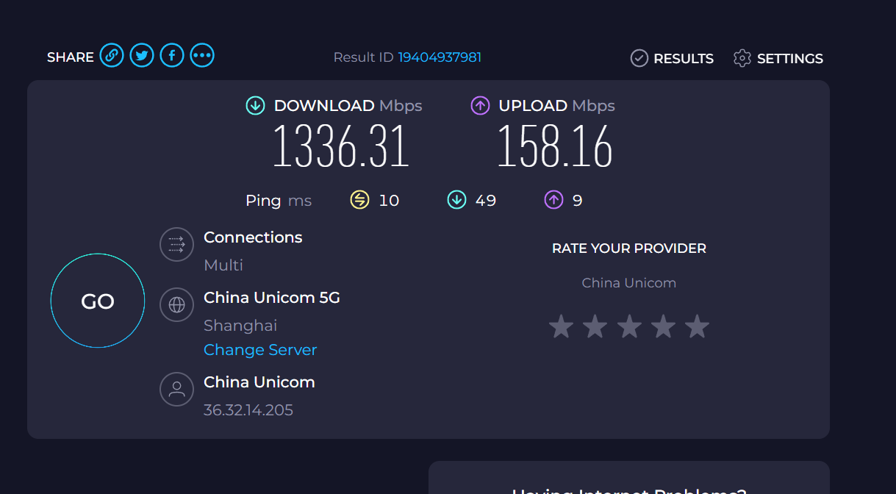
The actual measured downstream speed reached 1336.31 Mbps, and the upstream speed reached 158.16 Mbps. I guess that counts as a success?
However, the perceived improvement in daily use isn't huge because, at the time of testing, very few platforms could saturate such speeds. Combined with current carrier strategies like QoS, speeds are rarely maxed out. Still, multi-threaded download tools like IDM might be able to take better advantage of it, I suppose?