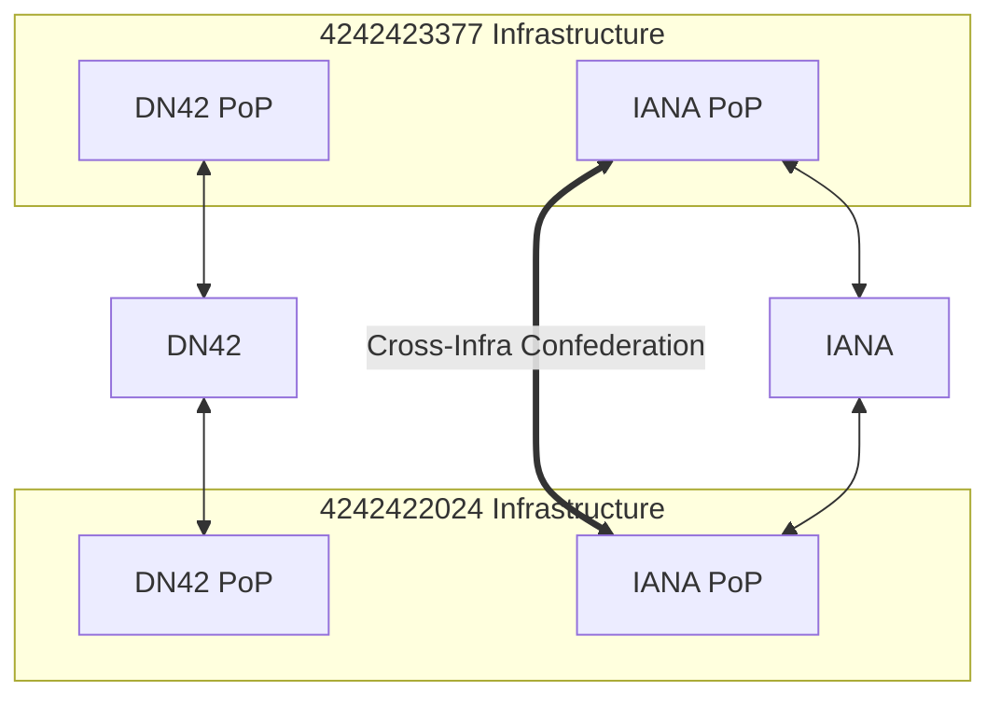
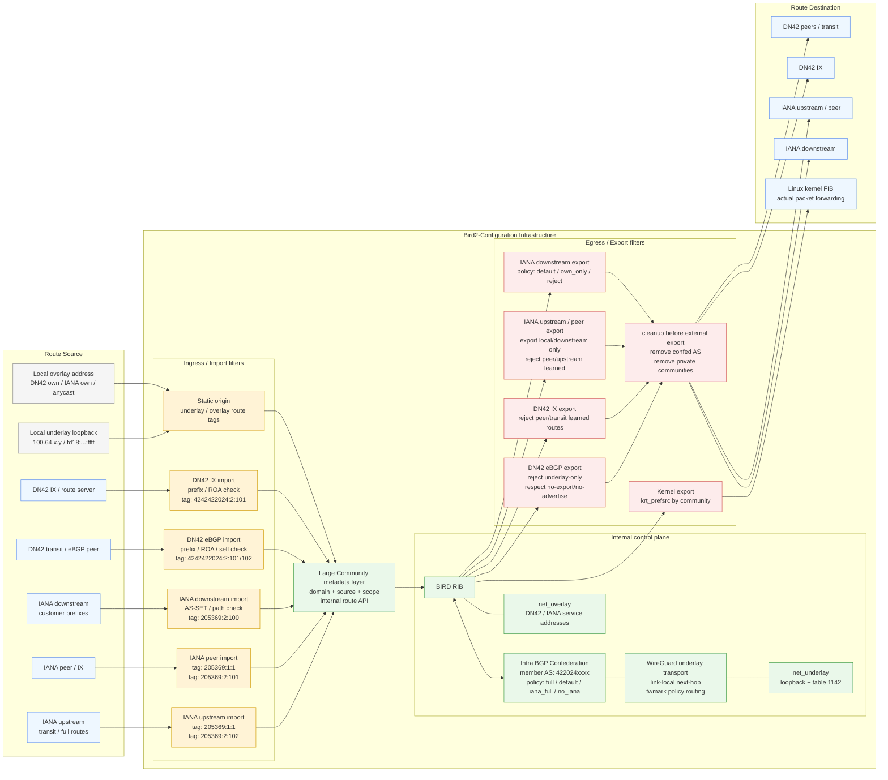
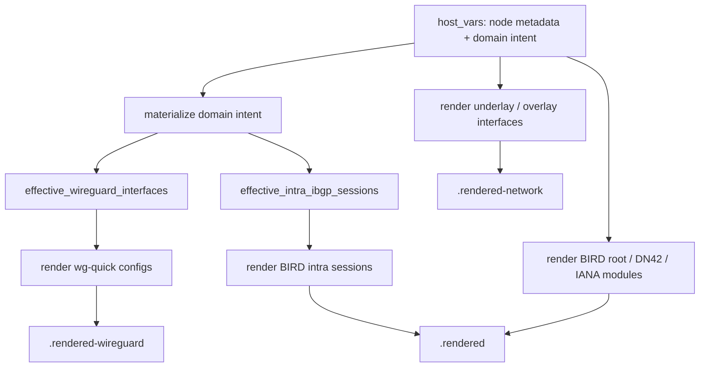

> This article does not go into implementation details in depth; it only records the internal network architecture design process and automation ideas. If you need reference code or configuration files, please see [iYoRoy-Network/bird2-config: BIRD2 Configuration for iYoRoy Network (AS4242422024, AS205369)](https://github.com/iYoRoy-Network/bird2-config). The repository contains a significant amount of AI-generated code.
_This article only borrows the logical layering concept of Underlay/Overlay (base layer/business layer), specifically referring to the separation of address roles, and does not involve tunneling encapsulation technologies such as VXLAN/GRE._

# TL;DR
The entire internal network architecture was refactored. What was originally a horizontally split network based on “DN42 / IANA / WireGuard / BIRD config files” was transformed into a set of infrastructure organised by network intent. The final design can be summarised as:
- Use WireGuard to carry underlay transport between nodes;
- Use BGP Confederation instead of OSPF / full-mesh iBGP as the internal routing backbone;
- Separate node identity and service addresses with Underlay / Overlay;
- Automatically derive AS, loopback and link-local addresses from Tier / Region / Node ID / Token;
- Use BGP Large Community to express route origin, propagation scope and export policy;
- Use Ansible to compile high-level peer intent into WireGuard + BIRD + interface configurations and deploy them automatically.

# Background
In some earlier articles from these two series, we successfully brought up a DN42 AS and an IANA AS, with the same infrastructure carrying traffic for both networks simultaneously. In a previous post, [DN42&OneManISP - Troubleshooting OSPF Source Address in a Coexistence Environment - iYoRoy's Develop Diary](https://blog.iyoroy.cn/en/archives/208/), there was already some initial separation and isolation for the two networks. However, as the number of nodes grew, manually maintaining the WireGuard and BIRD configuration files for this whole thing became more and more complex. Moreover, public network nodes also needed to interconnect and provide mutual IP transit, so in the end I decided to do a thorough refactoring of this entire internal network.

# Analysis
## Problems with the Old Architecture
Before the refactoring, DN42 routes between nodes were mutually propagated, using OSPF over WireGuard as the IGP, with full-mesh iBGP on top to carry full routing information between border routers. For IANA traffic, nodes were completely isolated from each other, with each node independently advertising its own /48 IANA IPv6 prefix.

To sum up:
- WireGuard was responsible for tunnels between nodes;
- OSPF over WireGuard was responsible for the IGP;
- DN42 border routers ran full-mesh iBGP on top;
- IANA nodes basically each independently advertised their own public prefixes.

This architecture worked well when there were few nodes, but problems started to become apparent as the number of nodes increased:
1. WireGuard, OSPF, and BIRD configurations had to be maintained separately;
2. Adding a new node required changes in multiple places, making it easy to miss something;
3. Routing policies for DN42 and IANA influenced each other, yet the configuration was scattered;
4. Cross-PoP scheduling of IANA prefixes was not natural;
5. Some nodes were only transit nodes but were forced to have an overlay identity;
6. Source address selection, route leaks, and exposure of internal addresses became increasingly difficult to control.

## Design Goals and BGP Confederation
The main goals for this refactoring were:
1. Adding nodes should be simple: ideally, only the node identity and peer relationships need to be described;
2. DN42, IANA and the internal backbone should be able to share infrastructure while remaining policy-isolated from each other;
3. IP addresses should be schedulable resources, not fixed identities of nodes;
4. The internal topology should not leak to external BGP peers;
5. Configurations should be generated from declarative data, not by handwriting lots of repetitive WireGuard/BIRD sessions;
6. The deployment process should be automated.

There were also several other, more detailed requirements:
1. Some IANA nodes should be able to carry IP transit for other nodes, using an IANA PoP to advertise public IPs for other nodes;
2. Currently, the IANA AS is maintained jointly by [たのしい](https://leziblog.com/) and myself; we need to coordinate, with some infrastructure needing mutual transit and route tuning;
3. We only have one 44Net IPv4 /24 (sponsored by たのしい); if we want to advertise it, all nodes would need iBGP interconnection and an IGP, otherwise only a single PoP can use it;
4. The IANA AS needs to accept downstreams;
5. Route optimization is needed between IANA PoPs.

The previous IANA IPv6 prefix assignment rule followed **Continent 3 bits** + **Region 3 bits** + **Multi-node within region 2 bits**, carving several /48s out of a complete /40. However, due to certain upstream limitations on the number of advertised prefixes, and because such fragmented prefixes are unfavourable for IPAM, we planned to eventually aggregate external advertisements only to the continent level, and then handle more detailed parts via internal iBGP routing.

The internal network structure on たのしい's side is BGP Confederation, implemented with a manually simulated approach.

Actually, after this analysis, defining the internal network architecture became quite straightforward: the most suitable solution was to switch the internal network to BGP Confederation as well, and then utilise the concept of "BGP as IGP" to advertise /32 and /128 routes within the confederation to handle internal routing. At the same time, because a confederation avoids the split-horizon characteristic of traditional iBGP, it doesn't require strict full-mesh, nor does it need separate iBGP instances, making it very decentralized xD.

Furthermore, BGP Confederation can be easily merged with たのしい's infrastructure, requiring only that both sides treat the other's internal ASes as confederation ASes.

This solution has another benefit, because the containment relationship of our infrastructure is actually like this:


Our DN42 PoPs and transit are isolated, but the IANA PoPs and transit are interconnected. In the BGP Confederation scenario, we can use filters + BGP (Large) Community to isolate route origins while still exchanging IANA traffic engineering intents, achieving a single standard usable across both infrastructures.

## Overlay and IPAM
In the old design, a node often simultaneously held two identities:
1. It was a router in the network;
2. It was also a service address holder reachable within DN42 / IANA.

After the refactoring, I decided to separate these two identities:
- Underlay: the node's identity as a router, used for internal interconnection, next-hop, tunnels, and forwarding;
- Overlay: the DN42 / IANA address used when the node provides services to the outside world or accepts traffic.

This way, a node can only participate in forwarding without having a DN42 IPv4 address; it can also temporarily announce a certain overlay /32 or /128 when needed.

In practical application scenarios, my DN42 address space is not very abundant; I originally registered a /28, with only 16 usable addresses. Some nodes, like IEPL tunnel nodes or IX nodes, only perform forwarding roles, do not need to host services, and do not need to be connected from the outside. Therefore, theoretically they do not need to be assigned independent, reachable DN42/IANA addresses.

Moreover, since we had already decided to switch the internal network to BGP Confederation, based on this configuration we could re-plan the originally horizontally split DN42 + IANA network structure into a vertical Underlay + Overlay division. DN42 and IANA addresses/traffic become the payload of the upper-layer Overlay Network, while the lower-layer Underlay Network serves as the infrastructure for underlying communication and forwarding between nodes. In this scenario, IP addresses become resources that can be easily scheduled within the internal network, rather than unique IDs bound to a node.

The advantages are clear:
1. Saves scarce address resources: transit nodes can have only an underlay identity, without needing DN42 IPv4 or public addresses;
2. Anycast and address migration: Overlay addresses become resources schedulable via BGP, no longer tightly bound to a specific machine;
3. Hides transit nodes: pure transit nodes do not need to expose globally reachable addresses, making it harder for outsiders to directly probe the internal topology;
4. Easy new node onboarding: new nodes join the underlay first, and overlay addresses are assigned when they need to carry services;
5. Elegant transit delivery: IANA PoPs can deliver customer prefixes or service addresses to other nodes via the internal confederation.

# Design
In summary, the final design consisted of the following IPAM mechanism and automation workflow.

Each node possesses some basic metadata:
* Tier: indicates the node's purpose, e.g., backbone, IX access, or intra-net node
* Region: the continent region where the node is located
* ID: the node's ID within that region
* Token: a random 16-bit string assigned to the node, used as a unique ID for the node under IPv6

For Tier and Region, several tables were created as data sources:

| Tier | Desc                |
| ---- | ------------------- |
| 1    | Backbone            |
| 2    | IX                  |
| 3    | Backbone + IX Mixed |
| 9    | Node                |

| Region | Desc          |
| ------ | ------------- |
| 0      | Reserved      |
| 1      | Asia          |
| 2      | Europe        |
| 3      | Africa        |
| 4      | North America |
| 5      | South America |
| 6      | Oceania       |
| 7      | Antarctica    |

#### Confederation AS: 4220240000 – 4220249999
Assignment rule: 
```text
422024{tier}{region}{node_id:02d}
```
Where `tier` indicates the node's purpose, `region` indicates the area where the node is located, and the last two digits `node_id` distinguish different nodes within the same region.

#### Underlay IPAM
IPv4 Prefix: 100.64.0.0/16  
Assignment rule: 
```text
100.64.{tier*10 + region}.{node_id}/32
```
IPv6 Prefix: fd18:3e15:61d0:ffff::/64  
Assignment rule: 
```text
fd18:3e15:61d0:ffff:{tier}:{region}::{node_token}/128
```
To simplify the automation workflow, I also intended to bring the link-local addresses between WireGuard tunnels under automated management, generating them using the aforementioned Tier, Region, and Token, with the automation scripts generating WireGuard configuration and automatically setting up the tunnel and confederation BGP session.  
The link-local assignment rule generally follows the normal IPv6 rule:
```text
fe80::2024:{tier}:{region}:{node_token}/64
```
Thus, each node only needs to be assigned its metadata to automatically generate the internal network confederation AS and addresses according to the rules above.

#### Overlay IPAM
The DN42 IPv4 part is assigned manually. This part has some historical legacy architecture, and changes need to be merged into the official registry, so I plan to assign it manually.  
The Underlay IPv6 is itself DN42-reachable; if other DN42 IPv6 addresses need to be allocated, they can simply be advertised on demand.

For IANA IPv6, the current design format is to first calculate the continent /43 according to the initially proposed rule, e.g., for Asia:
```text
2a14:7583:f220::/43
```
Then calculate the /46 based on the region, e.g., for Hong Kong region HKG:
```text
2a14:7583:f224::/46
```
Next, bits from /46 to /112 are set to zero, and the last 16 bits are filled with the node Token to serve as the node's IANA IPv6 address. For example, one of my backbone nodes in Hong Kong:
```text
2a14:7583:f224::7d89/128
```

#### Community Isolation Mechanism
In this architecture, BGP Large Community effectively acts as the metadata and control information carried along with a route as it propagates between different modules and infrastructures. Based on this metadata, when we export routes to different external peers we can determine:
* Does it belong to DN42 or IANA?
* Is it locally originated, brought in by a downstream, learned from a peer, or learned from an upstream?
* Can it be exported to other ASes?
* Is it underlay-only?
* Does this route need AS prepending?

As a concrete example, if the first identifier marks the route origin/destination as DN42 or IANA, all routes permitted to be sent to DN42 will be tagged with:
```text
(4242422024, 1, 1)
```
Similarly, all routes destined for IANA will be tagged with:
```text
(205369, 1, 1)
```

Within various protocols, this acts as a master switch, controlling whether export should occur. IANA upstream export filter:  
```nginx
template bgp iana_upstream_v6 {
	...
	
    ipv6 {
		...
        import filter {
            if !iana_filter_default_check() then reject;  # basic check
            remove_confederation_as();                    # remove confederation as to prevent external peers from maliciously carrying internal as
            remove_private_community();                   # remove private community to prevent external peers from maliciously manipulating internal routes
            iana_upstream_add_community();                # tag all routes from IANA with community permitting broadcast in IANA infrastructure
            accept;
        };
        export filter {
            if !iana_filter_default_check() then reject;     # basic check
            if !iana_upstream_check_community() then reject; # check community: is this a route destined for IANA / does it carry no-advertise/no-export etc.
            remove_confederation_as();                       # remove confederation as
            remove_private_community();                      # remove private community
            accept;
        };
		...
    };
	...
}
```

Where `iana_filter_default_check()` is used to check prefix length, ROA, whether it is a default route, and other miscellaneous content:
```nginx
function iana_filter_default_check(){
    if net ~ [::/0] then return false;
    if net.len > 48 then return false;
    if bgp_large_community ~ [(IANA_OWNAS,1,1)] && is_self_iana_v6() then return true;
    if roa_check(iana_roa_v6, net, bgp_path.last) = ROA_INVALID then return false;
    return true;
}
```

`remove_confederation_as()`, as the name suggests, removes internal confederation ASes:
```nginx
function remove_confederation_as() {
    bgp_path.delete([4220240000..4220249999]); # 4242422024 Infrastructure
    bgp_path.delete([4233770000..4233779999]); # 4242423377 Infrastructure
}
```

`remove_private_community()`, as the name suggests, removes internal Communities. The current implementation is very rough and needs detailed refinement later, because some Communities should be open to downstreams, allowing them to use Communities to convey routing intents and perform optimizations, such as prepending AS path, which can be used for route tuning or traffic engineering:
```nginx
function remove_private_community(){
    bgp_large_community.delete([(4242422024, *, *)]);
    bgp_large_community.delete([(205369, *, *)]);
}
```

`iana_upstream_add_community()`, tags all routes from upstream with the Community allowing circulation in the IANA infrastructure, as well as a route source identifier:
```nginx
function iana_upstream_add_community(){
    bgp_large_community.add((205369,1,1));
    bgp_large_community.add((205369,2,102));
}
```
Where `(205369,2,102)` identifies the route as coming from an upstream. Route sources are divided into three types: **Upstream**, **Peer**, **Downstream/Customer/Self (treated as customer)**. For these three different types of BGP sessions, the exported routes usually differ:
* To upstream: we need the upstream to advertise our own prefixes and our downstreams' prefixes, so all routes originating from **downstream** should be exported to upstream.
* To downstream: we need to provide network services, so we need to export all routes we know, i.e., routes from **upstream, peer, downstream**.
* To peer: peering connections are solely for both parties to access each other's networks, so we must not export each other's upstreams or peers, otherwise it becomes free transit/tunneling. Therefore, only routes from **downstream** are exported.
Correspondingly in the current internal network, routes from peers are tagged `(205369,2,101)`, and routes from downstreams are tagged `(205369,2,100)`.

`iana_upstream_check_community()` checks the route's Community, and based on the principles above, judges whether it should be advertised to upstream:
```nginx
function iana_upstream_check_community(){
    if !(bgp_large_community ~ [(205369,1,1)]) then return false;      # not permitted for broadcast in IANA infrastructure, reject
    if bgp_large_community ~ [(205369,65535,65282)] then return false; # no-advertise
    if bgp_large_community ~ [(205369,65535,65281)] then return false; # no-export
    if bgp_community ~ [(65535,65281)] then reject;                    # no-advertise
    if bgp_community ~ [(65535,65282)] then reject;                    # no-export

    if bgp_large_community ~ [(205369,2,0)] then return false;         # from internal network, this community is used to identify routes from the internal network that should not be advertised externally, reject here
    if bgp_large_community ~ [(205369,2,101)] then return false;       # from peer, reject advertisement
    if bgp_large_community ~ [(205369,2,102)] then return false;       # from upstream, reject advertisement

    return true;
}
```

Similarly, a similar check mechanism applies to DN42. Based on this mechanism, isolating the DN42 and IANA networks becomes very straightforward.

The above is just a general explanation; finer community design and various export policies could be further elaborated, but that would turn into another article on routing policy details.

This part actually draws heavily from [たのしい’s BGP Communities](https://t.me/as4242423377/26); after all, both infrastructures need to interoperate, and many community specifications are basically copied. Thanks to たのしい for providing the ideas~

# Route Lifecycle
## Phase 1: Ingress / Import
When all external routes enter the system, they first pass through the import filter of the corresponding domain.
IANA has three types of sources:
- upstream;
- peer / IX;
- downstream.

DN42 also has two main types of sources:
- regular transit / eBGP peer;
- IX / route server.

In addition, the local machine also originates some routes:
- underlay loopback;
- DN42 overlay address;
- IANA own / anycast address.

These routes are tagged with Large Communities upon entering the confederation. All subsequent filters must be adjusted based on this.

## Phase 2: Core / Intra Confederation
After entering the BIRD RIB, routes propagate between nodes via the internal Intra BGP Confederation. Here, Intra Confederation is not just about handling connectivity, but more importantly, allowing internal routes to carry policy information as well.

The previous OSPF was great at solving:
* Where is this loopback?
* How to reach this next-hop?

But it could not convey AS information and policy intents, for example:
* This route was learned from an IANA peer and must not be exported to another peer;
* This route is DN42 underlay-only and must never be leaked to eBGP;
* This route is a downstream customer prefix and can be exported to upstream.

All of these are strengths of BGP policy. So moving the internal backbone from OSPF / full-mesh iBGP to confederation-style BGP is essentially upgrading the internal control plane to a "policy-carryable control plane".

## Phase 3: Egress / Export
When a route is about to leave the infrastructure, it passes through the export filter again. Here, based on communities, systemic prevention of route leaks and macro-control like AS prepending can be performed.

For example:
- DN42 underlay routes carry an underlay-only community and thus are not exported to DN42 eBGP;
- Routes learned from an IANA upstream are not exported to another upstream;
- Routes learned from an IANA peer are not exported to another peer;
- Routes learned from a DN42 IX are not exported back to IX;
- NO_EXPORT / NO_ADVERTISE are respected;
- Before external export, internal confederation ASes and private communities are removed.

In summary, it can be illustrated by this diagram:


# Automation: Compiling Network Intent into Configuration
All the above discussion on IPAM, Confederation AS, Underlay/Overlay, and BGP Communities would not truly solve the problem if it still ended up being maintained by hand-written configurations; it would just move the complexity from one form to another. Before this refactoring, adding a new node or peer often required simultaneous changes in many places:
* WireGuard configuration: interface name, listen port, peer public key, endpoint, allowed IPs
* BIRD configuration: BGP protocol name, neighbor address, neighbor interface, ASN, import/export filter
* IPAM-related configuration: loopback, link-local, router id, overlay address
* Deployment-related configuration: which nodes need rendering, which services need restarting
* Some special cases: nodes behind NAT, passive peers, special local AS, special filters

Logically, these things describe the same thing: **a connection belonging to a certain routing domain exists between two nodes**.  
But in manual configuration, they end up scattered across WireGuard, BIRD, network interfaces, systemd/openrc, and other places. If just one field is missed or inconsistent, very strange problems can occur, such as WireGuard being up but BIRD neighbor pointing to the wrong interface; or the link-local being changed, but the peer session still having the old address.

So in this refactoring, I didn't want Ansible to just be a tool that "fills YAML into Jinja2 templates". If we simply moved the original hand-written config into templates, we would essentially still be maintaining a pile of low-level configurations, just in a different file format. Since automation was introduced, the input should not be "I want to generate a configuration file that looks like this", but rather:
* Who is this node?
* Which tier / region does it belong to?
* Who does it interconnect with?
* Does this connection belong to DN42, IANA or Intra?
* What import/export policy should this connection use?
* Does it have special constraints like NAT, passive, endpoint override?

As for the specific WireGuard interface wording, how the BIRD session is written, what the link-local address is – all these should, as much as possible, be generated by the automation system based on rules.

## Source of Truth: Node State, Not Config Files
The input for this automation is mainly placed in Ansible's `host_vars`. The variables for each node are no longer just parameters needed for template rendering, but the description of the node's identity in the network. For example, a node will have at least:
* `tier`: node tier, e.g., backbone, IX, normal node
* `region`: region where the node is located
* `node_id`: node number within the same region
* `node_token`: a stable 16-bit token used to generate the IPv6 address suffix

These fields are used for IPAM address management and identification information within the Confederation (as mentioned earlier, AS calculation and IP address derivation). The advantage of this approach is that when a new node joins, we just need to configure its basic metadata, and all its fundamental identities within the underlay are already determined. This significantly reduces subsequent maintenance effort. If link-local addresses were handwritten in every BIRD session, then any change to a node's token or address rule would require changes on all peers; but if the BIRD neighbor address is automatically derived from the peer node's metadata, it always stays consistent with the source of truth.

## Domain Intent: Declarative Peer Configuration
The most important abstraction in this automation is **Domain Intent**, which treats the Session and its corresponding WireGuard tunnel binding as a single entity, then partitions them by the network type (DN42/IANA/Intra). Taking an Intra peer as an example, an internal connection fundamentally requires two types of configuration simultaneously:
1. WireGuard interface, to provide the transport tunnel
2. BIRD BGP session, to exchange routes over this tunnel

If maintained manually, these two parts easily duplicate the same information:
* interface name
* peer node
* listen port
* endpoint
* neighbor interface
* BGP protocol name
* import/export policy

So we abstract a regular Intra peer into a single peer intent. Simplified, it looks something like this:
```yaml
- node: tyo03-jp
  interface: intra_tyo03
  wireguard:
    listen_port: 10234
    passive: true
  bgp:
    protocol: intra_ibgp_tyo03
    ipv4:
      import_policy: full
      export_policy: full
    ipv6:
      import_policy: full
      export_policy: full
```

This declaration does not directly correspond to a single configuration file, but describes the peer intent:

> There is an internal connection named `intra_tyo03` between the current node and `tyo03-jp`. This connection uses WireGuard for transport, and establishes an Intra BGP session over it, with BGP policy using `full`.

Afterwards, Ansible automatically renders the corresponding WireGuard and BIRD configuration based on this.

Thus, a peer relationship only needs to be described once, and the subsequent low-level configuration is generated automatically. For example, the BIRD neighbor's link-local address does not need to be handwritten; it can be automatically obtained from the peer node's `tier / region / node_token`. The WireGuard endpoint can also be automatically derived from the peer's `ansible_host` in the inventory and the peer's return peer `listen_port`.

The biggest advantage of this is avoiding state inconsistency between multiple configuration layers.

## Automatic Endpoint Derivation and Passive Peers
In my internal network architecture, not all nodes have perfectly symmetric public reachability. For example, some nodes / DN42 peers are behind NAT and can only initiate connections; some tunnels require a fixed endpoint as the listener, with the other end initiating. Therefore, the peer intent must support special cases like passive listening. If a peer is not passive, the automation can attempt to read `ansible_host` from the peer's inventory, combine it with the `listen_port` declared by the peer, and automatically generate the WireGuard endpoint:
```text
endpoint = peer_ansible_host + ":" + peer_return_listen_port
```
If the peer is marked as passive, no endpoint is rendered, allowing the peer to actively initiate the connection.

Essentially, the endpoint is determined by "how the peer is accessed" and "which port the peer listens on". These two pieces of information already exist in the inventory and peer intent, so there's no need to duplicate them. Of course, for extremely unusual links, the most basic manual override for the endpoint is retained. The goal of automation is not to eliminate all edge cases, but to make the normal cases require no special handling.

## Generic Scenarios & Exceptions
This is essentially a fallback mechanism for special cases:
* Legacy tunnels
* Special internal peers carried over DN42
* Nodes behind NAT
* Temporary workarounds
* Peers requiring strange BGP parameters
* Certain sessions needing special local AS
* Some routes only intended for the IANA domain, not the DN42 domain

The final design kept: most regular Intra peers can generate WireGuard + BIRD via domain intent. DN42 peer WireGuard can also be generated from DN42 peer intents. However, some special BIRD sessions, such as those requiring separate `local_as` or special export policies, can still be explicitly declared using low-level configuration. Before final rendering, Ansible merges the generated configuration and legacy/manual overrides into the final configuration.

The benefit is that automation covers 90% of the repetitive and error-prone parts, while still leaving room for the remaining 10% of special cases.

## Configuration Rendering
The entire rendering process can be roughly understood as:



There are three types of final artifacts:
* `.rendered/`: BIRD configuration
* `.rendered-wireguard/`: WireGuard configuration
* `.rendered-network/`: underlay / overlay dummy interface configuration

The BIRD configuration is further divided into several modules, written via Jinja2 templates; the actual overlay network separation is also handled here:
* root config: global defines, includes, kernel protocol
* DN42 module: DN42 filters, RPKI, eBGP peers, IX peers
* IANA module: upstream, downstream, peers, RPKI, static routes
* Intra module: confederation-style BGP sessions, static routes, internal filters

Whether these modules are included is also decided automatically based on data as much as possible. For instance, if a node has no DN42 peers, there's no need to render and include `ebgp.conf`; no IX sessions, no need to include `ix.conf`. This reduces empty configurations and meaningless includes, and avoids some nodes failing template rendering due to missing related variables.

## Validation & Deployment
The final deployment process also added some check and validation stages:
1. render BIRD
2. validate BIRD
3. render WireGuard
4. validate WireGuard
5. deploy dummy interfaces
6. deploy WireGuard
7. deploy BIRD

BIRD configuration is rendered and validated locally first to catch syntax errors as early as possible. WireGuard configuration is also rendered and validated first to avoid missing keys or generating obviously invalid wg-quick configs. Finally, after all validations pass, the underlying interfaces + WireGuard are deployed, and only then is BIRD uploaded and reloaded.

# Conclusion
_I'm exhausted; this article has drained me. Why is narrating this architecture in linear language so difficult?_

After sorting things out, most of the code was basically written by AI, and the results were decent. If you need a reference, see [bird2-config/ansible at dev · iYoRoy-Network/bird2-config](https://github.com/iYoRoy-Network/bird2-config/tree/dev/ansible).

The applicable scenarios for this solution are actually quite narrow; the DN42 + IANA BGP Player scene is really too niche xD. Moreover, a major reason this solution can function properly is that the IANA prefixes and DN42, along with the address ranges chosen for my own internal network, do not conflict at all. If there were address conflicts in the transit segments, one would probably still need to consider proper ISP isolation solutions like VRF/MPLS L3VPN.

---
References:
* [Configure BGP Confederation & Fake Confederation in Bird (Updated 2020-06-07) - Lan Tian @ Blog](https://lantian.pub/en/article/modify-website/bird-confederation.lantian/)
* [浅谈 BGP 中的 Transit（中转）与 Peering（对等互联） | 网络蝙蝠侠部落](https://heiok.com/bgp-transit-and-peering.html)