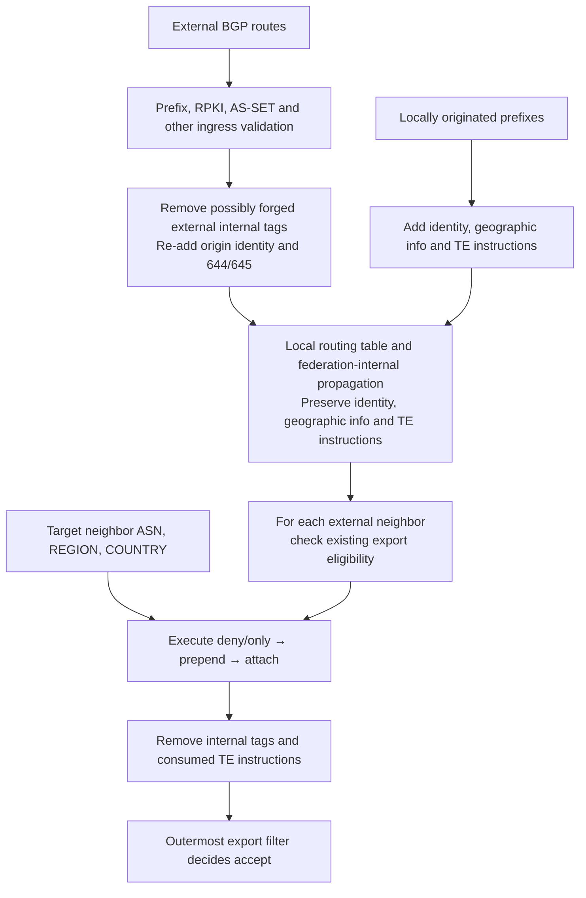

# Foreword

In the previous article, we used Ansible to automatically configure WireGuard and Bird2, building a cross-region virtual BGP confederation backbone. But this backbone has an inherent problem: **BGP path selection is not aware of physical latency**. Within the federation, the AS path between nodes is often very short; for example, from Hong Kong to Europe it may be only 1 to 2 hops, yet the actual physical RTT between them is still very high.

This introduces a risk: if the same overlay prefix is announced to both the Hong Kong and Europe nodes at the same time, inbound traffic may leave through the Hong Kong upstream and land on the Europe PoP, then travel back to Hong Kong over the high-latency virtual link. The problem is amplified even further when we peer directly with a Tier 1 ISP such as Hurricane Electric (AS6939). Once a prefix enters HE's backbone, it is usually propagated widely and preferred; if a Hong Kong-region prefix is mistakenly announced to HE from the Europe node at that point, a large amount of traffic will be attracted to HE's Europe ingress and then detoured back to Hong Kong, significantly raising the overall latency of local network access in Hong Kong.

Therefore, on this backbone, merely getting the BGP sessions running is not enough. We need to introduce some traffic control mechanisms that make clear where a route comes from, which domain it belongs to, where it should be announced from, and where it is allowed to propagate, so as to avoid routes from the wrong region being exported to the wrong upstream. This is what is called traffic engineering, and it is generally implemented with BGP (Large) Communities.

# Principles

It is actually the same idea as the earlier control over marking whether a route is internal or external, and whether it is DN42 or IANA: "tag" prefixes to convey routing intent, and "translate" those tags into corresponding actions when announcing at the border routers.

Generally speaking, common traffic engineering techniques can be divided into five categories:

1. **Propagation scope control**: Control whether a prefix is exported in a certain region, country, or PoP, or to a peer; it can also be restricted to visibility only in specific domains such as DN42/IANA/federation-internal. Typical actions include allow/deny export, `NO_EXPORT`, `NO_ADVERTISE`, and announcing only aggregates while suppressing more-specifics.
2. **Inbound path influence**: Influence which ingress external traffic enters through. The most common method is **AS Path Prepend**: prepend your own AS in front of a designated upstream or region to lengthen the AS path and lower that path's preference; you can also choose to announce a prefix only at some PoPs, or use more-specific prefixes for selective traffic steering, though the latter should be used with caution.
3. **Outbound path selection influence**: Influence which exit your own traffic leaves through. Common methods are **Local Preference**, **MED**, next-hop/source address selection, and in overlay scenarios choosing which underlay address to egress from. These are usually not propagated to external parties via communities but executed in local policy. Unlike propagation scope control, this category operates on internal routes, while propagation scope control operates on prefixes when exporting outward.
4. **Path state and primary/backup**: Use tags to mark primary paths, backup paths, maintenance state, or blackhole state. For example, backup paths use long prepends or lower Local Preference so that they only take effect passively after the primary path disappears; during maintenance, graceful shutdown is used to bring a path down gracefully; anomalous traffic is dropped with a blackhole community.
5. **Upstream TE translation**: If the upstream supports customer TE Communities, the border router can translate internal Large Communities into communities the upstream understands, such as region preference, prepend, blackhole, etc. In this way, internally you only need to express routing intent, such as "I want this route to egress from HK with lower priority", while how it is expressed to the upstream is translated by the border policy into the upstream's TE Communities and executed by the upstream.

We do not actually need to implement all of it; I chose to implement only the following parts:

1. Well-known `NO_EXPORT`, `NO_ADVERTISE`, `BLACKHOLE`;
2. Origin type identification, as mentioned above: from a downstream, from a peer, or from an upstream;
3. Geographic tags, used to identify which region/country the route was received from; this is the basis for later region-based policy matching;
4. Export scope control: for a specified region/country/ASN, export only to it, or deny export to it;
5. AS Path Prepend: prepend your own AS 1/2/3 times when exporting to a specified region/country/ASN.

These already cover most of the scenarios I need.

# Tag Design

_This step actually derives from たのしい's Community specification, because our two infrastructures jointly bear the AS 205369 backbone network_

As before, Communities and Large Communities are used to carry the information. For IANA prefixes, use `205369`, i.e., our own public AS number, as the first part of the Large Community; for DN42 prefixes, use `4242422024`; for internal routes, use `4220240000`. The second part is the function number, and the third part is the operation target or recorded value.

In summary:

```
(asn, operation, target)
```

Well-known ones use regular Communities, following common conventions:

```
(65535, 666)   # BLACKHOLE
(65535, 65281) # NO_EXPORT
(65535, 65282) # NO_ADVERTISE
```

The final function numbers are as follows:

## Marking and Identification

| Function | Parameter         | Implemented function                                                          |
| -------- | ----------------- | ----------------------------------------------------------------------------- |
| 2        | 100 / 101 / 102   | Marks the origin as Customer / Peer / Upstream, mentioned in the previous article |
| 644      | REGION or COUNTRY | Route origin, i.e., the region/country where the peer is located              |
| 645      | REGION or COUNTRY | Route reception location, i.e., the region/country where the local PoP is located |

A peer's geographic location can be configured separately; when not specified, the local node's location is used by default. This also means we need to give every node a geographic location. For self-originated routes, both 644 and 645 are filled in with the local location.

## Export Restrictions

| Function       | Parameter | Implemented function                                         |
| -------------- | --------- | ------------------------------------------------------------ |
| 650 / 651      | REGION    | Deny export to / only export to the specified region         |
| 660 / 661      | COUNTRY   | Deny export to / only export to the specified country        |
| 670 / 671      | ASN       | Deny export to / only export to the specified AS             |

The same function number can hold multiple values, forming an allowlist that the various edge nodes handle on their own; region, country, and ASN restrictions must all be satisfied at the same time, and deny rules take precedence. These rules match the target peer's configured location and ASN, not the route's 644/645 tags.

## AS Path Prepend

| Function       | Parameter | Implemented function                                           |
| -------------- | --------- | -------------------------------------------------------------- |
| 691–693        | ASN       | Prepend 1 / 2 / 3 times to the specified AS                    |
| 694–696        | ASN       | Prepend 1 / 2 / 3 times to non-specified ASes                  |
| 697–699        | REGION    | Prepend 1 / 2 / 3 times to the specified region                |
| 700–702        | REGION    | Prepend 1 / 2 / 3 times to non-specified regions               |
| 703–705        | COUNTRY   | Prepend 1 / 2 / 3 times to the specified country               |
| 706–708        | COUNTRY   | Prepend 1 / 2 / 3 times to non-specified countries             |

Prepends triggered by different function numbers can stack; the same function with multiple targets will not be executed repeatedly. The counts here are additional repetitions and do not include the automatic handling during a normal eBGP export.

## Additional well-known Communities

| Function             | Action                                                          |
| -------------------- | --------------------------------------------------------------- |
| 100666 / 200666      | Attach 65535:666, BLACKHOLE, to the specified / non-specified AS |
| 165281 / 265281      | Attach 65535:65281, NO_EXPORT, to the specified / non-specified AS |
| 165282 / 265282      | Attach 65535:65282, NO_ADVERTISE, to the specified / non-specified AS |

The first three "specified" functions support the parameter 0, meaning all neighbors. For BLACKHOLE, what is implemented here is attaching the tag and passing it to the outside, rather than the local machine dropping the route automatically; there is also no guarantee that the peer will actually perform the blackhole.

# Implementation

Overall, I mainly followed this flow:



## Import Stage

When an external prefix enters the federation's border router, after basic filtering such as prefix length and RPKI, first erase any possibly forged internal-control and geographic Communities targeting the federation, then re-tag geographic information and origin identity according to the session configuration.

First delete the internal Communities that may be present at import time:

```bird2
function remove_internal_communities(){
    remove_intra_communities();
    bgp_large_community.delete([(4242422024, COMM_FN_IDENTIFY, *), (4242422024, COMM_FN_GEO_SRC, *), (4242422024, COMM_FN_GEO_DST, *)]);
    bgp_large_community.delete([(205369, COMM_FN_IDENTIFY, *), (205369, COMM_FN_GEO_SRC, *), (205369, COMM_FN_GEO_DST, *)]);
}
```

Here the constants starting with `COMM_` correspond to the different function numbers:

```bird2
define COMM_FN_IDENTIFY = 2;
define COMM_FN_GEO_SRC = 644;
define COMM_FN_GEO_DST = 645;
```

Then apply the corresponding Geo tags:

```bird2
function dn42_add_geo(int peer_region; int peer_country) {
    bgp_large_community.delete([(4242422024, COMM_FN_GEO_SRC, *), (4242422024, COMM_FN_GEO_DST, *)]);
    bgp_large_community.add((4242422024, COMM_FN_GEO_SRC, peer_region));
    bgp_large_community.add((4242422024, COMM_FN_GEO_SRC, peer_country));
    bgp_large_community.add((4242422024, COMM_FN_GEO_DST, POP_REGION));
    bgp_large_community.add((4242422024, COMM_FN_GEO_DST, POP_COUNTRY));
}

function iana_add_geo(int peer_region; int peer_country) {
    bgp_large_community.delete([(205369, COMM_FN_GEO_SRC, *), (205369, COMM_FN_GEO_DST, *)]);
    bgp_large_community.add((205369, COMM_FN_GEO_SRC, peer_region));
    bgp_large_community.add((205369, COMM_FN_GEO_SRC, peer_country));
    bgp_large_community.add((205369, COMM_FN_GEO_DST, POP_REGION));
    bgp_large_community.add((205369, COMM_FN_GEO_DST, POP_COUNTRY));
}
```

Here, `peer_region` and `peer_country` are values predefined according to the [DN42 Communities specification](https://dn42.cc/wiki/howto/bgp-communities/):

```bird2
define GEO_REGION_EUROPE = 41;
define GEO_REGION_NA_EAST = 42;
define GEO_REGION_NA_CENTRAL = 43;
...
define GEO_REGION_ASIA_WEST = 56;
define GEO_REGION_ASIA_CENTRAL = 57;
define GEO_COUNTRY_CANADA = 1124;
define GEO_COUNTRY_CHINA = 1156;
define GEO_COUNTRY_TAIWAN = 1158;
define GEO_COUNTRY_FRANCE = 1250;
define GEO_COUNTRY_GERMANY = 1276;
define GEO_COUNTRY_HONG_KONG = 1344;
define GEO_COUNTRY_JAPAN = 1392;
define GEO_COUNTRY_UNITED_STATES = 1840;
...
```

## Within the Federation

For routes originated internally, first tag them with Geo data; then we can attach other control tags as needed, for example:

```bird2
protocol static iana_static_advertise{
    route 2a14:7583:f220::/43 reject {
        bgp_large_community.add((205369,COMM_FN_ONLY_REGION,GEO_REGION_ASIA_SOUTH));
        bgp_large_community.add((205369,COMM_FN_ONLY_REGION,GEO_REGION_ASIA_SOUTHEAST));
        bgp_large_community.add((205369,COMM_FN_ONLY_REGION,GEO_REGION_ASIA_EAST));
        bgp_large_community.add((205369,COMM_FN_ONLY_REGION,GEO_REGION_ASIA_NORTH));
        bgp_large_community.add((205369,COMM_FN_ONLY_REGION,GEO_REGION_ASIA_WEST));
        bgp_large_community.add((205369,COMM_FN_ONLY_REGION,GEO_REGION_ASIA_CENTRAL));
        bgp_large_community.add((205369,COMM_FN_DENY_AS,6939));
    };
    route 2a14:7581:0ffb::/48 reject;
    ipv6 {
        import filter{
            bgp_large_community.add((205369,COMM_FN_IDENTIFY,COMM_ORIGIN_CUSTOMER));
            iana_add_geo(POP_REGION, POP_COUNTRY);
            accept;
        };
        export none;
    };
}
```

Here for the prefix `2a14:7583:f220::/43`, we specify that it may only be announced in the Asia region, carrying the `COMM_FN_ONLY_REGION` function number whose values cover the various Asian regions. Meanwhile, the `iana_add_geo(POP_REGION, POP_COUNTRY);` below tags all prefixes originated by this static protocol with geographic labels.

The definitions of `POP_REGION` and `POP_COUNTRY` reference the predefined list above:

```bird2
define POP_REGION = GEO_REGION_ASIA_EAST;
define POP_COUNTRY = GEO_COUNTRY_HONG_KONG;
```

There are also some machines with special requirements, such as needing to inject certain routes into the kernel or Bird2's FIB to keep the whole node's forwarding function working properly; in that case the well-known `NO_ADVERTISE` can be attached to ensure these routes are not propagated to other machines:

```bird2
protocol static iana_static{
    route 2401:5a0:1000::1/128 via fe80::232:17ff:fe4b:e4e0 % 'eth0' {
        bgp_community.add((COMM_FN_WELLKNOWN,COMM_WK_NO_ADVERTISE));
    };
    route fd00:7720::1/128 via fe80::232:17ff:fe4b:e4e0 % 'eth0' {
        bgp_community.add((COMM_FN_WELLKNOWN,COMM_WK_NO_ADVERTISE));
    };
    ipv6 {
        import all;
        export none;
    };
}
```

Therefore, when exporting between federation-internal nodes, the Communities must also be processed; for example, when the well-known `NO_ADVERTISE` is detected, the prefix is silently dropped:

```bird2
filter intra_ibgp_import_full {
    # no-advertise
    if bgp_community ~ [(65535,65282)] then reject;
    ...
}
```

One thing to note here: Bird2 itself automatically handles some well-known communities such as `NO_ADVERTISE` and `NO_EXPORT`. However, because I am manually emulating a federation rather than using Bird2's built-in federation feature, Bird2 treats the BGP sessions between federation members as external BGP and automatically applies `NO_EXPORT`. As a result, some routes that we want to propagate inside the federation but not outward would fail to propagate normally within the federation because they carry `NO_EXPORT`. Therefore we need to turn off Bird2's interpret communities feature to prevent it from automatically applying well-known communities:

```diff
template bgp intra_ibgpeers {
    router   id x.x.x.x;
    local    as xxxxxxxxxx;
    neighbor external;
+    interpret communities off;
};
```

## Export Stage

First perform basic filtering, filtering out prefixes that are too long and any possible default route `::/0`, and perform ROA checks:

```bird2
function iana_filter_default_check(){
    if net ~ [::/0] then return false;
    if net.len > 48 then return false;
    if bgp_large_community ~ [(205369,COMM_FN_IDENTIFY,*)] && is_self_iana_v6() then return true;
    if roa_check(iana_roa_v6, net, bgp_path.last) = ROA_INVALID then return false;
    return true;
}
```

Next, according to the session type (upstream/downstream, peer), check whether export should happen. Here the upstream case is used as an example:

```bird2
function iana_upstream_check_community(){
    if !(bgp_large_community ~ [(205369,COMM_FN_IDENTIFY,*)]) then return false;
    if bgp_community ~ [(65535,65281)] then reject;
    if bgp_community ~ [(65535,65282)] then reject;

    if bgp_large_community ~ [(205369,COMM_FN_IDENTIFY,COMM_ORIGIN_PEER)] then return false;
    if bgp_large_community ~ [(205369,COMM_FN_IDENTIFY,COMM_ORIGIN_UPSTREAM)] then return false;

    return true;
}
```

For an upstream, we need to export our own and downstream prefixes, and must not export prefixes from other upstreams or from peers.

Then handle each function number separately.

Allow / deny announcement to certain regions/ASes:

```bird2
function iana_apply_export(int peer_as; int peer_region; int peer_country) -> bool {
    if (205369, COMM_FN_DENY_REGION, peer_region) ~ bgp_large_community then return false;
    if bgp_large_community ~ [(205369, COMM_FN_ONLY_REGION, *)] &&
       !((205369, COMM_FN_ONLY_REGION, peer_region) ~ bgp_large_community) then return false;
    if (205369, COMM_FN_DENY_COUNTRY, peer_country) ~ bgp_large_community then return false;
    if bgp_large_community ~ [(205369, COMM_FN_ONLY_COUNTRY, *)] &&
       !((205369, COMM_FN_ONLY_COUNTRY, peer_country) ~ bgp_large_community) then return false;
    if (205369, COMM_FN_DENY_AS, peer_as) ~ bgp_large_community then return false;
    if bgp_large_community ~ [(205369, COMM_FN_ONLY_AS, *)] &&
       !((205369, COMM_FN_ONLY_AS, peer_as) ~ bgp_large_community) then return false;
```

Handle prepend toward the specified AS peer:

```bird2
    if (205369, COMM_FN_PREPEND_AS_1, peer_as) ~ bgp_large_community then bgp_path.prepend(205369);
    if (205369, COMM_FN_PREPEND_AS_2, peer_as) ~ bgp_large_community then { bgp_path.prepend(205369); bgp_path.prepend(205369); }
    if (205369, COMM_FN_PREPEND_AS_3, peer_as) ~ bgp_large_community then { bgp_path.prepend(205369); bgp_path.prepend(205369); bgp_path.prepend(205369); }
```

Prepend toward all peers except the specified AS:

```bird2
    if bgp_large_community ~ [(205369, COMM_FN_PREPEND_AS_OTHERS_1, *)] &&
       !((205369, COMM_FN_PREPEND_AS_OTHERS_1, peer_as) ~ bgp_large_community) then bgp_path.prepend(205369);
    if bgp_large_community ~ [(205369, COMM_FN_PREPEND_AS_OTHERS_2, *)] &&
       !((205369, COMM_FN_PREPEND_AS_OTHERS_2, peer_as) ~ bgp_large_community) then { bgp_path.prepend(205369); bgp_path.prepend(205369); }
    if bgp_large_community ~ [(205369, COMM_FN_PREPEND_AS_OTHERS_3, *)] &&
       !((205369, COMM_FN_PREPEND_AS_OTHERS_3, peer_as) ~ bgp_large_community) then { bgp_path.prepend(205369); bgp_path.prepend(205369); bgp_path.prepend(205369); }
```

Prepend toward peers in the specified region/country:

```bird2
    if (205369, COMM_FN_PREPEND_REGION_1, peer_region) ~ bgp_large_community then {
        bgp_path.prepend(205369);
    }
    if (205369, COMM_FN_PREPEND_REGION_2, peer_region) ~ bgp_large_community then {
        bgp_path.prepend(205369);
        bgp_path.prepend(205369);
    }
    if (205369, COMM_FN_PREPEND_REGION_3, peer_region) ~ bgp_large_community then {
        bgp_path.prepend(205369);
        bgp_path.prepend(205369);
        bgp_path.prepend(205369);
    }
    if (205369, COMM_FN_PREPEND_COUNTRY_1, peer_country) ~ bgp_large_community then {
        bgp_path.prepend(205369);
    }
    if (205369, COMM_FN_PREPEND_COUNTRY_2, peer_country) ~ bgp_large_community then {
        bgp_path.prepend(205369);
        bgp_path.prepend(205369);
    }
    if (205369, COMM_FN_PREPEND_COUNTRY_3, peer_country) ~ bgp_large_community then {
        bgp_path.prepend(205369);
        bgp_path.prepend(205369);
        bgp_path.prepend(205369);
    }
```

Prepend toward peers in non-specified regions/countries:

```bird2
    if bgp_large_community ~ [(205369, COMM_FN_PREPEND_REGION_OTHERS_1, *)] &&
       !((205369, COMM_FN_PREPEND_REGION_OTHERS_1, peer_region) ~ bgp_large_community) then {
        bgp_path.prepend(205369);
    }
    if bgp_large_community ~ [(205369, COMM_FN_PREPEND_REGION_OTHERS_2, *)] &&
       !((205369, COMM_FN_PREPEND_REGION_OTHERS_2, peer_region) ~ bgp_large_community) then {
        bgp_path.prepend(205369);
        bgp_path.prepend(205369);
    }
    if bgp_large_community ~ [(205369, COMM_FN_PREPEND_REGION_OTHERS_3, *)] &&
       !((205369, COMM_FN_PREPEND_REGION_OTHERS_3, peer_region) ~ bgp_large_community) then {
        bgp_path.prepend(205369);
        bgp_path.prepend(205369);
        bgp_path.prepend(205369);
    }
    if bgp_large_community ~ [(205369, COMM_FN_PREPEND_COUNTRY_OTHERS_1, *)] &&
       !((205369, COMM_FN_PREPEND_COUNTRY_OTHERS_1, peer_country) ~ bgp_large_community) then {
        bgp_path.prepend(205369);
    }
    if bgp_large_community ~ [(205369, COMM_FN_PREPEND_COUNTRY_OTHERS_2, *)] &&
       !((205369, COMM_FN_PREPEND_COUNTRY_OTHERS_2, peer_country) ~ bgp_large_community) then {
        bgp_path.prepend(205369);
        bgp_path.prepend(205369);
    }
    if bgp_large_community ~ [(205369, COMM_FN_PREPEND_COUNTRY_OTHERS_3, *)] &&
       !((205369, COMM_FN_PREPEND_COUNTRY_OTHERS_3, peer_country) ~ bgp_large_community) then {
        bgp_path.prepend(205369);
        bgp_path.prepend(205369);
        bgp_path.prepend(205369);
    }
```

Handle Communities that convey routing intent to the upstream, such as `BLACKHOLE`:

```bird2
    if bgp_large_community ~ [(205369, COMM_FN_ATTACH_BLACKHOLE, 0)] ||
       (205369, COMM_FN_ATTACH_BLACKHOLE, peer_as) ~ bgp_large_community then
        bgp_community.add((COMM_FN_WELLKNOWN, COMM_WK_BLACKHOLE));
    if bgp_large_community ~ [(205369, COMM_FN_ATTACH_NO_EXPORT, 0)] ||
       (205369, COMM_FN_ATTACH_NO_EXPORT, peer_as) ~ bgp_large_community then
        bgp_community.add((COMM_FN_WELLKNOWN, COMM_WK_NO_EXPORT));
    if bgp_large_community ~ [(205369, COMM_FN_ATTACH_NO_ADVERTISE, 0)] ||
       (205369, COMM_FN_ATTACH_NO_ADVERTISE, peer_as) ~ bgp_large_community then
        bgp_community.add((COMM_FN_WELLKNOWN, COMM_WK_NO_ADVERTISE));
    if bgp_large_community ~ [(205369, COMM_FN_ATTACH_BLACKHOLE_OTHERS, *)] &&
       !((205369, COMM_FN_ATTACH_BLACKHOLE_OTHERS, peer_as) ~ bgp_large_community) then
        bgp_community.add((COMM_FN_WELLKNOWN, COMM_WK_BLACKHOLE));
    if bgp_large_community ~ [(205369, COMM_FN_ATTACH_NO_EXPORT_OTHERS, *)] &&
       !((205369, COMM_FN_ATTACH_NO_EXPORT_OTHERS, peer_as) ~ bgp_large_community) then
        bgp_community.add((COMM_FN_WELLKNOWN, COMM_WK_NO_EXPORT));
    if bgp_large_community ~ [(205369, COMM_FN_ATTACH_NO_ADVERTISE_OTHERS, *)] &&
       !((205369, COMM_FN_ATTACH_NO_ADVERTISE_OTHERS, peer_as) ~ bgp_large_community) then
        bgp_community.add((COMM_FN_WELLKNOWN, COMM_WK_NO_ADVERTISE));

    return true;
}
```

Finally, remove the control Communities that have already been applied:

```bird2
function remove_export_control_communities(){
    bgp_large_community.delete([(4242422024, COMM_FN_ATTACH_BLACKHOLE, *)]);
    bgp_large_community.delete([(4242422024, COMM_FN_ATTACH_BLACKHOLE_OTHERS, *)]);
    bgp_large_community.delete([(4242422024, COMM_FN_ATTACH_NO_EXPORT, *)]);
    bgp_large_community.delete([(4242422024, COMM_FN_ATTACH_NO_EXPORT_OTHERS, *)]);
...
    bgp_large_community.delete([(4242422024, COMM_FN_PREPEND_COUNTRY_3, *)]);
    bgp_large_community.delete([(4242422024, COMM_FN_PREPEND_COUNTRY_OTHERS_1, *)]);
    bgp_large_community.delete([(4242422024, COMM_FN_PREPEND_COUNTRY_OTHERS_2, *)]);
    bgp_large_community.delete([(4242422024, COMM_FN_PREPEND_COUNTRY_OTHERS_3, *)]);
    bgp_large_community.delete([(205369, COMM_FN_ATTACH_BLACKHOLE, *)]);
    bgp_large_community.delete([(205369, COMM_FN_ATTACH_BLACKHOLE_OTHERS, *)]);
    bgp_large_community.delete([(205369, COMM_FN_ATTACH_NO_EXPORT, *)]);
    bgp_large_community.delete([(205369, COMM_FN_ATTACH_NO_EXPORT_OTHERS, *)]);
...
    bgp_large_community.delete([(205369, COMM_FN_PREPEND_COUNTRY_3, *)]);
    bgp_large_community.delete([(205369, COMM_FN_PREPEND_COUNTRY_OTHERS_1, *)]);
    bgp_large_community.delete([(205369, COMM_FN_PREPEND_COUNTRY_OTHERS_2, *)]);
    bgp_large_community.delete([(205369, COMM_FN_PREPEND_COUNTRY_OTHERS_3, *)]);
}
```

As well as other internal Communities and the federation ASNs:

```bird2
function remove_intra_communities(){ # this one handles internal routes
    bgp_large_community.delete([(4220240000, COMM_FN_IDENTIFY, *), (4220240000, COMM_FN_GEO_SRC, *), (4220240000, COMM_FN_GEO_DST, *)]);
}

function remove_internal_communities(){ # this one handles DN42 / IANA routes
    remove_intra_communities();
    bgp_large_community.delete([(4242422024, COMM_FN_IDENTIFY, *), (4242422024, COMM_FN_GEO_SRC, *), (4242422024, COMM_FN_GEO_DST, *)]);
    bgp_large_community.delete([(205369, COMM_FN_IDENTIFY, *), (205369, COMM_FN_GEO_SRC, *), (205369, COMM_FN_GEO_DST, *)]);
}

function remove_confederation_as() {
    bgp_path.delete([INTRA_CONFEDERATION_START..INTRA_CONFEDERATION_END]);
    bgp_path.delete([4233770000..4233779999]);
}
```

At this point, we have roughly implemented a simple TE control system.

## Automation Integration

There is not much to say about this step: just hand these contents to Ansible. For example, add the peer's geographic location under each DN42 peer configuration file and then render it into the configuration:

```yml
...
geo:
  region: ASIA_EAST
  country: HONG_KONG
...
```

When configuring prefixes, add the Communities configuration items and render them into the configuration:

```yml
extra_routes:
- protocol: iana_static
  prefixes:
  - prefix: 2401:5a0:1000::1/128
    via:
      address: fe80::232:17ff:fe4b:e4e0
      interface: eth0
    communities:
    - [COMM_FN_WELLKNOWN, COMM_WK_NO_ADVERTISE]
  - prefix: fd00:7720::1/128
    via:
      address: fe80::232:17ff:fe4b:e4e0
      interface: eth0
    communities:
    - [COMM_FN_WELLKNOWN, COMM_WK_NO_ADVERTISE]
```

~~(Actually this part I just threw at an AI and had it modify my Ansible templates for me, so I cannot say exactly how the templates render it (flees))~~

For the code, see: [bird2-config/ansible at dev · iYoRoy-Network/bird2-config](https://github.com/iYoRoy-Network/bird2-config/tree/dev/ansible)

# Effects

For the prefix `2a14:7583:f220::/43` that I announce in the Asia region, I do not want it announced to the Europe region, nor do I want it announced to AS 6939. Therefore, on all machines announcing this block, I added:

```yml
- [205369, COMM_FN_ONLY_REGION, GEO_REGION_ASIA_SOUTH]
- [205369, COMM_FN_ONLY_REGION, GEO_REGION_ASIA_SOUTHEAST]
- [205369, COMM_FN_ONLY_REGION, GEO_REGION_ASIA_EAST]
- [205369, COMM_FN_ONLY_REGION, GEO_REGION_ASIA_NORTH]
- [205369, COMM_FN_ONLY_REGION, GEO_REGION_ASIA_WEST]
- [205369, COMM_FN_ONLY_REGION, GEO_REGION_ASIA_CENTRAL]
- [205369, COMM_FN_DENY_AS, 6939]
```

At this point, checking this prefix's information on a PoP in the Europe region (the UK machine):

```shell
root@LHR01-UK:~# birdc show route 2a14:7583:f220::/43 all
BIRD 2.19.2 ready.
Table master6:
2a14:7583:f220::/43  unicast [intra_confed_fra01 2026-10-31] * (100) [AS4220241106i]
    via fe80::2024:1:2:3b06 on intra_fra01
    Type: BGP univ
    BGP.origin: IGP
    BGP.as_path: 4220241201 4220241106
    BGP.next_hop: :: fe80::2024:1:2:3b06
    BGP.local_pref: 100
    BGP.large_community: (205369, 2, 100) (205369, 644, 52) (205369, 644, 1392) (205369, 645, 52) (205369, 645, 1392) (205369, 651, 50) (205369, 651, 51) (205369, 651, 52) (205369, 651, 55) (205369, 651, 56) (205369, 651, 57) (205369, 670, 6939)
                     unicast [intra_confed_cdg01 08:05:22.688] (100) [AS4220241103i]
    via fe80::2024:1:2:a024 on intra_cdg01
    Type: BGP univ
    BGP.origin: IGP
    BGP.as_path: 4220241203 4220241103
    BGP.next_hop: :: fe80::2024:1:2:a024
    BGP.local_pref: 100
    BGP.large_community: (205369, 2, 100) (205369, 644, 52) (205369, 644, 1344) (205369, 645, 52) (205369, 645, 1344) (205369, 651, 50) (205369, 651, 51) (205369, 651, 52) (205369, 651, 55) (205369, 651, 56) (205369, 651, 57) (205369, 670, 6939)
```

As you can see, it already carries the Communities we attached.

And checking the filter exporting to the upstream at this point:

```shell
root@LHR01-UK:~# birdc 'show route 2a14:7583:f220::/43 export iana_upstream_44324_v6 all'
BIRD 2.19.2 ready.
```

You will find that this prefix does not appear in the list of exported prefixes. Meanwhile, looking at Europe's own prefix shows:

```shell
root@LHR01-UK:~# birdc 'show route 2a14:7583:f240::/43 export iana_upstream_44324_v6 all'
BIRD 2.19.2 ready.
Table master6:
2a14:7583:f240::/43  unreachable [iana_static_advertise 2026-10-28] * (200)
    Type: static univ
    BGP.as_path:
    BGP.large_community:
```

Moreover, you can see that after passing through the filter, its Large Communities have been stripped of the internal federation ASNs and the used Communities.

# Afterword

This mechanism currently covers only the most urgent part of the inbound direction: origin identification, geographic tags, export scope control, and prepend. It provides the most basic means of steering routes. Mature traffic engineering should be far more complex than this: outbound Local Preference / MED policies, translating internal tags into upstream customer TE Communities, aggregation and more-specific suppression, graceful shutdown, and dynamic TE based on latency probing, among others, are all not yet implemented.

It is also apparent that a large number of Communities rules will send configuration complexity soaring, so perhaps automated configuration with IPAM is an inevitable trend (?
