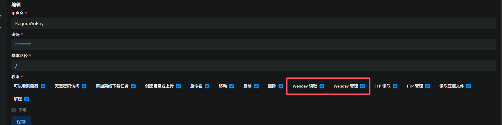
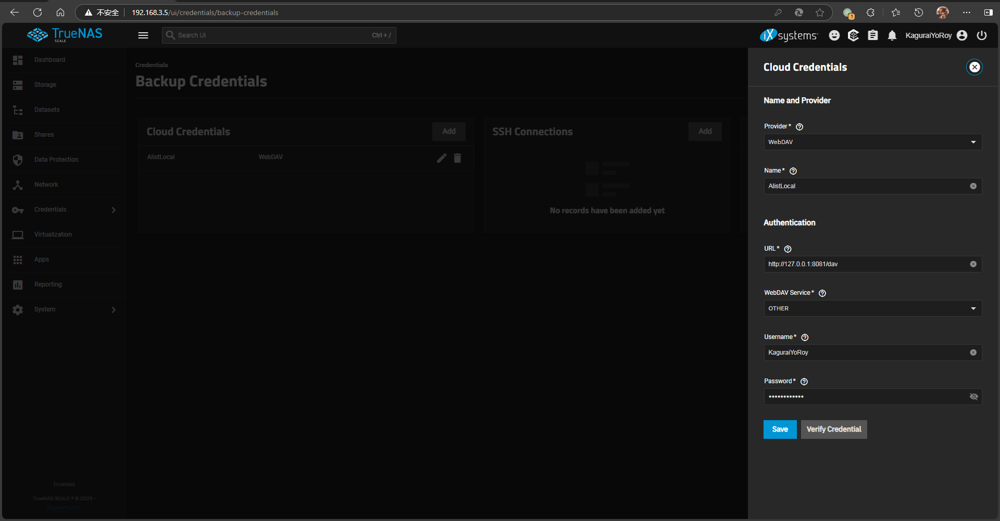
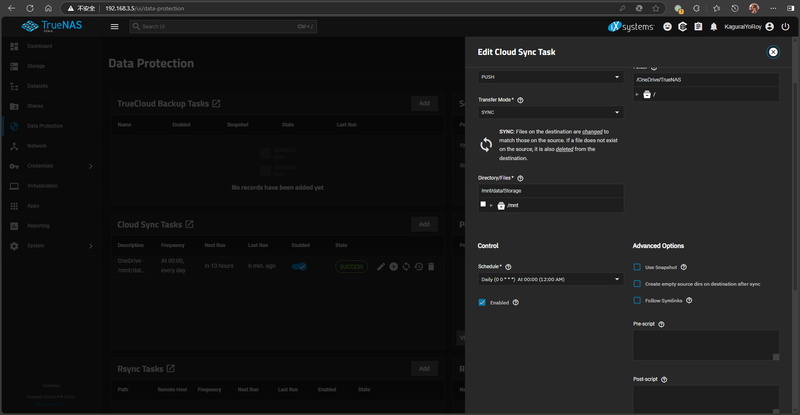

# Background
I have an E5 subscription and was originally using a solution involving running the **driveone/onedrive:edge** Docker container to achieve synchronization. However, this solution had drawbacks: firstly, it lacked a GUI/WebUI, and secondly, each sync operation would consume 25%-50% of CPU resources. Considering that TrueNAS's built-in sync solution can sync to WebDAV, I thought of using Alist to mount OneDrive and convert it into WebDAV for TrueNAS to mount.

# Process
## Installing Alist
Create a persistent storage folder for Alist and write a Docker Compose file according to the official Alist documentation:  

```yaml
services:
  alist:
    environment:
      - PUID=3000
      - PGID=950
      - UMASK=022
    image: xhofe/alist:latest
    ports:
      - '8088:5244'
    restart: always
    volumes:
      - /mnt/systemdata/DockerData/alist/etc:/opt/alist/data
      - /mnt/data/Storage:/mnt/data
```

Here, I exposed the Alist port on 8088. Mapping `/mnt/data/Storage` allows Alist to manage local storage; mapping `/mnt/systemdata/DockerData/alist/etc` serves as the folder for storing Alist data.  
Configuring OneDrive on Alist is not discussed in this article; please refer to the official Alist documentation. Here, I mounted my OneDrive at `/OneDrive`.  

After setup, go to the Alist admin panel -> Users, edit your user or create a new user, and check the **Webdav Read** and **Webdav Manage** permissions to enable WebDAV access for this user.



## Configuring TrueNAS Sync

Go to **TrueNAS Admin-Credentials-Backup Credentials**, and add a **Cloud Credential** with the following parameters:
* Provider: WebDAV
* Name: Custom
* URL: Alist address +/dav, e.g., I used `http://127.0.0.1:8088/dav`
* WebDAV Service: OTHER
* Username和Password: Alist account credentials



Verify the credential and save it if successful.

Next, go to **TrueNAS Admin -> Data Protection**, and add a **Cloud Sync Task**. Under **Provider**, select the WebDAV credential for Alist created earlier. The parameters are explained in detail below:
* Direction: Choose PULL (cloud to local) or PUSH (local to cloud)
* Transfer Mode:
  1. COPY: Copy files. Files deleted from the source folder later will not be deleted from the target.
  2. MOVE: Copy files and then delete them from the source folder after transfer.
  3. SYNC: Keep the source and target folders synchronized. Files deleted from the source will also be deleted from the target.
* Directory/Files: The local file or folder to sync.
* Folder: The target folder in the cloud storage.
* Description: Notes.
* Schedule: Set a schedule using Cron syntax. You can use predefined intervals or write your own.



For example, I selected PUSH, SYNC, syncing from `/mnt/data/Storage` to `/OneDrive/TrueNAS`, scheduled to run daily at 00:00.  

After editing, save the task. It will automatically upload local files to OneDrive at the scheduled time.  

----
Old Solution Project Address:
* https://github.com/abraunegg/onedrive

Reference Articles:
* https://alist.nn.ci/zh/guide/install/docker.html
* https://alist.nn.ci/zh/guide/drivers/onedrive.html
