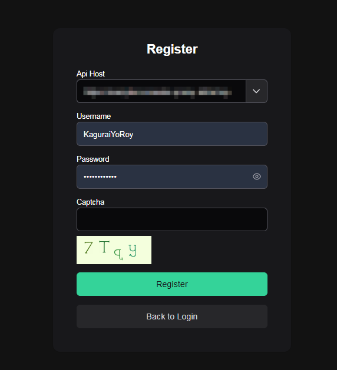
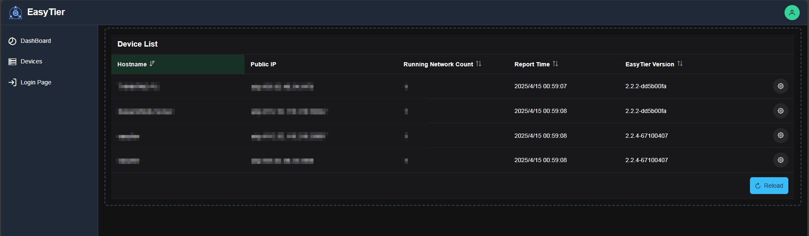
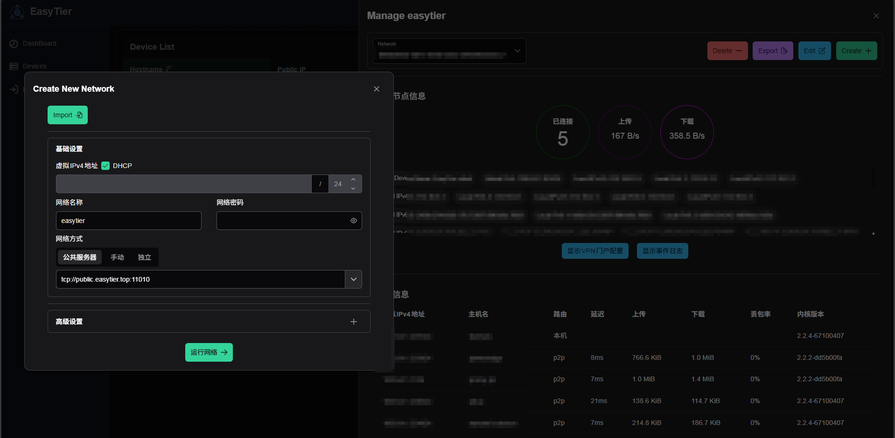

[EasyTier](https://easytier.cn) is inherently a decentralized P2P tool where any node can act as a relay server. However, each node's configuration file must be manually edited, which felt somewhat unfamiliar after migrating from Tailscale. Additionally, during the exploration phase, frequent configuration changes are often needed, leading to the decision to deploy EasyTier's Dashboard centrally for unified device management.  

Project Repository: https://github.com/easytier/easytier  

The official documentation doesn't explicitly provide a method for deploying the config-server separately, but it's actually quite straightforward, as the server component is already included in the downloaded binary file. This article focuses on installation via Docker Compose. For binary installation, please refer to the reference articles below.  

# Analysis
The dashboard deployment consists of two main parts: a backend RESTful API and a frontend web console. The **easytier-web-embed** binary found in the Releases provides both. Therefore, running this single binary enables the full functionality.

# Let's Get Started
## Deploying the API and Web Console
Deploying with Docker is straightforward.

Two ports need to be exposed:
1. `11211/tcp`: API interface, HTTP
2. `22020/udp`: For communication between clients (`easytier-core`) and the server.

Volume mapping is required for the container's `/app` folder to persist data.

The Compose file is as follows:
```yaml
services:
  easytier:
    restart: always
    hostname: easytier
    volumes:
      - /opt/easytier/api:/app
    ports:
      - "127.0.0.1:11211:11211"
      - "22020:22020/udp"
    environment:
      - TZ=Asia/Shanghai
    image: easytier/easytier:latest 
    entrypoint: easytier-web-embed
```

The image here is the same one used for deploying the client via Docker in the official documentation. The default entrypoint is **easytier-core**, so running the web API requires specifying the entrypoint as **easytier-web-embed**.
Since the API interface requires HTTPS, the `11211` port is not directly exposed to the public internet here. Instead, it's bound to `127.0.0.1` and then exposed via a reverse proxy with HTTPS.

## Setting up Reverse Proxy
I use 1Panel, so I simply created a new site in the panel and set up a reverse proxy to the configured API port.  

## Registering a Console Account
After deployment, open `https://your-domain.com` (if using the built-in console version, adding `/web/` is not necessary). Change the 'Api Host' to `https://your-domain.com`. Ensure there is no trailing "`/`" in the Api Host URL, otherwise, strange issues may occur. Click 'Register' below to create an account.



Then use this account to log in and access the console.

## Client Configuration
Remove all startup parameters for the client, keeping only `--config-server udp://your-ip:22020/your-username`. Run the `easytier-core` binary, and the device should appear in the console.



Click the settings button on the right, then click 'Create' to create a network for it. The subsequent steps are the same as in the local GUI mode and won't be detailed here. After saving, select the newly created network from the 'network' dropdown to join it.



Because Docker container data is lost on restart, when deploying the client in Docker, a file must be mapped to the container path `/usr/local/bin/et_machine_id` to save the machine ID. Otherwise, the network will need to be reconfigured after each restart. Additionally, setting the container's `hostname` can be used as the device name displayed in the web console.

Here is my compose file for the client:
```yaml
services:
  easytier:
    command: '--config-server udp://<ip>:22020/KaguraiYoRoy'
    environment:
      - TZ=Asia/Shanghai
    hostname: truenas
    image: easytier/easytier:latest
    labels:
      com.centurylinklabs.watchtower.enable: 'true'
    mem_limit: 0m
    network_mode: host
    privileged: True
    restart: always
    volumes:
      - >-
        /mnt/systemdata/DockerData/easytier/app/et_machine_id:/usr/local/bin/et_machine_id
  watchtower:
    command: '--interval 3600 --cleanup --label-enable'
    environment:
      - TZ=Asia/Shanghai
      - WATCHTOWER_NO_STARTUP_MESSAGE
    image: containrrr/watchtower
    restart: always
    volumes:
      - /var/run/docker.sock:/var/run/docker.sock
```

-----

References:
* https://blog.mitsea.com/1a57bda595c580088006c17d6ba2a744/
* https://github.com/EasyTier/EasyTier/issues/722
* https://github.com/EasyTier/EasyTier/issues/577
* https://github.com/EasyTier/EasyTier/pull/718