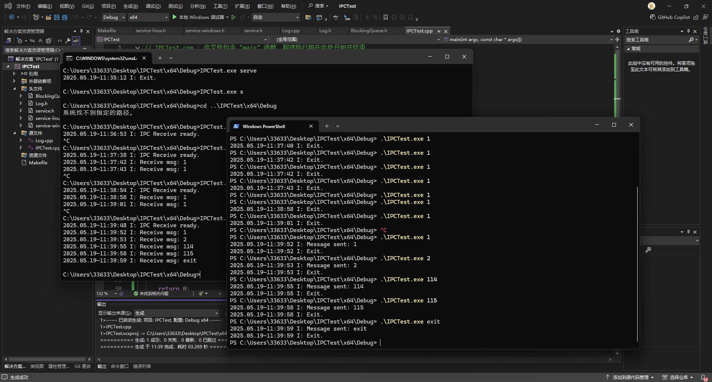
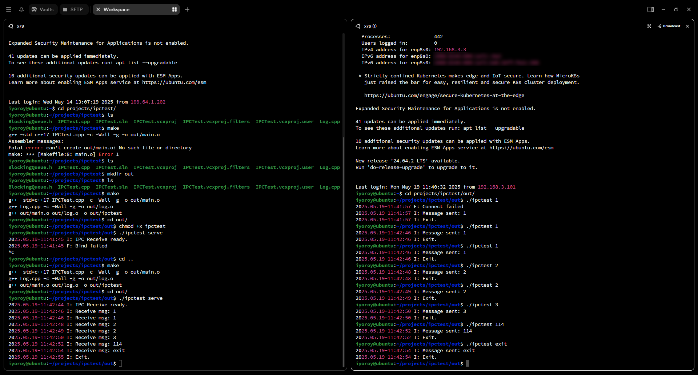

# Previously  
The previous article implemented unified log management. This article implements inter-process message communication, i.e., IPC.

# Analysis
## Windows
On Windows, inter-process communication is primarily achieved through **Pipes**. Pipes are further divided into **Named Pipes** and **Anonymous Pipes**. Anonymous pipes are **unidirectional** and are typically used for communication between a parent and child process<sup>[\[2\]](https://learn.microsoft.com/zh-cn/windows/win32/ipc/anonymous-pipes)</sup>. Named pipes, however, can be unidirectional or duplex and support one-to-many communication<sup>[\[3\]](https://learn.microsoft.com/zh-cn/windows/win32/ipc/named-pipes)</sup>. As the name implies, the only way to identify a named pipe is by its name, so two processes can communicate as long as they connect to the named pipe with the same name.   
We need to achieve bidirectional communication between processes, so we use named pipes. The general idea is: a process starts in server mode (receiver), creates a thread, creates a named pipe, and listens for messages within the pipe. When the pipe is connected, it reads data from it; when a process starts as a sender, it attempts to connect to a pipe with the same name and writes the message content.

## Linux
On Linux, **sockets** are typically used for inter-process communication. However, unlike listening on a port, IPC usually involves listening on a **sock file**<sup>[\[5\]](https://blog.csdn.net/dog250/article/details/100998838)</sup>. Common service applications like the Docker daemon and MySQL use this method.    
Thus, the general idea is as follows: a process started in server mode creates a socket listener and waits to receive messages from it; the sender connects to the socket and sends a message. Similar to the name of the named pipe mentioned above, the socket maps to a unique .sock file. The sender just needs to open this file to send the message. (In practice, it's not opened in the conventional file manner but using socket-specific methods<sup>[\[5\]](https://blog.csdn.net/dog250/article/details/100998838)</sup>.)

# Code Implementation
## Initialization
To use a common main codebase, I used the same approach as the previous article, differentiating system types via macro definitions, placing the Windows and Linux code in the header files `service-windows.h` and `service-linux.h` respectively:
```cpp
#ifdef _WIN32
#include "service-windows.h"
#elif defined(__linux__)
#include "service-linux.h"
#endif
```
When the receiver process starts, it creates a thread to handle message reception (using `std::thread` as the multithreading library):
```cpp
thread_bind = std::thread(bind_thread_main);
```

## Listener Section
### Windows
On Windows, we simply attempt to read data from a named pipe with a specified name. Because the pipe is set to **blocking mode** (i.e., `PIPE_WAIT` is set in the `DWORD dwPipeMode` parameter of `CreateNamedPipe` below), `ConnectNamedPipe` will be blocking, so there's no need to worry about performance loss from constant looping.

```cpp
void bind_thread_main() {
    while (!exit_requested.load()) {
        HANDLE hPipe = CreateNamedPipe(
            PIPE_NAME,
            PIPE_ACCESS_DUPLEX,
            PIPE_TYPE_MESSAGE | PIPE_READMODE_MESSAGE | PIPE_WAIT,
            PIPE_UNLIMITED_INSTANCES,
            1024,  // Output buffer size
            1024,  // Input buffer size
            0,     // Default timeout
            NULL);

        if (hPipe == INVALID_HANDLE_VALUE) {
            service_log.push(LEVEL_WARN, "Failed to create pipe: %d", GetLastError());
            continue;
        }

        if (ConnectNamedPipe(hPipe, NULL) ||
            GetLastError() == ERROR_PIPE_CONNECTED) {

            char buffer[1024];
            DWORD bytesRead;

            if (ReadFile(hPipe, buffer, sizeof(buffer) - 1, &bytesRead, NULL)) {
                buffer[bytesRead] = '\0';
                m_queueMsg.push(buffer);
                service_log.push(LEVEL_VERBOSE, "Message received: %s", buffer);
            }

            FlushFileBuffers(hPipe);
            DisconnectNamedPipe(hPipe);
            CloseHandle(hPipe);
        }
        else {
            CloseHandle(hPipe);
        }
    }
}
```

### Linux
To prevent creation failure, the code attempts to delete any leftover sock file that wasn't cleaned up before creation, i.e., `unlink(SOCKET_PATH)` in the code. `SOCKET_PATH` is a global variable defining the path to the socket file. When creating the socket, the family is specified as `AF_UNIX`, indicating a UNIX socket (the `.sock` file type; for network sockets it would be `AF_INET`). The timeval code sets a timeout limit. If the accept function waits longer than the set `SOCKET_TIMEOUT` (in seconds), it will automatically stop blocking and return an error. After creating the socket, proceed with the normal setup for binding and listening.  

```cpp
void bind_thread_main() {
    unlink(SOCKET_PATH);

    int server_fd = socket(AF_UNIX, SOCK_STREAM, 0);
    if (server_fd == -1) {
        service_log.push(LEVEL_FATAL, "Failed to create socket");
        exit_requested.store(true);
        return;
    }

    struct timeval tv;
    tv.tv_sec = SOCKET_TIMEOUT;
    tv.tv_usec = 0;
    setsockopt(server_fd, SOL_SOCKET, SO_RCVTIMEO, &tv, sizeof(tv));

    sockaddr_un addr{};
    addr.sun_family = AF_UNIX;
    strncpy(addr.sun_path, SOCKET_PATH, sizeof(addr.sun_path) - 1);

    if (bind(server_fd, (sockaddr*)&addr, sizeof(addr)) == -1) {
        service_log.push(LEVEL_FATAL, "Bind failed");
        close(server_fd);
        exit_requested.store(true);
        return;
    }

    if (listen(server_fd, 5) == -1) {
        service_log.push(LEVEL_FATAL, "Listen failed");
        close(server_fd);
        exit_requested.store(true);
        return;
    }

    while (!exit_requested.load()) {
        int client_fd = accept(server_fd, nullptr, nullptr);
        if (client_fd != -1) {
            char buffer[1024];
            int bytes_read = read(client_fd, buffer, sizeof(buffer) - 1);
            if (bytes_read > 0) {
                buffer[bytes_read] = '\0';
                m_queueMsg.push(buffer);
                service_log.push(LEVEL_VERBOSE, "Message received: %s", buffer);
            }
            close(client_fd);
        }
        else {
            if (errno == EWOULDBLOCK || errno == EAGAIN) {
                continue;
            }
            service_log.push(LEVEL_WARN, "Failed to accept socket connection");
        }
    }
}
```

After reading a message, both code versions save the message to the blocking queue `m_queueMsg`.

## Sender Section
### Windows
Open the specified pipe and write the message content:
```cpp
bool send_message(const std::string& msg) {
    if (!WaitNamedPipe(PIPE_NAME, NMPWAIT_WAIT_FOREVER)) {
        service_log.push(LEVEL_ERROR, "Failed to find valid pipe: %d", GetLastError());
        return false;
    }

    HANDLE hPipe = CreateFile(
        PIPE_NAME,
        GENERIC_WRITE,
        0,
        NULL,
        OPEN_EXISTING,
        0,
        NULL);

    if (hPipe == INVALID_HANDLE_VALUE) {
        service_log.push(LEVEL_ERROR, "Failed to connect: %d", GetLastError());
        return false;
    }

    DWORD bytesWritten;
    if (WriteFile(hPipe, msg.c_str(), (DWORD)msg.size(), &bytesWritten, NULL)) {
        service_log.push(LEVEL_VERBOSE, "Message sent: %s", msg.c_str());
        CloseHandle(hPipe);
        return true;
    }
    else {
        service_log.push(LEVEL_ERROR, "Message (%s) send failed: %d", msg.c_str(),GetLastError());
        CloseHandle(hPipe);
        return false;
    }

}
```

### Linux
Similarly, connect to the socket and send the data:  
```cpp
bool send_message(const std::string& msg) {
    int sock = socket(AF_UNIX, SOCK_STREAM, 0);
    if (sock == -1) {
        service_log.push(LEVEL_ERROR, "Failed to create socket");
        return false;
    }

    sockaddr_un addr{};
    addr.sun_family = AF_UNIX;
    strncpy(addr.sun_path, SOCKET_PATH, sizeof(addr.sun_path) - 1);

    if (connect(sock, (sockaddr*)&addr, sizeof(addr)) == -1) {
        service_log.push(LEVEL_ERROR, "Connect failed");
        close(sock);
        return false;
    }

    if (write(sock, msg.c_str(), msg.size()) == -1) {
        service_log.push(LEVEL_ERROR, "Message send failed: %s", msg.c_str());
        close(sock);
        return false;
    }
    else {
        service_log.push(LEVEL_VERBOSE, "Message sent success: %s", msg.c_str());
        close(sock);
        return true;
    }
}
```

## Cleanup
There's little to clean up on Windows, but on Linux, the socket file needs to be deleted:  
```cpp
unlink(SOCKET_PATH);
```

------

# Demo Screenshots
## Windows


## Linux


Sample code download:
[IPCTest.zip](/downloads/2025/05/3672377721.zip)

------
References:
1. https://learn.microsoft.com/zh-cn/windows/win32/ipc/pipes
2. https://learn.microsoft.com/zh-cn/windows/win32/ipc/anonymous-pipes
3. https://learn.microsoft.com/zh-cn/windows/win32/ipc/named-pipes
4. https://www.cnblogs.com/alantu2018/p/8493809.html
5. https://blog.csdn.net/dog250/article/details/100998838