While Cloudflare CDN's performance within mainland China leaves much to be desired, it remains highly capable for serving content to international audiences. However, Cloudflare phased out the traditional CNAME setup method some time ago. This article focuses on achieving a similar outcome using SaaS (SSL for SaaS) integration, which requires a credit card for activation.

# Prerequisites
1. A valid credit card (with card number, security code) or a linked PayPal account. Note: You will not be charged if you stay under the 100 custom hostname limit.
2. A Fallback Origin Domain – this must be different from your primary domain that visitors use to access your site (a requirement for Cloudflare setup).
3. Your Primary Domain (the domain your visitors use).

To implement separate DNS resolution for mainland China and other regions, the primary domain used for normal access should not be added to Cloudflare directly via the usual "Add a Site" method.  
In this guide, the primary domain is: `www.iyoroy.cn`, and the fallback domain is: `nekonya.cloud`.

# Process
## Adding the Fallback Domain to Cloudflare
Register a Cloudflare account and follow the standard procedure to change your domain's nameservers to Cloudflare's:
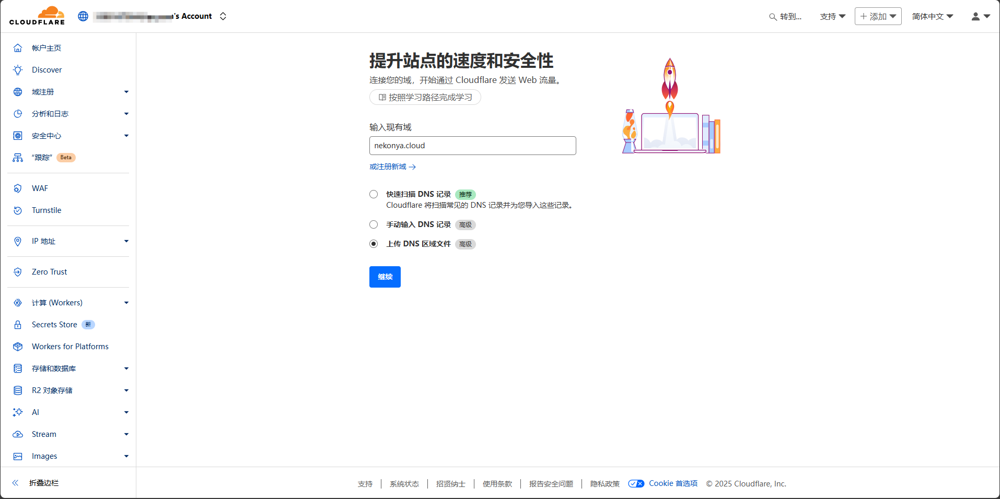

Select the **Free** plan:
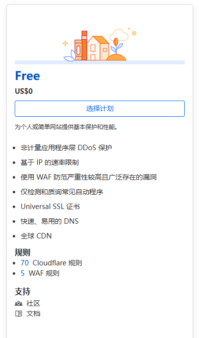

Update your domain's nameservers at your registrar as instructed:
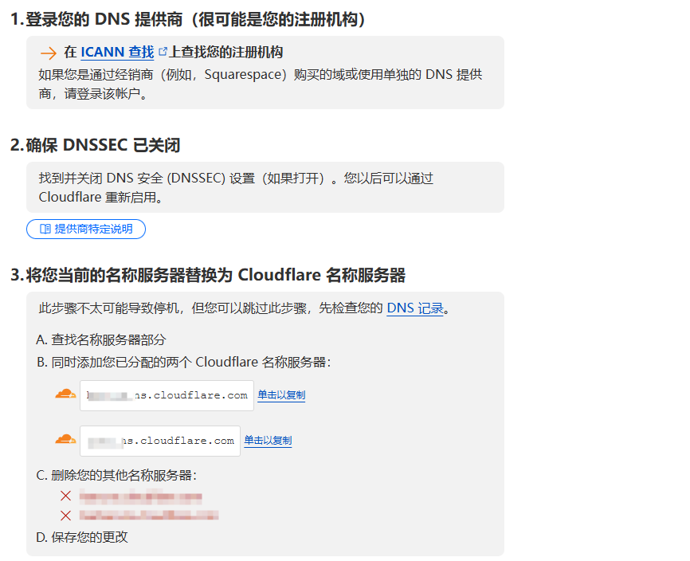

Wait for the nameserver changes to propagate. You can then manage the fallback domain's DNS through Cloudflare.

## Adding Payment Method & Enabling SaaS
Inside the Cloudflare dashboard for your fallback domain, navigate to **SSL/TLS** -> **Custom Hostnames**. Click **Enable Cloudflare for SaaS**:
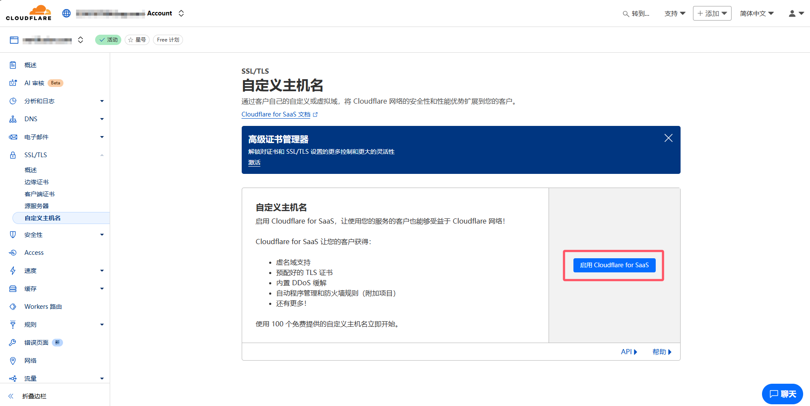

Enter your credit card information and save it. Then, proceed to activate the SaaS plan:
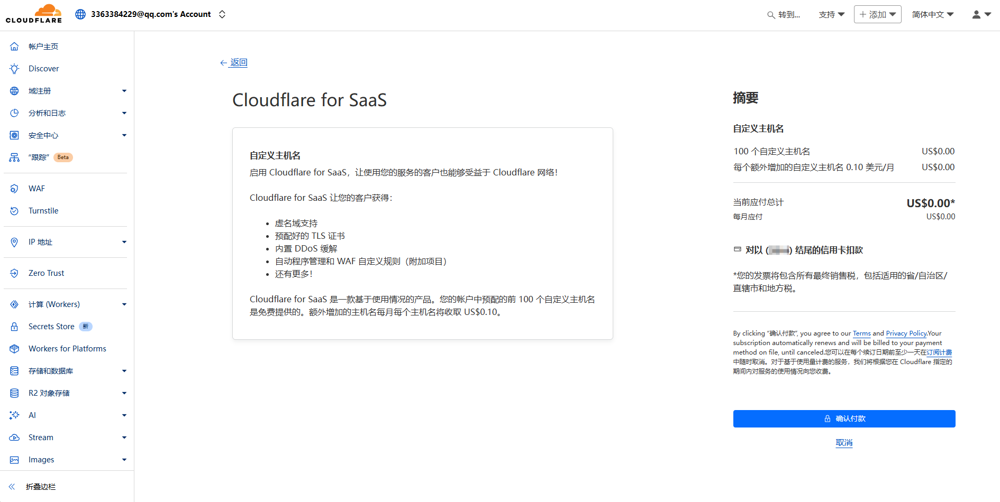

## Creating DNS Record for Fallback Origin & Setting up Custom Hostnames
Go to **DNS -> Records** in your fallback domain's dashboard. Create a new record pointing to your origin server:
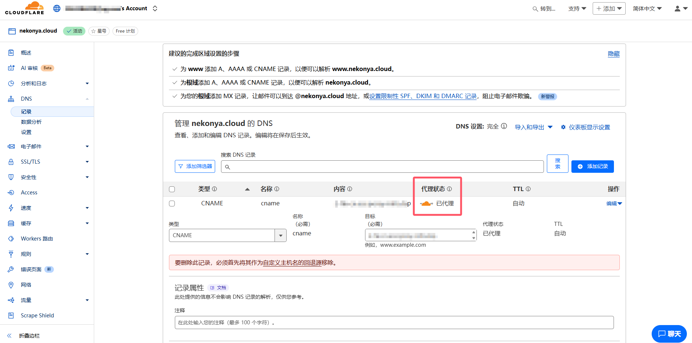
Here, my fallback origin is `cname.nekonya.cloud`, using a CNAME record (A or AAAA records are also perfectly valid). Ensure the orange-cloud proxy is enabled to utilize Cloudflare's CDN.

Next, go back to **SSL/TLS -> Custom Hostnames**. In the Fallback Origin field, enter the record you just created (e.g., `cname.nekonya.cloud`):  
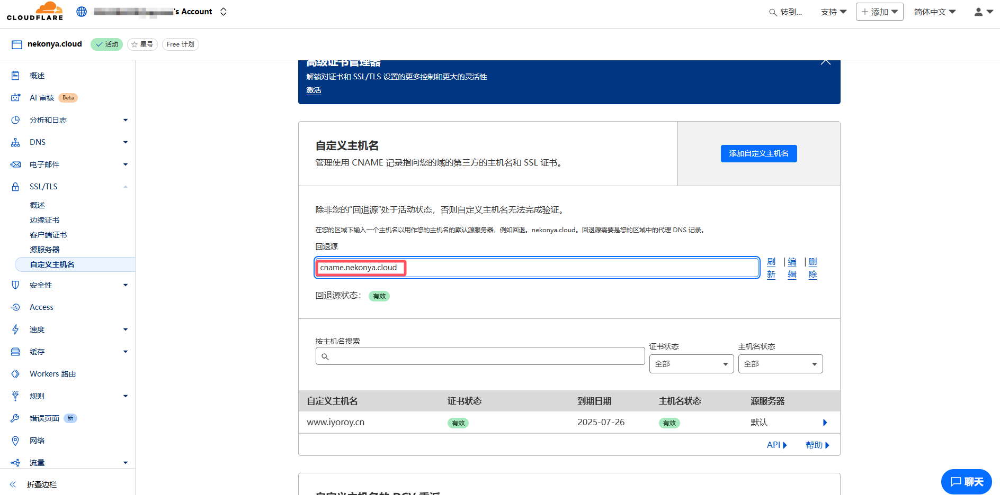

Click **Add Custom Hostname** and enter your primary domain that visitors will use:  
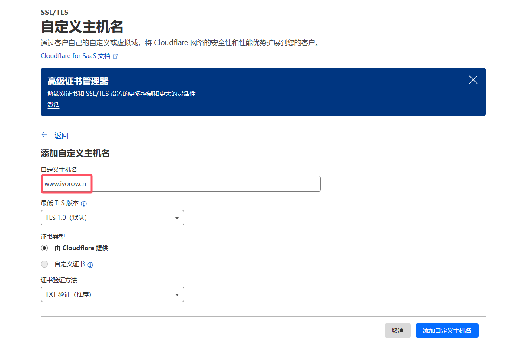
The TXT record method is recommended for **Domain Control Validation (DCV)**, as it allows for **DCV Delegation** (see the next section).

You will now need to verify ownership by adding the provided TXT record(s) to your primary domain's DNS (this example shows a test record for demonstration, as the actual one was already configured):  
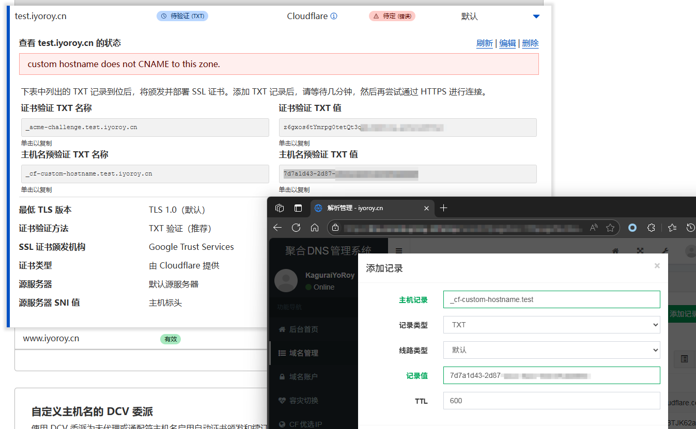
Because we will use DCV delegation for ongoing certificate validation in the next step, do not add the specific certificate validation records here yet. If you were not using DCV delegation, you would add those records now.

:::warning
Note: When adding certificate validation records, avoid refreshing the entire page, as the record contents might change. Use the refresh button within the options panel if needed.
:::

Once the hostname status changes to **Active**, you can safely remove the temporary TXT (and potentially CNAME) record(s) you added for the initial verification.

## Setting up DCV Delegation
Locate the **DCV Delegation for Custom Hostnames**section further down the same page. Copy the provided CNAME value. Go to your _primary domain_'s DNS management console and add a new **CNAME** record.
* **Hostname**: `_acme-challenge.www`(This depends on your primary domain. For `www.iyoroy.cn`, it's `_acme-challenge.www`. For `test.iyoroy.cn`, it would be `_acme-challenge.test`).
* **Value**: The value provided by Cloudflare, prefixed with your hostname (e.g., `www.iyoroy.cn.xxxxxxxx.dcv.cloudflare.com`).
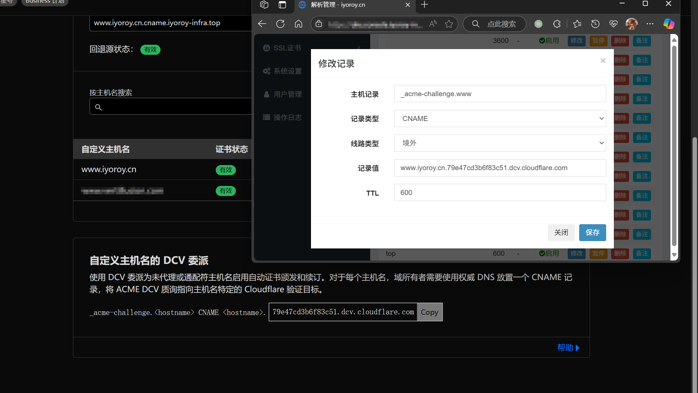

## Configuring CNAME Record for Traffic Routing
In your primary domain's DNS management console, add a CNAME record for the subdomain you are using (e.g., www). Configure your DNS provider's Geolocation or Split DNS features to ensure that:  

* Traffic from **outside mainland China** resolves to the Fallback Origin you set in Cloudflare (e.g., `cname.nekonya.cloud`).
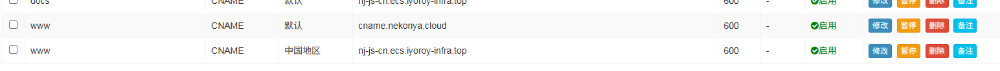

If everything is configured correctly, you should see both the Certificate Status and Hostname Status as **Active** in the Custom Hostnames section:
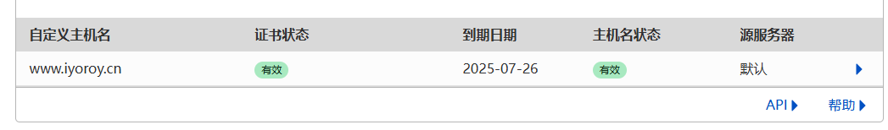

Testing confirms that traffic from outside China is now routed through Cloudflare:
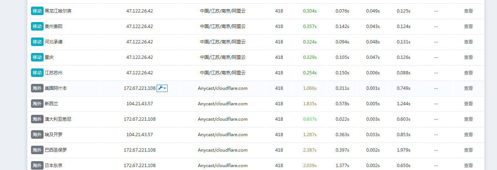

------
The DNS management system used in this article is [netcccyun/dnsmgr](https://github.com/netcccyun/dnsmgr)