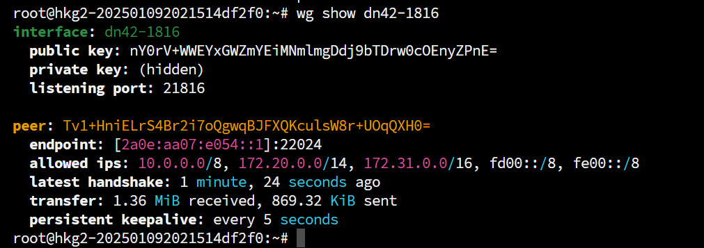

# Foreword
I am a novice in BGP. This article may contain **imprecise content/naive understandings/elementary mistakes**. I kindly ask the experts to be lenient. If you find any issues, you are welcome to contact me via [email](mailto:i@iyoroy.cn), and I will correct them as soon as possible. **If you find this unacceptable, it is recommended to close this article now.**  

> Welcome to peer with me! For details, please visit: [iYoRoy DN42 Network](https://www.iyoroy.cn/dn42.html)

I wanted to study BGP, but renting an ASN and IP block is too expensive, and I was afraid of [taking down half the internet due to a configuration error](https://blog.cloudflare.com/how-verizon-and-a-bgp-optimizer-knocked-large-parts-of-the-internet-offline-today/). So, I decided to look into DN42, a virtual network. DN42 is a large decentralized network that uses the BGP protocol for routing, making its structure very similar to today's internet. This makes it suitable for learning networking technologies like BGP. In DN42, everyone plays the role of an ISP (Internet Service Provider), peering with other users to join and participate in building the entire DN42 network. DN42 operates on `172.20.0.0/14` and `fd00::/8`, both of which are private address ranges, so it won't affect the clearnet.

# Registration
You need to know basic git commands, GPG, and Linux. It's also best to sign your commits with GPG.
If you have basic Git knowledge, you can refer to my commit: [Add AS4242422024 · d1f9046ecb - registry - dn42 git](https://git.dn42.dev/dn42/registry/commit/d1f9046ecbf358f5e45941f2e046c6a23db3ac45)

## Fork and Clone the DN42 Registry Git Repository
Register an account on [dn42 git](https://git.dn42.dev/) and Fork the [dn42/registry](https://git.dn42.dev/dn42/registry) repository. Clone your forked repository and enter it.

## Register a Contact
Create a file named `<Nickname>-DN42` under `data/person` and fill in the following content:
```plain
person:             <Nickname>
e-mail:             <Email Address>
pgp-fingerprint:    <GPG Key Fingerprint>
nic-hdl:            <NIC Handle>
mnt-by:             <Maintainer>
source:             DN42
```

* `person`: Nickname.
* `e-mail`: Email address.
* `pgp-fingerprint`: GPG key fingerprint, used for some authentication services.
* `nic-hdl`: [NIC handle](https://en.wikipedia.org/wiki/NIC_handle), points to the file itself, just use the current filename.
* `mnt-by`: Maintained by, points to the maintainer information from the **Register Maintainer** section below.
* `source`: Source, keep it as `DN42`.
* `www`: Optional, your website URL.


**Example**

[`data/person/IYOROY-DN42` @ dn42/registry@master](https://git.dn42.dev/dn42/registry/src/branch/master/data/person/IYOROY-DN42)
```plain
person:             Kagura iYoRoy
e-mail:             i@iyoroy.cn
www:                https://www.iyoroy.cn
pgp-fingerprint:    3ECCFFDEC2CB4CB8DA8089BE9AF2F2E03CE8FD67
nic-hdl:            IYOROY-DN42
mnt-by:             IYOROY-MNT
source:             DN42
```


## Register a Maintainer
Create a file `data/mntner/<Nickname>-MNT` and fill in the following content:
```plain
mntner:             <Nickname>-MNT
admin-c:            <Contact>
tech-c:             <Contact>
auth:               <Authentication Method>
mnt-by:             <Maintainer>
source:             DN42
```

* `mntner`: Maintainer name, generally the same as the filename.
* `admin-c`:  Administrator contact information, points to a file in the `person` folder, use the filename from the **Register Contact** section above.
* `tech-c`: Technical contact information, points to a file in the `person` folder, use the filename from the **Register Contact** section above.
* `auth`: Authentication method, supports pgp or ssh-key.
* `mnt-by`: Maintained by, generally points to the filename itself.
* `source`: Source, keep it as `DN42`.


**Example**

[`data/mntner/IYOROY-MNT` @ dn42/registry@master](https://git.dn42.dev/dn42/registry/src/branch/master/data/mntner/IYOROY-MNT)
```plain
mntner:             IYOROY-MNT
admin-c:            IYOROY-DN42
tech-c:             IYOROY-DN42
auth:               pgp-fingerprint 3ECCFFDEC2CB4CB8DA8089BE9AF2F2E03CE8FD67
mnt-by:             IYOROY-MNT
source:             DN42
```


## Register an ASN
On the clearnet, **4200000000 - 4294967294** is the reserved range for ASNs. DN42 uses **4242420000 - 4242429999**, and currently, **4242420000 - 4242423999** is open for registration.The official recommendation is not to manually find an available ASN but to use Burble's [DN42 Free ASN Explorer](https://explorer.burble.com/free#/asn) to select an available ASN for registration.   
After choosing your desired ASN, create a file `<ASN, including AS letters>` in `data/aut-num` and fill in the following content:
```plain
aut-num:            <ASN>
as-name:            <Autonomous System Name>
descr:              <Autonomous System Description>
admin-c:            <Administrator NIC Handle>
tech-c:             <Technical Contact NIC Handle>
mnt-by:             <Maintainer>
source:             DN42
```

* `aut-num`:  Your chosen ASN, **including the AS prefix**. It should be in the format AS424242xxxx.
* `as-name`: Autonomous System Name.
* `descr`: Autonomous System Description, can contain spaces.
* `admin-c`: Administrator contact information, points to a file in the `person` folder, use the filename from the **Register Contact** section above.
* `tech-c`: Technical contact information, points to a file in the `person` folder, use the filename from the **Register Contact** section above.
* `mnt-by`: Maintained by, points to the filename from the **Create Maintainer** section above.
* `source`: Source, keep it as `DN42`.


**示例**

[`data/aut-num/AS4242422024` @ dn42/registry@master](https://git.dn42.dev/dn42/registry/src/branch/master/data/aut-num/AS4242422024)
```plain
aut-num:            AS4242422024
as-name:            IYOROYNET-AS-DN42
descr:              iYoRoy DN42 Network
admin-c:            IYOROY-DN42
tech-c:             IYOROY-DN42
mnt-by:             IYOROY-MNT
source:             DN42
```


## Register an IPv4 Block and Add Route
_You can skip this section if you don't want to register IPv4_
The official provides a tool for finding available address blocks: [DN42 Free IPv4 Explorer](https://explorer.burble.com/free#/4).  It is also not recommended to manually specify but to use the available blocks found through the search tool.
DN42 also faces IPv4 address shortages, so please register according to your needs. Generally, a /27 block containing 30 usable IPv4 addresses is sufficient. For smaller networks, you can apply for /28 (14 usable addresses) and /29 (6 usable addresses). The largest block that can be directly applied for is /26, which is 62 addresses. Applying for /25, /24 requires submitting an application and waiting for review. For details, refer to: [DN42 Experimental Network: Intro and Registration (Updated 2022-12) - Lan Tian @ Blog](https://lantian.pub/en/article/modify-website/dn42-experimental-network-2020.lantian/)

After selecting your IPv4 block, create a file in `data/inetnum` named after the CIDR format of the IPv4 block, using `_` instead of `/` (e.g., if the applied IPv4 block is `172.20.234.224/28`, the filename is `172.20.234.224_28`), and fill in the content:
```plain
inetnum:            <First IPv4 Address in Block> - <Last IPv4 Address in Block>
cidr:               <IPv4 Block in CIDR Format>
netname:            <IPv4 Block Name>
descr:              <IPv4 Block Description>
country:            <Country Code for IPv4 Block>
admin-c:            <Administrator NIC Handle>
tech-c:             <Technical Contact NIC Handle>
mnt-by:             <Maintainer>
status:             ASSIGNED
source:             DN42
```
* `inetnum`: IPv4 address range, from the first address to the last address, connected with `-`.
* `cidr`: IPv4 block in CIDR format, **do not** replace `/` with `_`.
* `netname`: IPv4 block name, fill in as desired, no special requirements.
* `descr`: IPv4 block description, can contain spaces.
* `country`: Two-character country code from [ISO 3166](https://zh.wikipedia.org/wiki/ISO_3166), for China, fill in `CN`.
* `admin-c`: Administrator contact information, points to a file in the `person` folder, use the filename from the **Register Contact** section above.
* `tech-c`: Technical contact information, points to a file in the `person` folder, use the filename from the **Register Contact** section above.
* `mnt-by`: Maintained by, points to the filename from the **Create Maintainer** section above.
* `status`: Status, keep it as `ASSIGNED`.
* `source`: Source, keep it as `DN42`.


**Example**

[`data/inetnum/172.20.234.224_28` @ dn42/registry@master](https://git.dn42.dev/dn42/registry/src/branch/master/data/inetnum/172.20.234.224_28)
```plain
inetnum:            172.20.234.224 - 172.20.234.239
cidr:               172.20.234.224/28
netname:            IYOROYNET-DN42-V4
descr:              iYoRoy DN42 Network IPv4 Block
country:            CN
admin-c:            IYOROY-DN42
tech-c:             IYOROY-DN42
mnt-by:             IYOROY-MNT
status:             ASSIGNED
source:             DN42
```


Next, under `data/route`, create a file also named after the IPv4 block's CIDR format, using `_` instead of `/`, and fill in the content:
```plain
route:              <IPv4 Block in CIDR Format>
origin:             <ASN>
max-length:         <IPv4 Prefix Length>
mnt-by:             <Maintainer>
source:             DN42
```

* `route`: IPv4 block, fill in CIDR format, do not convert `/`.
* `origin`: ASN, needs to include `AS` prefix.
* `max-lenth`: Prefix Length, i.e., the number after `/` in the CIDR format.
* `mnt-by`: Maintained by, points to the filename from the **Create Maintainer** section above.
* `source`: Source, keep it as `DN42`.


**Example**

[`data/route/172.20.234.224_28` @ dn42/registry@master](https://git.dn42.dev/dn42/registry/src/branch/master/data/route/172.20.234.224_28)
```plain
route:              172.20.234.224/28
origin:             AS4242422024
max-length:         28
mnt-by:             IYOROY-MNT
source:             DN42
```


## Register an IPv6 Block and Add Route
_You can skip this section if you don't want to register IPv6_
Similarly, use the official tool to find available IPv6: [DN42 Free IPv6 Explorer ](https://explorer.burble.com/free#/6)。
After selecting the address block, create a file under `data/inet6num` named after the IPv6 block's CIDR format, using `_` instead of `/` (e.g., if the IPv6 block is `fd18:3e15:61d0::/48`, the filename is `fd18:3e15:61d0::_48`), and fill in the content:
```plain
inet6num:           <First IPv6 Address in Block> - <Last IPv6 Address in Block>
cidr:               <IPv6 Block in CIDR Format>
netname:            <IPv6 Block Name>
descr:              <IPv6 Block Description>
country:            <Country Code for IPv6 Block>
admin-c:            <Administrator NIC Handle>
tech-c:             <Technical Contact NIC Handle>
mnt-by:             <Maintainer>
status:             ASSIGNED
source:             DN42
```
* `inet6num`: IPv6 address range, from the first address to the last address, cannot use `::` shorthand, connected with -. For example, if my block is `fd18:3e15:61d0::/48`, I need to fill in `fd18:3e15:61d0:0000:0000:0000:0000:0000` - `fd18:3e15:61d0:ffff:ffff:ffff:ffff:ffff`.
* `cidr`: IPv6 block in CIDR format, **do not** replace `/` with `_`.
* `netname`: IPv6 block name, fill in as desired, no special requirements
* `descr`: IPv6 block description, can contain spaces
* `country`: Two-character country code from [ISO 3166](https://zh.wikipedia.org/wiki/ISO_3166), for China, fill in `CN`.
* `admin-c`: Administrator contact information, points to a file in the `person` folder, use the filename from the **Register Contact** section above.
* `tech-c`: Technical contact information, points to a file in the `person` folder, use the filename from the **Register Contact** section above.
* `mnt-by`: Maintained by, points to the filename from the **Create Maintainer** section above.
* `status`: Status, keep it as `ASSIGNED`.
* `source`: Source, keep it as `DN42`.


**Example**

[`data/inet6num/fd18:3e15:61d0::_48` @ dn42/registry@master](https://git.dn42.dev/dn42/registry/src/branch/master/data/inet6num/fd18:3e15:61d0::_48)
```plain
inet6num:           fd18:3e15:61d0:0000:0000:0000:0000:0000 - fd18:3e15:61d0:ffff:ffff:ffff:ffff:ffff
cidr:               fd18:3e15:61d0::/48
netname:            IYOROYNET-DN42-V6
descr:              iYoRoy DN42 Network IPv6 Block
country:            CN
admin-c:            IYOROY-DN42
tech-c:             IYOROY-DN42
mnt-by:             IYOROY-MNT
status:             ASSIGNED
source:             DN42
```


Next, under `data/route6`, create a file also named after the IPv6 block's CIDR format, using `_` instead of `/`, and fill in the content:
```plain
route6:             <IPv6 Block in CIDR Format>
origin:             <ASN>
max-length:         <IPv6 Prefix Length>
mnt-by:             <Maintainer>
source:             DN42
```

* `route6`: IPv6 block, fill in CIDR format, do not convert `/`.
* `origin`: ASN, needs to include `AS` prefix.
* `max-lenth`: Prefix Length, i.e., the number after `/` in the CIDR format.
* `mnt-by`: Maintained by, points to the filename from the **Create Maintainer** section above.
* `source`: Source, keep it as `DN42`.


**Example**

[`data/route6/fd18:3e15:61d0::_48` @ dn42/registry@master](https://git.dn42.dev/dn42/registry/src/branch/master/data/route6/fd18:3e15:61d0::_48)
```plain
route6:             fd18:3e15:61d0::/48
origin:             AS4242422024
max-length:         48
mnt-by:             IYOROY-MNT
source:             DN42
```


## Create and Push Commit, Submit PR
> It's best to sign your commits with GPG and upload your public key to dn42 git.

After filling in the above information, return to the root directory of the repository and run the script `./fmt-my-stuff <Maintainer>` to automatically format the configuration files. Note: Here `<Maintainer>` is the value of mntner from the **Register Maintainer** chapter. Then follow the normal git commit process: `git add data/`, `git commit -S -m "<commit-msg>"` to create the commit, `git push origin master` to push. Then, go to the dn42 git web interface, open your forked repository, and submit a Pull Request.  
If there are configuration issues, the automated review bot and administrators will inform you. Please patiently modify according to the requirements and **merge into the original commit, do not create a new commit**. It is recommended to use `git commit --amend` after `git add`. After modification, **force push directly (`git push origin master --force`)**.  

**The working language of the DN42 Registry is English. Please use English for the entire process to avoid unnecessary trouble.**

# Configuring Bird
First, install bird. Using Ubuntu 22.04 as an example:
```bash
apt install bird2 -y
```
If you also want to install WireGuard for later use, add the wireguard and wireguard-tools packages:
```bash
apt install bird2 wireguard wireguard-tools -y
```

## Create Configuration Files

### bird.conf
Modify `/etc/bird/bird.conf`：
```nginx
define OWNAS       = <AS Number>;
define OWNIP       = <DN42 IPv4 Address>;
define OWNIPv6     = <DN42 IPv6 Address>;
define OWNNET      = <DN42 IPv4 Block, CIDR Format>;
define OWNNETv6    = <DN42 IPv6 Block, CIDR Format>;
define OWNNETSET   = [ <DN42 IPv4 Block, CIDR Format>+ ];
define OWNNETSETv6 = [ <DN42 IPv6 Block, CIDR Format>+ ];

router id OWNIP;

protocol device {
    scan time 10;
}

function is_self_net() {
    return net ~ OWNNETSET;
}

function is_self_net_v6() {
    return net ~ OWNNETSETv6;
}

function is_valid_network() {
    return net ~ [
        172.20.0.0/14{21,29}, # dn42
        172.20.0.0/24{28,32}, # dn42 Anycast
        172.21.0.0/24{28,32}, # dn42 Anycast
        172.22.0.0/24{28,32}, # dn42 Anycast
        172.23.0.0/24{28,32}, # dn42 Anycast
        172.31.0.0/16+,       # ChaosVPN
        10.100.0.0/14+,       # ChaosVPN
        10.127.0.0/16{16,32}, # neonetwork
        10.0.0.0/8{15,24}     # Freifunk.net
    ];
}

function is_valid_network_v6() {
  return net ~ [
    fd00::/8{44,64} # ULA address space as per RFC 4193
  ];
}

protocol kernel {
    scan time 20;

    ipv6 {
        import none;
        export filter {
            if source = RTS_STATIC then reject;
            krt_prefsrc = OWNIPv6;
            accept;
        };
    };
};

protocol kernel {
    scan time 20;

    ipv4 {
        import none;
        export filter {
            if source = RTS_STATIC then reject;
            krt_prefsrc = OWNIP;
            accept;
        };
    };
}

protocol static {
    route OWNNET reject;

    ipv4 {
        import all;
        export none;
    };
}

protocol static {
    route OWNNETv6 reject;

    ipv6 {
        import all;
        export none;
    };
}

include "rpki.conf";
include "ebgp.conf";
```

Here, the `OWNIP` and `OWNIPV6` parameters refer to the DN42 IPv4 and IPv6 addresses assigned to this machine, not the address of the block. For example, if I obtained the address segment `172.20.234.224/28` and assigned `172.20.234.225` to machine A, then OWNIP is `172.20.234.225`. The same applies to IPv6.

### rpki.conf
You might have seen other tutorials using cron jobs + reloading Bird to update ROAs. Configuring RPKI here is another way to configure ROAs.

Create `/etc/bird/rpki.conf` and fill in the following content:
```nginx
roa4 table dn42_roa;
roa6 table dn42_roa_v6;

protocol rpki dn42_rpki_akix {
    roa4 { table dn42_roa; };
    roa6 { table dn42_roa_v6; };
    remote "<rpki server address>" port 8082; # change it
    refresh 30;
    retry 5;
    expire 600;
}
```

For the RPKI server, you can use the service provided by my friend's AkaereIX: `rpki.akae.re`.


**Example**

```nginx
roa4 table dn42_roa;
roa6 table dn42_roa_v6;

protocol rpki dn42_rpki_akix {
    roa4 { table dn42_roa; };
    roa6 { table dn42_roa_v6; };
    remote "rpki.akae.re" port 8082;
    refresh 30;
    retry 5;
    expire 600;
}
```


### ebgp.conf
Create `/etc/bird/ebgp.conf` and fill in the following content:
```nginx
template bgp dnpeers {
    local as OWNAS;
    path metric 1;

    ipv4 {
        import filter {
            if is_valid_network() && !is_self_net() then {
                if (roa_check(dn42_roa, net, bgp_path.last) != ROA_VALID) then {
                    print "[dn42] ROA check failed for ", net, " ASN ", bgp_path.last;
                    reject;
                }
                accept;
            }
            reject;
        };

        export filter {
            if is_valid_network() && source ~ [RTS_STATIC, RTS_BGP] then accept;
            reject;
        };
        import limit 1000 action block;
    };

    ipv6 {
        import filter {
            if is_valid_network_v6() && !is_self_net_v6() then {
                if (roa_check(dn42_roa_v6, net, bgp_path.last) != ROA_VALID) then {
                    print "[dn42] ROA check failed for ", net, " ASN ", bgp_path.last;
                    reject;
                }
                accept;
            }
            reject;
        };
        export filter {
            if is_valid_network_v6() && source ~ [RTS_STATIC, RTS_BGP] then accept;
            reject;
        };
        import limit 1000 action block;
    };
}


include "peers/*";
```

This configuration defines a template for peering within DN42 and references all configuration files under `/etc/bird/peers`. Later, when we peer, we only need to create configuration files here according to the template and write them.

Create the `/etc/bird/peers` folder for subsequent peering.

# System Configuration
## Kernel
Because each node may act as a router for other nodes, Linux kernel packet forwarding needs to be enabled. Also, because WireGuard is used, which doesn't forward through physical network cards, the `rp_filter` strict mode needs to be disabled.
```shell
echo "net.ipv4.ip_forward=1" >> /etc/sysctl.conf
echo "net.ipv6.conf.default.forwarding=1" >> /etc/sysctl.conf
echo "net.ipv6.conf.all.forwarding=1" >> /etc/sysctl.conf
echo "net.ipv4.conf.default.rp_filter=0" >> /etc/sysctl.conf
echo "net.ipv4.conf.all.rp_filter=0" >> /etc/sysctl.conf
sysctl -p
```

## DN42 Virtual Network Interface
Because MP-BGP typically uses LLA addresses to establish BGP sessions, we need to set up a dummy network interface in the system and bind the DN42 IP we assigned to this machine. Run the following commands:
```bash
ip link add dn42 type dummy
ip addr add <DN42 IPv4 assigned to this machine> dev dn42
ip addr add <DN42 IPv6 assigned to this machine> dev dn42
```

If persistent configuration is needed, you can refer to the following three methods:


### systemd-networkd

```bash
tee /etc/systemd/network/10-dn42.netdev > /dev/null <<EOF
[NetDev]
Name=dn42
Kind=dummy
EOF

tee /etc/systemd/network/20-dn42.network > /dev/null <<EOF
[Match]
Name=dn42

[Network]
Address=<DN42 IPv4 assigned to this machine>/32
Address=<DN42 IPv6 assigned to this machine>/128
EOF

systemctl enable systemd-networkd
systemctl restart systemd-networkd
```


### netplan

```bash
tee /etc/netplan/99-dn42.yaml > /dev/null <<EOF
network:
  version: 2
  renderer: networkd
  ethernets:
    dn42:
      match:
        name: dn42
      addresses:
        - <DN42 IPv4 assigned to this machine>/32
        - "<DN42 IPv6 assigned to this machine>/128"
      accept-ra: no
EOF

netplan apply
```


### /etc/network/interfaces

```bash
tee -a /etc/network/interfaces > /dev/null <<EOF
auto dn42
iface dn42 inet static
    address <DN42 IPv4 assigned to this machine>
    netmask 255.255.255.255

iface dn42 inet6 static
    address <DN42 IPv6 assigned to this machine>/128
EOF

ifup dn42
```


# Peering with Other Members
A user-friendly option for beginners is Potat0's self-service peering service. For details, refer to his [DN42 Network](https://dn42.potat0.cc/) page. Follow the instructions to find his [Automatic Peering Bot](https://t.me/Potat0_DN42_Bot), register your account with the bot by providing your DN42 ASN, the email recorded in the Maintainer during registration above (this is why it's best to fill in the email during registration, as many verification services use it), and receive the verification code with that email. Then, follow the bot's requirements to establish the peer. 

## Install WireGuard
```shell
apt install wireguard wireguard-tools -y
```
Note: Modern package managers usually automatically install `wireguard-tools` when installing wireguard to use the `wg-quick` command.  

## Generate Key Pair
```shell
wg genkey | tee privatekey | wg pubkey > publickey
```
Note down the contents of privatekey and publickey, representing the private and public keys respectively.

## Establishing a Peer
Generally, there are two modes for establishing a peer: using MP-BGP (Multiprotocol BGP) and not using MP-BGP. Personally, I find MP-BGP more common because its configuration is relatively simple. The configurations are slightly different, so please refer according to your needs.

### Using MP-BGP
#### Exchanging Information with the Peer
You need to provide the other party with the following information, and you also need to know the other party's corresponding information:
* Public Key
* Public IP Address (non-DN42 address)
* Public WireGuard Port, usually listening on the **last 5 digits** of the other party's ASN
* DN42 ASN
* LLA (Link-Local Address), generally `fe80::<last 4 digits of peer's ASN>`
* Whether ENH (Extended Next Hop) is supported. Note: If using v6 to exchange routes without enabling ENH, v4 routes cannot be exchanged.

Sometimes the public IP address and public WG port are combined and called the Endpoint.  

#### Configuring WireGuard
Create a configuration file under `/etc/wireguard`. The name is arbitrary, but my naming convention is `dn42-<last 4 digits of peer's ASN>.conf`, where dn42-xxxx is the tunnel name. Fill the file with the following content:
```ini
[Interface]
PrivateKey = <Private key generated in the "Generate Key Pair" section above>
ListenPort = <Public WireGuard Listen Port>
Table = off
Address = <Your LLA Address>/64
PostUp = sysctl -w net.ipv6.conf.%i.autoconf=0

[Peer]
PublicKey = <Peer's Public Key>
Endpoint = <Peer's Endpoint, i.e., IP:Port>
AllowedIPs = 10.0.0.0/8, 172.20.0.0/14, 172.31.0.0/16, fd00::/8, fe00::/8
```

After editing and saving, run:

```bash
wg-quick up <Tunnel Name>
```

This will start the WG tunnel. Use `wg show <Tunnel Name>` to check the connection status. Running `wg` directly shows the status of all tunnels.



If you want the tunnel to start automatically on boot, run:  
```bash
systemctl enable wg-quick@<Tunnel Name>
```

#### Configuring the Bird2 Peer Section
Create a new file `<Name>.conf` under `/etc/bird/peers` and fill in the following content:
```ini
protocol bgp <BGP Session Name> from dnpeers{
    neighbor <Peer's LLA Address> % '<WireGuard Tunnel Name>' as <Peer's ASN, without AS prefix>;
};
```

If Extended Next Hop is used (as negotiated during information exchange above), configure:
```ini
protocol bgp <BGP Session Name> from dnpeers{
    neighbor <Peer's LLA Address> % '<WireGuard Tunnel Name>' as <Peer's ASN, without AS prefix>;
    ipv4{
        extended next hop;
    };
};
```

#### Applying Configuration
Run `birdc configure` (or `birdc c`, equivalent) to reload the Bird configuration, then run `birdc show protocols` (or `birdc s p`, equivalent) to view the currently established BGP connections.
```plain
root@hkg2-202501092021514df2f0:~# birdc show protocols
BIRD 2.0.12 ready.
Name       Proto      Table      State  Since         Info
device1    Device     ---        up     07:24:14.255  
static1    Static     dn42_roa   up     07:24:14.255  
static2    Static     dn42_roa_v6 up     07:24:14.255  
kernel1    Kernel     master6    up     07:24:14.255  
kernel2    Kernel     master4    up     07:24:14.255  
static3    Static     master4    up     07:24:14.255  
static4    Static     master6    up     07:24:14.255  
dn42-0298  BGP        ---        up     08:03:13.347  Established   
dn42-1816  BGP        ---        up     07:53:05.028  Established
```

### Not Using MP-BGP
#### Exchanging Information with the Peer
You need to provide the other party with the following information, and you also need to know the other party's corresponding information:

* Public Key
* Public IP Address (non-DN42 address)
* Public WireGuard Port, usually listening on the **last 5 digits** of the other party's ASN
* DN42 ASN
* DN42 IP, if exchanging IPv4 routes, an IPv4 address is needed; if exchanging IPv6 routes, an IPv6 address is needed.

Sometimes the public IP address and public WG port are combined and called the Endpoint.

#### Configuring WireGuard
Create a configuration file under `/etc/wireguard`. The name is arbitrary, but my naming convention is `dn42-<last 4 digits of peer's ASN>.conf`, where dn42-xxxx is the tunnel name. Fill the file with the following content:  
```ini
[Interface]
PrivateKey = <Private key generated in the "Generate Key Pair" section above>
ListenPort = <Public WireGuard Listen Port>
Table = off
PostUp = ip addr add <LLA>/64 dev %i
PostUp = ip addr add <Local DN42 IPv6> dev %i
PostUp = ip addr add <Local DN42 IPv4> peer <Peer's DN42 IPv4> dev %i
PostUp = sysctl -w net.ipv6.conf.%i.autoconf=0

[Peer]
PublicKey = <Peer's Public Key>
Endpoint = <Peer's Endpoint, i.e., IP:Port>
AllowedIPs = 10.0.0.0/8, 172.20.0.0/14, 172.31.0.0/16, fd00::/8, fe00::/8
```

After editing and saving, run: 

```bash
wg-quick up <Tunnel Name>
```

This will start the WG tunnel. Use `wg show <Tunnel Name>` to check the connection status. Running `wg` directly shows the status of all tunnels.

If you want the tunnel to start automatically on boot, run:
```bash
systemctl enable wg-quick@<Tunnel Name>
```

#### Configuring the Bird2 Peer Section
Create a new file `<Name>.conf` under `/etc/bird/peers` and fill in the following content:
```ini
protocol bgp <v4 BGP Session Name> from dnpeers{
    neighbor <Peer's DN42 IPv4 Address> as <Peer's ASN, without AS prefix>;
    direct;
    ipv6{
        import none;
        export none;
    };
};

protocol bgp <v6 BGP Session Name> from dnpeers{
    neighbor <Peer's DN42 IPv6 Address> % '<WireGuard Tunnel Name>' as <Peer's ASN, without AS prefix>;
    direct;
    ipv4{
        import none;
        export none;
    };
};
```

#### Applying Configuration
Run `birdc configure` (or `birdc c`, equivalent) to reload the Bird configuration, then run `birdc show protocols` (or `birdc s p`, equivalent) to view the currently established BGP connections.

At this point, we have successfully joined the DN42 network. To make the network more stable, we can peer with more users, establishing multiple BGP lines to prevent disconnection if some nodes fail. You can join the [DN42 Unofficial Telegram Group](https://t.me/Dn42Chat) for more information.

If BGP is Established but you cannot Ping internal DN42 IPs, check if the IP set in bird.conf matches the IP assigned to the dummy interface or the local IP in WireGuard.

## Configuring DNS
DN42 has its own public DNS with the anycast address `172.20.0.53`, which can also resolve normal internet domains. To access internal domains ending with **.dn42**, you need to put this address at the top of resolv.conf:
```ini
nameserver 172.20.0.53
nameserver 223.5.5.5 # Below are normal DNS server configurations
```

After this, you can resolve DN42 internal domain names. Also, commands like `ping`, `traceroute`, and `mtr` will show rDNS resolution results when querying internal IPs.

---- 
> Welcome to peer with me! For details, please visit: [iYoRoy DN42 Network](https://www.iyoroy.cn/dn42.html)

References:
* https://blog.baoshuo.ren/post/dn42-network/
* https://dn42.dev/howto/Bird2#example-configuration
* https://dn42.eu/howto/wireguard
* https://blog.udon.eu.org/archives/dbf21067.html
* https://blog.byteloid.one/2025/06/02/babeld-over-wireguard/
* https://blog.wcysite.com/2021/%E8%B8%A9%E5%9D%91DN42-p2-peer/
* https://blog.chs.pub/p/23-14-joindn42/
* https://www.cnblogs.com/FengZeng666/p/15583434.html