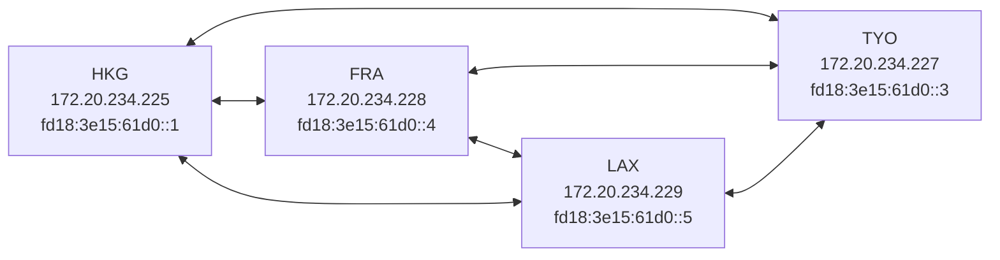

# Basic Information

* ASN: **4242422024**
* Network Name: **iYoRoy DN42 Network**
* Maintainer: **[IYOROY-MNT](https://explorer.burble.com/#/mntner/IYOROY-MNT)**
* IPv4 Block: **172.20.234.224/28**
* IPv6 Block: **fd18:3e15:61d0::/48**
* DN42 Domain: **yori.dn42**

# Nodes

> Looking Glass: [iYoRoy DN42 Network Looking Glass](https://lg.iyoroy.cn)

## Topology

## HKG - Hong Kong, China
* Server Provider: MoeDove
* Endpoint: `hkg02-cn.ecs.iyoroy-infra.top`
* Support both IPv4 and IPv6
* For IPv4/IPv6 only, please use ipv4/ipv6.hkg02-cn.ecs.iyoroy-infra.top
* DN42 IPv4: `172.20.234.225`
* DN42 IPv6: `fd18:3e15:61d0::1`
* IPv6 Link-Local: `fe80::2024/64`
* WireGuard Public Key: `bg+KnzVupBrOQntHFFVzvBx+3sqYVoyJRantT6m5fm8=`
* WireGuard Listen Port: Last 5 digits of your ASN
* Peer with Chinese Mainland is prohibited

## TYO - Tokyo, Japan
* Server Provider: Lycheen
* Endpoint: `tyo-jp.ecs.iyoroy-infra.top`
* Support both IPv4 and IPv6
* For IPv4/IPv6 only, please use ipv4/ipv6.tyo-jp.ecs.iyoroy-infra.top
* DN42 IPv4: `172.20.234.227`
* DN42 IPv6: `fd18:3e15:61d0::3`
* IPv6 Link-Local: `fe80::2024/64`
* WireGuard Public Key: `Sh62ZCxnEcXyLq49mLP1jF4C2vWKhKMxjtZHxVUAQg4=`
* WireGuard Listen Port: Last 5 digits of your ASN
* Peer with Chinese Mainland is prohibited

## FRA01 - Frankfurt, Germany
* Server Provider: Vultr
* Endpoint: `fra01-de.ecs.iyoroy-infra.top`
* Support both IPv4 and IPv6
* For IPv4/IPv6 only, please use ipv4/ipv6.fra01-de.ecs.iyoroy-infra.top
* DN42 IPv4: `172.20.234.228`
* DN42 IPv6: `fd18:3e15:61d0::4`
* IPv6 Link-Local: `fe80::2024/64`
* WireGuard Public Key: `4zEFOrqHdIDPcjvu6NwbE1AAYBH1bA+SAowysX5fRT4=`
* WireGuard Listen Port: Last 5 digits of your ASN
* Peer with Chinese Mainland is prohibited

## LAX - Los Angeles, United Stats
* Server Provider: VMISS
* Endpoint: `lax-us.ecs.iyoroy-infra.top`
* Support both IPv4 and IPv6
* IPv6 Provided by Hurricane Electric IPv6 TunnelBroker. Please test before set up.
* For IPv4/IPv6 only, please use ipv4/ipv6.lax-us.ecs.iyoroy-infra.top
* DN42 IPv4: `172.20.234.229`
* DN42 IPv6: `fd18:3e15:61d0::5`
* IPv6 Link-Local: `fe80::2024/64`
* WireGuard Public Key: `As0rZo5b9Bwt4loPGl6iSdtOqkd2p6ExK/Xyoy9OmTU=`
* WireGuard Listen Port: Last 5 digits of your ASN
* Peer with Chinese Mainland is prohibited

# Features
* Multi Protocol BGP
* Extended Next Hop

# Contact
* E-mail:[i@iyoroy.cn](mailto:i@iyoroy.cn)(Preferred) [yorisocute233@gmail.com](mailto:yorisocute233@gmail.com)